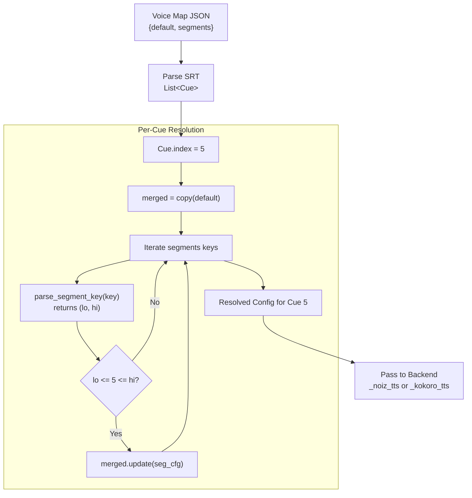
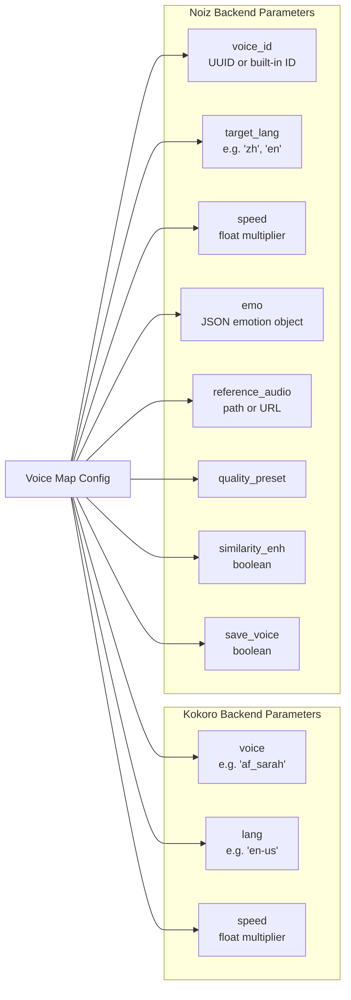
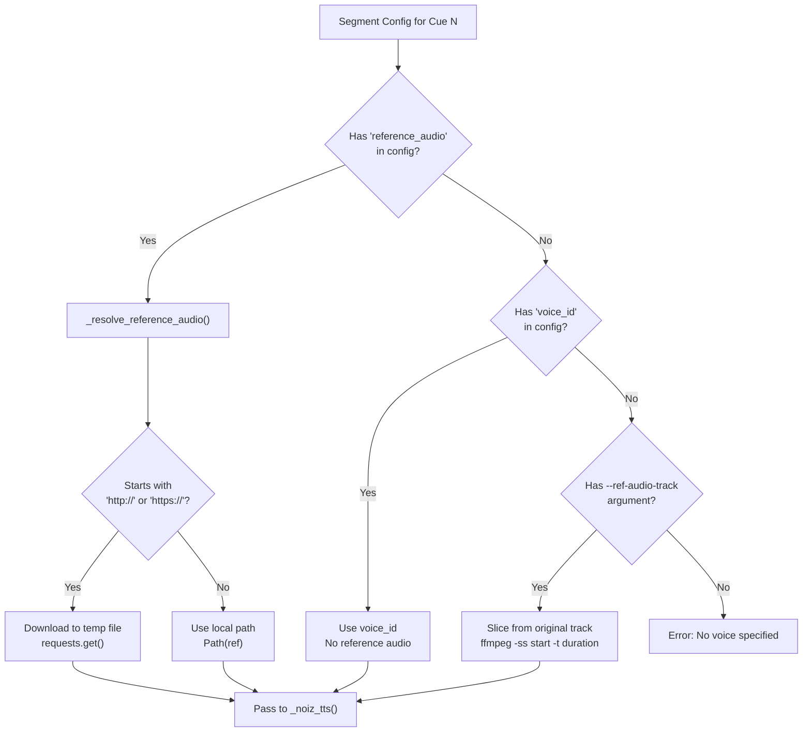
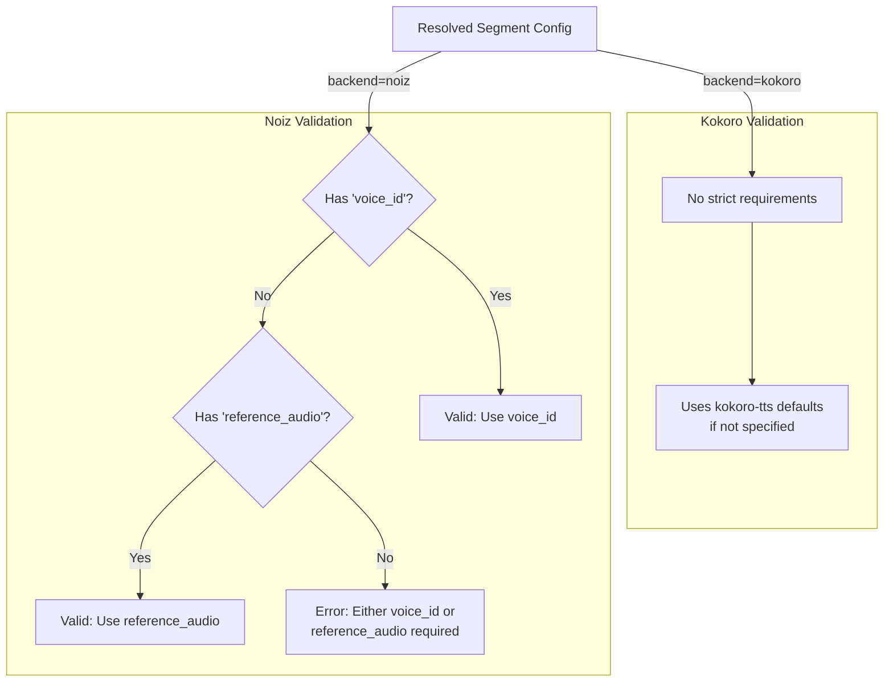
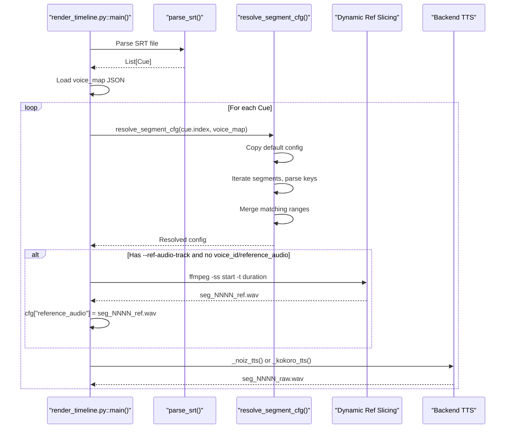

<!-- source: DeepWiki mcp.deepwiki.com · repo NoizAI/skills · page 3.3 Voice Maps and Segment Configuration · fetched 2026-10-26 -->

# Voice Maps and Segment Configuration

<details>
<summary>Relevant source files</summary>

The following files were used as context for generating this wiki page:

- [skills/tts/SKILL.md](skills/tts/SKILL.md)
- [skills/tts/scripts/render_timeline.py](skills/tts/scripts/render_timeline.py)

</details>


This page documents the voice map JSON format used by Timeline Mode to configure voice settings per subtitle segment. Voice maps enable different voices, languages, emotions, and reference audio for different parts of a timeline, making it possible to create multi-speaker content or vary expressiveness across segments.

For information about Timeline Mode's overall workflow, see [Timeline Mode - SRT to Audio](#3.2). For backend selection and authentication, see [Backend System](#2).

---

## Purpose and Scope

A **voice map** is a JSON configuration file that controls which voice settings apply to each subtitle segment during timeline rendering. The voice map contains:

1. **Default settings** that apply to all segments unless overridden
2. **Per-segment overrides** for specific subtitle indices or ranges

The TTS system parses the voice map, merges default and segment-specific settings for each cue, and passes the resolved configuration to the appropriate backend (Kokoro or Noiz).

---

## Voice Map JSON Structure

The voice map JSON contains two top-level keys:

| Key | Type | Required | Purpose |
|-----|------|----------|---------|
| `default` | Object | No | Default voice configuration applied to all segments |
| `segments` | Object | No | Per-segment overrides keyed by segment index or range |

### Segment Key Format

Segment keys in the `segments` object can be:

- **Single index**: `"3"` — applies to segment 3 only
- **Range**: `"5-8"` — applies to segments 5, 6, 7, and 8 inclusive

**Example Structure:**

```json
{
  "default": {
    "voice": "af_sarah",
    "lang": "en-us"
  },
  "segments": {
    "1": { "voice": "zm_yunxi" },
    "5-8": { "voice": "zf_xiaoni", "speed": 1.2 }
  }
}
```

**Sources:** [skills/tts/SKILL.md:54-88](), [skills/tts/scripts/render_timeline.py:92-109]()

---

## Segment Resolution Algorithm

### Resolution Flow



### Implementation Details

The resolution logic is implemented in `resolve_segment_cfg()`:

1. **Copy defaults**: Start with a copy of the `default` object
2. **Parse segment keys**: For each key in `segments`, parse it into `(lo, hi)` range
3. **Check membership**: If `lo <= cue.index <= hi`, merge that segment's config
4. **Later overrides win**: If multiple ranges match, later entries in the iteration order override earlier ones

The parsing function handles both formats:

- `"3"` → `(3, 3)`
- `"5-8"` → `(5, 8)`

**Sources:** [skills/tts/scripts/render_timeline.py:94-109]()

---

## Backend-Specific Parameters

Different backends support different voice configuration parameters. The voice map should contain parameters appropriate for the backend being used.

### Backend Parameter Mapping



### Kokoro Backend Parameters

| Parameter | Type | Description | Example |
|-----------|------|-------------|---------|
| `voice` | String | Voice model name or blend formula | `"af_sarah"`, `"v1:60,v2:40"` |
| `lang` | String | Language code | `"en-us"`, `"cmn"`, `"ja"` |
| `speed` | Float | Speed multiplier | `0.9`, `1.2` |

The Kokoro backend passes these parameters directly to the `kokoro-tts` CLI:

```
kokoro-tts input.txt output.wav --voice af_sarah --lang en-us --speed 1.0
```

**Sources:** [skills/tts/SKILL.md:57-67](), [skills/tts/scripts/render_timeline.py:315-350]()

### Noiz Backend Parameters

| Parameter | Type | Description | Example |
|-----------|------|-------------|---------|
| `voice_id` | String | Built-in voice ID or cloned voice UUID | `"883b6b7c"`, `"voice_123"` |
| `reference_audio` | String | Path or URL to reference audio for cloning | `"./refs/host.wav"`, `"https://..."` |
| `emo` | Object/String | Emotion parameters JSON or JSON string | `{"Joy": 0.6, "Calm": 0.4}` |
| `target_lang` | String | Target language code | `"zh"`, `"en"`, `"ja"` |
| `speed` | Float | Speed multiplier | `0.9`, `1.2` |
| `quality_preset` | String | Quality setting | `"standard"`, `"high"` |
| `similarity_enh` | Boolean | Enable similarity enhancement | `true`, `false` |
| `save_voice` | Boolean | Save cloned voice for reuse | `true`, `false` |

**Constraints:**
- Either `voice_id` OR `reference_audio` must be provided (not both)
- If neither is provided and `--ref-audio-track` is used, the system will auto-slice reference audio

**Sources:** [skills/tts/SKILL.md:69-79](), [skills/tts/scripts/render_timeline.py:241-304]()

---

## Reference Audio Resolution

### Resolution Modes



### Static Reference Audio (Per-Segment)

When `reference_audio` is specified in a segment's config, the system resolves it as follows:

1. **URL**: If the value starts with `http://` or `https://`, download to a temporary file
2. **Local path**: Otherwise, treat as a local file path and verify it exists

The resolution logic is in `_resolve_reference_audio()`, which returns a tuple of `(path_to_use, temp_path_to_cleanup_or_None)`.

**Sources:** [skills/tts/scripts/render_timeline.py:224-238]()

### Dynamic Reference Audio Slicing (`--ref-audio-track`)

For video dubbing scenarios where each segment should use the original audio from the same timestamp as reference, use the `--ref-audio-track` argument instead of specifying `reference_audio` in the voice map.

**Workflow:**

1. User invokes: `tts.py render --srt input.srt --voice-map vm.json --ref-audio-track original.mp4`
2. For each cue without `voice_id` or `reference_audio` in its config:
   - Extract audio slice: `ffmpeg -ss {cue.start_ms/1000} -t {cue.duration_ms/1000} -i original.mp4 seg_NNNN_ref.wav`
   - Set `cfg["reference_audio"] = seg_NNNN_ref.wav`
3. Pass the per-segment reference audio to the TTS backend

This enables automatic voice matching for each subtitle segment without manual reference audio preparation.

**Sources:** [skills/tts/SKILL.md:81-86](), [skills/tts/scripts/render_timeline.py:400-411]()

---

## Complete Voice Map Examples

### Example 1: Kokoro Multi-Voice Podcast

```json
{
  "default": {
    "voice": "af_sarah",
    "lang": "en-us",
    "speed": 1.0
  },
  "segments": {
    "1": {
      "voice": "zm_yunxi",
      "lang": "cmn"
    },
    "3-5": {
      "voice": "zf_xiaoni",
      "speed": 0.9
    },
    "7": {
      "voice": "v1:60,v2:40",
      "speed": 1.1
    }
  }
}
```

**Interpretation:**
- Segments 1: Chinese voice `zm_yunxi`
- Segments 2: English voice `af_sarah` (default)
- Segments 3-5: Chinese voice `zf_xiaoni` at 0.9x speed
- Segment 6: English voice `af_sarah` (default)
- Segment 7: Voice blend at 1.1x speed
- Remaining: English voice `af_sarah` (default)

**Sources:** [skills/tts/SKILL.md:57-67]()

### Example 2: Noiz Multi-Speaker with Cloning

```json
{
  "default": {
    "voice_id": "883b6b7c",
    "target_lang": "en"
  },
  "segments": {
    "1": {
      "reference_audio": "./refs/host_a.wav",
      "emo": {
        "Joy": 0.7,
        "Excitement": 0.5
      }
    },
    "2-4": {
      "reference_audio": "./refs/host_b.wav",
      "emo": {
        "Calm": 0.8
      }
    },
    "6": {
      "voice_id": "b4775100",
      "emo": {
        "Joy": 0.9
      }
    }
  }
}
```

**Interpretation:**
- Segment 1: Clone from `host_a.wav` with joyful emotion
- Segments 2-4: Clone from `host_b.wav` with calm emotion
- Segment 5: Built-in voice `883b6b7c` (default)
- Segment 6: Built-in voice `b4775100` with very joyful emotion
- Remaining: Built-in voice `883b6b7c` (default)

**Sources:** [skills/tts/SKILL.md:69-79]()

### Example 3: Video Dubbing with Dynamic Slicing

**Voice Map (`vm.json`):**
```json
{
  "default": {
    "target_lang": "zh"
  }
}
```

**Command:**
```bash
python3 skills/tts/scripts/tts.py render \
  --srt translated.srt \
  --voice-map vm.json \
  --ref-audio-track original_video.mp4 \
  --backend noiz \
  -o dubbed.wav
```

**Interpretation:**
- All segments will automatically use sliced audio from `original_video.mp4` at matching timestamps
- No manual reference audio preparation needed
- Each segment's reference audio is extracted on-demand based on `cue.start_ms` and `cue.duration_ms`

**Sources:** [skills/tts/SKILL.md:81-86](), [skills/tts/scripts/render_timeline.py:400-411]()

---

## Parameter Validation and Error Handling

### Required Parameters by Backend



### Kokoro Validation

The Kokoro backend is lenient and uses its own defaults for unspecified parameters. No strict validation is performed.

### Noiz Validation

For each segment, the Noiz backend requires **either** `voice_id` OR `reference_audio`:

- If both are missing and no `--ref-audio-track` is provided: raises `ValueError`
- If both are provided: `reference_audio` takes precedence (only one is sent to the API)

The error message from the code:

```
ValueError: Cue {cue.index}: either voice_id or reference_audio required.
```

**Sources:** [skills/tts/scripts/render_timeline.py:281-284]()

---

## Voice Map Processing Pipeline



**Sources:** [skills/tts/scripts/render_timeline.py:356-482]()

---

## Summary

Voice maps provide fine-grained control over voice settings in timeline rendering:

- **Structure**: JSON with `default` and `segments` keys
- **Segment keys**: Single index `"3"` or range `"5-8"`
- **Resolution**: Defaults are copied, then overridden by matching segment ranges
- **Backend-specific**: Kokoro uses `voice`/`lang`/`speed`; Noiz adds `voice_id`/`emo`/`reference_audio`
- **Reference audio**: Can be static (path/URL in map) or dynamic (`--ref-audio-track` auto-slicing)

For usage examples in complete workflows, see [Timeline Mode - SRT to Audio](#3.2) and [Video Translation](#5.3).

**Sources:** [skills/tts/SKILL.md:54-88](), [skills/tts/scripts/render_timeline.py:1-486]()

---

