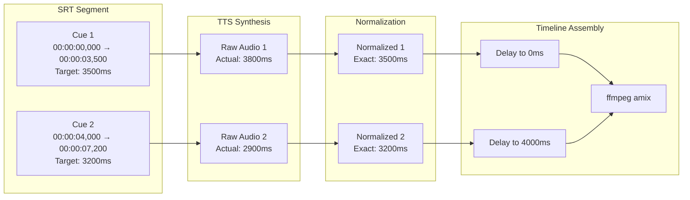
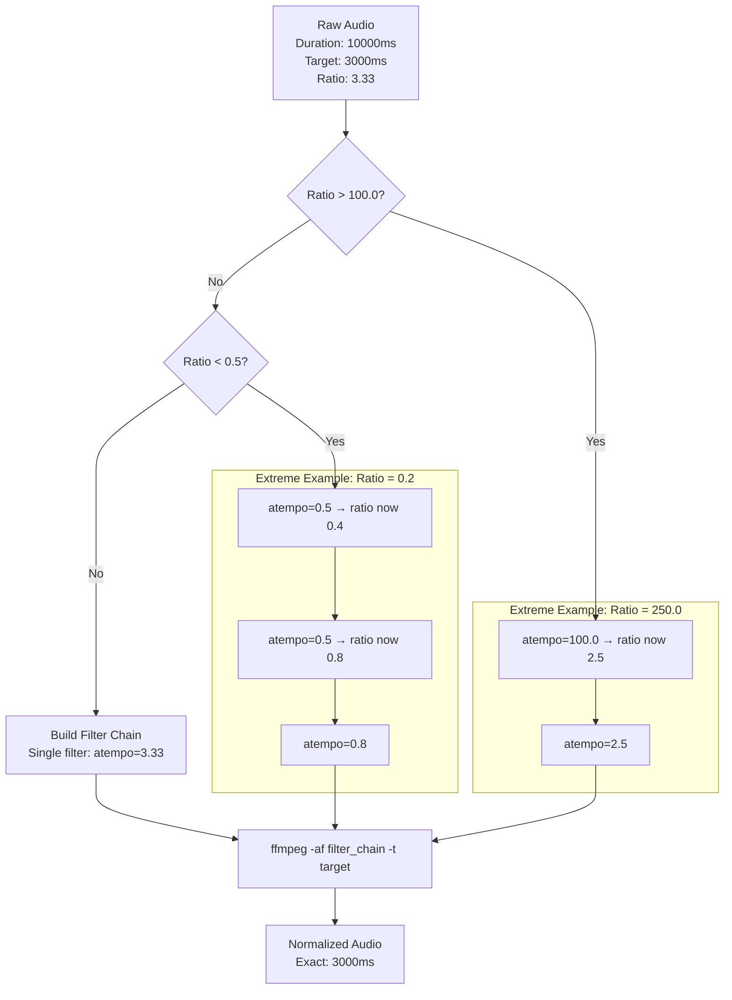
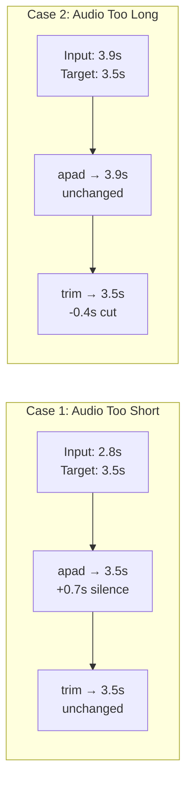
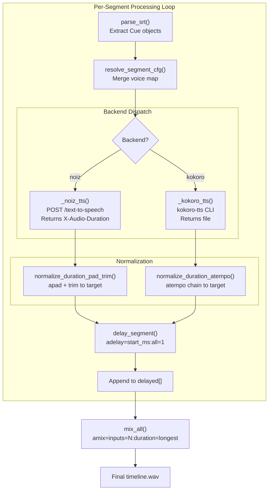

<!-- source: DeepWiki mcp.deepwiki.com · repo NoizAI/skills · page 3.4 Duration Control and Audio Normalization · fetched 2026-10-26 -->

# Duration Control and Audio Normalization

<details>
<summary>Relevant source files</summary>

The following files were used as context for generating this wiki page:

- [skills/tts/SKILL.md](skills/tts/SKILL.md)
- [skills/tts/scripts/render_timeline.py](skills/tts/scripts/render_timeline.py)

</details>


This document explains how the TTS skill ensures that synthesized audio segments match their target durations in **Timeline Mode**. Duration normalization is critical for dubbing, subtitle-aligned audio, and podcast generation where each segment must start and end at precise timestamps.

For general Timeline Mode usage, see [Timeline Mode - SRT to Audio](#3.2). For voice mapping configuration, see [Voice Maps and Segment Configuration](#3.3).

---

## Overview

When rendering SRT files to audio, each subtitle segment has a fixed time window defined by its start and end timestamps. However, TTS backends do not guarantee that synthesized audio will exactly match the requested duration. Duration normalization post-processes each segment to force exact alignment.

The TTS skill implements two distinct normalization strategies based on the backend:

| Backend | Strategy | Preserves Pitch | Quality Trade-off |
|---------|----------|-----------------|-------------------|
| **Kokoro** | `atempo` filter chain | Yes | Minimal artifacts for ratios near 1.0 |
| **Noiz** | Pad silence + trim | N/A | Assumes server-side pre-processing |

**Sources:** [skills/tts/scripts/render_timeline.py:139-172]()

---

## Why Duration Control is Needed

In **Timeline Mode**, the TTS engine processes each SRT segment independently:



**Diagram: Timeline Rendering Requires Exact Durations**

Without normalization, segments would overlap or create gaps when mixed into the final timeline. The duration mismatch occurs because:

1. **Noiz backend**: Server-side duration forcing is approximate; network overhead and encoding can add/remove milliseconds
2. **Kokoro backend**: Local TTS has no duration control; speech rate varies naturally with text complexity

**Sources:** [skills/tts/scripts/render_timeline.py:1-10](), [skills/tts/scripts/render_timeline.py:420-435]()

---

## Backend-Specific Normalization Strategies

### Kokoro Backend: `atempo` Filter Chain

The Kokoro backend uses FFmpeg's `atempo` audio filter to stretch or compress the audio to match the target duration. This preserves pitch by adjusting playback speed.

```python
# Function: normalize_duration_atempo
# Location: skills/tts/scripts/render_timeline.py:149-172

def normalize_duration_atempo(inp: Path, outp: Path, target_ms: int) -> None:
    actual_ms = probe_duration_ms(inp)
    ratio = actual_ms / target_ms
    
    # Build filter chain for extreme ratios
    filters = []
    r = ratio
    while r > 100.0:
        filters.append("atempo=100.0")
        r /= 100.0
    while r < 0.5:
        filters.append("atempo=0.5")
        r /= 0.5
    filters.append(f"atempo={r:.6f}")
    
    # Apply: ffmpeg -af "atempo=X,atempo=Y,..." -t target
```

#### Atempo Filter Chaining

The `atempo` filter has technical constraints: it only accepts speed ratios between 0.5 and 100.0. For extreme duration mismatches, the code chains multiple filters:



**Diagram: Atempo Filter Chaining for Extreme Ratios**

#### Fallback for Zero-Duration Audio

If `ffprobe` reports zero or negative duration (corrupted file), the code falls back to pad-trim strategy:

```python
if actual_ms <= 0:
    normalize_duration_pad_trim(inp, outp, target_ms)
    return
```

**Sources:** [skills/tts/scripts/render_timeline.py:149-172](), [skills/tts/scripts/render_timeline.py:126-136]()

---

### Noiz Backend: Pad and Trim

The Noiz backend assumes the server has already attempted to match the requested duration. The normalization step simply ensures exact alignment by padding short audio and trimming to the target length:

```python
# Function: normalize_duration_pad_trim
# Location: skills/tts/scripts/render_timeline.py:139-146

def normalize_duration_pad_trim(inp: Path, outp: Path, target_ms: int) -> None:
    sec = target_ms / 1000.0
    _run_ff([
        "ffmpeg", "-y", "-i", str(inp),
        "-af", f"apad=pad_dur={sec:.3f}",  # Add silence to reach target
        "-t", f"{sec:.3f}",                 # Trim to exact target
        str(outp),
    ])
```

#### Why Pad-Then-Trim?

The `apad` filter adds silence to the end of the audio stream to reach the target duration. The `-t` flag then trims the result to the exact duration. This handles both cases:

- **Audio shorter than target**: `apad` extends it with silence, `-t` keeps it at target
- **Audio longer than target**: `apad` has no effect (already long enough), `-t` trims excess



**Diagram: Pad-Trim Handles Both Short and Long Audio**

This strategy is faster than `atempo` and suitable when the server has already performed most of the duration adjustment. The Noiz API accepts a `duration` parameter and returns `X-Audio-Duration` header indicating actual synthesis duration.

**Sources:** [skills/tts/scripts/render_timeline.py:139-146](), [skills/tts/scripts/render_timeline.py:252-256](), [skills/tts/scripts/render_timeline.py:302-304]()

---

## Duration Normalization in the Rendering Pipeline

The complete timeline rendering workflow applies normalization between synthesis and delay:



**Diagram: Duration Normalization in render_timeline.py**

The normalization produces intermediate files:

| File Pattern | Content | Purpose |
|--------------|---------|---------|
| `seg_0001_raw.wav` | Raw TTS output | As returned by backend |
| `seg_0001_norm.wav` | Normalized audio | Exact target duration |
| `seg_0001_delay.wav` | Delayed audio | Positioned at start timestamp |
| `timeline.wav` | Final mix | All segments combined |

**Sources:** [skills/tts/scripts/render_timeline.py:397-435](), [skills/tts/scripts/render_timeline.py:455-457]()

---

## Probing Actual Duration

Both normalization strategies require knowing the actual duration of the synthesized audio. The `probe_duration_ms()` function uses `ffprobe` to query the file:

```python
# Function: probe_duration_ms
# Location: skills/tts/scripts/render_timeline.py:126-136

def probe_duration_ms(path: Path) -> float:
    proc = subprocess.run([
        "ffprobe", "-v", "error",
        "-show_entries", "format=duration",
        "-of", "default=noprint_wrappers=1:nokey=1",
        str(path),
    ], capture_output=True, text=True)
    
    return float(proc.stdout.strip()) * 1000  # Convert seconds to ms
```

**Key Points:**

- **Used by Kokoro backend**: Must probe every file to calculate `atempo` ratio
- **Not used by Noiz backend**: Trusts `X-Audio-Duration` header from API response
- **Failure handling**: Returns zero on error, triggering pad-trim fallback

The Noiz backend receives actual duration from the server response header:

```python
# From _noiz_tts() function
dur_h = resp.headers.get("X-Audio-Duration")
return float(dur_h) if dur_h else -1.0
```

This avoids an extra `ffprobe` invocation per segment, improving performance when rendering many segments.

**Sources:** [skills/tts/scripts/render_timeline.py:126-136](), [skills/tts/scripts/render_timeline.py:302-304](), [skills/tts/scripts/render_timeline.py:348-350]()

---

## Technical Constraints and Edge Cases

### Atempo Ratio Limits

The `atempo` filter accepts ratios in the range [0.5, 100.0]:

- **Speed up by 2x**: `atempo=2.0` (halves duration)
- **Slow down by 2x**: `atempo=0.5` (doubles duration)
- **Speed up by 250x**: Requires chaining: `atempo=100.0,atempo=2.5`

For extreme mismatches (e.g., 10-second audio forced into 100ms), the filter chain can become very long. This is rare in practice because TTS backends produce reasonable durations.

### Final Trim Safety

Both normalization functions apply a final `-t` trim to guarantee exact duration, accounting for:

- Floating-point rounding in filter calculations
- Container format overhead
- Sample-level alignment differences

```bash
# Both strategies include:
-t "{target_ms / 1000.0:.3f}"
```

This ensures the output never exceeds the target, even by a few milliseconds.

### Zero-Duration Handling

If `probe_duration_ms()` returns 0 or negative (indicating a corrupt or empty file), `normalize_duration_atempo()` falls back to `normalize_duration_pad_trim()`:

```python
if actual_ms <= 0:
    normalize_duration_pad_trim(inp, outp, target_ms)
    return
```

This prevents division-by-zero when computing the `atempo` ratio.

**Sources:** [skills/tts/scripts/render_timeline.py:149-172](), [skills/tts/scripts/render_timeline.py:157-172]()

---

## Backend Selection and Normalization Strategy

The rendering script selects the normalization strategy based on the `--backend` flag:

```python
# In main() function, render_timeline.py:425-433

if args.backend == "noiz":
    api_dur = _noiz_tts(...)
    normalize_duration_pad_trim(raw, norm, cue.duration_ms)
else:  # kokoro
    api_dur = _kokoro_tts(...)
    normalize_duration_atempo(raw, norm, cue.duration_ms)
```

The choice is explicit and cannot be overridden per-segment. All segments in a single render job use the same normalization strategy.

### Command-Line Usage

```bash
# Kokoro backend → atempo normalization
python3 skills/tts/scripts/tts.py render \
  --srt input.srt \
  --voice-map vm.json \
  --backend kokoro \
  -o output.wav

# Noiz backend → pad-trim normalization
python3 skills/tts/scripts/tts.py render \
  --srt input.srt \
  --voice-map vm.json \
  --backend noiz \
  --api-key $(cat ~/.noiz_api_key) \
  -o output.wav
```

**Sources:** [skills/tts/scripts/render_timeline.py:425-433](), [skills/tts/scripts/render_timeline.py:362-365]()

---

## Render Report

After rendering, the script generates a JSON report including per-segment duration information:

```json
{
  "srt": "input.srt",
  "backend": "kokoro",
  "total_ms": 45000,
  "segments": [
    {
      "index": 1,
      "start_ms": 0,
      "end_ms": 3500,
      "duration_ms": 3500,
      "raw_duration_sec": 3.82,
      "backend": "kokoro",
      "voice": "af_sarah"
    }
  ]
}
```

The `raw_duration_sec` field shows the duration before normalization, allowing you to verify how much time-stretching was applied:

- **Ratio = raw_duration_sec × 1000 / duration_ms**
- Example: 3820 / 3500 = 1.09 (9% speedup via atempo)

**Sources:** [skills/tts/scripts/render_timeline.py:438-453](), [skills/tts/scripts/render_timeline.py:466-476]()

---

