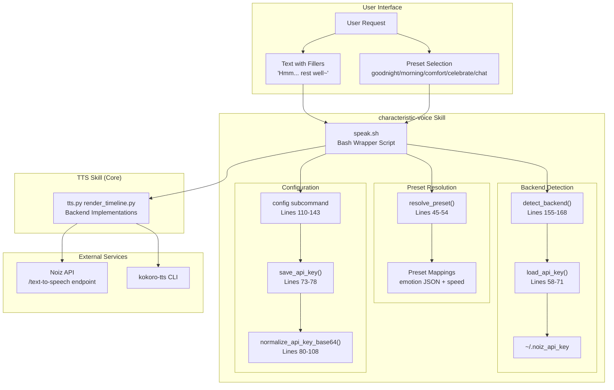
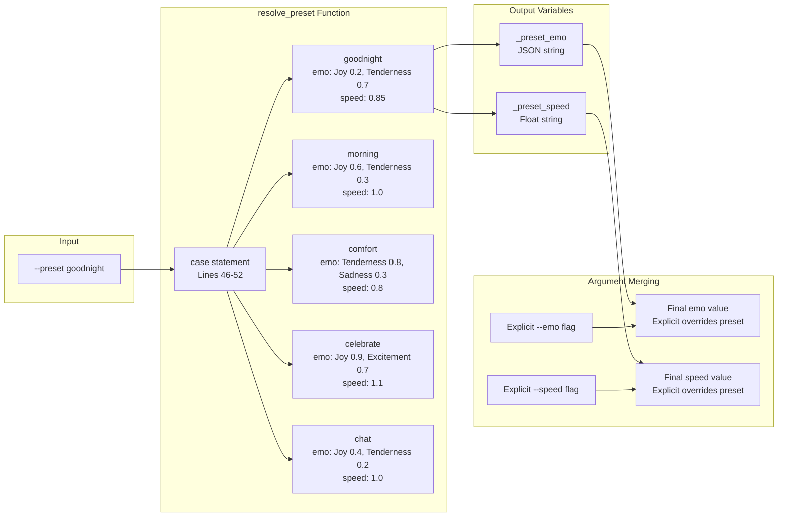
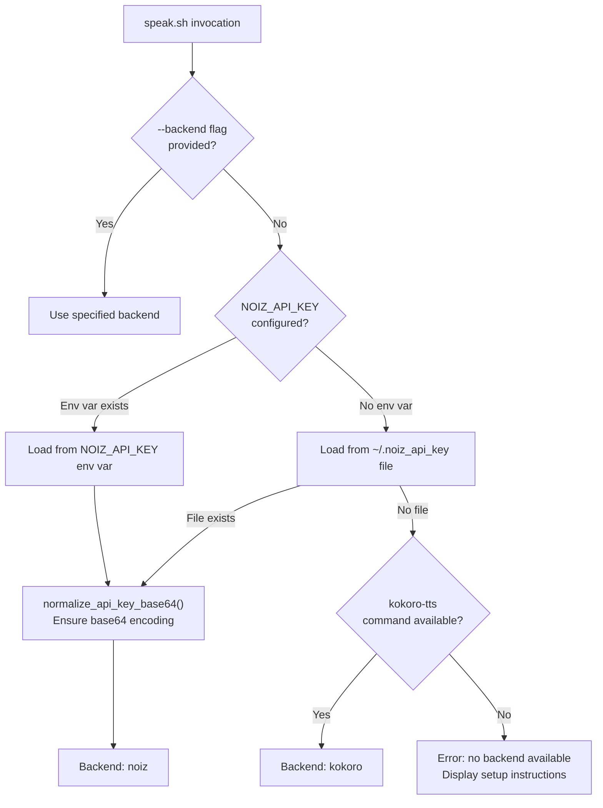
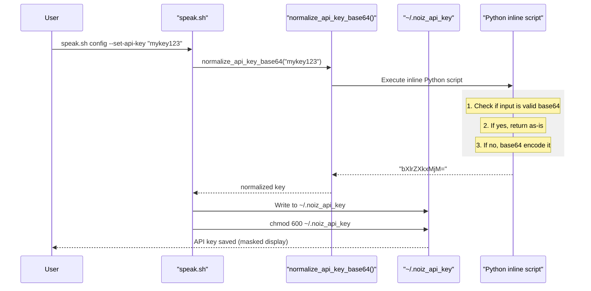
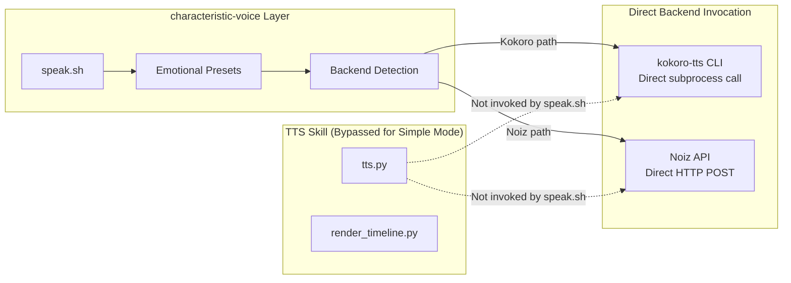

<!-- source: DeepWiki mcp.deepwiki.com · repo NoizAI/skills · page 4 Characteristic Voice Skill · fetched 2026-10-26 -->

# Characteristic Voice Skill

<details>
<summary>Relevant source files</summary>

The following files were used as context for generating this wiki page:

- [skills/characteristic-voice/SKILL.md](skills/characteristic-voice/SKILL.md)
- [skills/characteristic-voice/scripts/speak.sh](skills/characteristic-voice/scripts/speak.sh)

</details>


This document covers the **characteristic-voice** skill, which adds human-like expressiveness and personality to text-to-speech output. The skill functions as a preset-based wrapper around the core **tts** skill (see [TTS (Text-to-Speech) Skill](#3)), providing five emotional presets, non-lexical filler guidance, and voice cloning capabilities. For information about the underlying TTS rendering engine and backend options, see [TTS (Text-to-Speech) Skill](#3). For details on voice cloning setup workflows, see [Character Voice Cloning Setup](#4.2).

## Purpose and Scope

The characteristic-voice skill transforms plain text into companion-like speech by:
- Applying emotional presets that combine emotion parameters with speaking speed adjustments
- Providing usage guidelines for non-lexical fillers (hmm, haha, aww, etc.)
- Supporting character voice cloning via reference audio files
- Managing backend selection and API key configuration

Unlike the core TTS skill which focuses on accurate text rendering, this skill prioritizes emotional expressiveness and conversational naturalness.

**Sources:** [skills/characteristic-voice/SKILL.md:1-12]()

---

## Architecture Overview

The characteristic-voice skill operates as a thin configuration layer that wraps the TTS skill's capabilities with companion-friendly defaults.

### System Architecture Diagram



The skill does **not** implement TTS synthesis directly. Instead, it:
1. Resolves presets to concrete emotion/speed parameters
2. Detects available backend (Kokoro vs Noiz)
3. Forwards parameters to the appropriate backend implementation

**Sources:** [skills/characteristic-voice/scripts/speak.sh:1-323]()

---

## Command-Line Interface

The `speak.sh` script provides the primary interface to the characteristic-voice skill.

### Basic Invocation

```bash
bash skills/characteristic-voice/scripts/speak.sh [--preset MODE] [options]
```

### Command Structure

| Command | Purpose | Example |
|---------|---------|---------|
| `speak.sh --preset PRESET -t TEXT -o FILE` | Synthesize with preset | `speak.sh --preset goodnight -t "Sleep well~" -o out.wav` |
| `speak.sh config --set-api-key KEY` | Configure Noiz API key | `speak.sh config --set-api-key abc123` |
| `speak.sh config` | Display API key status | `speak.sh config` |
| `speak.sh --help` | Show usage information | `speak.sh --help` |

### Parameters

| Parameter | Type | Description | Forwarded To |
|-----------|------|-------------|--------------|
| `--preset` | String | Emotional preset name | Resolved internally |
| `-t, --text` | String | Text to synthesize | Backend |
| `-f, --text-file` | Path | Input text file | Backend |
| `-o, --output` | Path | Output audio file (required) | Backend |
| `--emo` | JSON | Emotion parameters (overrides preset) | Noiz backend |
| `--speed` | Float | Speed multiplier (overrides preset) | Both backends |
| `-v, --voice` | String | Kokoro voice name | Kokoro backend |
| `--voice-id` | String | Noiz voice ID | Noiz backend |
| `--ref-audio` | Path | Reference audio for cloning | Noiz backend |
| `--backend` | String | Force backend (kokoro/noiz) | Internal routing |
| `--lang` | String | Target language code | Backend |

**Sources:** [skills/characteristic-voice/scripts/speak.sh:7-40](), [skills/characteristic-voice/scripts/speak.sh:220-241]()

---

## Preset System

The preset system maps semantic emotional states to concrete TTS parameters.

### Preset Resolution Flow



### Preset Parameters Table

| Preset | Emotion Parameters | Speed | Use Case |
|--------|-------------------|-------|----------|
| `goodnight` | `{"Joy":0.2,"Tenderness":0.7}` | 0.85 | Gentle, warm, sleepy bedtime messages |
| `morning` | `{"Joy":0.6,"Tenderness":0.3}` | 1.0 | Cheerful but not overwhelming greetings |
| `comfort` | `{"Tenderness":0.8,"Sadness":0.3}` | 0.8 | Soft, understanding, unhurried support |
| `celebrate` | `{"Joy":0.9,"Excitement":0.7}` | 1.1 | Excited, proud, genuinely happy moments |
| `chat` | `{"Joy":0.4,"Tenderness":0.2}` | 1.0 | Relaxed, playful, natural conversation |

The preset resolution occurs in `resolve_preset()` which sets shell variables `_preset_emo` and `_preset_speed`. These are then applied as defaults if explicit `--emo` or `--speed` flags are not provided.

**Override Behavior:** Explicit command-line flags always take precedence over preset defaults. This allows fine-tuning while maintaining preset convenience.

**Sources:** [skills/characteristic-voice/scripts/speak.sh:45-54](), [skills/characteristic-voice/scripts/speak.sh:250-258](), [skills/characteristic-voice/SKILL.md:42-62]()

---

## Backend Detection and Forwarding

The skill automatically selects an appropriate TTS backend based on available credentials and installed tools.

### Backend Selection Logic



### Backend Forwarding Behavior

Once a backend is detected, `speak.sh` routes parameters differently:

**Kokoro Backend Path** (lines 284-296):
- Creates temporary input file with text content
- Invokes `kokoro-tts` CLI directly
- Forwards: `--voice`, `--lang`, `--speed`, `--format`
- Ignores: `--emo`, `--voice-id`, `--ref-audio` (not supported by Kokoro)

**Noiz Backend Path** (lines 300-320):
- Calls `noiz_tts()` function (lines 191-218)
- Auto-selects voice via API if no `--voice-id` or `--ref-audio` provided
- Constructs multipart/form-data POST request to `/text-to-speech` endpoint
- Forwards: `text`, `voice_id`, `speed`, `emo`, `target_lang`, `file` (reference audio)
- Returns HTTP status code; errors displayed to stderr

**Key Difference:** The characteristic-voice skill does **not** invoke `tts.py` or `render_timeline.py` directly. Instead, it either calls `kokoro-tts` CLI or makes direct HTTP requests to Noiz API. This differs from composite skills like video-translation which invoke `tts.sh` as a subprocess.

**Sources:** [skills/characteristic-voice/scripts/speak.sh:155-168](), [skills/characteristic-voice/scripts/speak.sh:284-296](), [skills/characteristic-voice/scripts/speak.sh:191-218](), [skills/characteristic-voice/scripts/speak.sh:300-320]()

---

## API Key Configuration

The skill implements a two-tier API key storage system with automatic base64 normalization.

### Configuration Workflow



### Key Storage Locations (Priority Order)

1. **Environment Variable:** `NOIZ_API_KEY` - Highest priority
2. **File:** `~/.noiz_api_key` - Persistent storage

### Base64 Normalization Logic

The `normalize_api_key_base64()` function (lines 80-108) uses an embedded Python script to ensure all API keys are stored in base64 format:

1. **Input validation:** Check if input is already valid base64
2. **Canonical comparison:** Decode and re-encode to verify canonical form
3. **Auto-encoding:** If not base64, encode the raw string
4. **Output:** Always returns base64-encoded string

This normalization ensures consistent handling whether users provide plain text keys or pre-encoded values.

### Configuration Commands

| Command | Effect |
|---------|--------|
| `speak.sh config` | Display current API key status (masked) |
| `speak.sh config --set-api-key KEY` | Save API key to `~/.noiz_api_key` with chmod 600 |

**Sources:** [skills/characteristic-voice/scripts/speak.sh:58-71](), [skills/characteristic-voice/scripts/speak.sh:73-78](), [skills/characteristic-voice/scripts/speak.sh:80-108](), [skills/characteristic-voice/scripts/speak.sh:110-143]()

---

## Non-Lexical Fillers

The characteristic-voice skill provides **usage guidance** for non-lexical fillers but does not automatically insert them. The AI agent or user must include fillers explicitly in the input text.

### Filler Palette

The skill documentation defines nine categories of human vocalizations:

| Sound | Emotional Function | Placement Guidance |
|-------|-------------------|-------------------|
| `hmm...` | Thinking, gentle acknowledgment | Sentence starts, transitions |
| `ah...` | Realization, soft surprise | Before discoveries |
| `uh...` | Hesitation, empathy | Careful moments |
| `heh / hehe` | Playful, mischievous | Light teasing |
| `haha` | Laughter | Joyful moments |
| `aww` | Tenderness, sympathy | Deep comfort |
| `oh? / oh!` | Surprise, attention | Reacting to input |
| `pfft` | Stifled laugh | Playful disbelief |
| `whew` | Relief | After tension |
| `~` (tilde) | Drawn out, melodic ending | Word endings for warmth |

### Usage Rules

Per SKILL.md lines 40-41:
- **Density:** 2-4 fillers maximum per short message
- **Placement:** Natural pauses (sentence starts, thought shifts)
- **Timing:** Use `...` after fillers for silence beat
- **Warmth:** Use `~` at word endings for melodic effect

These fillers are processed as regular text by the TTS backend. Their effectiveness depends on the backend's ability to pronounce non-standard text naturally.

**Sources:** [skills/characteristic-voice/SKILL.md:25-40]()

---

## Integration with TTS Skill

The relationship between characteristic-voice and the core TTS skill is **compositional but direct**.

### Integration Pattern



**Key Architectural Point:** Unlike composite skills (chat-with-anyone, video-translation) which invoke `tts.sh` as a subprocess, the characteristic-voice skill **directly invokes backends**:

- **Kokoro:** Executes `kokoro-tts` command (line 293)
- **Noiz:** Calls internal `noiz_tts()` function which makes HTTP requests (line 319)

This design makes characteristic-voice a **parallel alternative** to the TTS skill's simple mode, not a wrapper around it. Both skills ultimately call the same backends, but through different code paths.

### Voice Cloning Integration

When `--ref-audio` is provided, the skill forwards it directly to the Noiz backend via the `file=@` multipart form field (line 207). This leverages Noiz's voice cloning API endpoint. For detailed voice cloning workflows, see [Character Voice Cloning Setup](#4.2).

**Sources:** [skills/characteristic-voice/scripts/speak.sh:284-296](), [skills/characteristic-voice/scripts/speak.sh:191-218](), [skills/characteristic-voice/SKILL.md:64-82]()

---

## Error Handling

The script implements several error detection mechanisms:

### Input Validation

- **Missing output:** Lines 243-245 require `-o/--output` flag
- **Missing text:** Lines 246-248 require either `-t/--text` or `-f/--text-file`
- **Unknown preset:** Line 52 validates preset name against known values

### Backend Availability

Lines 264-274 handle the case where no backend is available:
- Checks if `detect_backend()` returns empty string
- Displays two-option setup guide (Noiz API key vs Kokoro installation)
- Exits with error code 1

### API Request Failures

For Noiz backend, `noiz_tts()` function (lines 209-218):
- Captures HTTP status code via `curl -w "%{http_code}"`
- Checks for status code 200
- On failure: prints first 500 bytes of response to stderr, removes output file, returns error code

**Sources:** [skills/characteristic-voice/scripts/speak.sh:243-248](), [skills/characteristic-voice/scripts/speak.sh:264-274](), [skills/characteristic-voice/scripts/speak.sh:209-218]()

---

