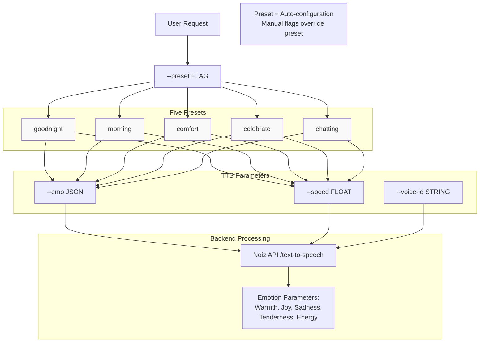
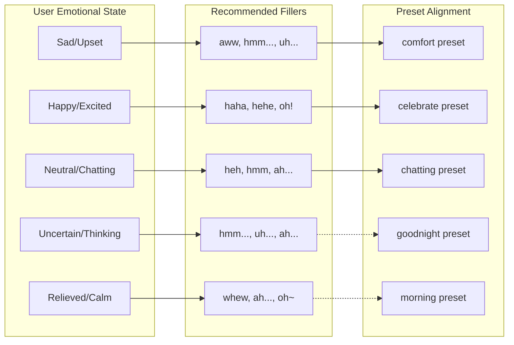
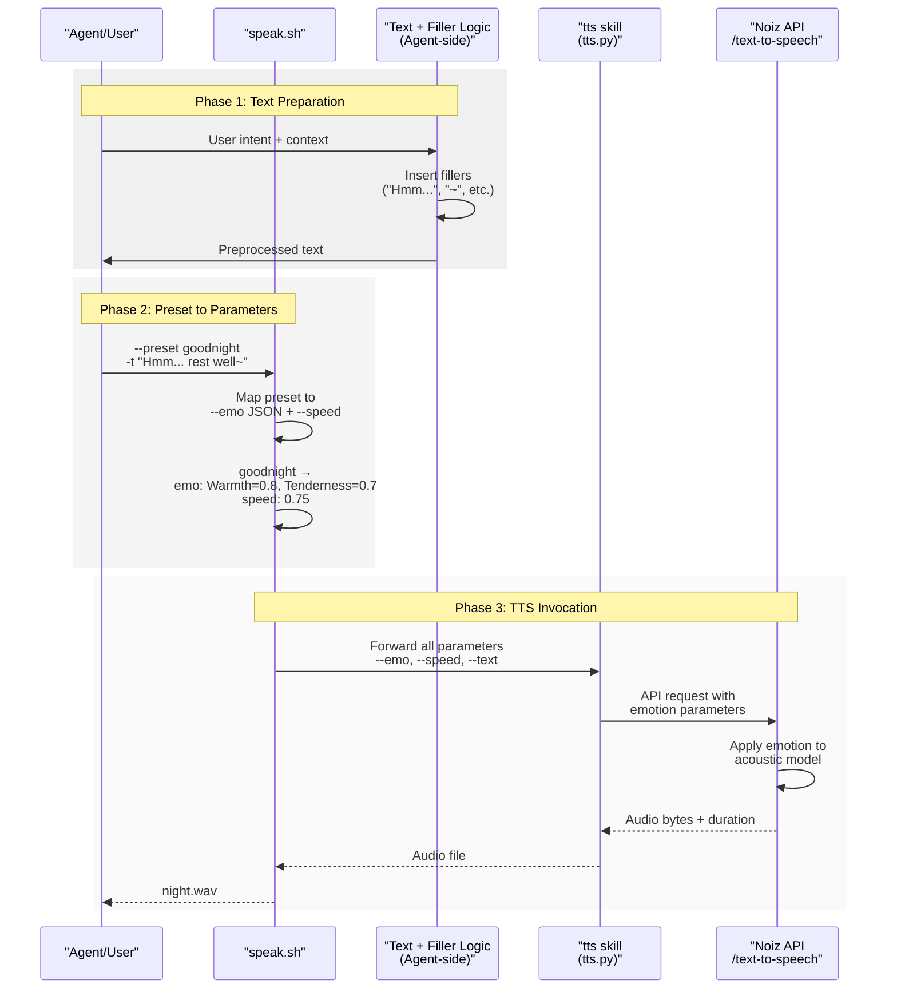
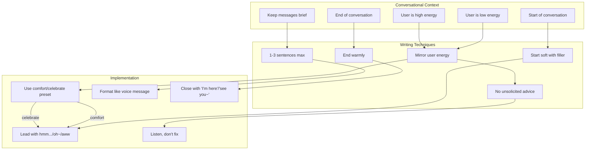

<!-- source: DeepWiki mcp.deepwiki.com · repo NoizAI/skills · page 4.1 Emotional Presets and Fillers · fetched 2026-10-26 -->

# Emotional Presets and Fillers

<details>
<summary>Relevant source files</summary>

The following files were used as context for generating this wiki page:

- [skills/characteristic-voice/SKILL.md](skills/characteristic-voice/SKILL.md)

</details>


This page documents the two core mechanisms that make the `characteristic-voice` skill ([#4](#4)) produce human-like, emotionally expressive speech: **emotional presets** and **non-lexical fillers**. These features work by preprocessing text before passing it to the underlying TTS skill ([#3](#3)) and configuring emotion parameters for the Noiz backend ([#2.2](#2.2)).

For information about voice cloning and character voice setup, see [Character Voice Cloning Setup](#4.2). For basic TTS functionality without personality, see [TTS Skill](#3).

---

## Overview: The Two-Layer System

The characteristic-voice skill enhances plain text with human qualities through two complementary mechanisms:

1. **Non-lexical fillers**: Text preprocessing that inserts sounds like "hmm...", "haha", "aww" at natural pause points
2. **Emotional presets**: Predefined emotion parameter configurations that adjust warmth, joy, tenderness, and speed

Both mechanisms are optional but designed to work together. Users can select a preset (which auto-configures emotion and speed) or manually specify emotion JSON and speed parameters for full control.

**Sources:** [skills/characteristic-voice/SKILL.md:20-24]()

---

## Emotional Presets

### Purpose and Implementation

Emotional presets are named configurations that bundle emotion parameters and speed settings for common conversational contexts. The `speak.sh` script accepts a `--preset` flag that maps to backend-specific parameters.

**Preset Mapping Diagram**



**Sources:** [skills/characteristic-voice/SKILL.md:42-62](), [skills/characteristic-voice/SKILL.md:86-103]()

### The Five Presets

| Preset | Emotional Intent | Typical Speed | Use Case |
|--------|-----------------|---------------|----------|
| `goodnight` | Gentle, warm, slightly sleepy | Slow (0.7-0.8) | Bedtime messages, winding down |
| `morning` | Warm, cheerful but not overwhelming | Normal (0.9-1.0) | Greetings, starting the day |
| `comfort` | Soft, understanding, unhurried | Slow (0.75) | Emotional support, listening |
| `celebrate` | Excited, proud, genuinely happy | Normal-Fast (1.0-1.1) | Congratulations, achievements |
| `chatting` | Relaxed, playful, natural | Normal (1.0) | Casual conversation |

Each preset internally maps to a combination of:
- **Emotion JSON**: A dictionary with keys like `Warmth`, `Joy`, `Sadness`, `Tenderness` with float values 0.0-1.0
- **Speed multiplier**: Float value affecting speech rate (typically 0.7-1.1)

**Implementation Detail**: The preset logic is handled by `speak.sh`, which translates preset names into appropriate `--emo` and `--speed` flags before invoking the underlying `tts` skill. Users can override preset parameters by explicitly specifying `--emo` or `--speed` after the `--preset` flag.

**Sources:** [skills/characteristic-voice/SKILL.md:42-62]()

---

## Non-Lexical Fillers

### The Filler Palette

Fillers are phonetic sounds that simulate natural human speech patterns—thinking noises, laughter, hesitation markers, and empathetic acknowledgments. These are **text-level additions** that get synthesized like any other text, not post-processing audio effects.

**Filler Sound Reference Table**

| Sound | Emotional Quality | Context | Example Usage |
|-------|------------------|---------|---------------|
| `hmm...` | Thinking, gentle acknowledgment | Comfort, pondering | "Hmm... that's a good question." |
| `ah...` | Realization, soft surprise | Discoveries, transitions | "Ah... I see what you mean." |
| `uh...` | Hesitation, empathy | Careful moments | "Uh... let me think about that." |
| `heh` / `hehe` | Playful, mischievous | Teasing, light moments | "Heh, you know me too well." |
| `haha` | Laughter | Joy, humor | "Haha, that's hilarious!" |
| `aww` | Tenderness, sympathy | Deep comfort | "Aww... I'm here for you." |
| `oh?` / `oh!` | Surprise, attention | Reacting to news | "Oh! That's wonderful!" |
| `pfft` | Stifled laugh | Playful disbelief | "Pfft, as if that would work." |
| `whew` | Relief | After tension | "Whew, glad that's over." |
| `~` (tilde) | Drawn-out, melodic ending | Warmth, playfulness | "Good night~" (lengthens the vowel) |

**Sources:** [skills/characteristic-voice/SKILL.md:25-38]()

### Filler Placement Rules

The skill documentation specifies precise rules for filler usage to avoid overuse and maintain naturalness:

1. **Frequency**: 2-4 fillers per short message maximum
2. **Position**: Place at natural pause points—sentence starts, thought shifts, clause boundaries
3. **Spacing**: Use `...` (ellipsis) after fillers to create a beat of silence
4. **Melodic endings**: Use `~` (tilde) at word endings to add warmth and draw out the sound

**Example with annotations:**

```
"Hmm... [filler at start] rest well~ [tilde for warmth] Sweet dreams."
```

**Sources:** [skills/characteristic-voice/SKILL.md:40]()

### Filler Context Mapping Diagram



**Sources:** [skills/characteristic-voice/SKILL.md:25-62]()

---

## Integration with TTS Backend

### Parameter Flow from Preset to Audio

The following diagram shows how presets and fillers are processed through the skill stack:



**Sources:** [skills/characteristic-voice/SKILL.md:86-103]()

### Backend Requirements

The emotional preset system requires the **Noiz backend** with API key configuration. The Kokoro backend does not support emotion parameters, so presets will only affect speed when using Kokoro.

| Feature | Kokoro Backend | Noiz Backend |
|---------|---------------|--------------|
| Emotion parameters (`--emo`) | Not supported | Fully supported |
| Speed adjustment (`--speed`) | Supported via atempo filter | Supported natively |
| Presets | Partial (speed only) | Full support |
| Fillers (text-level) | Fully supported | Fully supported |

For API key setup, see [API Key Configuration](#2.3). For backend comparison, see [Backend System](#2).

**Sources:** [skills/characteristic-voice/SKILL.md:86-103]()

---

## Usage Examples

### Example 1: Using a Preset

```bash
bash skills/characteristic-voice/scripts/speak.sh \
  --preset goodnight \
  -t "Hmm... rest well~ Sweet dreams." \
  -o night.wav
```

This command:
1. Selects the `goodnight` preset (slow speed, warm/tender emotion)
2. Processes text with fillers ("Hmm...", "~")
3. Outputs audio to `night.wav`

**Sources:** [skills/characteristic-voice/SKILL.md:90-92]()

### Example 2: Custom Emotion Override

```bash
bash skills/characteristic-voice/scripts/speak.sh \
  -t "Aww... I'm right here." \
  --emo '{"Tenderness":0.9}' \
  --speed 0.75 \
  -o comfort.wav
```

This bypasses presets and manually specifies:
- High tenderness (0.9 on 0-1 scale)
- Slow speed (0.75x)
- Filler-enriched text

**Sources:** [skills/characteristic-voice/SKILL.md:94-96]()

### Example 3: Preset with Backend Selection

```bash
bash skills/characteristic-voice/scripts/speak.sh \
  --preset morning \
  -t "Good morning~" \
  --voice-id voice_abc \
  --backend noiz \
  -o morning.mp3 \
  --format mp3
```

This combines:
- `morning` preset (warm, cheerful)
- Specific voice ID
- Explicit Noiz backend selection
- MP3 output format

**Sources:** [skills/characteristic-voice/SKILL.md:98-100]()

---

## Writing Guidelines for Agents

The skill documentation includes agent writing guidelines that connect preset selection to conversational strategy:

**Preset to Writing Pattern Mapping**



The five writing principles:

1. **Start soft**: Lead with a filler ("hmm...", "oh~"), not content
2. **Mirror energy**: Gentle when user is low, match when user is high
3. **Keep it brief**: 1-3 sentences, like a voice message from a friend
4. **End warmly**: Close with connection ("I'm here", "see you tomorrow~")
5. **Don't lecture**: Listen and stay present; no unsolicited advice

**Sources:** [skills/characteristic-voice/SKILL.md:105-111]()

---

## Code References

### Primary Implementation

- Main script: `skills/characteristic-voice/scripts/speak.sh`
- Documentation: [skills/characteristic-voice/SKILL.md:1-112]()
- Preset definitions: [skills/characteristic-voice/SKILL.md:42-62]()
- Filler palette: [skills/characteristic-voice/SKILL.md:25-38]()
- Usage examples: [skills/characteristic-voice/SKILL.md:86-103]()

### Integration Points

The `speak.sh` script acts as a wrapper that:
1. Accepts `--preset` flag
2. Maps preset to `--emo` JSON and `--speed` parameters
3. Forwards all parameters to the underlying `tts` skill ([#3](#3))
4. Inherits all TTS functionality (voice cloning via `--ref-audio`, backend selection, output formats)

For the underlying TTS implementation, see [TTS Skill](#3). For voice cloning configuration, see [Character Voice Cloning Setup](#4.2).

**Sources:** [skills/characteristic-voice/SKILL.md:86-103]()

---

