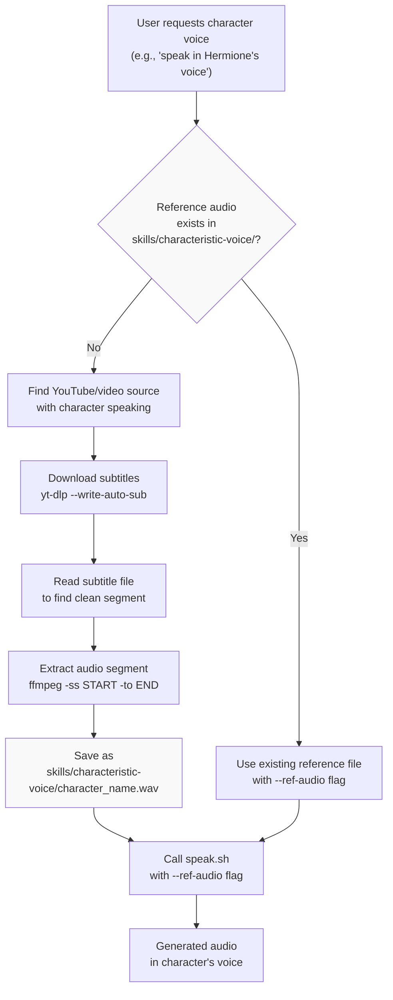
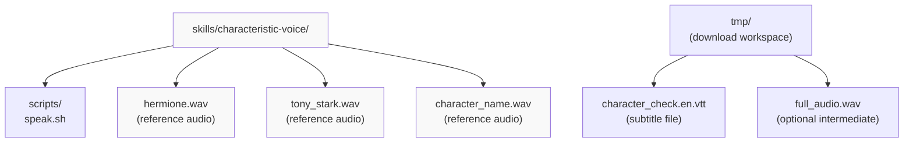
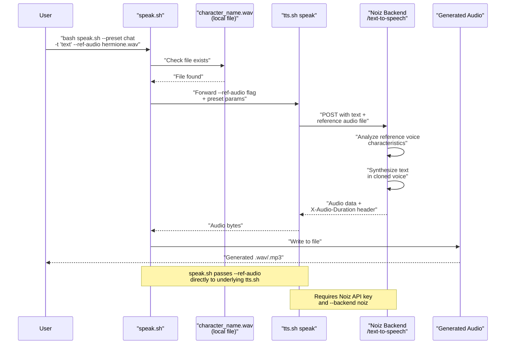
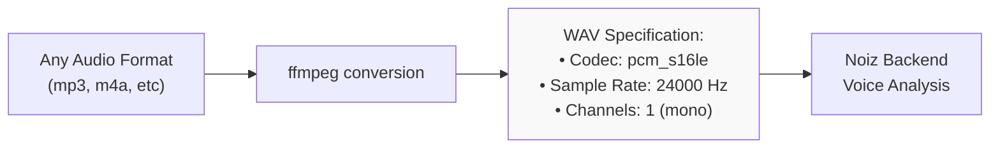

<!-- source: DeepWiki mcp.deepwiki.com · repo NoizAI/skills · page 4.2 Character Voice Cloning Setup · fetched 2026-10-26 -->

# Character Voice Cloning Setup

<details>
<summary>Relevant source files</summary>

The following files were used as context for generating this wiki page:

- [README.md](README.md)
- [skills/characteristic-voice/SKILL.md](skills/characteristic-voice/SKILL.md)
- [skills/chat-with-anyone/SKILL.md](skills/chat-with-anyone/SKILL.md)
- [skills/daily-news-caster/SKILL.md](skills/daily-news-caster/SKILL.md)

</details>


This document walks through the one-time setup process for cloning a specific character's voice from online sources. Once completed, the reference audio file can be reused indefinitely for generating speech in that character's voice. For information about emotional presets and fillers without voice cloning, see [4.1](#4.1). For the automated chat workflow that performs this process automatically, see [5.1](#5.1).

## Overview

The characteristic-voice skill supports voice cloning by providing a reference audio sample to the Noiz backend via the `--ref-audio` flag. The setup process involves locating suitable source material online, extracting a clean audio segment, and storing it in the skill directory for reuse.

**Key Principle**: This is a one-time setup per character. The extracted reference audio file is stored permanently and referenced in subsequent calls to `speak.sh`.

Sources: [skills/characteristic-voice/SKILL.md:65-79]()

## Process Flow



**Diagram**: Character voice cloning one-time setup workflow

Sources: [skills/characteristic-voice/SKILL.md:66-72](), [skills/chat-with-anyone/SKILL.md:20-47]()

## Prerequisites

| Requirement | Purpose | Installation Check |
|-------------|---------|-------------------|
| Noiz API key | Voice cloning backend | `cat ~/.noiz_api_key` |
| `yt-dlp` | Download videos and subtitles | `yt-dlp --version` |
| `ffmpeg` | Extract and convert audio | `ffmpeg -version` |
| `rg` (optional) | Search subtitle files efficiently | `rg --version` |

The Noiz backend is required for voice cloning functionality. Kokoro does not support `--ref-audio`. See [2.2](#2.2) and [2.3](#2.3) for API key configuration.

Sources: [skills/characteristic-voice/SKILL.md:81](), [README.md:84-92]()

## Step-by-Step Setup Guide

### Step 1: Find Suitable Source Material

Locate a video where the character speaks clearly for at least 10-30 seconds. Ideal sources:

- **Interviews**: Clear speech, minimal background noise
- **Monologues**: Single speaker, continuous speech
- **Voice memos**: Personal, characteristic delivery
- **Speeches**: Formal but clear articulation

**Avoid**: Music videos, action scenes with sound effects, overlapping dialogue.

Sources: [skills/characteristic-voice/SKILL.md:68](), [skills/chat-with-anyone/SKILL.md:26-28]()

### Step 2: Download Subtitles

Download the subtitle file without downloading the full video initially. This allows you to identify the optimal audio segment before committing to a full download.

```bash
yt-dlp "VIDEO_URL" \
  --write-auto-sub \
  --sub-lang en \
  --skip-download \
  -o tmp/character_check
```

**Output**: Generates `tmp/character_check.en.vtt` (or `.srt` depending on availability).

Sources: [skills/characteristic-voice/SKILL.md:69]()

### Step 3: Identify Clean Audio Segment

Read the subtitle file to find a continuous segment where:
- The character speaks for 10-30 seconds
- No long pauses or interruptions
- Clear, characteristic delivery

Using `rg` (ripgrep) to search:

```bash
rg -n "character's first line" tmp/character_check.en.vtt
```

**Example output**:
```
14:00:00:15.000 --> 00:00:25.000
character's first line and subsequent speech...
```

Note the timestamp range (e.g., `00:00:15` to `00:00:25`).

Sources: [skills/characteristic-voice/SKILL.md:70](), [skills/chat-with-anyone/SKILL.md:39]()

### Step 4: Extract Audio Segment

Two approaches depending on your workflow:

#### Option A: Download Specific Section Only

```bash
yt-dlp "VIDEO_URL" \
  -x \
  --audio-format wav \
  --download-sections *00:00:15-00:00:25 \
  -o skills/characteristic-voice/character_name
```

#### Option B: Download Full Audio, Then Trim

```bash
# Download full audio
yt-dlp "VIDEO_URL" -x --audio-format wav -o tmp/full_audio

# Extract segment with ffmpeg
ffmpeg -y \
  -i tmp/full_audio.wav \
  -ss 00:00:15 \
  -to 00:00:25 \
  -c:a pcm_s16le \
  -ar 24000 \
  -ac 1 \
  skills/characteristic-voice/character_name.wav
```

**Audio Format Requirements**:
- Format: WAV (PCM signed 16-bit little-endian)
- Sample rate: 24000 Hz recommended
- Channels: 1 (mono)

Sources: [skills/characteristic-voice/SKILL.md:71](), [skills/chat-with-anyone/SKILL.md:42-46]()

### Step 5: Verify and Use

Verify the extracted audio:

```bash
ffprobe skills/characteristic-voice/character_name.wav
```

Test the voice cloning:

```bash
bash skills/characteristic-voice/scripts/speak.sh \
  --preset chat \
  -t "This is a test in the character's voice." \
  --ref-audio skills/characteristic-voice/character_name.wav \
  -o test_output.wav
```

Sources: [skills/characteristic-voice/SKILL.md:73-79]()

## Directory Structure and File Naming



**Diagram**: File organization for character voice references

**Naming Conventions**:

| File Type | Location | Naming Pattern | Example |
|-----------|----------|----------------|---------|
| Reference audio | `skills/characteristic-voice/` | `character_name.wav` | `hermione.wav` |
| Temporary downloads | `tmp/` | `character_check.*` | `tmp/hermione_check.en.vtt` |
| Test outputs | Current directory or specified | `test_output.wav` | `test_hermione.wav` |

**Important**: Reference audio files are **not** tracked in git if the repository uses `.gitignore` patterns that exclude `.wav` files. Store them locally per installation.

Sources: [skills/characteristic-voice/SKILL.md:66-72]()

## Integration with speak.sh



**Diagram**: Runtime flow when using reference audio for voice cloning

The `--ref-audio` flag is forwarded from `speak.sh` to the underlying `tts.sh` command, which then passes it to the Noiz backend for processing. The preset (e.g., `--preset chat`) controls emotion parameters, while `--ref-audio` controls voice characteristics.

Sources: [skills/characteristic-voice/SKILL.md:73-81](), [skills/characteristic-voice/SKILL.md:86-101]()

## Command Reference

### Full Command Template

```bash
bash skills/characteristic-voice/scripts/speak.sh \
  --preset PRESET_NAME \
  -t "Text to speak" \
  --ref-audio skills/characteristic-voice/CHARACTER.wav \
  --backend noiz \
  -o output.wav
```

### Parameter Descriptions

| Parameter | Required | Description | Example |
|-----------|----------|-------------|---------|
| `--preset` | No | Emotional preset (goodnight, morning, comfort, celebrate, chat) | `--preset comfort` |
| `-t` | Yes | Text to synthesize | `-t "Hello there"` |
| `--ref-audio` | No | Path to reference audio file | `--ref-audio hermione.wav` |
| `--backend` | No | Force specific backend (defaults to noiz if API key exists) | `--backend noiz` |
| `-o` | Yes | Output file path | `-o output.wav` |
| `--format` | No | Output format (wav, mp3, opus) | `--format mp3` |
| `--voice-id` | No | Specific voice ID (overridden by --ref-audio) | `--voice-id voice_abc` |
| `--emo` | No | Custom emotion JSON (overrides preset) | `--emo '{"Joy":0.8}'` |
| `--speed` | No | Speech rate multiplier | `--speed 0.9` |

**Important**: When using `--ref-audio`, the `--backend noiz` flag is implicit but can be specified explicitly. Kokoro backend does not support voice cloning.

Sources: [skills/characteristic-voice/SKILL.md:88-101]()

## Technical Details

### Audio Format Specifications

The Noiz API expects reference audio in specific formats for optimal voice analysis:



**Diagram**: Audio format conversion pipeline for reference audio

**FFmpeg conversion command**:

```bash
ffmpeg -i input.m4a -c:a pcm_s16le -ar 24000 -ac 1 output.wav
```

Sources: [skills/chat-with-anyone/SKILL.md:42-46]()

### Voice Cloning Quality Factors

| Factor | Impact | Recommendation |
|--------|--------|----------------|
| **Segment length** | 10-30 seconds optimal | Too short: insufficient data; too long: may include variations |
| **Background noise** | High noise degrades clone quality | Choose clips with minimal music/effects |
| **Speech clarity** | Direct impact on intelligibility | Prefer close-mic recordings over distant/echoey sources |
| **Emotional range** | Reference emotion transfers to output | Choose neutral or representative tone |
| **Audio quality** | Better source = better clone | Use highest available quality (1080p video audio > 480p) |

### Backend Requirements

The voice cloning feature requires:

- **Noiz API key**: Set via `tts.sh config --set-api-key` (see [2.3](#2.3))
- **Network connectivity**: Cloud processing required
- **File size limits**: Reference audio typically under 5MB (30 seconds at 24kHz)

The Kokoro backend does **not** support `--ref-audio`. Attempting to use it will result in the flag being ignored.

Sources: [skills/characteristic-voice/SKILL.md:81](), [README.md:84-92]()

## Example Workflows

### Example 1: Creating Hermione Granger Voice

```bash
# 1. Download subtitle to find good segment
yt-dlp "https://youtube.com/watch?v=EXAMPLE" \
  --write-auto-sub --sub-lang en --skip-download \
  -o tmp/hermione_check

# 2. Search subtitle for dialogue
rg -n "It's leviOsa, not levioSA" tmp/hermione_check.en.vtt
# Output: 125:00:02:15.000 --> 00:02:28.000

# 3. Download that specific segment
yt-dlp "https://youtube.com/watch?v=EXAMPLE" \
  -x --audio-format wav \
  --download-sections *00:02:15-00:02:28 \
  -o skills/characteristic-voice/hermione

# 4. Test the voice
bash skills/characteristic-voice/scripts/speak.sh \
  --preset comfort \
  -t "Hmm... you're doing great. Keep going~" \
  --ref-audio skills/characteristic-voice/hermione.wav \
  -o hermione_comfort.wav
```

### Example 2: Using with Emotional Presets

```bash
# Morning greeting in character voice
bash skills/characteristic-voice/scripts/speak.sh \
  --preset morning \
  -t "Good morning~ Ready to start the day?" \
  --ref-audio skills/characteristic-voice/character.wav \
  -o morning.wav

# Goodnight message in character voice
bash skills/characteristic-voice/scripts/speak.sh \
  --preset goodnight \
  -t "Rest well... Sweet dreams~" \
  --ref-audio skills/characteristic-voice/character.wav \
  -o goodnight.wav
```

Sources: [skills/characteristic-voice/SKILL.md:73-79](), [skills/characteristic-voice/SKILL.md:88-101]()

## Troubleshooting

### Common Issues

| Problem | Cause | Solution |
|---------|-------|----------|
| "Kokoro backend doesn't support --ref-audio" | Using Kokoro with voice cloning | Add `--backend noiz` or configure API key |
| File not found error | Incorrect path to reference audio | Use absolute path or relative from current directory |
| Poor voice quality | Low-quality source or background noise | Extract from higher quality source with clearer speech |
| API authentication error | Missing or invalid API key | Run `tts.sh config --set-api-key YOUR_KEY` |
| Audio too short/long warning | Reference segment duration | Aim for 10-30 second segments |

### Validation Commands

```bash
# Check if reference file exists and is valid
test -f skills/characteristic-voice/character.wav && echo "File exists"

# Inspect audio properties
ffprobe -hide_banner skills/characteristic-voice/character.wav

# Verify API key is configured
test -f ~/.noiz_api_key && echo "API key configured"

# Test voice cloning with minimal text
bash skills/characteristic-voice/scripts/speak.sh \
  -t "Test" \
  --ref-audio skills/characteristic-voice/character.wav \
  -o test.wav \
  --backend noiz
```

Sources: [skills/characteristic-voice/SKILL.md:65-81]()

## Integration with Other Skills

The reference audio files created here are reusable across skills:

- **characteristic-voice**: Use with presets for emotional control
- **chat-with-anyone**: Automatic extraction (see [5.1](#5.1))
- **daily-news-caster**: Different hosts with different voices (see [5.2](#5.2))
- **video-translation**: Dub videos in original speaker's voice (see [5.3](#5.3))

**Example: Using same reference in daily-news-caster**:

```bash
# Host A with character voice
bash skills/tts/scripts/tts.sh speak \
  -t "Welcome to today's news" \
  --ref-audio skills/characteristic-voice/host_a.wav \
  -o line_01.wav

# Host B with different character voice
bash skills/tts/scripts/tts.sh speak \
  -t "Thanks for having me" \
  --ref-audio skills/characteristic-voice/host_b.wav \
  -o line_02.wav
```

Sources: [skills/daily-news-caster/SKILL.md:64-71]()

---

