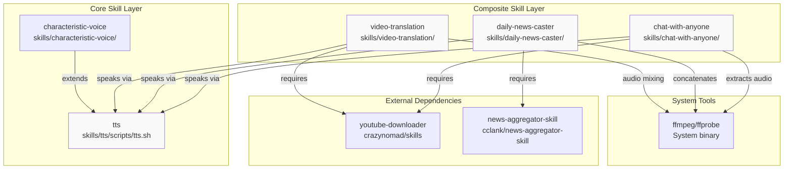
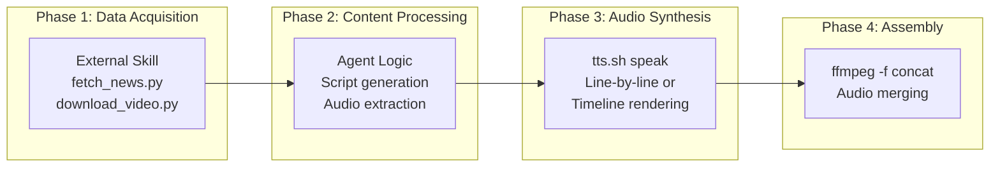
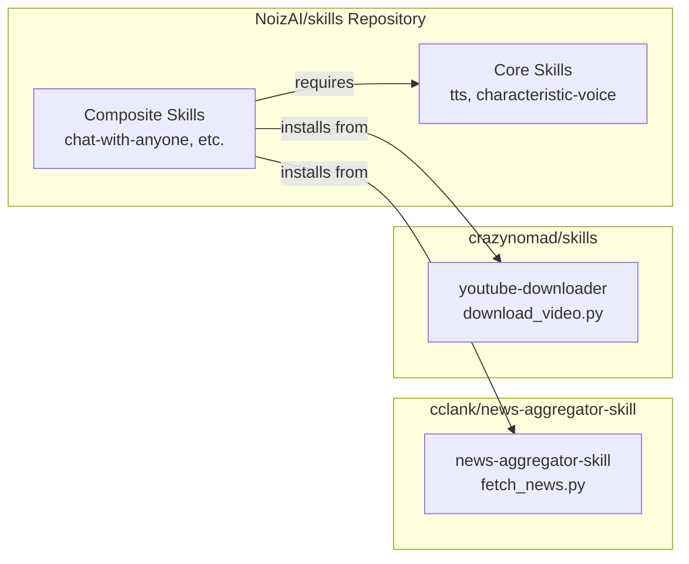

<!-- source: DeepWiki mcp.deepwiki.com · repo NoizAI/skills · page 5 Composite Skills · fetched 2026-10-26 -->

# Composite Skills

<details>
<summary>Relevant source files</summary>

The following files were used as context for generating this wiki page:

- [CONTRIBUTING.md](CONTRIBUTING.md)
- [README.md](README.md)
- [skills/README.md](skills/README.md)
- [skills/chat-with-anyone/SKILL.md](skills/chat-with-anyone/SKILL.md)
- [skills/daily-news-caster/SKILL.md](skills/daily-news-caster/SKILL.md)
- [skills/template-skill/SKILL.md](skills/template-skill/SKILL.md)
- [skills/template-skill/SKILL.zh-CN.md](skills/template-skill/SKILL.zh-CN.md)

</details>


**Purpose**: This page introduces composite skills—complex, multi-step capabilities that combine core skills with external dependencies to perform end-to-end workflows. Composite skills orchestrate processes like podcast generation, character voice cloning, and video dubbing by integrating the TTS skill, external tools (ffmpeg), and third-party skills from other repositories.

**Scope**: This page covers the composite skill architecture, dependency model, installation patterns, and common workflow structures. For detailed documentation of individual composite skills, see [Chat With Anyone](#5.1), [Daily News Caster](#5.2), and [Video Translation](#5.3). For the underlying TTS functionality that all composite skills depend on, see [TTS Skill](#3).

---

## What Are Composite Skills

Composite skills are **workflow orchestrators** that combine multiple capabilities to solve complex use cases. Unlike core skills (tts, characteristic-voice) which provide focused, reusable capabilities, composite skills implement multi-step processes by:

1. **Depending on core skills**: Always require `tts` for audio generation
2. **Integrating external dependencies**: Pull in skills from other GitHub repositories
3. **Orchestrating tools**: Execute ffmpeg, Python scripts, and bash commands in sequence
4. **Managing state**: Track intermediate files, extract audio segments, generate scripts

The three composite skills in the repository are:

| Skill Name | SKILL.md Location | Primary Use Case |
|------------|-------------------|------------------|
| `chat-with-anyone` | [skills/chat-with-anyone/SKILL.md:1-76]() | Roleplay conversations in cloned character voices |
| `daily-news-caster` | [skills/daily-news-caster/SKILL.md:1-89]() | Generate dual-host news podcasts from real-time data |
| `video-translation` | [skills/video-translation/SKILL.md]() | Dub videos into other languages with voice preservation |

**Sources**: [README.md:31-39](), [skills/chat-with-anyone/SKILL.md:1-7](), [skills/daily-news-caster/SKILL.md:1-8]()

---

## Architectural Pattern

Composite skills follow a consistent **external dependency + core skill** pattern. Each composite skill declares external dependencies in its workflow documentation and delegates audio synthesis to the TTS skill.

### Composite Skill Dependency Architecture



**Key Design Principle**: All composite skills converge on `tts.sh speak` or `tts.sh render` for audio generation. This creates a single point of control for voice synthesis, backend selection, and audio output.

**Sources**: [README.md:33-39](), Diagram 1 from high-level architecture

---

## Dependency Declaration Model

Composite skills declare dependencies **in their SKILL.md workflow sections**, not in a separate manifest file. The agent reads the workflow instructions and installs dependencies on-demand.

### Dependency Installation Pattern

**Example from daily-news-caster**:

```markdown
### Step 1: Ensure Skills are Installed
If the `news-aggregator-skill` and `tts` skills are not already installed in the workspace, run the following commands to install them:
```bash
npx skills add https://github.com/cclank/news-aggregator-skill --skill news-aggregator-skill -y
npx skills add https://github.com/noizai/skills --skill tts -y
```
```

This pattern appears in [skills/daily-news-caster/SKILL.md:14-19]().

**Key characteristics**:
- **Lazy installation**: Dependencies are installed only when the skill is first used
- **Cross-repository**: External skills are fetched from different GitHub repos
- **Explicit paths**: Workflow instructions reference exact script paths (e.g., `skills/news-aggregator-skill/scripts/fetch_news.py`)

**Sources**: [skills/daily-news-caster/SKILL.md:14-28](), [skills/chat-with-anyone/SKILL.md:72-75]()

---

## Workflow Execution Pattern

Composite skills implement **multi-phase workflows** where each phase performs a distinct operation. All composite skills follow this general structure:

### Common Workflow Phases



**Sources**: Diagram 5 from high-level architecture, [skills/daily-news-caster/SKILL.md:30-83]()

---

## Line-by-Line Audio Generation

A critical pattern shared by `daily-news-caster` and `chat-with-anyone` is **line-by-line audio generation** instead of sending the entire script to TTS at once. This enables:

1. **Per-line voice control**: Different voices for different speakers
2. **Reference audio per host**: Each host can use a different `--ref-audio` file
3. **Memory efficiency**: Avoid sending large scripts to API
4. **Fine-grained error handling**: Retry individual lines if synthesis fails

### Line-by-Line Generation Workflow

```mermaid
sequenceDiagram
    participant Agent
    participant Script["podcast_script.md<br/>Dual-host dialogue"]
    participant TTS["tts.sh speak"]
    participant Audio["Temporary audio files"]
    participant FFmpeg
    
    Agent->>Script: "Parse line by line"
    
    loop "For each dialogue line"
        Script->>Agent: "Host A: [text]"
        Agent->>TTS: "speak -t 'text' --ref-audio hostA.wav -o line_01.wav"
        TTS->>Audio: "line_01.wav"
        
        Script->>Agent: "Host B: [text]"
        Agent->>TTS: "speak -t 'text' --ref-audio hostB.wav -o line_02.wav"
        TTS->>Audio: "line_02.wav"
    end
    
    Agent->>Agent: "Create list.txt<br/>file 'line_01.wav'<br/>file 'line_02.wav'"
    Agent->>FFmpeg: "ffmpeg -f concat -safe 0 -i list.txt -c copy output.wav"
    FFmpeg->>Audio: "podcast_output.wav"
```

**Implementation Example**:

From [skills/daily-news-caster/SKILL.md:63-82]():

```bash
# Generate Audio for Each Line
bash path/to/tts.sh speak -t "Welcome to today's news roundup..." \
  --backend noiz --ref-audio path/to/host_A.wav -o line_01.wav

bash path/to/tts.sh speak -t "The main takeaway is that..." \
  --backend noiz --ref-audio path/to/host_B.wav -o line_02.wav

# Concatenate with ffmpeg
echo "file 'line_01.wav'" > list.txt
echo "file 'line_02.wav'" >> list.txt
ffmpeg -f concat -safe 0 -i list.txt -c copy podcast_output.wav
```

**Sources**: [skills/daily-news-caster/SKILL.md:58-82](), Diagram 5 from high-level architecture

---

## File Structure and Script Paths

Composite skills store their scripts in a `scripts/` subdirectory, but workflow execution happens **at the agent level**—the agent reads SKILL.md and executes commands, rather than the composite skill providing its own wrapper script.

### Typical Composite Skill Directory Structure

```
skills/
├── chat-with-anyone/
│   ├── SKILL.md                    # Workflow instructions
│   └── [no scripts directory]       # Agent executes inline commands
├── daily-news-caster/
│   ├── SKILL.md                    # Workflow instructions
│   └── [no scripts directory]       # Agent executes inline commands
└── video-translation/
    ├── SKILL.md                    # Workflow instructions
    └── scripts/                    # Optional helper scripts
        └── translate.py
```

**Contrast with Core Skills**:

```
skills/
├── tts/                            # Core skill
│   ├── SKILL.md
│   └── scripts/
│       ├── tts.sh                 # Main entry point
│       ├── tts.py
│       └── render_timeline.py
└── characteristic-voice/           # Core skill
    ├── SKILL.md
    └── scripts/
        └── speak.sh               # Main entry point
```

**Key Difference**: Core skills provide executable scripts (`tts.sh`, `speak.sh`). Composite skills provide **workflow documentation** with inline bash commands that the agent executes directly.

**Sources**: [skills/README.md:1-16](), [skills/daily-news-caster/SKILL.md:1-89](), [skills/chat-with-anyone/SKILL.md:1-76]()

---

## Installation and Discovery

Composite skills are installed the same way as core skills, using the `npx skills add` command.

### Installing a Composite Skill

```bash
# Install chat-with-anyone from GitHub
npx skills add NoizAI/skills --full-depth --skill chat-with-anyone -y

# Install daily-news-caster
npx skills add NoizAI/skills --full-depth --skill daily-news-caster -y

# List all available skills (including composite)
npx skills add NoizAI/skills --list --full-depth
```

**Automatic Dependency Resolution**: When a composite skill is installed, the agent reads its SKILL.md and installs external dependencies on first use. For example, when `daily-news-caster` is first invoked, the agent will automatically run:

```bash
npx skills add https://github.com/cclank/news-aggregator-skill --skill news-aggregator-skill -y
npx skills add https://github.com/noizai/skills --skill tts -y
```

This happens transparently based on the workflow instructions in [skills/daily-news-caster/SKILL.md:14-19]().

**Sources**: [README.md:8-22](), [skills/daily-news-caster/SKILL.md:14-19]()

---

## Skill Catalog View

The repository's skill catalog distinguishes composite skills from core skills in the documentation table:

| Name | Type | External Dependencies | Installation Command |
|------|------|----------------------|---------------------|
| `tts` | Core | Kokoro CLI, Noiz API (optional) | `npx skills add NoizAI/skills --skill tts -y` |
| `characteristic-voice` | Core | tts | `npx skills add NoizAI/skills --skill characteristic-voice -y` |
| `chat-with-anyone` | **Composite** | tts, youtube-downloader, ffmpeg | `npx skills add NoizAI/skills --skill chat-with-anyone -y` |
| `daily-news-caster` | **Composite** | tts, news-aggregator-skill, ffmpeg | `npx skills add NoizAI/skills --skill daily-news-caster -y` |
| `video-translation` | **Composite** | tts, youtube-downloader, ffmpeg | `npx skills add NoizAI/skills --skill video-translation -y` |

**Sources**: [README.md:33-39](), Diagram 3 from high-level architecture

---

## Cross-Repository Integration

Composite skills demonstrate the repository's **modular architecture** by pulling dependencies from different GitHub organizations:

### External Dependency Sources



This enables:
- **Community contributions**: External skills can be developed independently
- **Loose coupling**: Composite skills specify GitHub URLs, not local paths
- **Version flexibility**: Each external skill can evolve independently

**Example Installation Command**:

From [skills/daily-news-caster/SKILL.md:17]():
```bash
npx skills add https://github.com/cclank/news-aggregator-skill --skill news-aggregator-skill -y
```

**Sources**: [skills/daily-news-caster/SKILL.md:17-18](), [skills/chat-with-anyone/SKILL.md:32-36]()

---

## SKILL.md Workflow Structure

All composite skills follow a standardized SKILL.md format with these required sections:

### Required SKILL.md Sections

| Section | Purpose | Example Content |
|---------|---------|----------------|
| **Front Matter** | Metadata for skill discovery | `name: daily-news-caster`<br/>`description: Fetches news and generates podcast` |
| **Triggers** | Natural language patterns that invoke the skill | "我想跟xxx聊天"<br/>"generate today's news podcast" |
| **Workflow** | Step-by-step execution instructions | "Step 1: Ensure Skills are Installed"<br/>"Step 2: Fetch the Latest News" |
| **Dependencies** | External skills and tools required | youtube-downloader, ffmpeg, tts |
| **Example Conversation** | Sample agent-user interaction | Shows complete workflow execution |

**Template Reference**: [skills/template-skill/SKILL.md:1-55]()

**Sources**: [skills/daily-news-caster/SKILL.md:1-89](), [skills/chat-with-anyone/SKILL.md:1-76](), [CONTRIBUTING.md:10-15]()

---

## Common Patterns Across Composite Skills

### Pattern 1: Audio Extraction with ffmpeg

Both `chat-with-anyone` and `video-translation` extract audio segments from downloaded videos:

```bash
# Extract 10-30 second reference audio segment
ffmpeg -y -i "tmp/character_audio/VideoTitle.m4a" \
  -ss 00:01:15 -to 00:01:30 \
  -c:a pcm_s16le -ar 24000 -ac 1 \
  "skills/chat-with-anyone/character_name_ref.wav"
```

From [skills/chat-with-anyone/SKILL.md:42-46]().

### Pattern 2: Reference Audio Voice Cloning

All composite skills that need character-specific voices use `--ref-audio`:

```bash
bash skills/tts/scripts/tts.sh speak \
  -t "Hello there!" \
  --ref-audio "skills/chat-with-anyone/character_name_ref.wav" \
  -o "output.wav"
```

From [skills/chat-with-anyone/SKILL.md:52-54]().

### Pattern 3: Dual-Host Script Generation

`daily-news-caster` generates **Q&A style dialogue** with speaker labels:

```markdown
**Host A:** Welcome to today's news roundup. What are the core implications?

**Host B:** The main takeaway is that... [concise answer].

**Host A:** That's fascinating. But does this raise security concerns?

**Host B:** Exactly. Experts are pointing out that... [analysis].
```

From [skills/daily-news-caster/SKILL.md:42-56]().

**Sources**: [skills/chat-with-anyone/SKILL.md:42-54](), [skills/daily-news-caster/SKILL.md:32-56]()

---

## Limitations and Design Boundaries

Composite skills inherit limitations from their dependencies:

1. **TTS backend required**: All composite skills require either Kokoro or Noiz backend configured
2. **Voice cloning requires Noiz**: Reference audio (`--ref-audio`) only works with Noiz backend, not Kokoro
3. **External skill availability**: Cross-repository dependencies must be publicly accessible
4. **ffmpeg dependency**: All composite skills require ffmpeg/ffprobe installed on system
5. **Network access**: `youtube-downloader` and `news-aggregator-skill` require internet connectivity

**Sources**: [skills/chat-with-anyone/SKILL.md:72-75](), [skills/daily-news-caster/SKILL.md:14-28]()

---

## Summary

Composite skills represent the **application layer** of the skills ecosystem. They:

1. **Orchestrate workflows** by combining core skills, external dependencies, and system tools
2. **Follow a standard pattern**: External data acquisition → Content processing → TTS synthesis → Audio assembly
3. **Use line-by-line generation** to enable per-speaker voice control and memory efficiency
4. **Declare dependencies in SKILL.md** rather than separate manifest files
5. **Integrate cross-repository skills** via `npx skills add` with GitHub URLs
6. **Converge on TTS** as the universal audio synthesis interface

For implementation details of individual composite skills, see [Chat With Anyone](#5.1), [Daily News Caster](#5.2), and [Video Translation](#5.3).

**Sources**: [README.md:1-110](), [skills/daily-news-caster/SKILL.md:1-89](), [skills/chat-with-anyone/SKILL.md:1-76](), Diagrams 1, 3, 5 from high-level architecture

---

