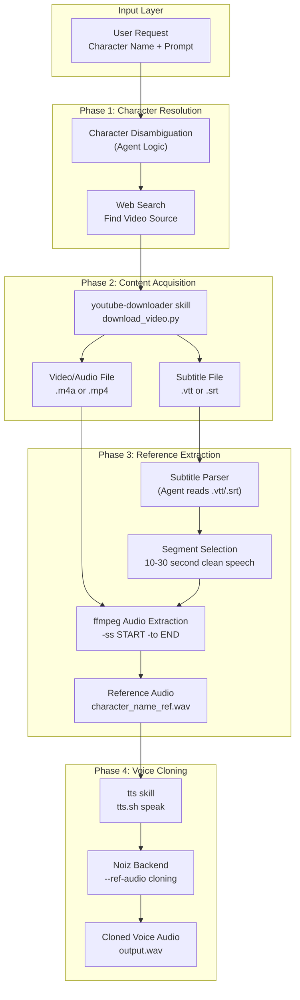
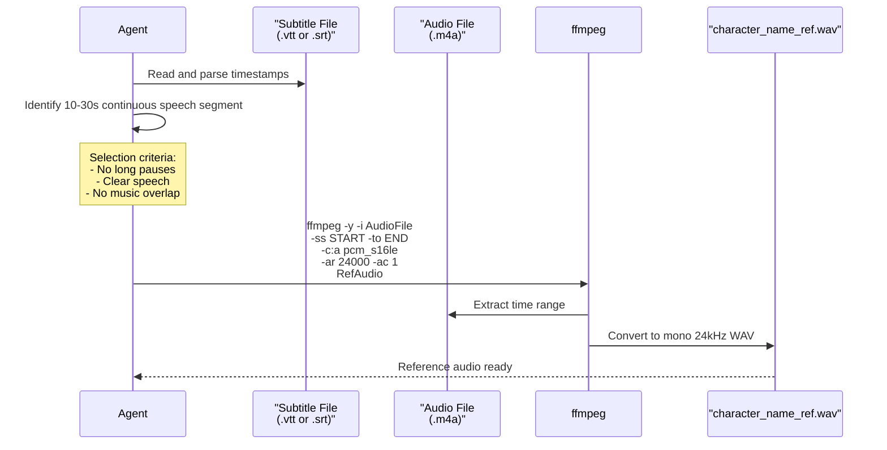
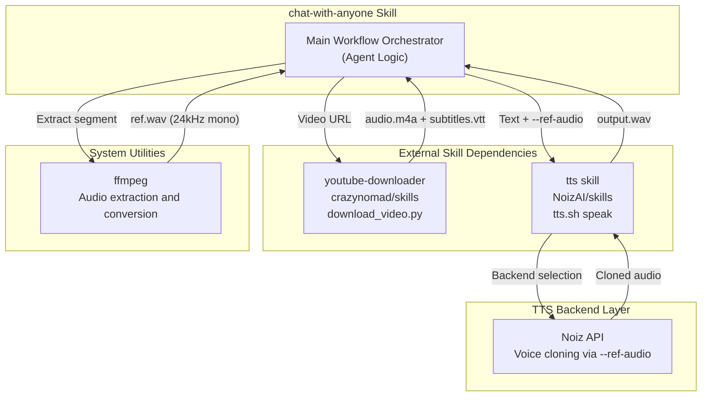
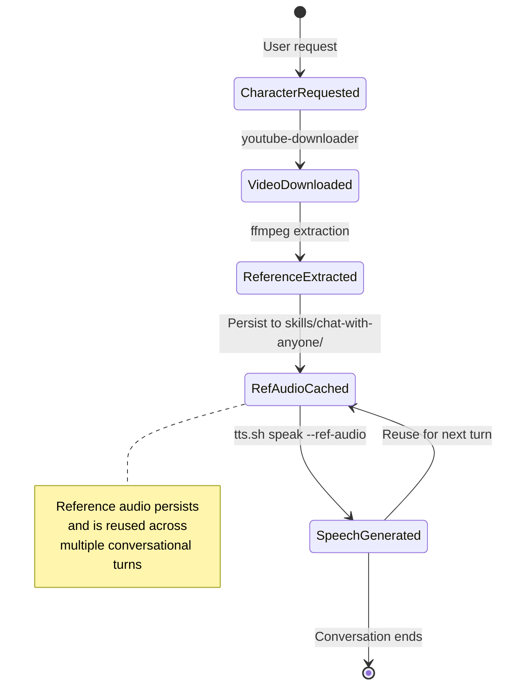
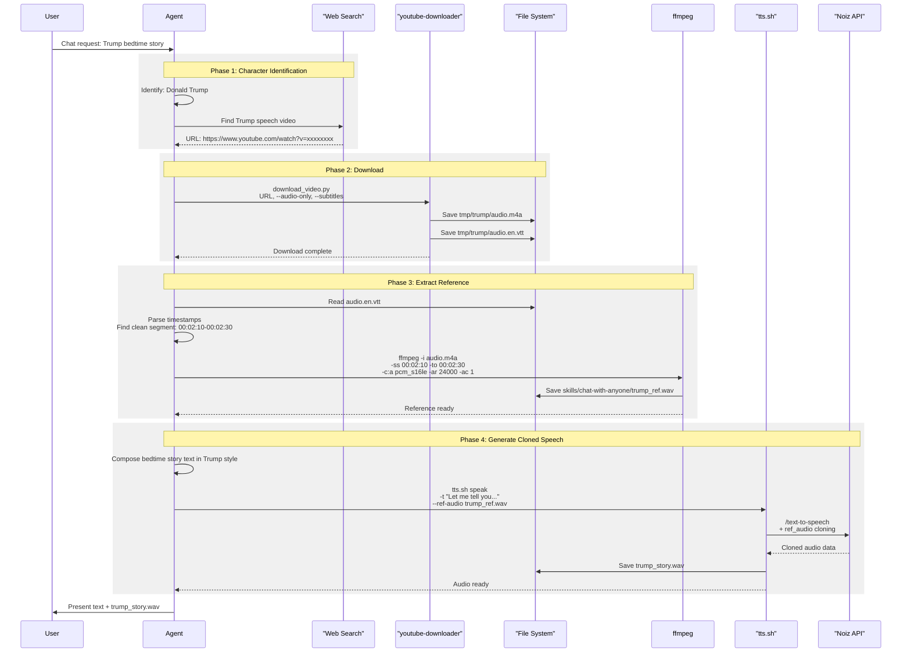
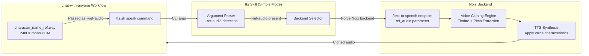

<!-- source: DeepWiki mcp.deepwiki.com · repo NoizAI/skills · page 5.1 Chat With Anyone · fetched 2026-10-26 -->

# Chat With Anyone

<details>
<summary>Relevant source files</summary>

The following files were used as context for generating this wiki page:

- [README.md](README.md)
- [skills/chat-with-anyone/SKILL.md](skills/chat-with-anyone/SKILL.md)
- [skills/daily-news-caster/SKILL.md](skills/daily-news-caster/SKILL.md)

</details>


## Purpose and Scope

The `chat-with-anyone` skill enables conversational interactions in the voice of any real person or fictional character by automatically locating their speech online, extracting a clean audio reference sample, and using voice cloning to generate responses. This composite skill orchestrates multiple sub-systems: web search for video sources, video/audio downloading, subtitle parsing, audio segment extraction, and voice-cloned text-to-speech synthesis.

This page documents the architectural workflow, technical implementation details, and integration patterns for the `chat-with-anyone` skill. For the underlying voice cloning mechanism, see [Simple Mode - Text to Audio](#3.1). For the TTS backend that powers voice synthesis, see [TTS (Text-to-Speech) Skill](#3) and [Noiz Backend (Cloud)](#2.2).

**Sources:** [skills/chat-with-anyone/SKILL.md:1-76]()

---

## System Overview

The `chat-with-anyone` skill implements a five-phase workflow that transforms a character name into voice-cloned audio output:



**Workflow Diagram: Five-Phase Character Voice Cloning Pipeline**

The skill operates as a composite workflow orchestrator, delegating specialized tasks to external skills (`youtube-downloader`, `tts`) and system utilities (`ffmpeg`). The critical architectural decision is the one-time reference audio extraction pattern: rather than re-downloading for each message, the extracted reference audio is persisted and reused across multiple conversational turns.

**Sources:** [skills/chat-with-anyone/SKILL.md:18-54]()

---

## Detailed Workflow Architecture

### Phase 1: Character Disambiguation and Video Discovery

When a user invokes the skill with a character name (e.g., "我想跟特朗普聊天"), the system first performs disambiguation if the name is ambiguous. For example, "Spider-Man actor" requires clarification between Tobey Maguire, Andrew Garfield, and Tom Holland.

The agent then uses web search capabilities to locate a suitable video source containing clear speech by the character. Selection criteria prioritize:

- Interviews, speeches, or monologues (high speech-to-silence ratio)
- Minimal background music or overlapping voices
- Clear audio quality
- Platform compatibility: YouTube, Bilibili, TikTok

**Sources:** [skills/chat-with-anyone/SKILL.md:22-28]()

### Phase 2: Content Acquisition via youtube-downloader

The system invokes the `youtube-downloader` skill to fetch both audio and subtitle data:

```bash
python skills/youtube-downloader/scripts/download_video.py "VIDEO_URL" \
  -o "tmp/character_audio" \
  --audio-only \
  --subtitles
```

This command downloads:
- Audio file (typically `.m4a` format)
- Subtitle file (`.vtt` or `.srt` format, auto-generated or manual)

The `--audio-only` flag optimizes bandwidth by skipping video streams. The download completes before proceeding to Phase 3.

**Sources:** [skills/chat-with-anyone/SKILL.md:30-36]()

### Phase 3: Reference Audio Extraction

This phase performs the core audio engineering task: extracting a clean, continuous speech segment suitable for voice cloning.



**Sequence Diagram: Reference Audio Extraction Process**

The ffmpeg command performs three operations simultaneously:
1. **Time-based extraction:** `-ss START -to END` defines the segment boundaries
2. **Format conversion:** `-c:a pcm_s16le` encodes to PCM 16-bit signed integer
3. **Normalization:** `-ar 24000 -ac 1` resamples to 24kHz mono (optimal for TTS voice cloning)

Example invocation from the skill documentation:

```bash
ffmpeg -y -i "tmp/character_audio/VideoTitle.m4a" \
  -ss 00:01:15 -to 00:01:30 \
  -c:a pcm_s16le -ar 24000 -ac 1 \
  "skills/chat-with-anyone/character_name_ref.wav"
```

**Sources:** [skills/chat-with-anyone/SKILL.md:38-46]()

### Phase 4: Voice-Cloned Speech Generation

The extracted reference audio is passed to the `tts` skill with the `--ref-audio` parameter:

```bash
bash skills/tts/scripts/tts.sh speak \
  -t "Hello there! I am ready to chat with you." \
  --ref-audio "skills/chat-with-anyone/character_name_ref.wav" \
  -o "output.wav"
```

The `speak` subcommand invokes the Noiz backend's voice cloning API (reference audio cloning requires the cloud backend; Kokoro does not support this feature). The backend analyzes the reference audio's voice characteristics (timbre, pitch, speaking rate) and applies them to the synthesized speech.

**Sources:** [skills/chat-with-anyone/SKILL.md:48-54]()

### Phase 5: Conversational Turn Management

Once the reference audio is established, subsequent conversational turns reuse the same `character_name_ref.wav` file without re-downloading. The agent maintains the character's persona and generates responses by:

1. Formulating text response in character
2. Invoking `tts.sh speak` with the cached reference audio
3. Presenting both text and audio output to the user

**Sources:** [skills/chat-with-anyone/SKILL.md:48-54]()

---

## Dependency Integration Architecture



**Dependency Integration Diagram: Skill and Utility Relationships**

### Dependency Table

| Dependency | Source | Purpose | Required Parameters |
|------------|--------|---------|-------------------|
| `youtube-downloader` | `crazynomad/skills` | Download video/audio and subtitles from online sources | `VIDEO_URL`, `-o OUTPUT_DIR`, `--audio-only`, `--subtitles` |
| `ffmpeg` | System utility | Audio segment extraction and format conversion | `-i INPUT`, `-ss START`, `-to END`, `-c:a pcm_s16le`, `-ar 24000`, `-ac 1` |
| `tts` | `NoizAI/skills` | Voice-cloned text-to-speech synthesis | `-t TEXT`, `--ref-audio PATH`, `-o OUTPUT` |
| Noiz Backend | Cloud API | Voice cloning engine (invoked via `tts` skill) | Requires API key; see [API Key Configuration](#2.3) |

**Sources:** [skills/chat-with-anyone/SKILL.md:72-76](), [README.md:36]()

---

## File Structure and Artifacts

### Directory Layout

```
skills/chat-with-anyone/
├── SKILL.md                      # Skill definition and workflow documentation
├── scripts/                      # (Future: automation scripts)
└── character_name_ref.wav        # Cached reference audio files (user-generated)

tmp/
└── character_audio/              # Temporary download directory
    ├── VideoTitle.m4a            # Downloaded audio
    └── VideoTitle.en.vtt         # Downloaded subtitles
```

The skill does not include pre-built scripts for automation; the workflow is intended to be orchestrated by an AI agent following the instructions in `SKILL.md`. Reference audio files are stored directly in `skills/chat-with-anyone/` for persistence across sessions.

**Sources:** [skills/chat-with-anyone/SKILL.md:34-46]()

### Artifact Lifecycle



**State Diagram: Reference Audio Lifecycle**

**Sources:** [skills/chat-with-anyone/SKILL.md:48-54]()

---

## Command-Line Interface Mapping

While `chat-with-anyone` is primarily agent-orchestrated, the underlying commands map to specific executables:

### Step-by-Step CLI Commands

| Workflow Step | Command Template | File Reference |
|--------------|------------------|----------------|
| Download video | `python skills/youtube-downloader/scripts/download_video.py "URL" -o "tmp/character_audio" --audio-only --subtitles` | [skills/chat-with-anyone/SKILL.md:34-36]() |
| Extract reference audio | `ffmpeg -y -i "tmp/character_audio/audio.m4a" -ss START -to END -c:a pcm_s16le -ar 24000 -ac 1 "skills/chat-with-anyone/ref.wav"` | [skills/chat-with-anyone/SKILL.md:44-46]() |
| Generate cloned speech | `bash skills/tts/scripts/tts.sh speak -t "TEXT" --ref-audio "skills/chat-with-anyone/ref.wav" -o "output.wav"` | [skills/chat-with-anyone/SKILL.md:52-54]() |

### Critical Parameters

**ffmpeg audio extraction parameters:**
- `-c:a pcm_s16le`: Codec selection for uncompressed 16-bit PCM (ensures compatibility)
- `-ar 24000`: Sample rate of 24kHz (Noiz backend's expected format)
- `-ac 1`: Mono audio (voice cloning models perform better with single-channel input)

**tts.sh speak parameters:**
- `--ref-audio PATH`: Path to reference audio for voice cloning
- Backend auto-selection: Noiz required (Kokoro does not support voice cloning)

**Sources:** [skills/chat-with-anyone/SKILL.md:44-54]()

---

## Example Conversation Flow

### User Request to Audio Output

**User Input:** "我想跟特朗普聊天，让他给我讲个睡前故事。" (I want to chat with Trump, have him tell me a bedtime story.)

**Agent Execution Trace:**



**Example Conversation Flow Sequence Diagram**

**Agent Output:**
- Text response: "Let me tell you a tremendous story, maybe the best story ever told..." (formatted in character)
- Audio file: `trump_story.wav` (24kHz mono WAV with Trump's cloned voice)

**Sources:** [skills/chat-with-anyone/SKILL.md:58-71]()

---

## Trigger Patterns and Use Cases

### Supported Trigger Phrases

The skill recognizes natural language patterns indicating character role-play or voice simulation:

| Language | Trigger Pattern | Example |
|----------|----------------|---------|
| Chinese | 我想跟xxx聊天 | 我想跟马斯克聊天 |
| Chinese | 你来扮演xxx跟我说话 | 你来扮演周星驰跟我说话 |
| Chinese | 让xxx给我讲讲这篇文章 | 让乔布斯给我讲讲这篇文章 |
| Chinese | 用xxx的声音说 | 用张国荣的声音说这段话 |
| English | Talk to me like xxx | Talk to me like Morgan Freeman |
| English | Roleplay as xxx | Roleplay as Sherlock Holmes |

**Sources:** [skills/chat-with-anyone/SKILL.md:10-16]()

### Common Use Cases

1. **Celebrity Conversations:** Chat with public figures (politicians, actors, entrepreneurs)
2. **Historical Figures:** Interact with historical personalities using archival audio
3. **Fictional Characters:** Roleplay with characters portrayed by specific actors
4. **Educational Content:** Have experts explain topics in their voice (e.g., "让费曼给我讲讲量子力学")
5. **Multi-Turn Dialogue:** Maintain character consistency across extended conversations

**Sources:** [skills/chat-with-anyone/SKILL.md:3]()

---

## Integration with Core TTS Skill

### Voice Cloning Parameter Flow



**Integration Diagram: TTS Skill Parameter Passing**

The `--ref-audio` parameter triggers automatic backend selection: if present, the system uses the Noiz backend regardless of other configuration, since Kokoro does not support voice cloning. For details on the `speak` command and reference audio processing, see [Simple Mode - Text to Audio](#3.1).

**Sources:** [skills/chat-with-anyone/SKILL.md:48-54](), [skills/chat-with-anyone/SKILL.md:72-76]()

---

## Limitations and Constraints

### Technical Limitations

| Limitation | Impact | Workaround |
|------------|--------|------------|
| **Noiz Backend Required** | Voice cloning unavailable with Kokoro local backend | Ensure API key configured; see [API Key Configuration](#2.3) |
| **Reference Audio Quality** | Poor source audio degrades cloning accuracy | Select high-quality interview/speech videos with minimal noise |
| **Language-Specific Sources** | Limited availability for non-English characters | Use bilingual sources or accept accent in cloned voice |
| **Subtitle Accuracy** | Auto-generated subtitles may have timestamp errors | Manually verify segment selection or use manually-subtitled videos |

### Workflow Constraints

- **Agent-Orchestrated Only:** No standalone CLI script; requires AI agent to execute the workflow
- **Single Voice Per Session:** Multiple characters in one conversation require separate reference audio extraction for each
- **Storage Accumulation:** Reference audio files persist indefinitely; manual cleanup required

**Sources:** [skills/chat-with-anyone/SKILL.md:72-76]()

---

## Performance Considerations

### Processing Time Breakdown

Typical latency for first message (including setup):

```mermaid
gantt
    title Character Voice Cloning Timeline (First Message)
    dateFormat X
    axisFormat %s

    section Phase 1
    Web search + video selection :0, 15s
    
    section Phase 2
    Video download (audio-only) :15s, 30s
    Subtitle download :15s, 5s
    
    section Phase 3
    Subtitle parsing :45s, 5s
    ffmpeg extraction :50s, 3s
    
    section Phase 4
    TTS API call (Noiz) :53s, 10s
    
    Total: ~63 seconds :crit, 0, 63s
```

**Performance Timeline for Initial Setup**

Subsequent messages reuse the cached reference audio, reducing latency to ~10 seconds (TTS generation only).

**Sources:** [skills/chat-with-anyone/SKILL.md:30-54]()

---

## Security and Privacy

### Data Flow and Storage

- **Local Storage:** Reference audio files stored locally in `skills/chat-with-anyone/`
- **Temporary Files:** Downloaded videos/audio stored in `tmp/` directory
- **API Transmission:** Reference audio uploaded to Noiz API for voice cloning
- **Credential Requirements:** Noiz API key required; see [Credential Management](#8.2)

### Privacy Considerations

The skill sends reference audio and generated text to the Noiz cloud backend. For maximum privacy when working with sensitive content, consider:

1. Using the Kokoro local backend (though voice cloning will be unavailable)
2. Reviewing reference audio content before generation
3. Manually cleaning up persisted reference audio files after use

**Sources:** [skills/chat-with-anyone/SKILL.md:72-76]()

---

