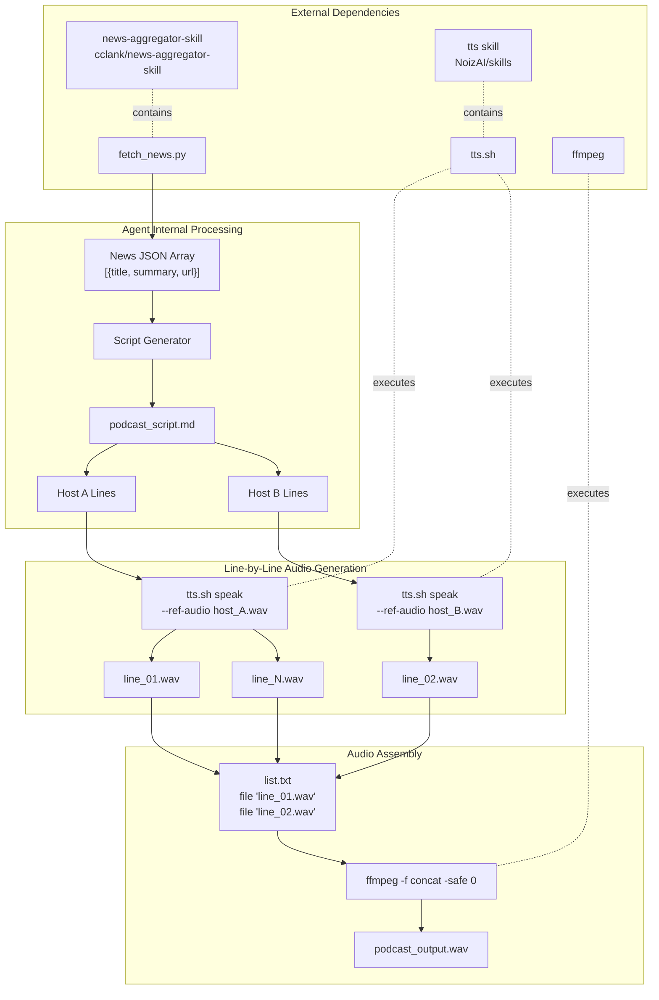
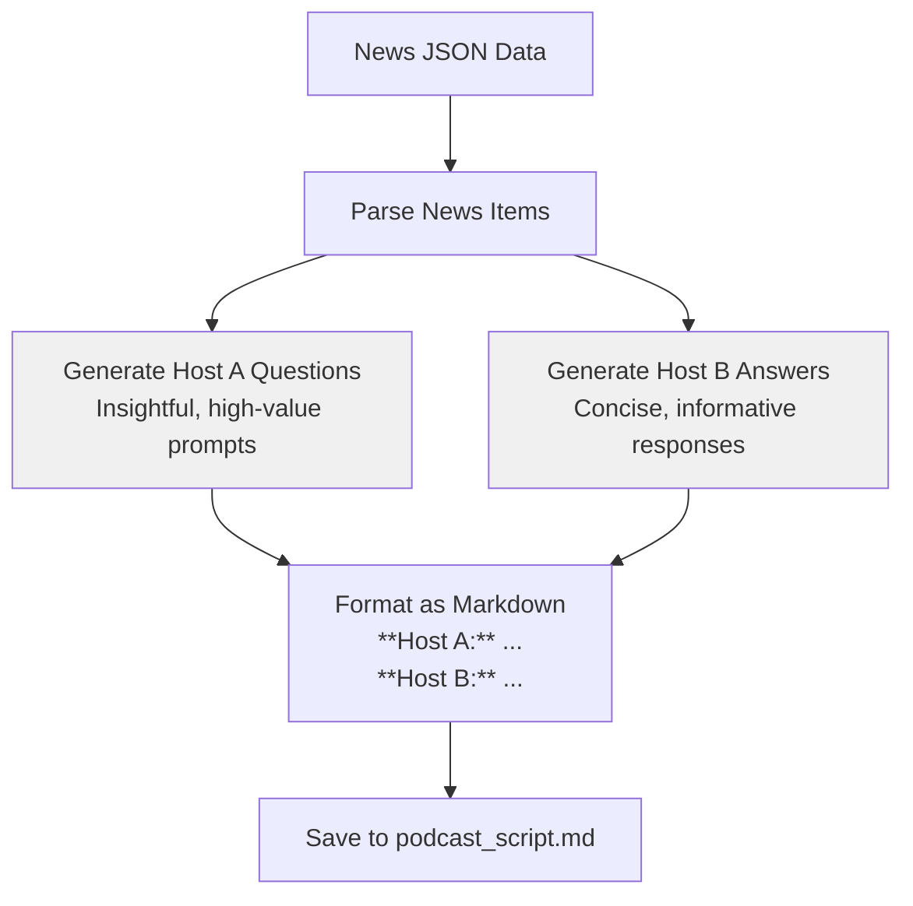
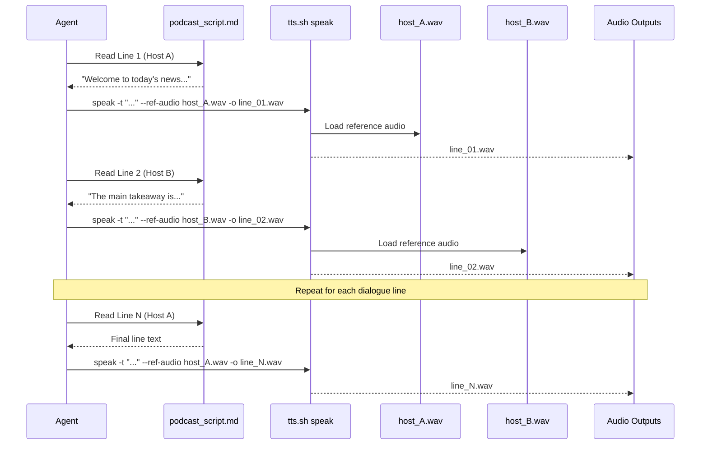
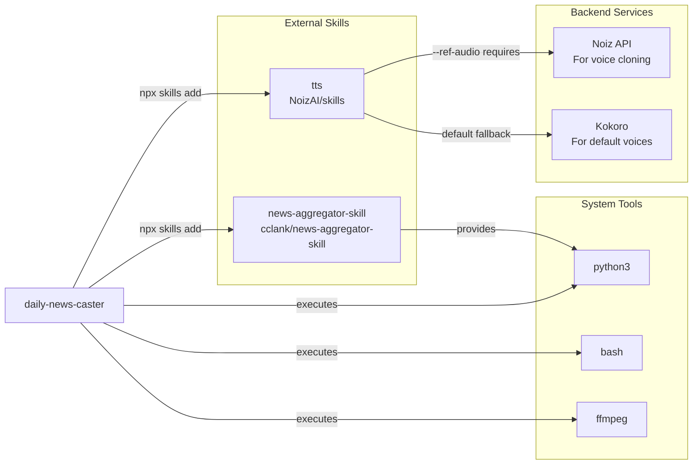

<!-- source: DeepWiki mcp.deepwiki.com · repo NoizAI/skills · page 5.2 Daily News Caster · fetched 2026-10-26 -->

# Daily News Caster

<details>
<summary>Relevant source files</summary>

The following files were used as context for generating this wiki page:

- [README.md](README.md)
- [skills/chat-with-anyone/SKILL.md](skills/chat-with-anyone/SKILL.md)
- [skills/daily-news-caster/SKILL.md](skills/daily-news-caster/SKILL.md)

</details>


The Daily News Caster skill generates two-person conversational podcast audio from real-time news sources. It fetches news articles, formats them into a dual-host Q&A script, and synthesizes audio line-by-line with optional voice cloning for each host. This skill is a composite workflow that orchestrates the `news-aggregator-skill` for data acquisition and the `tts` skill for audio generation.

For character-based voice cloning workflows, see [Chat With Anyone](#5.1). For general text-to-speech synthesis, see [TTS (Text-to-Speech) Skill](#3). For video dubbing workflows, see [Video Translation](#5.3).

## Purpose and Scope

This skill is designed to:
- Automatically fetch and aggregate news from multiple sources
- Transform news data into a conversational podcast script with two distinct hosts
- Generate time-synced audio for each dialogue line
- Assemble individual audio segments into a complete podcast file
- Support voice cloning for personalized host voices

The skill does **not** handle real-time streaming, multi-language translation, or advanced audio effects like background music or sound effects.

**Sources:** [skills/daily-news-caster/SKILL.md:1-89]()

## Architecture Overview



**Diagram: Daily News Caster Data Flow and Component Dependencies**

The architecture follows a five-phase pipeline: (1) news acquisition via external skill, (2) internal script generation, (3) line-by-line TTS invocation, (4) audio concatenation via ffmpeg, and (5) result presentation. The key architectural decision is to generate audio **line-by-line** rather than sending the entire script to the TTS API, enabling per-line voice control and avoiding API payload size limits.

**Sources:** [skills/daily-news-caster/SKILL.md:10-88]()

## Five-Phase Workflow

### Phase 1: Skill Installation

Before execution, the skill ensures dependencies are available. Two external skills must be installed:

| Skill | Repository | Purpose |
|-------|-----------|---------|
| `news-aggregator-skill` | `cclank/news-aggregator-skill` | Fetches real-time news from multiple sources |
| `tts` | `NoizAI/skills` | Generates speech audio from text |

Installation commands:
```bash
npx skills add https://github.com/cclank/news-aggregator-skill --skill news-aggregator-skill -y
npx skills add https://github.com/noizai/skills --skill tts -y
```

After installation, the scripts are typically located at:
- `.cursor/skills/news-aggregator-skill/scripts/fetch_news.py`
- `.cursor/skills/tts/scripts/tts.sh`

Alternative paths: `skills/news-aggregator-skill/scripts/fetch_news.py` and `skills/tts/scripts/tts.sh`.

**Sources:** [skills/daily-news-caster/SKILL.md:15-19]()

### Phase 2: News Acquisition

The `fetch_news.py` script retrieves news articles from configured sources:

```bash
python3 path/to/fetch_news.py --source all --limit 10 --deep
```

**Command-Line Parameters:**

| Parameter | Description | Example Values |
|-----------|-------------|----------------|
| `--source` | News source selection | `hackernews`, `github`, `all` |
| `--limit` | Maximum number of articles | `10`, `20`, `50` |
| `--deep` | Enable deep scraping for full content | Flag (no value) |

**Output Format:** JSON array with structure `[{title, summary, url}]`

The script is located at the path discovered in Phase 1. The agent must execute this command and parse the JSON output for the next phase.

**Sources:** [skills/daily-news-caster/SKILL.md:21-28]()

### Phase 3: Script Generation (Internal Agent Logic)



**Diagram: Podcast Script Generation Process**

The agent processes news data into a **dual-host conversational Q&A format**. This is an internal agent task, not a separate script.

**Script Requirements:**

| Requirement | Implementation |
|-------------|----------------|
| Format | Markdown with speaker labels |
| Speaker labels | `**Host A:**` and `**Host B:**` |
| Style | Q&A format: Host A asks, Host B answers |
| Tone | Concise, avoiding fluff (言简意赅) |
| Speech clarity | No complex URLs, unpronounceable characters |

**Example Script Structure:**
```markdown
**Host A:** Welcome to today's news roundup. We have some exciting tech updates today. To start things off, there's a big update from [Company Name]. What are the core implications of their new release for everyday users?

**Host B:** The main takeaway is that... [Insert concise answer and summary of News Item 1]. This completely changes how we approach [Topic].

**Host A:** That's fascinating. But does this new approach raise any security concerns, especially given recent data breaches?

**Host B:** Exactly. Experts are pointing out that... [Insert analysis or context].
```

The script is saved to `podcast_script.md`. The agent **does not display** this script to the user yet—it waits until Phase 5 for final presentation.

**Sources:** [skills/daily-news-caster/SKILL.md:30-56]()

### Phase 4: Line-by-Line Audio Generation

This phase implements the **sentence-by-sentence generation pattern** (一人一句地生成) to avoid sending the entire script to the API at once.



**Diagram: Line-by-Line TTS Invocation Sequence**

**Command Template for Each Line:**

```bash
# Host A lines
bash path/to/tts.sh speak -t "LINE_TEXT" --backend noiz --ref-audio path/to/host_A.wav -o line_01.wav

# Host B lines
bash path/to/tts.sh speak -t "LINE_TEXT" --backend noiz --ref-audio path/to/host_B.wav -o line_02.wav
```

**Key Parameters:**

| Parameter | Purpose | Required |
|-----------|---------|----------|
| `-t` | Text content for this line | Yes |
| `--backend noiz` | Use Noiz backend for voice cloning | Yes (if using `--ref-audio`) |
| `--ref-audio` | Reference audio file for voice cloning | Optional |
| `-o` | Output filename (e.g., `line_01.wav`) | Yes |

**Reference Audio:** If the user provides reference audio files or URLs for the two hosts, use them via the `--ref-audio` flag. This requires the Noiz backend. If no reference audio is provided, use default voices.

**Output Naming Convention:** Sequential numbering: `line_01.wav`, `line_02.wav`, ..., `line_N.wav`.

**Sources:** [skills/daily-news-caster/SKILL.md:58-71]()

### Phase 5: Audio Assembly and Presentation

After generating all individual line audio files, concatenate them into a single podcast file using ffmpeg.

**Step 1: Create Concatenation List**

Create a text file `list.txt` with the following format:
```text
file 'line_01.wav'
file 'line_02.wav'
file 'line_03.wav'
...
```

Each line must use the `file` directive followed by the relative or absolute path to the audio file.

**Step 2: Execute FFmpeg Concat**

```bash
ffmpeg -f concat -safe 0 -i list.txt -c copy podcast_output.wav
```

**FFmpeg Parameters:**

| Parameter | Purpose |
|-----------|---------|
| `-f concat` | Use concat demuxer |
| `-safe 0` | Allow any file paths (not just relative) |
| `-i list.txt` | Input file list |
| `-c copy` | Copy codec without re-encoding |
| `podcast_output.wav` | Output filename |

**Step 3: Present Results to User**

The agent must provide:
1. **Full Markdown Script:** Display the contents of `podcast_script.md` in the chat
2. **Audio File Path:** Provide the path to `podcast_output.wav`
3. **Brief Summary:** List the headlines included in the podcast

**Sources:** [skills/daily-news-caster/SKILL.md:73-88]()

## File Structure and Outputs

**Working Directory Layout:**

```
project_root/
├── podcast_script.md          # Generated dual-host script
├── line_01.wav                # Host A, first line
├── line_02.wav                # Host B, second line
├── line_03.wav                # Host A, third line
├── ...
├── line_N.wav                 # Final line
├── list.txt                   # FFmpeg concat list
└── podcast_output.wav         # Final assembled podcast
```

**Optional Reference Audio:**

```
project_root/
├── host_A.wav                 # Reference audio for Host A voice
└── host_B.wav                 # Reference audio for Host B voice
```

**Temporary Files:** The individual `line_*.wav` files and `list.txt` can be deleted after `podcast_output.wav` is successfully generated, or retained for debugging purposes.

**Sources:** [skills/daily-news-caster/SKILL.md:58-82]()

## Dependencies and Integration Points



**Diagram: Dependency Graph for Daily News Caster**

**Required Dependencies:**

| Dependency | Type | Installation Method | Purpose |
|------------|------|-------------------|---------|
| `news-aggregator-skill` | External Skill | `npx skills add` | News data acquisition |
| `tts` | Core Skill | `npx skills add` | Audio generation |
| `python3` | System | Pre-installed | Execute `fetch_news.py` |
| `bash` | System | Pre-installed | Execute `tts.sh` |
| `ffmpeg` | System | Package manager | Audio concatenation |

**Optional Dependencies:**

| Dependency | Required For | Alternative |
|------------|--------------|-------------|
| Noiz API Key | Voice cloning (`--ref-audio`) | Use default voices without `--ref-audio` |
| Reference audio files | Personalized host voices | Use built-in voice IDs |

For Noiz API key configuration, see [API Key Configuration](#2.3).

**Sources:** [skills/daily-news-caster/SKILL.md:15-19](), [README.md:84-92]()

## Command Reference

**Install Daily News Caster:**
```bash
npx skills add NoizAI/skills --full-depth --skill daily-news-caster -y
```

**Install Dependencies:**
```bash
# News aggregator
npx skills add https://github.com/cclank/news-aggregator-skill --skill news-aggregator-skill -y

# TTS skill (if not already installed)
npx skills add https://github.com/noizai/skills --skill tts -y
```

**Fetch News:**
```bash
python3 .cursor/skills/news-aggregator-skill/scripts/fetch_news.py \
  --source all \
  --limit 10 \
  --deep
```

**Generate Single Line Audio:**
```bash
bash skills/tts/scripts/tts.sh speak \
  -t "Your text here" \
  --backend noiz \
  --ref-audio host_A.wav \
  -o line_01.wav
```

**Concatenate Audio Files:**
```bash
ffmpeg -f concat -safe 0 -i list.txt -c copy podcast_output.wav
```

**Sources:** [skills/daily-news-caster/SKILL.md:15-82](), [README.md:39]()

## Line-by-Line Generation Pattern

The line-by-line generation pattern (一人一句地生成) is a key architectural decision that distinguishes this skill from simpler TTS workflows.

**Rationale:**

| Issue | Solution |
|-------|----------|
| API payload size limits | Each line is sent separately, avoiding large text blocks |
| Per-line voice control | Different hosts use different `--ref-audio` files |
| Error isolation | If one line fails, retry only that segment |
| Incremental progress | Generates audio as script is being written |

**Alternative Approach (Not Used):** Send the entire script to TTS with voice map JSON (Timeline Mode). This would require:
- Converting the script to SRT format
- Creating a voice map JSON file
- Using `tts.sh render` instead of `tts.sh speak`

The line-by-line approach is simpler for this use case because:
- No precise timing constraints (podcast doesn't sync to video)
- Natural pauses between speakers can be added during concatenation
- Easier to debug and modify individual lines

For timeline-accurate dubbing workflows, see [Timeline Mode - SRT to Audio](#3.2).

**Sources:** [skills/daily-news-caster/SKILL.md:58-71]()

## Example Execution Flow

**User Request:**
> "Generate today's news podcast about tech and open source."

**Agent Execution:**

```bash
# Phase 1: Install dependencies (if needed)
npx skills add https://github.com/cclank/news-aggregator-skill --skill news-aggregator-skill -y
npx skills add https://github.com/noizai/skills --skill tts -y

# Phase 2: Fetch news
python3 .cursor/skills/news-aggregator-skill/scripts/fetch_news.py \
  --source hackernews --source github --limit 15 --deep > news.json

# Phase 3: Generate script (internal agent logic)
# Agent reads news.json and writes podcast_script.md

# Phase 4: Generate audio line-by-line
bash skills/tts/scripts/tts.sh speak \
  -t "Welcome to today's tech news roundup. Let's dive into the latest updates." \
  --backend noiz -o line_01.wav

bash skills/tts/scripts/tts.sh speak \
  -t "Thanks for having me. Today we're seeing some exciting developments in AI." \
  --backend noiz -o line_02.wav

# ... continue for all lines ...

# Create list.txt:
# file 'line_01.wav'
# file 'line_02.wav'
# ...

# Phase 5: Concatenate
ffmpeg -f concat -safe 0 -i list.txt -c copy podcast_output.wav
```

**Agent Output to User:**

1. Full script displayed in chat
2. Path to `podcast_output.wav`
3. Summary: "Included 15 headlines covering AI breakthroughs, new GitHub projects, and startup funding news."

**Sources:** [skills/daily-news-caster/SKILL.md:10-88]()

## Limitations

| Limitation | Impact | Workaround |
|------------|--------|------------|
| No background music | Podcast sounds bare | Post-process with audio editing software |
| No voice overlap | Hosts don't interrupt each other | Acceptable for Q&A format |
| Sequential generation | Slow for long podcasts | Consider parallel execution for multiple segments |
| Fixed Q&A structure | Less dynamic than free conversation | Adjust script generation prompt |
| No emotion markers | Flat delivery | Use Noiz emotion control features if needed |

For emotion control in TTS, see [Noiz Backend (Cloud)](#2.2). For advanced audio mixing, see [Audio Ducking and Mixing](#5.3.2).

**Sources:** [skills/daily-news-caster/SKILL.md:1-89]()

---

