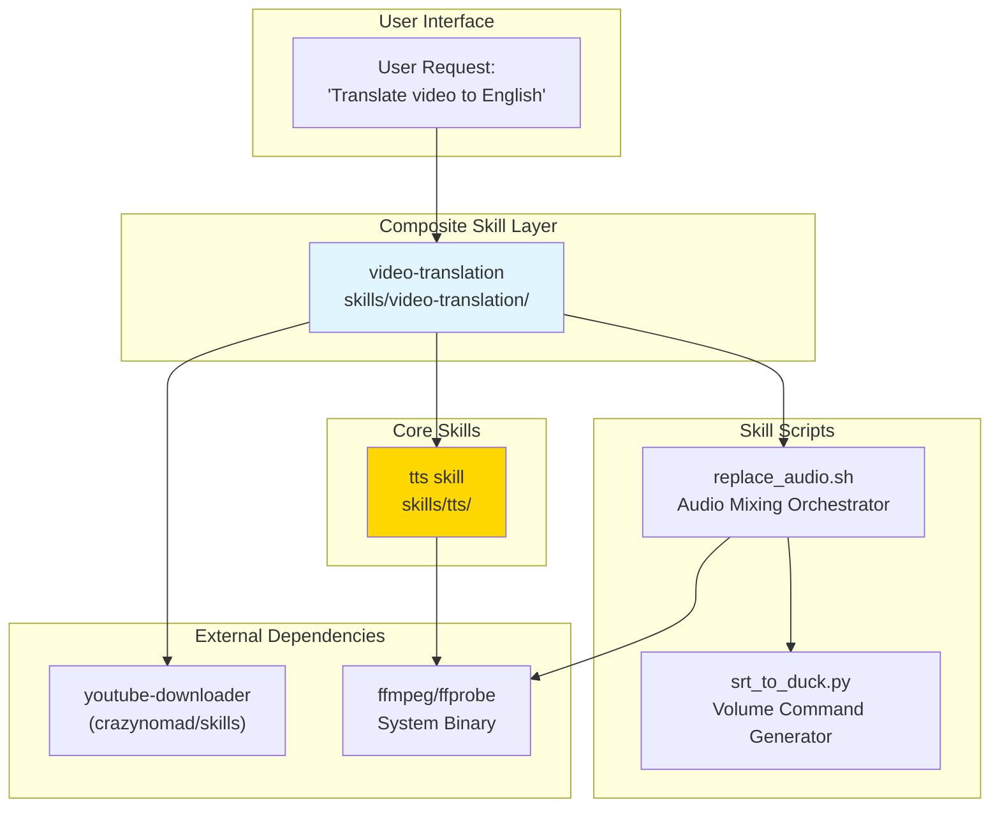
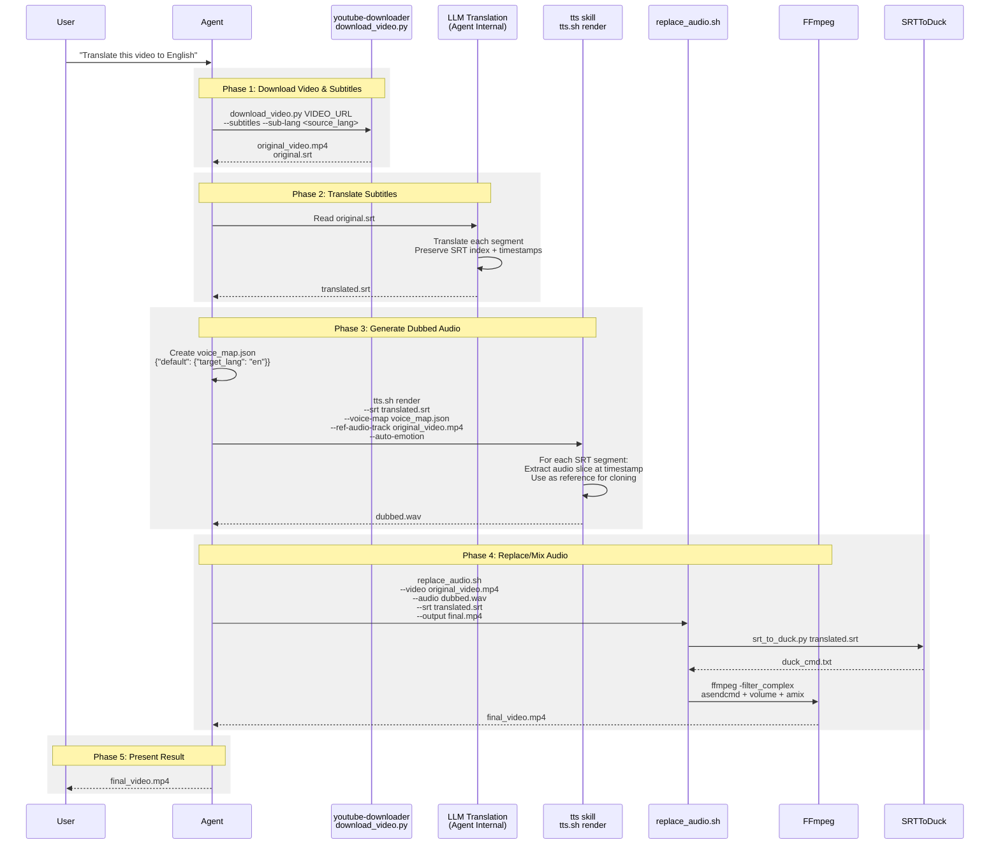
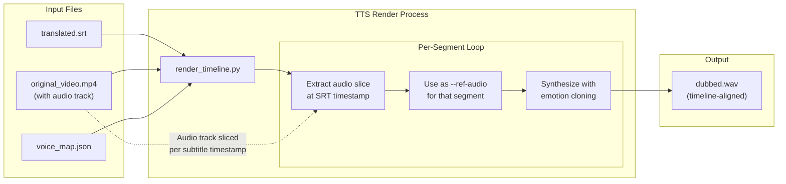
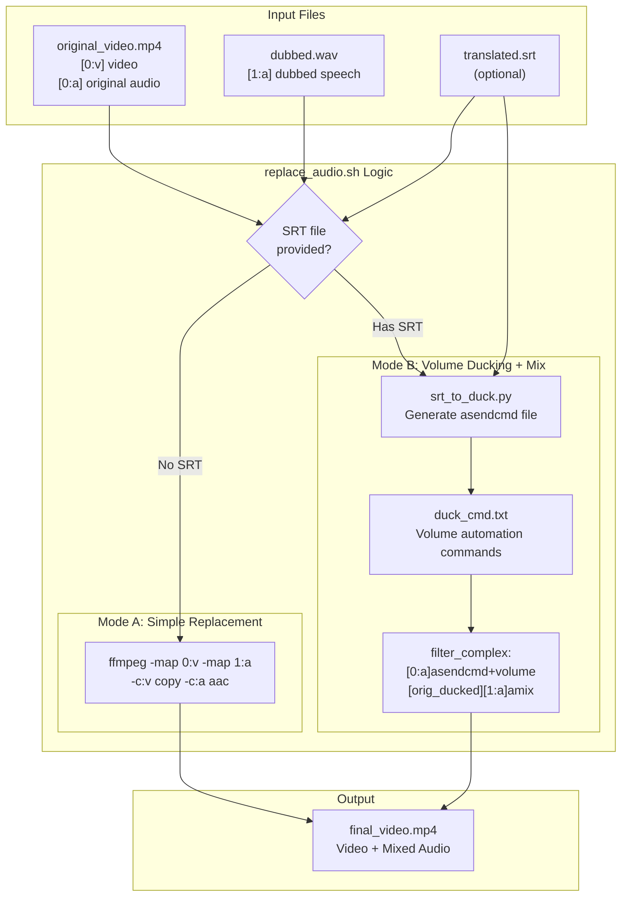
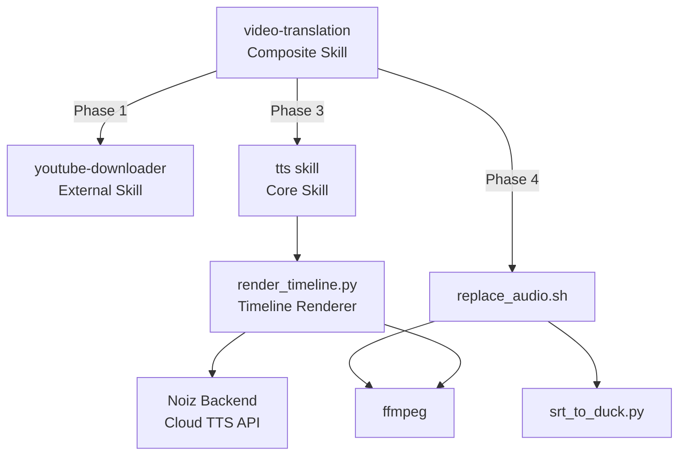

<!-- source: DeepWiki mcp.deepwiki.com · repo NoizAI/skills · page 5.3 Video Translation · fetched 2026-10-26 -->

# Video Translation

<details>
<summary>Relevant source files</summary>

The following files were used as context for generating this wiki page:

- [README.md](README.md)
- [skills/chat-with-anyone/SKILL.md](skills/chat-with-anyone/SKILL.md)
- [skills/daily-news-caster/SKILL.md](skills/daily-news-caster/SKILL.md)
- [skills/video-translation/SKILL.md](skills/video-translation/SKILL.md)
- [skills/video-translation/scripts/replace_audio.sh](skills/video-translation/scripts/replace_audio.sh)
- [skills/video-translation/scripts/srt_to_duck.py](skills/video-translation/scripts/srt_to_duck.py)

</details>


The **video-translation** skill provides automated video dubbing by translating subtitle content into a target language and replacing the original audio track with synthesized speech. This skill is a composite workflow that orchestrates subtitle translation, timeline-aligned TTS rendering with voice cloning, and audio mixing.

For information about the underlying TTS rendering engine, see [TTS (Text-to-Speech) Skill](#3). For voice cloning configuration, see [Timeline Mode - SRT to Audio](#3.2) and [Voice Maps and Segment Configuration](#3.3).

**Sources**: [skills/video-translation/SKILL.md:1-97]()

---

## Overview and Architecture

The video-translation skill is a **composite skill** that combines three external dependencies into a five-phase pipeline. Unlike core skills that provide single-purpose capabilities, this skill orchestrates a complete end-to-end workflow from video download to final dubbed output.

### System Position in Skill Hierarchy



**Sources**: [skills/video-translation/SKILL.md:1-97](), [README.md:33-39](), Diagram 1, Diagram 3

---

## Five-Phase Translation Workflow

The video translation process follows a strict five-phase execution model. Each phase has specific inputs, outputs, and dependencies.

### Workflow Sequence Diagram



**Sources**: [skills/video-translation/SKILL.md:22-68]()

---

## Phase 1: Video and Subtitle Download

The workflow begins by downloading the source video and its subtitles in the original language. This phase uses the `youtube-downloader` skill from an external repository.

### Download Command Structure

```bash
python path/to/youtube-downloader/scripts/download_video.py "VIDEO_URL" \
  --subtitles \
  --sub-lang <source_lang_code> \
  -o /tmp/video-translation
```

The `--sub-lang` parameter is critical because it ensures the correct subtitle track is retrieved. Many videos have multiple subtitle languages, and auto-generated subtitles may not be available in all languages.

**Key Files**:
- Video file: `original_video.mp4`
- Subtitle file: `original.srt` (SRT format with timestamps)

**Sources**: [skills/video-translation/SKILL.md:26-30]()

---

## Phase 2: Subtitle Translation

This phase translates the downloaded SRT file sentence-by-sentence while preserving the exact SRT index numbers and timestamp format. The translation is performed by the agent's internal LLM capabilities using a fixed prompt template.

### Translation Prompt Template

[skills/video-translation/SKILL.md:35-39]() defines the required prompt:

```
Translate the following subtitle text from <Source Language> to <Target Language>.
Provide ONLY the translated text. Do not explain, do not add notes, do not add index numbers.
The translation must be colloquial, natural-sounding, and suitable for video dubbing.
```

### SRT Format Preservation

The critical requirement is that the translated SRT file **must maintain the exact same structure**:

| Component | Requirement |
|-----------|-------------|
| Index numbers | Same sequence (1, 2, 3, ...) |
| Timestamps | Exact same start/end times |
| Text content | Translated, but natural/colloquial |
| Line breaks | Preserved where appropriate |

**Output**: `translated.srt`

**Sources**: [skills/video-translation/SKILL.md:32-40]()

---

## Phase 3: Timeline-Aligned Audio Generation

This phase generates the dubbed audio track using the TTS skill's `render` subcommand. The key innovation is the `--ref-audio-track` parameter, which enables automatic voice cloning with emotion transfer for each subtitle segment.

### Voice Cloning with Emotion Transfer



### Voice Map Configuration

The minimal `voice_map.json` for video translation:

```json
{
  "default": {
    "target_lang": "<target_lang_code>"
  }
}
```

The `target_lang` parameter ensures the TTS backend generates speech in the correct language. For more complex scenarios with multiple speakers, per-segment voice configurations can be added (see [Voice Maps and Segment Configuration](#3.3)).

### TTS Render Command

```bash
bash skills/tts/scripts/tts.sh render \
  --srt translated.srt \
  --voice-map voice_map.json \
  --backend noiz \
  --auto-emotion \
  --ref-audio-track original_video.mp4 \
  -o dubbed.wav
```

| Parameter | Purpose |
|-----------|---------|
| `--srt` | Translated subtitle file with timestamps |
| `--voice-map` | Per-segment voice configuration |
| `--backend noiz` | Required for voice cloning features |
| `--auto-emotion` | Auto-detect emotion from reference audio |
| `--ref-audio-track` | Source video file for automatic segment slicing |
| `-o` | Output dubbed audio file |

**How `--ref-audio-track` Works**:
1. For each segment in `translated.srt` (e.g., `00:01:15,000 --> 00:01:20,500`)
2. The TTS engine extracts audio from `original_video.mp4` at exactly those timestamps
3. This extracted audio becomes the `--ref-audio` for that specific segment
4. The TTS backend clones the voice characteristics **and emotion** from the reference
5. The synthesized segment matches the original speaker's tone and emotion

**Sources**: [skills/video-translation/SKILL.md:42-58]()

---

## Phase 4: Audio Replacement and Mixing

The `replace_audio.sh` script provides two modes of operation: **complete replacement** or **volume ducking with mixing**. The mode is determined by whether an SRT file is provided.

### Audio Mixing Architecture



**Sources**: [skills/video-translation/scripts/replace_audio.sh:1-78]()

### Mode A: Complete Replacement (No SRT)

[skills/video-translation/scripts/replace_audio.sh:68-75]()

When no SRT file is provided, the original audio track is completely discarded:

```bash
ffmpeg -y -i "$VIDEO" -i "$AUDIO" \
  -map 0:v:0 -map 1:a:0 \
  -c:v copy -c:a aac -b:a 192k \
  -shortest \
  "$OUTPUT"
```

| Parameter | Purpose |
|-----------|---------|
| `-map 0:v:0` | Take video stream from first input |
| `-map 1:a:0` | Take audio stream from second input |
| `-c:v copy` | Copy video without re-encoding |
| `-c:a aac -b:a 192k` | Encode audio as AAC at 192 kbps |
| `-shortest` | Match output duration to shortest input |

### Mode B: Volume Ducking (With SRT)

[skills/video-translation/scripts/replace_audio.sh:51-67]()

When an SRT file is provided, the original audio is **preserved but ducked** (volume reduced) during speech segments, then mixed with the dubbed audio. This preserves background music, ambient sound, and non-speech audio.

#### Step 1: Generate Volume Automation Commands

The `srt_to_duck.py` script converts SRT timestamps into ffmpeg's `asendcmd` format:

[skills/video-translation/scripts/srt_to_duck.py:1-44]()

```python
# For each SRT timestamp pair (start -> end):
start = h1*3600 + m1*60 + s1 + ms1/1000.0
end = h2*3600 + m2*60 + s2 + ms2/1000.0

commands.append(f"{start:.3f} [enter] volume volume 0.0;")  # Duck to 0%
commands.append(f"{end:.3f} [enter] volume volume 1.0;")    # Restore to 100%
```

**Example `duck_cmd.txt` output**:
```
0.0 [enter] volume volume 1.0;
75.500 [enter] volume volume 0.0;
80.200 [enter] volume volume 1.0;
85.100 [enter] volume volume 0.0;
90.500 [enter] volume volume 1.0;
```

#### Step 2: Apply Ducking and Mix

```bash
ffmpeg -y -i "$VIDEO" -i "$AUDIO" \
  -filter_complex "[0:a]asendcmd=f='${CMD_FILE}',volume=1.0[orig_ducked];[orig_ducked][1:a]amix=inputs=2:duration=first:dropout_transition=0:normalize=0[aout]" \
  -map 0:v:0 -map "[aout]" \
  -c:v copy -c:a aac -b:a 192k \
  -shortest \
  "$OUTPUT"
```

**Filter chain breakdown**:

1. `[0:a]asendcmd=f='${CMD_FILE}'` - Apply volume automation to original audio
2. `volume=1.0` - Set initial volume to 100%
3. `[orig_ducked]` - Label for ducked original audio
4. `[orig_ducked][1:a]amix=inputs=2` - Mix ducked original with dubbed audio
5. `duration=first` - Match duration of first input
6. `dropout_transition=0` - No crossfade between inputs
7. `normalize=0` - Preserve original volume levels

**Sources**: [skills/video-translation/scripts/replace_audio.sh:51-67](), [skills/video-translation/scripts/srt_to_duck.py:1-44]()

---

## Phase 5: Result Presentation

The final output is a complete video file with:
- Original video stream (copied without re-encoding)
- Either fully replaced audio (Mode A) or mixed audio with preserved background (Mode B)
- Same container format (`.mp4`)
- AAC audio codec at 192 kbps

The agent returns the file path to the user:
```
final_video.mp4
```

**Sources**: [skills/video-translation/SKILL.md:66-67]()

---

## Command-Line Interface

### replace_audio.sh Usage

[skills/video-translation/scripts/replace_audio.sh:4-15]()

```bash
replace_audio.sh --video <video_file> --audio <audio_file> --output <output_file> [--srt <srt_file>]

Options:
  --video    Original video file path
  --audio    New audio file path (WAV/MP3)
  --output   Final output video file path
  --srt      Original or translated SRT file (optional). 
             If provided, keeps original audio where there are no subtitles.
```

### Example Commands

**Complete replacement** (background audio discarded):
```bash
bash skills/video-translation/scripts/replace_audio.sh \
  --video original_video.mp4 \
  --audio dubbed.wav \
  --output final_video.mp4
```

**Volume ducking** (background audio preserved):
```bash
bash skills/video-translation/scripts/replace_audio.sh \
  --video original_video.mp4 \
  --audio dubbed.wav \
  --output final_video.mp4 \
  --srt translated.srt
```

**Sources**: [skills/video-translation/scripts/replace_audio.sh:1-78]()

---

## Dependencies and Requirements

### Skill Dependencies

| Dependency | Source Repository | Required Files |
|------------|-------------------|----------------|
| **youtube-downloader** | [crazynomad/skills](https://github.com/crazynomad/skills) | `skills/youtube-downloader/scripts/download_video.py` |
| **tts** | [NoizAI/skills](https://github.com/NoizAI/skills) | `skills/tts/scripts/tts.sh`<br/>`skills/tts/scripts/tts.py`<br/>`skills/tts/scripts/render_timeline.py` |

### System Dependencies

- **ffmpeg**: Required for audio extraction, mixing, and video processing
- **ffprobe**: Used by TTS skill for duration detection

### API Requirements

The Noiz backend is **required** for voice cloning features. The workflow will not function with the Kokoro backend because:
- `--ref-audio` voice cloning is Noiz-exclusive
- `--auto-emotion` is Noiz-exclusive
- `--ref-audio-track` automatic slicing requires Noiz API

**API Key Configuration**:
```bash
bash skills/tts/scripts/tts.sh config --set-api-key YOUR_KEY
```

Or set environment variable:
```bash
export NOIZ_API_KEY="your_api_key_here"
```

For API key setup details, see [API Key Configuration](#2.3).

**Sources**: [skills/video-translation/SKILL.md:83-91]()

---

## Limitations and Constraints

### Subtitle Availability
[skills/video-translation/SKILL.md:95]()

The source video **must** have subtitles available for the source language. This can be:
- Manual subtitles uploaded by the creator
- Auto-generated subtitles from YouTube
- Community-contributed subtitles

If subtitles are not available, the workflow cannot proceed. The `youtube-downloader` skill will fail at the download phase.

### Processing Time
[skills/video-translation/SKILL.md:96]()

Very long videos may take significant time to process because:
1. Each subtitle segment requires a separate TTS API call
2. Voice cloning with emotion detection adds processing overhead
3. ffmpeg audio mixing is CPU-intensive for long files

**Example**: A 30-minute video with 200 subtitle segments will make 200 TTS API calls.

### Language Support

The target language must be supported by the Noiz TTS backend. Currently supported languages include:
- English (`en`)
- Chinese (`zh`)
- Japanese (`ja`)
- And others (see [Noiz Backend (Cloud)](#2.2) for complete list)

**Sources**: [skills/video-translation/SKILL.md:93-96]()

---

## Integration with Other Skills

### Dependency Graph



**Sources**: [skills/video-translation/SKILL.md:83-91](), Diagram 1, Diagram 3

---

## Use Cases and Triggers

### Natural Language Triggers

[skills/video-translation/SKILL.md:10-15]()

The agent should activate this skill when the user requests:
- "translate this video"
- "dub this video to English"
- "把视频从 X 语译成 Y 语" (Chinese: translate video from X to Y language)
- "视频翻译" (Chinese: video translation)

### Typical Use Cases

1. **Foreign Language Content Consumption**: User wants to watch a YouTube video in a foreign language but hear it in their native language
2. **Content Localization**: User has created a video in one language and wants to create dubbed versions for other markets
3. **Accessibility**: Creating translated audio for videos that lack subtitles in certain languages

**Sources**: [skills/video-translation/SKILL.md:17-21]()

---

## File Structure

```
skills/video-translation/
├── SKILL.md                    # Skill definition and workflow documentation
└── scripts/
    ├── replace_audio.sh        # Audio replacement/mixing orchestrator
    └── srt_to_duck.py          # SRT-to-asendcmd converter for volume ducking
```

**Sources**: File paths from provided files

---

