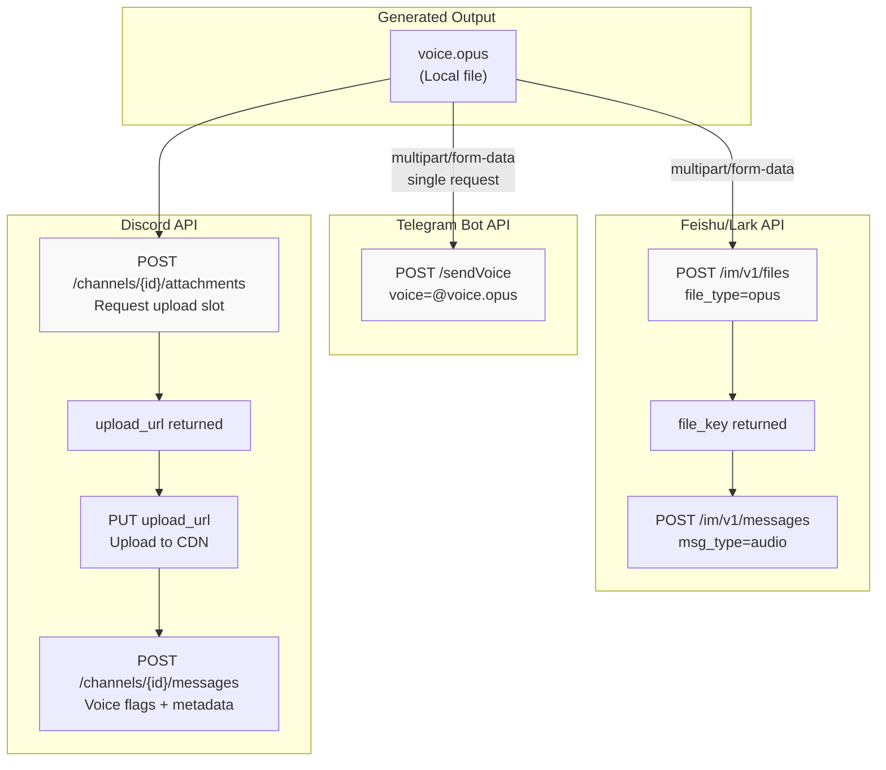
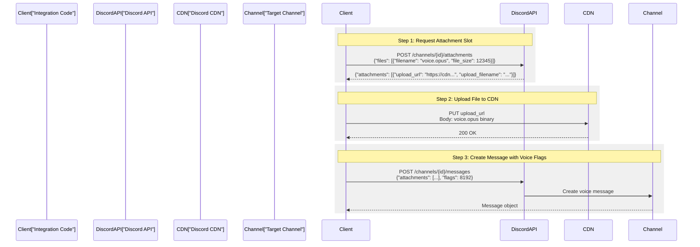

<!-- source: DeepWiki mcp.deepwiki.com · repo NoizAI/skills · page 6 Integration with Chat Platforms · fetched 2026-10-26 -->

# Integration with Chat Platforms

<details>
<summary>Relevant source files</summary>

The following files were used as context for generating this wiki page:

- [README.md](README.md)
- [skills/chat-with-anyone/SKILL.md](skills/chat-with-anyone/SKILL.md)
- [skills/daily-news-caster/SKILL.md](skills/daily-news-caster/SKILL.md)
- [skills/tts/ref_3rd_party.md](skills/tts/ref_3rd_party.md)

</details>


## Purpose and Scope

This document describes how to deliver TTS-generated audio files as native voice messages to chat platforms (Feishu/Lark, Telegram, and Discord). The integration follows a two-step architecture: first generate the voice audio using the TTS skill, then upload and send using each platform's official API.

For information about generating the audio files themselves, see [TTS (Text-to-Speech) Skill](#3). For configuring API keys and authentication for TTS backends, see [API Key Configuration](#2.3).

The integration is intentionally decoupled from the core TTS functionality, keeping platform-specific authentication and delivery logic in the integration layer rather than in `tts.sh`.

**Sources:** [skills/tts/ref_3rd_party.md:1-9]()

---

## Integration Architecture

The chat platform integration follows a separation-of-concerns pattern where audio generation and audio delivery are distinct phases. This architecture keeps the TTS skill focused on audio synthesis while delegating network operations to platform-specific code.

### Two-Phase Integration Flow

```mermaid
sequenceDiagram
    participant User
    participant Agent
    participant TTS["tts.sh speak"]
    participant Platform["Platform API<br/>(Feishu/Telegram/Discord)"]
    participant ChatApp["Chat Application"]
    
    User->>Agent: "Send voice message to chat"
    
    rect rgb(240, 240, 240)
        Note over Agent,TTS: Phase 1: Audio Generation
        Agent->>TTS: speak -t "text" --format opus -o voice.opus
        TTS-->>Agent: voice.opus file
    end
    
    rect rgb(240, 240, 240)
        Note over Agent,Platform: Phase 2: Platform Delivery
        Agent->>Platform: API call with voice.opus
        Platform->>Platform: Process upload
        Platform-->>ChatApp: Deliver voice message
        ChatApp-->>User: Native voice message appears
    end
    
    Note over Agent,Platform: Auth tokens/credentials managed<br/>in integration layer, not in tts.sh
```

**Diagram: Two-Phase Architecture for Chat Platform Integration**

The key design decision is that `tts.sh` terminates at file generation. Platform-specific operations (authentication, upload protocols, message creation) are handled by the consuming application or workflow tool, not by the core TTS skill.

**Sources:** [skills/tts/ref_3rd_party.md:1-9](), [README.md:29]()

---

## Audio Format Requirements

All three platforms support Opus-encoded audio, making `opus` the recommended output format for chat platform integration.

| Format | File Extension | MIME Type | Platform Support |
|--------|---------------|-----------|------------------|
| Opus | `.opus` | `audio/opus` | Feishu, Telegram, Discord |
| OGG (Opus) | `.ogg` | `audio/ogg` | Telegram (alias for `.opus`) |

**Generation Command:**

```bash
bash skills/tts/scripts/tts.sh speak \
  -t "Hello world" \
  --format opus \
  -o voice.opus
```

The `--format opus` flag instructs the TTS skill to encode the output as Opus, which provides good compression for voice transmission while maintaining acceptable quality. The `ogg` format name is an alias that produces the same Opus-encoded output.

**Sources:** [skills/tts/ref_3rd_party.md:11-15](), [skills/tts/ref_3rd_party.md:43]()

---

## Platform API Mapping

The following diagram maps each platform's API endpoints to their roles in the voice message delivery workflow. This serves as a reference for implementation.

### API Endpoint Flow by Platform



**Diagram: Platform-Specific API Endpoints and Upload Flows**

**Key Observations:**

- **Feishu** requires a two-step process: file upload followed by message creation with the returned `file_key`.
- **Telegram** simplifies this to a single `sendVoice` endpoint with multipart upload.
- **Discord** uses a three-step attachment flow: request slot, upload to CDN, create message with attachment metadata.

**Sources:** [skills/tts/ref_3rd_party.md:20-39]()

---

## Feishu (Lark) Integration

Feishu requires a two-step API sequence to send voice messages: first upload the audio file to obtain a `file_key`, then create a message referencing that key.

### Upload and Send Workflow

| Step | API Endpoint | Method | Purpose |
|------|--------------|--------|---------|
| 1 | `/im/v1/files` | POST | Upload opus file, receive `file_key` |
| 2 | `/im/v1/messages` | POST | Create audio message with `file_key` |

### Step 1: Upload File

**Endpoint:** `https://open.feishu.cn/open-apis/im/v1/files`

**Request Parameters:**
- `file_type`: Must be set to `"opus"`
- `file`: The `.opus` file as multipart/form-data

**Response:**
```json
{
  "code": 0,
  "msg": "success",
  "data": {
    "file_key": "file_v2_xxxxx-xxxx-xxxx-xxxx-xxxxxxxxxxxxx"
  }
}
```

### Step 2: Send Audio Message

**Endpoint:** `https://open.feishu.cn/open-apis/im/v1/messages`

**Request Parameters:**
- `receive_id_type`: Type of recipient ID (e.g., `"chat_id"`, `"user_id"`)
- `receive_id`: The actual recipient identifier
- `msg_type`: Must be set to `"audio"`
- `content`: JSON containing the `file_key` from Step 1

**Example Content Payload:**
```json
{
  "file_key": "file_v2_xxxxx-xxxx-xxxx-xxxx-xxxxxxxxxxxxx"
}
```

### Authentication

Feishu API calls require an access token obtained through OAuth 2.0 or tenant access token flow. The token is typically stored in the integration layer's credential management system (not in the TTS skill itself).

### Official Documentation

- [Upload file](https://open.feishu.cn/document/server-docs/im-v1/file/create)
- [Send message](https://open.feishu.cn/document/server-docs/im-v1/message/create)

**Sources:** [skills/tts/ref_3rd_party.md:20-25]()

---

## Telegram Integration

Telegram provides the simplest integration path with a single-request `sendVoice` method that handles both upload and message creation.

### Single-Request Upload

**Endpoint:** `https://api.telegram.org/bot<TOKEN>/sendVoice`

**Method:** POST (multipart/form-data)

**Request Parameters:**

| Parameter | Type | Required | Description |
|-----------|------|----------|-------------|
| `chat_id` | Integer/String | Yes | Unique identifier for target chat |
| `voice` | InputFile | Yes | Audio file (`@voice.opus` or `@voice.ogg`) |
| `caption` | String | No | Optional text caption for the voice message |
| `duration` | Integer | No | Duration in seconds (for progress display) |

**Example cURL Request:**
```bash
curl -F chat_id=123456789 \
     -F voice=@voice.opus \
     -F caption="Generated voice message" \
     https://api.telegram.org/bot<TOKEN>/sendVoice
```

### File Format Notes

Telegram accepts both `.opus` and `.ogg` extensions for Opus-encoded audio. The platform internally treats them identically since Telegram's voice messages use Opus codec by default.

### Authentication

The bot token is included in the URL path (`/bot<TOKEN>/sendVoice`). Tokens are obtained from [@BotFather](https://t.me/botfather) and should be stored securely in the integration layer, not hardcoded in scripts.

### Official Documentation

- [sendVoice method](https://core.telegram.org/bots/api#sendvoice)

**Sources:** [skills/tts/ref_3rd_party.md:27-30]()

---

## Discord Integration

Discord uses a modern three-step attachment flow that separates authorization, upload, and message creation. This architecture allows Discord to offload file hosting to CDN infrastructure.

### Three-Step Attachment Flow



**Diagram: Discord Three-Step Voice Message Flow**

### Step 1: Request Attachment Slot

**Endpoint:** `POST /channels/{channel_id}/attachments`

**Request Body:**
```json
{
  "files": [
    {
      "filename": "voice.opus",
      "file_size": 12345,
      "id": "0"
    }
  ]
}
```

**Response:**
```json
{
  "attachments": [
    {
      "id": "0",
      "upload_url": "https://discord-attachments-uploads-prd.storage.googleapis.com/...",
      "upload_filename": "xxxxxxxx_voice.opus"
    }
  ]
}
```

The `id` field is a client-assigned identifier used to correlate the upload with the final message attachment. The `upload_url` is a pre-signed URL with temporary write access.

### Step 2: Upload to CDN

**Endpoint:** The `upload_url` from Step 1 response

**Method:** PUT

**Headers:**
- `Content-Type`: `audio/opus`

**Body:** Raw binary content of `voice.opus`

This step does not require Discord authentication headers since the URL is pre-signed. A successful upload returns HTTP 200.

### Step 3: Create Message with Voice Flags

**Endpoint:** `POST /channels/{channel_id}/messages`

**Request Body:**
```json
{
  "attachments": [
    {
      "id": "0",
      "uploaded_filename": "xxxxxxxx_voice.opus"
    }
  ],
  "flags": 8192
}
```

**Key Parameters:**
- `attachments[].id`: Must match the `id` from Step 1
- `attachments[].uploaded_filename`: The `upload_filename` from Step 1 response
- `flags`: Value `8192` designates the message as a voice message (enables waveform UI)

### Voice Message Flags

The `flags` field is a bitfield that controls message display behavior:

| Flag Value | Hex | Meaning |
|------------|-----|---------|
| 8192 | 0x2000 | IS_VOICE_MESSAGE (shows waveform player) |

Without this flag, the attachment renders as a standard file attachment rather than a voice message with the interactive waveform player.

### Authentication

Discord API requests (Steps 1 and 3) require a `Authorization: Bot <TOKEN>` header. Bot tokens are obtained from the Discord Developer Portal and should be stored in secure credential storage.

### Official Documentation

- [Uploading Files](https://discord.com/developers/docs/reference#uploading-files)
- [Create Message](https://discord.com/developers/docs/resources/channel#create-message)

**Sources:** [skills/tts/ref_3rd_party.md:32-39]()

---

## Security and Credential Management

Chat platform integrations require API tokens and credentials that must be managed securely. The architecture deliberately separates TTS generation from delivery to isolate credential handling.

### Credential Storage Recommendations

| Platform | Credential Type | Storage Location | Environment Variable |
|----------|----------------|------------------|---------------------|
| Feishu | Access Token | `cred.json` or secure vault | `FEISHU_ACCESS_TOKEN` |
| Telegram | Bot Token | `cred.json` or secure vault | `TELEGRAM_BOT_TOKEN` |
| Discord | Bot Token | `cred.json` or secure vault | `DISCORD_BOT_TOKEN` |

The `cred.json` file pattern is used by composite skills to store platform credentials. This file is excluded from version control via `.gitignore` rules to prevent accidental credential exposure.

For more details on credential management patterns, see [Credential Management](#8.2).

### Integration Layer Responsibilities

The integration layer (application code, bot framework, or workflow tool) is responsible for:

1. **Token Refresh:** Obtaining and renewing access tokens (especially for Feishu OAuth)
2. **Error Handling:** Retrying failed uploads, handling rate limits
3. **Credential Rotation:** Supporting token updates without code changes
4. **Audit Logging:** Recording delivery attempts and API responses

The `tts.sh` script intentionally does not implement these operations to maintain its role as a pure audio generation tool.

**Sources:** [skills/tts/ref_3rd_party.md:42-44](), [README.md:26]()

---

## Integration Examples in Composite Skills

The repository's composite skills demonstrate practical integration patterns. While they don't implement full platform delivery (per the architecture separation), they show how TTS-generated audio can be prepared for platform upload.

### daily-news-caster Line-by-Line Pattern

The `daily-news-caster` skill generates audio suitable for chat platform delivery by processing dialogue line-by-line and concatenating the results:

```bash
# Generate individual lines with appropriate voices
bash path/to/tts.sh speak -t "Host A: Welcome..." \
  --ref-audio hostA.wav -o line_01.wav

bash path/to/tts.sh speak -t "Host B: Thanks for joining..." \
  --ref-audio hostB.wav -o line_02.wav

# Concatenate for platform upload
ffmpeg -f concat -safe 0 -i list.txt -c copy podcast_output.wav

# Convert to opus for platform delivery
bash path/to/tts.sh speak -t "..." --format opus -o final.opus
```

This pattern enables per-speaker voice customization while producing a single audio file suitable for chat platform upload.

**Sources:** [skills/daily-news-caster/SKILL.md:58-82]()

### chat-with-anyone Voice Cloning

The `chat-with-anyone` skill demonstrates generating character-specific voices that can be delivered to chat platforms:

```bash
# Generate response in character's voice
bash skills/tts/scripts/tts.sh speak \
  -t "Response text..." \
  --ref-audio skills/chat-with-anyone/character_ref.wav \
  -o output.wav
```

The `output.wav` can then be converted to opus format and uploaded to any chat platform using the methods documented in this page.

**Sources:** [skills/chat-with-anyone/SKILL.md:47-54]()

---

## MIME Type Considerations

While the TTS skill outputs `.opus` files, some platform APIs may expect specific MIME types in upload requests.

### MIME Type Mapping

| File Extension | Primary MIME | Alternative MIME | Notes |
|----------------|-------------|------------------|-------|
| `.opus` | `audio/opus` | `audio/ogg` | Preferred for Opus-encoded files |
| `.ogg` | `audio/ogg` | `audio/opus` | Container format; Opus is the codec |

**Platform-Specific Requirements:**

- **Feishu:** Accepts `audio/opus` or `audio/ogg` for opus-encoded files
- **Telegram:** Flexible; accepts either MIME type as long as the file is Opus-encoded
- **Discord:** Recommends `audio/opus` but tolerates `audio/ogg`

When the downstream API strictly requires `audio/ogg` as the MIME type, the `.opus`-encoded output file generated by `tts.sh` can still be sent with that MIME header. The actual encoding (Opus) is what matters, not the file extension or MIME declaration.

**Sources:** [skills/tts/ref_3rd_party.md:43]()

---

## Summary of Integration Flow

The complete integration process for any chat platform follows this pattern:

1. **Generate Audio:** Use `tts.sh speak --format opus -o voice.opus` to create the voice file
2. **Implement Platform Logic:** Write integration code that:
   - Reads the generated `voice.opus` file
   - Authenticates with the platform API
   - Uploads the file using the platform-specific protocol
   - Creates the voice message with appropriate metadata
3. **Handle Responses:** Process API responses for errors, rate limits, or delivery confirmation

The separation of audio generation (step 1) from platform delivery (step 2) enables the TTS skill to remain platform-agnostic while supporting all major chat applications through consistent file-based output.

**Sources:** [skills/tts/ref_3rd_party.md:1-44](), [README.md:29]()

---

