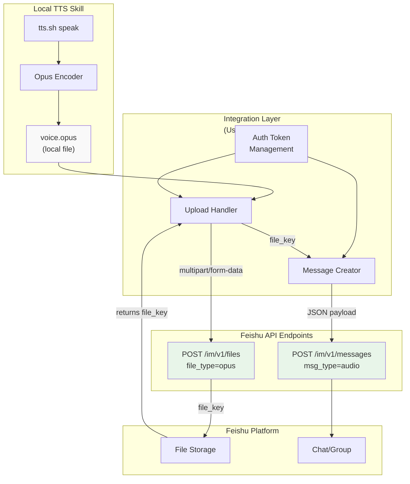
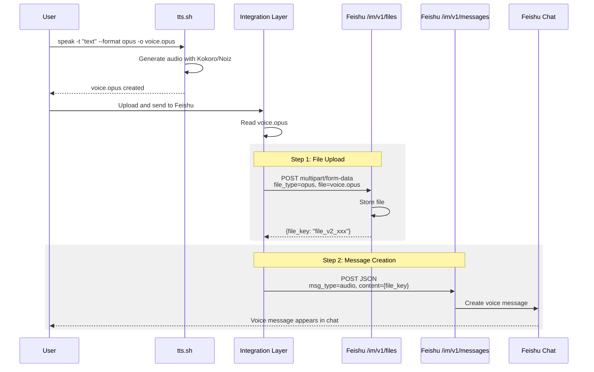

<!-- source: DeepWiki mcp.deepwiki.com · repo NoizAI/skills · page 6.1 Feishu (Lark) Integration · fetched 2026-10-26 -->

# Feishu (Lark) Integration

<details>
<summary>Relevant source files</summary>

The following files were used as context for generating this wiki page:

- [skills/tts/ref_3rd_party.md](skills/tts/ref_3rd_party.md)

</details>


## Purpose and Scope

This document details the integration between the TTS skill and Feishu (also known as Lark), enabling generated audio to be sent as native voice messages in Feishu conversations. The integration follows a two-step API workflow: file upload followed by message creation.

For integrations with other chat platforms, see [Telegram Integration](#6.2) and [Discord Integration](#6.3). For the core TTS functionality that generates the audio files, see [TTS (Text-to-Speech) Skill](#3).

**Sources:** [skills/tts/ref_3rd_party.md:1-45]()

---

## Integration Architecture

The Feishu integration operates as a **decoupled workflow** where the TTS skill generates audio files locally, and a separate integration layer handles platform-specific API communication. This separation keeps authentication and platform logic outside the core TTS codebase.

### System Architecture Diagram



**Sources:** [skills/tts/ref_3rd_party.md:1-45]()

---

## Two-Step Integration Process

Feishu requires a two-step process to send voice messages, unlike some platforms (e.g., Telegram) that support single-step uploads. The workflow involves:

1. **Upload the audio file** to Feishu's file storage system
2. **Create a message** referencing the uploaded file by its `file_key`

This architecture allows Feishu to validate and store files independently before message creation, enabling features like file reuse and access control.

**Sources:** [skills/tts/ref_3rd_party.md:20-25]()

---

## Step 1: Generate Audio with TTS

The first step is generating audio in Opus format, which is the required format for Feishu voice messages.

### Command Syntax

```bash
bash skills/tts/scripts/tts.sh speak \
  -t "Hello world" \
  --format opus \
  -o voice.opus
```

### Key Parameters

| Parameter | Value | Purpose |
|-----------|-------|---------|
| `-t` | Text content | The message to synthesize |
| `--format` | `opus` or `ogg` | Output format (Opus codec) |
| `-o` | File path | Output file location |

### Format Requirements

- **Container:** Opus or Ogg (both use Opus codec)
- **MIME Type:** Can be sent as `audio/ogg` even with `.opus` extension
- **Compatibility:** Feishu accepts Opus-encoded files regardless of container format

**Sources:** [skills/tts/ref_3rd_party.md:10-16](), [skills/tts/ref_3rd_party.md:43-44]()

---

## Step 2: Upload File to Feishu

After generating the audio file, it must be uploaded to Feishu's file storage to obtain a `file_key`.

### API Endpoint

```
POST https://open.feishu.cn/open-apis/im/v1/files
```

### Request Format

The request uses `multipart/form-data` encoding with the following fields:

| Field | Value | Required |
|-------|-------|----------|
| `file_type` | `opus` | Yes |
| `file_name` | File name (e.g., `voice.opus`) | Yes |
| `file` | Binary file content | Yes |

### Response Structure

```json
{
  "code": 0,
  "msg": "success",
  "data": {
    "file_key": "file_v2_xxx..."
  }
}
```

The `file_key` from the response is required for the next step.

### Authentication

The upload request must include a valid access token in the Authorization header:

```
Authorization: Bearer <tenant_access_token>
```

**Sources:** [skills/tts/ref_3rd_party.md:21-24]()

---

## Step 3: Send Audio Message

With the `file_key` obtained from upload, create an audio message in the target chat.

### API Endpoint

```
POST https://open.feishu.cn/open-apis/im/v1/messages?receive_id_type=<type>
```

### Request Parameters

**Query Parameters:**
- `receive_id_type`: One of `open_id`, `user_id`, `union_id`, `email`, `chat_id`

**Request Body:**
```json
{
  "receive_id": "<chat_id or user_id>",
  "msg_type": "audio",
  "content": "{\"file_key\": \"file_v2_xxx...\"}"
}
```

### Message Type Configuration

| Field | Value | Purpose |
|-------|-------|---------|
| `msg_type` | `audio` | Specifies audio message type |
| `content` | JSON string with `file_key` | References uploaded file |

### Authentication

Same as upload step - requires `tenant_access_token` in Authorization header.

**Sources:** [skills/tts/ref_3rd_party.md:22-25]()

---

## Complete Workflow Sequence

### Sequence Diagram



**Sources:** [skills/tts/ref_3rd_party.md:20-25]()

---

## Authentication and Credential Management

### Token Types

Feishu API supports two primary token types:

1. **Tenant Access Token** - For app-level operations (recommended for bots)
2. **User Access Token** - For user-delegated operations

### Token Storage

Following the repository's **local-first security model**, credentials should be stored locally and excluded from version control:

- Store in a `cred.json` file at skill root or project root
- Ensure `.gitignore` excludes `**/cred.json`
- Set appropriate file permissions (`chmod 600`)

### Example Credential Structure

```json
{
  "feishu": {
    "app_id": "cli_xxx...",
    "app_secret": "xxx...",
    "tenant_access_token": "t-xxx..."
  }
}
```

### Separation of Concerns

As documented in [skills/tts/ref_3rd_party.md:44](), authentication and token handling must remain in the integration layer, **not in the core TTS script**. This maintains the modularity of the TTS skill and allows it to be used with any platform.

**Sources:** [skills/tts/ref_3rd_party.md:44-45]()

---

## File Format Specifications

### Opus Format Details

| Property | Value | Notes |
|----------|-------|-------|
| **Codec** | Opus | Modern audio codec |
| **Container** | `.opus` or `.ogg` | Both supported |
| **MIME Type** | `audio/ogg` or `audio/opus` | Feishu accepts both |
| **file_type param** | `opus` | Required in upload API |

### Format Compatibility

The TTS skill can output both `.opus` and `.ogg` (alias):

```bash
# These are equivalent
--format opus
--format ogg
```

Both produce Opus-encoded audio. The `.ogg` alias exists because some APIs require the `audio/ogg` MIME type, but the underlying codec is still Opus.

**Sources:** [skills/tts/ref_3rd_party.md:13-16](), [skills/tts/ref_3rd_party.md:28-29](), [skills/tts/ref_3rd_party.md:43-44]()

---

## Integration Implementation Example

### Data Flow Diagram

```mermaid
graph LR
    subgraph "Input"
        TextInput["Text Message"]
    end
    
    subgraph "TTS Generation"
        TTSCmd["tts.sh speak<br/>--format opus"]
        OpusFile["voice.opus<br/>(local filesystem)"]
    end
    
    subgraph "Upload Phase"
        ReadFile["Read file bytes"]
        MultipartReq["multipart/form-data<br/>request builder"]
        UploadAPI["/im/v1/files<br/>POST"]
        FileKey["file_key string"]
    end
    
    subgraph "Message Phase"
        JSONBuilder["Build JSON payload<br/>{msg_type: audio}"]
        MessageAPI["/im/v1/messages<br/>POST"]
    end
    
    subgraph "Output"
        VoiceMsg["Voice message<br/>in Feishu chat"]
    end
    
    TextInput --> TTSCmd
    TTSCmd --> OpusFile
    OpusFile --> ReadFile
    ReadFile --> MultipartReq
    MultipartReq --> UploadAPI
    UploadAPI --> FileKey
    FileKey --> JSONBuilder
    JSONBuilder --> MessageAPI
    MessageAPI --> VoiceMsg
```



### Recommended Integration Pattern

1. **Generate audio first** - Run TTS separately to enable reuse/caching
2. **Implement retry logic** - Network requests may fail
3. **Validate file_key** - Check response before message creation
4. **Handle errors gracefully** - Both steps can fail independently

**Sources:** [skills/tts/ref_3rd_party.md:1-45]()

---

## Error Handling Considerations

### Common Error Scenarios

| Error | Step | Cause | Solution |
|-------|------|-------|----------|
| Token expired | Upload/Message | Outdated `tenant_access_token` | Refresh token before retry |
| Invalid file_key | Message | Upload failed silently | Validate upload response |
| File too large | Upload | Audio file exceeds limit | Use shorter text or compression |
| Insufficient permissions | Upload/Message | Bot lacks permissions | Check bot configuration |

### File Upload Validation

Always verify the upload response structure:

```python
# Pseudo-code
response = upload_file(audio_file)
if response.get("code") != 0:
    raise UploadError(response.get("msg"))
file_key = response["data"]["file_key"]
if not file_key:
    raise ValueError("No file_key in response")
```

### Message Creation Validation

Similarly, validate message creation:

```python
# Pseudo-code
response = create_message(file_key, chat_id)
if response.get("code") != 0:
    raise MessageError(response.get("msg"))
```

**Sources:** [skills/tts/ref_3rd_party.md:20-25]()

---

## Official Documentation Links

### Feishu API References

| Resource | URL |
|----------|-----|
| Upload File | https://open.feishu.cn/document/server-docs/im-v1/file/create |
| Send Message | https://open.feishu.cn/document/server-docs/im-v1/message/create |

These links provide official specifications for request/response formats, error codes, and rate limiting policies.

**Sources:** [skills/tts/ref_3rd_party.md:23-25]()

---

## Integration Architecture Summary

### Design Principles

1. **Decoupling** - TTS skill generates audio; integration layer handles platform API
2. **Reusability** - Generated audio files can be sent to multiple platforms
3. **Security** - Authentication remains outside core skill code
4. **Simplicity** - Two-step workflow is explicit and debuggable

### Comparison with Other Platforms

| Platform | Upload Steps | Message Creation | Single Request |
|----------|--------------|------------------|----------------|
| **Feishu** | Separate upload | Separate message | No (2 steps) |
| **Telegram** | Combined | Combined | Yes (1 step) |
| **Discord** | Separate upload | Separate message | No (3 steps) |

Feishu's two-step process balances simplicity with file reuse capabilities. For single-step alternatives, see [Telegram Integration](#6.2).

**Sources:** [skills/tts/ref_3rd_party.md:1-45]()

---

