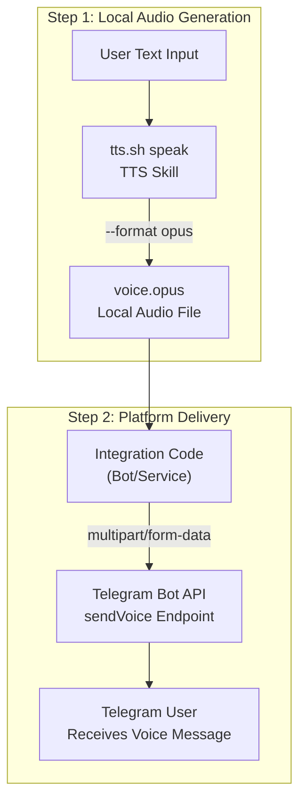
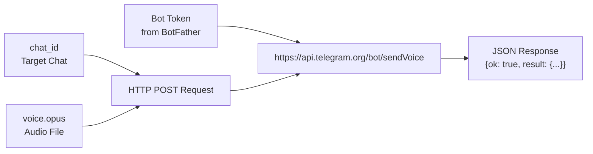
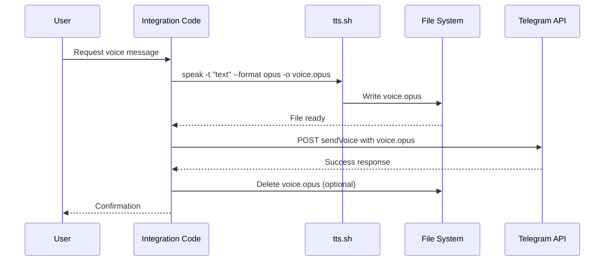
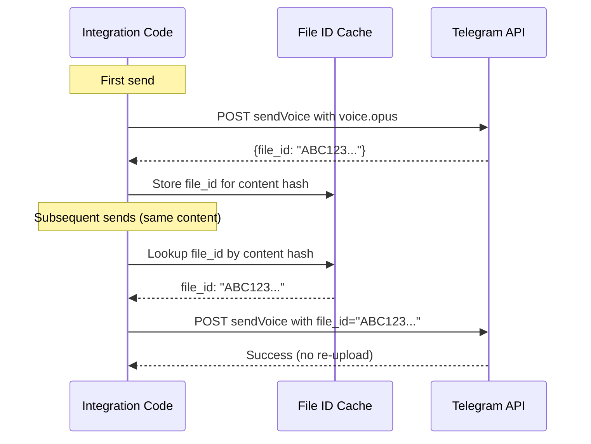
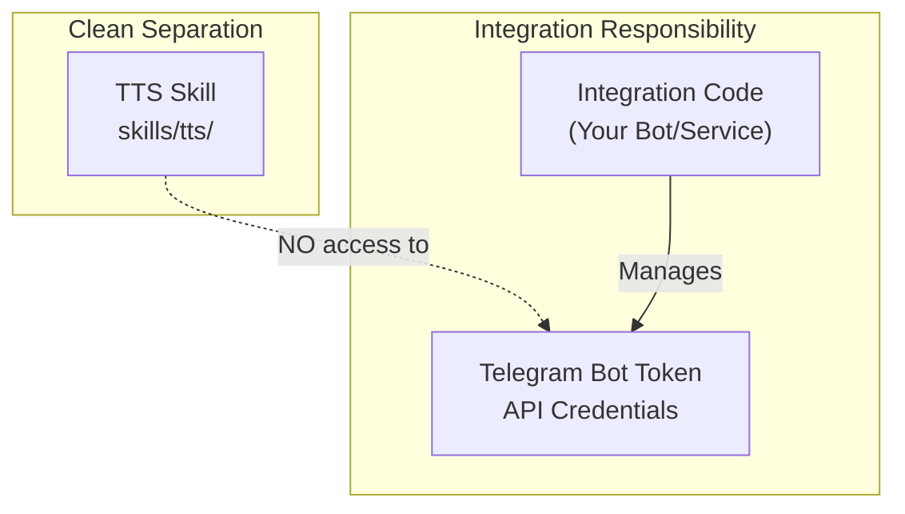

<!-- source: DeepWiki mcp.deepwiki.com · repo NoizAI/skills · page 6.2 Telegram Integration · fetched 2026-10-26 -->

# Telegram Integration

<details>
<summary>Relevant source files</summary>

The following files were used as context for generating this wiki page:

- [skills/tts/ref_3rd_party.md](skills/tts/ref_3rd_party.md)

</details>


## Purpose and Scope

This document explains how to send TTS-generated voice audio to Telegram using the Telegram Bot API's `sendVoice` method. The integration follows a two-step architecture where the TTS skill generates voice files locally, and platform-specific code handles delivery using Telegram's native API.

For integrations with other chat platforms, see [Feishu Integration](#6.1) and [Discord Integration](#6.3). For generating the voice audio itself, see [Simple Mode - Text to Audio](#3.1).

---

## Architecture Overview

The Telegram integration maintains a clean separation of concerns: the TTS skill handles audio synthesis, while Telegram-specific delivery logic remains external to the core skill. This design keeps authentication and platform API details out of the TTS codebase.

### Integration Flow Diagram



**Sources:** [skills/tts/ref_3rd_party.md:1-45]()

---

## Prerequisites

Before implementing Telegram voice message integration, ensure the following:

| Requirement | Description |
|-------------|-------------|
| **TTS Skill** | Installed and functional (`npx skills add tts`) |
| **Telegram Bot Token** | Obtained from [@BotFather](https://t.me/botfather) |
| **Opus Codec Support** | TTS skill can output opus format (default with Noiz backend) |
| **HTTP Client** | Tool for making multipart/form-data requests (curl, axios, requests, etc.) |

---

## Step 1: Generate Voice Audio

The first step is generating voice audio in the `opus` format, which Telegram natively supports as a voice message format.

### Command Syntax

```bash
bash skills/tts/scripts/tts.sh speak -t "Hello world" --format opus -o voice.opus
```

### Format Options

Telegram's `sendVoice` method accepts both `opus` and `ogg` formats:

| Format Flag | File Extension | MIME Type | Notes |
|-------------|----------------|-----------|-------|
| `--format opus` | `.opus` | `audio/opus` | Recommended, explicit codec |
| `--format ogg` | `.ogg` | `audio/ogg` | Alias for opus-encoded ogg container |

**Sources:** [skills/tts/ref_3rd_party.md:10-16](), [skills/tts/ref_3rd_party.md:43-44]()

---

## Step 2: Send via Telegram Bot API

The second step involves uploading the generated audio file to Telegram using the `sendVoice` method. This step occurs in your integration code, not within the TTS skill.

### API Endpoint Structure



### sendVoice Method Parameters

The `sendVoice` method is part of the Telegram Bot API and sends audio files as voice messages with special UI treatment (waveform visualization, playback controls).

| Parameter | Type | Required | Description |
|-----------|------|----------|-------------|
| `chat_id` | Integer/String | Yes | Unique identifier for target chat or username |
| `voice` | InputFile/String | Yes | Audio file to send (multipart upload or file_id) |
| `caption` | String | No | Voice message caption, 0-1024 characters |
| `duration` | Integer | No | Duration in seconds for client display |
| `reply_to_message_id` | Integer | No | Message ID to reply to |

**Sources:** [skills/tts/ref_3rd_party.md:27-30]()

---

## Implementation Examples

### Using curl

```bash
# Step 1: Generate voice file
bash skills/tts/scripts/tts.sh speak -t "Hello from TTS" --format opus -o voice.opus

# Step 2: Send via Telegram
curl -X POST "https://api.telegram.org/bot<YOUR_BOT_TOKEN>/sendVoice" \
  -F "chat_id=<CHAT_ID>" \
  -F "voice=@voice.opus"
```

### Using Python (requests library)

```python
import requests

# Step 1: Generate voice (assume already done via tts.sh)
voice_file_path = "voice.opus"

# Step 2: Send to Telegram
bot_token = "YOUR_BOT_TOKEN"
chat_id = "CHAT_ID"

url = f"https://api.telegram.org/bot{bot_token}/sendVoice"

with open(voice_file_path, 'rb') as voice_file:
    files = {'voice': voice_file}
    data = {'chat_id': chat_id}
    response = requests.post(url, files=files, data=data)

print(response.json())
```

### Using Node.js (axios with form-data)

```javascript
const axios = require('axios');
const FormData = require('form-data');
const fs = require('fs');

// Step 1: Generate voice (assume already done via tts.sh)
const voiceFilePath = 'voice.opus';

// Step 2: Send to Telegram
const botToken = 'YOUR_BOT_TOKEN';
const chatId = 'CHAT_ID';

const form = new FormData();
form.append('chat_id', chatId);
form.append('voice', fs.createReadStream(voiceFilePath));

axios.post(`https://api.telegram.org/bot${botToken}/sendVoice`, form, {
  headers: form.getHeaders()
})
.then(response => console.log(response.data))
.catch(error => console.error(error));
```

**Sources:** [skills/tts/ref_3rd_party.md:27-30]()

---

## Multipart Form Data Structure

The `sendVoice` method requires multipart/form-data encoding for file uploads. Understanding this structure is essential for debugging integration issues.

### HTTP Request Anatomy

```mermaid
graph TB
    HTTPRequest["HTTP POST Request"]
    
    RequestLine["POST /bot<TOKEN>/sendVoice HTTP/1.1"]
    Host["Host: api.telegram.org"]
    ContentType["Content-Type: multipart/form-data;<br/>boundary=----WebKitFormBoundary..."]
    
    Part1["--boundary<br/>Content-Disposition: form-data; name=\"chat_id\"<br/><br/>123456789"]
    Part2["--boundary<br/>Content-Disposition: form-data; name=\"voice\";<br/>filename=\"voice.opus\"<br/>Content-Type: audio/opus<br/><br/>[binary audio data]"]
    PartEnd["--boundary--"]
    
    HTTPRequest --> RequestLine
    HTTPRequest --> Host
    HTTPRequest --> ContentType
    HTTPRequest --> Part1
    HTTPRequest --> Part2
    HTTPRequest --> PartEnd
```

**Sources:** [skills/tts/ref_3rd_party.md:28]()

---

## Integration Design Patterns

### Pattern 1: Direct File Upload

The simplest pattern: generate the file, immediately upload it, then optionally delete it.



### Pattern 2: File ID Reuse

After the first upload, Telegram returns a `file_id`. Subsequent sends of the same audio can reference this ID instead of re-uploading.



**Sources:** [skills/tts/ref_3rd_party.md:27-30]()

---

## Authentication and Security

### Bot Token Management

The Telegram Bot Token is the primary authentication credential. It should be:

- **Stored securely**: Environment variables, secret management systems, or encrypted files
- **Never committed**: Add to `.gitignore` to prevent accidental exposure
- **Rotated if exposed**: Use @BotFather to regenerate if compromised

### Credential Separation Principle

Per the architecture, authentication credentials remain in the integration layer, not in the TTS skill:



**Sources:** [skills/tts/ref_3rd_party.md:44]()

---

## MIME Type Handling

Telegram's `sendVoice` method is flexible with MIME types for opus-encoded audio.

### Compatible MIME Types

| MIME Type | File Extension | Accepted by Telegram |
|-----------|----------------|----------------------|
| `audio/opus` | `.opus` | ✅ Yes (preferred) |
| `audio/ogg` | `.ogg` | ✅ Yes (if opus-encoded) |
| `audio/ogg; codecs=opus` | `.ogg` | ✅ Yes (explicit codec) |

### Server-Side Handling

When uploading, the MIME type is often auto-detected by HTTP libraries based on file extension. If necessary, you can explicitly set it:

```python
# Python example with explicit MIME type
files = {
    'voice': ('voice.opus', open('voice.opus', 'rb'), 'audio/opus')
}
```

**Sources:** [skills/tts/ref_3rd_party.md:43-44]()

---

## Error Handling

### Common Error Responses

| Error Code | Description | Solution |
|------------|-------------|----------|
| `400 Bad Request: wrong file identifier/HTTP URL specified` | Invalid file or file_id | Verify file exists and is readable; check file_id format |
| `401 Unauthorized` | Invalid bot token | Verify token from @BotFather; check for typos |
| `400 Bad Request: chat not found` | Invalid chat_id | Verify chat_id; ensure bot has been started by user |
| `413 Request Entity Too Large` | File exceeds size limit | Telegram voice messages limited to 50MB; compress audio |

### File Format Validation

Telegram may reject files that claim to be opus but contain invalid data:

```bash
# Validate opus file before upload
ffprobe voice.opus 2>&1 | grep -i opus

# Expected output contains "Stream #0:0: Audio: opus"
```

**Sources:** [skills/tts/ref_3rd_party.md:1-45]()

---

## Advanced Features

### Duration Parameter

The optional `duration` parameter helps Telegram display accurate playback time before the user plays the message:

```bash
# Get actual duration from file
duration=$(ffprobe -v error -show_entries format=duration \
  -of default=noprint_wrappers=1:nokey=1 voice.opus)

# Send with duration
curl -X POST "https://api.telegram.org/bot<TOKEN>/sendVoice" \
  -F "chat_id=<CHAT_ID>" \
  -F "voice=@voice.opus" \
  -F "duration=${duration%.*}"
```

### Caption Support

Voice messages can include captions up to 1024 characters, useful for providing context:

```bash
curl -X POST "https://api.telegram.org/bot<TOKEN>/sendVoice" \
  -F "chat_id=<CHAT_ID>" \
  -F "voice=@voice.opus" \
  -F "caption=Generated by TTS skill with Noiz backend"
```

**Sources:** [skills/tts/ref_3rd_party.md:27-30]()

---

## Comparison with Other Platforms

The Telegram integration is notably simpler than other chat platforms:

| Platform | Upload Steps | Native Format | Voice UI |
|----------|--------------|---------------|----------|
| **Telegram** | 1 (direct sendVoice) | opus/ogg | Waveform + playback controls |
| **Feishu** | 2 (upload file → send message) | opus | Voice message bubble |
| **Discord** | 3 (request slot → upload → send) | opus/ogg | Waveform + playback controls |

Telegram's single-step `sendVoice` method makes it the most straightforward integration target.

**Sources:** [skills/tts/ref_3rd_party.md:20-39]()

---

## Testing Checklist

Before deploying Telegram voice integration:

- [ ] TTS skill generates valid opus files locally
- [ ] Bot token is correctly configured and accessible
- [ ] Target chat_id is valid (test with a personal chat first)
- [ ] HTTP client correctly constructs multipart/form-data requests
- [ ] File path is correct and file is readable by integration code
- [ ] Error responses are handled gracefully
- [ ] Temporary files are cleaned up after upload (if applicable)
- [ ] Voice messages appear in Telegram with correct waveform visualization

---

## Troubleshooting

### Voice Message Appears as Regular File

**Symptom:** Audio appears as a downloadable file instead of a playback-enabled voice message.

**Cause:** Using `sendDocument` instead of `sendVoice`, or sending non-opus audio.

**Solution:** Ensure you're calling the `sendVoice` endpoint and the file is opus-encoded.

### "Bad Request: file is too big"

**Symptom:** 413 or 400 error mentioning file size.

**Cause:** Telegram enforces a 50MB limit on voice messages.

**Solution:** Reduce audio duration or use higher compression settings in TTS generation.

### No Waveform Visualization

**Symptom:** Voice message sends successfully but displays without waveform.

**Cause:** Telegram may not have processed the audio metadata yet, or file is corrupted.

**Solution:** Wait a few seconds; if persistent, regenerate the opus file and verify with `ffprobe`.

**Sources:** [skills/tts/ref_3rd_party.md:1-45]()

---

## External References

- [Telegram Bot API - sendVoice](https://core.telegram.org/bots/api#sendvoice): Official documentation for the sendVoice method
- [Telegram Bot API - Sending Files](https://core.telegram.org/bots/api#sending-files): General file upload documentation
- [@BotFather](https://t.me/botfather): Create and manage Telegram bots

**Sources:** [skills/tts/ref_3rd_party.md:29-30]()

---

