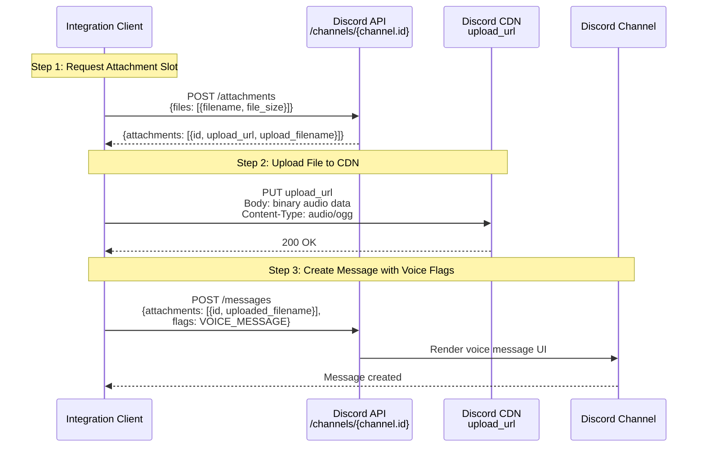
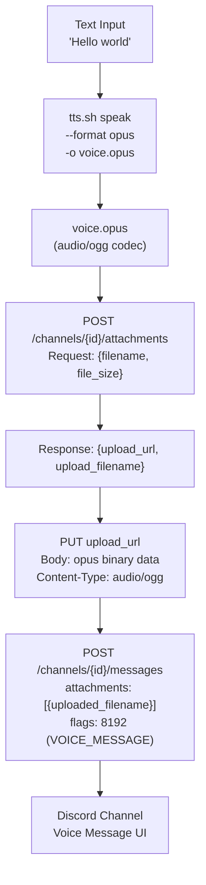

<!-- source: DeepWiki mcp.deepwiki.com · repo NoizAI/skills · page 6.3 Discord Integration · fetched 2026-10-26 -->

# Discord Integration

<details>
<summary>Relevant source files</summary>

The following files were used as context for generating this wiki page:

- [skills/tts/ref_3rd_party.md](skills/tts/ref_3rd_party.md)

</details>


## Purpose and Scope

This document explains how to send TTS-generated audio files to Discord as native voice messages. Discord requires a multi-step upload process involving attachment slot reservation, file upload to a temporary URL, and message creation with voice-specific flags.

For Feishu/Lark integration, see [Feishu Integration](#6.1). For Telegram integration, see [Telegram Integration](#6.2). For generating the audio files themselves, see [Simple Mode - Text to Audio](#3.1).

**Sources:** [skills/tts/ref_3rd_party.md:1-45]()

---

## Discord Voice Message Architecture

Unlike Telegram's direct `sendVoice` method or Feishu's two-step upload-then-send pattern, Discord implements a three-step attachment system that separates file upload from message creation. This architecture allows Discord to pre-validate files, allocate CDN resources, and apply client-specific rendering flags before the message appears in the channel.

### Three-Step Upload Flow



**Diagram: Discord Voice Message Upload Sequence**

This sequence differs from file-based Discord message attachments because the `flags` field must include the `VOICE_MESSAGE` flag (typically value `8192` or `0x2000`) to render the audio as a waveform-style voice message rather than a downloadable file attachment.

**Sources:** [skills/tts/ref_3rd_party.md:32-39]()

---

## Step-by-Step Workflow

### Step 1: Request Attachment Slot

The first API call reserves an upload slot on Discord's CDN. This endpoint validates file metadata before allocating upload resources.

**Endpoint:** `POST /channels/{channel.id}/attachments`

**Request Payload:**
```json
{
  "files": [
    {
      "filename": "voice.opus",
      "file_size": 24576,
      "id": 0
    }
  ]
}
```

**Response:**
```json
{
  "attachments": [
    {
      "id": 0,
      "upload_url": "https://discord-attachments-uploads-prd.storage.googleapis.com/...",
      "upload_filename": "abc123-voice.opus"
    }
  ]
}
```

The `upload_url` is a temporary pre-signed URL valid for a short time window (typically 15 minutes). The `upload_filename` must be used in Step 3 to reference the uploaded file.

**Sources:** [skills/tts/ref_3rd_party.md:34-36]()

---

### Step 2: Upload Audio File

Upload the binary audio file to the `upload_url` returned in Step 1 using a `PUT` request. Discord accepts `audio/ogg` or `audio/opus` MIME types for voice messages.

**HTTP Request:**
```
PUT {upload_url}
Content-Type: audio/ogg
Content-Length: 24576

{binary audio data}
```

The file must match the `file_size` declared in Step 1. Discord validates file integrity and may reject uploads that exceed size limits or have incorrect MIME types.

**Sources:** [skills/tts/ref_3rd_party.md:32-39]()

---

### Step 3: Create Message with Voice Flags

After successful upload, create the channel message referencing the uploaded attachment. The `flags` field must include the voice message flag to enable voice message UI rendering.

**Endpoint:** `POST /channels/{channel.id}/messages`

**Request Payload:**
```json
{
  "attachments": [
    {
      "id": 0,
      "uploaded_filename": "abc123-voice.opus"
    }
  ],
  "flags": 8192
}
```

The `flags` value `8192` (binary `0x2000`) corresponds to the `VOICE_MESSAGE` flag in Discord's message flags enum. Without this flag, the attachment renders as a downloadable file instead of a playable voice message with waveform visualization.

**Sources:** [skills/tts/ref_3rd_party.md:32-39]()

---

## Integration with TTS Skill Output

The Discord integration consumes audio files generated by the TTS skill in `opus` or `ogg` format. The recommended workflow generates the audio first, then uploads it through the three-step process.

### End-to-End Data Flow



**Diagram: TTS-to-Discord Complete Pipeline**

**Example Command:**
```bash
# Generate opus file
bash skills/tts/scripts/tts.sh speak -t "Hello world" --format opus -o voice.opus

# Then upload using Discord API (Steps 1-3)
```

**Sources:** [skills/tts/ref_3rd_party.md:10-16](), [skills/tts/ref_3rd_party.md:32-39]()

---

## Key Discord API Concepts

### Attachment Slots vs Direct Upload

Discord separates the **reservation** of upload capacity from the **execution** of the upload. This enables:

- **Pre-validation:** File size and type checking before CDN allocation
- **Quota enforcement:** Per-user or per-guild upload limits
- **CDN optimization:** Upload URLs route to geographically optimal CDN nodes
- **Concurrent uploads:** Multiple files can be uploaded in parallel after batch reservation

This differs from traditional multipart form uploads used by platforms like Telegram, where file data is sent directly in the message creation request.

**Sources:** [skills/tts/ref_3rd_party.md:32-39]()

---

### Voice Message Flags

The `flags` field in Discord messages is a bitfield where each bit represents a message property. The relevant flags for voice messages:

| Flag Name | Bit Value | Decimal | Purpose |
|-----------|-----------|---------|---------|
| `VOICE_MESSAGE` | `0x2000` | `8192` | Enables voice message UI rendering |
| `IS_VOICE_MESSAGE` (alias) | `0x2000` | `8192` | Same flag, different documentation name |

Without this flag, the attachment renders as a generic file download button. With the flag, Discord's client displays:
- Waveform visualization
- Play/pause controls inline
- Duration display
- Voice-specific UI styling

The flag must be set in the message creation request (Step 3), not in the attachment slot request (Step 1).

**Sources:** [skills/tts/ref_3rd_party.md:32-39]()

---

### upload_url Expiration

The `upload_url` returned in Step 1 is a pre-signed URL with a limited validity window. If the upload (Step 2) is not completed within this window, the URL expires and the entire process must restart from Step 1.

Typical expiration times:
- **Standard:** 15 minutes
- **Large files:** May be shorter for files approaching Discord's 25MB limit

The URL cannot be reused. Each message requires a fresh attachment slot request.

**Sources:** [skills/tts/ref_3rd_party.md:32-39]()

---

## Authentication and Permissions

### Bot Token Authentication

All Discord API requests require authentication via a bot token in the `Authorization` header:

```
Authorization: Bot {TOKEN}
```

The bot must have the following permissions in the target channel:
- `SEND_MESSAGES` (permission bit `2048`)
- `ATTACH_FILES` (permission bit `32768`)

Voice message sending does not require voice channel permissions, as these are text-channel attachments, not voice connections.

### Channel Access

The `{channel.id}` parameter in all API endpoints must reference a channel where:
1. The bot is a member of the guild (for guild channels)
2. The bot has been added as a participant (for DM channels)
3. The bot has not been blocked by the recipient (for DM channels)

**Sources:** [skills/tts/ref_3rd_party.md:32-39]()

---

## Implementation Considerations

### File Format Requirements

Discord accepts the following audio formats for voice messages:

| Format | MIME Type | Codec | Recommended |
|--------|-----------|-------|-------------|
| Opus (`.opus`) | `audio/ogg` | Opus | ✅ Yes |
| Ogg Vorbis (`.ogg`) | `audio/ogg` | Vorbis | ✅ Yes |
| MP3 (`.mp3`) | `audio/mpeg` | MP3 | ❌ Not ideal |
| WAV (`.wav`) | `audio/wav` | PCM | ❌ Too large |

The TTS skill's `--format opus` output is optimal for Discord voice messages, as it provides:
- Small file size (typically 10-50KB for short messages)
- High quality at low bitrates
- Native support in Discord's audio pipeline
- Direct compatibility without transcoding

**Note:** Despite the `.opus` file extension, the MIME type should be `audio/ogg` because Opus audio is typically wrapped in an Ogg container.

**Sources:** [skills/tts/ref_3rd_party.md:10-16](), [skills/tts/ref_3rd_party.md:42-44]()

---

### Error Handling

Common failure points in the three-step flow:

| Step | Error | Cause | Solution |
|------|-------|-------|----------|
| 1 | `50035: Invalid Form Body` | File size exceeds limit (25MB) | Compress audio or split message |
| 1 | `50001: Missing Access` | Bot lacks `ATTACH_FILES` permission | Grant permission in channel settings |
| 2 | `403 Forbidden` | `upload_url` expired | Restart from Step 1 |
| 2 | `400 Bad Request` | File size mismatch with declared size | Ensure file size matches Step 1 declaration |
| 3 | `50035: Invalid Form Body` | `uploaded_filename` doesn't match Step 2 | Use exact filename from Step 1 response |
| 3 | `40005: Request entity too large` | Attachment not uploaded before message creation | Complete Step 2 before Step 3 |

**Sources:** [skills/tts/ref_3rd_party.md:32-39]()

---

## Official Documentation References

Discord's official documentation for this workflow:

- **Uploading Files:** [https://discord.com/developers/docs/reference#uploading-files](https://discord.com/developers/docs/reference#uploading-files)
- **Create Message:** [https://discord.com/developers/docs/resources/channel#create-message](https://discord.com/developers/docs/resources/channel#create-message)
- **Message Flags:** [https://discord.com/developers/docs/resources/channel#message-object-message-flags](https://discord.com/developers/docs/resources/channel#message-object-message-flags)

**Sources:** [skills/tts/ref_3rd_party.md:37-39]()

---

## Comparison with Other Platforms

The following table compares Discord's integration approach with Feishu and Telegram:

| Platform | Steps | Upload Method | Voice Flag | Complexity |
|----------|-------|---------------|------------|------------|
| **Discord** | 3 steps | Pre-signed URL (PUT) | `flags: 8192` in message | High |
| **Feishu** | 2 steps | Multipart upload, then reference file_key | `msg_type: audio` | Medium |
| **Telegram** | 1 step | Direct multipart `sendVoice` | Implicit in endpoint | Low |

Discord's three-step architecture provides more control and validation but requires more integration complexity than Telegram's single-call approach.

**Sources:** [skills/tts/ref_3rd_party.md:20-39]()

---

## Security Considerations

### Credential Management

Discord bot tokens should never be committed to version control. Store tokens using one of these methods:

1. **Environment variable:** `DISCORD_BOT_TOKEN`
2. **Credential file:** `cred.json` (excluded via `.gitignore`)
3. **Secret management service:** Vault, AWS Secrets Manager, etc.

The token provides full access to all bot permissions, so it must be protected with the same security level as API keys. For more on credential management patterns, see [Credential Management](#8.2).

### upload_url Security

The `upload_url` is a pre-signed URL that grants temporary write access to a specific CDN location. While it cannot be used to download the file after upload, it should not be logged or shared, as it could be used to replace the intended upload with malicious content during the validity window.

**Sources:** [skills/tts/ref_3rd_party.md:44-45]()

---

