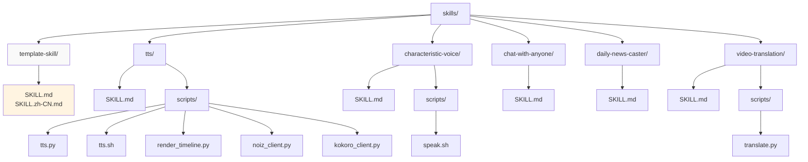
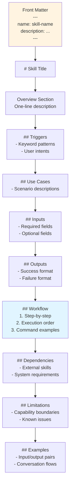
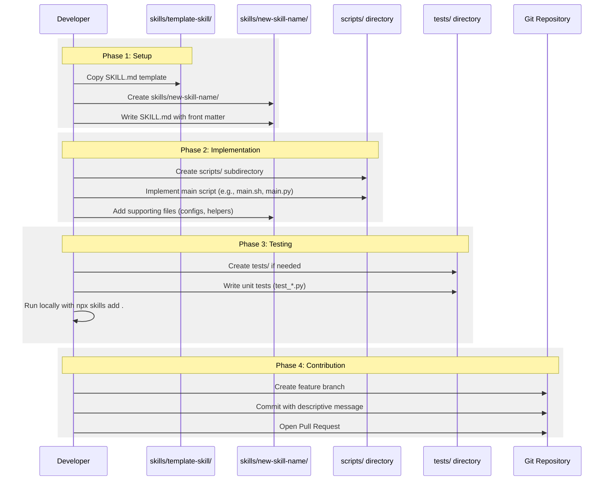
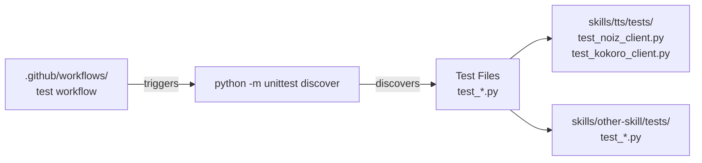
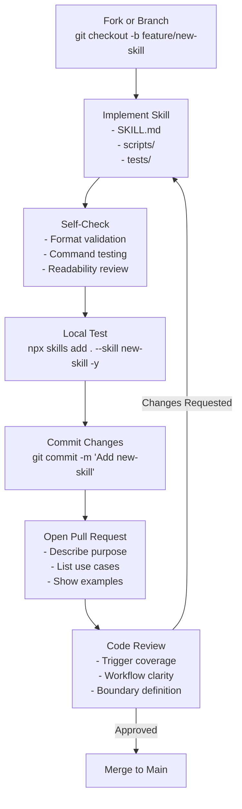

<!-- source: DeepWiki mcp.deepwiki.com · repo NoizAI/skills · page 7 Developer Guide · fetched 2026-10-26 -->

# Developer Guide

<details>
<summary>Relevant source files</summary>

The following files were used as context for generating this wiki page:

- [CONTRIBUTING.md](CONTRIBUTING.md)
- [README.md](README.md)
- [skills/README.md](skills/README.md)
- [skills/chat-with-anyone/SKILL.md](skills/chat-with-anyone/SKILL.md)
- [skills/daily-news-caster/SKILL.md](skills/daily-news-caster/SKILL.md)
- [skills/template-skill/SKILL.md](skills/template-skill/SKILL.md)
- [skills/template-skill/SKILL.zh-CN.md](skills/template-skill/SKILL.zh-CN.md)

</details>


This guide is for developers who want to create new skills or contribute to the NoizAI/skills repository. It covers the skill authoring process, directory conventions, SKILL.md format specification, testing infrastructure, and contribution workflow.

For information about using existing skills, see [Quick Start Guide](#1.1). For details about specific skills and their APIs, see [TTS Skill](#3), [Characteristic Voice Skill](#4), and [Composite Skills](#5).

---

## Skill Architecture and Directory Structure

Skills in this repository follow a standardized directory layout and documentation format that enables the `npx skills add` CLI to discover, install, and manage them programmatically.

### Skill Directory Layout



**Directory Naming Convention**: All skill directories use kebab-case naming (e.g., `chat-with-anyone`, not `chatWithAnyone` or `chat_with_anyone`) as specified in [skills/README.md:8-9]().

**Sources**: [skills/README.md:1-16](), [README.md:33-39]()

---

### Skill Metadata and Front Matter

Every skill must have a `SKILL.md` file with YAML front matter that defines metadata for programmatic discovery:

```yaml
---
name: skill-name
description: Brief description of what the skill does and when to use it
---
```

The front matter is parsed by the `npx skills add` CLI to list and install skills. The `name` field must match the directory name, and the `description` should be a single sentence that clearly states the skill's trigger conditions.

| Field | Type | Required | Purpose |
|-------|------|----------|---------|
| `name` | string | Yes | Must match directory name (kebab-case) |
| `description` | string | Yes | Concise description including trigger keywords and use cases |

**Sources**: [skills/template-skill/SKILL.md:1-4](), [skills/daily-news-caster/SKILL.md:1-4](), [skills/chat-with-anyone/SKILL.md:1-4]()

---

## SKILL.md Format Specification

The SKILL.md document follows a standardized structure that enables both human readers and AI agents to understand how to use the skill.

### SKILL.md Template Structure



**Sources**: [skills/template-skill/SKILL.md:1-55]()

---

### Section-by-Section Requirements

#### Triggers Section

Lists keywords and phrases that should activate this skill. This enables AI agents to determine when to invoke the skill.

```markdown
## Triggers
- I want to chat with xxx
- Play the role of xxx and talk to me
- Let xxx explain this article to me
- Talk to me like xxx
```

**Sources**: [skills/chat-with-anyone/SKILL.md:10-16]()

#### Workflow Section

The most critical section for developers. Must provide step-by-step instructions with actual command examples that can be executed. Use concrete file paths and command syntax.

**Key Requirements**:
- Number each step sequentially
- Include complete command examples with placeholders
- Specify exact file paths (e.g., `skills/tts/scripts/tts.sh`)
- Document internal vs external steps clearly
- Show how to chain multiple commands
- Include error handling or fallback strategies

Example from daily-news-caster:

```markdown
### Step 4: Generate the Podcast Audio Line-by-Line
To avoid sending the entire script to the API at once, you must generate the audio **sentence by sentence (一人一句地生成)** and then concatenate them.

**1. Generate Audio for Each Line**:
```bash
bash path/to/tts.sh speak -t "Welcome to today's news roundup..." --backend noiz --ref-audio path/to/host_A.wav -o line_01.wav
```
```

**Sources**: [skills/daily-news-caster/SKILL.md:58-83](), [skills/template-skill/SKILL.md:39-45]()

#### Dependencies Section

Lists external skills (from other repositories) and system requirements. Use exact repository URLs.

```markdown
## Dependencies
- **youtube-downloader**: For fetching videos and subtitles.
- **ffmpeg**: For trimming and converting audio formats.
- **tts**: For generating the final speech using `--ref-audio` (typically requires Noiz backend for voice cloning).
```

**Sources**: [skills/chat-with-anyone/SKILL.md:72-75]()

---

## Creating a New Skill: Step-by-Step

### Workflow for Skill Development



**Sources**: [CONTRIBUTING.md:1-29]()

### Step 1: Copy the Template

Start from the template skill to ensure consistent structure:

```bash
cd skills/
cp -r template-skill/ my-new-skill/
cd my-new-skill/
```

Edit the front matter in `SKILL.md`:

```yaml
---
name: my-new-skill
description: Brief description of what the skill does and when to trigger it.
---
```

**Sources**: [skills/template-skill/SKILL.md:1-55]()

### Step 2: Define Triggers and Workflow

Fill in the core sections that agents use:

1. **Triggers**: List all natural language patterns that should invoke your skill
2. **Workflow**: Write numbered steps with actual commands
3. **Inputs/Outputs**: Document the data contract clearly
4. **Limitations**: Set clear expectations about what the skill cannot do

**Best Practice**: Look at existing composite skills like [skills/daily-news-caster/SKILL.md]() or [skills/chat-with-anyone/SKILL.md]() for examples of well-documented workflows.

**Sources**: [skills/template-skill/SKILL.md:12-48]()

### Step 3: Implement Scripts

Create a `scripts/` subdirectory if your skill requires executable code:

```bash
mkdir scripts/
```

Common patterns:
- **Shell wrapper**: `scripts/main.sh` for simple command orchestration
- **Python implementation**: `scripts/main.py` for complex logic
- **Helper modules**: Additional Python modules for reusable components

Example structure from TTS skill:
- `scripts/tts.sh` - Main CLI entry point
- `scripts/tts.py` - Python implementation
- `scripts/noiz_client.py` - Backend abstraction
- `scripts/kokoro_client.py` - Backend abstraction
- `scripts/render_timeline.py` - Timeline mode logic

**Sources**: [skills/tts/scripts/]() (directory reference)

### Step 4: Document Command Examples

Every workflow step must include copy-paste-ready command examples. Use placeholder syntax that's easy to understand:

```markdown
### Step 2: Generate Audio
```bash
bash skills/my-new-skill/scripts/main.sh --input "text" --output output.wav
```
```

**Important**: Use relative paths from repository root (e.g., `skills/tts/scripts/tts.sh`) rather than absolute paths or assumptions about installation location.

**Sources**: [skills/daily-news-caster/SKILL.md:66-82]()

---

## Testing Infrastructure

The repository uses Python's `unittest` framework for skill testing. Tests are discovered automatically by GitHub Actions.

### Test Discovery Pattern



### Creating Tests for Your Skill

If your skill includes Python code, create a `tests/` directory:

```bash
mkdir skills/my-new-skill/tests/
touch skills/my-new-skill/tests/test_main.py
```

Use the `unittest` framework:

```python
import unittest
from skills.my_new_skill.scripts import main_module

class TestMyNewSkill(unittest.TestCase):
    def test_basic_functionality(self):
        result = main_module.process("input")
        self.assertIsNotNone(result)
    
    def test_error_handling(self):
        with self.assertRaises(ValueError):
            main_module.process(None)

if __name__ == '__main__':
    unittest.main()
```

**Testing Best Practices**:
- Test with mocked external dependencies (APIs, file systems)
- Include both success and failure cases
- Test parameter validation and error messages
- Use descriptive test method names

**Sources**: Reference to TTS skill test structure (inferred from pattern, no direct file provided)

### Local Testing Before PR

Test your skill locally using the `npx skills add` CLI:

```bash
# From repository root
npx skills add . --list --full-depth

# Install your skill locally
npx skills add . --full-depth --skill my-new-skill -y

# Run the skill
bash skills/my-new-skill/scripts/main.sh --help
```

**Sources**: [README.md:20-22]()

---

## Contribution Workflow

### Pre-Submission Checklist

Before opening a pull request, verify:

| Requirement | Location | Verification Command |
|-------------|----------|---------------------|
| Kebab-case directory name | `skills/<skill-name>/` | `ls skills/` |
| SKILL.md exists | `skills/<skill-name>/SKILL.md` | `cat skills/<skill-name>/SKILL.md` |
| Front matter present | Top of SKILL.md | Check YAML block |
| Triggers section | SKILL.md | Search for `## Triggers` |
| Workflow section | SKILL.md | Search for `## Workflow` |
| Limitations section | SKILL.md | Search for `## Limitations` |
| Examples/commands | SKILL.md | Check for code blocks |

**Sources**: [CONTRIBUTING.md:6-16]()

### Pull Request Process



**Sources**: [CONTRIBUTING.md:17-29]()

### Review Criteria

The maintainers focus on three key areas during review:

1. **Trigger Coverage**: Do the triggers map to real user intents? Are they comprehensive enough to catch expected use cases? [CONTRIBUTING.md:26]()

2. **Workflow Clarity**: Is the workflow actionable? Can an AI agent or human developer execute it without ambiguity? Are commands complete and correct? [CONTRIBUTING.md:27]()

3. **Boundary Definition**: Are limitations clearly stated? Does the skill avoid over-promising capabilities? [CONTRIBUTING.md:28]()

**Sources**: [CONTRIBUTING.md:24-28]()

### Commit Message Convention

Use descriptive commit messages that explain the purpose:

```bash
# Good examples
git commit -m "Add video-translation skill for multilingual dubbing"
git commit -m "Update daily-news-caster to support custom news sources"
git commit -m "Fix character-voice emotion preset serialization"

# Avoid
git commit -m "Update files"
git commit -m "Fix bug"
```

---

## Best Practices for Skill Development

### 1. Skill Granularity

- **Core Skills**: Single-purpose, reusable components (e.g., `tts`, `characteristic-voice`)
- **Composite Skills**: Orchestrate multiple skills for complex workflows (e.g., `chat-with-anyone`, `daily-news-caster`)

Reference the dependency patterns in the high-level architecture diagrams to understand where your skill fits.

**Sources**: High-level system diagrams (provided in context)

### 2. Command Portability

Always use relative paths from repository root and document both `.sh` and `.py` entry points:

```bash
# Good - relative from repo root
bash skills/tts/scripts/tts.sh speak -t "Hello"

# Avoid - absolute paths or undocumented locations
/usr/local/bin/tts speak -t "Hello"
```

**Sources**: [skills/daily-news-caster/SKILL.md:61-82]()

### 3. Error Handling Documentation

Include fallback strategies in your workflow:

```markdown
### Step 3: Generate Audio
Run the TTS command. If it fails with authentication error:
- Check if API key is configured: `bash skills/tts/scripts/tts.sh config --check`
- Fall back to Kokoro backend: `--backend kokoro`
```

**Sources**: [skills/template-skill/SKILL.md:43]()

### 4. Dependency Management

If your skill depends on external repositories:
- Document installation commands with exact URLs
- Use `npx skills add` syntax for skill dependencies
- Specify minimum versions if relevant

Example from daily-news-caster:

```bash
npx skills add https://github.com/cclank/news-aggregator-skill --skill news-aggregator-skill -y
npx skills add https://github.com/noizai/skills --skill tts -y
```

**Sources**: [skills/daily-news-caster/SKILL.md:16-19]()

### 5. Internationalization

Provide bilingual documentation when possible. The template includes both English and Chinese versions:

- `SKILL.md` - English documentation
- `SKILL.zh-CN.md` - Simplified Chinese documentation

Use language-switching links at the top:

```markdown
[简体中文](./SKILL.zh-CN.md) | English
```

**Sources**: [skills/template-skill/SKILL.md:8](), [skills/template-skill/SKILL.zh-CN.md:8]()

---

## Code Organization Patterns

### Backend Abstraction Pattern

The TTS skill demonstrates a clean backend abstraction pattern that can be reused:

```
scripts/
├── tts.py              # Main CLI logic
├── tts.sh              # Shell wrapper
├── noiz_client.py      # Noiz backend implementation
├── kokoro_client.py    # Kokoro backend implementation
└── render_timeline.py  # Shared timeline rendering
```

Each backend client implements the same interface, enabling transparent backend switching based on configuration.

**Sources**: TTS skill directory structure (inferred)

### Configuration Management Pattern

Follow the security-first configuration pattern:
- Store sensitive credentials in `~/.noiz_api_key` (excluded by `.gitignore`)
- Provide a `config` subcommand for credential management
- Support environment variable overrides
- Document configuration in SKILL.md

**Sources**: [README.md:84-92](), security architecture diagram

### Multi-Step Workflow Pattern

For complex workflows (composite skills), use explicit phase markers:

```markdown
### Phase 1: Data Acquisition
[steps...]

### Phase 2: Processing
[steps...]

### Phase 3: Assembly
[steps...]
```

This helps both human readers and AI agents understand the logical flow and dependencies.

**Sources**: [skills/daily-news-caster/SKILL.md:11-89]()

---

## Skill Integration with npx skills add

Your skill becomes discoverable when the SKILL.md follows the correct format. The `npx skills add` CLI:

1. Clones the repository
2. Scans `skills/*/SKILL.md` files
3. Parses YAML front matter for metadata
4. Lists available skills with `--list`
5. Installs requested skills with `--skill <name>`

Ensure your skill can be listed:

```bash
npx skills add NoizAI/skills --list --full-depth
```

Expected output should include your skill:

```
Available skills:
  - tts
  - characteristic-voice
  - chat-with-anyone
  - daily-news-caster
  - video-translation
  - my-new-skill          # Your skill appears here
```

**Sources**: [README.md:8-22]()

---

## Summary: Developer Checklist

When creating a new skill:

- [ ] Create `skills/<skill-name>/` directory (kebab-case)
- [ ] Copy and customize `SKILL.md` from template
- [ ] Add YAML front matter with `name` and `description`
- [ ] Write comprehensive `## Triggers` section
- [ ] Document step-by-step `## Workflow` with commands
- [ ] List all `## Dependencies` with install instructions
- [ ] Define `## Limitations` clearly
- [ ] Create `scripts/` directory if needed
- [ ] Write tests in `tests/` directory if applicable
- [ ] Test locally with `npx skills add .`
- [ ] Follow commit message conventions
- [ ] Open PR with clear description and examples
- [ ] Address review feedback on triggers, workflow, and boundaries

**Sources**: [CONTRIBUTING.md:6-28](), [skills/template-skill/SKILL.md:1-55]()

---

