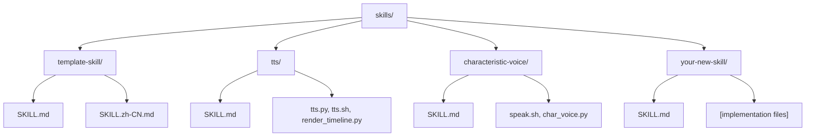
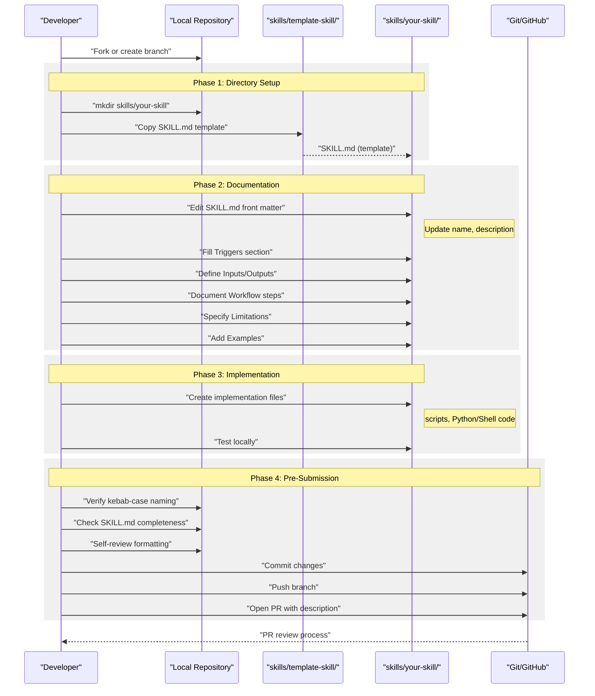
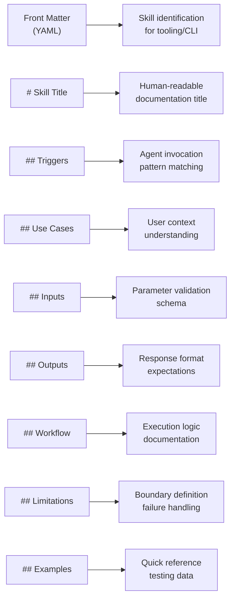

<!-- source: DeepWiki mcp.deepwiki.com · repo NoizAI/skills · page 7.1 Creating a New Skill · fetched 2026-10-26 -->

# Creating a New Skill

<details>
<summary>Relevant source files</summary>

The following files were used as context for generating this wiki page:

- [CONTRIBUTING.md](CONTRIBUTING.md)
- [skills/README.md](skills/README.md)
- [skills/template-skill/SKILL.md](skills/template-skill/SKILL.md)
- [skills/template-skill/SKILL.zh-CN.md](skills/template-skill/SKILL.zh-CN.md)

</details>


This page provides a step-by-step guide for creating a new skill in the NoizAI/skills repository. It covers directory structure, naming conventions, and using the template-skill as a starting point. For detailed documentation of the SKILL.md format and its sections, see [Skill Definition Format](#7.2). For the full contribution and review process, see [Contribution Guidelines](#7.4).

## Purpose and Scope

Creating a new skill involves establishing a standardized directory structure, authoring a `SKILL.md` file that defines the skill's interface, and implementing the skill's functionality. This document focuses on the structural requirements and initial setup process. The actual SKILL.md content format is covered in detail in [page 7.2](#7.2), while testing and CI/CD practices are documented in [page 7.3](#7.3).

---

## Directory Structure and Naming Conventions

All skills in the repository follow a standardized directory convention:

```
skills/
├── <skill-name>/
│   ├── SKILL.md
│   ├── SKILL.zh-CN.md (optional)
│   └── [implementation files]
```

**Naming Requirements:**
- Skill directory names **must** use kebab-case (lowercase with hyphens)
- The directory name becomes the skill identifier
- Valid examples: `tts`, `characteristic-voice`, `chat-with-anyone`, `video-translation`
- Invalid examples: `TTS`, `characteristicVoice`, `chat_with_anyone`

The `SKILL.md` file is the primary interface definition. All skills must include this file at the root of their skill directory.

**Directory Structure Diagram**



Sources: [skills/README.md:1-16](), [CONTRIBUTING.md:8-9]()

---

## Skill Creation Workflow

The following diagram shows the complete process for creating and submitting a new skill:

**Skill Creation Process**



Sources: [CONTRIBUTING.md:17-23](), [skills/template-skill/SKILL.md:1-55]()

---

## Step-by-Step Creation Guide

### Step 1: Create the Skill Directory

Create a new directory under `skills/` using kebab-case naming:

```bash
mkdir skills/your-skill-name
cd skills/your-skill-name
```

The directory name should be:
- Descriptive of the skill's function
- Lowercase only
- Words separated by hyphens
- Concise (2-4 words typically)

### Step 2: Copy the Template

The `template-skill` directory provides a starting point:

```bash
cp ../template-skill/SKILL.md ./SKILL.md
```

Optionally, if providing Chinese documentation:

```bash
cp ../template-skill/SKILL.zh-CN.md ./SKILL.zh-CN.md
```

Sources: [skills/template-skill/SKILL.md:1-55](), [skills/template-skill/SKILL.zh-CN.md:1-57]()

### Step 3: Update Front Matter

The front matter at the top of `SKILL.md` must be updated with your skill's information:

```yaml
---
name: your-skill-name
description: Brief one-line description of what this skill does
---
```

**Requirements:**
- `name` must match the directory name exactly
- `description` should be concise and actionable (what problem it solves)
- Front matter must be valid YAML enclosed in `---` delimiters

Sources: [skills/template-skill/SKILL.md:1-4]()

### Step 4: Update the Skill Title

Replace the placeholder title with your skill name:

```markdown
# your-skill-name
```

Add language toggle links if providing translations:

```markdown
[简体中文](./SKILL.zh-CN.md) | English
```

Sources: [skills/template-skill/SKILL.md:6-8]()

### Step 5: Complete Required Sections

The template contains all required sections. You must fill in each section with your skill's specific information:

| Section | Purpose | Required |
|---------|---------|----------|
| **Triggers** | Keywords or phrases that invoke this skill | Yes |
| **Use Cases** | Typical scenarios where this skill applies | Yes |
| **Inputs** | Required and optional input parameters | Yes |
| **Outputs** | Success and failure output formats | Yes |
| **Workflow** | Step-by-step execution process | Yes |
| **Limitations** | Capability boundaries and failure modes | Yes |
| **Examples** | Concrete input/output examples | Yes |

Detailed format specifications for each section are covered in [Skill Definition Format](#7.2).

Sources: [skills/template-skill/SKILL.md:12-54](), [CONTRIBUTING.md:10-15]()

### Step 6: Implement Skill Functionality

Create your implementation files in the same directory. Common patterns:

**For shell-based skills:**
```
skills/your-skill/
├── SKILL.md
├── your-skill.sh  # Main entry point
└── your-skill.py  # Python implementation (if needed)
```

**For composite skills:**
```
skills/your-skill/
├── SKILL.md
├── main.sh        # Orchestration script
├── agent.py       # Agent logic
└── utils/         # Helper modules
```

There are no strict requirements for implementation file names or languages, but consistency with existing skills is recommended.

Sources: [skills/README.md:1-16]()

---

## SKILL.md Template Structure

The template provides a standardized outline. Below is the mapping between template sections and their functional purposes:

**Template Section Mapping**



**Required vs Optional Content:**

- **Always Required:** All seven sections (Triggers through Examples) must be present
- **Front Matter:** `name` and `description` fields are mandatory
- **Bilingual Support:** `SKILL.zh-CN.md` is optional but recommended for broader accessibility

Sources: [skills/template-skill/SKILL.md:1-55](), [CONTRIBUTING.md:10-15]()

---

## Pre-Submission Checklist

Before submitting your skill for review, verify the following:

### Directory and Naming
- [ ] Skill directory is under `skills/`
- [ ] Directory name uses kebab-case
- [ ] Directory name matches front matter `name` field

### SKILL.md Completeness
- [ ] Front matter contains `name` and `description`
- [ ] All seven required sections are present and filled
- [ ] Triggers cover realistic usage patterns
- [ ] Workflow steps are clear and actionable
- [ ] Limitations explicitly define boundaries
- [ ] Examples provide concrete input/output samples

### Implementation
- [ ] Implementation files are present in skill directory
- [ ] Skill has been tested locally
- [ ] No hardcoded credentials or sensitive data

### Documentation Quality
- [ ] Formatting is consistent with template
- [ ] Language is technical and precise
- [ ] Examples are self-contained and runnable

Sources: [CONTRIBUTING.md:6-16]()

---

## Review Criteria

When your PR is reviewed, evaluators will focus on:

| Criterion | What Reviewers Check |
|-----------|---------------------|
| **Trigger Coverage** | Do triggers map to real user scenarios? Are they natural language patterns? |
| **Workflow Clarity** | Is the execution process clearly documented? Can it be implemented from the description? |
| **Boundary Definition** | Are limitations explicit? Are failure cases documented? Is scope realistic? |
| **Reusability** | Does the skill follow conventions that allow composition with other skills? |
| **Completeness** | Are all required sections present and substantive? |

The review process aims to ensure skills are well-documented, maintainable, and composable within the larger ecosystem.

Sources: [CONTRIBUTING.md:24-29]()

---

## Example: Creating a Minimal Skill

Here is a condensed example of creating a simple skill:

```bash
# Create directory
mkdir skills/json-formatter
cd skills/json-formatter

# Copy template
cp ../template-skill/SKILL.md ./SKILL.md

# Edit SKILL.md (pseudocode)
# Update front matter: name: json-formatter, description: Format JSON with proper indentation
# Fill Triggers: "format this JSON", "prettify JSON"
# Define Inputs: raw JSON string
# Define Outputs: formatted JSON or error message
# Document Workflow: validate → parse → format → output
# Specify Limitations: only handles valid JSON, max 10MB size
# Add Examples: input: {"a":1,"b":2}, output: properly indented JSON

# Create implementation
cat > format.py << 'EOF'
#!/usr/bin/env python3
import json
import sys

def format_json(raw):
    try:
        obj = json.loads(raw)
        return json.dumps(obj, indent=2)
    except json.JSONDecodeError as e:
        return f"Error: {e}"

if __name__ == "__main__":
    print(format_json(sys.stdin.read()))
EOF

chmod +x format.py
```

This example demonstrates the minimal viable structure: directory, SKILL.md, and implementation file.

---

## Relationship to Other Skills

New skills typically fall into one of two categories:

**Core Skills:**
- Self-contained functionality
- No dependencies on other skills
- Examples: `tts`, `characteristic-voice`
- See [System Architecture Overview](#1.2) for more on core vs composite skills

**Composite Skills:**
- Orchestrate multiple core skills or external dependencies
- Examples: `chat-with-anyone`, `daily-news-caster`, `video-translation`
- See [Composite Skills](#5) for architecture patterns

When creating a composite skill, ensure that dependencies are clearly documented in the **Inputs** section and installation requirements are noted in **Limitations**.

Sources: [skills/README.md:12-15]()

---

## Next Steps

After creating your skill:

1. **Local Testing:** Test your implementation thoroughly before submission
2. **Documentation Review:** Ensure SKILL.md is complete and follows the template
3. **Submit PR:** Follow the process in [Contribution Guidelines](#7.4)
4. **Incorporate Feedback:** Address review comments to refine the skill

For detailed SKILL.md format specifications, proceed to [Skill Definition Format](#7.2). For testing infrastructure details, see [Testing and CI/CD](#7.3).

---

