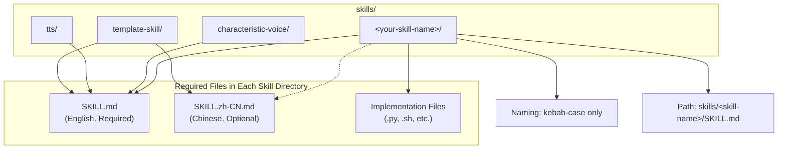
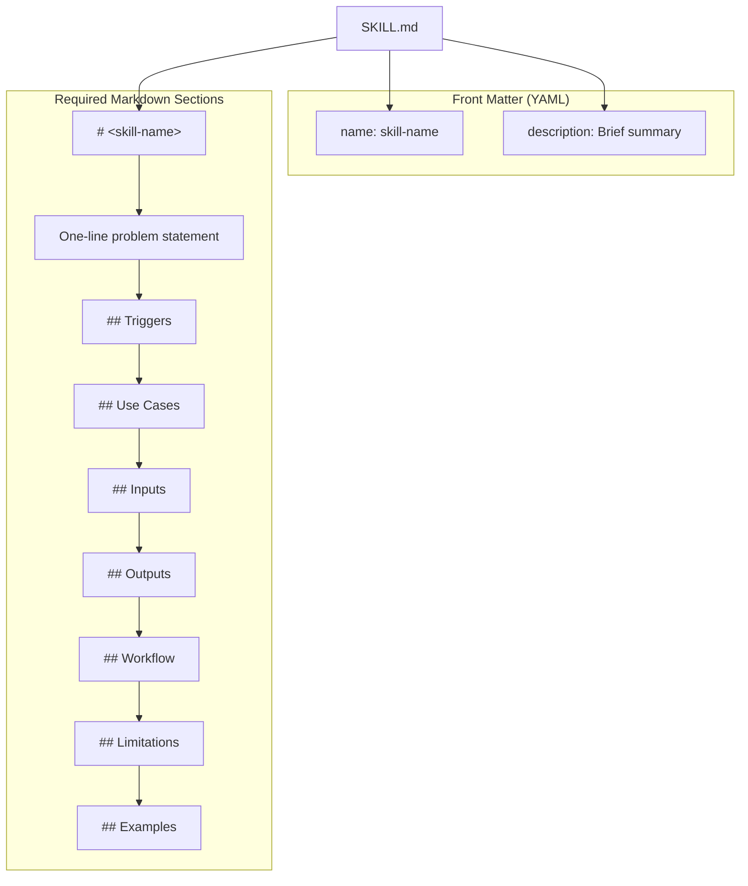
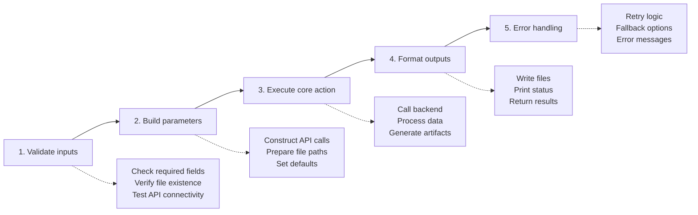
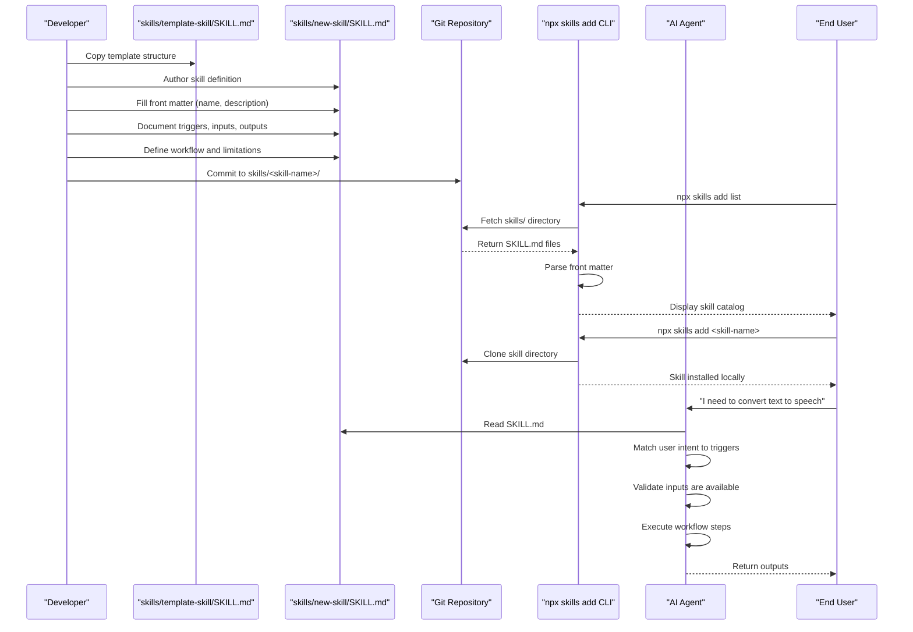
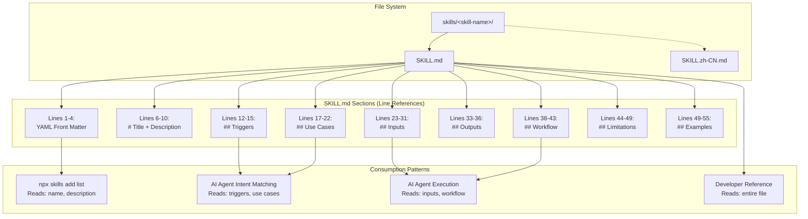

<!-- source: DeepWiki mcp.deepwiki.com · repo NoizAI/skills · page 7.2 Skill Definition Format · fetched 2026-10-26 -->

# Skill Definition Format

<details>
<summary>Relevant source files</summary>

The following files were used as context for generating this wiki page:

- [CONTRIBUTING.md](CONTRIBUTING.md)
- [skills/README.md](skills/README.md)
- [skills/template-skill/SKILL.md](skills/template-skill/SKILL.md)
- [skills/template-skill/SKILL.zh-CN.md](skills/template-skill/SKILL.zh-CN.md)

</details>


This document specifies the structure and conventions for `SKILL.md` files, which define the interface contract for each skill in the repository. Every skill must include a `SKILL.md` file that documents its triggers, inputs, outputs, workflow, and limitations in a standardized format. This format enables both human developers and AI agents to understand how to invoke and integrate skills.

For the overall process of creating a new skill, see [Creating a New Skill](#7.1). For submission requirements, see [Contribution Guidelines](#7.4).

---

## File Location and Naming Convention

Each skill is defined in its own directory under `skills/`, following a strict naming convention:

```
skills/
├── <skill-name>/
│   ├── SKILL.md          # English definition (required)
│   ├── SKILL.zh-CN.md    # Chinese definition (optional)
│   └── [implementation files]
```

**Directory Naming Rules:**
- Use **kebab-case** for `<skill-name>` (lowercase with hyphens)
- Examples: `tts`, `characteristic-voice`, `chat-with-anyone`, `daily-news-caster`
- Avoid underscores, camelCase, or spaces

**File Structure Diagram:**



**Sources:** [skills/README.md:1-16](), [CONTRIBUTING.md:8-9]()

---

## SKILL.md Structure Overview

Every `SKILL.md` file follows a fixed structure with YAML front matter followed by markdown sections:



**Sources:** [skills/template-skill/SKILL.md:1-55]()

---

## Front Matter Specification

The YAML front matter appears at the top of `SKILL.md`, delimited by `---` markers:

```yaml
---
name: template-skill
description: Reusable template for authoring new Agent Skills with clear triggers, workflow, and I/O contracts.
---
```

| Field | Type | Required | Description |
|-------|------|----------|-------------|
| `name` | string | Yes | Skill identifier (must match directory name) |
| `description` | string | Yes | Concise summary of skill's purpose (1-2 sentences) |

**Validation Rules:**
- `name` must be kebab-case and match the parent directory name
- `description` should be a complete sentence explaining the problem solved
- No additional custom fields are currently supported

**Sources:** [skills/template-skill/SKILL.md:1-4]()

---

## Required Sections

### Title and Overview

Immediately after the front matter, include:

1. **H1 Title**: `# <skill-name>` (matches the `name` field)
2. **Language Navigation**: Links to translations (e.g., `[简体中文](./SKILL.zh-CN.md) | English`)
3. **One-line Description**: A single sentence problem statement

```markdown
# template-skill

[简体中文](./SKILL.zh-CN.md) | English

One-line description of what this skill solves.
```

**Sources:** [skills/template-skill/SKILL.md:6-10]()

---

### ## Triggers

Lists natural language phrases or keywords that should activate this skill. Triggers help AI agents determine when to invoke the skill.

**Format:**
```markdown
## Triggers

- trigger keyword 1
- trigger keyword 2
```

**Best Practices:**
- Include both specific commands and conversational phrases
- Use actual user language (not technical jargon)
- Provide 3-5 diverse trigger examples
- Include both English and localized triggers if applicable

**Example (TTS Skill):**
```markdown
## Triggers

- "Convert this text to speech"
- "Read this aloud"
- "Generate audio for..."
- "tts"
- "text to speech"
```

**Sources:** [skills/template-skill/SKILL.md:12-15](), [CONTRIBUTING.md:12]()

---

### ## Use Cases

Describes typical scenarios where this skill provides value. Helps users understand when to apply the skill.

**Format:**
```markdown
## Use Cases

- Typical scenario 1
- Typical scenario 2
- Typical scenario 3
```

**Best Practices:**
- Focus on user goals, not technical features
- Provide 3-5 concrete scenarios
- Use active voice ("Generate podcast audio" not "Audio can be generated")

**Sources:** [skills/template-skill/SKILL.md:17-22]()

---

### ## Inputs

Specifies the data required to execute the skill, divided into required and optional parameters.

**Format:**
```markdown
## Inputs

- Required inputs:
  - `field_a`: Description
  - `field_b`: Description
- Optional inputs:
  - `field_c`: Description
```

**Input Specification Table:**

| Category | Syntax | Description |
|----------|--------|-------------|
| **Required** | `` `field_name`: Description `` | Must be provided for skill execution |
| **Optional** | `` `field_name`: Description `` | Has default values or can be omitted |

**Best Practices:**
- Use `code formatting` for parameter names
- Specify data types (text, file path, URL, etc.)
- Mention valid ranges or formats (e.g., "ISO language code")
- Indicate if file paths should be absolute or relative

**Example (Video Translation Skill):**
```markdown
## Inputs

- Required inputs:
  - `video_url`: YouTube URL or local video file path
  - `target_lang`: Target language code (e.g., 'zh', 'es', 'fr')
- Optional inputs:
  - `preserve_background_audio`: Boolean, default true
  - `voice_id`: Custom voice for dubbing (auto-selected if omitted)
```

**Sources:** [skills/template-skill/SKILL.md:23-31]()

---

### ## Outputs

Describes what the skill produces upon success or failure.

**Format:**
```markdown
## Outputs

- Success output format (example)
- Failure output format (example)
```

**Best Practices:**
- Specify file formats and locations (e.g., "Generates `output.wav` in current directory")
- Include example success messages
- Document error codes or failure messages
- Mention any side effects (files created, APIs called, etc.)

**Example:**
```markdown
## Outputs

- Success: 
  - Audio file: `output.wav` (44.1kHz, stereo WAV)
  - Console message: "✓ Generated 3.5 seconds of audio"
- Failure:
  - Error message with reason (e.g., "API key not found")
  - Exit code 1
```

**Sources:** [skills/template-skill/SKILL.md:33-36]()

---

### ## Workflow

Step-by-step execution sequence that the skill follows. This is critical for understanding the skill's internal logic.

**Format:**
```markdown
## Workflow

1. Validate input completeness
2. Build request parameters
3. Execute core action
4. Format outputs
5. Provide retry or fallback strategy on failure
```

**Workflow Authoring Guidelines:**



**Best Practices:**
- Number each step sequentially
- Use imperative verbs ("Validate", "Execute", not "Validates", "Is executing")
- Keep steps at consistent granularity (avoid mixing high-level and low-level steps)
- Include error handling as a distinct step
- Mention dependencies on other skills if applicable

**Example (Daily News Caster):**
```markdown
## Workflow

1. Fetch latest news articles via news-aggregator-skill
2. Generate dual-host podcast script using LLM
3. Split script into individual dialogue lines
4. Synthesize each line using TTS with appropriate voice
5. Concatenate audio segments using ffmpeg
6. Output final podcast audio and script markdown
```

**Sources:** [skills/template-skill/SKILL.md:38-43](), [CONTRIBUTING.md:14]()

---

### ## Limitations

Explicitly states what the skill **cannot do** or where it may fail. This prevents over-promising and sets correct expectations.

**Format:**
```markdown
## Limitations

- Clearly define capability boundaries
- Explain common failure causes
```

**Best Practices:**
- Be honest about technical constraints
- Mention known edge cases
- Document performance limits (file sizes, duration limits, rate limits)
- Specify unsupported formats or languages
- Reference external dependency limitations

**Example (TTS Skill):**
```markdown
## Limitations

- Maximum text length: 5000 characters per request (Noiz backend)
- Voice cloning requires 10+ seconds of clear reference audio
- Kokoro backend supports limited languages (en, ja, zh, es, fr)
- Cannot preserve original speaker's accent when translating languages
- Rate limit: 100 requests/hour with free API tier
```

**Sources:** [skills/template-skill/SKILL.md:44-49](), [CONTRIBUTING.md:15]()

---

### ## Examples

Provides concrete input/output pairs demonstrating typical usage.

**Format:**
```markdown
## Examples

- Input example:
  - `...`
- Output example:
  - `...`
```

**Best Practices:**
- Show full command-line invocations when applicable
- Include actual file paths and parameter values
- Demonstrate both simple and complex use cases
- Use realistic data (not placeholder text)

**Example (TTS Simple Mode):**
```markdown
## Examples

- Input example:
  ```bash
  ./tts.sh speak -t "Hello world" --voice af_bella --format wav
  ```
- Output example:
  ```
  ✓ Audio generated: output.wav
  Duration: 1.2s, Size: 211KB
  Backend: kokoro (local)
  ```
```

**Sources:** [skills/template-skill/SKILL.md:49-55]()

---

## Bilingual Support (Optional)

Skills may provide a Chinese translation in `SKILL.zh-CN.md` following the same structure:

**Cross-Linking Pattern:**
```markdown
# In SKILL.md (English)
[简体中文](./SKILL.zh-CN.md) | English

# In SKILL.zh-CN.md (Chinese)
简体中文 | [English](./SKILL.md)
```

**Translation Requirements:**
- Preserve all section headings (## Triggers, ## Inputs, etc.)
- Translate natural language content (descriptions, examples)
- Keep code snippets, file paths, and parameter names in English
- Maintain front matter field names in English (only translate values)

**Example Front Matter Translation:**
```yaml
# SKILL.md
---
name: template-skill
description: Reusable template for authoring new Agent Skills.
---

# SKILL.zh-CN.md
---
name: template-skill
description: 用于编写新 Agent Skill 的可复用模板，包含触发词、流程和输入输出约定。
---
```

**Sources:** [skills/template-skill/SKILL.zh-CN.md:1-57](), [skills/template-skill/SKILL.md:8]()

---

## SKILL.md Consumption Flow

The following diagram illustrates how `SKILL.md` files are consumed by different system components:



**Sources:** [skills/template-skill/SKILL.md:1-55](), [CONTRIBUTING.md:1-29]()

---

## Pre-Submission Validation Checklist

Before submitting a new or updated `SKILL.md`, verify the following:

| Check | Requirement | Reference |
|-------|-------------|-----------|
| ✓ | Front matter includes `name` and `description` | [Front Matter](#front-matter-specification) |
| ✓ | `name` matches directory name (kebab-case) | [File Location](#file-location-and-naming-convention) |
| ✓ | All required sections present | [Structure Overview](#skillmd-structure-overview) |
| ✓ | Triggers cover realistic user queries | [Triggers](#triggers) |
| ✓ | Inputs distinguish required vs optional | [Inputs](#inputs) |
| ✓ | Outputs document success and failure cases | [Outputs](#outputs) |
| ✓ | Workflow is numbered and actionable | [Workflow](#workflow) |
| ✓ | Limitations honestly state boundaries | [Limitations](#limitations) |
| ✓ | Examples show concrete usage | [Examples](#examples) |
| ✓ | If Chinese version exists, follows same structure | [Bilingual Support](#bilingual-support-optional) |

**Automated Validation:**
The repository does not currently implement automated SKILL.md linting, but pull requests are manually reviewed for compliance with these requirements (see [Contribution Guidelines](#7.4)).

**Sources:** [CONTRIBUTING.md:6-15]()

---

## Section Mapping to Code Entities

The following diagram bridges the SKILL.md document structure to its actual file representation and consumption patterns:



**Sources:** [skills/template-skill/SKILL.md:1-55](), [skills/README.md:1-16]()

---

