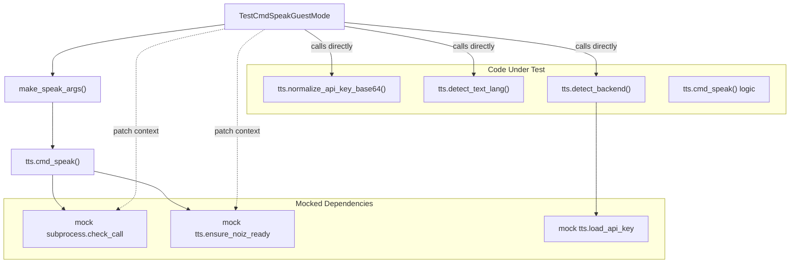
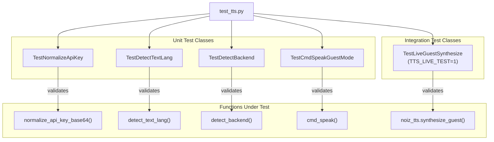
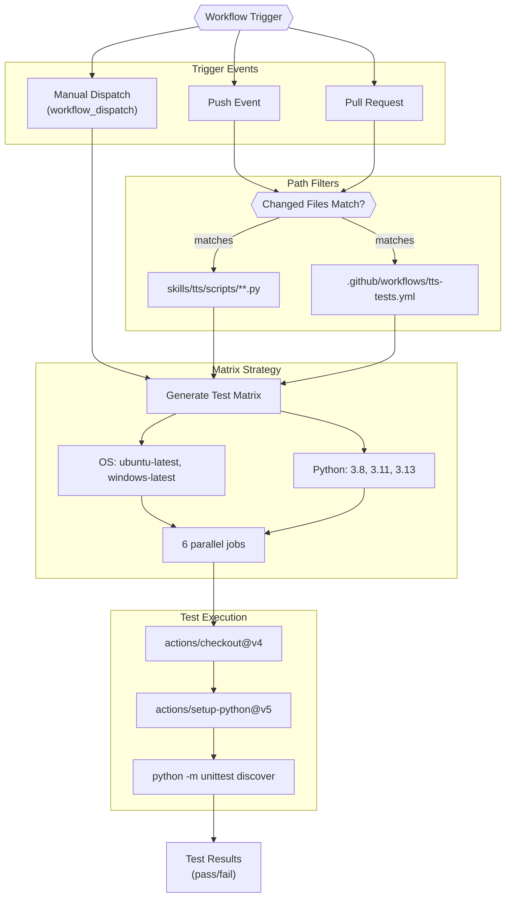

<!-- source: DeepWiki mcp.deepwiki.com · repo NoizAI/skills · page 7.3 Testing and CI/CD · fetched 2026-10-26 -->

# Testing and CI/CD

<details>
<summary>Relevant source files</summary>

The following files were used as context for generating this wiki page:

- [.github/workflows/tts-tests.yml](.github/workflows/tts-tests.yml)
- [skills/tts/scripts/test_tts.py](skills/tts/scripts/test_tts.py)

</details>


This page documents the testing infrastructure and continuous integration/continuous deployment (CI/CD) pipeline for the NoizAI/skills repository. It covers the unittest-based test framework, test discovery patterns, mocking strategies, live integration tests, and the GitHub Actions workflow that ensures code quality across multiple Python versions and operating systems.

For information about the contribution process and PR requirements, see [Contribution Guidelines](#7.4).

---

## Test Infrastructure Overview

The repository uses Python's built-in `unittest` framework as the primary testing mechanism, with optional `pytest` compatibility for developers who prefer that runner. Tests are organized as separate `test_*.py` files alongside the code they validate.

**Current Test Coverage:**
- **TTS Skill:** `skills/tts/scripts/test_tts.py` provides unit and integration tests for the core TTS functionality

**Test Discovery Pattern:**
```bash
python -m unittest discover -s skills/tts/scripts -p "test_*.py" -v
```

This discovery pattern is used both locally and in CI/CD, ensuring consistent test execution across environments.

**Sources:** [skills/tts/scripts/test_tts.py:1-10](), [.github/workflows/tts-tests.yml:32-33]()

---

## Test File Structure and Organization

### Test Module Loading

The test file uses dynamic module loading to import the code under test without executing its `main()` function. This allows testing of individual functions in isolation:

```python
import importlib.util
from pathlib import Path

_spec = importlib.util.spec_from_file_location("tts", Path(__file__).parent / "tts.py")
tts = importlib.util.module_from_spec(_spec)
_spec.loader.exec_module(tts)
```

This pattern enables importing `tts.py` as a module named `tts`, making its functions accessible as `tts.normalize_api_key_base64()`, `tts.detect_backend()`, etc.

**Sources:** [skills/tts/scripts/test_tts.py:20-23]()

### Test Helper Functions

The test suite includes helper functions that construct test arguments programmatically:

| Helper Function | Purpose |
|----------------|---------|
| `make_speak_args(**overrides)` | Creates an `argparse.Namespace` with default parameters for `cmd_speak`, using noiz-guest mode by default |

This helper accepts keyword arguments to override specific parameters, enabling concise test case creation:

```python
# Default arguments
args = make_speak_args()

# Override specific parameters
args = make_speak_args(voice_id="883b6b7c", speed=1.5)
```

**Sources:** [skills/tts/scripts/test_tts.py:27-47]()

---

## Unit Testing Strategy

### Mock-Based Testing

Unit tests use `unittest.mock.patch` to isolate the code under test from external dependencies. This approach tests logic without requiring API keys, network access, or subprocess execution.

**Diagram: Mock Architecture for TTS Tests**



**Example Mock Pattern:**
```python
def _run(self, args):
    with patch("subprocess.check_call") as mock_call, \
         patch.object(tts, "ensure_noiz_ready"):
        rc = tts.cmd_speak(args)
        return rc, mock_call
```

This pattern captures the subprocess command without executing it, allowing tests to verify that correct arguments are passed to the TTS backend.

**Sources:** [skills/tts/scripts/test_tts.py:111-115]()

### Test Coverage by Component

**Diagram: Test Class Hierarchy and Coverage**



**Sources:** [skills/tts/scripts/test_tts.py:52-163]()

#### TestNormalizeApiKey

Tests the API key normalization function that ensures keys are properly base64-encoded:

| Test Case | Validates |
|-----------|-----------|
| `test_plain_text_is_base64_encoded` | Plain text keys are converted to base64 |
| `test_already_base64_passes_through` | Valid base64 keys are not double-encoded |
| `test_empty_returns_empty` | Empty strings are handled gracefully |
| `test_strips_surrounding_whitespace` | Whitespace is removed before processing |

**Sources:** [skills/tts/scripts/test_tts.py:52-71]()

#### TestDetectTextLang

Tests automatic language detection for input text:

| Test Case | Input | Expected Output |
|-----------|-------|-----------------|
| `test_chinese_returns_zh` | "你好世界" | "zh" |
| `test_english_returns_en` | "Hello world" | "en" |
| `test_mixed_returns_zh` | "Hello 你好" | "zh" |
| `test_empty_returns_en` | "" | "en" |

**Sources:** [skills/tts/scripts/test_tts.py:75-88]()

#### TestDetectBackend

Tests backend selection logic based on API key availability:

| Test Case | Condition | Expected Backend |
|-----------|-----------|------------------|
| `test_explicit_backend_is_respected` | User specifies "kokoro" or "noiz" | Respect user choice |
| `test_no_key_falls_back_to_guest` | No API key present | "noiz-guest" |
| `test_key_present_selects_noiz` | API key exists | "noiz" |

**Sources:** [skills/tts/scripts/test_tts.py:92-105]()

#### TestCmdSpeakGuestMode

Tests the `cmd_speak` function in guest mode, verifying correct subprocess command construction:

| Test Case | Validates |
|-----------|-----------|
| `test_calls_noiz_tts_with_guest_flag` | `--guest` flag is present in subprocess call |
| `test_voice_id_forwarded` | `--voice-id` parameter is correctly passed |
| `test_text_forwarded` | `--text` parameter contains the input text |
| `test_ogg_format_aliased_to_opus` | "ogg" format is converted to "opus" |
| `test_speed_forwarded_when_set` | `--speed` is included when specified |
| `test_speed_absent_when_not_set` | `--speed` is omitted when not specified |
| `test_missing_voice_id_returns_error` | Returns error code 1 when voice_id is None |
| `test_missing_text_and_file_returns_error` | Returns error code 1 when no text source provided |

**Sources:** [skills/tts/scripts/test_tts.py:109-163]()

---

## Live Integration Testing

### TTS_LIVE_TEST Environment Variable

The test suite includes optional integration tests that make real HTTP calls to the Noiz API. These tests are gated behind an environment variable to prevent accidental execution during normal development:

```python
@unittest.skipUnless(os.getenv("TTS_LIVE_TEST"), "set TTS_LIVE_TEST=1 to run live tests")
class TestLiveGuestSynthesize(unittest.TestCase):
    """Calls the real Noiz guest endpoint; requires network access and requests."""
```

**Running Live Tests:**
```bash
TTS_LIVE_TEST=1 python3 -m pytest skills/tts/scripts/test_tts.py -v -k live
```

**Sources:** [skills/tts/scripts/test_tts.py:167-169]()

### Live Test Validation Strategy

The live integration test validates multiple aspects of the API response:

**Validation Steps:**

| Validation | Check | Purpose |
|------------|-------|---------|
| File existence | `out_path.exists()` | Confirms file was created |
| File size > 0 | `file_size > 0` | Ensures file is not empty |
| File size > 4096 | `file_size > 4096` | Confirms file is not an error response |
| WAV header | `header == b"RIFF"` | Validates audio file format |
| Duration value | `duration >= -1.0` | Checks metadata (guest returns -1.0) |

**Cleanup:** The test uses `try/finally` to ensure temporary files are deleted, including both the audio file and any `.duration` metadata file.

**Sources:** [skills/tts/scripts/test_tts.py:183-211]()

---

## GitHub Actions CI/CD Pipeline

### Workflow Configuration

The repository uses GitHub Actions for continuous integration, defined in `.github/workflows/tts-tests.yml`.

**Diagram: CI/CD Workflow Execution Flow**



**Sources:** [.github/workflows/tts-tests.yml:1-34]()

### Trigger Conditions

The workflow executes under three conditions:

| Trigger | When | Use Case |
|---------|------|----------|
| `workflow_dispatch` | Manual trigger from Actions tab | On-demand testing, debugging |
| `push` | Commit pushed to repository | Continuous integration on main branch |
| `pull_request` | PR opened or updated | Pre-merge validation |

**Path Filters:** Both `push` and `pull_request` triggers include path filters to run only when TTS-related files change:
- `skills/tts/scripts/**.py` (any Python file in TTS scripts)
- `.github/workflows/tts-tests.yml` (the workflow file itself)

**Sources:** [.github/workflows/tts-tests.yml:4-12]()

### Matrix Testing Strategy

The workflow uses a matrix strategy to test across multiple environments:

```yaml
strategy:
  fail-fast: false
  matrix:
    os: [ubuntu-latest, windows-latest]
    python-version: ["3.8", "3.11", "3.13"]
```

**Matrix Dimensions:**

| Dimension | Values | Rationale |
|-----------|--------|-----------|
| Operating Systems | Ubuntu, Windows | Cross-platform compatibility |
| Python Versions | 3.8, 3.11, 3.13 | Legacy (3.8), stable (3.11), latest (3.13) |
| Total Jobs | 6 (2 × 3) | All combinations tested in parallel |

**`fail-fast: false`**: Ensures all matrix jobs complete even if one fails, providing complete coverage visibility.

**Sources:** [.github/workflows/tts-tests.yml:18-22]()

### Job Steps

Each matrix job executes the following steps:

**Step 1: Checkout Code**
```yaml
- uses: actions/checkout@v4
```
Clones the repository at the commit being tested.

**Step 2: Setup Python**
```yaml
- name: Set up Python ${{ matrix.python-version }}
  uses: actions/setup-python@v5
  with:
    python-version: ${{ matrix.python-version }}
```
Installs the specified Python version from the matrix.

**Step 3: Run Tests**
```yaml
- name: Run tests
  run: python -m unittest discover -s skills/tts/scripts -p "test_*.py" -v
```
Executes test discovery and runs all matching test files with verbose output.

**Sources:** [.github/workflows/tts-tests.yml:24-33]()

---

## Running Tests Locally

### Unit Tests Only (Recommended for Development)

Run all unit tests without network access:

```bash
# Using unittest (matches CI)
python -m unittest discover -s skills/tts/scripts -p "test_*.py" -v

# Or using pytest
python3 -m pytest skills/tts/scripts/test_tts.py -v
```

### Including Live Integration Tests

Run with live API calls (requires network):

```bash
# Using unittest
TTS_LIVE_TEST=1 python -m unittest discover -s skills/tts/scripts -p "test_*.py" -v

# Using pytest with keyword filter
TTS_LIVE_TEST=1 python3 -m pytest skills/tts/scripts/test_tts.py -v -k live
```

### Running a Specific Test Class

```bash
# Run only TestNormalizeApiKey
python3 -m unittest skills.tts.scripts.test_tts.TestNormalizeApiKey -v

# Run only live tests (with pytest)
TTS_LIVE_TEST=1 python3 -m pytest skills/tts/scripts/test_tts.py::TestLiveGuestSynthesize -v
```

### Direct Execution

The test file can be executed directly as a script:

```bash
python3 skills/tts/scripts/test_tts.py
```

This runs `unittest.main(verbosity=2)` if executed as `__main__`.

**Sources:** [skills/tts/scripts/test_tts.py:4-8](), [skills/tts/scripts/test_tts.py:213-214]()

---

## Adding New Tests

### Test File Naming Convention

Follow the pattern `test_*.py` to ensure automatic discovery:
- `test_tts.py` (existing)
- `test_render_timeline.py` (example for future tests)
- `test_noiz_tts.py` (example for future tests)

### Test Class Structure

Create test classes that inherit from `unittest.TestCase`:

```python
class TestNewFeature(unittest.TestCase):
    
    def test_specific_behavior(self):
        # Arrange
        args = make_helper_args(param="value")
        
        # Act
        result = tts.function_under_test(args)
        
        # Assert
        self.assertEqual(result, expected_value)
```

### Mock External Dependencies

Use `unittest.mock.patch` for external dependencies:

```python
def test_command_execution(self):
    with patch("subprocess.check_call") as mock_call, \
         patch.object(tts, "load_api_key", return_value="test_key"):
        
        result = tts.cmd_speak(args)
        
        # Verify subprocess was called with correct arguments
        cmd = mock_call.call_args[0][0]
        self.assertIn("expected_arg", cmd)
```

### Integration Test Pattern

For tests requiring real network access, use the `@unittest.skipUnless` decorator:

```python
@unittest.skipUnless(os.getenv("FEATURE_LIVE_TEST"), "set FEATURE_LIVE_TEST=1 to run")
class TestLiveFeature(unittest.TestCase):
    
    @classmethod
    def setUpClass(cls):
        # One-time setup for all tests in class
        cls.setup_dependencies()
    
    def test_real_api_call(self):
        # Make real HTTP request
        response = api_call()
        self.assertIsNotNone(response)
```

**Sources:** [skills/tts/scripts/test_tts.py:167-211]()

---

## Best Practices Summary

| Practice | Rationale |
|----------|-----------|
| Use mocks for unit tests | Isolates logic from dependencies, no API keys required |
| Gate integration tests behind env vars | Prevents accidental API calls, network failures |
| Match CI test command locally | `python -m unittest discover` ensures consistency |
| Validate file creation in integration tests | Confirms actual output, not just status codes |
| Clean up temporary files | Use `try/finally` to prevent test pollution |
| Test cross-platform | CI matrix catches OS-specific issues |
| Test multiple Python versions | Ensures compatibility across deployment targets |
| Use descriptive test names | `test_missing_voice_id_returns_error` is self-documenting |

**Sources:** [skills/tts/scripts/test_tts.py:1-214](), [.github/workflows/tts-tests.yml:1-34]()

---

