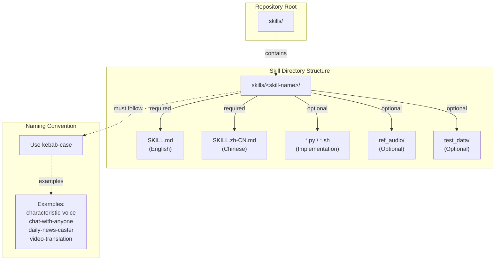
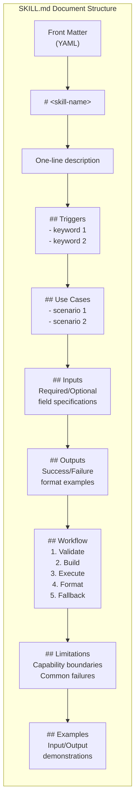
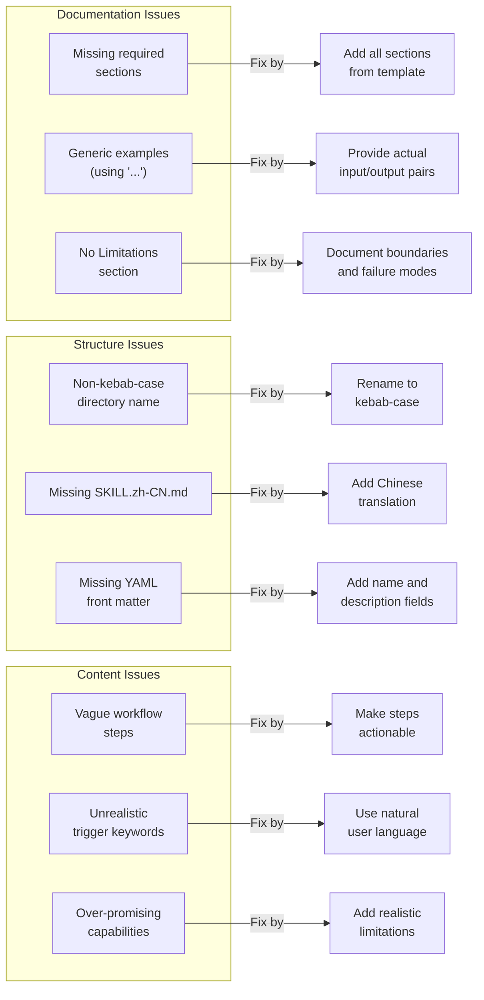

<!-- source: DeepWiki mcp.deepwiki.com · repo NoizAI/skills · page 7.4 Contribution Guidelines · fetched 2026-10-26 -->

# Contribution Guidelines

<details>
<summary>Relevant source files</summary>

The following files were used as context for generating this wiki page:

- [CONTRIBUTING.md](CONTRIBUTING.md)
- [skills/README.md](skills/README.md)
- [skills/template-skill/SKILL.md](skills/template-skill/SKILL.md)
- [skills/template-skill/SKILL.zh-CN.md](skills/template-skill/SKILL.zh-CN.md)

</details>


## Purpose and Scope

This document specifies the process, requirements, and review criteria for contributing new skills or improvements to the NoizAI/skills repository. It covers directory structure conventions, mandatory documentation sections, the pull request workflow, and quality standards that maintainers use during code review.

For guidance on creating a new skill from scratch, see [Creating a New Skill](#7.1). For detailed documentation of the `SKILL.md` format itself, see [Skill Definition Format](#7.2). For testing infrastructure and CI/CD pipelines, see [Testing and CI/CD](#7.3).

---

## Pre-Submission Checklist

Before submitting a pull request, verify that your contribution meets all mandatory requirements defined in [CONTRIBUTING.md:6-15]():

| Requirement | Specification | File Reference |
|------------|---------------|----------------|
| **Directory Naming** | Use kebab-case for `<skill-name>` | [CONTRIBUTING.md:9]() |
| **File Location** | Place skill at `skills/<skill-name>/SKILL.md` | [CONTRIBUTING.md:8]() |
| **Bilingual Support** | Provide both `SKILL.md` (English) and `SKILL.zh-CN.md` (Chinese) | [skills/template-skill/]() |
| **Front Matter** | Include YAML front matter with `name` and `description` | [skills/template-skill/SKILL.md:1-4]() |
| **Mandatory Sections** | Include all required sections listed below | [CONTRIBUTING.md:10-15]() |

**Mandatory `SKILL.md` Sections:**

```markdown
## Triggers          # Keyword list for agent activation
## Use Cases         # Typical scenarios
## Inputs            # Required and optional parameters
## Outputs           # Success/failure format examples
## Workflow          # Step-by-step execution process
## Limitations       # Capability boundaries and failure modes
## Examples          # Input/output demonstration
```

Sources: [CONTRIBUTING.md:6-15](), [skills/template-skill/SKILL.md:12-54]()

---

## Directory Structure Conventions

All skills must follow the standardized directory layout defined in [skills/README.md:6-9]():



**Directory Naming Rules:**

- **Lowercase with hyphens**: `video-translation`, not `videoTranslation` or `video_translation`
- **Descriptive and concise**: Aim for 2-4 words maximum
- **Action-oriented**: Prefer verb-based names (`chat-with-anyone`) over noun-based names when applicable

Sources: [skills/README.md:6-9](), [CONTRIBUTING.md:9]()

---

## SKILL.md Structure Requirements

The `SKILL.md` file serves as the canonical specification for agent integration and must include YAML front matter followed by structured markdown sections.

### Front Matter Format

```yaml
---
name: skill-name
description: One-line description of what this skill solves.
---
```

The `name` field must match the directory name, and the `description` should be under 100 characters.

Sources: [skills/template-skill/SKILL.md:1-4]()

### Required Section Breakdown



**Section Purposes:**

| Section | Purpose | Validation Criteria |
|---------|---------|---------------------|
| **Triggers** | Agent activation keywords | Must include both English and translated terms |
| **Use Cases** | Real-world scenarios | At least 3 concrete examples |
| **Inputs** | Parameter specifications | Clearly separate required vs optional |
| **Outputs** | Return format contracts | Include both success and failure cases |
| **Workflow** | Execution steps | Numbered list with validation and fallback steps |
| **Limitations** | Capability boundaries | Explicit about what the skill cannot do |
| **Examples** | Demonstrations | Actual input/output pairs, not placeholders |

Sources: [skills/template-skill/SKILL.md:12-54](), [CONTRIBUTING.md:10-15]()

---

## Pull Request Workflow

The contribution process follows a standard fork-and-PR model with specific review requirements.

```mermaid
sequenceDiagram
    participant Contributor
    participant Fork as "Forked Repository"
    participant Branch as "Feature Branch"
    participant PR as "Pull Request"
    participant Reviewer as "Maintainer"
    participant Main as "main Branch"
    
    Contributor->>Fork: "1. Fork NoizAI/skills"
    Contributor->>Branch: "2. Create feature branch<br/>git checkout -b add-new-skill"
    
    rect rgb(240, 240, 240)
        Note over Contributor,Branch: Development Phase
        Contributor->>Branch: "3a. Create skills/&lt;name&gt;/SKILL.md"
        Contributor->>Branch: "3b. Create skills/&lt;name&gt;/SKILL.zh-CN.md"
        Contributor->>Branch: "3c. Add implementation scripts"
        Contributor->>Branch: "3d. Self-check formatting"
    end
    
    Contributor->>PR: "4. Open PR with:<br/>- Purpose description<br/>- Use case explanation<br/>- Breaking change notes"
    
    rect rgb(240, 240, 240)
        Note over PR,Reviewer: Review Phase
        Reviewer->>PR: "5a. Check directory naming"
        Reviewer->>PR: "5b. Validate SKILL.md sections"
        Reviewer->>PR: "5c. Review triggers for realism"
        Reviewer->>PR: "5d. Assess workflow clarity"
        Reviewer->>PR: "5e. Verify boundary documentation"
    end
    
    alt "Changes Requested"
        Reviewer->>Contributor: "Request modifications"
        Contributor->>Branch: "Address feedback"
        Contributor->>PR: "Push updates"
    end
    
    Reviewer->>Main: "6. Merge to main"
```

### Step-by-Step Process

**1. Fork or Create Branch** ([CONTRIBUTING.md:19]())

For external contributors:
```bash
# Fork on GitHub, then clone
git clone https://github.com/YOUR_USERNAME/skills.git
cd skills
git checkout -b add-my-skill
```

For maintainers with write access:
```bash
git checkout -b add-my-skill
```

**2. Add or Update Skill Documentation** ([CONTRIBUTING.md:20]())

Create the skill directory and documentation files:
```bash
mkdir -p skills/my-new-skill
touch skills/my-new-skill/SKILL.md
touch skills/my-new-skill/SKILL.zh-CN.md
```

Use [skills/template-skill/SKILL.md]() as a starting template.

**3. Self-Check Formatting and Readability** ([CONTRIBUTING.md:21]())

Before submitting, validate:
- All mandatory sections are present
- Triggers cover realistic user inputs
- Workflow steps are actionable (not vague)
- Limitations explicitly state capability boundaries
- Examples use real data, not placeholders like `...`

**4. Submit Pull Request** ([CONTRIBUTING.md:22]())

The PR description must include:
- **Purpose**: What problem does this skill solve?
- **Use Cases**: When would an agent invoke this skill?
- **Breaking Changes**: Does this modify existing skill interfaces?

Sources: [CONTRIBUTING.md:17-22]()

---

## Review Criteria

Maintainers evaluate pull requests based on three primary dimensions defined in [CONTRIBUTING.md:24-28]():

```mermaid
graph TB
    subgraph "Review Criteria"
        TriggerReview["Trigger Coverage"]
        WorkflowReview["Workflow Clarity"]
        BoundaryReview["Boundary Documentation"]
    end
    
    subgraph "Trigger Coverage Assessment"
        TriggerQ1["Do triggers map to<br/>real user language?"]
        TriggerQ2["Are triggers specific<br/>enough to avoid collisions?"]
        TriggerQ3["Do triggers cover<br/>both English and Chinese?"]
    end
    
    subgraph "Workflow Clarity Assessment"
        WorkflowQ1["Are steps actionable<br/>and unambiguous?"]
        WorkflowQ2["Is validation logic<br/>explicitly described?"]
        WorkflowQ3["Are fallback strategies<br/>clearly defined?"]
    end
    
    subgraph "Boundary Documentation Assessment"
        BoundaryQ1["Are limitations<br/>explicitly stated?"]
        BoundaryQ2["Are common failure<br/>modes documented?"]
        BoundaryQ3["Does description avoid<br/>over-promising capabilities?"]
    end
    
    TriggerReview --> TriggerQ1
    TriggerReview --> TriggerQ2
    TriggerReview --> TriggerQ3
    
    WorkflowReview --> WorkflowQ1
    WorkflowReview --> WorkflowQ2
    WorkflowReview --> WorkflowQ3
    
    BoundaryReview --> BoundaryQ1
    BoundaryReview --> BoundaryQ2
    BoundaryReview --> BoundaryQ3
```



### 1. Trigger Coverage ([CONTRIBUTING.md:26]())

**Acceptance Criteria:**
- Triggers use natural language that users would actually type
- Triggers are specific enough to avoid activating unrelated skills
- Both English and Chinese triggers are provided
- Triggers cover variations (e.g., "translate video", "dub this video", "add voiceover")

**Common Rejection Reasons:**
- Generic triggers like "help" or "run" that conflict with other skills
- Only providing English triggers without Chinese equivalents
- Triggers that don't reflect real user intent

### 2. Workflow Clarity ([CONTRIBUTING.md:27]())

**Acceptance Criteria:**
- Each step is actionable with clear inputs and outputs
- Validation logic is explicit (what gets checked, what causes failure)
- Dependencies on external services are documented
- Error handling and retry strategies are specified
- The workflow follows the standard 5-step pattern: validate → build → execute → format → fallback

**Common Rejection Reasons:**
- Vague steps like "Process data" without specifics
- Missing validation steps
- No fallback strategy for failures
- Unclear dependencies on other skills or external APIs

### 3. Boundary Documentation ([CONTRIBUTING.md:28]())

**Acceptance Criteria:**
- Limitations section explicitly states what the skill cannot do
- Common failure modes are documented with explanations
- Performance constraints are noted (e.g., file size limits, processing time)
- Backend-specific limitations are clearly separated (Kokoro vs Noiz)

**Common Rejection Reasons:**
- No Limitations section
- Over-promising capabilities (e.g., "perfect translation")
- Not documenting known failure scenarios
- Unclear about which features require paid API keys

Sources: [CONTRIBUTING.md:24-28]()

---

## Code Quality Standards

While `SKILL.md` documentation is the primary contribution requirement, skills with implementation code must meet additional standards:

| Aspect | Requirement | Rationale |
|--------|-------------|-----------|
| **Python Style** | Follow PEP 8 conventions | Consistency with existing codebase |
| **Bash Scripts** | Use `#!/bin/bash` and `set -e` for error propagation | Fail-fast behavior |
| **Executable Permissions** | `chmod +x` for `.sh` files | Direct execution without `bash` prefix |
| **Error Handling** | Non-zero exit codes on failure | Shell script composition |
| **Dependency Declaration** | Document in `SKILL.md` Workflow section | Reproducibility |

**Testing Requirements:**

If your skill includes Python implementation, add unit tests following the pattern in [skills/tts/test_tts.py](). For details on the testing infrastructure, see [Testing and CI/CD](#7.3).

Sources: Repository conventions (implicit from existing skills)

---

## Bilingual Documentation Requirements

All skills must provide both English and Chinese versions of `SKILL.md`:

```
skills/my-skill/
├── SKILL.md         # English (primary)
└── SKILL.zh-CN.md   # Simplified Chinese
```

**Translation Guidelines:**

- Front matter must be identical in both files
- Section headings should maintain the same structure
- Chinese version should use natural phrasing, not literal translation
- Technical terms (API names, file paths) remain in English

**Template Usage:**

Copy and adapt from:
- English: [skills/template-skill/SKILL.md]()
- Chinese: [skills/template-skill/SKILL.zh-CN.md]()

The language navigation links at the top of each file should cross-reference:

```markdown
# English version
[简体中文](./SKILL.zh-CN.md) | English

# Chinese version
简体中文 | [English](./SKILL.md)
```

Sources: [skills/template-skill/SKILL.md:8](), [skills/template-skill/SKILL.zh-CN.md:8]()

---

## Common Rejection Scenarios

Based on the review criteria, here are frequent reasons for PR rejection or change requests:



**Example: Rejected Workflow Section**

❌ **Rejected (too vague):**
```markdown
## Workflow
1. Process input
2. Call API
3. Return result
```

✅ **Accepted (actionable):**
```markdown
## Workflow
1. Validate input completeness (check required fields: `video_url`, `target_lang`)
2. Download video using `youtube-downloader` skill
3. Extract audio track with `ffmpeg -i input.mp4 -vn -acodec copy audio.aac`
4. Call TTS skill with `--timeline-mode` and translated SRT file
5. On API failure: retry once, then fall back to Kokoro backend
```

Sources: [CONTRIBUTING.md:24-28](), [skills/template-skill/SKILL.md:36-42]()

---

## Post-Merge Expectations

After your PR is merged:

1. **Documentation Sync**: Changes to `SKILL.md` may trigger wiki updates (see [Skill Definition Format](#7.2))
2. **npx Registry**: New skills become available via `npx skills add <skill-name>` within 24 hours
3. **Ongoing Maintenance**: Contributors are encouraged to respond to issues related to their skills
4. **Breaking Changes**: If you need to modify an existing skill's interface, open a discussion issue first

Sources: Repository maintenance conventions (implicit)

---

