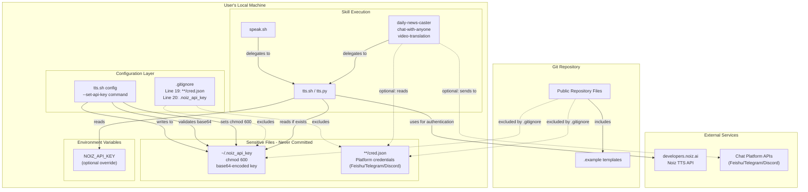
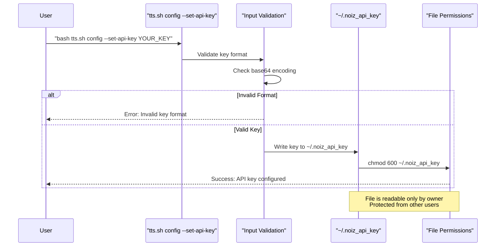
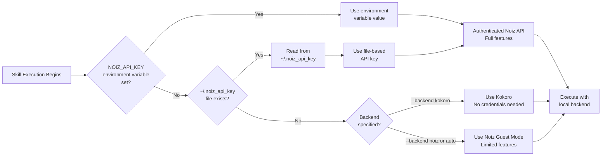
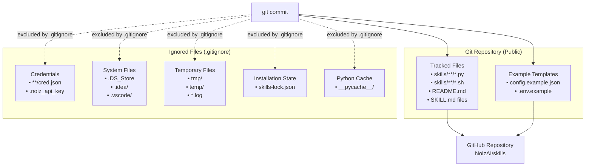

<!-- source: DeepWiki mcp.deepwiki.com · repo NoizAI/skills · page 8 Security and Configuration · fetched 2026-10-26 -->

# Security and Configuration

<details>
<summary>Relevant source files</summary>

The following files were used as context for generating this wiki page:

- [.gitignore](.gitignore)
- [README.md](README.md)
- [skills/chat-with-anyone/SKILL.md](skills/chat-with-anyone/SKILL.md)
- [skills/daily-news-caster/SKILL.md](skills/daily-news-caster/SKILL.md)

</details>


This document explains the security model and configuration architecture of the NoizAI/skills system. It covers how sensitive credentials are managed, the local-first security principle, file-based configuration storage, and best practices for protecting API keys and platform credentials.

For specific details on the local-first execution model, see [Local-First Architecture](#8.1). For detailed credential file formats and management commands, see [Credential Management](#8.2).

## Security Model Overview

The skills repository implements a **local-first security architecture** where all skill execution happens on the user's local machine, and sensitive credentials never enter version control. This design ensures that:

1. **Text and assets remain private**: Speech input text, reference audio files, and generated outputs stay on the user's filesystem
2. **Credentials are excluded from Git**: API keys and platform tokens are explicitly ignored via `.gitignore`
3. **Offline operation is possible**: The Kokoro backend enables credential-free TTS generation
4. **API access is opt-in**: Advanced cloud features require explicit API key configuration

Sources: [README.md:26](), [.gitignore:18-20]()

## Credential Storage Architecture



**Diagram 1: Credential Storage and Access Patterns**

The system uses two primary credential storage mechanisms:

| Storage Location | Purpose | Format | Exclusion Pattern | Permissions |
|-----------------|---------|--------|-------------------|-------------|
| `~/.noiz_api_key` | Noiz API authentication | Base64-encoded string | `.gitignore:20` | `chmod 600` |
| `**/cred.json` | Chat platform tokens | JSON object | `.gitignore:19` | User-managed |

Sources: [.gitignore:18-20](), [README.md:88-92]()

## Configuration Management Commands

The `tts.sh config` subcommand provides a controlled interface for API key management:



**Diagram 2: API Key Configuration Flow**

### Configuration Command Syntax

```bash
# Set API key (recommended method)
bash skills/tts/scripts/tts.sh config --set-api-key YOUR_BASE64_KEY

# The key is persisted to ~/.noiz_api_key and loaded automatically
# File permissions are automatically set to 600 (owner read/write only)
```

Sources: [README.md:88-92]()

## File Permissions and Access Control

### API Key File Protection

The `~/.noiz_api_key` file is created with restrictive permissions to prevent unauthorized access:

| Permission | Octal | Description |
|-----------|-------|-------------|
| Owner | `rw-` (6) | Read and write access for file owner |
| Group | `---` (0) | No access for group members |
| Others | `---` (0) | No access for other users |
| **Total** | **600** | Owner-only read/write |

### Platform Credential Files

Files matching the pattern `**/cred.json` are excluded from version control but do not have enforced permissions. Users should manually protect these files:

```bash
# Recommended: Set restrictive permissions on credential files
chmod 600 path/to/cred.json
```

Sources: [.gitignore:18-20]()

## Configuration Precedence

The system checks for credentials in the following order:



**Diagram 3: Credential Resolution and Backend Selection**

**Precedence order (highest to lowest):**

1. `NOIZ_API_KEY` environment variable (if set)
2. `~/.noiz_api_key` file content (if exists)
3. Backend fallback: `--backend kokoro` → local processing, no credentials
4. Default: Noiz guest mode (limited features, no authentication required)

Sources: [README.md:92]()

## Backend Security Implications

### Kokoro Backend (Local)

**Security characteristics:**
- **No credentials required**: Completely offline operation
- **No network traffic**: All processing happens locally
- **No data transmission**: Input text and output audio never leave the machine
- **Privacy-first**: Ideal for sensitive content or air-gapped environments

### Noiz Backend (Cloud)

**Security characteristics:**
- **API key authentication**: Requires `~/.noiz_api_key` for full features
- **Guest mode available**: Limited features without credentials (15 built-in voices)
- **Data transmission**: Text input is sent to `developers.noiz.ai` API endpoints
- **HTTPS encryption**: All API communication uses TLS/SSL
- **Feature access control**: Voice cloning and emotion control require authentication

| Feature | Kokoro (Local) | Noiz Guest | Noiz Authenticated |
|---------|----------------|------------|-------------------|
| Credentials Required | No | No | Yes |
| Network Access | No | Yes | Yes |
| Data Leaves Machine | No | Yes (text input) | Yes (text + ref audio) |
| Voice Cloning | No | No | Yes (via `--ref-audio`) |
| Emotion Control | No | No | Yes (via `--emo`) |

Sources: [README.md:26](), [README.md:84-92]()

## Version Control Exclusions

The `.gitignore` file creates a security boundary that prevents credential leakage:



**Diagram 4: .gitignore Exclusion Patterns**

### Critical Exclusion Patterns

From [.gitignore:18-20]():

```
# credentials
**/cred.json
.noiz_api_key
```

**Pattern explanations:**

- `**/cred.json`: Matches `cred.json` in any directory at any depth (composite skills use this for chat platform tokens)
- `.noiz_api_key`: Matches the API key file in the repository root and user home directory

Sources: [.gitignore:18-20]()

## Environment Variable Configuration

For development and CI/CD environments, API keys can be provided via environment variables instead of file-based storage:

```bash
# Set API key as environment variable (alternative to ~/.noiz_api_key)
export NOIZ_API_KEY="your_base64_encoded_key"

# Run TTS commands (will automatically use environment variable)
bash skills/tts/scripts/tts.sh speak -t "Test message" -o output.wav
```

**Use cases for environment variables:**

| Scenario | Recommended Method | Reason |
|----------|-------------------|--------|
| Local development | `~/.noiz_api_key` file | Persistent, automatic loading |
| CI/CD pipelines | `NOIZ_API_KEY` env var | Managed by CI system (GitHub Secrets, etc.) |
| Docker containers | `NOIZ_API_KEY` env var | Passed at runtime via `-e` flag |
| Temporary testing | `NOIZ_API_KEY` env var | Doesn't modify filesystem |
| Shared machines | `~/.noiz_api_key` file | Per-user isolation |

Sources: [README.md:92]()

## Security Best Practices

### For Individual Users

1. **Use the `config` command**: Always set API keys via `tts.sh config --set-api-key` to ensure proper file permissions
2. **Verify `.gitignore`**: Before committing, check that `git status` does not show credential files
3. **Protect credential files**: Ensure `~/.noiz_api_key` and `cred.json` files have restrictive permissions (600)
4. **Choose backend appropriately**: Use Kokoro for sensitive content that should never leave your machine

### For Shared Environments

1. **Use environment variables**: Avoid file-based credentials on shared systems
2. **Create separate API keys**: Each user should obtain their own Noiz API key from `developers.noiz.ai/api-keys`
3. **Isolate execution directories**: Run skills in user-specific directories to prevent credential exposure

### For CI/CD Pipelines

1. **Use secrets management**: Store API keys in GitHub Secrets, GitLab CI/CD variables, or similar
2. **Inject as environment variables**: Pass `NOIZ_API_KEY` via environment, not files
3. **Test with guest mode**: For public CI runs, use `--backend kokoro` or Noiz guest mode without credentials

Sources: [README.md:26](), [README.md:84-92]()

## Credential File Formats

### ~/.noiz_api_key Format

```
# File: ~/.noiz_api_key
# Format: Single line, base64-encoded API key
# Permissions: 600 (owner read/write only)

aBcDeFgHiJkLmNoPqRsTuVwXyZ1234567890==
```

**Characteristics:**
- Single line containing the base64-encoded API key
- No additional formatting or metadata
- Trailing newline optional
- Must be valid base64 encoding

### **/cred.json Format

```json
{
  "feishu": {
    "app_id": "cli_xxxxxxxxx",
    "app_secret": "xxxxxxxxxxxxxxxx"
  },
  "telegram": {
    "bot_token": "1234567890:ABCdefGHIjklMNOpqrsTUVwxyz",
    "chat_id": "-1001234567890"
  },
  "discord": {
    "bot_token": "MTIzNDU2Nzg5MDEyMzQ1Njc4.ABCDEF.xxxxxxxxxxxxxxxxxxxxxxxx",
    "channel_id": "1234567890123456789"
  }
}
```

**Usage locations:**
- Skills that integrate with chat platforms (Feishu, Telegram, Discord)
- Composite skills that send generated audio to messaging platforms
- Referenced in skill scripts when `--send-to-feishu` or similar flags are used

Sources: [.gitignore:19](), [skills/daily-news-caster/SKILL.md:1-89](), [skills/chat-with-anyone/SKILL.md:1-76]()

## Migration and Backup

### Migrating API Keys Between Machines

```bash
# On source machine: Export API key
cat ~/.noiz_api_key

# On target machine: Set API key (recommended)
bash skills/tts/scripts/tts.sh config --set-api-key "YOUR_KEY_HERE"

# Alternative: Manual file creation (must set permissions)
echo "YOUR_KEY_HERE" > ~/.noiz_api_key
chmod 600 ~/.noiz_api_key
```

### Backup Recommendations

**DO NOT** commit credential files to version control, even private repositories. Instead:

1. **Password managers**: Store API keys in 1Password, LastPass, or similar
2. **Encrypted backups**: Use encrypted archives (e.g., `gpg -c cred.json`) for backup
3. **Regeneration over backup**: For Noiz API keys, regenerate from `developers.noiz.ai/api-keys` if lost

Sources: [.gitignore:18-20]()

---

**Summary**: The NoizAI/skills security model is built on local-first execution, explicit credential exclusion from version control, and dual-backend architecture that enables both credential-free operation (Kokoro) and authenticated cloud features (Noiz). Configuration is managed through file-based storage with restrictive permissions (`~/.noiz_api_key`) or environment variables (`NOIZ_API_KEY`), with automatic fallback to guest mode or local backends when credentials are absent.

---

