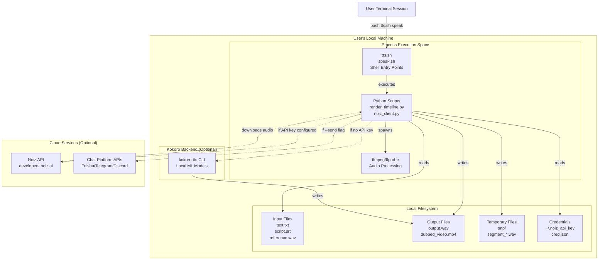
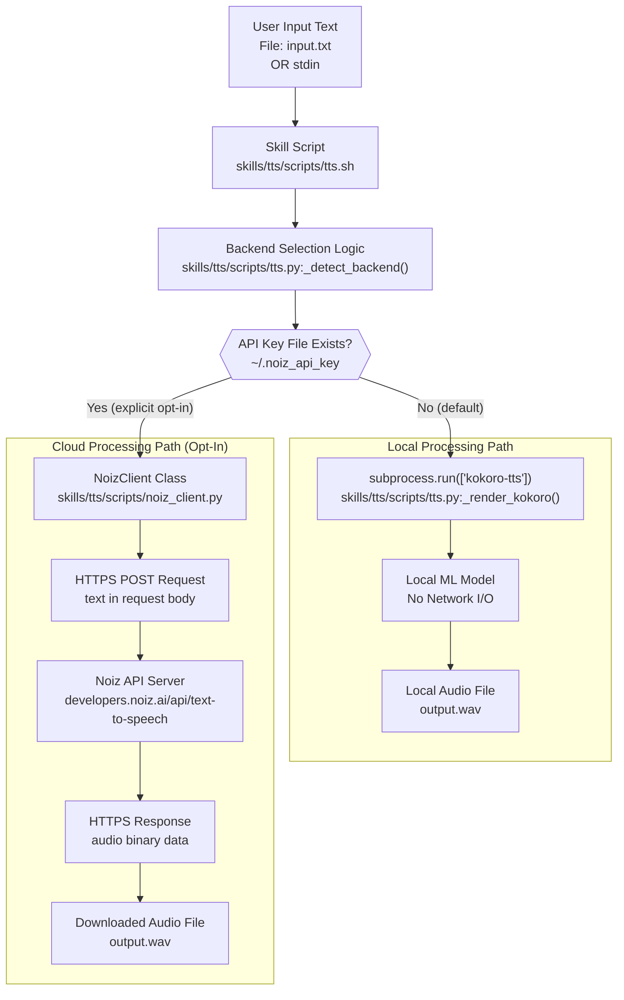
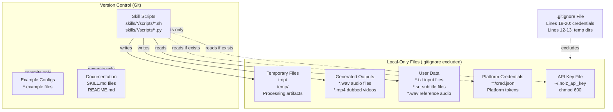
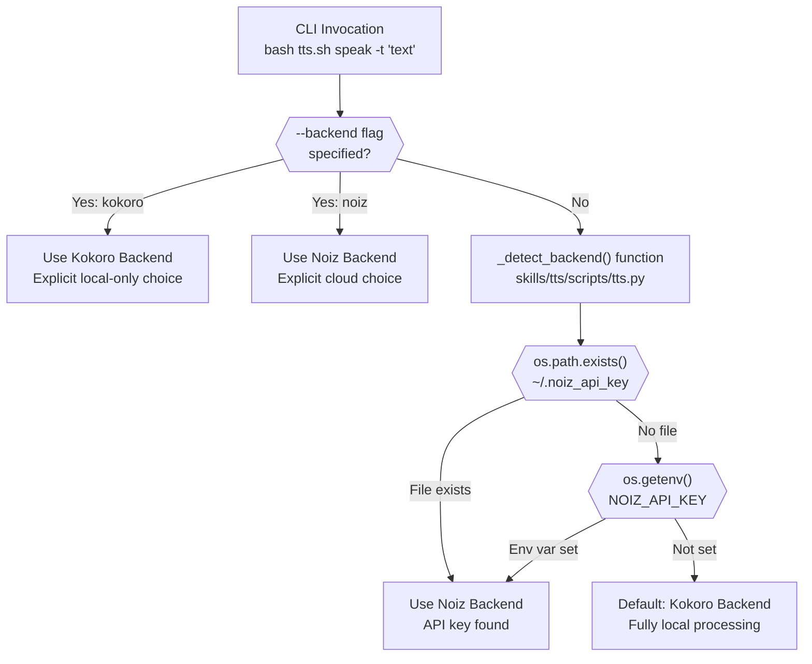
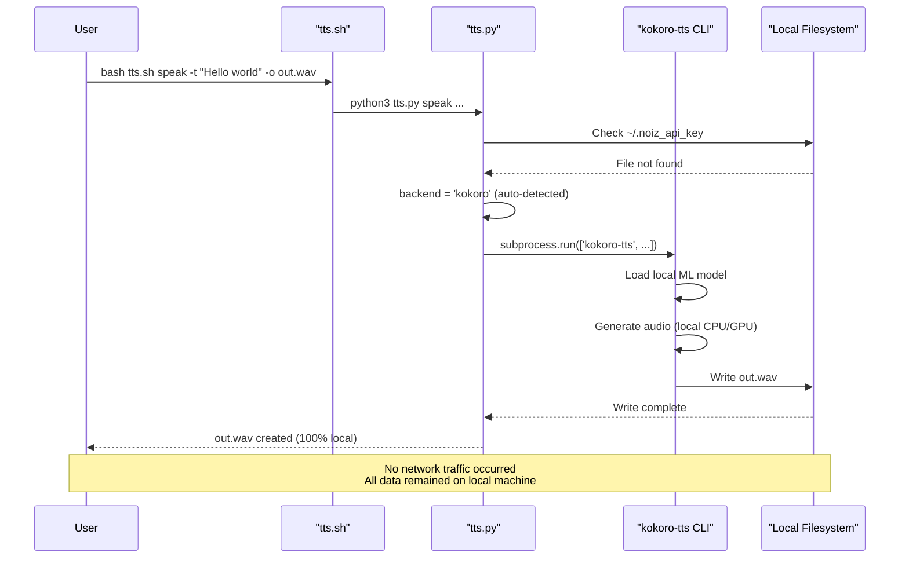
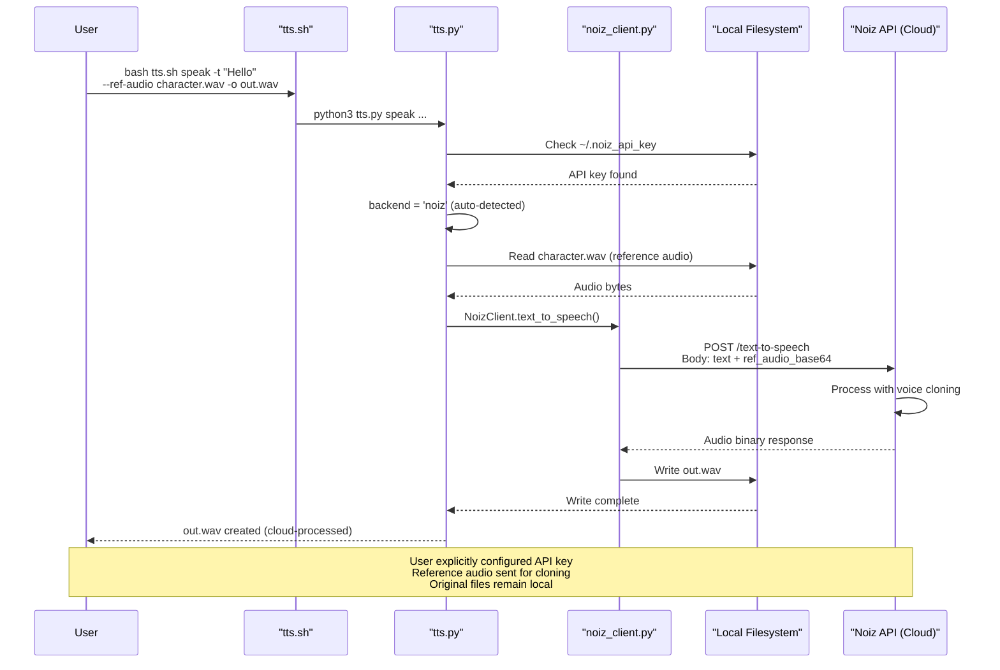
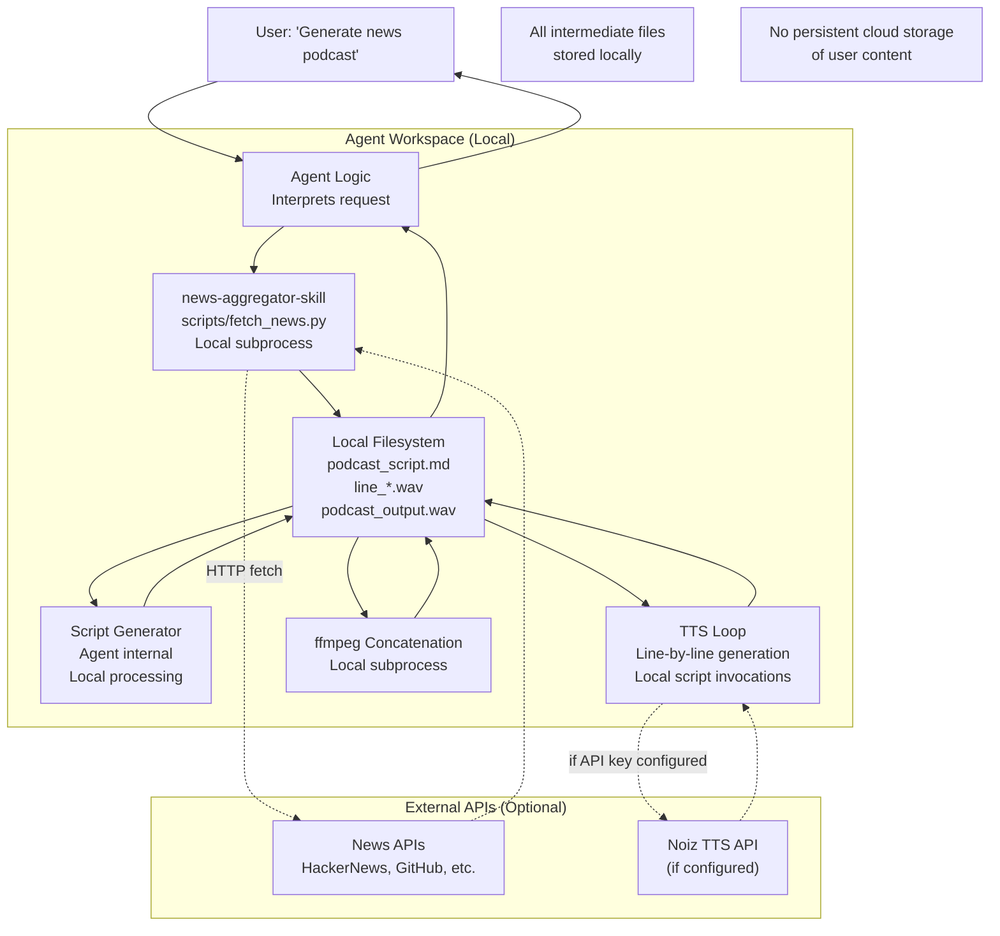
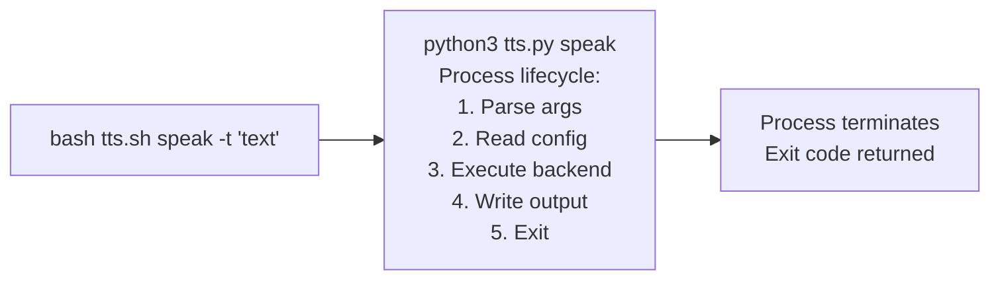

<!-- source: DeepWiki mcp.deepwiki.com · repo NoizAI/skills · page 8.1 Local-First Architecture · fetched 2026-10-26 -->

# Local-First Architecture

<details>
<summary>Relevant source files</summary>

The following files were used as context for generating this wiki page:

- [.gitignore](.gitignore)
- [README.md](README.md)
- [skills/chat-with-anyone/SKILL.md](skills/chat-with-anyone/SKILL.md)
- [skills/daily-news-caster/SKILL.md](skills/daily-news-caster/SKILL.md)

</details>


## Purpose and Scope

This document explains the local-first execution model of the NoizAI/skills system, detailing how skills run entirely on the user's machine to maintain control over sensitive text, audio files, and processing workflows. This architecture ensures that user data remains private and under direct control, with optional cloud augmentation for advanced features.

For backend-specific details about Kokoro and Noiz, see [Backend System](#2). For credential storage and management, see [Credential Management](#8.2).

---

## Core Principles

The local-first architecture is built on three foundational principles:

| Principle | Implementation | Benefit |
|-----------|----------------|---------|
| **Local Execution** | All skill scripts execute as local processes | User controls when and what to process |
| **Data Sovereignty** | Input text, audio files, and intermediate artifacts remain on local filesystem | No mandatory cloud transmission of sensitive content |
| **Optional Cloud** | Cloud features require explicit opt-in via API key configuration | Users choose their privacy/feature tradeoff |

The system guarantees that **no user data is transmitted to external services unless explicitly configured**. By default, skills operate entirely offline using the Kokoro backend.

**Sources:** [README.md:26]()

---

## Local Execution Model

All skills in the repository are implemented as **shell scripts and Python programs that execute as local processes**. There is no remote server component, no web service to authenticate with, and no persistent daemon running in the background.

### Process Architecture Diagram



**Sources:** [README.md:8-22](), [README.md:26]()

---

## Data Flow: Local vs Cloud Processing

The system supports two distinct data flow paths depending on backend configuration. **Crucially, the user's original text input always remains on the local filesystem** and is only transmitted when explicitly configured.

### Backend Selection Flow Diagram



**Sources:** [README.md:84-92](), [skills/daily-news-caster/SKILL.md:17-18]()

---

## Privacy Guarantees by Processing Mode

The local-first architecture provides different privacy guarantees depending on the backend and mode used:

| Processing Mode | Input Text Location | Processing Location | Network Transmission | Output Location |
|-----------------|---------------------|---------------------|----------------------|-----------------|
| **Kokoro Backend** | Local filesystem | Local CPU/GPU | None | Local filesystem |
| **Noiz Guest Mode** | Local filesystem | Cloud API | Text sent to API | Downloaded to local |
| **Noiz Full Mode** | Local filesystem | Cloud API | Text + optional ref audio sent to API | Downloaded to local |
| **Chat Platform Send** | Local filesystem | Local + Cloud | Audio file uploaded to chat platform | Chat platform servers |

### Key Privacy Properties

1. **No Persistent Cloud Storage**: When using Noiz backend, the API does not store input text or generated audio beyond the request lifecycle
2. **No Credentials in Git**: The `.gitignore` file explicitly excludes all credential files from version control
3. **User-Controlled Transmission**: All network transmission requires either explicit API key configuration or the `--send` flag

**Sources:** [.gitignore:18-20]()

---

## File System Data Boundaries

All sensitive data remains within specific filesystem boundaries that are never committed to version control:

### Data Storage Architecture



**Sources:** [.gitignore:1-22](), [README.md:89]()

---

## Hybrid Architecture: Local and Cloud Coexistence

The system's architecture allows both local and cloud backends to coexist, with automatic selection based on configuration state. This hybrid model provides a privacy spectrum from fully offline to cloud-augmented.

### Configuration-Based Backend Selection

The backend selection logic in `tts.py` implements a deterministic algorithm:



This logic ensures that **local-first is the default**, and cloud features are only enabled through explicit configuration steps.

**Sources:** [README.md:92](), [README.md:26]()

---

## Workflow Examples: Data Locality in Practice

### Example 1: Fully Local TTS Generation

When generating speech without any API key configured:



**Sources:** [README.md:41-47](), [skills/daily-news-caster/SKILL.md:58-82]()

### Example 2: Cloud-Augmented Voice Cloning (Opt-In)

When user has configured API key and uses reference audio:



**Sources:** [skills/chat-with-anyone/SKILL.md:48-54](), [README.md:84-92]()

---

## Skill Dependency Model: Transitive Locality

Composite skills maintain the local-first property by **delegating to local scripts** rather than calling remote services directly. This ensures that even complex workflows preserve data locality guarantees.

### Daily News Caster Data Flow



**Key Locality Properties:**
1. News fetching transmits no user data (only API requests for public news)
2. Script generation occurs entirely locally
3. TTS invocations use local filesystem for I/O
4. All intermediate `.wav` files remain local
5. Final concatenation is local
6. User receives local file paths

**Sources:** [skills/daily-news-caster/SKILL.md:1-89]()

---

## Security Implications of Local-First Design

The local-first architecture provides several security advantages over cloud-only systems:

| Security Property | Implementation | Threat Mitigation |
|-------------------|----------------|-------------------|
| **No Credential Leakage** | `.gitignore` excludes `cred.json` and API keys | Prevents accidental commit of secrets |
| **Offline Operation** | Kokoro backend requires no network | Immune to network-based attacks during use |
| **Audit Trail** | All processing visible in local process list | User can monitor exactly what executes |
| **Data Deletion** | User controls all files via filesystem | Complete data removal via `rm` |
| **No Account Lockout** | Local backend has no authentication | Continuous access to core features |

### Filesystem Permissions Model

The system recommends `chmod 600` for the API key file, ensuring only the owning user can read credentials:

```
~/.noiz_api_key      # chmod 600 (user read/write only)
**/cred.json         # Should be chmod 600 (not enforced)
```

**Sources:** [.gitignore:18-20](), [README.md:89]()

---

## Comparison with Cloud-Only Architectures

To illustrate the local-first advantage, consider the architectural difference:

| Aspect | Local-First (This System) | Cloud-Only (Alternative) |
|--------|---------------------------|--------------------------|
| **Text Input** | Remains on user's filesystem | Uploaded to cloud service |
| **Processing** | User's CPU (Kokoro) or optional cloud (Noiz) | Always cloud servers |
| **Intermediate Files** | `tmp/` directory on local disk | Cloud storage buckets |
| **Output Storage** | User's filesystem | Cloud storage, requires download |
| **Network Dependency** | Optional (only for Noiz features) | Required for all operations |
| **Privacy** | Input text never leaves machine (default) | Input text always transmitted |
| **Cost** | Free for local backend | Per-request API charges |

The local-first model ensures that **the user is the system administrator** of their own data processing pipeline.

---

## Implementation Details: Local Script Execution

All skill entry points are implemented as shell scripts that invoke Python programs, ensuring transparency and user control:

### Shell Script Entry Points

| Skill | Entry Script | Purpose |
|-------|--------------|---------|
| TTS | `skills/tts/scripts/tts.sh` | Main TTS interface |
| Characteristic Voice | `skills/characteristic-voice/scripts/speak.sh` | Expressive speech wrapper |

These shell scripts:
1. Accept command-line arguments
2. Set up environment variables
3. Invoke Python scripts with `python3` or `python`
4. Exit with appropriate status codes

### Python Script Execution Model

The Python scripts implement the core logic but execute as **short-lived processes**:



There are **no persistent daemons, no background services, and no state maintained between invocations**. Each execution is a clean, isolated process.

**Sources:** [skills/daily-news-caster/SKILL.md:61-71](), [skills/chat-with-anyone/SKILL.md:32-46]()

---

## Summary

The local-first architecture of NoizAI/skills ensures:

1. **Default Privacy**: All processing occurs locally by default (Kokoro backend)
2. **Explicit Opt-In**: Cloud features require deliberate API key configuration
3. **Data Sovereignty**: User data remains on user's filesystem throughout processing
4. **Transparent Execution**: All skill scripts are readable and execute as local processes
5. **No Lock-In**: Users can delete all data and credentials at any time
6. **Hybrid Flexibility**: Optional cloud augmentation for advanced features without compromising core local operation

This architecture positions the user as the **primary data controller**, with cloud services serving as optional, explicitly-configured enhancement layers rather than mandatory infrastructure.

---

