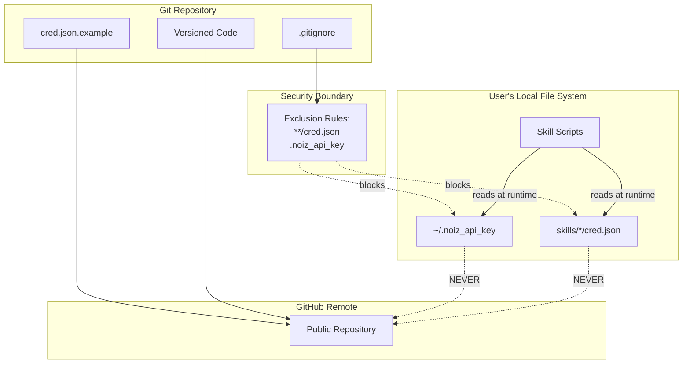
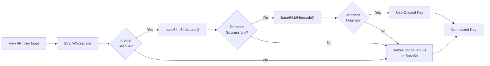
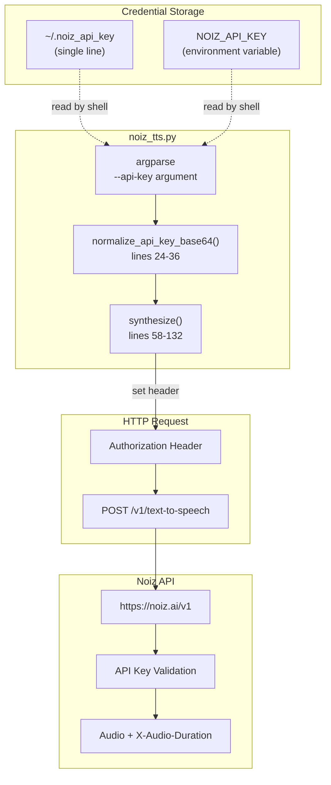

<!-- source: DeepWiki mcp.deepwiki.com · repo NoizAI/skills · page 8.2 Credential Management · fetched 2026-10-26 -->

# Credential Management

<details>
<summary>Relevant source files</summary>

The following files were used as context for generating this wiki page:

- [.gitignore](.gitignore)
- [skills/tts/scripts/noiz_tts.py](skills/tts/scripts/noiz_tts.py)

</details>


## Purpose and Scope

This document describes how sensitive credentials are stored, managed, and protected in the NoizAI/skills repository. It covers API key storage for the Noiz backend, platform credentials for chat integrations, .gitignore exclusion rules, file permissions, and security best practices. For information about configuring API keys via the command-line interface, see [API Key Configuration](#2.3). For the overall local-first security philosophy, see [Local-First Architecture](#8.1).

---

## Credential Types

The system manages two primary categories of credentials:

| Credential Type | Purpose | Storage Location | Format |
|----------------|---------|------------------|--------|
| **Noiz API Key** | Authentication for Noiz cloud TTS backend | `~/.noiz_api_key` | Base64-encoded string (single line) |
| **Platform Credentials** | Authentication for chat platforms (Feishu, Telegram, Discord) | `**/cred.json` | JSON object with platform-specific keys |

**Sources:** [.gitignore:18-20]()

---

## Storage Locations and File Structure

### Noiz API Key File

The Noiz API key is stored in a single-purpose file in the user's home directory:

```
~/.noiz_api_key
```

**File Structure:**
- Single line of text
- Base64-encoded API key
- No padding (trailing `=` symbols stripped)
- No newline characters
- File permissions: `chmod 600` (owner read/write only)

**Location Strategy:** Home directory placement (`~/.noiz_api_key`) ensures:
- Credentials persist across skill installations
- Single configuration shared by all skills
- Standard Unix convention for user-level configuration

### Platform Credentials File

Platform-specific credentials (for Feishu, Telegram, Discord) are stored in `cred.json` files:

```
skills/*/cred.json
```

**File Structure:**
```json
{
  "feishu_app_id": "cli_...",
  "feishu_app_secret": "...",
  "telegram_bot_token": "...",
  "discord_token": "..."
}
```

**Location Strategy:** Per-skill `cred.json` allows:
- Each skill to maintain its own platform configurations
- Isolation between different integration setups
- Easy skill-specific credential management

**Sources:** [.gitignore:19](), [.gitignore:20]()

---

## Security Boundaries: Version Control Exclusion

### Credential Storage and Version Control Exclusion Flow



**Diagram: Credential Files are Excluded from Version Control**

The `.gitignore` file creates a security perimeter that prevents sensitive credentials from entering the Git repository:

**Exclusion Rules:**

| Pattern | Matches | Purpose |
|---------|---------|---------|
| `**/cred.json` | Any `cred.json` in any subdirectory | Exclude platform credentials |
| `.noiz_api_key` | File in repository root | Exclude Noiz API key |

**Sources:** [.gitignore:18-20]()

---

## API Key Management: Noiz Backend

### API Key Normalization and Validation

The system performs automatic normalization and validation of API keys to ensure consistent encoding:



**Diagram: API Key Normalization Algorithm**

**Implementation:** The normalization algorithm in [noiz_tts.py:24-36]() performs these steps:

1. **Strip whitespace** from input
2. **Pad base64** if needed (add `=` symbols to make length divisible by 4)
3. **Attempt decode** using `base64.b64decode(padded, validate=True)`
4. **Re-encode** and compare canonical form
5. **If invalid base64**: Treat as plain text and encode using `base64.b64encode(key.encode("utf-8"))`

This ensures that both pre-encoded base64 strings and plain text API keys are accepted and normalized to canonical base64 format.

**Sources:** [skills/tts/scripts/noiz_tts.py:24-36]()

---

## API Key Authentication Flow

### From File to HTTP Request



**Diagram: API Key Flow from Storage to Noiz API Call**

**Authorization Header Format:**

The API key is passed directly in the `Authorization` HTTP header without a scheme prefix:

```python
headers={"Authorization": api_key}
```

This occurs in two locations:
- **Emotion enhancement call:** [noiz_tts.py:44]()
- **TTS synthesis call:** [noiz_tts.py:114]()

**Guest Mode Alternative:**

When `--guest` flag is used, no API key is required. The system calls a different endpoint:

```
/api/v1/guest/text-to-speech
```

See [noiz_tts.py:135-168]() for the guest synthesis implementation.

**Sources:** [skills/tts/scripts/noiz_tts.py:39-56](), [skills/tts/scripts/noiz_tts.py:58-132](), [skills/tts/scripts/noiz_tts.py:135-168]()

---

## Credential Precedence and Configuration

### Configuration Sources Priority

The system follows this precedence order for API key configuration:

1. **Command-line argument:** `--api-key` passed directly to script
2. **Environment variable:** `NOIZ_API_KEY` or similar
3. **File-based storage:** `~/.noiz_api_key`

**No Default Fallback:** If no API key is provided and `--guest` is not specified, the script raises an error:

```python
if not args.guest and not args.api_key:
    parser.error("--api-key is required unless --guest is specified")
```

See [noiz_tts.py:199-200]()

**Sources:** [skills/tts/scripts/noiz_tts.py:199-202]()

---

## Platform Credentials: cred.json

### Structure for Chat Platform Integration

The `cred.json` file stores credentials for multiple chat platforms in a single JSON object:

**Example Structure:**

```json
{
  "feishu_app_id": "cli_a1b2c3d4e5f6g7h8",
  "feishu_app_secret": "secretvalue123",
  "telegram_bot_token": "123456789:ABCdefGHIjklMNOpqrsTUVwxyz",
  "discord_token": "MTIzNDU2Nzg5MDEyMzQ1Njc4.GhIjKl.mNoPqRsTuVwXyZ1234567890"
}
```

**Wildcard Pattern:** The `.gitignore` pattern `**/cred.json` excludes all files named `cred.json` in any subdirectory, preventing accidental commits regardless of skill location.

**Template Pattern:** Skills may include `cred.json.example` files in version control to demonstrate the expected structure:

```json
{
  "feishu_app_id": "your_app_id_here",
  "feishu_app_secret": "your_app_secret_here"
}
```

Template files guide users on credential setup without exposing actual values.

**Sources:** [.gitignore:19]()

---

## Security Best Practices

### File Permissions

**Noiz API Key:**
```bash
chmod 600 ~/.noiz_api_key
```

This ensures:
- Owner can read and write
- Group cannot access
- Others cannot access

**Platform Credentials:**
```bash
chmod 600 skills/*/cred.json
```

### Validation Checklist

Before committing code, verify:

- [ ] No hardcoded API keys in source files
- [ ] `~/.noiz_api_key` has restrictive permissions (600)
- [ ] All `cred.json` files are listed in `.gitignore`
- [ ] Example files use placeholder values, not real credentials
- [ ] Environment variables are documented but not set in committed scripts

### Detection of Leaked Credentials

If credentials are accidentally committed:

1. **Immediately rotate** the exposed API key or token
2. **Use `git filter-branch` or BFG Repo-Cleaner** to remove from history
3. **Force push** to remote (if you control it)
4. **Notify affected services** of potential compromise

**Sources:** [.gitignore:18-20]()

---

## Local-First Security Model

### Credential Scope

All credentials remain on the user's local machine:

| Credential Type | Storage Location | Network Transmission |
|----------------|------------------|---------------------|
| Noiz API Key | `~/.noiz_api_key` | Only in HTTPS Authorization header |
| Platform Tokens | `**/cred.json` | Only in platform-specific API calls |
| Reference Audio | Local file paths | Only when passed to Noiz API for cloning |

**No Credential Servers:** The system does not use intermediate credential servers or proxy authentication. Users authenticate directly with:
- Noiz API (`https://noiz.ai/v1`)
- Feishu/Lark API
- Telegram Bot API
- Discord API

This ensures credentials are never exposed to third-party infrastructure beyond the intended service providers.

**Sources:** [skills/tts/scripts/noiz_tts.py:111-120]()

---

## Error Handling and Diagnostics

### Common Credential Issues

**Missing API Key:**
```
Error: --api-key is required unless --guest is specified
```
**Resolution:** Configure API key via `tts.sh config --set-api-key` or use `--guest` mode.

**Invalid Base64 Format:**
The system auto-corrects by encoding the input as UTF-8, so invalid base64 is rarely an error. However, if the API rejects the key:
```
RuntimeError: /text-to-speech failed: status=401
```
**Resolution:** Verify API key is valid by checking Noiz developer portal.

**File Not Found:**
```
FileNotFoundError: Reference audio not found: /path/to/audio.wav
```
**Resolution:** Ensure reference audio file exists when using `--reference-audio`.

**Sources:** [skills/tts/scripts/noiz_tts.py:97-108](), [skills/tts/scripts/noiz_tts.py:122-125]()

---

## Integration with Configuration Commands

The `tts.sh config` subcommand provides a user-friendly interface for API key management:

```bash
# Set API key (writes to ~/.noiz_api_key)
tts.sh config --set-api-key YOUR_KEY_HERE

# Validate and normalize automatically
```

The configuration command:
1. Validates base64 encoding
2. Sets file permissions to 600
3. Writes to `~/.noiz_api_key`

For detailed command-line reference, see [API Key Configuration](#2.3).

---

