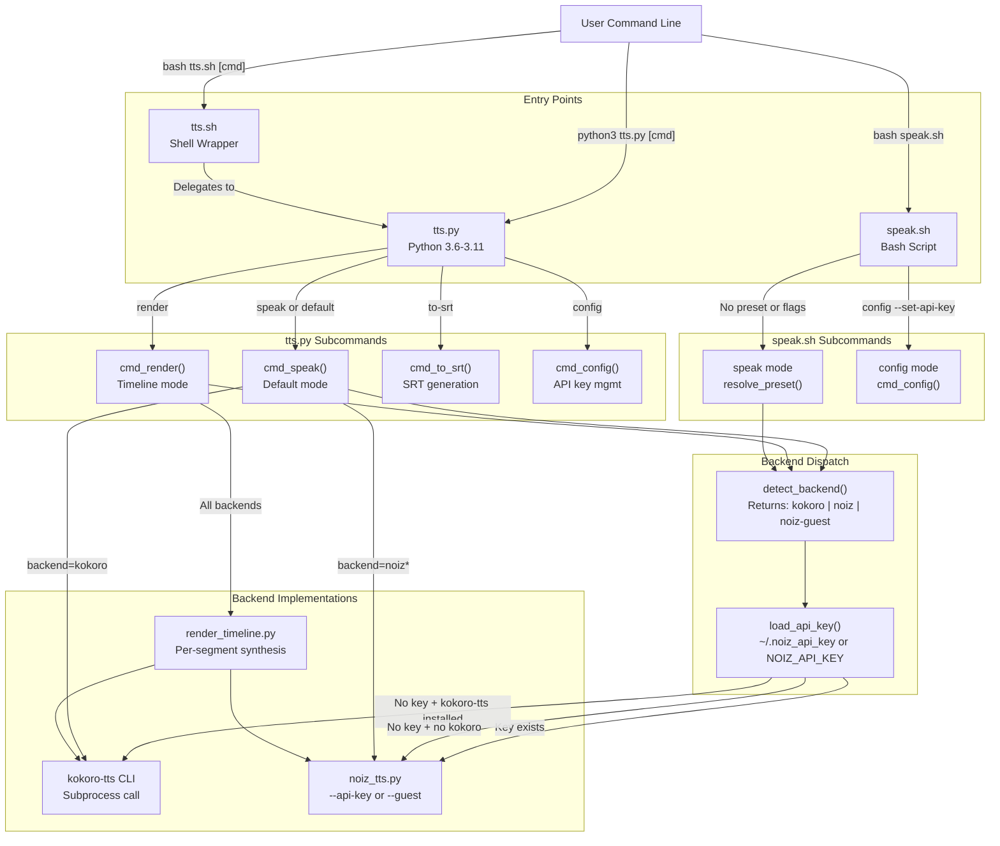
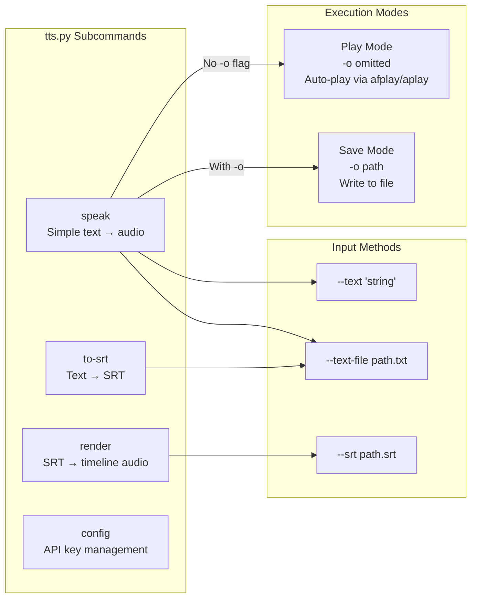
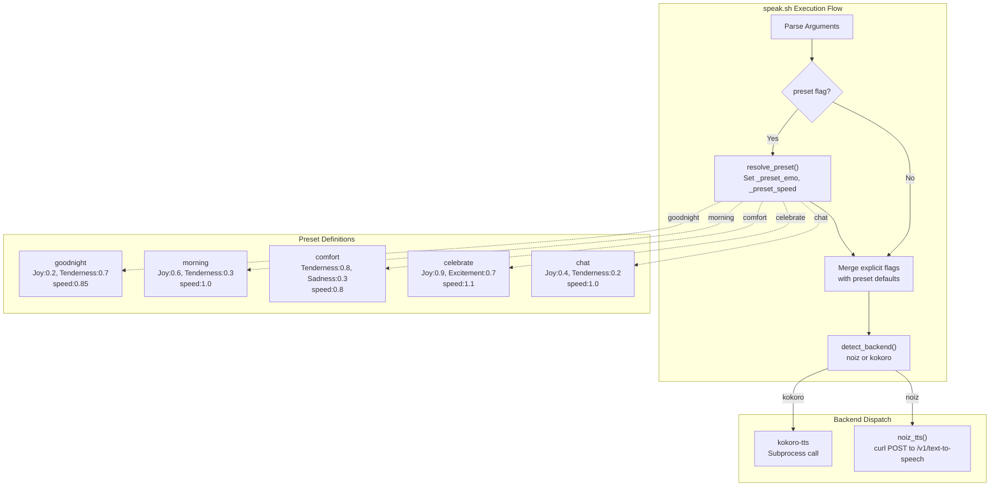

<!-- source: DeepWiki mcp.deepwiki.com · repo NoizAI/skills · page 9 Command-Line Reference · fetched 2026-10-26 -->

# Command-Line Reference

<details>
<summary>Relevant source files</summary>

The following files were used as context for generating this wiki page:

- [skills/characteristic-voice/scripts/speak.sh](skills/characteristic-voice/scripts/speak.sh)
- [skills/tts/SKILL.md](skills/tts/SKILL.md)
- [skills/tts/scripts/tts.py](skills/tts/scripts/tts.py)

</details>


This page provides a comprehensive reference for all command-line interfaces in the NoizAI/skills repository. It documents the exact syntax, options, and behavior of each CLI tool.

For conceptual information about how these commands are used within workflows, see [TTS (Text-to-Speech) Skill](#3) and [Characteristic Voice Skill](#4). For backend selection and API key setup, see [Backend System](#2) and [API Key Configuration](#2.3).

## CLI Ecosystem Overview

The skills repository provides three primary command-line interfaces, each serving distinct use cases:

| CLI Tool | Purpose | Primary File | Default Mode |
|----------|---------|--------------|--------------|
| `tts.py` | Core TTS operations with dual backend support | `skills/tts/scripts/tts.py` | `speak` (simple text-to-audio) |
| `tts.sh` | Shell wrapper for `tts.py` (legacy) | `skills/tts/scripts/tts.sh` | Delegates to `tts.py` |
| `speak.sh` | Expressive speech with emotional presets | `skills/characteristic-voice/scripts/speak.sh` | Preset-driven synthesis |

All CLIs support both Kokoro (local) and Noiz (cloud) backends through automatic detection based on API key presence.

Sources: [skills/tts/scripts/tts.py:1-547](), [skills/characteristic-voice/scripts/speak.sh:1-323]()

### Command Dispatch Architecture



**Diagram: Command Dispatch and Backend Selection Flow**

The dispatch architecture shows two-stage routing: (1) subcommand routing to handler functions ([tts.py:509-542]()), and (2) backend detection using `detect_backend()` ([tts.py:72-76]()) which checks for API key presence via `load_api_key()` ([tts.py:48-60]()). The `speak` subcommand defaults when no subcommand is specified ([tts.py:511-513]()).

Sources: [skills/tts/scripts/tts.py:72-76](), [skills/tts/scripts/tts.py:509-542](), [skills/characteristic-voice/scripts/speak.sh:145-168]()

---

## tts.py / tts.sh - Core TTS Interface

The `tts.py` script is the primary TTS interface supporting four subcommands. The `speak` subcommand is the default and can be omitted.

### Subcommand Summary



**Diagram: tts.py Subcommand Overview**

Sources: [skills/tts/scripts/tts.py:421-503](), [skills/tts/scripts/tts.py:139-309]()

### speak - Simple Text-to-Audio

Convert text to audio with optional voice cloning, emotion control, and format selection.

**Syntax:**
```bash
python3 skills/tts/scripts/tts.py [speak] [OPTIONS]
```

**Input Options (mutually exclusive, one required):**

| Flag | Type | Description |
|------|------|-------------|
| `-t`, `--text` | string | Text content to synthesize |
| `-f`, `--text-file` | path | Path to text file |

**Output Options:**

| Flag | Type | Default | Description |
|------|------|---------|-------------|
| `-o`, `--output` | path | *(play mode)* | Output file path; omit to play immediately via `afplay`/`aplay`/`paplay` ([tts.py:123-133]()) |
| `--format` | choice | `wav` | Audio format: `wav`, `mp3`, `opus`, `ogg` (alias for `opus`) |

**Voice Selection (backend-specific):**

| Flag | Backend | Type | Description |
|------|---------|------|-------------|
| `-v`, `--voice` | Kokoro | string | Kokoro voice name (e.g. `zf_xiaoni`, `af_sarah`) |
| `--voice-id` | Noiz | string | Noiz voice ID (required for `noiz-guest` mode) |
| `--ref-audio` | Noiz | path/URL | Reference audio for voice cloning; can be local file or HTTP(S) URL ([tts.py:108-120]()) |

**Synthesis Parameters:**

| Flag | Type | Range/Format | Description |
|------|------|--------------|-------------|
| `--lang` | string | ISO code | Language code (e.g. `zh`, `en-us`, `cmn`) |
| `--speed` | float | > 0 | Playback speed multiplier (1.0 = normal) |
| `--emo` | JSON | `{"Emotion":0.0-1.0}` | Noiz-only: emotion weights (e.g. `'{"Joy":0.5,"Tenderness":0.3}'`) |
| `--duration` | float | (0, 36] | Noiz-only: target duration in seconds ([tts.py:458-462]()) |

**Advanced Noiz Options:**

| Flag | Type | Description |
|------|------|-------------|
| `--auto-emotion` | flag | Enable automatic emotion detection from text |
| `--similarity-enh` | flag | Enable voice similarity enhancement |
| `--save-voice` | flag | Save cloned voice for reuse |

**Backend Control:**

| Flag | Values | Description |
|------|--------|-------------|
| `--backend` | `kokoro`, `noiz`, `noiz-guest` | Force specific backend; auto-detected if omitted ([tts.py:72-76]()) |

**Examples:**

```bash
# Basic usage (implicit speak, play mode)
python3 skills/tts/scripts/tts.py -t "Hello world"

# Save to file
python3 skills/tts/scripts/tts.py -t "Hello" -o output.wav

# Voice cloning with local reference
python3 skills/tts/scripts/tts.py -t "Hello" --ref-audio ./voice.wav -o clone.wav

# Voice cloning with URL reference
python3 skills/tts/scripts/tts.py -t "Hello" \
  --ref-audio https://example.com/ref.wav -o clone.wav

# Guest mode (no API key)
python3 skills/tts/scripts/tts.py -t "Hello" \
  --voice-id 883b6b7c --backend noiz-guest -o guest.wav

# Emotion control with Noiz
python3 skills/tts/scripts/tts.py -t "I'm so excited!" \
  --emo '{"Joy":0.9,"Excitement":0.7}' --auto-emotion -o happy.wav

# Voice message format for chat platforms
python3 skills/tts/scripts/tts.py -t "Message" --format opus -o voice.opus
```

**Default Behavior:**
- When no `--backend` is specified, `detect_backend()` returns `noiz` if API key exists, otherwise `noiz-guest` ([tts.py:72-76]())
- When `noiz` backend is selected without `--voice-id` or `--ref-audio`, a default reference audio is auto-selected based on text language detection ([tts.py:245-258]())
- Play mode: when `-o` is omitted, output is written to a temp file and played via the first available player: `afplay` (macOS), `aplay` (ALSA), or `paplay` (PulseAudio) ([tts.py:123-133]())

Sources: [skills/tts/scripts/tts.py:139-309](), [skills/tts/scripts/tts.py:442-476](), [skills/tts/SKILL.md:18-35]()

---

### render - Timeline-Accurate SRT Rendering

Generate time-aligned audio from SRT subtitles with per-segment voice control. This mode synthesizes each subtitle segment individually and concatenates them with precise timing.

**Syntax:**
```bash
python3 skills/tts/scripts/tts.py render --srt FILE --voice-map FILE -o FILE [OPTIONS]
```

**Required Arguments:**

| Flag | Type | Description |
|------|------|-------------|
| `--srt` | path | Input SRT subtitle file |
| `--voice-map` | path | Voice map JSON file defining default and per-segment voice settings |
| `-o`, `--output` | path | Output audio file path |

**Optional Arguments:**

| Flag | Values | Description |
|------|--------|-------------|
| `--backend` | `kokoro`, `noiz` | Backend to use (auto-detected if omitted); `noiz-guest` not supported ([tts.py:318-338]()) |

**Extra Arguments:**

The `render` command forwards unknown arguments to `render_timeline.py` ([tts.py:528-529]()). Key forwarded options include:

| Flag | Type | Description |
|------|------|-------------|
| `--ref-audio-track` | path | Source video/audio for dynamic reference audio slicing; extracts audio at each segment's timestamp ([SKILL.md:82-86]()) |
| `--auto-emotion` | flag | Enable auto-emotion detection for all segments |

**Voice Map Structure:**

The voice map JSON defines default settings and per-segment overrides. Segment keys support single indices (`"3"`) or ranges (`"5-8"`).

**Kokoro Voice Map Example:**
```json
{
  "default": {
    "voice": "zf_xiaoni",
    "lang": "cmn",
    "speed": 1.0
  },
  "segments": {
    "1": { "voice": "zm_yunxi" },
    "5-8": { "voice": "af_sarah", "lang": "en-us", "speed": 0.9 }
  }
}
```

**Noiz Voice Map Example:**
```json
{
  "default": {
    "voice_id": "voice_123",
    "target_lang": "zh",
    "speed": 1.0
  },
  "segments": {
    "1": {
      "voice_id": "voice_host",
      "emo": { "Joy": 0.6, "Tenderness": 0.3 }
    },
    "2-4": {
      "reference_audio": "./refs/guest.wav"
    }
  }
}
```

**Examples:**

```bash
# Basic timeline rendering with Kokoro
python3 skills/tts/scripts/tts.py render \
  --srt input.srt --voice-map vm_kokoro.json -o output.wav

# Noiz backend with auto-emotion
python3 skills/tts/scripts/tts.py render \
  --srt input.srt --voice-map vm_noiz.json \
  --backend noiz --auto-emotion -o output.wav

# Dynamic reference audio from source video
python3 skills/tts/scripts/tts.py render \
  --srt translated.srt --voice-map vm.json \
  --ref-audio-track original_video.mp4 -o dubbed.wav
```

**Workflow:**
1. Parse SRT file to extract segments with timing
2. For each segment, determine voice settings by merging default + segment-specific overrides
3. Call backend (Kokoro or Noiz) to synthesize segment audio with target duration
4. Concatenate all segment audio files using ffmpeg, padding silence between segments to match SRT timestamps

Sources: [skills/tts/scripts/tts.py:315-365](), [skills/tts/scripts/tts.py:478-487](), [skills/tts/SKILL.md:38-95]()

---

### to-srt - Text to SRT Conversion

Generate SRT subtitle files from plain text with automatic timing calculations.

**Syntax:**
```bash
python3 skills/tts/scripts/tts.py to-srt -i FILE -o FILE [OPTIONS]
```

**Required Arguments:**

| Flag | Type | Description |
|------|------|-------------|
| `-i`, `--input` | path | Input text file |
| `-o`, `--output` | path | Output SRT file |

**Optional Arguments:**

| Flag | Type | Default | Description |
|------|------|---------|-------------|
| `--cps` | float | 4 (CJK), 15 (Latin) | Characters per second reading rate for timing calculation |
| `--gap` | int | 500 | Gap between segments in milliseconds |

**Examples:**

```bash
# Generate SRT with default settings
python3 skills/tts/scripts/tts.py to-srt -i article.txt -o article.srt

# Customize timing for English text
python3 skills/tts/scripts/tts.py to-srt \
  -i english.txt -o english.srt --cps 15 --gap 500

# Slower pace for Chinese
python3 skills/tts/scripts/tts.py to-srt \
  -i chinese.txt -o chinese.srt --cps 4 --gap 800
```

**Implementation:**

Delegates to `text_to_srt.py` ([tts.py:371-383]()) which segments text into subtitle entries with calculated start/end timestamps based on character count and `--cps` rate.

Sources: [skills/tts/scripts/tts.py:371-383](), [skills/tts/scripts/tts.py:489-498](), [skills/tts/SKILL.md:43-51]()

---

### config - API Key Management

Check current API key status or configure the Noiz API key for authenticated access.

**Syntax:**
```bash
python3 skills/tts/scripts/tts.py config [--set-api-key KEY]
```

**Options:**

| Flag | Type | Description |
|------|------|-------------|
| `--set-api-key` | string | Save API key to `~/.noiz_api_key`; automatically base64-encodes if not already encoded ([tts.py:33-46]()) |

**Examples:**

```bash
# Check current API key status
python3 skills/tts/scripts/tts.py config

# Set API key (plaintext or base64)
python3 skills/tts/scripts/tts.py config --set-api-key YOUR_KEY

# Environment variable override (temporary)
NOIZ_API_KEY=YOUR_KEY python3 skills/tts/scripts/tts.py -t "Test"
```

**Configuration Precedence:**
1. `NOIZ_API_KEY` environment variable ([tts.py:49-52]())
2. `~/.noiz_api_key` file ([tts.py:54-59]())

**File Permissions:**

The `config --set-api-key` command automatically sets file permissions to `0o600` (user read/write only) for security ([tts.py:66]()).

**Output Example:**

```
# When key is configured:
NOIZ_API_KEY is configured: AbCd****XyZw
  Backend: noiz (full features)

# When key is not configured:
NOIZ_API_KEY is not configured.
  Current fallback: noiz-guest (limited features, no API key required)

Option A — Noiz with API key (recommended, full features):
  1. Get your API key from https://developers.noiz.ai/api-keys
  2. Run:
     python3 skills/tts/scripts/tts.py config --set-api-key YOUR_KEY
  The key will be saved to /home/user/.noiz_api_key and loaded automatically.

Option B — Kokoro (offline, local):
  uv tool install kokoro-tts
  Then pass --backend kokoro
```

Sources: [skills/tts/scripts/tts.py:389-415](), [skills/tts/scripts/tts.py:499-501](), [skills/tts/scripts/tts.py:63-66]()

---

## speak.sh - Characteristic Voice Interface

The `speak.sh` script provides expressive, human-like speech through emotional presets that combine emotion weights with speed adjustments. It includes non-lexical fillers for natural conversational flow.

### Command Structure



**Diagram: speak.sh Preset Resolution and Backend Dispatch**

Sources: [skills/characteristic-voice/scripts/speak.sh:43-54](), [skills/characteristic-voice/scripts/speak.sh:155-168](), [skills/characteristic-voice/scripts/speak.sh:282-296]()

### Syntax

```bash
bash skills/characteristic-voice/scripts/speak.sh [--preset MODE] [OPTIONS]
bash skills/characteristic-voice/scripts/speak.sh config [--set-api-key KEY]
```

### Emotional Presets

Presets automatically configure emotion weights and speed. Explicit `--emo` and `--speed` flags override preset values.

| Preset | Emotion Weights | Speed | Use Case |
|--------|----------------|-------|----------|
| `goodnight` | `Joy:0.2, Tenderness:0.7` | 0.85 | Gentle, warm, sleepy voice |
| `morning` | `Joy:0.6, Tenderness:0.3` | 1.0 | Warm, cheerful greeting |
| `comfort` | `Tenderness:0.8, Sadness:0.3` | 0.8 | Soft, unhurried, supportive |
| `celebrate` | `Joy:0.9, Excitement:0.7` | 1.1 | Excited, proud, energetic |
| `chat` | `Joy:0.4, Tenderness:0.2` | 1.0 | Relaxed, natural conversation |

Implementation: [speak.sh:45-53]()

### Options

**Input (one required):**

| Flag | Type | Description |
|------|------|-------------|
| `-t`, `--text` | string | Text to synthesize |
| `-f`, `--text-file` | path | Path to text file |

**Output (required):**

| Flag | Type | Description |
|------|------|-------------|
| `-o`, `--output` | path | Output audio file path |

**Preset and Emotion:**

| Flag | Type | Description |
|------|------|-------------|
| `--preset` | choice | One of: `goodnight`, `morning`, `comfort`, `celebrate`, `chat` |
| `--emo` | JSON | Override emotion weights (e.g. `'{"Joy":0.5,"Tenderness":0.3}'`) |
| `--speed` | float | Override speed multiplier |

**Voice Selection:**

| Flag | Backend | Type | Description |
|------|---------|------|-------------|
| `-v`, `--voice` | Kokoro | string | Kokoro voice name |
| `--voice-id` | Noiz | string | Noiz voice ID |
| `--ref-audio` | Noiz | path | Reference audio file for voice cloning |

**Other:**

| Flag | Type | Description |
|------|------|-------------|
| `--backend` | choice | Force backend: `kokoro` or `noiz` |
| `--lang` | string | Language code |
| `-h`, `--help` | flag | Show help message |

### Examples

```bash
# Goodnight message with preset
bash speak.sh --preset goodnight -t "Sweet dreams~" -o night.wav

# Comfort message with Noiz backend
bash speak.sh --preset comfort \
  -t "I'm here for you." --backend noiz --voice-id abc123 -o comfort.mp3

# Custom emotion override
bash speak.sh -t "Haha nice!" \
  --emo '{"Joy":0.8}' --speed 1.1 -o reply.wav

# Voice cloning with preset
bash speak.sh --preset chat \
  -t "Hey there!" --ref-audio ./myvoice.wav -o chat.wav
```

### Backend Detection

The `detect_backend()` function ([speak.sh:155-168]()) implements this logic:

1. If `--backend` is explicitly set, use that value
2. If `load_api_key()` succeeds (finds `~/.noiz_api_key` or `NOIZ_API_KEY` env var), return `noiz`
3. If `kokoro-tts --help-voices` succeeds, return `kokoro`
4. Otherwise, return empty string (error state)

### config Subcommand

Identical to `tts.py config` but implemented in Bash.

**Syntax:**
```bash
bash speak.sh config [--set-api-key KEY]
```

**Examples:**

```bash
# Check status
bash speak.sh config

# Set API key
bash speak.sh config --set-api-key YOUR_KEY
```

Implementation: [speak.sh:110-143]()

Sources: [skills/characteristic-voice/scripts/speak.sh:1-323](), [skills/characteristic-voice/scripts/speak.sh:7-40](), [skills/characteristic-voice/scripts/speak.sh:45-54]()

---

## Backend-Specific Behavior

### Kokoro Backend

Invoked directly via `kokoro-tts` CLI tool. The command structure is:

```bash
kokoro-tts INPUT_FILE OUTPUT_FILE \
  --format wav|mp3|opus \
  [--voice VOICE_NAME] \
  [--lang LANG_CODE] \
  [--speed FLOAT]
```

**Key Implementation Details:**
- Requires text input from file; `tts.py` creates temp files for `--text` strings ([tts.py:159-163]())
- Speed is controlled via Kokoro's `--speed` parameter, not ffmpeg atempo
- Voice blending supported (e.g. `"v1:60,v2:40"`) when specified in voice map
- No network access required

**Voice Map Keys for Kokoro:**
- `voice`: Voice name or blend string
- `lang`: Language code (e.g. `cmn`, `en-us`)
- `speed`: Speed multiplier

Sources: [skills/tts/scripts/tts.py:156-177]()

### Noiz Backend (Authenticated)

Invoked via `noiz_tts.py` which makes HTTP POST requests to `https://noiz.ai/v1/text-to-speech`.

**Authentication:**
- Header: `Authorization: <base64_api_key>` (no prefix like "Bearer" or "APIKEY") ([SKILL.md:148-149]())
- API key loaded from `~/.noiz_api_key` or `NOIZ_API_KEY` env var
- Auto-normalized to base64 if provided as plaintext ([tts.py:33-46]())

**Request Format:**
- Method: `POST`
- Content-Type: `multipart/form-data`
- Fields: `text`, `output_format`, `speed`, optional: `voice_id`, `emo`, `target_lang`, `file` (reference audio), `duration`

**Voice Map Keys for Noiz:**
- `voice_id`: Noiz voice ID string
- `reference_audio`: Path to reference audio file (local only; URLs must be pre-downloaded)
- `emo`: Emotion weights object (e.g. `{"Joy":0.6}`)
- `target_lang`: Target language code
- `speed`: Speed multiplier
- `duration`: Target duration in seconds

**Default Reference Audio:**
When neither `--voice-id` nor `--ref-audio` is provided, `tts.py` auto-selects:
- Chinese text: `https://storage.googleapis.com/noiz_audio_public/resource/audio/ref_cn_fm1.WAV` ([tts.py:23-25]())
- English text: `https://noiz.ai/resource/img/tts/landing_creative1.mp3` ([tts.py:26-28]())

Language detection uses regex to check for CJK characters ([tts.py:102-105]()).

Sources: [skills/tts/scripts/tts.py:228-303](), [skills/tts/scripts/tts.py:102-120](), [skills/tts/SKILL.md:148-149]()

### Noiz Guest Mode

A limited, unauthenticated mode for testing without an API key.

**Invocation:**
Automatically selected when `load_api_key()` returns `None` and no `--backend` override is specified ([tts.py:72-76]()).

**Supported Features:**
- `--voice-id`: One of 15 built-in voices (see table below)
- `--speed`: Speed multiplier
- `--format`: Output format

**Unsupported Features:**
- Voice cloning (`--ref-audio`)
- Emotion control (`--emo`, `--auto-emotion`)
- Duration forcing (`--duration`)
- Timeline rendering (`render` subcommand)

**Guest Voice Catalog:**

| voice_id | name | lang | gender | tone |
|----------|------|------|--------|------|
| `063a4491` | 販売員（なおみ） | ja | F | 喜び |
| `4252b9c8` | 落ち着いた女性 | ja | F | 穏やか |
| `578b4be2` | 熱血漢（たける） | ja | M | 怒り |
| `a9249ce7` | 安らぎ（みなと） | ja | M | 穏やか |
| `f00e45a1` | 旅人（かいと） | ja | M | 穏やか |
| `b4775100` | 悦悦｜社交分享 | zh | F | Joyful |
| `77e15f2c` | 婉青｜情绪抚慰 | zh | F | Calm |
| `ac09aeb4` | 阿豪｜磁性主持 | zh | M | Calm |
| `87cb2405` | 建国｜知识科普 | zh | M | Calm |
| `3b9f1e27` | 小明｜科技达人 | zh | M | Joyful |
| `95814add` | Science Narration | en | M | Calm |
| `883b6b7c` | The Mentor (Alex) | en | M | Joyful |
| `a845c7de` | The Naturalist (Silas) | en | M | Calm |
| `5a68d66b` | The Healer (Serena) | en | F | Calm |
| `0e4ab6ec` | The Mentor (Maya) | en | F | Calm |

**Example:**

```bash
# Guest mode (auto-detected when no API key is set)
python3 skills/tts/scripts/tts.py -t "Hello" \
  --voice-id 883b6b7c -o hello.wav
```

Sources: [skills/tts/scripts/tts.py:178-225](), [skills/tts/SKILL.md:109-140]()

---

## Common Patterns and Recipes

### Voice Cloning Workflow

```bash
# 1. Obtain reference audio (10-30 seconds recommended)
# Option A: Use existing file
REF_AUDIO="./reference_voice.wav"

# Option B: Download from URL
REF_AUDIO="https://example.com/voice_sample.wav"

# 2. Clone voice for single utterance
python3 skills/tts/scripts/tts.py -t "Hello in cloned voice" \
  --ref-audio "$REF_AUDIO" -o output.wav

# 3. Clone voice for timeline (dubbing)
# Create voice map with reference_audio
cat > voice_map.json <<'EOF'
{
  "default": {
    "reference_audio": "./reference_voice.wav",
    "target_lang": "en"
  }
}
EOF

python3 skills/tts/scripts/tts.py render \
  --srt subtitles.srt --voice-map voice_map.json -o dubbed.wav
```

### Multi-Speaker Timeline Rendering

```bash
# 1. Create voice map with different voices per speaker
cat > podcast_voices.json <<'EOF'
{
  "default": { "voice": "zf_xiaoni", "lang": "cmn" },
  "segments": {
    "1": { "voice": "zm_yunxi" },
    "3": { "voice": "zm_yunxi" },
    "5": { "voice": "zm_yunxi" },
    "2": { "voice": "zf_xiaoni" },
    "4": { "voice": "zf_xiaoni" },
    "6": { "voice": "zf_xiaoni" }
  }
}
EOF

# 2. Render alternating speakers
python3 skills/tts/scripts/tts.py render \
  --srt dialogue.srt --voice-map podcast_voices.json -o podcast.wav
```

### Emotion-Driven Synthesis

```bash
# Preset-based (characteristic-voice)
bash skills/characteristic-voice/scripts/speak.sh \
  --preset celebrate -t "We did it!" -o celebrate.wav

# Custom emotion weights (tts.py with Noiz)
python3 skills/tts/scripts/tts.py -t "I'm sorry to hear that." \
  --emo '{"Sadness":0.7,"Tenderness":0.5}' -o sympathy.wav

# Auto-emotion detection
python3 skills/tts/scripts/tts.py -t "This is amazing!" \
  --auto-emotion -o auto.wav
```

### Chat Platform Voice Message

```bash
# Generate opus format for Telegram/Discord
python3 skills/tts/scripts/tts.py -t "Voice message" \
  --format opus -o message.opus

# Then use platform-specific upload (see Integration with Chat Platforms #6)
```

Sources: [skills/tts/SKILL.md:27-35](), [skills/tts/SKILL.md:82-95](), [skills/characteristic-voice/scripts/speak.sh:34-38]()

---

## Error Handling and Diagnostics

### Common Error Messages

**No API key configured (speak/render):**
```
Error: NOIZ_API_KEY not configured.
  Get your key at https://developers.noiz.ai/api-keys
  Then run: python3 skills/tts/scripts/tts.py config --set-api-key YOUR_KEY
```
**Resolution:** Run `config --set-api-key` or set `NOIZ_API_KEY` environment variable.

**Guest mode limitations:**
```
Error: --voice-id is required in guest mode (no API key configured).

  To unlock all features (voice cloning, emotion, etc.), configure your API key:
    1. Get your API key from https://developers.noiz.ai/api-keys
    2. Run: python3 skills/tts/scripts/tts.py config --set-api-key YOUR_KEY
```
**Resolution:** Either provide `--voice-id` for guest mode, or configure API key for full features.

**No backend available (speak.sh):**
```
Error: no TTS backend available.

  Option A — Noiz (recommended):
    1. Get your API key from https://developers.noiz.ai/api-keys
    2. Run: bash skills/characteristic-voice/scripts/speak.sh config --set-api-key YOUR_KEY

  Option B — Kokoro (offline, local):
    uv tool install kokoro-tts
```
**Resolution:** Install Kokoro or configure Noiz API key.

### Exit Codes

All CLI tools follow standard Unix conventions:
- `0`: Success
- `1`: General error (missing arguments, API error, backend unavailable)

### Debugging Tips

**Check API key status:**
```bash
python3 skills/tts/scripts/tts.py config
# or
bash skills/characteristic-voice/scripts/speak.sh config
```

**Force backend for testing:**
```bash
# Test Kokoro
python3 skills/tts/scripts/tts.py -t "Test" --backend kokoro

# Test Noiz
python3 skills/tts/scripts/tts.py -t "Test" --backend noiz
```

**Verify Kokoro installation:**
```bash
kokoro-tts --help-voices
```

**Test guest mode explicitly:**
```bash
python3 skills/tts/scripts/tts.py -t "Guest test" \
  --voice-id 883b6b7c --backend noiz-guest -o test.wav
```

Sources: [skills/tts/scripts/tts.py:231-239](), [skills/tts/scripts/tts.py:395-414](), [skills/characteristic-voice/scripts/speak.sh:264-274]()

---

