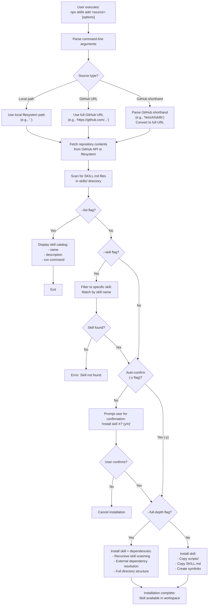
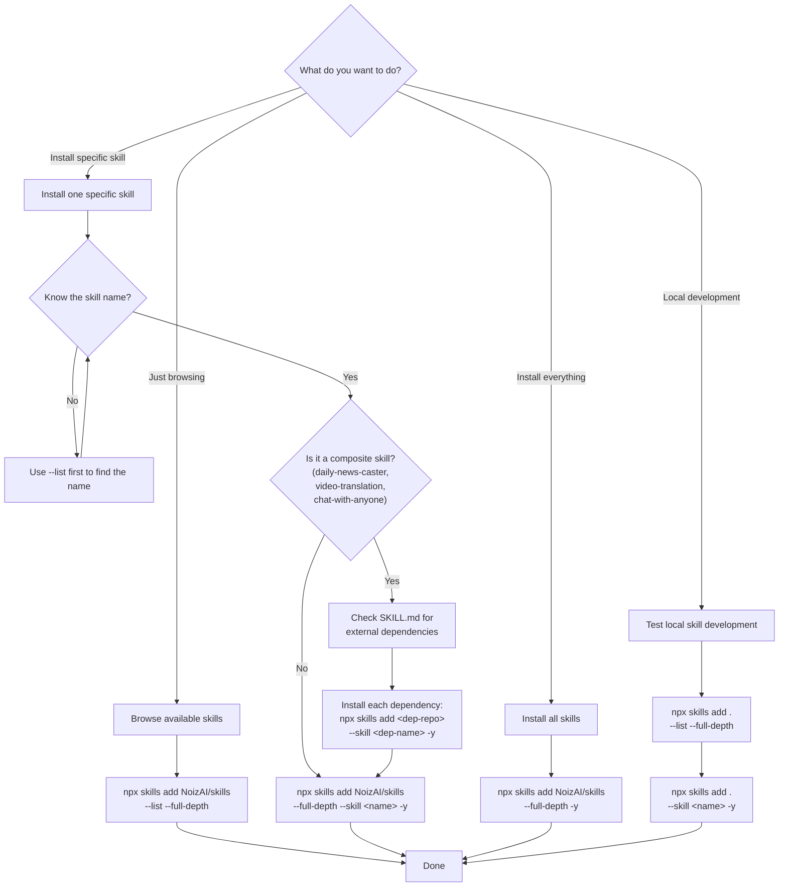

<!-- source: DeepWiki mcp.deepwiki.com · repo NoizAI/skills · page 9.1 npx skills add Commands · fetched 2026-10-26 -->

# npx skills add Commands

<details>
<summary>Relevant source files</summary>

The following files were used as context for generating this wiki page:

- [README.md](README.md)
- [skills/chat-with-anyone/SKILL.md](skills/chat-with-anyone/SKILL.md)
- [skills/daily-news-caster/SKILL.md](skills/daily-news-caster/SKILL.md)

</details>


This page provides a complete command-line reference for the `npx skills add` CLI tool, which is the primary interface for discovering, installing, and managing skills from the NoizAI/skills repository and other skill repositories.

**Scope**: This page covers the syntax, flags, and usage patterns for `npx skills add`. For information about individual skill commands after installation (e.g., `tts.sh`, `speak.sh`), see [9.2](#9.2) and [9.3](#9.3). For creating new skills, see [7.1](#7.1).

---

## Command Syntax

The basic syntax for `npx skills add` follows this pattern:

```bash
npx skills add <source> [options]
```

**Parameters:**
- `<source>` - Location of the skills repository (required)
  - GitHub shorthand: `NoizAI/skills`
  - Full GitHub URL: `https://github.com/NoizAI/skills`
  - Local path: `.` (for development in the repository directory)

**Options:**
- `--list` - List available skills instead of installing
- `--full-depth` - Enable deep installation (includes all dependencies and subdirectories)
- `--skill <name>` - Install only a specific skill by name
- `-y` - Auto-confirm installation without prompting

Sources: [README.md:10-22]()

---

## Command Modes and Options

The following table summarizes all available command patterns:

| Mode | Command Pattern | Description |
|------|----------------|-------------|
| **List Skills** | `npx skills add <source> --list` | Display available skills without installing |
| **List Skills (Deep)** | `npx skills add <source> --list --full-depth` | Display all skills including nested/composite skills |
| **Install All** | `npx skills add <source>` | Install all skills from the repository (prompts for confirmation) |
| **Install All (Deep)** | `npx skills add <source> --full-depth` | Install all skills with full dependency depth (prompts) |
| **Install Specific** | `npx skills add <source> --skill <name> -y` | Install a single named skill with auto-confirmation |
| **Install Specific (Deep)** | `npx skills add <source> --full-depth --skill <name> -y` | Install a specific skill with all its dependencies |
| **Local Development** | `npx skills add . --list --full-depth` | List local skills during repository development |

Sources: [README.md:10-22](), [skills/daily-news-caster/SKILL.md:16-19]()

---

## Command Flow Diagram

The following diagram shows how `npx skills add` processes commands and interacts with skill sources:

**Diagram: npx skills add Execution Flow**



Sources: [README.md:10-22]()

---

## Source Specifications

### GitHub Shorthand

The most common pattern uses GitHub repository shorthand:

```bash
npx skills add NoizAI/skills --full-depth --skill tts -y
```

This is automatically expanded to `https://github.com/NoizAI/skills`.

**Common repositories:**
- `NoizAI/skills` - Official skills repository
- `cclank/news-aggregator-skill` - Third-party news aggregation skill
- `crazynomad/skills` - Third-party skills collection

Sources: [README.md:15](), [skills/daily-news-caster/SKILL.md:17]()

### Full GitHub URL

For clarity or non-standard repositories, use the complete URL:

```bash
npx skills add https://github.com/cclank/news-aggregator-skill --skill news-aggregator-skill -y
```

Sources: [skills/daily-news-caster/SKILL.md:17]()

### Local Path

During skill development, use a local path to test before publishing:

```bash
# From within the NoizAI/skills repository
npx skills add . --list --full-depth
```

This mode is essential for [local development workflows](#7.1).

Sources: [README.md:21]()

---

## Flag Reference

### `--list`

**Purpose**: Display available skills without installing them.

**Behavior**:
- Fetches the skill repository
- Scans for all `SKILL.md` files
- Displays a table with: skill name, description, and installation command
- Exits without modifying the local workspace

**Example:**
```bash
npx skills add NoizAI/skills --list --full-depth
```

**Output format:**
```
| Name | Description | Run command |
|------|-------------|-------------|
| tts  | Convert text into speech... | npx skills add NoizAI/skills --skill tts -y |
| ...  | ...                         | ...                                         |
```

Sources: [README.md:12]()

---

### `--full-depth`

**Purpose**: Enable deep installation that includes all nested skills, composite dependencies, and full directory structures.

**Shallow installation (without flag)**:
- Copies only the primary skill's `scripts/` directory
- Copies the skill's `SKILL.md` file
- Creates minimal symlinks

**Deep installation (with flag)**:
- Recursively scans for composite skill dependencies
- Resolves external skill requirements (e.g., `news-aggregator-skill` for `daily-news-caster`)
- Preserves full directory hierarchy
- Includes example files, documentation, and configuration templates

**Recommendation**: Always use `--full-depth` unless you have specific constraints, as composite skills like `daily-news-caster` and `video-translation` require their dependencies.

Sources: [README.md:12,15,21]()

---

### `--skill <name>`

**Purpose**: Install only a specific skill by name instead of all skills in the repository.

**Syntax:**
```bash
npx skills add <source> --skill <skill-name> [options]
```

**Skill name matching**:
- Must exactly match the skill's directory name in `skills/<skill-name>/`
- Case-sensitive
- Hyphens required (e.g., `chat-with-anyone`, not `chat with anyone`)

**Example:**
```bash
# Install only the tts skill from NoizAI/skills
npx skills add NoizAI/skills --full-depth --skill tts -y

# Install only characteristic-voice
npx skills add NoizAI/skills --full-depth --skill characteristic-voice -y
```

**Error handling**: If the specified skill name doesn't exist, the command will fail with an error message listing available skills.

Sources: [README.md:15](), [skills/daily-news-caster/SKILL.md:18]()

---

### `-y` (Auto-confirm)

**Purpose**: Skip interactive confirmation prompts during installation.

**Behavior**:
- Without `-y`: Prompts user with "Install skill X? (y/n)" before proceeding
- With `-y`: Automatically confirms and proceeds with installation

**Use cases**:
- Automated scripts and CI/CD pipelines
- Non-interactive environments
- When you're certain about the installation

**Example:**
```bash
# Interactive mode (requires user confirmation)
npx skills add NoizAI/skills --skill tts

# Auto-confirm mode (no prompt)
npx skills add NoizAI/skills --skill tts -y
```

Sources: [README.md:15,35-39]()

---

## Common Usage Patterns

### Pattern 1: Discover Available Skills

Before installing, list all skills to see what's available:

```bash
npx skills add NoizAI/skills --list --full-depth
```

This displays the complete catalog with descriptions and ready-to-copy installation commands.

Sources: [README.md:12]()

---

### Pattern 2: Install a Specific Core Skill

Install a single core skill like `tts` with all dependencies:

```bash
npx skills add NoizAI/skills --full-depth --skill tts -y
```

**Result**: The `tts` skill is installed to `skills/tts/` or `.cursor/skills/tts/` depending on workspace configuration.

Sources: [README.md:15,35]()

---

### Pattern 3: Install a Composite Skill with Dependencies

Composite skills like `daily-news-caster` require external dependencies. Use `--full-depth` to ensure all dependencies are resolved:

```bash
# First, install external dependency
npx skills add https://github.com/cclank/news-aggregator-skill --skill news-aggregator-skill -y

# Then, install the composite skill
npx skills add NoizAI/skills --full-depth --skill daily-news-caster -y
```

Sources: [skills/daily-news-caster/SKILL.md:16-19]()

---

### Pattern 4: Install Complete Skill Collection

To install all skills from the repository:

```bash
npx skills add NoizAI/skills --full-depth
```

**Warning**: This will prompt for confirmation before installing. Use `-y` to auto-confirm:

```bash
npx skills add NoizAI/skills --full-depth -y
```

Sources: [README.md:18]()

---

### Pattern 5: Local Development Testing

When developing a new skill in a local clone of the repository:

```bash
# List local skills to verify SKILL.md is detected
npx skills add . --list --full-depth

# Test installation from local directory
npx skills add . --skill my-new-skill -y
```

This allows testing the skill installation process before pushing to GitHub.

Sources: [README.md:21]()

---

## Installation Decision Tree

**Diagram: Choosing the Right npx skills add Command**



Sources: [README.md:10-39](), [skills/daily-news-caster/SKILL.md:16-19]()

---

## Workspace Integration

After successful installation, skills are placed in one of the following directories:

```
workspace/
├── skills/                    # Standard installation
│   ├── tts/
│   │   ├── SKILL.md
│   │   └── scripts/
│   │       ├── tts.sh
│   │       └── tts.py
│   └── characteristic-voice/
│       └── ...
└── .cursor/                   # Cursor IDE integration (alternative)
    └── skills/
        └── tts/
            └── ...
```

The exact location depends on the workspace configuration and the `npx skills add` implementation's detection logic.

**Verification**: After installation, verify the skill is accessible:

```bash
# For tts skill
bash skills/tts/scripts/tts.sh --help

# Or
bash .cursor/skills/tts/scripts/tts.sh --help
```

Sources: [README.md:45-46](), [skills/daily-news-caster/SKILL.md:22,61]()

---

## External Skill Repositories

The `npx skills add` command is not limited to the official NoizAI/skills repository. It can install skills from any GitHub repository that follows the skill format conventions.

**Example repositories:**

| Repository | Owner | Example Installation |
|-----------|-------|---------------------|
| `NoizAI/skills` | NoizAI | `npx skills add NoizAI/skills --skill tts -y` |
| `cclank/news-aggregator-skill` | cclank | `npx skills add https://github.com/cclank/news-aggregator-skill --skill news-aggregator-skill -y` |
| `crazynomad/skills` | crazynomad | `npx skills add crazynomad/skills --skill youtube-downloader -y` |

**Skill format requirements** for third-party repositories are documented in [7.2](#7.2).

Sources: [skills/daily-news-caster/SKILL.md:17](), [skills/chat-with-anyone/SKILL.md:73]()

---

## Error Scenarios

### Skill Not Found

**Command:**
```bash
npx skills add NoizAI/skills --skill nonexistent-skill -y
```

**Error behavior**: The command will fail and display available skill names from the repository.

**Resolution**: Use `--list` to see the correct skill names.

---

### Missing Dependencies

**Command:**
```bash
npx skills add NoizAI/skills --skill daily-news-caster -y
```

**Error behavior**: If `news-aggregator-skill` is not installed, the skill may install successfully but fail at runtime when attempting to execute `fetch_news.py`.

**Resolution**: Install dependencies first as documented in the skill's [SKILL.md]().

Sources: [skills/daily-news-caster/SKILL.md:15-19]()

---

### Network Connectivity

**Command:**
```bash
npx skills add NoizAI/skills --list
```

**Error behavior**: If GitHub is unreachable, the command will fail with a network error.

**Resolution**: Verify internet connectivity or use local development mode with `.` as the source.

---

## Related Commands

After installing skills, refer to these pages for skill-specific command references:

- [9.2](#9.2) - `tts.sh` / `tts.py` command reference (TTS skill)
- [9.3](#9.3) - `speak.sh` reference (characteristic-voice skill)
- [7.1](#7.1) - Creating new skills that work with `npx skills add`
- [1.1](#1.1) - Quick start guide for first-time installation

Sources: [README.md:1-110]()

---

