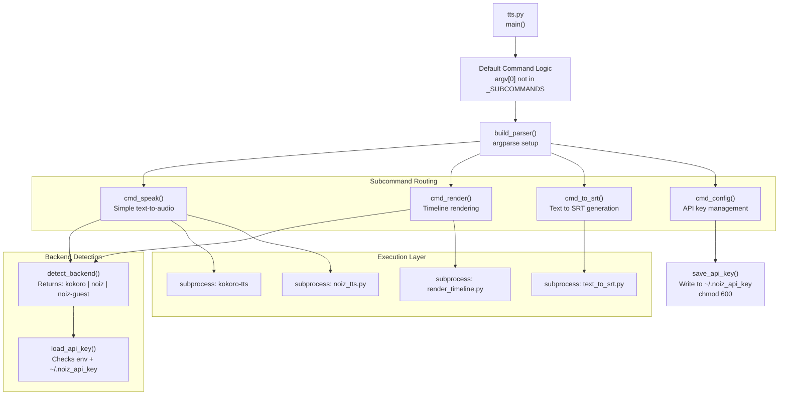
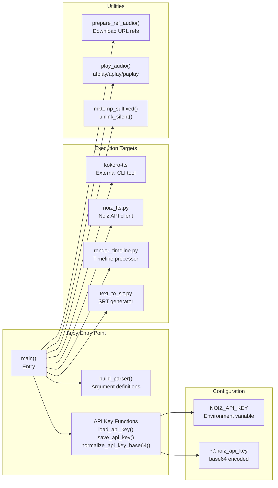
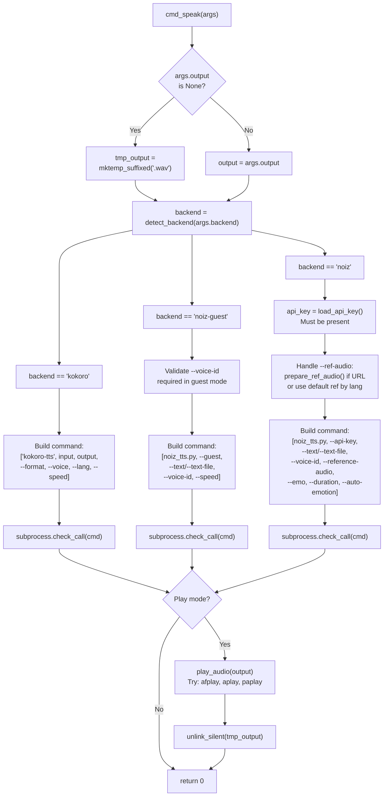
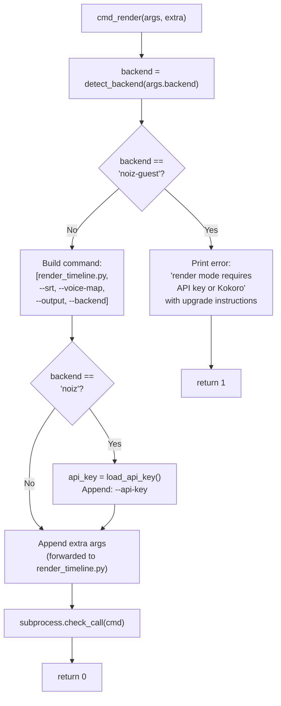
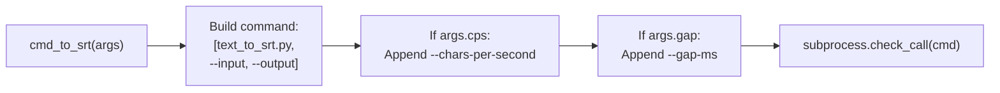
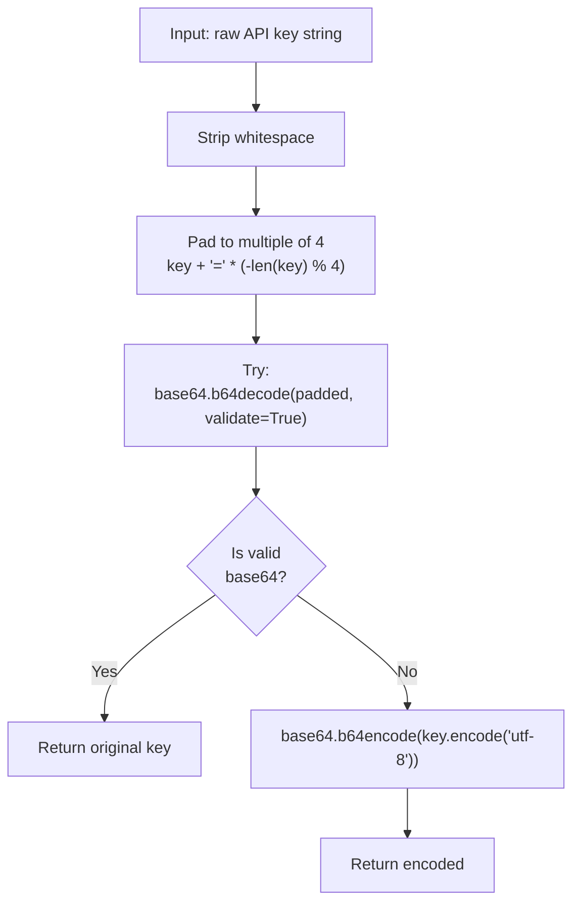
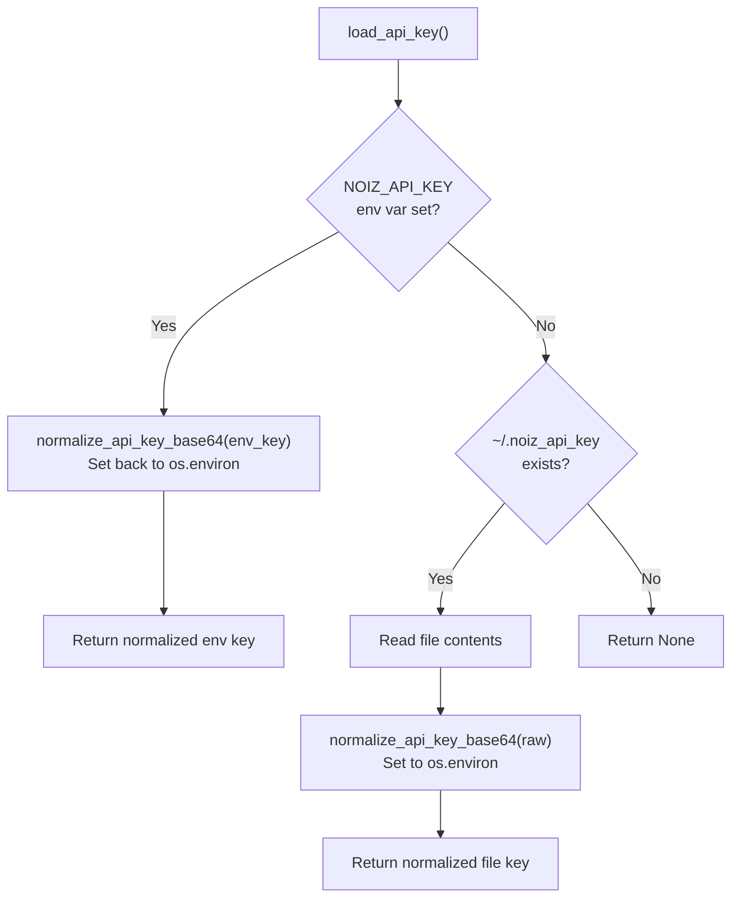

<!-- source: DeepWiki mcp.deepwiki.com · repo NoizAI/skills · page 9.2 tts.sh / tts.py Reference · fetched 2026-10-26 -->

# tts.sh / tts.py Reference

<details>
<summary>Relevant source files</summary>

The following files were used as context for generating this wiki page:

- [skills/tts/SKILL.md](skills/tts/SKILL.md)
- [skills/tts/scripts/tts.py](skills/tts/scripts/tts.py)

</details>


This page provides a complete command-line reference for the TTS skill's entrypoint script. It documents all subcommands, arguments, and backend selection logic for `tts.py` (which replaces the legacy `tts.sh`). For high-level usage patterns and examples, see [TTS (Text-to-Speech) Skill](#3). For the characteristic-voice wrapper, see [speak.sh Reference](#9.3).

## Script Architecture

`tts.py` is the unified entrypoint for all TTS operations, supporting four subcommands. The `speak` subcommand is the default and can be omitted, allowing `tts.py -t "Hello"` as shorthand for `tts.py speak -t "Hello"`.



**Subcommand Detection Logic**

The script implements implicit `speak` by injecting it into `sys.argv` when the first argument is not a recognized subcommand:

Sources: [skills/tts/scripts/tts.py:421-421](), [skills/tts/scripts/tts.py:509-513]()

## Global Architecture - Module Dependencies



Sources: [skills/tts/scripts/tts.py:1-22](), [skills/tts/scripts/tts.py:32-67]()

## Subcommand: `speak`

**Purpose**: Convert text to audio using simple mode (single output file, no timeline alignment).

**Invocation**:
```bash
tts.py speak [OPTIONS]
tts.py [OPTIONS]  # speak is implicit
```

### Arguments

| Argument | Type | Description | Default |
|----------|------|-------------|---------|
| `-t, --text` | string | Text string to synthesize | - |
| `-f, --text-file` | path | Path to text file | - |
| `-v, --voice` | string | Kokoro voice name | - |
| `--voice-id` | string | Noiz voice ID | - |
| `-o, --output` | path | Output file path (omit to play immediately) | None (play mode) |
| `--format` | enum | Audio format: `wav`, `mp3`, `opus`, `ogg` | `wav` |
| `--lang` | string | Language code (e.g. `zh`, `en-us`) | - |
| `--speed` | float | Playback speed multiplier | - |
| `--emo` | JSON | Emotion JSON string, e.g. `'{"Joy":0.5}'` | - |
| `--duration` | float | Target audio duration in seconds (0, 36] | - |
| `--backend` | enum | Force backend: `kokoro`, `noiz`, `noiz-guest` | auto-detected |
| `--ref-audio` | path/URL | Reference audio for voice cloning (Noiz only) | - |
| `--auto-emotion` | flag | Enable auto-emotion detection | false |
| `--similarity-enh` | flag | Enable similarity enhancement | false |
| `--save-voice` | flag | Save voice model | false |

Sources: [skills/tts/scripts/tts.py:441-476]()

### Backend-Specific Execution Paths



Sources: [skills/tts/scripts/tts.py:139-309]()

### Backend Detection Algorithm

The `detect_backend()` function implements automatic backend selection:

| Condition | Backend | Feature Set |
|-----------|---------|-------------|
| `--backend` explicitly set | User-specified value | Override auto-detection |
| `load_api_key()` returns value | `noiz` | Full features (cloning, emotion, duration) |
| No API key found | `noiz-guest` | Limited (15 voices, basic params only) |

Sources: [skills/tts/scripts/tts.py:72-76]()

### Play Mode vs Output Mode

When `-o/--output` is omitted, the script enters "play mode":
1. Creates temporary WAV file via `mktemp_suffixed(".wav")`
2. Synthesizes audio to temporary file
3. Plays audio using first available player: `afplay` (macOS), `aplay` (ALSA), `paplay` (PulseAudio)
4. Deletes temporary file via `unlink_silent()`

Sources: [skills/tts/scripts/tts.py:142-148](), [skills/tts/scripts/tts.py:305-307](), [skills/tts/scripts/tts.py:123-133]()

### Error Handling: Guest Mode Restrictions

When `backend == "noiz-guest"` and no `--voice-id` is provided, the script prints a detailed error message explaining how to upgrade to full features:

```
Error: --voice-id is required in guest mode (no API key configured).

  To unlock all features (voice cloning, emotion, etc.), configure your API key:
    1. Get your API key from https://developers.noiz.ai/api-keys
    2. Run: python3 skills/tts/scripts/tts.py config --set-api-key YOUR_KEY

  Or use Kokoro for offline local TTS:
    uv tool install kokoro-tts
    Then pass --backend kokoro
```

Sources: [skills/tts/scripts/tts.py:182-204]()

## Subcommand: `render`

**Purpose**: Render timeline-accurate audio from SRT file with per-segment voice control.

**Invocation**:
```bash
tts.py render --srt INPUT.srt --voice-map MAP.json -o OUTPUT.wav [OPTIONS]
```

### Arguments

| Argument | Type | Required | Description |
|----------|------|----------|-------------|
| `--srt` | path | Yes | Input SRT file |
| `--voice-map` | path | Yes | Voice map JSON file |
| `-o, --output` | path | Yes | Output audio file |
| `--backend` | enum | No | Backend: `kokoro`, `noiz` (auto-detected) |
| *(extra args)* | - | No | Forwarded to `render_timeline.py` |

**Note**: `noiz-guest` backend is not supported for timeline rendering. The script explicitly checks and rejects guest mode with an instructional error message.

Sources: [skills/tts/scripts/tts.py:478-486]()

### Execution Flow



Sources: [skills/tts/scripts/tts.py:315-365]()

### Extra Arguments Forwarding

The `render` subcommand uses `parse_known_args()` to forward unknown arguments to `render_timeline.py`. This allows passing timeline-specific options like `--ref-audio-track` without defining them in the main parser:

```bash
tts.py render --srt input.srt --voice-map vm.json \
    --ref-audio-track video.mp4 \
    --auto-emotion \
    -o output.wav
```

The `--ref-audio-track` and `--auto-emotion` arguments are forwarded to `render_timeline.py` via the `extra` list.

Sources: [skills/tts/scripts/tts.py:516-517](), [skills/tts/scripts/tts.py:363-364]()

## Subcommand: `to-srt`

**Purpose**: Convert plain text file to SRT format with automatic timing calculations.

**Invocation**:
```bash
tts.py to-srt -i INPUT.txt -o OUTPUT.srt [OPTIONS]
```

### Arguments

| Argument | Type | Required | Description | Default |
|----------|------|----------|-------------|---------|
| `-i, --input` | path | Yes | Input text file | - |
| `-o, --output` | path | Yes | Output SRT file | - |
| `--cps` | float | No | Characters per second | 4 (Chinese), ~15 (English) |
| `--gap` | int | No | Gap between segments in milliseconds | - |

### Execution

The subcommand delegates to `text_to_srt.py` with argument translation:



Sources: [skills/tts/scripts/tts.py:371-383](), [skills/tts/scripts/tts.py:489-497]()

## Subcommand: `config`

**Purpose**: Manage NOIZ_API_KEY configuration (check status or set key).

**Invocation**:
```bash
tts.py config [--set-api-key KEY]
```

### Arguments

| Argument | Type | Description |
|----------|------|-------------|
| `--set-api-key` | string | Set API key (saved to `~/.noiz_api_key`) |

### Operations

**Setting API Key**:
```bash
tts.py config --set-api-key YOUR_KEY_HERE
# Output: API key saved to /home/user/.noiz_api_key
```

**Checking Status**:
```bash
tts.py config
# If configured:
#   NOIZ_API_KEY is configured: abcd****wxyz
#   Backend: noiz (full features)
#
# If not configured:
#   NOIZ_API_KEY is not configured.
#   Current fallback: noiz-guest (limited features, no API key required)
#   [Instructions for both Noiz and Kokoro setup]
```

Sources: [skills/tts/scripts/tts.py:389-415](), [skills/tts/scripts/tts.py:500-501]()

### API Key Normalization

The `normalize_api_key_base64()` function ensures all API keys are stored in canonical base64 format:



This allows users to provide either:
- Already base64-encoded keys (returned as-is)
- Plain text keys (automatically encoded)

Sources: [skills/tts/scripts/tts.py:33-45]()

### Key Storage and Permissions

When `save_api_key()` writes the key file, it sets restrictive permissions:

```python
NOIZ_KEY_FILE.write_text(normalized, encoding="utf-8")
os.chmod(str(NOIZ_KEY_FILE), 0o600)  # rw------- (owner only)
```

Sources: [skills/tts/scripts/tts.py:63-66]()

## API Key Loading Precedence

The `load_api_key()` function implements a two-tier precedence:



**Precedence Order**:
1. `NOIZ_API_KEY` environment variable (highest priority)
2. `~/.noiz_api_key` file
3. No key found → triggers `noiz-guest` mode

**Side Effect**: When a key is found, it's normalized and stored back to `os.environ["NOIZ_API_KEY"]`, making it available to child processes like `noiz_tts.py`.

Sources: [skills/tts/scripts/tts.py:48-60]()

## Utility Functions

### Reference Audio Handling

```python
def prepare_ref_audio(ref_audio_input: str) -> str:
    """Download ref audio if URL; return local path."""
```

- If input is HTTP/HTTPS URL: downloads to temporary file using `urllib.request.urlretrieve()`
- If input is local path: returns as-is
- Used by `cmd_speak()` when `--ref-audio` points to a URL

Sources: [skills/tts/scripts/tts.py:108-120]()

### Language Detection

```python
def detect_text_lang(text: str) -> str:
    if re.search(r"[\u4e00-\u9fff\u3400-\u4dbf]", text):
        return "zh"
    return "en"
```

Simple heuristic using Unicode ranges for CJK characters. Used to select default reference audio URL when neither `--voice-id` nor `--ref-audio` is specified.

Sources: [skills/tts/scripts/tts.py:102-105]()

### Default Reference Audio Selection

When Noiz backend is used without explicit voice configuration, the script auto-selects a reference audio based on detected language:

| Language | Default Reference Audio URL |
|----------|----------------------------|
| `zh` | `https://storage.googleapis.com/noiz_audio_public/resource/audio/ref_cn_fm1.WAV` |
| `en` | `https://noiz.ai/resource/img/tts/landing_creative1.mp3` |

Sources: [skills/tts/scripts/tts.py:23-28](), [skills/tts/scripts/tts.py:245-258]()

## Command-Line Examples

### Basic Text-to-Speech

```bash
# Play immediately (no output file)
tts.py -t "Hello world"

# Save to file
tts.py -t "Hello world" -o output.wav

# From text file
tts.py -f article.txt -o article.mp3 --format mp3
```

### Voice Cloning (Noiz)

```bash
# Local reference audio
tts.py -t "Clone this voice" --ref-audio ./my_voice.wav -o cloned.wav

# Reference audio from URL
tts.py -t "Clone from URL" \
    --ref-audio https://example.com/speaker.mp3 \
    -o cloned.wav
```

### Guest Mode (No API Key)

```bash
# Requires --voice-id
tts.py -t "Hello" --voice-id 883b6b7c -o hello.wav

# With speed adjustment
tts.py -t "Faster speech" --voice-id 883b6b7c --speed 1.2 -o fast.wav
```

### Kokoro Backend

```bash
# Force Kokoro backend
tts.py -t "Local synthesis" --backend kokoro -o local.wav

# Kokoro-specific options
tts.py -t "Custom voice" \
    --backend kokoro \
    --voice af_sarah \
    --lang en-us \
    --speed 0.9 \
    -o sarah.wav
```

### Emotion Control (Noiz Full)

```bash
# JSON emotion parameters
tts.py -t "Happy message" \
    --emo '{"Joy":0.8,"Excitement":0.5}' \
    -o happy.wav

# Auto-emotion detection
tts.py -t "Analyze this text for emotion" \
    --auto-emotion \
    --ref-audio my_voice.wav \
    -o emotional.wav
```

### Timeline Rendering

```bash
# Basic timeline render
tts.py render \
    --srt subtitles.srt \
    --voice-map voices.json \
    -o dubbed.wav

# With dynamic reference audio slicing
tts.py render \
    --srt translated.srt \
    --voice-map voices.json \
    --ref-audio-track original_video.mp4 \
    -o dubbed.wav

# With auto-emotion and Noiz backend
tts.py render \
    --srt input.srt \
    --voice-map vm.json \
    --backend noiz \
    --auto-emotion \
    -o output.wav
```

### SRT Generation

```bash
# Auto-generate SRT from text
tts.py to-srt -i article.txt -o article.srt

# Custom timing for English
tts.py to-srt \
    -i english_article.txt \
    -o english.srt \
    --cps 15 \
    --gap 500
```

### API Key Management

```bash
# Set API key
tts.py config --set-api-key YOUR_BASE64_KEY

# Check configuration status
tts.py config
```

Sources: [skills/tts/SKILL.md:20-94]()

## Error Messages and Troubleshooting

### Missing Text Input

```
Error: --text (-t) or --text-file (-f) is required.
```

**Solution**: Provide either `-t` for inline text or `-f` for text file path.

Sources: [skills/tts/scripts/tts.py:150-152]()

### Guest Mode Restrictions

```
Error: --voice-id is required in guest mode (no API key configured).
```

**Solution**: Either:
1. Configure API key: `tts.py config --set-api-key YOUR_KEY`
2. Use Kokoro: `--backend kokoro`

Sources: [skills/tts/scripts/tts.py:182-204]()

### Timeline Render in Guest Mode

```
Error: render mode requires a Noiz API key or Kokoro backend.
  Guest mode does not support timeline rendering.
```

**Solution**: Configure API key or use `--backend kokoro`.

Sources: [skills/tts/scripts/tts.py:318-338]()

### Missing API Key for Full Features

```
Error: NOIZ_API_KEY not configured.
  Get your key at https://developers.noiz.ai/api-keys
  Then run: python3 skills/tts/scripts/tts.py config --set-api-key YOUR_KEY
```

**Solution**: Follow the instructions to obtain and configure API key.

Sources: [skills/tts/scripts/tts.py:230-238](), [skills/tts/scripts/tts.py:351-359]()

## Constants and Configuration Files

| Constant | Value | Purpose |
|----------|-------|---------|
| `NOIZ_KEY_FILE` | `Path.home() / ".noiz_api_key"` | API key storage location |
| `DEFAULT_NOIZ_REF_AUDIO_URL_CN` | GCS URL | Chinese default reference audio |
| `DEFAULT_NOIZ_REF_AUDIO_URL_EN` | noiz.ai URL | English default reference audio |
| `_SUBCOMMANDS` | `{"speak", "render", "to-srt", "config"}` | Valid subcommand set |

Sources: [skills/tts/scripts/tts.py:21-28](), [skills/tts/scripts/tts.py:421-421]()

---

