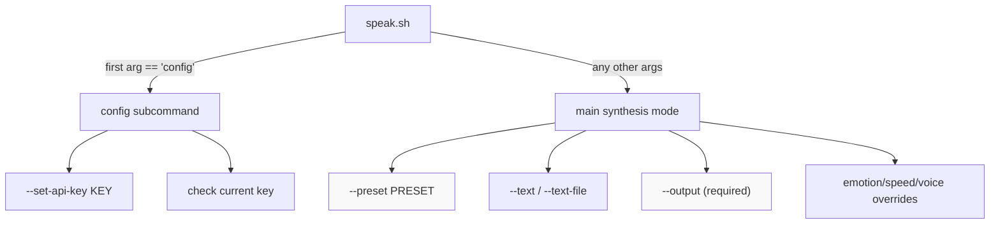
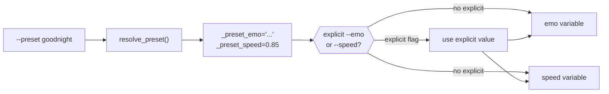
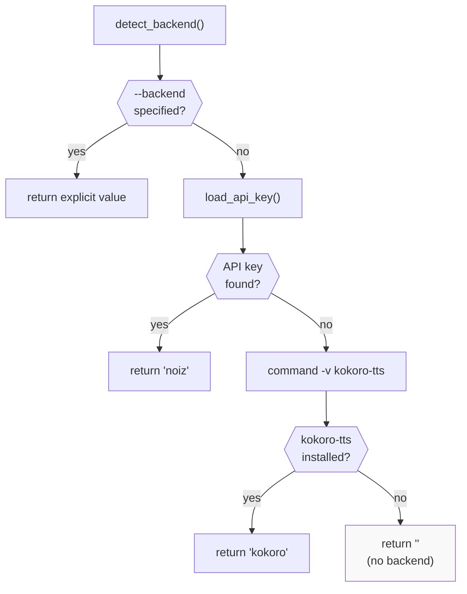
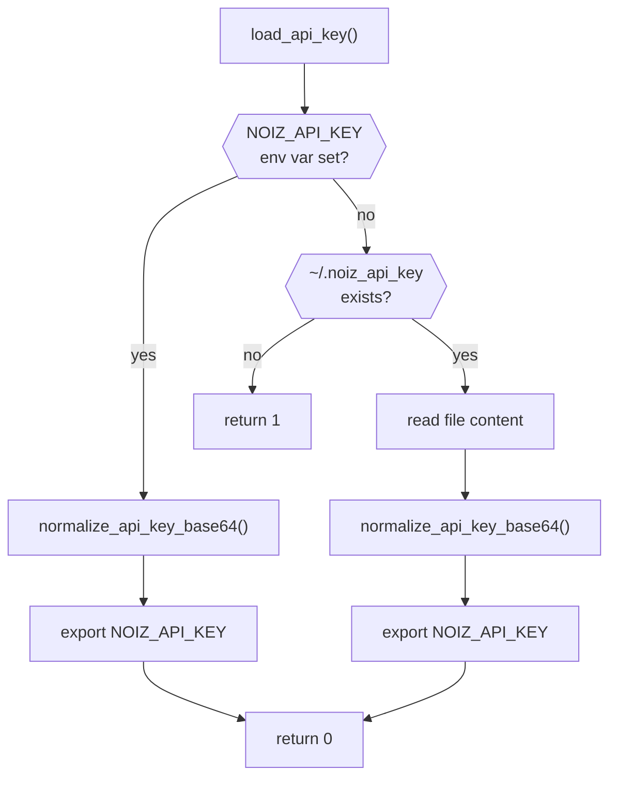
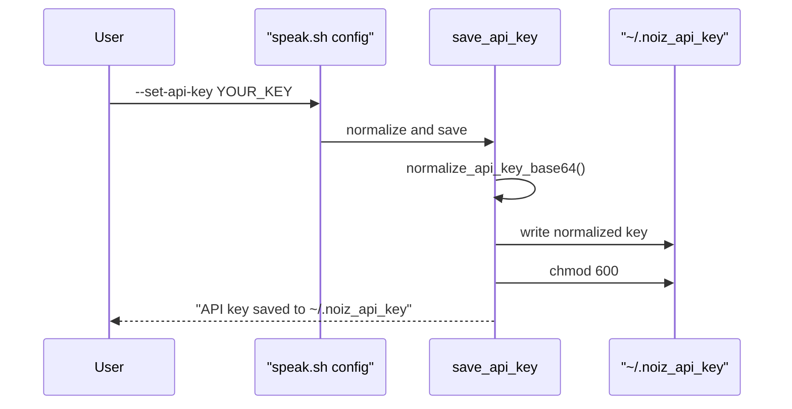
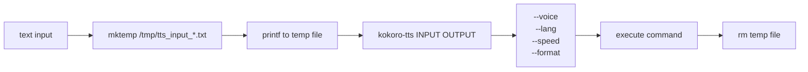
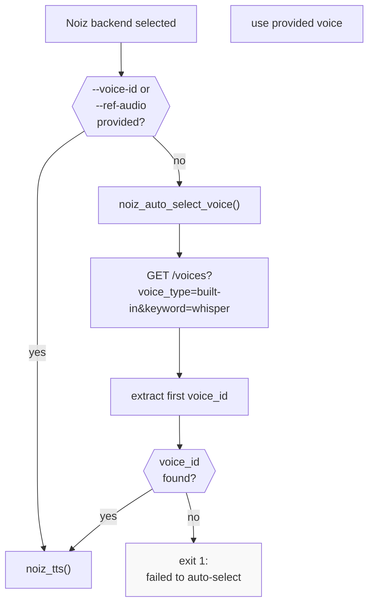
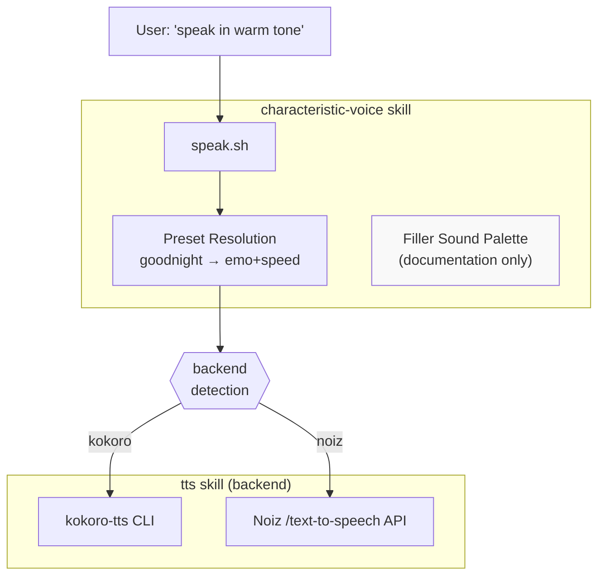

<!-- source: DeepWiki mcp.deepwiki.com · repo NoizAI/skills · page 9.3 speak.sh Reference (Characteristic Voice) · fetched 2026-10-26 -->

# speak.sh Reference (Characteristic Voice)

<details>
<summary>Relevant source files</summary>

The following files were used as context for generating this wiki page:

- [skills/characteristic-voice/SKILL.md](skills/characteristic-voice/SKILL.md)
- [skills/characteristic-voice/scripts/speak.sh](skills/characteristic-voice/scripts/speak.sh)

</details>


This page provides a comprehensive command-line reference for `speak.sh`, the CLI interface for the `characteristic-voice` skill. This script wraps the core TTS functionality with preset emotion configurations and non-lexical filler support for expressive, human-like speech generation.

For conceptual information about emotion presets and filler sounds, see [4 Characteristic Voice Skill](#4). For the underlying TTS engine, see [9.2 tts.sh / tts.py Reference](#9.2).

**Sources:** [skills/characteristic-voice/scripts/speak.sh:1-323]()

---

## Command Structure

The `speak.sh` script provides two command modes:

```bash
# Main mode: generate expressive speech
speak.sh [--preset MODE] [OPTIONS]

# Configuration mode: manage API key
speak.sh config [--set-api-key KEY]
```

**Sources:** [skills/characteristic-voice/scripts/speak.sh:7-41]()

---

## Invocation Syntax



**Sources:** [skills/characteristic-voice/scripts/speak.sh:145-151](), [skills/characteristic-voice/scripts/speak.sh:220-241]()

---

## Preset Reference

Presets automatically configure emotion parameters and speech speed. Explicit flags override preset defaults.

| Preset | Emotion Parameters | Speed | Use Case |
|--------|-------------------|-------|----------|
| `goodnight` | `{"Joy":0.2,"Tenderness":0.7}` | 0.85 | Gentle, warm, slightly sleepy |
| `morning` | `{"Joy":0.6,"Tenderness":0.3}` | 1.0 | Warm, cheerful greeting |
| `comfort` | `{"Tenderness":0.8,"Sadness":0.3}` | 0.8 | Soft, understanding, unhurried |
| `celebrate` | `{"Joy":0.9,"Excitement":0.7}` | 1.1 | Excited, proud, genuinely happy |
| `chat` | `{"Joy":0.4,"Tenderness":0.2}` | 1.0 | Relaxed, playful, natural conversation |

**Preset Resolution Logic:**



**Sources:** [skills/characteristic-voice/scripts/speak.sh:45-54](), [skills/characteristic-voice/scripts/speak.sh:250-258]()

---

## Options Reference

### Required Options

| Option | Short | Value | Description |
|--------|-------|-------|-------------|
| `--output` | `-o` | FILE | Output audio file path (required) |
| `--text` OR `--text-file` | `-t` OR `-f` | TEXT / FILE | Input text to synthesize (one required) |

### Preset and Emotion Control

| Option | Value | Description |
|--------|-------|-------------|
| `--preset` | `goodnight\|morning\|comfort\|celebrate\|chat` | Apply emotion+speed preset |
| `--emo` | JSON | Override emotion, e.g. `'{"Joy":0.8,"Tenderness":0.5}'` |
| `--speed` | FLOAT | Speech speed multiplier (default: 1.0, or preset value) |

### Voice Selection

| Option | Short | Value | Description | Backend |
|--------|-------|-------|-------------|---------|
| `--voice` | `-v` | NAME | Kokoro voice name | Kokoro only |
| `--voice-id` | | ID | Noiz voice ID | Noiz only |
| `--ref-audio` | | FILE | Reference audio for voice cloning | Noiz only |

### Backend and Language

| Option | Value | Description |
|--------|-------|-------------|
| `--backend` | `kokoro\|noiz` | Force specific backend (auto-detected if omitted) |
| `--lang` | CODE | Target language code (Noiz: `target_lang`, Kokoro: `--lang`) |

### Other

| Option | Short | Description |
|--------|-------|-------------|
| `--help` | `-h` | Show usage help |

**Sources:** [skills/characteristic-voice/scripts/speak.sh:20-32](), [skills/characteristic-voice/scripts/speak.sh:225-241]()

---

## Backend Detection Flow



**Backend Selection Priority:**
1. Explicit `--backend` flag (highest priority)
2. Noiz if `NOIZ_API_KEY` is configured (env var or `~/.noiz_api_key` file)
3. Kokoro if `kokoro-tts` command is available
4. Error if no backend available

**Sources:** [skills/characteristic-voice/scripts/speak.sh:155-168](), [skills/characteristic-voice/scripts/speak.sh:260-274]()

---

## API Key Management

### Configuration Locations

API keys are resolved in the following order:

1. **Environment variable:** `NOIZ_API_KEY`
2. **File:** `~/.noiz_api_key`



**Sources:** [skills/characteristic-voice/scripts/speak.sh:58-71]()

### Base64 Normalization

API keys are automatically normalized to base64 format:

- If the input is already valid base64, it's used as-is
- If the input is plain text, it's base64-encoded
- Whitespace is stripped

```python
# Embedded in normalize_api_key_base64() [line 82-108]
# 1. Check if input is valid base64
# 2. If yes: return as-is
# 3. If no: base64.b64encode(value.encode("utf-8"))
```

**Sources:** [skills/characteristic-voice/scripts/speak.sh:80-108]()

### config Subcommand

```bash
# Check current API key status
speak.sh config

# Set API key
speak.sh config --set-api-key YOUR_KEY
```

**Workflow:**



**Key saved to:** `~/.noiz_api_key` with permissions `600`

**Sources:** [skills/characteristic-voice/scripts/speak.sh:110-143](), [skills/characteristic-voice/scripts/speak.sh:73-78]()

---

## Backend-Specific Behavior

### Kokoro Backend

When Kokoro is detected or explicitly selected:



**Ignored options on Kokoro:**
- `--emo` (emotion parameters)
- `--voice-id` (Noiz-specific)
- `--ref-audio` (voice cloning)

**Sources:** [skills/characteristic-voice/scripts/speak.sh:284-296]()

### Noiz Backend

When Noiz is detected or explicitly selected:

**Voice Selection Logic:**



**API Call Structure:**

```bash
# Implemented in noiz_tts() [lines 191-218]
curl -X POST ${NOIZ_BASE_URL}/text-to-speech \
  -H "Authorization: ${api_key}" \
  -F "text=$text" \
  -F "output_format=wav" \
  -F "speed=$speed" \
  [-F "voice_id=$voice_id"] \         # optional
  [-F "emo=$emo"] \                   # optional
  [-F "target_lang=$lang"] \          # optional
  [-F "file=@$ref_audio"]             # optional for cloning
```

**Error Handling:**
- HTTP status checked (must be 200)
- On error: prints first 500 bytes of response and exits

**Sources:** [skills/characteristic-voice/scripts/speak.sh:172-189](), [skills/characteristic-voice/scripts/speak.sh:191-218](), [skills/characteristic-voice/scripts/speak.sh:298-322]()

---

## Usage Examples

### Basic Preset Usage

```bash
# Goodnight message with preset
speak.sh --preset goodnight -t "Hmm... rest well~ Sweet dreams." -o night.wav

# Morning greeting
speak.sh --preset morning -t "Good morning~" -o morning.wav

# Comfort message
speak.sh --preset comfort -t "Aww... I'm right here." -o comfort.wav
```

### Custom Emotion Override

```bash
# Override preset emotion
speak.sh --preset chat -t "Haha nice!" \
  --emo '{"Joy":0.9}' --speed 1.2 -o excited.wav

# Pure custom emotion (no preset)
speak.sh -t "I understand..." \
  --emo '{"Tenderness":0.9,"Sadness":0.5}' \
  --speed 0.75 -o empathy.wav
```

### Voice Cloning

```bash
# Clone voice from reference audio
speak.sh --preset goodnight \
  -t "Sweet dreams~" \
  --ref-audio skills/characteristic-voice/hermione.wav \
  -o hermione_night.wav

# Force Noiz backend with specific voice
speak.sh --preset celebrate \
  -t "You did it!" \
  --backend noiz --voice-id voice_abc123 \
  -o celebrate.mp3
```

### File Input

```bash
# Read text from file
speak.sh --preset chat \
  --text-file message.txt \
  -o message.wav
```

### Configuration

```bash
# Check API key status
speak.sh config

# Set API key (one-time setup)
speak.sh config --set-api-key YOUR_KEY_HERE

# Example output:
# API key saved to /home/user/.noiz_api_key
```

**Sources:** [skills/characteristic-voice/scripts/speak.sh:34-38](), [skills/characteristic-voice/SKILL.md:89-101]()

---

## Exit Codes and Error Handling

| Exit Code | Condition |
|-----------|-----------|
| 0 | Success |
| 1 | Invalid arguments, missing required options, or API errors |

**Common Error Messages:**

| Error | Cause | Solution |
|-------|-------|----------|
| `Error: --output (-o) is required.` | Missing output file argument | Add `-o filename.wav` |
| `Error: --text (-t) or --text-file (-f) is required.` | No input text provided | Add `-t "text"` or `-f file.txt` |
| `Error: unknown preset 'xyz'` | Invalid preset name | Use: `goodnight`, `morning`, `comfort`, `celebrate`, `chat` |
| `Error: no TTS backend available.` | Neither Noiz nor Kokoro configured | Install Kokoro or configure API key |
| `Error: NOIZ_API_KEY not configured.` | Noiz selected but no key | Run `speak.sh config --set-api-key KEY` |
| `Error: Noiz API returned HTTP XXX` | API request failed | Check API key, network, or API status |
| `Error: failed to auto-select a voice.` | Voice auto-selection failed | Provide `--voice-id` or `--ref-audio` |

**Sources:** [skills/characteristic-voice/scripts/speak.sh:243-248](), [skills/characteristic-voice/scripts/speak.sh:264-273](), [skills/characteristic-voice/scripts/speak.sh:302-306](), [skills/characteristic-voice/scripts/speak.sh:212-217]()

---

## Integration with TTS Skill

The `speak.sh` script is a **wrapper** around the core TTS functionality, not a replacement. The relationship:



**Key differences from direct TTS usage:**

| Feature | speak.sh (characteristic-voice) | tts.py/tts.sh (core) |
|---------|--------------------------------|---------------------|
| Preset emotions | ✓ 5 named presets | Manual `--emo` JSON only |
| Filler sounds | Documentation/guidance only | N/A |
| Voice cloning | `--ref-audio` passthrough | Native `--ref-audio` |
| Timeline mode | ✗ Not supported | ✓ SRT rendering |
| Backend selection | Same auto-detection | Same auto-detection |
| API key config | `config` subcommand | `config` subcommand |

**Sources:** [skills/characteristic-voice/SKILL.md:87-88](), [skills/characteristic-voice/scripts/speak.sh:1-323]()

---

## Environment Variables

| Variable | Purpose | Example |
|----------|---------|---------|
| `NOIZ_API_KEY` | Noiz API authentication token (base64) | `YWJjZGVmZ2hpams=` |

**Note:** If both `NOIZ_API_KEY` env var and `~/.noiz_api_key` file exist, the environment variable takes precedence.

**Sources:** [skills/characteristic-voice/scripts/speak.sh:59-63]()

---

## File Paths

| Path | Purpose | Permissions |
|------|---------|-------------|
| `~/.noiz_api_key` | Persistent API key storage | `600` (read/write owner only) |
| `skills/characteristic-voice/scripts/speak.sh` | Main script executable | Executable |
| `/tmp/tts_input_XXXXXX.txt` | Temporary text input for Kokoro | Auto-cleaned |

**Sources:** [skills/characteristic-voice/scripts/speak.sh:4](), [skills/characteristic-voice/scripts/speak.sh:77](), [skills/characteristic-voice/scripts/speak.sh:285-294]()

---

