# Page: Introduction

# Introduction

<details>
<summary>Relevant source files</summary>

The following files were used as context for generating this wiki page:

- [README.md](README.md)
- [README.zh-CN.md](README.zh-CN.md)
- [skills/chat-with-anyone/SKILL.md](skills/chat-with-anyone/SKILL.md)
- [skills/daily-news-caster/SKILL.md](skills/daily-news-caster/SKILL.md)

</details>


This document introduces the NoizAI/skills repository, its architecture, and core concepts. It covers the modular skills system, installation workflow, security model, and backend infrastructure. For specific skill documentation, see their respective pages: [TTS Skill](#3), [Characteristic Voice](#4), [Chat With Anyone](#5.1), [Daily News Caster](#5.2), and [Video Translation](#5.3).

## What is NoizAI/skills?

NoizAI/skills is a GitHub repository that serves as a central catalog of modular AI skills for human-like text-to-speech generation and voice-based workflows. The repository implements a **local-first architecture** where skills run on the user's machine, keeping sensitive text and audio assets localized rather than requiring cloud processing.

The system is designed around a hierarchical structure:

- **Core Skills**: Foundational capabilities like `tts` (text-to-speech) and `characteristic-voice` (expressive speech)
- **Composite Skills**: Complex workflows like `chat-with-anyone`, `daily-news-caster`, and `video-translation` that combine core skills with external dependencies

Sources: [README.md:1-40]()

## Skills Installation System

### npx skills add CLI

Skills are installed using the `npx skills add` command-line interface, which fetches skill code directly from GitHub repositories. The CLI supports:

| Command | Purpose |
|---------|---------|
| `npx skills add NoizAI/skills --list --full-depth` | List all available skills from the repository |
| `npx skills add NoizAI/skills --full-depth --skill tts -y` | Install a specific skill by name |
| `npx skills add NoizAI/skills` | Install skills interactively |
| `npx skills add . --list --full-depth` | Local development mode (run from repository directory) |

The `--full-depth` flag ensures all dependencies and subdirectories are fetched. The `-y` flag skips confirmation prompts.

**Installation Location**: Skills are installed to either `.cursor/skills/` or `skills/` directory in the workspace, depending on the environment.

Sources: [README.md:8-22]()

### Skills Ecosystem Architecture

The following diagram shows the complete skills ecosystem, installation flow, and dependency relationships:

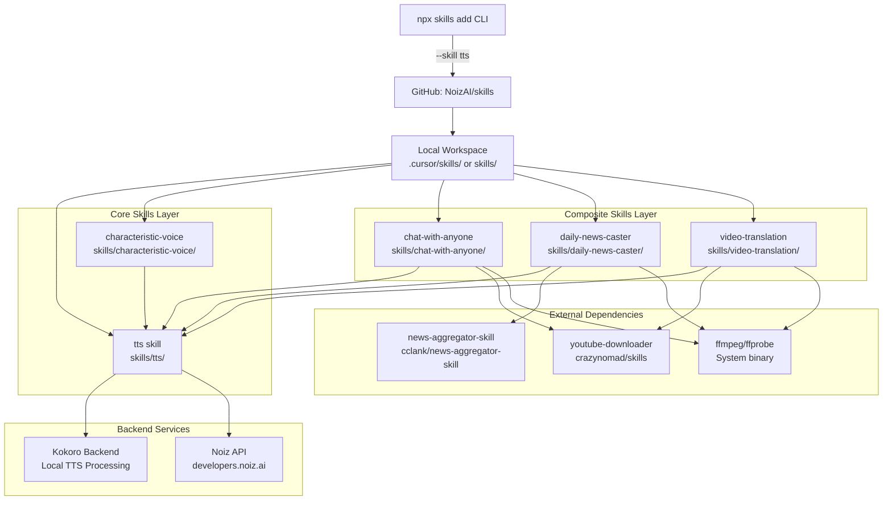

Sources: [README.md:31-39](), High-Level System Architecture Diagrams (Diagram 1)

## Available Skills Catalog

The repository currently provides five skills:

| Skill Name | Type | Purpose | Entry Point |
|------------|------|---------|-------------|
| `tts` | Core | Text-to-speech conversion with Kokoro/Noiz backends, timeline rendering, voice cloning | `skills/tts/scripts/tts.sh` |
| `characteristic-voice` | Core | Expressive speech with fillers, emotional presets, companion-like output | `skills/characteristic-voice/scripts/speak.sh` |
| `chat-with-anyone` | Composite | Voice cloning from online sources for character roleplay | `skills/chat-with-anyone/SKILL.md` |
| `daily-news-caster` | Composite | Dual-host podcast generation from real-time news | `skills/daily-news-caster/SKILL.md` |
| `video-translation` | Composite | Video dubbing with subtitle translation and audio replacement | `skills/video-translation/SKILL.md` |

**SKILL.md Format**: Each skill includes a `SKILL.md` file with front matter (name, description) and workflow instructions. See [Skill Definition Format](#7.2) for details.

Sources: [README.md:31-39]()

## Local-First Security Model

The architecture implements a **local-first security** design with the following principles:

### Execution Model

All skill scripts execute on the user's local machine. Text input, generated audio, and intermediate files remain in the local filesystem unless explicitly uploaded by the user.

### Credential Management

Sensitive credentials are stored locally and excluded from version control:

- **API Keys**: Stored in `~/.noiz_api_key` (chmod 600)
- **Chat Platform Credentials**: Stored in `**/cred.json` files
- **Version Control**: `.gitignore` excludes both patterns to prevent accidental commits

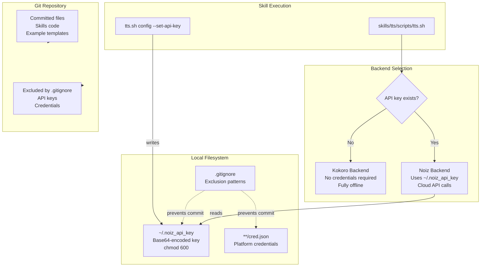

**Configuration Command**: The `tts.sh config --set-api-key` subcommand provides a controlled interface for API key setup, validating base64 encoding and setting proper file permissions.

Sources: [README.md:24-29](), [README.md:84-92](), High-Level System Architecture Diagrams (Diagram 6)

## Dual Backend Architecture

The TTS system supports two backends with different trade-offs:

### Kokoro Backend (Local)

- **Execution**: Fully local, zero network calls
- **Privacy**: Maximum privacy, no data leaves machine
- **Features**: Voice blending, EPUB/PDF support, speed control
- **Duration Control**: Uses ffmpeg atempo filter for time-stretching
- **Activation**: Automatic when no API key configured, or via `--backend kokoro`

### Noiz Backend (Cloud)

- **Execution**: Cloud API at `developers.noiz.ai`
- **Authentication**: Two-tier (guest mode without key, full mode with key)
- **Features**: Voice cloning via `--ref-audio`, emotion control, precise duration, auto-emotion detection
- **Duration Control**: Server-side processing with padding/trimming
- **Activation**: Automatic when `~/.noiz_api_key` exists

### Backend Selection Flow

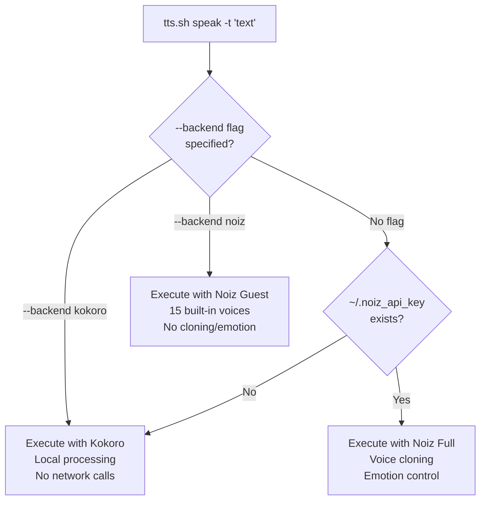

For detailed backend comparison and feature matrices, see [Backend System](#2).

Sources: [README.md:84-92](), High-Level System Architecture Diagrams (Diagram 2, Diagram 4)

## Core vs Composite Skills

### Core Skills

Core skills are **self-contained** and have no dependencies on other skills in the repository. They provide foundational capabilities:

- **tts**: Text-to-speech synthesis with backend abstraction
- **characteristic-voice**: Extends TTS with expressive features (fillers, emotional presets)

### Composite Skills

Composite skills **orchestrate workflows** by combining core skills with external dependencies:

- **chat-with-anyone**: Uses `youtube-downloader` (external) + `ffmpeg` (system) + `tts` (core)
- **daily-news-caster**: Uses `news-aggregator-skill` (external) + `ffmpeg` (system) + `tts` (core)
- **video-translation**: Uses `youtube-downloader` (external) + `ffmpeg` (system) + `tts` (core)

### Dependency Pattern

All composite skills converge on the `tts` skill as the universal audio generation endpoint. The line-by-line generation pattern (demonstrated in daily-news-caster) is architecturally significant: instead of synthesizing entire scripts at once, composite skills call TTS once per dialogue line or subtitle segment, enabling per-line voice control and avoiding large API payloads.

Sources: [skills/daily-news-caster/SKILL.md:58-82](), [skills/chat-with-anyone/SKILL.md:48-54](), High-Level System Architecture Diagrams (Diagram 3, Diagram 5)

## Quick Start Example

After installation, verify the system with a characteristic-voice command:

```bash
bash skills/characteristic-voice/scripts/speak.sh \
  --preset comfort -t "Hmm... I'm right here." -o comfort.wav
```

This command:
1. Uses the `characteristic-voice` skill
2. Applies the "comfort" emotional preset
3. Synthesizes the text with appropriate fillers and tone
4. Outputs to `comfort.wav`

For comprehensive installation and usage instructions, see [Quick Start Guide](#1.1). For CLI reference, see [Command-Line Reference](#9).

Sources: [README.md:41-47]()

---

# Page: Quick Start Guide

# Quick Start Guide

<details>
<summary>Relevant source files</summary>

The following files were used as context for generating this wiki page:

- [README.md](README.md)
- [skills/chat-with-anyone/SKILL.md](skills/chat-with-anyone/SKILL.md)
- [skills/daily-news-caster/SKILL.md](skills/daily-news-caster/SKILL.md)
- [skills/tts/SKILL.md](skills/tts/SKILL.md)

</details>


This guide walks you through installing your first skill, running basic text-to-speech commands, and understanding the available skill catalog. You will use the `npx skills add` CLI to fetch skills from the NoizAI/skills repository and execute them locally.

For architectural details about core vs composite skills and backend systems, see [System Architecture Overview](#1.2). For comprehensive TTS documentation, see [TTS (Text-to-Speech) Skill](#3).

---

## Prerequisites

Before starting, ensure you have:

| Requirement | Purpose | Verification Command |
|-------------|---------|---------------------|
| Node.js (>=14) | To run `npx skills add` | `node --version` |
| Python 3 | To execute skill scripts | `python3 --version` |
| ffmpeg | For audio processing (timeline mode, composite skills) | `ffmpeg -version` |

**Sources:** [README.md:8-22]()

---

## Step 1: List Available Skills

The `npx skills add` command can fetch skills directly from GitHub. Start by listing all available skills to see what's in the repository:

```bash
npx skills add NoizAI/skills --list --full-depth
```

This command queries the repository and displays all skills organized by type (core skills and composite skills).

**Expected Output Structure:**

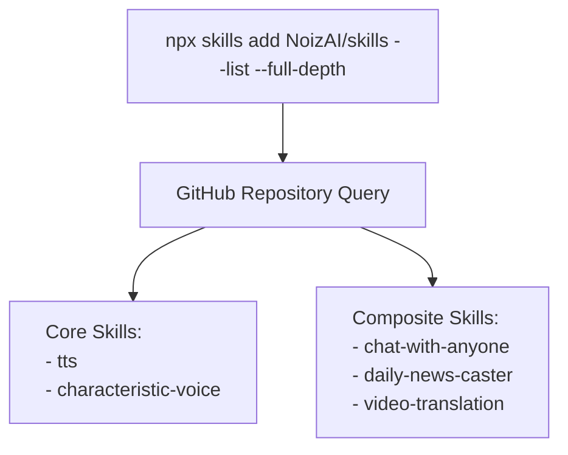

**Diagram: npx skills add List Command Flow**

**Sources:** [README.md:10-22]()

---

## Step 2: Install the TTS Skill

The `tts` skill is the foundational core skill for text-to-speech conversion. Install it with:

```bash
npx skills add NoizAI/skills --full-depth --skill tts -y
```

**What This Does:**

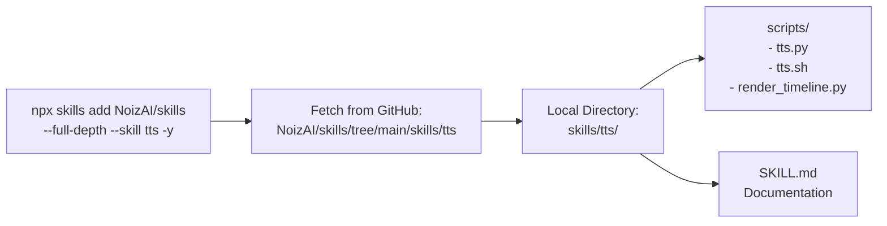

**Diagram: TTS Skill Installation Process**

After installation, the skill is available at `skills/tts/` in your workspace.

**Sources:** [README.md:14-15](), [skills/tts/SKILL.md:1-6]()

---

## Step 3: Run Your First TTS Command

The TTS skill operates in **Simple Mode** by default, converting text directly to audio. The main entry point is `skills/tts/scripts/tts.py`.

### Basic Text-to-Speech

Generate speech from a text string:

```bash
python3 skills/tts/scripts/tts.py -t "Hello world" -o hello.wav
```

Or use the shell wrapper (identical functionality):

```bash
bash skills/tts/scripts/tts.sh -t "Hello world" -o hello.wav
```

### Backend Selection

The TTS skill automatically selects a backend based on API key configuration:

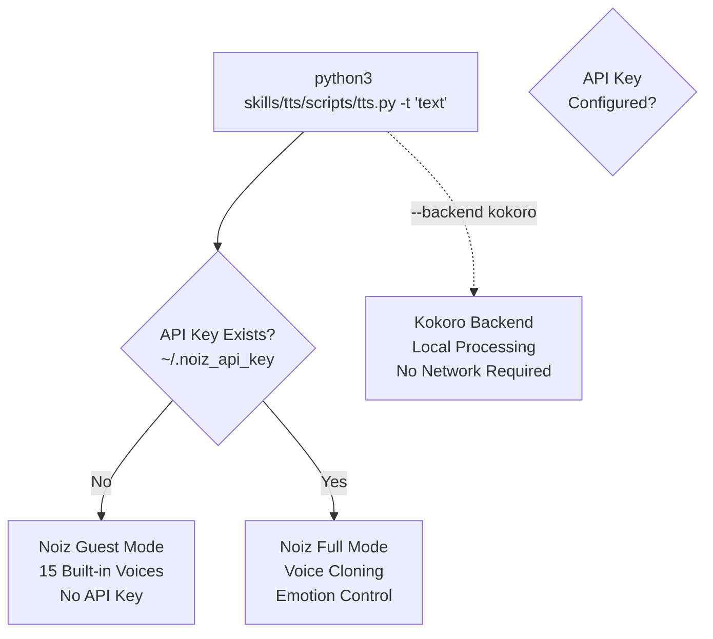

**Diagram: TTS Backend Auto-Detection Flow**

**Sources:** [skills/tts/SKILL.md:109-119](), [skills/tts/SKILL.md:141-145]()

---

## Step 4: Try Guest Mode (No API Key)

Without configuring an API key, the TTS skill uses **Noiz Guest Mode** with 15 built-in voices:

```bash
# Use a specific guest voice (English male mentor)
python3 skills/tts/scripts/tts.py -t "Hello world" --voice-id 883b6b7c -o hello.wav

# Use a Japanese female voice
python3 skills/tts/scripts/tts.py -t "こんにちは" --voice-id 063a4491 -o hello_ja.wav

# Use a Chinese male voice
python3 skills/tts/scripts/tts.py -t "你好世界" --voice-id 87cb2405 -o hello_zh.wav
```

### Available Guest Voices

| voice_id | Name | Language | Gender |
|----------|------|----------|--------|
| `883b6b7c` | The Mentor (Alex) | en | M |
| `5a68d66b` | The Healer (Serena) | en | F |
| `87cb2405` | 建国｜知识科普 | zh | M |
| `b4775100` | 悦悦｜社交分享 | zh | F |
| `063a4491` | 販売員（なおみ） | ja | F |

See [skills/tts/SKILL.md:121-139]() for the complete list of 15 voices.

**Sources:** [skills/tts/SKILL.md:109-140]()

---

## Step 5: Configure Noiz API Key (Optional)

For advanced features like voice cloning and emotion control, configure a Noiz API key:

```bash
# Obtain key from https://developers.noiz.ai/api-keys
bash skills/tts/scripts/tts.sh config --set-api-key YOUR_BASE64_KEY
```

This command writes the key to `~/.noiz_api_key` (chmod 600 for security). After configuration:

```bash
# Voice cloning from reference audio
python3 skills/tts/scripts/tts.py -t "Hello in my voice" \
  --ref-audio ./my_voice.wav -o cloned.wav

# Convert a text file to audio
python3 skills/tts/scripts/tts.py -f article.txt -o article.mp3
```

**Sources:** [README.md:84-92](), [skills/tts/SKILL.md:141-149]()

---

## Step 6: Explore the Skills Catalog

The repository contains two types of skills:

### Core Skills

Core skills provide foundational capabilities and have no external skill dependencies:

| Skill | Command | Purpose |
|-------|---------|---------|
| `tts` | `npx skills add NoizAI/skills --skill tts -y` | Text-to-speech with dual backends |
| `characteristic-voice` | `npx skills add NoizAI/skills --skill characteristic-voice -y` | Expressive speech with fillers and emotion presets |

### Composite Skills

Composite skills orchestrate complex workflows by combining core skills with external dependencies:

| Skill | Command | Purpose |
|-------|---------|---------|
| `chat-with-anyone` | `npx skills add NoizAI/skills --skill chat-with-anyone -y` | Chat in any character's voice via auto voice extraction |
| `daily-news-caster` | `npx skills add NoizAI/skills --skill daily-news-caster -y` | Generate dual-host news podcasts from real-time feeds |
| `video-translation` | `npx skills add NoizAI/skills --skill video-translation -y` | Translate and dub videos with voice cloning |

**Skill Dependency Map:**

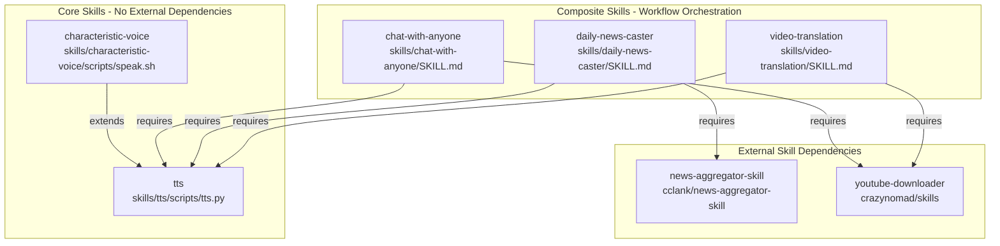

**Diagram: Skill Dependencies and Execution Paths**

**Sources:** [README.md:31-39](), [skills/chat-with-anyone/SKILL.md:72-75](), [skills/daily-news-caster/SKILL.md:14-19]()

---

## Step 7: Try a Composite Skill

Install and run the `characteristic-voice` skill to generate expressive speech:

```bash
# Install the skill
npx skills add NoizAI/skills --full-depth --skill characteristic-voice -y

# Generate comfort-style speech
bash skills/characteristic-voice/scripts/speak.sh \
  --preset comfort -t "Hmm... I'm right here." -o comfort.wav
```

This skill extends the TTS skill by adding:
- **Non-lexical fillers** (um, hmm, ah) for natural pauses
- **Emotional presets** (goodnight, morning, comfort, celebrate, chat)
- **Personality tuning** via JSON configuration

**Execution Flow:**

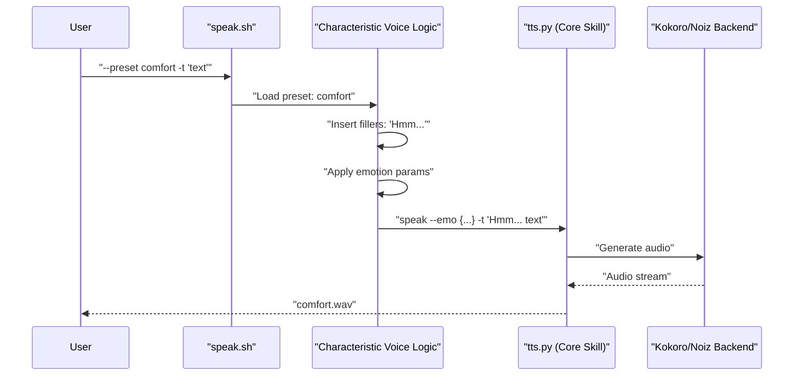

**Diagram: Characteristic Voice Execution Sequence**

**Sources:** [README.md:41-47](), [skills/characteristic-voice/SKILL.md:1-6]()

---

## Understanding Skill Execution Paths

When you run a skill command, the execution follows this pattern:

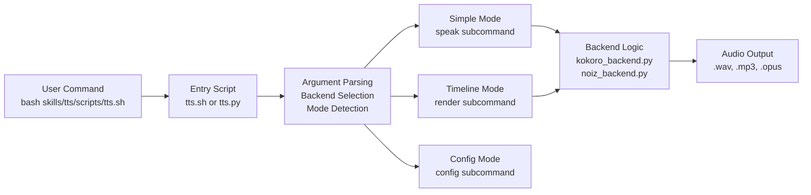

**Diagram: TTS Skill Execution Flow with File Paths**

**Sources:** [skills/tts/SKILL.md:18-34](), [skills/tts/SKILL.md:38-95]()

---

## Local Development Mode

If you're developing skills locally, you can install from your working directory:

```bash
# From within the NoizAI/skills repository clone
npx skills add . --list --full-depth

# Install a skill from local directory
npx skills add . --skill tts -y
```

This is useful for testing changes before publishing to GitHub.

**Sources:** [README.md:20-22]()

---

## Next Steps

Now that you have the basics working, explore these areas:

| Topic | Description | Documentation |
|-------|-------------|---------------|
| Timeline Mode | SRT-based dubbing with per-segment voice control | [Timeline Mode - SRT to Audio](#3.2) |
| Voice Cloning | Clone voices from reference audio | [Simple Mode - Text to Audio](#3.1) |
| Backend Configuration | Choose between Kokoro (local) and Noiz (cloud) | [Backend System](#2) |
| Composite Skills | Build complex workflows | [Composite Skills](#5) |
| Chat Platform Integration | Send voice messages to Feishu/Telegram/Discord | [Integration with Chat Platforms](#6) |

**Sources:** [README.md:24-29](), [skills/tts/SKILL.md:1-152]()

---

## Common Installation Commands Reference

```bash
# List all available skills
npx skills add NoizAI/skills --list --full-depth

# Install specific skills
npx skills add NoizAI/skills --skill tts -y
npx skills add NoizAI/skills --skill characteristic-voice -y
npx skills add NoizAI/skills --skill chat-with-anyone -y
npx skills add NoizAI/skills --skill daily-news-caster -y
npx skills add NoizAI/skills --skill video-translation -y

# Install all skills from the repository
npx skills add NoizAI/skills --full-depth

# Local development
npx skills add . --list --full-depth
```

**Sources:** [README.md:8-22](), [README.md:31-39]()

---

# Page: System Architecture Overview

# System Architecture Overview

<details>
<summary>Relevant source files</summary>

The following files were used as context for generating this wiki page:

- [CONTRIBUTING.md](CONTRIBUTING.md)
- [README.md](README.md)
- [skills/README.md](skills/README.md)
- [skills/chat-with-anyone/SKILL.md](skills/chat-with-anyone/SKILL.md)
- [skills/daily-news-caster/SKILL.md](skills/daily-news-caster/SKILL.md)
- [skills/template-skill/SKILL.md](skills/template-skill/SKILL.md)
- [skills/template-skill/SKILL.zh-CN.md](skills/template-skill/SKILL.zh-CN.md)

</details>


## Purpose and Scope

This document describes the high-level architecture of the NoizAI/skills repository, explaining how skills are organized, how they relate to each other, and how the backend system operates. It covers the three-tier skill hierarchy (core, composite, external), the dual backend architecture, skill installation mechanisms, and security principles.

For installation instructions, see [Quick Start Guide](#1.1). For detailed backend configuration and API usage, see [Backend System](#2). For individual skill documentation, see sections 3-5.

## Architectural Principles

The skills repository is built on four core architectural principles:

1. **Local-First Execution**: All skills run on the user's local machine. Sensitive text and generated audio remain under user control, with cloud services used only optionally for advanced features.

2. **Hierarchical Skill Composition**: Skills are organized into three tiers—core skills provide foundational capabilities, composite skills orchestrate workflows, and external skills are pluggable dependencies.

3. **Backend Agnosticism**: The TTS core skill supports dual backends (Kokoro local, Noiz cloud) with automatic selection based on API key presence, enabling users to choose between privacy and advanced features.

4. **Declarative Skill Definition**: Each skill is defined by a `SKILL.md` file with structured front matter, making skills discoverable and executable by agents without custom code.

**Sources:** [README.md:1-110]()

## Skill Hierarchy and Organization

### Directory Structure

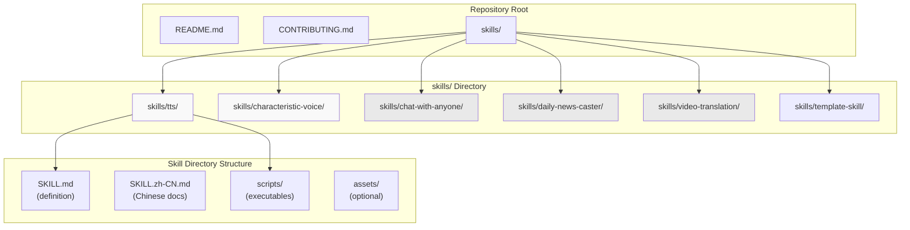

**Skill Directory Structure**

Each skill follows a standardized directory convention with kebab-case naming:

| Component | Location | Purpose |
|-----------|----------|---------|
| Skill Definition | `skills/<skill-name>/SKILL.md` | Declarative metadata with front matter (name, description) and workflow instructions |
| Localized Docs | `skills/<skill-name>/SKILL.zh-CN.md` | Chinese documentation (optional) |
| Executable Scripts | `skills/<skill-name>/scripts/*.sh` or `*.py` | Shell or Python entry points |
| Assets | `skills/<skill-name>/assets/` | Reference audio, example files (optional) |

**Sources:** [skills/README.md:1-16](), [CONTRIBUTING.md:1-29](), [skills/template-skill/SKILL.md:1-55]()

### Three-Tier Skill Taxonomy

#### Skill Type Classification with Code Entities

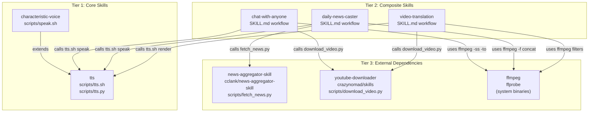

**Tier 1: Core Skills** are self-contained capabilities with no dependencies on other skills:

- **`tts`**: Text-to-speech engine with entry points `tts.sh` and `tts.py`. Provides subcommands: `speak` (simple mode), `render` (timeline mode), `to-srt` (subtitle generation), `config` (API key management).
- **`characteristic-voice`**: Extends `tts` with emotional presets and filler insertion via `speak.sh`.

**Tier 2: Composite Skills** orchestrate workflows by combining core skills with external dependencies:

- **`chat-with-anyone`**: Multi-step workflow defined in `SKILL.md` that invokes `download_video.py`, `ffmpeg` for audio extraction, and `tts.sh speak --ref-audio` for voice cloning.
- **`daily-news-caster`**: Fetches news via `fetch_news.py`, generates scripts internally, then calls `tts.sh speak` line-by-line and concatenates with `ffmpeg -f concat`.
- **`video-translation`**: Downloads videos, translates subtitles, calls `tts.sh render` in timeline mode, and mixes audio with `ffmpeg` filters.

**Tier 3: External Dependencies** are either:
- Skills from other GitHub repositories (e.g., `cclank/news-aggregator-skill`)
- System utilities (e.g., `ffmpeg`, `ffprobe`)

**Sources:** [README.md:31-39](), [skills/daily-news-caster/SKILL.md:1-89](), [skills/chat-with-anyone/SKILL.md:1-76]()

## Backend Architecture

### Dual Backend Design

The TTS skill implements a dual backend architecture with automatic selection logic:

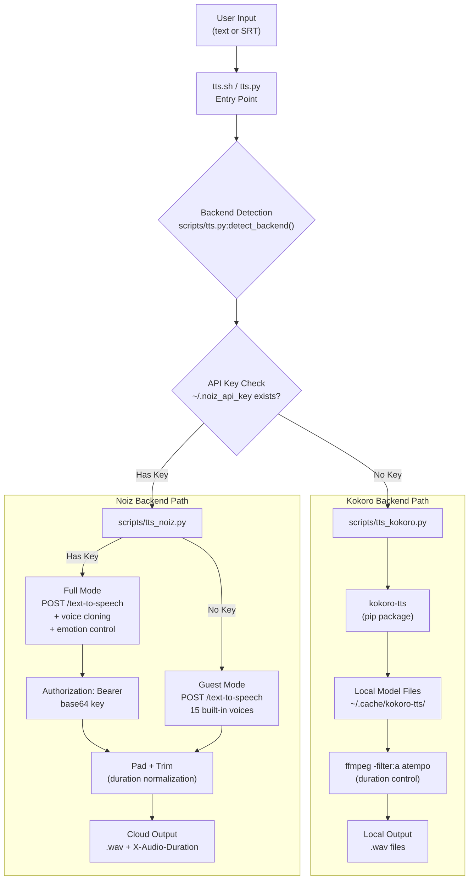

**Backend Selection Logic**

The backend is chosen automatically in [scripts/tts.py]():

1. Check for `~/.noiz_api_key` file
2. If present and valid → Noiz backend (full features)
3. If absent but `--backend noiz` specified → Noiz guest mode (limited)
4. Default → Kokoro backend (local-only)

**Feature Comparison Matrix**

| Feature | Kokoro Backend | Noiz Guest Mode | Noiz Full Mode |
|---------|----------------|-----------------|----------------|
| **API Key Required** | No | No | Yes |
| **Network Required** | No | Yes | Yes |
| **Voice Cloning** | No | No | Yes (`--ref-audio`) |
| **Emotion Control** | No | No | Yes (`--emo`, `--auto-emotion`) |
| **Voice Selection** | `--voice` parameter | `--voice-id` (15 built-in) | `--voice-id` + cloning |
| **Duration Control** | `atempo` filter (tempo adjustment) | Server-side + pad/trim | Server-side + pad/trim |
| **Voice Blending** | Yes (`v1:60,v2:40`) | No | No |
| **EPUB/PDF Support** | Yes | No | No |

**Sources:** [README.md:84-92](), [skills/tts/SKILL.md]()

## Skill Installation and Management

### NPX Skills Add CLI

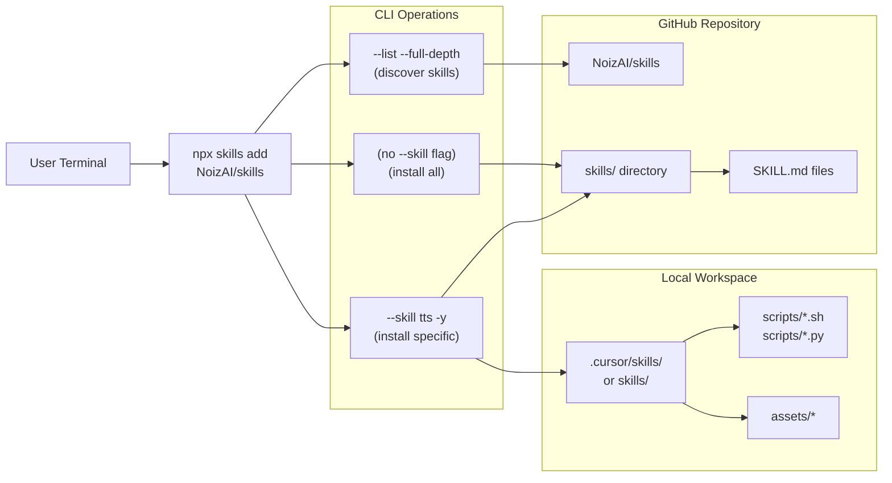

**Installation Commands**

| Command | Purpose | Result |
|---------|---------|--------|
| `npx skills add NoizAI/skills --list --full-depth` | List all available skills from repository | Displays skill catalog with descriptions |
| `npx skills add NoizAI/skills --skill tts -y` | Install specific skill (`tts`) | Downloads `skills/tts/` to local workspace |
| `npx skills add NoizAI/skills` | Install all skills | Downloads entire `skills/` directory |
| `npx skills add . --list --full-depth` | Local development mode | List skills from current directory |

**Installation Targets**: Skills are installed to either `.cursor/skills/` (Cursor IDE) or `skills/` (generic workspace) depending on the environment.

**Sources:** [README.md:8-22]()

## Composite Skill Execution Pattern

### Line-by-Line Generation Workflow

Composite skills follow a consistent pattern where audio generation happens incrementally rather than monolithically:

```mermaid
sequenceDiagram
    participant Agent
    participant ExternalSkill["External Skill<br/>(fetch_news.py or<br/>download_video.py)"]
    participant InternalLogic["Agent Internal Logic<br/>(script generation)"]
    participant TTSScript["skills/tts/scripts/tts.sh"]
    participant FFmpeg["ffmpeg concat"]
    participant Output["Final Output"]
    
    Agent->>ExternalSkill: "Fetch data<br/>(news or video)"
    ExternalSkill-->>Agent: "JSON or audio file"
    
    Agent->>InternalLogic: "Transform data<br/>(generate script)"
    InternalLogic-->>Agent: "Structured content<br/>(lines or segments)"
    
    loop For each line/segment
        Agent->>TTSScript: "tts.sh speak -t 'text'<br/>--ref-audio host.wav<br/>-o line_N.wav"
        TTSScript-->>Agent: "line_N.wav"
    end
    
    Agent->>Agent: "Create list.txt:<br/>file 'line_01.wav'<br/>file 'line_02.wav'"
    
    Agent->>FFmpeg: "ffmpeg -f concat<br/>-safe 0 -i list.txt<br/>-c copy output.wav"
    FFmpeg-->>Output: "output.wav"
```

**Why Line-by-Line?** This pattern provides three architectural benefits:

1. **Per-Segment Voice Control**: Each line can use different `--ref-audio` (e.g., Host A vs Host B in podcasts)
2. **API Efficiency**: Avoids sending full scripts to TTS APIs, reducing token usage
3. **Incremental Progress**: Enables progress tracking and partial recovery on failure

**Example from daily-news-caster**: [skills/daily-news-caster/SKILL.md:58-82]() demonstrates this pattern:

```bash
# Generate audio for each dialogue line
bash path/to/tts.sh speak -t "Welcome to today's news..." \
  --backend noiz --ref-audio host_A.wav -o line_01.wav

bash path/to/tts.sh speak -t "The main takeaway is..." \
  --backend noiz --ref-audio host_B.wav -o line_02.wav

# Concatenate all segments
ffmpeg -f concat -safe 0 -i list.txt -c copy podcast_output.wav
```

**Sources:** [skills/daily-news-caster/SKILL.md:58-82](), [skills/chat-with-anyone/SKILL.md:48-54]()

## Security and Configuration Model

### Local-First Data Flow

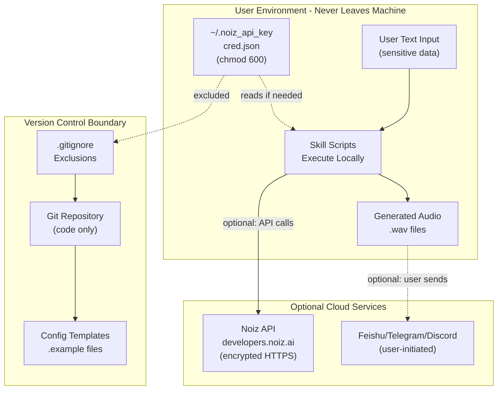

**Security Principles**

1. **Credential Isolation**: API keys stored in `~/.noiz_api_key` with `chmod 600` permissions, excluded via `.gitignore`
2. **Local Execution**: All scripts run on user's machine; text never transmitted unless user explicitly chooses Noiz backend
3. **Zero-Trust Cloud**: Kokoro backend option enables 100% offline operation
4. **Explicit Opt-In**: Cloud features require user action (`tts.sh config --set-api-key`)

**Configuration Precedence**:
1. Environment variables (e.g., `NOIZ_API_KEY`)
2. File-based keys (`~/.noiz_api_key`)
3. Default to local backend (Kokoro)

**Sources:** [README.md:25-26](), [README.md:84-92](), [CONTRIBUTING.md:1-29]()

## Cross-Skill Dependency Graph

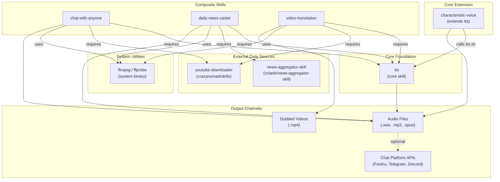

**Dependency Installation Pattern**

Composite skills declare dependencies in their `SKILL.md` workflow sections. For example, [skills/daily-news-caster/SKILL.md:14-19]():

```bash
# Install external skill from different repository
npx skills add https://github.com/cclank/news-aggregator-skill \
  --skill news-aggregator-skill -y

# Install core skill from NoizAI/skills
npx skills add https://github.com/noizai/skills --skill tts -y
```

**Execution Pattern**: Composite skills invoke external dependencies directly via their script paths (e.g., `python3 path/to/fetch_news.py --source all --limit 10`).

**Sources:** [skills/daily-news-caster/SKILL.md:14-28](), [skills/chat-with-anyone/SKILL.md:73-76](), [README.md:31-39]()

## Skill Definition Format

Every skill is defined by a `SKILL.md` file with YAML front matter:

```markdown
---
name: skill-name
description: One-line description of what this skill does and when to use it
---

# Skill Name

## Triggers
- User phrases that should activate this skill

## Workflow
1. Step-by-step execution instructions
2. Including exact commands to run

## Dependencies
- Other skills or external tools required

## Limitations
- Capability boundaries and known failure modes
```

This declarative format enables agents to discover capabilities, understand prerequisites, and execute workflows without hardcoded logic. For detailed specification, see [Skill Definition Format](#7.2).

**Sources:** [skills/template-skill/SKILL.md:1-55](), [CONTRIBUTING.md:10-15]()

---

# Page: Backend System

# Backend System

<details>
<summary>Relevant source files</summary>

The following files were used as context for generating this wiki page:

- [README.md](README.md)
- [skills/chat-with-anyone/SKILL.md](skills/chat-with-anyone/SKILL.md)
- [skills/daily-news-caster/SKILL.md](skills/daily-news-caster/SKILL.md)
- [skills/tts/SKILL.md](skills/tts/SKILL.md)
- [skills/tts/scripts/noiz_tts.py](skills/tts/scripts/noiz_tts.py)

</details>


## Purpose and Scope

This document provides a comprehensive technical overview of the dual backend architecture that powers text-to-speech synthesis in the NoizAI/skills repository. The system supports two distinct backends: **Kokoro** (local, privacy-focused) and **Noiz** (cloud-based, feature-rich), with automatic backend selection and fallback mechanisms.

For implementation details of each backend, see [Kokoro Backend (Local)](#2.1) and [Noiz Backend (Cloud)](#2.2). For API key setup and credential management, see [API Key Configuration](#2.3). For TTS skill usage and command-line interface, see [TTS (Text-to-Speech) Skill](#3).

---

## Backend Architecture Overview

The backend system implements a dual-path architecture where requests are routed to either a local TTS engine or a cloud API based on configuration and feature requirements.

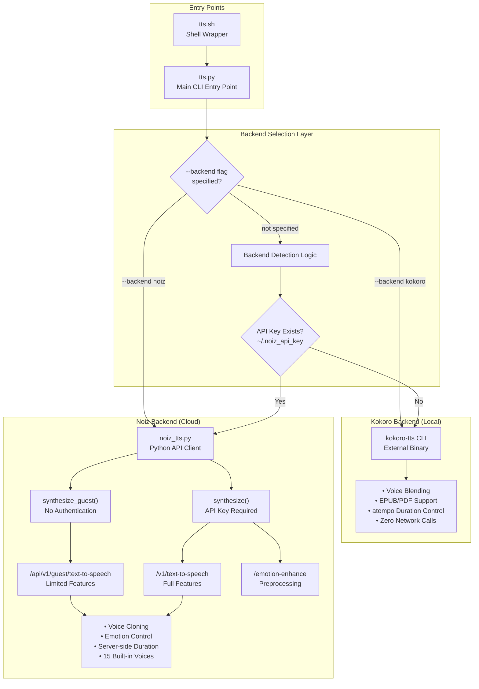

**Sources:** [skills/tts/SKILL.md:1-152](), [skills/tts/scripts/noiz_tts.py:1-263]()

---

## Backend Selection Decision Flow

The backend selection process follows a priority-based decision tree that considers explicit user flags, API key availability, and feature requirements.

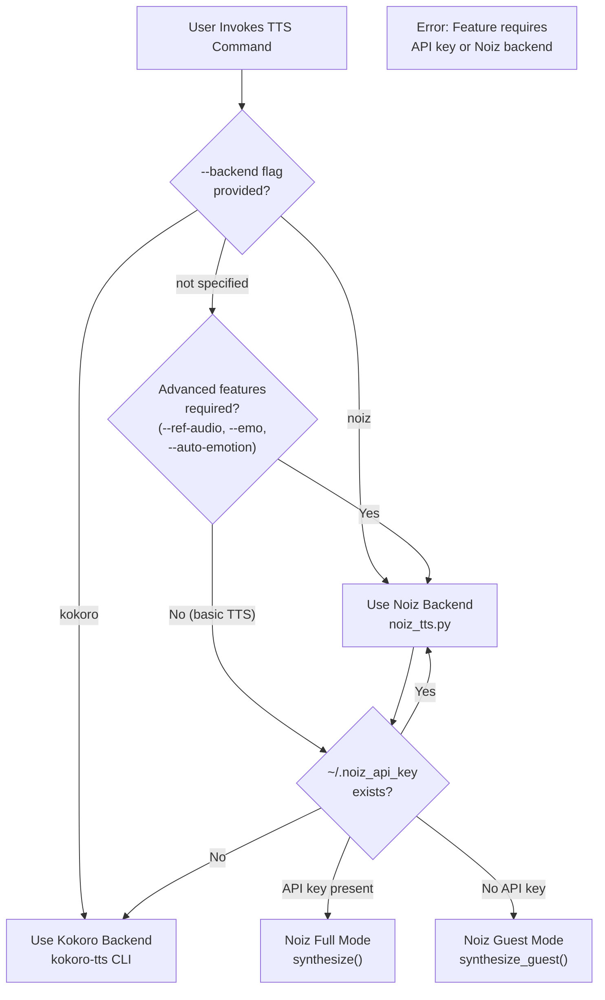

**Backend Selection Rules:**

1. **Explicit flag takes precedence**: `--backend kokoro` or `--backend noiz` overrides automatic detection
2. **Feature-based routing**: Commands with `--ref-audio`, `--emo`, or `--auto-emotion` require Noiz backend
3. **API key detection**: If no explicit backend is specified and no advanced features are requested, presence of `~/.noiz_api_key` determines the default
4. **Guest mode fallback**: Noiz backend can operate without API key in limited guest mode

**Sources:** [skills/tts/SKILL.md:96-119](), [skills/tts/scripts/noiz_tts.py:199-201]()

---

## Feature Comparison Matrix

The two backends offer different capabilities optimized for different use cases.

| Feature | Kokoro (Local) | Noiz Guest Mode | Noiz Full Mode |
|---------|----------------|-----------------|----------------|
| **Network Requirement** | None (fully offline) | HTTPS to `noiz.ai` | HTTPS to `noiz.ai` |
| **Authentication** | Not required | Not required | `~/.noiz_api_key` required |
| **Voice Selection** | `--voice` parameter<br/>Built-in voice names | `--voice-id` parameter<br/>15 pre-defined IDs | `--voice-id` parameter<br/>All available voices |
| **Voice Cloning** | ❌ Not supported | ❌ Not supported | ✅ `--ref-audio` (local path or URL) |
| **Voice Blending** | ✅ `"v1:60,v2:40"` syntax | ❌ Not supported | ❌ Not supported |
| **Emotion Control** | ❌ Not supported | ❌ Not supported | ✅ `--emo` JSON parameter |
| **Auto-Emotion** | ❌ Not supported | ❌ Not supported | ✅ `--auto-emotion` flag |
| **Duration Control** | ✅ `atempo` filter (tempo-based) | ❌ Not supported | ✅ `--duration` parameter (pad/trim) |
| **EPUB/PDF Input** | ✅ Native support | ❌ Not supported | ❌ Not supported |
| **Timeline Mode** | ✅ Supported | ❌ Not supported | ✅ Supported |
| **Output Formats** | WAV, MP3 | WAV, MP3, OPUS | WAV, MP3, OPUS |
| **Speed Control** | ✅ `--speed` parameter | ✅ `--speed` parameter | ✅ `--speed` parameter |
| **Target Language** | `--lang` parameter | ❌ Not supported | ✅ `--target-lang` parameter |
| **Similarity Enhancement** | ❌ Not supported | ❌ Not supported | ✅ `--similarity-enh` flag |
| **Voice Persistence** | ❌ Not supported | ❌ Not supported | ✅ `--save-voice` flag |

**Sources:** [skills/tts/SKILL.md:96-108](), [skills/tts/SKILL.md:121-140]()

---

## Code Implementation Details

### Noiz Backend API Client

The Noiz backend is implemented in [skills/tts/scripts/noiz_tts.py:1-263]() with two primary synthesis functions:

**Guest Mode Synthesis**

```python
def synthesize_guest(
    base_url: str,
    text: str,
    voice_id: str,
    output_format: str,
    speed: float,
    timeout: int,
    out_path: Path,
) -> float
```

Calls the guest endpoint at `/api/v1/guest/text-to-speech` without authentication. Only supports `text`, `voice_id`, `output_format`, and `speed` parameters.

[skills/tts/scripts/noiz_tts.py:135-168]()

**Full Mode Synthesis**

```python
def synthesize(
    base_url: str,
    api_key: str,
    text: str,
    voice_id: Optional[str],
    reference_audio: Optional[Path],
    output_format: str,
    speed: float,
    emo: Optional[str],
    target_lang: Optional[str],
    similarity_enh: bool,
    save_voice: bool,
    duration: Optional[float],
    timeout: int,
    out_path: Path,
) -> float
```

Calls the authenticated endpoint at `/v1/text-to-speech` with full feature support including voice cloning, emotion control, and duration forcing.

[skills/tts/scripts/noiz_tts.py:58-132]()

**Sources:** [skills/tts/scripts/noiz_tts.py:58-168]()

---

### API Authentication Implementation

The Noiz API uses base64-encoded API keys passed directly in the `Authorization` header without any prefix (no `Bearer` or `APIKEY` prefix).

**Key Normalization Logic**

```python
def normalize_api_key_base64(api_key: str) -> str:
    key = api_key.strip()
    if not key:
        return key
    padded = key + ("=" * (-len(key) % 4))
    try:
        decoded = base64.b64decode(padded, validate=True)
        canonical = base64.b64encode(decoded).decode("ascii").rstrip("=")
        if decoded and canonical == key.rstrip("="):
            return key
    except binascii.Error:
        pass
    return base64.b64encode(key.encode("utf-8")).decode("ascii")
```

This function ensures the API key is properly base64-encoded. If the provided key is already valid base64, it is returned as-is. Otherwise, it encodes the raw string to base64.

[skills/tts/scripts/noiz_tts.py:24-36]()

**Authentication Headers**

```python
headers={"Authorization": api_key, "Content-Type": "application/json"}
```

The key is passed directly without prefix, as documented in [skills/tts/SKILL.md:147-149]():

> Use **only** the base64-encoded API key as `Authorization`—no prefix (e.g. no `APIKEY ` or `Bearer `). Any prefix causes 401.

**Sources:** [skills/tts/scripts/noiz_tts.py:24-36](), [skills/tts/scripts/noiz_tts.py:44](), [skills/tts/SKILL.md:147-149]()

---

### Emotion Enhancement Preprocessing

The Noiz backend supports optional emotion enhancement preprocessing via the `/emotion-enhance` endpoint.

```python
def call_emotion_enhance(
    base_url: str, api_key: str, text: str, timeout: int
) -> str:
    resp = requests.post(
        f"{base_url.rstrip('/')}/emotion-enhance",
        headers={"Authorization": api_key, "Content-Type": "application/json"},
        json={"text": text},
        timeout=timeout,
    )
    if resp.status_code != 200:
        raise RuntimeError(
            f"/emotion-enhance failed: status={resp.status_code}, body={resp.text}"
        )
    enhanced = resp.json().get("data", {}).get("emotion_enhance")
    if not enhanced:
        raise RuntimeError(f"/emotion-enhance returned no data: {resp.text}")
    return enhanced
```

When `--auto-emotion` flag is provided, the text is sent to this endpoint before synthesis to automatically detect and enhance emotional content.

[skills/tts/scripts/noiz_tts.py:39-55](), [skills/tts/scripts/noiz_tts.py:233-236]()

**Sources:** [skills/tts/scripts/noiz_tts.py:39-55]()

---

### Duration Metadata Extraction

Both synthesis functions extract audio duration from the response headers and persist it to a sidecar file:

```python
out_path.parent.mkdir(parents=True, exist_ok=True)
out_path.write_bytes(resp.content)
dur = resp.headers.get("X-Audio-Duration")
duration_val = float(dur) if dur else -1.0
out_path.with_suffix(".duration").write_text(str(duration_val))
return duration_val
```

The `X-Audio-Duration` header from the API response is saved to a `.duration` file alongside the audio output. This duration metadata is used by timeline rendering to align segments precisely.

[skills/tts/scripts/noiz_tts.py:127-132](), [skills/tts/scripts/noiz_tts.py:163-167]()

**Sources:** [skills/tts/scripts/noiz_tts.py:127-132]()

---

## Guest Voice Catalog

The Noiz guest mode provides 15 pre-configured voices without authentication. These voices are accessed via their voice ID.

**Available Guest Voices:**

| voice_id | name | lang | gender | tone |
|----------|------|------|--------|------|
| `063a4491` | 販売員（なおみ） | ja | F | 喜び |
| `4252b9c8` | 落ち着いた女性 | ja | F | 穏やか |
| `578b4be2` | 熱血漢（たける） | ja | M | 怒り |
| `a9249ce7` | 安らぎ（みなと） | ja | M | 穏やか |
| `f00e45a1` | 旅人（かいと） | ja | M | 穏やか |
| `b4775100` | 悦悦｜社交分享 | zh | F | Joyful |
| `77e15f2c` | 婉青｜情绪抚慰 | zh | F | Calm |
| `ac09aeb4` | 阿豪｜磁性主持 | zh | M | Calm |
| `87cb2405` | 建国｜知识科普 | zh | M | Calm |
| `3b9f1e27` | 小明｜科技达人 | zh | M | Joyful |
| `95814add` | Science Narration | en | M | Calm |
| `883b6b7c` | The Mentor (Alex) | en | M | Joyful |
| `a845c7de` | The Naturalist (Silas) | en | M | Calm |
| `5a68d66b` | The Healer (Serena) | en | F | Calm |
| `0e4ab6ec` | The Mentor (Maya) | en | F | Calm |

Guest mode usage example:

```bash
python3 skills/tts/scripts/tts.py -t "Hello" --voice-id 883b6b7c -o hello.wav
```

When no API key is configured, the system automatically routes to guest mode. To explicitly force Kokoro instead, use `--backend kokoro`.

**Sources:** [skills/tts/SKILL.md:121-140]()

---

## Backend Integration Points

### Composite Skills Usage

Composite skills depend on the backend system for audio generation. The backend selection impacts feature availability:

**chat-with-anyone skill** requires voice cloning (`--ref-audio`), which necessitates Noiz Full Mode with API key:

```bash
bash skills/tts/scripts/tts.sh speak -t "Hello there!" \
  --ref-audio "skills/chat-with-anyone/trump_ref.wav" -o "output.wav"
```

[skills/chat-with-anyone/SKILL.md:49-54]()

**daily-news-caster skill** generates audio line-by-line with optional voice cloning for dual-host podcasts:

```bash
bash path/to/tts.sh speak -t "Welcome to today's news..." \
  --backend noiz --ref-audio path/to/host_A.wav -o line_01.wav
```

[skills/daily-news-caster/SKILL.md:64-71]()

**Sources:** [skills/chat-with-anyone/SKILL.md:49-54](), [skills/daily-news-caster/SKILL.md:64-71]()

---

### Timeline Rendering Integration

Both backends support timeline mode via the `render` subcommand, but with different duration control strategies:

- **Kokoro**: Uses ffmpeg `atempo` filter to adjust tempo without pitch changes
- **Noiz**: Uses `--duration` parameter for server-side duration forcing, with client-side padding/trimming

For detailed timeline mode documentation, see [Timeline Mode - SRT to Audio](#3.2).

**Sources:** [skills/tts/SKILL.md:38-95]()

---

## Default Backend Behavior

The default backend is determined by a simple algorithm implemented in the TTS skill:

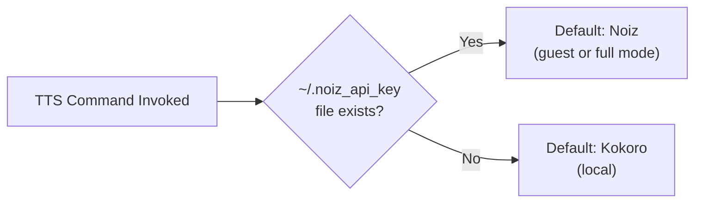

When no `--backend` flag is provided and no advanced features are requested, the system checks for the existence of `~/.noiz_api_key`. If present, Noiz is selected; otherwise, Kokoro is selected.

This ensures privacy-first operation by default (Kokoro when unconfigured) while enabling seamless cloud features when users have explicitly configured API keys.

**Sources:** [skills/tts/SKILL.md:96-119](), [README.md:84-92]()

---

# Page: Kokoro Backend (Local)

# Kokoro Backend (Local)

<details>
<summary>Relevant source files</summary>

The following files were used as context for generating this wiki page:

- [skills/tts/SKILL.md](skills/tts/SKILL.md)
- [skills/tts/scripts/render_timeline.py](skills/tts/scripts/render_timeline.py)

</details>


This document covers the **Kokoro** TTS backend, a fully local, offline text-to-speech engine used by the `tts` skill. Kokoro is one of two backend options in the system; for cloud-based features like voice cloning and emotion control, see [Noiz Backend (Cloud)](#2.2). For general API key configuration applicable to both backends, see [API Key Configuration](#2.3).

## Overview

Kokoro is the **default backend** for the `tts` skill, providing local-first text-to-speech synthesis that requires no network connectivity or API keys. It operates as a command-line interface (`kokoro-tts`) that the system invokes as a subprocess for each synthesis request.

**Key characteristics:**
- **Fully offline**: No network calls, all processing happens locally
- **Privacy-first**: Input text never leaves the user's machine
- **Voice blending**: Mix multiple voice models with weighted ratios (e.g., `"v1:60,v2:40"`)
- **EPUB/PDF support**: Native chapter-aware audiobook generation
- **No authentication**: Zero configuration required beyond having `kokoro-tts` in PATH

Kokoro is automatically selected when no API key is configured, or can be explicitly requested via `--backend kokoro`.

Sources: [skills/tts/SKILL.md:100-106](), [skills/tts/scripts/render_timeline.py:307-313]()

## Architecture

The Kokoro backend follows a subprocess invocation pattern where Python scripts orchestrate the `kokoro-tts` CLI tool for all synthesis operations.

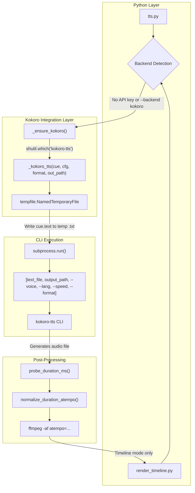

**Processing Flow:**

1. **Detection**: [render_timeline.py:385-386]() checks if backend is `"kokoro"` and calls `_ensure_kokoro()` to validate CLI availability
2. **Text preparation**: [render_timeline.py:321-325]() writes input text to a temporary file (Kokoro CLI reads from files, not stdin)
3. **CLI invocation**: [render_timeline.py:328-344]() constructs command array and executes via `subprocess.run()`
4. **Duration probing**: [render_timeline.py:348-350]() uses `ffprobe` to determine actual audio duration
5. **Normalization** (timeline mode only): [render_timeline.py:433]() applies `atempo` filters to match target duration

Sources: [skills/tts/scripts/render_timeline.py:307-350](), [skills/tts/scripts/render_timeline.py:385-386]()

## Voice Configuration

Kokoro backend accepts voice configuration through a subset of parameters compared to the Noiz backend.

### Supported Parameters

| Parameter | Type | Description | Example |
|-----------|------|-------------|---------|
| `voice` | string | Voice model name or blend expression | `"zf_xiaoni"`, `"v1:60,v2:40"` |
| `lang` | string | Language code | `"cmn"`, `"en-us"`, `"ja"` |
| `speed` | float | Playback speed multiplier | `0.9`, `1.0`, `1.2` |

Voice blending syntax allows weighted mixing of multiple models: `"voice1:weight1,voice2:weight2"` where weights are percentages.

### Voice Map Example

In timeline mode, voice configuration is specified per-segment via JSON:

```json
{
  "default": { 
    "voice": "zf_xiaoni", 
    "lang": "cmn" 
  },
  "segments": {
    "1": { "voice": "zm_yunxi" },
    "5-8": { 
      "voice": "af_sarah:70,bf_emma:30", 
      "lang": "en-us", 
      "speed": 0.9 
    }
  }
}
```

The `resolve_segment_cfg()` function [render_timeline.py:103-109]() merges default settings with segment-specific overrides for each cue.

Sources: [skills/tts/SKILL.md:60-67](), [skills/tts/scripts/render_timeline.py:103-109](), [skills/tts/scripts/render_timeline.py:328-338]()

## Duration Normalization Strategy

Kokoro backend uses **atempo-based duration normalization** to match timeline requirements, preserving pitch while adjusting tempo.

```mermaid
graph LR
    subgraph "Input"
        RawAudio["Raw audio from kokoro-tts"]
        ActualDur["Actual: 3200ms"]
        TargetDur["Target: 2500ms (from SRT)"]
    end
    
    subgraph "Duration Probing"
        FFprobe["ffprobe -show_entries format=duration"]
        ProbeDurMs["probe_duration_ms()"]
        RatioCalc["ratio = actual_ms / target_ms"]
    end
    
    subgraph "Atempo Filter Chain"
        RatioCheck{"ratio within 0.5-100.0?"}
        ChainBuilder["Build atempo chain"]
        Extreme["ratio > 100 or < 0.5"]
        Normal["0.5 ≤ ratio ≤ 100"]
        
        MultipleFilters["atempo=100.0, atempo=100.0, atempo=1.28"]
        SingleFilter["atempo=1.28"]
    end
    
    subgraph "FFmpeg Execution"
        AtempoCommand["ffmpeg -af atempo=... -t target_sec"]
        NormAudio["Normalized audio at exact target duration"]
    end
    
    RawAudio --> FFprobe
    FFprobe --> ProbeDurMs
    ProbeDurMs --> RatioCalc
    TargetDur --> RatioCalc
    
    RatioCalc --> RatioCheck
    RatioCheck -->|"Yes"| Normal
    RatioCheck -->|"No"| Extreme
    
    Normal --> SingleFilter
    Extreme --> ChainBuilder
    ChainBuilder --> MultipleFilters
    
    SingleFilter --> AtempoCommand
    MultipleFilters --> AtempoCommand
    AtempoCommand --> NormAudio
```

### Atempo Filter Algorithm

The `normalize_duration_atempo()` function [render_timeline.py:149-172]() implements a filter chain strategy to handle extreme ratios:

```python
ratio = actual_ms / target_ms
# atempo accepts 0.5–100.0; chain filters for extreme ratios
filters = []
r = ratio
while r > 100.0:
    filters.append("atempo=100.0")
    r /= 100.0
while r < 0.5:
    filters.append("atempo=0.5")
    r /= 0.5
filters.append(f"atempo={r:.6f}")
```

**Example**: To slow down by 12800× (ratio=128.0):
1. Apply `atempo=100.0` → ratio becomes 1.28
2. Apply `atempo=1.28` → final target reached

This chaining approach works around ffmpeg's single-filter limitation while preserving audio quality.

**Fallback**: If `probe_duration_ms()` returns ≤0 (corrupt audio), the system falls back to `normalize_duration_pad_trim()` [render_timeline.py:152-154]().

Sources: [skills/tts/scripts/render_timeline.py:149-172](), [skills/tts/scripts/render_timeline.py:126-136]()

## Command-Line Interface

### CLI Invocation Pattern

The `_kokoro_tts()` function constructs command arrays following this structure:

```bash
kokoro-tts <text_file> <output_path> [--voice VOICE] [--lang LANG] [--speed SPEED] --format FORMAT
```

**Code implementation** [render_timeline.py:328-344]():

```python
cmd = ["kokoro-tts", tmp_path, str(out_path)]
voice = cfg.get("voice")
if voice:
    cmd += ["--voice", str(voice)]
lang = cfg.get("lang")
if lang:
    cmd += ["--lang", str(lang)]
speed = cfg.get("speed")
if speed is not None:
    cmd += ["--speed", str(speed)]
cmd += ["--format", output_format]

proc = subprocess.run(cmd, capture_output=True, text=True)
```

### Error Handling

The subprocess execution captures both stdout and stderr. Non-zero exit codes raise `RuntimeError` with diagnostic information [render_timeline.py:340-343]():

```python
if proc.returncode != 0:
    raise RuntimeError(
        f"kokoro-tts failed for cue {cue.index}: {proc.stderr}"
    )
```

Sources: [skills/tts/scripts/render_timeline.py:328-344]()

## Feature Comparison

### Kokoro-Specific Features

| Feature | Availability | Implementation |
|---------|--------------|----------------|
| Voice blending | Kokoro only | Via `--voice "v1:60,v2:40"` syntax |
| EPUB/PDF chapters | Kokoro only | Native CLI support |
| Offline operation | Kokoro only | No network calls |
| Atempo normalization | Kokoro only | Preserves pitch during time-stretch |

### Kokoro Limitations

The following features are **not available** with Kokoro backend:

- **Voice cloning** from reference audio (`--ref-audio`) - requires Noiz
- **Emotion control** via `emo` parameters - requires Noiz
- **Server-side duration forcing** - Kokoro uses client-side `atempo` instead
- **Dynamic reference audio slicing** (`--ref-audio-track`) - requires Noiz for cloning

When these features are required, the system must use `--backend noiz` with proper API key configuration.

Sources: [skills/tts/SKILL.md:100-107]()

## Prerequisites and Setup

### Required Dependencies

1. **kokoro-tts CLI**: Must be available in system PATH
   - Verified via: [render_timeline.py:310-312]() `shutil.which("kokoro-tts")`
   - Installation method: (project-specific, not documented in provided files)

2. **ffmpeg/ffprobe**: Required for timeline mode
   - Verified via: [render_timeline.py:121-123]() `ensure_ffmpeg()`
   - Used for: duration probing and atempo normalization

### Zero-Configuration Operation

Unlike the Noiz backend, Kokoro requires **no configuration files or API keys**. If `kokoro-tts` is in PATH, the backend is ready to use:

```bash
# Automatic backend selection (uses Kokoro if no API key)
python3 skills/tts/scripts/tts.py -t "Hello world"

# Explicit backend selection
python3 skills/tts/scripts/tts.py -t "Hello world" --backend kokoro
```

Sources: [skills/tts/scripts/render_timeline.py:310-312](), [skills/tts/scripts/render_timeline.py:121-123]()

## Timeline Mode Integration

In timeline mode, Kokoro processes each SRT cue independently through a three-stage pipeline:

```mermaid
sequenceDiagram
    participant RT as "render_timeline.py"
    participant KT as "_kokoro_tts()"
    participant CLI as "kokoro-tts CLI"
    participant FF as "ffmpeg (atempo)"
    
    loop "For each SRT cue"
        RT->>RT: "resolve_segment_cfg(index, voice_map)"
        RT->>KT: "cue, cfg, format, out_path"
        
        KT->>KT: "Create tempfile.NamedTemporaryFile(.txt)"
        KT->>KT: "Write cue.text to temp file"
        KT->>CLI: "subprocess.run([kokoro-tts, tmp, out, --voice, ...])"
        CLI-->>KT: "raw audio file"
        
        KT->>KT: "probe_duration_ms(raw)"
        KT-->>RT: "actual_duration_sec"
        
        RT->>FF: "normalize_duration_atempo(raw, norm, target_ms)"
        FF->>FF: "Build atempo filter chain"
        FF->>FF: "ffmpeg -af atempo=... -t target"
        FF-->>RT: "normalized audio"
        
        RT->>FF: "delay_segment(norm, delayed, start_ms)"
        FF-->>RT: "time-aligned segment"
    end
    
    RT->>FF: "mix_all(delayed_segments, output, total_ms)"
    FF-->>RT: "final timeline audio"
```

**Key steps:**

1. **Voice resolution**: [render_timeline.py:398]() - Apply default + segment overrides
2. **Synthesis**: [render_timeline.py:432]() - Invoke `_kokoro_tts()` to generate raw audio
3. **Normalization**: [render_timeline.py:433]() - Apply `atempo` to match SRT duration
4. **Delay**: [render_timeline.py:435]() - Insert silence via `adelay` filter to align to start time
5. **Mixing**: [render_timeline.py:457]() - Combine all segments with `amix` filter

Sources: [skills/tts/scripts/render_timeline.py:397-457]()

## Comparison: Kokoro vs Noiz

| Aspect | Kokoro Backend | Noiz Backend |
|--------|----------------|--------------|
| **Network** | None (fully offline) | HTTPS API calls |
| **Authentication** | None required | API key required (guest mode limited) |
| **Duration strategy** | Client-side `atempo` | Server-side pad+trim |
| **Voice cloning** | Not supported | Via `--ref-audio` |
| **Emotion control** | Not supported | Via `emo` JSON params |
| **Voice blending** | Yes (`"v1:60,v2:40"`) | Not supported |
| **EPUB/PDF** | Native support | Not supported |
| **Processing location** | Local machine | Cloud server |
| **API response** | File output only | File + `X-Audio-Duration` header |

For most basic use cases (reading text aloud, audiobooks), Kokoro is sufficient and preferred for privacy. For advanced workflows requiring voice cloning or emotion control, Noiz is necessary.

Sources: [skills/tts/SKILL.md:100-107](), [skills/tts/scripts/render_timeline.py:139-172]()

---

# Page: Noiz Backend (Cloud)

# Noiz Backend (Cloud)

<details>
<summary>Relevant source files</summary>

The following files were used as context for generating this wiki page:

- [README.md](README.md)
- [skills/chat-with-anyone/SKILL.md](skills/chat-with-anyone/SKILL.md)
- [skills/daily-news-caster/SKILL.md](skills/daily-news-caster/SKILL.md)
- [skills/tts/SKILL.md](skills/tts/SKILL.md)
- [skills/tts/scripts/noiz_tts.py](skills/tts/scripts/noiz_tts.py)

</details>


The Noiz backend is a cloud-based TTS service accessible via HTTPS API that provides advanced speech synthesis capabilities including voice cloning, emotion control, and precise duration targeting. It operates in two authentication modes: guest mode for limited feature access without credentials, and full mode requiring an API key for advanced features.

This page documents the Noiz backend architecture, API endpoints, authentication flow, and feature implementation. For the local alternative, see [Kokoro Backend (Local)](#2.1). For API key setup instructions, see [API Key Configuration](#2.3).

---

## Authentication Modes and Endpoint Selection

The Noiz backend implements a two-tier access model that automatically selects between guest and authenticated endpoints based on API key availability.

```mermaid
graph TB
    Entry["noiz_tts.py invocation"]
    KeyCheck{"API key<br/>provided?"}
    GuestMode["Guest Mode Path"]
    FullMode["Full Mode Path"]
    
    GuestEndpoint["/api/v1/guest/text-to-speech"]
    AuthEndpoint["/text-to-speech"]
    EmotionEndpoint["/emotion-enhance"]
    
    GuestParams["Parameters:<br/>• text<br/>• voice_id (required)<br/>• output_format<br/>• speed"]
    
    FullParams["Parameters:<br/>• text<br/>• voice_id OR file upload<br/>• output_format<br/>• speed<br/>• emo (JSON)<br/>• target_lang<br/>• similarity_enh<br/>• save_voice<br/>• duration"]
    
    AutoEmotion{"--auto-emotion<br/>flag?"}
    
    Entry --> KeyCheck
    KeyCheck -->|"--guest OR<br/>no key"| GuestMode
    KeyCheck -->|"--api-key VALUE"| FullMode
    
    GuestMode --> GuestParams
    GuestParams --> GuestEndpoint
    
    FullMode --> AutoEmotion
    AutoEmotion -->|Yes| EmotionEndpoint
    AutoEmotion -->|No| FullParams
    EmotionEndpoint --> FullParams
    FullParams --> AuthEndpoint
    
    GuestEndpoint --> Response["HTTP Response<br/>+ X-Audio-Duration header"]
    AuthEndpoint --> Response
```

**Mode Selection Logic**

The authentication mode is determined at runtime by [skills/tts/scripts/noiz_tts.py:199-202]():

```python
if not args.guest and not args.api_key:
    parser.error("--api-key is required unless --guest is specified")
```

When `--guest` is specified or no API key is configured, the script invokes `synthesize_guest()` at [skills/tts/scripts/noiz_tts.py:220-231](). Otherwise, it calls `synthesize()` at [skills/tts/scripts/noiz_tts.py:238-253]().

**Sources:** [skills/tts/scripts/noiz_tts.py:1-263](), [skills/tts/SKILL.md:109-119]()

---

## API Endpoints and Request Flow

The Noiz backend exposes three primary endpoints, each serving a distinct purpose in the synthesis pipeline.

```mermaid
sequenceDiagram
    participant Client as noiz_tts.py
    participant Normalize as normalize_api_key_base64()
    participant Emotion as /emotion-enhance
    participant TTS as /text-to-speech
    participant Guest as /api/v1/guest/text-to-speech
    
    Note over Client: Full Mode Flow
    Client->>Normalize: API key string
    Normalize-->>Client: Base64-encoded key
    
    alt Auto-emotion enabled
        Client->>Emotion: POST with text
        Note right of Emotion: Headers:<br/>Authorization: BASE64_KEY<br/>Content-Type: application/json
        Emotion-->>Client: Enhanced text with emotion markup
    end
    
    Client->>TTS: POST multipart/form-data OR application/x-www-form-urlencoded
    Note right of TTS: Headers:<br/>Authorization: BASE64_KEY<br/><br/>Body (form-data):<br/>text, voice_id?, file?,<br/>emo?, duration?, etc.
    TTS-->>Client: Audio bytes + X-Audio-Duration header
    
    Note over Client: Guest Mode Flow
    Client->>Guest: POST application/x-www-form-urlencoded
    Note right of Guest: No Authorization header<br/><br/>Body:<br/>text, voice_id (required),<br/>output_format, speed
    Guest-->>Client: Audio bytes + X-Audio-Duration header
```

### Endpoint: `/emotion-enhance`

**Purpose:** Pre-processes input text to add emotion markup based on semantic analysis.

**Implementation:** [skills/tts/scripts/noiz_tts.py:39-55]()

```python
def call_emotion_enhance(
    base_url: str, api_key: str, text: str, timeout: int
) -> str:
    resp = requests.post(
        f"{base_url.rstrip('/')}/emotion-enhance",
        headers={"Authorization": api_key, "Content-Type": "application/json"},
        json={"text": text},
        timeout=timeout,
    )
```

**Request Format:**
- Method: `POST`
- Headers: `Authorization: {base64_api_key}`, `Content-Type: application/json`
- Body: `{"text": "input text"}`

**Response:** JSON object with `data.emotion_enhance` field containing enhanced text.

### Endpoint: `/text-to-speech` (Authenticated)

**Purpose:** Full-featured synthesis with voice cloning, emotion control, and duration targeting.

**Implementation:** [skills/tts/scripts/noiz_tts.py:58-132]()

The function constructs a multipart form-data request when `reference_audio` is provided, or a standard form-encoded request for voice ID-based synthesis:

```python
def synthesize(
    base_url: str,
    api_key: str,
    text: str,
    voice_id: Optional[str],
    reference_audio: Optional[Path],
    ...
) -> float:
    url = f"{base_url.rstrip('/')}/text-to-speech"
    data: Dict[str, str] = {
        "text": text,
        "output_format": normalized_format,
        "speed": str(speed),
    }
    if voice_id:
        data["voice_id"] = voice_id
    if emo:
        data["emo"] = emo
    # ... additional parameters
    
    files = None
    if reference_audio:
        files = {
            "file": (
                reference_audio.name,
                reference_audio.open("rb"),
                "application/octet-stream",
            )
        }
```

**Request Parameters:**

| Parameter | Type | Required | Description |
|-----------|------|----------|-------------|
| `text` | string | Yes | Input text (max 5000 chars) |
| `voice_id` | string | Conditional | Required if no `file` uploaded |
| `file` | binary | Conditional | Reference audio for cloning |
| `output_format` | enum | No | `wav`, `mp3`, `opus` (default: `wav`) |
| `speed` | float | No | Playback speed multiplier (default: 1.0) |
| `emo` | JSON string | No | Emotion parameters, e.g. `{"Joy": 0.5}` |
| `target_lang` | string | No | Target language code |
| `duration` | float | No | Target duration in seconds (0, 36] |
| `similarity_enh` | boolean | No | Enable similarity enhancement |
| `save_voice` | boolean | No | Save cloned voice for reuse |

**Duration Constraint:** The API enforces `0 < duration <= 36` seconds at [skills/tts/scripts/noiz_tts.py:74-75]():

```python
if duration is not None and not (0 < duration <= 36):
    raise ValueError("duration must be in range (0, 36] seconds")
```

### Endpoint: `/api/v1/guest/text-to-speech`

**Purpose:** Limited synthesis without authentication for testing and basic use cases.

**Implementation:** [skills/tts/scripts/noiz_tts.py:135-168]()

The guest endpoint uses a different URL construction that strips the `/v1` suffix from `base_url`:

```python
def synthesize_guest(
    base_url: str,
    text: str,
    voice_id: str,
    output_format: str,
    speed: float,
    timeout: int,
    out_path: Path,
) -> float:
    root = base_url.rstrip("/")
    if root.endswith("/v1"):
        root = root[:-3]
    url = f"{root}/api/v1/guest/text-to-speech"
```

**Request Parameters:**

| Parameter | Type | Required | Description |
|-----------|------|----------|-------------|
| `text` | string | Yes | Input text |
| `voice_id` | string | Yes | One of 15 built-in voices |
| `output_format` | enum | No | `wav`, `mp3`, `opus` |
| `speed` | float | No | Speed multiplier |

**Limitations:** No voice cloning, no emotion control, no duration targeting, no `save_voice` or `similarity_enh`.

**Sources:** [skills/tts/scripts/noiz_tts.py:39-168](), [skills/tts/SKILL.md:109-140]()

---

## API Key Normalization and Authentication

The Noiz API requires base64-encoded API keys in the `Authorization` header with no prefix (no `Bearer`, no `APIKEY`). The normalization function handles both raw and pre-encoded keys.

```mermaid
graph LR
    Input["API key input<br/>(raw or base64)"]
    Strip["Strip whitespace"]
    Pad["Add base64 padding<br/>(= chars)"]
    Validate{"Valid base64?"}
    Decode["base64.b64decode()"]
    Encode["base64.b64encode()"]
    AlreadyEncoded["Return as-is"]
    NeedsEncoding["Encode UTF-8 bytes"]
    Output["Canonical base64 string"]
    
    Input --> Strip
    Strip --> Pad
    Pad --> Validate
    Validate -->|Yes| Decode
    Decode --> AlreadyEncoded
    AlreadyEncoded --> Output
    Validate -->|No| NeedsEncoding
    NeedsEncoding --> Encode
    Encode --> Output
```

**Implementation:** [skills/tts/scripts/noiz_tts.py:24-36]()

```python
def normalize_api_key_base64(api_key: str) -> str:
    key = api_key.strip()
    if not key:
        return key
    padded = key + ("=" * (-len(key) % 4))
    try:
        decoded = base64.b64decode(padded, validate=True)
        canonical = base64.b64encode(decoded).decode("ascii").rstrip("=")
        if decoded and canonical == key.rstrip("="):
            return key  # Already valid base64
    except binascii.Error:
        pass
    return base64.b64encode(key.encode("utf-8")).decode("ascii")
```

**Authentication Header Usage:** The normalized key is passed directly in the `Authorization` header without any prefix scheme:

- ✅ Correct: `Authorization: eyJhbGciOiJIUzI1NiIsInR5cCI6IkpXVCJ9...`
- ❌ Incorrect: `Authorization: Bearer eyJhbGciOi...`
- ❌ Incorrect: `Authorization: APIKEY eyJhbGciOi...`

This requirement is documented in [skills/tts/SKILL.md:147-149](): "Use **only** the base64-encoded API key as `Authorization`—no prefix (e.g. no `APIKEY ` or `Bearer `). Any prefix causes 401."

**Sources:** [skills/tts/scripts/noiz_tts.py:24-36](), [skills/tts/SKILL.md:147-149]()

---

## Voice Cloning via Reference Audio

Voice cloning allows synthesis in any voice by uploading a reference audio file. The feature is exclusive to the authenticated `/text-to-speech` endpoint.

```mermaid
graph TB
    RefAudio["Reference Audio<br/>(local file or URL)"]
    PathCheck{"Path exists?"}
    FileOpen["Open file handle<br/>reference_audio.open('rb')"]
    Multipart["Construct multipart/form-data"]
    FormField["Add 'file' field:<br/>name: filename<br/>content: binary<br/>type: application/octet-stream"]
    TextFields["Add text fields:<br/>text, speed, emo, etc."]
    Request["POST to /text-to-speech"]
    CloseHandle["Close file handle<br/>(finally block)"]
    Response["Synthesized audio<br/>in cloned voice"]
    
    RefAudio --> PathCheck
    PathCheck -->|No| Error["FileNotFoundError"]
    PathCheck -->|Yes| FileOpen
    FileOpen --> Multipart
    Multipart --> FormField
    FormField --> TextFields
    TextFields --> Request
    Request --> CloseHandle
    CloseHandle --> Response
```

**Implementation Details:**

The reference audio file is uploaded as a multipart form field at [skills/tts/scripts/noiz_tts.py:96-106]():

```python
files = None
if reference_audio:
    if not reference_audio.exists():
        raise FileNotFoundError(f"Reference audio not found: {reference_audio}")
    files = {
        "file": (
            reference_audio.name,
            reference_audio.open("rb"),
            "application/octet-stream",
        )
    }
```

The file handle is guaranteed to be closed via a `finally` block at [skills/tts/scripts/noiz_tts.py:118-120]():

```python
finally:
    if files and files["file"][1]:
        files["file"][1].close()
```

**Mutual Exclusivity:** Either `voice_id` or `reference_audio` must be provided, enforced at [skills/tts/scripts/noiz_tts.py:107-108]():

```python
elif not voice_id:
    raise ValueError("Either --voice-id or --reference-audio is required.")
```

**Usage Example from SKILL.md:**

```bash
# Local file path
python3 skills/tts/scripts/tts.py -t "Hello" --ref-audio ./ref.wav

# URL (downloaded automatically by wrapper)
python3 skills/tts/scripts/tts.py -t "Hello" --ref-audio https://example.com/my_voice.wav -o clone.wav
```

**Sources:** [skills/tts/scripts/noiz_tts.py:96-120](), [skills/tts/SKILL.md:27-29]()

---

## Emotion Control and Auto-Emotion

The Noiz backend supports two mechanisms for emotion control: manual emotion parameters and automatic emotion enhancement.

### Manual Emotion Parameters

Emotions are specified as a JSON string mapping emotion names to intensity values (0.0 to 1.0).

**Parameter Format:** `--emo '{"Joy": 0.6, "Sadness": 0.2}'`

The JSON string is passed directly to the API at [skills/tts/scripts/noiz_tts.py:85-86]():

```python
if emo:
    data["emo"] = emo
```

**Supported Emotions:** The exact emotion vocabulary depends on the Noiz API version, but common values include `Joy`, `Sadness`, `Anger`, `Fear`, `Surprise`, `Disgust`, `Calm`.

### Auto-Emotion Enhancement

When `--auto-emotion` is specified, the text is first sent to `/emotion-enhance` for automatic emotion markup before synthesis.

**Flow Diagram:**

```mermaid
sequenceDiagram
    participant CLI as noiz_tts.py main()
    participant Enhance as call_emotion_enhance()
    participant API as /emotion-enhance
    participant Synth as synthesize()
    participant TTS as /text-to-speech
    
    CLI->>CLI: Parse --auto-emotion flag
    
    alt Auto-emotion enabled
        CLI->>Enhance: call_emotion_enhance(text)
        Enhance->>API: POST {"text": "original text"}
        API-->>Enhance: {"data": {"emotion_enhance": "marked-up text"}}
        Enhance-->>CLI: Enhanced text
        CLI->>CLI: Replace text with enhanced version
    end
    
    CLI->>Synth: synthesize(enhanced_text, ...)
    Synth->>TTS: POST with enhanced text
    TTS-->>Synth: Audio with emotion
    Synth-->>CLI: Output file
```

**Implementation:** [skills/tts/scripts/noiz_tts.py:233-236]()

```python
if args.auto_emotion:
    text = call_emotion_enhance(
        args.base_url, args.api_key, text, args.timeout_sec
    )
```

The enhanced text replaces the original before being passed to `synthesize()`.

**Error Handling:** If the API returns no data or an error status, the function raises a `RuntimeError` at [skills/tts/scripts/noiz_tts.py:48-54]():

```python
if resp.status_code != 200:
    raise RuntimeError(
        f"/emotion-enhance failed: status={resp.status_code}, body={resp.text}"
    )
enhanced = resp.json().get("data", {}).get("emotion_enhance")
if not enhanced:
    raise RuntimeError(f"/emotion-enhance returned no data: {resp.text}")
```

**Sources:** [skills/tts/scripts/noiz_tts.py:39-55](), [skills/tts/scripts/noiz_tts.py:233-236](), [skills/tts/SKILL.md:93]()

---

## Duration Control and Response Handling

The Noiz backend provides server-side duration control, allowing precise audio length specification. The actual duration is returned via the `X-Audio-Duration` HTTP header.

### Duration Parameter

The `--duration` parameter enforces a target audio length, with the server handling timing internally (no client-side tempo manipulation).

**Validation:** [skills/tts/scripts/noiz_tts.py:74-75]()

```python
if duration is not None and not (0 < duration <= 36):
    raise ValueError("duration must be in range (0, 36] seconds")
```

**API Submission:** [skills/tts/scripts/noiz_tts.py:93-94]()

```python
if duration is not None:
    data["duration"] = str(duration)
```

### Response Header Extraction

Both `synthesize()` and `synthesize_guest()` extract the duration from the `X-Audio-Duration` response header and persist it to a sidecar file.

```mermaid
graph LR
    Response["HTTP Response"]
    Extract["resp.headers.get('X-Audio-Duration')"]
    Parse["float(dur) if dur else -1.0"]
    WriteBinary["out_path.write_bytes(resp.content)"]
    WriteDuration["out_path.with_suffix('.duration')<br/>.write_text(str(duration_val))"]
    Return["Return duration_val"]
    
    Response --> Extract
    Extract --> Parse
    Response --> WriteBinary
    Parse --> WriteDuration
    Parse --> Return
```

**Implementation:** [skills/tts/scripts/noiz_tts.py:127-132]() and [skills/tts/scripts/noiz_tts.py:163-168]()

```python
out_path.parent.mkdir(parents=True, exist_ok=True)
out_path.write_bytes(resp.content)
dur = resp.headers.get("X-Audio-Duration")
duration_val = float(dur) if dur else -1.0
out_path.with_suffix(".duration").write_text(str(duration_val))
return duration_val
```

**Sidecar File Naming:** For output file `output.wav`, the duration is written to `output.duration` as a plain text float value.

**Fallback Value:** If the header is missing, the function returns `-1.0` to indicate unknown duration.

**Sources:** [skills/tts/scripts/noiz_tts.py:74-75](), [skills/tts/scripts/noiz_tts.py:127-132](), [skills/tts/scripts/noiz_tts.py:163-168]()

---

## Guest Mode: Voices and Limitations

Guest mode provides access to 15 pre-configured voices without requiring authentication. This mode is automatically activated when no API key is provided or when `--guest` is explicitly specified.

### Available Guest Voices

The following table lists all voices available in guest mode as documented in [skills/tts/SKILL.md:122-139]():

| voice_id | name | lang | gender | tone |
|----------|------|------|--------|------|
| `063a4491` | 販売員（なおみ） | ja | F | 喜び |
| `4252b9c8` | 落ち着いた女性 | ja | F | 穏やか |
| `578b4be2` | 熱血漢（たける） | ja | M | 怒り |
| `a9249ce7` | 安らぎ（みなと） | ja | M | 穏やか |
| `f00e45a1` | 旅人（かいと） | ja | M | 穏やか |
| `b4775100` | 悦悦｜社交分享 | zh | F | Joyful |
| `77e15f2c` | 婉青｜情绪抚慰 | zh | F | Calm |
| `ac09aeb4` | 阿豪｜磁性主持 | zh | M | Calm |
| `87cb2405` | 建国｜知识科普 | zh | M | Calm |
| `3b9f1e27` | 小明｜科技达人 | zh | M | Joyful |
| `95814add` | Science Narration | en | M | Calm |
| `883b6b7c` | The Mentor (Alex) | en | M | Joyful |
| `a845c7de` | The Naturalist (Silas) | en | M | Calm |
| `5a68d66b` | The Healer (Serena) | en | F | Calm |
| `0e4ab6ec` | The Mentor (Maya) | en | F | Calm |

### Feature Comparison

```mermaid
graph TB
    subgraph Guest["Guest Mode (synthesize_guest)"]
        GuestFeatures["Supported:<br/>• voice_id (15 built-in)<br/>• output_format<br/>• speed<br/>• Basic synthesis"]
        GuestLimits["NOT Supported:<br/>• reference_audio<br/>• emo parameters<br/>• duration targeting<br/>• auto-emotion<br/>• similarity_enh<br/>• save_voice<br/>• target_lang"]
    end
    
    subgraph Full["Full Mode (synthesize)"]
        FullFeatures["All Guest Features<br/>PLUS:<br/>• Voice cloning (reference_audio)<br/>• Emotion control (emo)<br/>• Duration forcing<br/>• Auto-emotion enhancement<br/>• Similarity enhancement<br/>• Voice saving<br/>• Target language"]
    end
    
    GuestFeatures -.->|Subset| FullFeatures
```

### Guest Mode Enforcement

When guest mode is used, `voice_id` becomes mandatory. This is enforced at [skills/tts/scripts/noiz_tts.py:221-222]():

```python
if not args.voice_id:
    raise ValueError("--voice-id is required in guest mode")
```

The guest endpoint does not accept file uploads or extended parameters, only the four basic fields shown in the `synthesize_guest()` function signature.

**Usage Example:**

```bash
# Guest mode (auto-detected when no API key is set)
python3 skills/tts/scripts/noiz_tts.py -t "Hello" --voice-id 883b6b7c -o hello.wav

# Explicit backend override to use kokoro instead
python3 skills/tts/scripts/noiz_tts.py -t "Hello" --backend kokoro
```

**Sources:** [skills/tts/SKILL.md:109-140](), [skills/tts/scripts/noiz_tts.py:135-168](), [skills/tts/scripts/noiz_tts.py:221-222]()

---

## Output Format Handling

The Noiz backend supports three output formats: `wav`, `mp3`, and `opus`. The `ogg` format is treated as an alias for `opus`.

### Format Normalization

Format normalization occurs at [skills/tts/scripts/noiz_tts.py:19-21]():

```python
def normalize_output_format(output_format: str) -> str:
    # "ogg" is treated as an alias to opus.
    return "opus" if output_format == "ogg" else output_format
```

This normalization is applied before sending the request to the API at [skills/tts/scripts/noiz_tts.py:77]() and [skills/tts/scripts/noiz_tts.py:149]():

```python
normalized_format = normalize_output_format(output_format)
```

### Format Use Cases

| Format | Use Case | Command Example |
|--------|----------|-----------------|
| `wav` | Default, lossless | `-o output.wav` |
| `mp3` | Compressed, universal | `--format mp3 -o output.mp3` |
| `opus` | Voice messages, low bitrate | `--format opus -o voice.opus` |
| `ogg` | Alias for opus | `--format ogg -o voice.ogg` |

**Voice Message Integration:** The `opus` format is optimized for chat platform voice messages as documented in [skills/tts/SKILL.md:31-33]():

```bash
python3 skills/tts/scripts/tts.py -t "Hello" --format opus -o voice.opus
python3 skills/tts/scripts/tts.py -t "Hello" --format ogg -o voice.ogg
```

For integration with Feishu, Telegram, and Discord, see [Integration with Chat Platforms](#6).

**Sources:** [skills/tts/scripts/noiz_tts.py:19-21](), [skills/tts/SKILL.md:31-33]()

---

## Error Handling and Timeouts

The Noiz backend implementation includes comprehensive error handling for network failures, API errors, and invalid inputs.

### HTTP Error Handling

Both synthesis functions check the HTTP status code and raise descriptive errors:

**For `/text-to-speech`:** [skills/tts/scripts/noiz_tts.py:122-125]()

```python
if resp.status_code != 200:
    raise RuntimeError(
        f"/text-to-speech failed: status={resp.status_code}, body={resp.text}"
    )
```

**For `/api/v1/guest/text-to-speech`:** [skills/tts/scripts/noiz_tts.py:158-161]()

```python
if resp.status_code != 200:
    raise RuntimeError(
        f"/guest/text-to-speech failed: status={resp.status_code}, body={resp.text}"
    )
```

### Timeout Configuration

All HTTP requests accept a configurable timeout value, defaulting to 120 seconds:

**Command-line argument:** [skills/tts/scripts/noiz_tts.py:196]()

```python
parser.add_argument("--timeout-sec", type=int, default=120)
```

**Usage in requests:** The timeout is passed to all `requests.post()` calls via the `timeout` parameter.

### Input Validation

**Text Length Warning:** [skills/tts/scripts/noiz_tts.py:213-218]()

```python
if len(text) > 5000:
    print(
        f"Warning: text is {len(text)} chars (max 5000). "
        "Consider chunking for long texts.",
        file=sys.stderr,
    )
```

**Empty Text Check:** [skills/tts/scripts/noiz_tts.py:210-211]()

```python
if not text:
    raise ValueError("Input text is empty.")
```

### Top-Level Exception Handling

The main function wraps all operations in a try-except block at [skills/tts/scripts/noiz_tts.py:204-258]():

```python
try:
    # ... all processing logic
    print(f"Done. Output: {args.output} (duration: {out_duration}s)")
    return 0
except Exception as exc:
    print(f"Error: {exc}", file=sys.stderr)
    return 1
```

This ensures that any unhandled exceptions are caught and the script exits with status code 1.

**Sources:** [skills/tts/scripts/noiz_tts.py:122-125](), [skills/tts/scripts/noiz_tts.py:158-161](), [skills/tts/scripts/noiz_tts.py:196](), [skills/tts/scripts/noiz_tts.py:204-258]()

---

## Integration with Timeline Mode

While `noiz_tts.py` handles simple text-to-speech synthesis, the Noiz backend is also invoked by the timeline rendering system for SRT-based dubbing workflows. This integration is documented in [Timeline Mode - SRT to Audio](#3.2).

**Key Integration Points:**

1. **Per-segment synthesis:** Timeline mode calls `noiz_tts.py` once per subtitle segment with segment-specific parameters from the voice map.

2. **Voice map support:** The voice map JSON can specify `voice_id`, `emo`, and `reference_audio` on a per-segment basis. See [Voice Maps and Segment Configuration](#3.3).

3. **Duration enforcement:** When rendering to SRT timecodes, the `--duration` parameter is calculated from subtitle timing to ensure audio matches the timeline exactly.

4. **Reference audio slicing:** The `--ref-audio-track` feature automatically extracts reference audio from the original video at each segment's timestamp for voice cloning.

**Example voice map from SKILL.md:**

```json
{
  "default": { "voice_id": "voice_123", "target_lang": "zh" },
  "segments": {
    "1": { "voice_id": "voice_host", "emo": { "Joy": 0.6 } },
    "2-4": { "reference_audio": "./refs/guest.wav" }
  }
}
```

**Sources:** [skills/tts/SKILL.md:69-79](), [skills/tts/SKILL.md:81-85]()

---

# Page: API Key Configuration

# API Key Configuration

<details>
<summary>Relevant source files</summary>

The following files were used as context for generating this wiki page:

- [.gitignore](.gitignore)
- [README.md](README.md)
- [skills/chat-with-anyone/SKILL.md](skills/chat-with-anyone/SKILL.md)
- [skills/daily-news-caster/SKILL.md](skills/daily-news-caster/SKILL.md)
- [skills/tts/scripts/noiz_tts.py](skills/tts/scripts/noiz_tts.py)

</details>


This document explains how to obtain, configure, and manage Noiz API keys for accessing cloud-based TTS features. The API key enables advanced capabilities including voice cloning, emotion control, and precise duration forcing that are not available in the local Kokoro backend or guest mode.

For information about choosing between Kokoro and Noiz backends, see [Backend System](#2). For details on Noiz-specific features, see [Noiz Backend (Cloud)](#2.2).

---

## Overview: API Key Access Tiers

The Noiz backend supports three access modes:

| Mode | API Key Required | Features Available | Use Case |
|------|------------------|-------------------|----------|
| **Kokoro (local)** | No | Basic TTS, voice blending, offline operation | Privacy-first, no network required |
| **Noiz Guest** | No | 15 built-in voices, basic synthesis | Testing without registration |
| **Noiz Full** | Yes | Voice cloning (`--ref-audio`), emotion control, duration forcing, auto-emotion | Production use, advanced features |

**Sources:** [README.md:84-92](), [skills/tts/scripts/noiz_tts.py:176-177](), [skills/tts/scripts/noiz_tts.py:199-202]()

---

## Obtaining an API Key

Noiz API keys are issued through the Noiz developer portal:

1. Navigate to `https://developers.noiz.ai/api-keys`
2. Register or log in to your account
3. Generate a new API key
4. Copy the key for configuration (see next section)

The API key is a base64-encoded string that authenticates your requests to the Noiz cloud service.

**Sources:** [README.md:86]()

---

## Configuration Methods

### Method 1: File-Based Storage (Recommended)

The standard approach is to persist the API key in `~/.noiz_api_key` using the `config` subcommand:

```bash
bash skills/tts/scripts/tts.sh config --set-api-key YOUR_KEY
```

This command:
- Writes the normalized key to `~/.noiz_api_key` in the user's home directory
- Sets appropriate file permissions (`chmod 600` equivalent)
- Validates the key format (base64 encoding)

**File Location:** `~/.noiz_api_key`

**Example content:**
```
dGhpc19pc19hbl9leGFtcGxlX2tleQ==
```

Once configured, the key is automatically loaded by all TTS operations without needing to specify `--api-key` on every command.

**Sources:** [README.md:89-92](), [skills/tts/scripts/noiz_tts.py:176]()

---

### Method 2: Command-Line Flag

For one-time use or testing, pass the API key directly via the `--api-key` flag:

```bash
python skills/tts/scripts/noiz_tts.py \
  --text "Hello world" \
  --api-key YOUR_KEY \
  --voice-id af_sarah \
  --output test.wav
```

This method takes precedence over file-based storage when both are present.

**Sources:** [skills/tts/scripts/noiz_tts.py:176]()

---

### Configuration Precedence Diagram

```mermaid
graph TB
    TTS["TTS Script Execution"]
    CheckCLI{"--api-key<br/>flag provided?"}
    UseFlag["Use command-line<br/>--api-key value"]
    CheckFile{"~/.noiz_api_key<br/>file exists?"}
    LoadFile["Load key from<br/>~/.noiz_api_key"]
    CheckGuest{"--guest<br/>flag set?"}
    GuestMode["Use guest endpoint<br/>/api/v1/guest/text-to-speech"]
    RequireKey["Error: API key required<br/>unless --guest specified"]
    
    TTS --> CheckCLI
    CheckCLI -->|Yes| UseFlag
    CheckCLI -->|No| CheckFile
    CheckFile -->|Yes| LoadFile
    CheckFile -->|No| CheckGuest
    CheckGuest -->|Yes| GuestMode
    CheckGuest -->|No| RequireKey
```

**Sources:** [skills/tts/scripts/noiz_tts.py:176](), [skills/tts/scripts/noiz_tts.py:199-202]()

---

## Base64 Normalization

The `normalize_api_key_base64()` function in [skills/tts/scripts/noiz_tts.py:23-36]() ensures API keys are properly formatted:

### Normalization Logic

1. **Padding Addition:** Adds `=` padding to align to 4-byte boundaries (base64 requirement)
2. **Validation:** Attempts to decode the key to verify it's valid base64
3. **Canonical Form:** Re-encodes to canonical base64 (without trailing `=`)
4. **Fallback Encoding:** If the key is not valid base64, encodes it as UTF-8 bytes, then converts to base64

```python
def normalize_api_key_base64(api_key: str) -> str:
    key = api_key.strip()
    if not key:
        return key
    padded = key + ("=" * (-len(key) % 4))
    try:
        decoded = base64.b64decode(padded, validate=True)
        canonical = base64.b64encode(decoded).decode("ascii").rstrip("=")
        if decoded and canonical == key.rstrip("="):
            return key
    except binascii.Error:
        pass
    return base64.b64encode(key.encode("utf-8")).decode("ascii")
```

This normalization ensures compatibility with keys that may be copied with or without padding, or provided in plain text.

**Sources:** [skills/tts/scripts/noiz_tts.py:23-36]()

---

## Guest Mode: Using Noiz Without an API Key

Guest mode provides limited access to Noiz TTS without authentication:

```bash
python skills/tts/scripts/noiz_tts.py \
  --text "Hello world" \
  --guest \
  --voice-id af_sarah \
  --output test.wav
```

### Guest Mode Endpoint

- **URL:** `/api/v1/guest/text-to-speech` (different from authenticated endpoint)
- **Available Voices:** 15 pre-configured voice IDs
- **Limitations:** No voice cloning, no emotion control, no `--ref-audio` support
- **Parameters:** `text`, `voice_id`, `output_format`, `speed`

**Sources:** [skills/tts/scripts/noiz_tts.py:135-168](), [skills/tts/scripts/noiz_tts.py:177]()

---

## API Key Usage Flow

```mermaid
graph TB
    subgraph "noiz_tts.py Execution"
        Parse["Parse Arguments<br/>argparse"]
        Normalize["normalize_api_key_base64()<br/>Base64 validation"]
        Guest{"--guest flag?"}
        ValidateKey{"API key valid?"}
    end
    
    subgraph "HTTP Request Construction"
        GuestReq["POST /api/v1/guest/text-to-speech<br/>No auth header"]
        AuthReq["POST /v1/text-to-speech<br/>Authorization: {api_key}"]
    end
    
    subgraph "Backend Response"
        AudioData["Audio bytes +<br/>X-Audio-Duration header"]
    end
    
    Parse --> Normalize
    Normalize --> Guest
    Guest -->|Yes| GuestReq
    Guest -->|No| ValidateKey
    ValidateKey -->|Valid| AuthReq
    ValidateKey -->|Missing/Invalid| Error["Exit with error:<br/>'--api-key is required'"]
    
    GuestReq --> AudioData
    AuthReq --> AudioData
```

**Sources:** [skills/tts/scripts/noiz_tts.py:110-132](), [skills/tts/scripts/noiz_tts.py:135-168](), [skills/tts/scripts/noiz_tts.py:199-202]()

---

## Security Considerations

### Version Control Exclusion

The `.gitignore` file explicitly excludes API keys from version control:

```gitignore
# credentials
**/cred.json
.noiz_api_key
```

**File Location:** [.gitignore:18-20]()

This ensures that:
- API keys are never committed to Git repositories
- Keys remain local to each developer's machine
- No accidental exposure in public repositories

### File Permissions

The `~/.noiz_api_key` file should have restricted permissions:

```bash
chmod 600 ~/.noiz_api_key
```

This prevents other users on the same system from reading your API key.

### Best Practices

| Practice | Rationale |
|----------|-----------|
| Never commit `~/.noiz_api_key` | Prevents credential leakage |
| Use file-based storage for production | Persistent configuration |
| Use `--api-key` flag for testing/CI | Temporary, environment-specific |
| Rotate keys periodically | Limits exposure window |
| Use environment variables in containerized deployments | Follows 12-factor app principles |

**Sources:** [.gitignore:18-20](), [README.md:92]()

---

## Backend Selection Logic

The presence or absence of an API key determines which backend is used:

```mermaid
graph LR
    UserCmd["User runs tts command"]
    DetectKey{"API key<br/>configured?"}
    Kokoro["Kokoro Backend<br/>Local processing<br/>No network required"]
    NoizFull["Noiz Full Mode<br/>Voice cloning<br/>Emotion control<br/>Duration forcing"]
    
    UserCmd --> DetectKey
    DetectKey -->|No| Kokoro
    DetectKey -->|Yes| NoizFull
```

The TTS skill automatically selects:
- **Kokoro backend** when no API key is configured
- **Noiz backend** when `~/.noiz_api_key` exists or `--api-key` is provided

This auto-selection enables a seamless fallback to local processing for privacy-conscious users.

**Sources:** [README.md:92](), [skills/tts/scripts/noiz_tts.py:199-202]()

---

## Verifying Configuration

After configuring your API key, test it with a simple synthesis command:

```bash
bash skills/tts/scripts/tts.sh speak \
  -t "Hello, this is a test of my API key configuration." \
  -o test_api_key.wav
```

If configured correctly:
- The command completes without errors
- The output file `test_api_key.wav` is created
- No prompt for `--api-key` appears

If the API key is missing or invalid:
- Error message: `"Error: --api-key is required unless --guest is specified"`
- The system falls back to Kokoro backend (if installed)

**Sources:** [skills/tts/scripts/noiz_tts.py:199-202]()

---

## Common Configuration Patterns

### Development Workflow

```bash
# One-time setup
bash skills/tts/scripts/tts.sh config --set-api-key YOUR_KEY

# Use in all subsequent commands automatically
bash skills/tts/scripts/tts.sh speak -t "Test" -o out.wav
```

### CI/CD Pipeline

```bash
# Pass key via environment/flag without persisting to filesystem
python skills/tts/scripts/noiz_tts.py \
  --api-key "${NOIZ_API_KEY}" \
  --text "Automated build test" \
  --voice-id af_sarah \
  --output ci_test.wav
```

### Multi-User Server

Each user maintains their own `~/.noiz_api_key`:

```bash
# User 1
/home/user1/.noiz_api_key  # User 1's key

# User 2
/home/user2/.noiz_api_key  # User 2's key
```

**Sources:** [README.md:89-92](), [skills/tts/scripts/noiz_tts.py:176]()

---

# Page: TTS (Text-to-Speech) Skill

# TTS (Text-to-Speech) Skill

<details>
<summary>Relevant source files</summary>

The following files were used as context for generating this wiki page:

- [skills/tts/SKILL.md](skills/tts/SKILL.md)
- [skills/tts/scripts/tts.py](skills/tts/scripts/tts.py)

</details>


## Purpose and Scope

The TTS skill is a **core skill** that provides text-to-speech synthesis with dual backend support (local and cloud), multiple modes of operation, and advanced features including voice cloning, emotion control, and timeline-accurate rendering. This skill serves as the foundational audio generation component for all composite skills in the repository.

This page documents the overall architecture, entry points, and mode selection logic. For detailed usage of specific modes:
- Simple text-to-audio conversion: see [Simple Mode](#3.1)
- Timeline-accurate SRT rendering: see [Timeline Mode](#3.2)
- Voice configuration: see [Voice Maps and Segment Configuration](#3.3)
- Audio duration handling: see [Duration Control and Audio Normalization](#3.4)

For backend-specific details, see [Kokoro Backend](#2.1) and [Noiz Backend](#2.2).

**Sources:** [skills/tts/SKILL.md:1-152]()

---

## Architecture Overview

The TTS skill is implemented as a multi-mode command-line tool with automatic backend detection and pluggable processing pipelines.

```mermaid
graph TB
    subgraph "Entry Point Layer"
        tts_py["tts.py<br/>Main Entry Point"]
        argv["sys.argv"]
    end
    
    subgraph "Command Router"
        default_detect["Default Mode Detection<br/>argv[0] not in SUBCOMMANDS<br/>→ prepend 'speak'"]
        parser["argparse Parser<br/>build_parser()"]
        subcommands["Subcommands:<br/>speak | render | to-srt | config"]
    end
    
    subgraph "Backend Selection"
        detect_backend["detect_backend()<br/>explicit or auto"]
        load_api_key["load_api_key()<br/>ENV or ~/.noiz_api_key"]
        backend_choice{"API Key<br/>Present?"}
    end
    
    subgraph "Execution Modules"
        cmd_speak["cmd_speak()<br/>Simple Mode"]
        cmd_render["cmd_render()<br/>Timeline Mode"]
        cmd_to_srt["cmd_to_srt()<br/>SRT Generation"]
        cmd_config["cmd_config()<br/>Key Management"]
        
        noiz_tts["noiz_tts.py<br/>Noiz API Client"]
        render_timeline["render_timeline.py<br/>Timeline Processor"]
        text_to_srt["text_to_srt.py<br/>SRT Generator"]
        kokoro_cli["kokoro-tts CLI<br/>External Tool"]
    end
    
    subgraph "Backend Implementations"
        kokoro_backend["Kokoro Backend<br/>Local Offline"]
        noiz_guest["Noiz Guest Backend<br/>No Auth, Limited"]
        noiz_full["Noiz Full Backend<br/>Authenticated"]
    end
    
    argv --> tts_py
    tts_py --> default_detect
    default_detect --> parser
    parser --> subcommands
    
    subcommands --> cmd_speak
    subcommands --> cmd_render
    subcommands --> cmd_to_srt
    subcommands --> cmd_config
    
    cmd_speak --> detect_backend
    cmd_render --> detect_backend
    
    detect_backend --> load_api_key
    load_api_key --> backend_choice
    
    backend_choice -->|"No Key + --backend kokoro"| kokoro_backend
    backend_choice -->|"No Key + no override"| noiz_guest
    backend_choice -->|"Has Key"| noiz_full
    
    cmd_speak --> kokoro_cli
    cmd_speak --> noiz_tts
    
    cmd_render --> render_timeline
    render_timeline --> kokoro_cli
    render_timeline --> noiz_tts
    
    cmd_to_srt --> text_to_srt
    
    kokoro_cli --> kokoro_backend
    noiz_tts --> noiz_guest
    noiz_tts --> noiz_full
```

**Entry Point and Command Structure**

The skill uses a unified entry point at [skills/tts/scripts/tts.py]() with automatic mode detection. When no subcommand is provided, the system defaults to `speak` mode, allowing abbreviated commands like `tts.py -t "Hello"` instead of `tts.py speak -t "Hello"`.

**Sources:** [skills/tts/scripts/tts.py:509-542](), [skills/tts/scripts/tts.py:421-503]()

---

## Command-Line Interface Structure

The TTS skill exposes four subcommands through a unified CLI:

| Subcommand | Purpose | Primary Module | Detailed Docs |
|------------|---------|----------------|---------------|
| `speak` | Text → Audio (simple mode) | [tts.py:139-309]() → [noiz_tts.py]() or `kokoro-tts` | [Simple Mode](#3.1) |
| `render` | SRT → Timeline-accurate audio | [tts.py:315-365]() → [render_timeline.py]() | [Timeline Mode](#3.2) |
| `to-srt` | Text → SRT with auto-timing | [tts.py:371-383]() → [text_to_srt.py]() | [Timeline Mode](#3.2) |
| `config` | API key management | [tts.py:389-415]() | [API Key Configuration](#2.3) |

### Default Mode Behavior

The parser implements intelligent mode detection at [tts.py:509-513]():

```python
argv = sys.argv[1:]
if not argv or argv[0] not in _SUBCOMMANDS:
    argv = ["speak"] + argv
```

This allows users to omit the `speak` subcommand for the most common use case, improving ergonomics.

**Sources:** [skills/tts/scripts/tts.py:421-503](), [skills/tts/scripts/tts.py:509-542](), [skills/tts/SKILL.md:18-35]()

---

## Backend Detection and Selection

The TTS skill supports three backend configurations with automatic detection based on API key presence and explicit overrides.

```mermaid
graph TB
    entry["Command Execution<br/>speak or render"]
    
    explicit{"--backend<br/>specified?"}
    
    api_check["load_api_key()"]
    env_check["Check NOIZ_API_KEY<br/>environment variable"]
    file_check["Check ~/.noiz_api_key<br/>file existence"]
    
    key_found{"Key<br/>Found?"}
    
    kokoro["Backend: 'kokoro'<br/>Local offline TTS"]
    noiz_guest["Backend: 'noiz-guest'<br/>Limited cloud features<br/>No authentication"]
    noiz_full["Backend: 'noiz'<br/>Full cloud features<br/>Requires API key"]
    
    kokoro_exec["Execute via kokoro-tts CLI<br/>subprocess.check_call()"]
    guest_exec["Execute via noiz_tts.py<br/>--guest flag"]
    full_exec["Execute via noiz_tts.py<br/>--api-key parameter"]
    
    entry --> explicit
    
    explicit -->|"Yes"| kokoro
    explicit -->|"Yes"| noiz_guest
    explicit -->|"Yes"| noiz_full
    
    explicit -->|"No (auto-detect)"| api_check
    
    api_check --> env_check
    env_check -->|"Not set"| file_check
    env_check -->|"Set"| key_found
    file_check --> key_found
    
    key_found -->|"No"| noiz_guest
    key_found -->|"Yes"| noiz_full
    
    kokoro --> kokoro_exec
    noiz_guest --> guest_exec
    noiz_full --> full_exec
```

### Backend Detection Logic

The `detect_backend()` function at [tts.py:72-75]() implements the selection algorithm:

```python
def detect_backend(explicit: str = "") -> str:
    if explicit:
        return explicit
    return "noiz" if load_api_key() else "noiz-guest"
```

The `load_api_key()` function at [tts.py:48-60]() checks two locations in order:
1. `NOIZ_API_KEY` environment variable
2. `~/.noiz_api_key` file

Both sources are normalized to base64 encoding via `normalize_api_key_base64()` at [tts.py:33-45]().

### Backend Capabilities Matrix

| Feature | Kokoro | Noiz Guest | Noiz Full |
|---------|--------|------------|-----------|
| API Key Required | No | No | Yes |
| Network Required | No | Yes | Yes |
| Voice Cloning | No | No | Yes (`--ref-audio`) |
| Emotion Control | No | No | Yes (`--emo`, `--auto-emotion`) |
| Timeline Rendering | Yes | No | Yes |
| Voice Blending | Yes (`v1:60,v2:40`) | No | No |
| EPUB/PDF Support | Yes | No | No |
| Duration Control | atempo filter | N/A | Server-side + padding |

**Sources:** [skills/tts/scripts/tts.py:72-75](), [skills/tts/scripts/tts.py:48-60](), [skills/tts/scripts/tts.py:33-45](), [skills/tts/SKILL.md:96-107]()

---

## Modes of Operation

The TTS skill operates in four distinct modes, each optimized for different use cases.

### 1. Simple Mode (`speak`)

Converts text to audio in a single operation without timeline constraints. Supports both inline text (`-t`) and file input (`-f`).

**Entry Function:** [tts.py:139-309]()

**Key Features:**
- Direct text-to-audio conversion
- Voice cloning via `--ref-audio` (Noiz only)
- Automatic playback when output path is omitted
- Format selection: WAV, MP3, Opus, OGG

**Detailed documentation:** [Simple Mode](#3.1)

### 2. Timeline Mode (`render`)

Generates timeline-accurate audio from SRT files with per-segment voice control. Used for dubbing, video translation, and multi-speaker scenarios.

**Entry Function:** [tts.py:315-365]()

**Key Components:**
- Requires SRT file (`--srt`) and voice map JSON (`--voice-map`)
- Delegates to `render_timeline.py` for segment-by-segment processing
- Supports dynamic reference audio slicing via `--ref-audio-track`

**Detailed documentation:** [Timeline Mode](#3.2)

### 3. SRT Generation (`to-srt`)

Converts plain text to SRT format with automatic timing calculation based on character-per-second rates.

**Entry Function:** [tts.py:371-383]()

**Parameters:**
- `--cps`: Characters per second (default 4 for Chinese, ~15 for English)
- `--gap`: Gap between segments in milliseconds

**Workflow:**
```
Text File → text_to_srt.py → SRT File → render mode
```

### 4. Configuration (`config`)

Manages Noiz API key storage and displays current backend configuration.

**Entry Function:** [tts.py:389-415]()

**Operations:**
- `--set-api-key KEY`: Save API key to `~/.noiz_api_key` with chmod 600
- No arguments: Display current configuration and masked key

**Sources:** [skills/tts/scripts/tts.py:139-415](), [skills/tts/SKILL.md:18-95]()

---

## Module Decomposition

The TTS skill is decomposed into focused modules with clear separation of concerns:

```mermaid
graph LR
    subgraph "User Interface"
        tts_py["tts.py<br/>CLI Parser & Router<br/>546 lines"]
    end
    
    subgraph "Processing Modules"
        noiz_tts["noiz_tts.py<br/>Noiz API Client<br/>Guest + Full Mode"]
        render_timeline["render_timeline.py<br/>Timeline Renderer<br/>Per-segment TTS"]
        text_to_srt["text_to_srt.py<br/>SRT Generator<br/>Auto-timing"]
    end
    
    subgraph "External Tools"
        kokoro["kokoro-tts<br/>3rd-party CLI<br/>Local TTS"]
        ffmpeg["ffmpeg<br/>Audio Processing<br/>Mixing & Normalization"]
    end
    
    subgraph "Configuration"
        api_key_file["~/.noiz_api_key<br/>Base64 Encoded<br/>chmod 600"]
        env_var["NOIZ_API_KEY<br/>Environment Variable"]
    end
    
    tts_py -->|"speak mode<br/>backend=kokoro"| kokoro
    tts_py -->|"speak mode<br/>backend=noiz*"| noiz_tts
    tts_py -->|"render mode"| render_timeline
    tts_py -->|"to-srt mode"| text_to_srt
    
    render_timeline --> noiz_tts
    render_timeline --> kokoro
    render_timeline --> ffmpeg
    
    noiz_tts --> ffmpeg
    
    tts_py -->|"load_api_key()"| env_var
    tts_py -->|"load_api_key()"| api_key_file
    tts_py -->|"save_api_key()"| api_key_file
```

### Key Modules and Responsibilities

| Module | Path | Responsibility | Lines of Code |
|--------|------|----------------|---------------|
| `tts.py` | [skills/tts/scripts/tts.py]() | CLI parsing, routing, backend detection, API key management | 546 |
| `noiz_tts.py` | [skills/tts/scripts/noiz_tts.py]() | Noiz API HTTP client, guest mode, full mode, emotion enhancement | Not shown |
| `render_timeline.py` | [skills/tts/scripts/render_timeline.py]() | SRT parsing, per-segment TTS invocation, audio mixing | Not shown |
| `text_to_srt.py` | [skills/tts/scripts/text_to_srt.py]() | Text segmentation, timing calculation, SRT formatting | Not shown |

### Dependency Flow

The skill has minimal external dependencies:
- **Required:** Python 3.6+ standard library
- **Optional (Noiz):** `requests` library (auto-installed via `uv pip install`)
- **Optional (Timeline):** `ffmpeg` and `ffprobe` binaries in PATH
- **Optional (Kokoro):** `kokoro-tts` installed via `uv tool install`

**Sources:** [skills/tts/scripts/tts.py:1-546](), [skills/tts/SKILL.md:141-145]()

---

## Integration with Composite Skills

The TTS skill is designed as a reusable component for composite skills. All three composite skills in the repository depend on it:

```mermaid
graph TB
    subgraph "Composite Skills - Consumers"
        chat_anyone["chat-with-anyone<br/>Character Voice Cloning"]
        daily_news["daily-news-caster<br/>Podcast Generation"]
        video_trans["video-translation<br/>Video Dubbing"]
    end
    
    subgraph "TTS Skill - Provider"
        tts_simple["tts.py speak<br/>Simple Mode"]
        tts_timeline["tts.py render<br/>Timeline Mode"]
    end
    
    subgraph "Typical Usage Patterns"
        pattern_clone["Pattern: Voice Cloning<br/>1. Extract reference audio<br/>2. Call speak --ref-audio"]
        pattern_multivoice["Pattern: Multi-Voice<br/>1. Generate voice map<br/>2. Call render with SRT"]
        pattern_line_by_line["Pattern: Line-by-Line<br/>Loop: speak for each line<br/>Concat: ffmpeg -f concat"]
    end
    
    chat_anyone --> tts_simple
    chat_anyone --> pattern_clone
    
    daily_news --> tts_simple
    daily_news --> pattern_line_by_line
    
    video_trans --> tts_timeline
    video_trans --> pattern_multivoice
    
    pattern_clone --> tts_simple
    pattern_multivoice --> tts_timeline
    pattern_line_by_line --> tts_simple
```

### Common Integration Patterns

**Pattern 1: Voice Cloning for Character Speech**
Used by `chat-with-anyone`:
1. Extract reference audio from character video using `ffmpeg`
2. Invoke `tts.py speak --ref-audio path/to/character.wav -t "Response text"`
3. Return cloned voice audio

**Pattern 2: Multi-Voice Timeline Rendering**
Used by `video-translation`:
1. Generate translated SRT file
2. Create voice map JSON with per-segment voice configurations
3. Invoke `tts.py render --srt translated.srt --voice-map vm.json --ref-audio-track original.mp4`
4. Replace video audio track

**Pattern 3: Line-by-Line Sequential Generation**
Used by `daily-news-caster`:
1. Split script into individual dialogue lines
2. Loop: `tts.py speak -t "Line text" --ref-audio hostA.wav -o line_N.wav`
3. Create `list.txt` with file paths
4. Concatenate: `ffmpeg -f concat -safe 0 -i list.txt -c copy output.wav`

This pattern allows different voices per line without using timeline mode.

**Sources:** [skills/tts/SKILL.md:1-152]()

---

## Reference Audio Handling

The TTS skill supports reference audio for voice cloning in both local file and remote URL formats.

### Reference Audio Sources

| Input Type | Example | Processing |
|------------|---------|------------|
| Local Path | `./my_voice.wav` | Direct file read |
| HTTP URL | `https://example.com/voice.mp3` | Download to temp file via `urllib.request.urlretrieve()` |
| HTTPS URL | `https://storage.googleapis.com/...` | Download to temp file |
| Default (CN) | Auto-selected when `--lang zh` | `DEFAULT_NOIZ_REF_AUDIO_URL_CN` |
| Default (EN) | Auto-selected when `--lang en` | `DEFAULT_NOIZ_REF_AUDIO_URL_EN` |

### URL Download Implementation

The `prepare_ref_audio()` function at [tts.py:108-120]() handles URL detection and download:

```python
def prepare_ref_audio(ref_audio_input: str) -> str:
    """Download ref audio if URL; return local path."""
    if ref_audio_input.startswith("http://") or ref_audio_input.startswith("https://"):
        import urllib.request
        tmp = mktemp_suffixed(".wav")
        print("[noiz] Downloading reference audio: {}".format(ref_audio_input), file=sys.stderr)
        urllib.request.urlretrieve(ref_audio_input, str(tmp))
        return str(tmp)
    return ref_audio_input
```

Downloaded files are stored in temporary files and cleaned up after synthesis at [tts.py:299-303]().

### Default Reference Audio Selection

When neither `--voice-id` nor `--ref-audio` is provided in Noiz mode, the system auto-selects a default reference audio based on language detection at [tts.py:245-258]():

1. Determine language via `--lang` argument
2. If no `--lang`, detect from text using `detect_text_lang()` (checks for Chinese characters)
3. Select default URL: CN or EN
4. Download and use as reference audio

**Sources:** [skills/tts/scripts/tts.py:108-120](), [skills/tts/scripts/tts.py:245-258](), [skills/tts/scripts/tts.py:23-28]()

---

## Audio Playback and Output

The TTS skill supports both file output and immediate playback modes.

### Playback Mode Detection

When the `--output` (`-o`) argument is **omitted**, the skill enters playback mode at [tts.py:142-148]():

```python
play_mode = args.output is None
tmp_output = None  # type: Optional[Path]
if play_mode:
    tmp_output = mktemp_suffixed(".wav")
    output = str(tmp_output)
else:
    output = args.output
```

After synthesis completes, `play_audio()` is invoked at [tts.py:305-307]() to automatically play the generated audio.

### Audio Player Detection

The `play_audio()` function at [tts.py:123-133]() attempts to find an available audio player:

```python
def play_audio(path: str) -> None:
    for player in ("afplay", "aplay", "paplay"):
        if shutil.which(player):
            print("[tts] Playing audio...", file=sys.stderr)
            subprocess.call([player, path])
            return
    print("[tts] No audio player found (tried afplay, aplay, paplay). "
          "Audio saved to: {}".format(path), file=sys.stderr)
```

**Supported Players:**
- `afplay` (macOS)
- `aplay` (ALSA on Linux)
- `paplay` (PulseAudio on Linux)

### Output Format Support

The skill supports multiple audio formats via the `--format` argument:

| Format | Extension | Use Case | Backend Support |
|--------|-----------|----------|-----------------|
| `wav` | `.wav` | High quality, uncompressed | Kokoro, Noiz |
| `mp3` | `.mp3` | Compressed, universal | Kokoro, Noiz |
| `opus` | `.opus` | Voice-optimized, small size | Kokoro, Noiz |
| `ogg` | `.ogg` | Alias for `opus` | Kokoro, Noiz |

Format is normalized at [tts.py:140]():
```python
fmt = "opus" if args.format == "ogg" else args.format
```

**Sources:** [skills/tts/scripts/tts.py:123-133](), [skills/tts/scripts/tts.py:142-148](), [skills/tts/scripts/tts.py:305-307](), [skills/tts/scripts/tts.py:140](), [skills/tts/SKILL.md:31-34]()

---

## Error Handling and User Guidance

The TTS skill implements contextual error messages that guide users toward solutions based on their current configuration.

### Guest Mode Limitations

When a user attempts to use advanced features without an API key, the skill provides explicit upgrade instructions at [tts.py:182-204]():

```python
if not args.voice_id:
    print("Error: --voice-id is required in guest mode (no API key configured).", file=sys.stderr)
    print("", file=sys.stderr)
    print("  To unlock all features (voice cloning, emotion, etc.), configure your API key:", file=sys.stderr)
    print("    1. Get your API key from https://developers.noiz.ai/api-keys", file=sys.stderr)
    print("    2. Run: python3 skills/tts/scripts/tts.py config --set-api-key YOUR_KEY", file=sys.stderr)
    print("", file=sys.stderr)
    print("  Or use Kokoro for offline local TTS:", file=sys.stderr)
    print("    uv tool install kokoro-tts", file=sys.stderr)
    print("    Then pass --backend kokoro", file=sys.stderr)
    return 1
```

### Timeline Mode Restrictions

Guest mode cannot use timeline rendering. The error message at [tts.py:319-338]() provides two alternatives:

**Option A: Noiz with API Key**
- Get key from developers.noiz.ai
- Configure via `tts.py config --set-api-key`

**Option B: Kokoro Backend**
- Install via `uv tool install kokoro-tts`
- Use `--backend kokoro` flag

### Missing Dependencies

When Noiz features are requested but the `requests` library is not installed, the skill auto-installs it at [tts.py:96-99]():

```python
def ensure_noiz_ready() -> None:
    if importlib.util.find_spec("requests") is None:
        print("[noiz] Installing requests...", file=sys.stderr)
        subprocess.check_call(["uv", "pip", "install", "requests"])
```

**Sources:** [skills/tts/scripts/tts.py:182-204](), [skills/tts/scripts/tts.py:319-338](), [skills/tts/scripts/tts.py:96-99]()

---

## Configuration Management

The TTS skill uses a file-based configuration system for API key storage with security best practices.

### API Key Storage

**Primary Location:** `~/.noiz_api_key`

**Security Properties:**
- File permissions: `0o600` (readable/writable only by owner)
- Content: Base64-encoded API key
- Never committed to version control (excluded via `.gitignore`)

### Configuration Subcommand

The `config` subcommand provides two operations:

**1. Set API Key**
```bash
python3 skills/tts/scripts/tts.py config --set-api-key YOUR_KEY
```

Implementation at [tts.py:389-393]():
- Normalizes key to base64 via `save_api_key()` → `normalize_api_key_base64()`
- Writes to `~/.noiz_api_key`
- Sets file permissions to `0o600` at [tts.py:63-66]()

**2. Display Current Configuration**
```bash
python3 skills/tts/scripts/tts.py config
```

Output includes:
- Masked API key (first 4 + last 4 characters)
- Current backend mode
- Configuration instructions if no key is set

Example output (with key):
```
NOIZ_API_KEY is configured: abcd****wxyz
  Backend: noiz (full features)
```

Example output (without key):
```
NOIZ_API_KEY is not configured.
  Current fallback: noiz-guest (limited features, no API key required)

Option A — Noiz with API key (recommended, full features):
  1. Get your API key from https://developers.noiz.ai/api-keys
  2. Run:
     python3 skills/tts/scripts/tts.py config --set-api-key YOUR_KEY
  The key will be saved to ~/.noiz_api_key and loaded automatically.

Option B — Kokoro (offline, local):
  uv tool install kokoro-tts
  Then pass --backend kokoro
```

### Environment Variable Override

The API key can also be provided via the `NOIZ_API_KEY` environment variable, which takes precedence over the file-based configuration. Both sources are checked and normalized at [tts.py:48-60]().

**Sources:** [skills/tts/scripts/tts.py:389-415](), [skills/tts/scripts/tts.py:63-66](), [skills/tts/scripts/tts.py:48-60](), [skills/tts/scripts/tts.py:22]()

---

## Python Compatibility

The TTS skill is designed to support a wide range of Python versions from 3.6 to 3.11+, using only standard library features and minimal external dependencies.

### Type Annotations

Type hints use the `typing` module for compatibility with Python 3.6:

```python
from typing import List, Optional
```

Example from [tts.py:19]():
- Uses `Optional[str]` instead of `str | None` (Python 3.10+ syntax)
- Uses `List[str]` instead of `list[str]` (Python 3.9+ syntax)

### String Formatting

Uses `.format()` instead of f-strings for better compatibility:

```python
print("[noiz] Downloading reference audio: {}".format(ref_audio_input), file=sys.stderr)
```

### Path Handling

Uses `pathlib.Path` from the standard library for cross-platform file path operations:

```python
SCRIPT_DIR = Path(__file__).parent
NOIZ_KEY_FILE = Path.home() / ".noiz_api_key"
```

### Temporary File Management

Uses `tempfile.mkstemp()` for secure temporary file creation:

```python
def mktemp_suffixed(suffix: str) -> Path:
    fd, path = tempfile.mkstemp(suffix=suffix)
    os.close(fd)
    return Path(path)
```

This creates a unique temporary file with the specified suffix and returns its path as a `Path` object.

**Sources:** [skills/tts/scripts/tts.py:1-19](), [skills/tts/scripts/tts.py:81-84](), [skills/tts/scripts/tts.py:21-22]()

---

# Page: Simple Mode - Text to Audio

# Simple Mode - Text to Audio

<details>
<summary>Relevant source files</summary>

The following files were used as context for generating this wiki page:

- [skills/tts/SKILL.md](skills/tts/SKILL.md)
- [skills/tts/scripts/noiz_tts.py](skills/tts/scripts/noiz_tts.py)
- [skills/tts/scripts/tts.py](skills/tts/scripts/tts.py)

</details>


## Purpose and Scope

Simple Mode provides direct text-to-audio conversion without timeline constraints. This mode accepts text input (either as a string or file) and produces a single audio file using the configured backend (Kokoro local or Noiz cloud). Simple Mode is the default operation mode of the TTS skill—the `speak` subcommand can be omitted from the command line.

For timeline-accurate rendering with per-segment voice control and SRT-based synchronization, see [Timeline Mode - SRT to Audio](#3.2). For integration with chat platforms, see [Integration with Chat Platforms](#6).

**Sources:** [skills/tts/SKILL.md:18-36]()

---

## Architecture Overview

Simple Mode operates through a multi-layer architecture that handles backend detection, input normalization, and audio synthesis delegation.

```mermaid
graph TB
    subgraph "Command Line Interface"
        UserCmd["User Command<br/>tts.py -t 'text' -o out.wav"]
        ArgParser["build_parser()<br/>argparse configuration"]
    end
    
    subgraph "Entry Point Layer - tts.py"
        Main["main()<br/>Default to 'speak' if no subcommand"]
        CmdSpeak["cmd_speak(args)<br/>Simple mode orchestrator"]
    end
    
    subgraph "Backend Detection - tts.py"
        DetectBackend["detect_backend(explicit)<br/>Returns: kokoro | noiz | noiz-guest"]
        LoadAPIKey["load_api_key()<br/>Check NOIZ_API_KEY env or ~/.noiz_api_key"]
    end
    
    subgraph "Backend Implementations"
        KokoroCLI["kokoro-tts CLI<br/>External subprocess"]
        NoizGuestScript["noiz_tts.py --guest<br/>synthesize_guest()"]
        NoizFullScript["noiz_tts.py --api-key<br/>synthesize()"]
    end
    
    subgraph "Output Handlers"
        SaveFile["Write to args.output<br/>Permanent file"]
        PlayTemp["Play via afplay/aplay/paplay<br/>Temporary file"]
    end
    
    UserCmd --> ArgParser
    ArgParser --> Main
    Main --> CmdSpeak
    CmdSpeak --> DetectBackend
    DetectBackend --> LoadAPIKey
    
    DetectBackend -->|"backend='kokoro'"| KokoroCLI
    DetectBackend -->|"backend='noiz-guest'"| NoizGuestScript
    DetectBackend -->|"backend='noiz'"| NoizFullScript
    
    KokoroCLI --> SaveFile
    KokoroCLI --> PlayTemp
    NoizGuestScript --> SaveFile
    NoizGuestScript --> PlayTemp
    NoizFullScript --> SaveFile
    NoizFullScript --> PlayTemp
```

**Diagram: Simple Mode Architecture and Control Flow**

**Sources:** [skills/tts/scripts/tts.py:139-309](), [skills/tts/scripts/tts.py:424-503](), [skills/tts/scripts/tts.py:72-76]()

---

## Input Methods

Simple Mode supports two mutually exclusive input methods, defined in [skills/tts/scripts/tts.py:443-444]():

| Argument | Type | Description | Code Reference |
|----------|------|-------------|----------------|
| `-t`, `--text` | String | Direct text string to synthesize | [tts.py:443]() |
| `-f`, `--text-file` | File path | Read text from file (UTF-8 encoded) | [tts.py:444]() |

### Input Processing Flow

```mermaid
graph LR
    subgraph "Input Argument Parsing"
        TextArg["args.text<br/>(command-line string)"]
        FileArg["args.text_file<br/>(file path)"]
    end
    
    subgraph "Kokoro Backend Path"
        KokoroTextCheck{{"args.text?"}}
        CreateTempFile["tmp_input = mktemp_suffixed('.txt')<br/>Write args.text to temp file"]
        UseFileDirect["input_path = args.text_file"]
        KokoroExec["subprocess.check_call(['kokoro-tts', input_path, ...])"]
    end
    
    subgraph "Noiz Backend Path"
        NoizBranch{{"Check input type"}}
        NoizCmdText["cmd += ['--text', args.text]"]
        NoizCmdFile["cmd += ['--text-file', args.text_file]"]
        NoizExec["subprocess.check_call(cmd)"]
    end
    
    TextArg --> KokoroTextCheck
    FileArg --> KokoroTextCheck
    
    KokoroTextCheck -->|"Yes"| CreateTempFile
    KokoroTextCheck -->|"No"| UseFileDirect
    CreateTempFile --> KokoroExec
    UseFileDirect --> KokoroExec
    
    TextArg --> NoizBranch
    FileArg --> NoizBranch
    NoizBranch -->|"args.text"| NoizCmdText
    NoizBranch -->|"args.text_file"| NoizCmdFile
    NoizCmdText --> NoizExec
    NoizCmdFile --> NoizExec
```

**Diagram: Input Method Handling by Backend**

The Kokoro backend requires file input for its CLI, so text strings are written to temporary files via `mktemp_suffixed('.txt')` at [tts.py:161-163](). The Noiz backend accepts both input types directly through `noiz_tts.py` arguments at [tts.py:217-220]().

**Sources:** [skills/tts/scripts/tts.py:150-176](), [skills/tts/scripts/tts.py:217-220](), [skills/tts/scripts/noiz_tts.py:171-208]()

---

## Backend Selection Logic

Backend selection follows a three-tier priority system implemented in `detect_backend()`:

```mermaid
graph TD
    Start["detect_backend(explicit='')"]
    ExplicitCheck{{"explicit argument<br/>provided?"}}
    ReturnExplicit["Return explicit<br/>(kokoro | noiz | noiz-guest)"]
    
    LoadKey["api_key = load_api_key()"]
    KeyCheck{{"api_key exists?"}}
    
    CheckEnv["Check NOIZ_API_KEY env var"]
    EnvExists{{"env var set?"}}
    NormalizeEnv["normalize_api_key_base64(env_key)"]
    
    CheckFile["Check ~/.noiz_api_key file"]
    FileExists{{"file exists?"}}
    NormalizeFile["normalize_api_key_base64(file_content)"]
    
    ReturnNoiz["Return 'noiz'<br/>(authenticated)"]
    ReturnGuest["Return 'noiz-guest'<br/>(unauthenticated)"]
    
    Start --> ExplicitCheck
    ExplicitCheck -->|"Yes"| ReturnExplicit
    ExplicitCheck -->|"No"| LoadKey
    
    LoadKey --> CheckEnv
    CheckEnv --> EnvExists
    EnvExists -->|"Yes"| NormalizeEnv
    NormalizeEnv --> ReturnNoiz
    
    EnvExists -->|"No"| CheckFile
    CheckFile --> FileExists
    FileExists -->|"Yes"| NormalizeFile
    NormalizeFile --> ReturnNoiz
    
    FileExists -->|"No"| ReturnGuest
```

**Diagram: Backend Detection Decision Tree**

### Backend Priority

1. **Explicit override** (`--backend` flag): Directly returns the specified backend [tts.py:72-76]()
2. **API key presence**: If `NOIZ_API_KEY` environment variable or `~/.noiz_api_key` file exists, returns `"noiz"` [tts.py:48-60]()
3. **Default fallback**: Returns `"noiz-guest"` when no API key is configured [tts.py:75]()

### Guest Mode Limitations

When operating in `noiz-guest` mode (no API key), only the following parameters are supported [SKILL.md:109-119]():

- `--voice-id`: Voice selection from 15 built-in voices
- `--speed`: Playback speed multiplier  
- `--format`: Output audio format

Voice cloning (`--ref-audio`), emotion control (`--emo`), duration forcing (`--duration`), and timeline rendering are **not available** in guest mode. The implementation explicitly checks for these constraints at [tts.py:179-204]().

**Sources:** [skills/tts/scripts/tts.py:72-76](), [skills/tts/scripts/tts.py:48-60](), [skills/tts/scripts/tts.py:179-204](), [skills/tts/SKILL.md:109-119]()

---

## Voice Configuration

Voice configuration varies by backend, with Kokoro using voice names and Noiz using voice IDs or reference audio.

### Kokoro Voice Parameters

| Parameter | Flag | Default Behavior | Implementation |
|-----------|------|------------------|----------------|
| Voice name | `--voice` | Kokoro's default voice | [tts.py:166-167]() |
| Language | `--lang` | Auto-detected | [tts.py:168-169]() |
| Speed | `--speed` | 1.0 | [tts.py:170-171]() |

Kokoro voices are specified as simple string identifiers (e.g., `zf_xiaoni`, `af_sarah`) passed directly to the `kokoro-tts` CLI.

### Noiz Voice Parameters

| Parameter | Flag | Purpose | Mode Availability |
|-----------|------|---------|-------------------|
| Voice ID | `--voice-id` | Select from predefined voices | Guest + Full |
| Reference Audio | `--ref-audio` | Clone voice from audio file/URL | Full only |
| Emotion | `--emo` | JSON emotion parameters | Full only |
| Auto-emotion | `--auto-emotion` | Pre-process via `/emotion-enhance` | Full only |
| Target Language | `--lang` | Cross-lingual synthesis | Full only |
| Duration | `--duration` | Force specific duration (0, 36]s | Full only |

**Voice Cloning Flow:**

```mermaid
graph TB
    subgraph "Reference Audio Input"
        RefAudioArg["--ref-audio argument"]
        CheckType{{"Starts with http:// or https://?"}}
        LocalPath["Use local file path directly"]
        URLPath["URL detected"]
    end
    
    subgraph "URL Download Handler - tts.py"
        PrepareRef["prepare_ref_audio(ref_audio_input)"]
        Download["urllib.request.urlretrieve()"]
        TempFile["tmp = mktemp_suffixed('.wav')"]
    end
    
    subgraph "Noiz API Call - noiz_tts.py"
        BuildMultipart["files = {'file': (name, open(ref_path, 'rb'), ...)}"]
        PostRequest["requests.post(/text-to-speech, files=files, data=data)"]
        CloseFile["files['file'][1].close()"]
    end
    
    subgraph "Default Reference Selection"
        NoVoiceNoRef{{"No --voice-id and<br/>no --ref-audio?"}}
        DetectLang["detect_text_lang(text)<br/>Check for Chinese chars"]
        SelectCN["DEFAULT_NOIZ_REF_AUDIO_URL_CN"]
        SelectEN["DEFAULT_NOIZ_REF_AUDIO_URL_EN"]
    end
    
    RefAudioArg --> CheckType
    CheckType -->|"Yes"| URLPath
    CheckType -->|"No"| LocalPath
    
    URLPath --> PrepareRef
    PrepareRef --> Download
    Download --> TempFile
    TempFile --> BuildMultipart
    LocalPath --> BuildMultipart
    
    BuildMultipart --> PostRequest
    PostRequest --> CloseFile
    
    NoVoiceNoRef -->|"Yes"| DetectLang
    DetectLang -->|"Has CJK"| SelectCN
    DetectLang -->|"No CJK"| SelectEN
    SelectCN --> PrepareRef
    SelectEN --> PrepareRef
```

**Diagram: Voice Cloning Reference Audio Handling**

### Default Reference Audio Selection

When neither `--voice-id` nor `--ref-audio` is provided for Noiz backend, the system automatically selects a default reference audio based on language detection [tts.py:245-258]():

- **Chinese text detection**: Uses `DEFAULT_NOIZ_REF_AUDIO_URL_CN`
- **English/other**: Uses `DEFAULT_NOIZ_REF_AUDIO_URL_EN`

Language detection uses a simple regex check for CJK characters: `re.search(r"[\u4e00-\u9fff\u3400-\u4dbf]", text)` at [tts.py:102-105]().

**Sources:** [skills/tts/scripts/tts.py:242-264](), [skills/tts/scripts/tts.py:108-120](), [skills/tts/scripts/tts.py:102-105](), [skills/tts/scripts/noiz_tts.py:58-133](), [skills/tts/scripts/tts.py:445-475]()

---

## Output Formats and Playback

### Supported Formats

| Format | Extension | Usage | Normalization |
|--------|-----------|-------|---------------|
| `wav` | `.wav` | Lossless, default format | No change |
| `mp3` | `.mp3` | Compressed, universal compatibility | No change |
| `opus` | `.opus` | High quality, low bitrate | No change |
| `ogg` | `.ogg` | Treated as alias for `opus` | Normalized to `opus` [noiz_tts.py:19-21]() |

Format normalization occurs in both entry points:
- `normalize_output_format()` at [noiz_tts.py:19-21]()
- Direct normalization in `cmd_speak()` at [tts.py:140]()

### Output Modes

Simple Mode supports two output modes determined by the presence of the `-o`/`--output` flag:

**File Mode** (output path specified):
```python
python3 skills/tts/scripts/tts.py -t "Hello" -o output.wav
```

**Play Mode** (no output path):
```python
python3 skills/tts/scripts/tts.py -t "Hello"
# Creates temporary file, plays audio, then deletes temp file
```

### Play Mode Implementation

```mermaid
graph TB
    CheckOutput{{"args.output is None?"}}
    
    subgraph "File Mode"
        UseOutput["output = args.output"]
        NoCleanup["No cleanup needed"]
    end
    
    subgraph "Play Mode"
        CreateTemp["tmp_output = mktemp_suffixed('.wav')"]
        Synthesize["Backend synthesis to tmp_output"]
        SearchPlayer["Try players: afplay, aplay, paplay"]
        FindPlayer{{"Player found?"}}
        Play["subprocess.call([player, output])"]
        NoPlayer["Print: No player found"]
        Cleanup["unlink_silent(tmp_output)"]
    end
    
    CheckOutput -->|"Yes"| CreateTemp
    CheckOutput -->|"No"| UseOutput
    
    CreateTemp --> Synthesize
    Synthesize --> SearchPlayer
    SearchPlayer --> FindPlayer
    FindPlayer -->|"Yes"| Play
    FindPlayer -->|"No"| NoPlayer
    Play --> Cleanup
    NoPlayer --> Cleanup
    
    UseOutput --> NoCleanup
```

**Diagram: Output Mode Selection and Playback Logic**

The playback implementation at [tts.py:123-133]() iterates through platform-specific audio players:
- **macOS**: `afplay`
- **Linux (ALSA)**: `aplay`
- **Linux (PulseAudio)**: `paplay`

**Sources:** [skills/tts/scripts/tts.py:139-148](), [skills/tts/scripts/tts.py:123-133](), [skills/tts/scripts/tts.py:305-307](), [skills/tts/scripts/noiz_tts.py:19-21]()

---

## Backend-Specific Processing

### Kokoro Backend Execution

```mermaid
graph LR
    subgraph "Command Construction"
        BaseCmd["cmd = ['kokoro-tts', input_path, output, '--format', fmt]"]
        AddVoice{{"args.voice?"}}
        AppendVoice["cmd += ['--voice', args.voice]"]
        AddLang{{"args.lang?"}}
        AppendLang["cmd += ['--lang', args.lang]"]
        AddSpeed{{"args.speed?"}}
        AppendSpeed["cmd += ['--speed', str(args.speed)]"]
    end
    
    Exec["subprocess.check_call(cmd)"]
    Cleanup["unlink_silent(tmp_input)"]
    
    BaseCmd --> AddVoice
    AddVoice -->|"Yes"| AppendVoice
    AddVoice -->|"No"| AddLang
    AppendVoice --> AddLang
    AddLang -->|"Yes"| AppendLang
    AddLang -->|"No"| AddSpeed
    AppendLang --> AddSpeed
    AddSpeed -->|"Yes"| AppendSpeed
    AddSpeed -->|"No"| Exec
    AppendSpeed --> Exec
    Exec --> Cleanup
```

**Diagram: Kokoro Backend Command Construction**

Kokoro execution is a direct subprocess call to the external `kokoro-tts` CLI tool [tts.py:165-176](). No HTTP requests or API authentication is required.

### Noiz Backend Execution (Guest Mode)

Guest mode uses `synthesize_guest()` at [noiz_tts.py:135-168]():

```python
# URL construction adjusts for base URL variations
root = base_url.rstrip("/")
if root.endswith("/v1"):
    root = root[:-3]
url = f"{root}/api/v1/guest/text-to-speech"

# Simple POST with form data (no multipart)
data = {
    "text": text,
    "voice_id": voice_id,
    "output_format": normalized_format,
    "speed": str(speed),
}
resp = requests.post(url, data=data, timeout=timeout)
```

**Key constraints:**
- No `Authorization` header required
- Only `voice_id`, `output_format`, and `speed` parameters accepted
- Endpoint: `/api/v1/guest/text-to-speech` (not the standard `/v1/text-to-speech`)

### Noiz Backend Execution (Full Mode)

Full mode uses `synthesize()` at [noiz_tts.py:58-133]():

```python
# All parameters supported
data = {
    "text": text,
    "output_format": normalized_format,
    "speed": str(speed),
}
if voice_id:
    data["voice_id"] = voice_id
if emo:
    data["emo"] = emo
if target_lang:
    data["target_lang"] = target_lang
if similarity_enh:
    data["similarity_enh"] = "true"
if save_voice:
    data["save_voice"] = "true"
if duration is not None:
    data["duration"] = str(duration)

# Multipart upload for reference audio
if reference_audio:
    files = {
        "file": (
            reference_audio.name,
            reference_audio.open("rb"),
            "application/octet-stream",
        )
    }
```

**Authentication:**
- API key passed as `Authorization` header (base64-encoded, no prefix)
- API key normalized via `normalize_api_key_base64()` at [tts.py:33-45]()

**Duration metadata:**
The Noiz API returns audio duration in the `X-Audio-Duration` response header, which is saved to a `.duration` file alongside the audio output [noiz_tts.py:129-131]():

```python
dur = resp.headers.get("X-Audio-Duration")
duration_val = float(dur) if dur else -1.0
out_path.with_suffix(".duration").write_text(str(duration_val))
```

**Sources:** [skills/tts/scripts/tts.py:156-176](), [skills/tts/scripts/noiz_tts.py:135-168](), [skills/tts/scripts/noiz_tts.py:58-133](), [skills/tts/scripts/tts.py:33-45]()

---

## Command-Line Examples

### Basic Text Synthesis

```bash
# Default backend (auto-detected), play immediately
python3 skills/tts/scripts/tts.py -t "Hello world"

# Save to file
python3 skills/tts/scripts/tts.py -t "Hello world" -o output.wav

# Read from file
python3 skills/tts/scripts/tts.py -f article.txt -o article.mp3
```

### Voice Selection

```bash
# Kokoro backend with specific voice
python3 skills/tts/scripts/tts.py -t "你好" --backend kokoro --voice zf_xiaoni --lang cmn

# Noiz guest mode with voice ID
python3 skills/tts/scripts/tts.py -t "Hello" --voice-id 883b6b7c -o hello.wav
```

### Voice Cloning

```bash
# Clone from local file
python3 skills/tts/scripts/tts.py -t "Hello in my voice" --ref-audio ./my_voice.wav -o cloned.wav

# Clone from URL
python3 skills/tts/scripts/tts.py -t "Hello" --ref-audio https://example.com/voice.wav -o output.wav
```

### Advanced Noiz Features

```bash
# Emotion control
python3 skills/tts/scripts/tts.py -t "I'm so happy!" --emo '{"Joy":0.8}' -o happy.wav

# Auto-emotion enhancement (calls /emotion-enhance first)
python3 skills/tts/scripts/tts.py -t "This is amazing news!" --auto-emotion -o enhanced.wav

# Force specific duration
python3 skills/tts/scripts/tts.py -t "Quick message" --duration 2.5 -o fixed.wav

# Voice message format for chat platforms
python3 skills/tts/scripts/tts.py -t "Voice message" --format opus -o voice.opus
```

**Sources:** [skills/tts/SKILL.md:22-34](), [skills/tts/scripts/tts.py:443-475]()

---

## Error Handling and Validation

### Input Validation

```mermaid
graph TD
    Start["cmd_speak(args)"]
    
    CheckInput{{"args.text or<br/>args.text_file?"}}
    ErrorNoInput["Print: Error --text or --text-file required<br/>Return 1"]
    
    GuestCheck{{"backend == 'noiz-guest'<br/>and not args.voice_id?"}}
    ErrorNoVoiceID["Print: --voice-id required in guest mode<br/>Print: Instructions for API key or Kokoro<br/>Return 1"]
    
    NoizCheck{{"backend == 'noiz'<br/>and not load_api_key()?"}}
    ErrorNoAPIKey["Print: NOIZ_API_KEY not configured<br/>Print: Instructions to get API key<br/>Return 1"]
    
    NoizVoiceCheck{{"backend == 'noiz'<br/>and not voice_id<br/>and not ref_audio?"}}
    SelectDefault["Detect language, select default ref audio"]
    
    Proceed["Proceed to synthesis"]
    
    Start --> CheckInput
    CheckInput -->|"No"| ErrorNoInput
    CheckInput -->|"Yes"| GuestCheck
    
    GuestCheck -->|"Yes"| ErrorNoVoiceID
    GuestCheck -->|"No"| NoizCheck
    
    NoizCheck -->|"Yes"| ErrorNoAPIKey
    NoizCheck -->|"No"| NoizVoiceCheck
    
    NoizVoiceCheck -->|"Yes"| SelectDefault
    NoizVoiceCheck -->|"No"| Proceed
    SelectDefault --> Proceed
```

**Diagram: Input Validation and Error Handling Flow**

### Common Error Scenarios

| Error Condition | Error Message | Resolution | Code Location |
|-----------------|---------------|------------|---------------|
| Missing input text | "Error: --text or --text-file is required" | Provide either `-t` or `-f` | [tts.py:150-152]() |
| Guest mode without voice ID | "--voice-id is required in guest mode" | Add `--voice-id` or configure API key | [tts.py:181-204]() |
| Missing API key for full features | "NOIZ_API_KEY not configured" | Run `config --set-api-key` | [tts.py:230-238]() |
| Text length warning | "Warning: text is X chars (max 5000)" | Split text into chunks | [noiz_tts.py:213-218]() |

### API Key Normalization

The `normalize_api_key_base64()` function handles multiple input formats [tts.py:33-45]():

1. **Already base64-encoded**: Returned as-is (with padding preserved)
2. **Plain text**: Automatically encoded to base64
3. **Empty string**: Returned unchanged

This normalization prevents authentication failures from incorrect encoding.

**Sources:** [skills/tts/scripts/tts.py:150-152](), [skills/tts/scripts/tts.py:181-204](), [skills/tts/scripts/tts.py:230-238](), [skills/tts/scripts/noiz_tts.py:213-218](), [skills/tts/scripts/tts.py:33-45]()

---

## Integration Points

### Subcommand Registration

Simple Mode is registered as the `speak` subcommand but defaults when no subcommand is specified:

```python
# In main() at tts.py:509-513
argv = sys.argv[1:]
if not argv or argv[0] not in _SUBCOMMANDS:
    argv = ["speak"] + argv
```

This allows both explicit and implicit invocation:
```bash
python3 tts.py speak -t "Hello"  # Explicit
python3 tts.py -t "Hello"        # Implicit (defaults to speak)
```

### Interaction with Other Modes

Simple Mode shares several utility functions with Timeline Mode ([#3.2](#3.2)):

- `load_api_key()`: Shared API key loading logic [tts.py:48-60]()
- `detect_backend()`: Shared backend selection [tts.py:72-76]()
- `prepare_ref_audio()`: URL download for reference audio [tts.py:108-120]()
- `normalize_api_key_base64()`: API key normalization [tts.py:33-45]()

The configuration subcommand stores API keys that Simple Mode automatically loads [tts.py:389-415]().

**Sources:** [skills/tts/scripts/tts.py:509-513](), [skills/tts/scripts/tts.py:421](), [skills/tts/scripts/tts.py:48-60](), [skills/tts/scripts/tts.py:72-76]()

---

# Page: Timeline Mode - SRT to Audio

# Timeline Mode - SRT to Audio

<details>
<summary>Relevant source files</summary>

The following files were used as context for generating this wiki page:

- [skills/tts/SKILL.md](skills/tts/SKILL.md)
- [skills/tts/scripts/render_timeline.py](skills/tts/scripts/render_timeline.py)

</details>


## Purpose and Scope

Timeline Mode is the precision dubbing mode of the TTS skill, designed to generate time-aligned audio where each segment must start and end at exact timestamps. This mode is essential for video dubbing, subtitle-synchronized narration, multi-voice podcasts, and any scenario requiring per-segment timing guarantees.

Unlike Simple Mode ([3.1](#3.1)), which produces continuous audio from text, Timeline Mode uses **SRT subtitle files** as the timeline blueprint and renders each segment independently before mixing them into a single synchronized track. This architecture enables per-segment voice control, precise timestamp alignment, and backend-specific duration normalization.

For voice map configuration details, see [3.3](#3.3). For duration control mechanisms, see [3.4](#3.4).

---

## Three-Step Workflow Overview

Timeline Mode follows a strict three-phase process:

```mermaid
graph TB
    subgraph Phase1["Phase 1: SRT Preparation"]
        InputText["Input Text or<br/>Existing SRT"]
        ToSRT["to-srt subcommand"]
        SRTFile["SRT File<br/>(timeline blueprint)"]
        
        InputText -->|"if no SRT exists"| ToSRT
        ToSRT --> SRTFile
    end
    
    subgraph Phase2["Phase 2: Voice Map Creation"]
        DefaultCfg["Default Voice Config<br/>(global settings)"]
        SegmentCfg["Per-Segment Overrides<br/>(ranges or single indices)"]
        VoiceMapJSON["voice_map.json<br/>(config file)"]
        
        DefaultCfg --> VoiceMapJSON
        SegmentCfg --> VoiceMapJSON
    end
    
    subgraph Phase3["Phase 3: Timeline Rendering"]
        RenderScript["render_timeline.py"]
        BackendChoice{"Backend Selection"}
        KokoroPath["Kokoro Backend<br/>(local CLI)"]
        NoizPath["Noiz Backend<br/>(cloud API)"]
        MixedOutput["Final Timeline Audio<br/>(synchronized WAV/MP3)"]
        
        SRTFile --> RenderScript
        VoiceMapJSON --> RenderScript
        RenderScript --> BackendChoice
        BackendChoice -->|"--backend kokoro"| KokoroPath
        BackendChoice -->|"--backend noiz"| NoizPath
        KokoroPath --> MixedOutput
        NoizPath --> MixedOutput
    end
```

**Sources:** [skills/tts/SKILL.md:38-95](), [skills/tts/scripts/render_timeline.py:1-11]()

---

## Step 1: SRT File Preparation

The SRT file defines the timeline structure. Each subtitle entry becomes one audio segment with mandatory start/end timestamps.

### Creating SRT from Text

Use the `to-srt` subcommand to auto-generate SRT from plain text:

```bash
python3 skills/tts/scripts/tts.py to-srt -i article.txt -o article.srt --cps 15 --gap 500
```

| Parameter | Purpose | Default |
|-----------|---------|---------|
| `--cps` | Characters per second (reading speed) | 4 (Chinese-optimized) |
| `--gap` | Milliseconds between segments | 300 |

For English text, use `--cps 15` for natural pacing. For Chinese, the default `4` is appropriate.

### SRT Format Requirements

```
1
00:00:00,000 --> 00:00:03,500
First line of dialogue

2
00:00:04,000 --> 00:00:07,200
Second line of dialogue
```

**Parsing Logic:** The `parse_srt()` function ([skills/tts/scripts/render_timeline.py:66-88]()) extracts each block into a `Cue` dataclass ([render_timeline.py:43-52]()):

```mermaid
classDiagram
    class Cue {
        +int index
        +int start_ms
        +int end_ms
        +string text
        +duration_ms() int
    }
    
    class parse_srt {
        +parse_srt(path) List~Cue~
        -parse_timestamp_ms(value) int
    }
    
    parse_srt --> Cue : "creates"
```

The parser tolerates both comma (`,`) and period (`.`) as millisecond separators ([render_timeline.py:25]()).

**Sources:** [skills/tts/SKILL.md:42-51](), [skills/tts/scripts/render_timeline.py:25-88]()

---

## Step 2: Voice Map Configuration

The voice map is a JSON file controlling default and per-segment voice settings. This enables multi-speaker scenarios where different segments use different voices or parameters.

### Voice Map Structure

```json
{
  "default": {
    "voice_id": "883b6b7c",
    "speed": 1.0
  },
  "segments": {
    "1": { "voice_id": "voice_host_a" },
    "3-7": { "voice_id": "voice_host_b", "emo": { "Joy": 0.7 } },
    "9": { "reference_audio": "./speaker_sample.wav" }
  }
}
```

### Configuration Resolution Process

```mermaid
graph LR
    VoiceMap["voice_map.json"]
    DefaultCfg["default object"]
    SegmentsCfg["segments object"]
    
    subgraph "resolve_segment_cfg()"
        ParseKey["parse_segment_key(key)"]
        RangeCheck{"index in range?"}
        MergeLogic["merge configs"]
    end
    
    ResolvedCfg["Resolved Config<br/>for segment"]
    
    VoiceMap --> DefaultCfg
    VoiceMap --> SegmentsCfg
    DefaultCfg --> MergeLogic
    SegmentsCfg --> ParseKey
    ParseKey --> RangeCheck
    RangeCheck -->|"yes"| MergeLogic
    MergeLogic --> ResolvedCfg
```

**Resolution Algorithm ([render_timeline.py:103-109]()):**
1. Start with `default` object as base
2. Iterate through `segments` keys
3. Parse key as single index (`"3"`) or range (`"5-8"`) via `parse_segment_key()` ([render_timeline.py:94-100]())
4. If current segment index falls in range, merge that config into base
5. Later matches override earlier ones

**Sources:** [skills/tts/SKILL.md:54-88](), [skills/tts/scripts/render_timeline.py:92-109]()

---

## Step 3: Rendering Process

The `render_timeline.py` script orchestrates the entire rendering pipeline.

### Core Rendering Pipeline

```mermaid
graph TB
    subgraph Input["Input Stage"]
        SRT["SRT File"]
        VoiceMap["Voice Map JSON"]
        CLIArgs["CLI Arguments<br/>(backend, api-key, etc)"]
    end
    
    subgraph Parsing["Parsing Stage"]
        ParseSRT["parse_srt()"]
        LoadJSON["json.loads()"]
        Cues["List[Cue]"]
        Config["voice_map dict"]
    end
    
    subgraph PerSegment["Per-Segment Loop"]
        ResolveCfg["resolve_segment_cfg()"]
        AutoEmotion{"--auto-emotion?"}
        EmotionAPI["_noiz_emotion_enhance()"]
        RefAudioSlice{"--ref-audio-track?"}
        SliceAudio["ffmpeg extract slice"]
        BackendTTS{"Backend?"}
        NoizTTS["_noiz_tts()"]
        KokoroTTS["_kokoro_tts()"]
        RawAudio["seg_XXXX_raw.wav"]
    end
    
    subgraph Normalization["Normalization Stage"]
        NormChoice{"Backend?"}
        Atempo["normalize_duration_atempo()"]
        PadTrim["normalize_duration_pad_trim()"]
        NormAudio["seg_XXXX_norm.wav"]
    end
    
    subgraph Delay["Delay Stage"]
        DelayFunc["delay_segment()"]
        DelayedAudio["seg_XXXX_delay.wav"]
    end
    
    subgraph Mixing["Mixing Stage"]
        MixAll["mix_all()"]
        FinalWAV["timeline.wav"]
        ConvertFormat["ffmpeg convert"]
        Output["Final Output<br/>(wav/mp3)"]
    end
    
    SRT --> ParseSRT
    VoiceMap --> LoadJSON
    ParseSRT --> Cues
    LoadJSON --> Config
    
    Cues --> ResolveCfg
    Config --> ResolveCfg
    ResolveCfg --> AutoEmotion
    AutoEmotion -->|"yes (Noiz)"| EmotionAPI
    AutoEmotion -->|"no"| RefAudioSlice
    EmotionAPI --> RefAudioSlice
    RefAudioSlice -->|"yes"| SliceAudio
    RefAudioSlice -->|"no"| BackendTTS
    SliceAudio --> BackendTTS
    BackendTTS -->|"noiz"| NoizTTS
    BackendTTS -->|"kokoro"| KokoroTTS
    NoizTTS --> RawAudio
    KokoroTTS --> RawAudio
    
    RawAudio --> NormChoice
    NormChoice -->|"kokoro"| Atempo
    NormChoice -->|"noiz"| PadTrim
    Atempo --> NormAudio
    PadTrim --> NormAudio
    
    NormAudio --> DelayFunc
    DelayFunc --> DelayedAudio
    
    DelayedAudio --> MixAll
    MixAll --> FinalWAV
    FinalWAV --> ConvertFormat
    ConvertFormat --> Output
```

**Command Example:**

```bash
python3 skills/tts/scripts/tts.py render \
  --srt input.srt \
  --voice-map vm.json \
  --backend noiz \
  --auto-emotion \
  -o output.wav
```

**Sources:** [skills/tts/scripts/render_timeline.py:356-486]()

---

## Backend-Specific Processing

### Kokoro Backend Implementation

The `_kokoro_tts()` function ([render_timeline.py:315-350]()) invokes the local `kokoro-tts` CLI:

**Process:**
1. Write cue text to temporary file
2. Build command: `["kokoro-tts", tmp_path, output_path, "--voice", ..., "--lang", ..., "--speed", ...]`
3. Execute subprocess
4. Probe output duration with `ffprobe`

**Supported Config Keys:**
- `voice` - Voice model identifier
- `lang` - Language code (e.g., `"cmn"`, `"en-us"`)
- `speed` - Speed multiplier

### Noiz Backend Implementation

The `_noiz_tts()` function ([render_timeline.py:241-304]()) calls the cloud API:

**Process:**
1. Build multipart form payload with `text`, `duration`, `output_format`
2. Add optional fields: `voice_id`, `quality_preset`, `speed`, `target_lang`, `similarity_enh`, `save_voice`, `emo`
3. If `reference_audio` specified:
   - Resolve via `_resolve_reference_audio()` ([render_timeline.py:224-238]())
   - If URL, download to temp file
   - If local path, validate existence
   - Attach as multipart file
4. POST to `/text-to-speech` with `Authorization: <base64_api_key>`
5. Extract duration from `X-Audio-Duration` header

**Supported Config Keys:**
- `voice_id` - Voice identifier
- `reference_audio` - Local path or URL to reference audio
- `emo` - Emotion parameters (dict or JSON string)
- `speed`, `quality_preset`, `target_lang`, `similarity_enh`, `save_voice`

**Sources:** [skills/tts/scripts/render_timeline.py:196-350]()

---

## Duration Normalization Strategies

Timeline Mode enforces exact durations per SRT timestamp. Each backend uses a different normalization approach.

### Kokoro: atempo Filter Chain

**Function:** `normalize_duration_atempo()` ([render_timeline.py:149-172]())

**Strategy:**
1. Probe actual duration of raw audio
2. Calculate ratio: `actual_ms / target_ms`
3. Build `atempo` filter chain to handle ratio
   - `atempo` accepts range `[0.5, 100.0]`
   - For extreme ratios, chain multiple filters
   - Example: ratio=250 → `atempo=100.0,atempo=2.5`
4. Apply filter and trim to exact target duration

**Advantage:** Preserves pitch while adjusting speed.

**Example Filter Chain:**
```
-af "atempo=100.0,atempo=2.5" -t "3.500"
```

### Noiz: Pad and Trim

**Function:** `normalize_duration_pad_trim()` ([render_timeline.py:139-146]())

**Strategy:**
1. Pad audio with silence to target duration
2. Trim to exact target duration

```
-af "apad=pad_dur=3.500" -t "3.500"
```

**Rationale:** Noiz API includes `duration` parameter in request, so server attempts to pre-generate audio at target duration. Client-side normalization is just safety margin correction.

**Sources:** [skills/tts/scripts/render_timeline.py:139-172]()

---

## Dynamic Reference Audio Slicing

The `--ref-audio-track` feature ([render_timeline.py:372]()) enables **automatic temporal alignment** for video dubbing scenarios.

### Use Case

When dubbing a video into another language:
- Original video has speaker at 00:00:05-00:00:08
- Translated subtitle for same timespan exists
- Want to clone that specific speaker's voice for that exact segment

### Implementation

```mermaid
graph TB
    OrigVideo["Original Video<br/>(--ref-audio-track)"]
    Cue["Current Cue<br/>(start=5000ms, end=8000ms)"]
    CheckVoice{"voice_id or<br/>reference_audio<br/>in config?"}
    FFmpegExtract["ffmpeg extract<br/>-ss 5.0 -t 3.0"]
    RefSlice["seg_XXXX_ref.wav<br/>(16kHz mono)"]
    UpdateCfg["cfg['reference_audio']<br/>= ref_slice_path"]
    NoizTTS["_noiz_tts()<br/>with sliced reference"]
    
    OrigVideo --> CheckVoice
    Cue --> CheckVoice
    CheckVoice -->|"no"| FFmpegExtract
    CheckVoice -->|"yes"| NoizTTS
    FFmpegExtract --> RefSlice
    RefSlice --> UpdateCfg
    UpdateCfg --> NoizTTS
```

**Code ([render_timeline.py:400-411]()):**

```python
if args.ref_audio_track and not cfg.get("voice_id") and not cfg.get("reference_audio"):
    ref_slice_path = work / f"seg_{cue.index:04d}_ref.wav"
    if not ref_slice_path.exists():
        _run_ff([
            "ffmpeg", "-y",
            "-ss", f"{cue.start_ms / 1000.0:.3f}",
            "-i", str(args.ref_audio_track),
            "-t", f"{cue.duration_ms / 1000.0:.3f}",
            "-acodec", "pcm_s16le", "-ar", "16000", "-ac", "1",
            str(ref_slice_path)
        ])
    cfg["reference_audio"] = str(ref_slice_path)
```

**Result:** Each dubbed segment automatically uses the original speaker's voice from the exact same timestamp as reference audio for cloning.

**Sources:** [skills/tts/SKILL.md:81-86](), [skills/tts/scripts/render_timeline.py:400-411]()

---

## Segment Delay and Mixing

After normalization, segments must be positioned at correct timeline offsets.

### Delay Application

**Function:** `delay_segment()` ([render_timeline.py:175-179]())

Uses `ffmpeg`'s `adelay` filter to shift audio forward in time:

```bash
ffmpeg -y -i seg_0001_norm.wav \
  -af "adelay=5000:all=1" \
  seg_0001_delay.wav
```

This prepends 5000ms of silence before the audio.

### Timeline Mixing

**Function:** `mix_all()` ([render_timeline.py:182-193]())

Combines all delayed segments into single track:

```bash
ffmpeg -y \
  -i seg_0001_delay.wav \
  -i seg_0002_delay.wav \
  -i seg_0003_delay.wav \
  -filter_complex "amix=inputs=3:duration=longest:dropout_transition=0" \
  -t "45.500" \
  timeline.wav
```

| Parameter | Purpose |
|-----------|---------|
| `inputs=N` | Number of input files |
| `duration=longest` | Output duration matches longest input |
| `dropout_transition=0` | No crossfade when streams end |
| `-t` | Trim to exact timeline end time |

**Sources:** [skills/tts/scripts/render_timeline.py:175-193]()

---

## Auto-Emotion Enhancement

When `--auto-emotion` flag is set with Noiz backend, text is preprocessed before TTS.

### Emotion Enhancement API

**Function:** `_noiz_emotion_enhance()` ([render_timeline.py:199-217]())

**Process:**
1. POST to `/emotion-enhance` with original text
2. API analyzes text and returns emotion-tagged version
3. Tagged text is passed to TTS instead of original

**Example Request:**
```python
resp = requests.post(
    f"{base_url}/emotion-enhance",
    headers={"Authorization": api_key, "Content-Type": "application/json"},
    json={"text": cue.text},
    timeout=timeout,
)
```

**Response:**
```json
{
  "data": {
    "emotion_enhance": "[Joy:0.7]Hello everyone![Neutral]Today we'll discuss..."
  }
}
```

This feature is Noiz-only and automatically adds emotional inflection without manual `emo` parameter configuration.

**Sources:** [skills/tts/scripts/render_timeline.py:199-217, 415-418]()

---

## Output and Reporting

### Generated Files

**Working Directory Structure** (`--work-dir .tmp/tts`):
```
.tmp/tts/
├── seg_0001_raw.wav        # Raw TTS output
├── seg_0001_norm.wav       # Duration-normalized
├── seg_0001_delay.wav      # Timeline-positioned
├── seg_0002_raw.wav
├── seg_0002_norm.wav
├── seg_0002_delay.wav
├── ...
├── timeline.wav            # Mixed result
└── render_report.json      # Metadata report
```

### Render Report Format

**File:** `render_report.json` ([render_timeline.py:466-476]())

```json
{
  "srt": "input.srt",
  "output": "output.wav",
  "backend": "noiz",
  "total_ms": 45500,
  "segments": [
    {
      "index": 1,
      "start_ms": 0,
      "end_ms": 3500,
      "duration_ms": 3500,
      "raw_duration_sec": 3.51,
      "backend": "noiz",
      "voice_id": "883b6b7c",
      "reference_audio": null,
      "emo": null
    },
    {
      "index": 2,
      "start_ms": 4000,
      "end_ms": 7200,
      "duration_ms": 3200,
      "raw_duration_sec": 3.19,
      "backend": "noiz",
      "voice_id": null,
      "reference_audio": "./ref/speaker.wav",
      "emo": {"Joy": 0.6}
    }
  ]
}
```

**Report Fields:**
- `raw_duration_sec` - Actual duration from TTS backend (before normalization)
- Backend-specific fields:
  - **Noiz:** `voice_id`, `reference_audio`, `emo`
  - **Kokoro:** `voice`, `lang`

This report enables debugging duration mismatches and verifying per-segment configuration.

**Sources:** [skills/tts/scripts/render_timeline.py:438-476]()

---

## Complete Execution Flow

```mermaid
sequenceDiagram
    participant User
    participant RenderScript as "render_timeline.py"
    participant Parser as "parse_srt()"
    participant Resolver as "resolve_segment_cfg()"
    participant Backend as "Backend (_noiz_tts /<br/>_kokoro_tts)"
    participant FFmpeg as "ffmpeg"
    participant Output as "Output File"
    
    User->>RenderScript: "python3 tts.py render<br/>--srt X.srt --voice-map vm.json"
    RenderScript->>Parser: "parse SRT"
    Parser-->>RenderScript: "List[Cue]"
    
    loop For each Cue
        RenderScript->>Resolver: "resolve_segment_cfg(index, map)"
        Resolver-->>RenderScript: "merged config"
        
        alt --auto-emotion + Noiz
            RenderScript->>Backend: "/emotion-enhance"
            Backend-->>RenderScript: "tagged text"
        end
        
        alt --ref-audio-track
            RenderScript->>FFmpeg: "extract slice -ss START -t DUR"
            FFmpeg-->>RenderScript: "seg_XXXX_ref.wav"
        end
        
        RenderScript->>Backend: "TTS(text, config)"
        Backend-->>RenderScript: "seg_XXXX_raw.wav"
        
        alt Backend == kokoro
            RenderScript->>FFmpeg: "normalize_duration_atempo()"
        else Backend == noiz
            RenderScript->>FFmpeg: "normalize_duration_pad_trim()"
        end
        FFmpeg-->>RenderScript: "seg_XXXX_norm.wav"
        
        RenderScript->>FFmpeg: "delay_segment(start_ms)"
        FFmpeg-->>RenderScript: "seg_XXXX_delay.wav"
    end
    
    RenderScript->>FFmpeg: "mix_all(delayed_segments)"
    FFmpeg-->>RenderScript: "timeline.wav"
    
    alt Output format != wav
        RenderScript->>FFmpeg: "convert format"
        FFmpeg-->>Output: "output.mp3"
    else
        RenderScript->>Output: "copy timeline.wav"
    end
    
    RenderScript-->>User: "Done. Output: output.wav<br/>Report: render_report.json"
```

**Sources:** [skills/tts/scripts/render_timeline.py:356-486]()

---

## Related Documentation

- **Simple Mode:** For basic text-to-audio without timeline requirements, see [3.1](#3.1)
- **Voice Maps:** For detailed voice map schema and examples, see [3.3](#3.3)
- **Duration Control:** For technical details on normalization strategies, see [3.4](#3.4)
- **Kokoro Backend:** For local backend capabilities and configuration, see [2.1](#2.1)
- **Noiz Backend:** For cloud backend features (emotion, cloning), see [2.2](#2.2)

---

# Page: Voice Maps and Segment Configuration

# Voice Maps and Segment Configuration

<details>
<summary>Relevant source files</summary>

The following files were used as context for generating this wiki page:

- [skills/tts/SKILL.md](skills/tts/SKILL.md)
- [skills/tts/scripts/render_timeline.py](skills/tts/scripts/render_timeline.py)

</details>


This page documents the voice map JSON format used by Timeline Mode to configure voice settings per subtitle segment. Voice maps enable different voices, languages, emotions, and reference audio for different parts of a timeline, making it possible to create multi-speaker content or vary expressiveness across segments.

For information about Timeline Mode's overall workflow, see [Timeline Mode - SRT to Audio](#3.2). For backend selection and authentication, see [Backend System](#2).

---

## Purpose and Scope

A **voice map** is a JSON configuration file that controls which voice settings apply to each subtitle segment during timeline rendering. The voice map contains:

1. **Default settings** that apply to all segments unless overridden
2. **Per-segment overrides** for specific subtitle indices or ranges

The TTS system parses the voice map, merges default and segment-specific settings for each cue, and passes the resolved configuration to the appropriate backend (Kokoro or Noiz).

---

## Voice Map JSON Structure

The voice map JSON contains two top-level keys:

| Key | Type | Required | Purpose |
|-----|------|----------|---------|
| `default` | Object | No | Default voice configuration applied to all segments |
| `segments` | Object | No | Per-segment overrides keyed by segment index or range |

### Segment Key Format

Segment keys in the `segments` object can be:

- **Single index**: `"3"` — applies to segment 3 only
- **Range**: `"5-8"` — applies to segments 5, 6, 7, and 8 inclusive

**Example Structure:**

```json
{
  "default": {
    "voice": "af_sarah",
    "lang": "en-us"
  },
  "segments": {
    "1": { "voice": "zm_yunxi" },
    "5-8": { "voice": "zf_xiaoni", "speed": 1.2 }
  }
}
```

**Sources:** [skills/tts/SKILL.md:54-88](), [skills/tts/scripts/render_timeline.py:92-109]()

---

## Segment Resolution Algorithm

### Resolution Flow

```mermaid
graph TB
    VoiceMap["Voice Map JSON<br/>{default, segments}"]
    ParseSRT["Parse SRT<br/>List&lt;Cue&gt;"]
    
    subgraph "Per-Cue Resolution"
        CueIndex["Cue.index = 5"]
        CopyDefault["merged = copy(default)"]
        IterateSegments["Iterate segments keys"]
        ParseKey["parse_segment_key(key)<br/>returns (lo, hi)"]
        CheckRange{"lo &lt;= 5 &lt;= hi?"}
        MergeOverride["merged.update(seg_cfg)"]
        ResolvedCfg["Resolved Config for Cue 5"]
    end
    
    Backend["Pass to Backend<br/>_noiz_tts or _kokoro_tts"]
    
    VoiceMap --> ParseSRT
    ParseSRT --> CueIndex
    CueIndex --> CopyDefault
    CopyDefault --> IterateSegments
    IterateSegments --> ParseKey
    ParseKey --> CheckRange
    CheckRange -->|Yes| MergeOverride
    CheckRange -->|No| IterateSegments
    MergeOverride --> IterateSegments
    IterateSegments --> ResolvedCfg
    ResolvedCfg --> Backend
```

### Implementation Details

The resolution logic is implemented in `resolve_segment_cfg()`:

1. **Copy defaults**: Start with a copy of the `default` object
2. **Parse segment keys**: For each key in `segments`, parse it into `(lo, hi)` range
3. **Check membership**: If `lo <= cue.index <= hi`, merge that segment's config
4. **Later overrides win**: If multiple ranges match, later entries in the iteration order override earlier ones

The parsing function handles both formats:

- `"3"` → `(3, 3)`
- `"5-8"` → `(5, 8)`

**Sources:** [skills/tts/scripts/render_timeline.py:94-109]()

---

## Backend-Specific Parameters

Different backends support different voice configuration parameters. The voice map should contain parameters appropriate for the backend being used.

### Backend Parameter Mapping

```mermaid
graph LR
    VoiceMap["Voice Map Config"]
    
    subgraph Kokoro["Kokoro Backend Parameters"]
        KVoice["voice<br/>e.g. 'af_sarah'"]
        KLang["lang<br/>e.g. 'en-us'"]
        KSpeed["speed<br/>float multiplier"]
    end
    
    subgraph Noiz["Noiz Backend Parameters"]
        NVoiceID["voice_id<br/>UUID or built-in ID"]
        NTargetLang["target_lang<br/>e.g. 'zh', 'en'"]
        NSpeed["speed<br/>float multiplier"]
        NEmo["emo<br/>JSON emotion object"]
        NRefAudio["reference_audio<br/>path or URL"]
        NQuality["quality_preset"]
        NSimilarity["similarity_enh<br/>boolean"]
        NSaveVoice["save_voice<br/>boolean"]
    end
    
    VoiceMap --> KVoice
    VoiceMap --> KLang
    VoiceMap --> KSpeed
    
    VoiceMap --> NVoiceID
    VoiceMap --> NTargetLang
    VoiceMap --> NSpeed
    VoiceMap --> NEmo
    VoiceMap --> NRefAudio
    VoiceMap --> NQuality
    VoiceMap --> NSimilarity
    VoiceMap --> NSaveVoice
```

### Kokoro Backend Parameters

| Parameter | Type | Description | Example |
|-----------|------|-------------|---------|
| `voice` | String | Voice model name or blend formula | `"af_sarah"`, `"v1:60,v2:40"` |
| `lang` | String | Language code | `"en-us"`, `"cmn"`, `"ja"` |
| `speed` | Float | Speed multiplier | `0.9`, `1.2` |

The Kokoro backend passes these parameters directly to the `kokoro-tts` CLI:

```
kokoro-tts input.txt output.wav --voice af_sarah --lang en-us --speed 1.0
```

**Sources:** [skills/tts/SKILL.md:57-67](), [skills/tts/scripts/render_timeline.py:315-350]()

### Noiz Backend Parameters

| Parameter | Type | Description | Example |
|-----------|------|-------------|---------|
| `voice_id` | String | Built-in voice ID or cloned voice UUID | `"883b6b7c"`, `"voice_123"` |
| `reference_audio` | String | Path or URL to reference audio for cloning | `"./refs/host.wav"`, `"https://..."` |
| `emo` | Object/String | Emotion parameters JSON or JSON string | `{"Joy": 0.6, "Calm": 0.4}` |
| `target_lang` | String | Target language code | `"zh"`, `"en"`, `"ja"` |
| `speed` | Float | Speed multiplier | `0.9`, `1.2` |
| `quality_preset` | String | Quality setting | `"standard"`, `"high"` |
| `similarity_enh` | Boolean | Enable similarity enhancement | `true`, `false` |
| `save_voice` | Boolean | Save cloned voice for reuse | `true`, `false` |

**Constraints:**
- Either `voice_id` OR `reference_audio` must be provided (not both)
- If neither is provided and `--ref-audio-track` is used, the system will auto-slice reference audio

**Sources:** [skills/tts/SKILL.md:69-79](), [skills/tts/scripts/render_timeline.py:241-304]()

---

## Reference Audio Resolution

### Resolution Modes

```mermaid
graph TB
    SegmentCfg["Segment Config for Cue N"]
    
    CheckRefAudio{"Has 'reference_audio'<br/>in config?"}
    CheckVoiceID{"Has 'voice_id'<br/>in config?"}
    CheckRefTrack{"Has --ref-audio-track<br/>argument?"}
    
    ResolveRefAudio["_resolve_reference_audio()"]
    CheckURL{"Starts with<br/>'http://' or 'https://'?"}
    
    DownloadTemp["Download to temp file<br/>requests.get()"]
    UseLocal["Use local path<br/>Path(ref)"]
    
    SliceTrack["Slice from original track<br/>ffmpeg -ss start -t duration"]
    
    UseVoiceID["Use voice_id<br/>No reference audio"]
    
    Error["Error: No voice specified"]
    
    TTS["Pass to _noiz_tts()"]
    
    SegmentCfg --> CheckRefAudio
    CheckRefAudio -->|Yes| ResolveRefAudio
    CheckRefAudio -->|No| CheckVoiceID
    
    ResolveRefAudio --> CheckURL
    CheckURL -->|Yes| DownloadTemp
    CheckURL -->|No| UseLocal
    
    DownloadTemp --> TTS
    UseLocal --> TTS
    
    CheckVoiceID -->|Yes| UseVoiceID
    CheckVoiceID -->|No| CheckRefTrack
    
    CheckRefTrack -->|Yes| SliceTrack
    CheckRefTrack -->|No| Error
    
    SliceTrack --> TTS
    UseVoiceID --> TTS
```

### Static Reference Audio (Per-Segment)

When `reference_audio` is specified in a segment's config, the system resolves it as follows:

1. **URL**: If the value starts with `http://` or `https://`, download to a temporary file
2. **Local path**: Otherwise, treat as a local file path and verify it exists

The resolution logic is in `_resolve_reference_audio()`, which returns a tuple of `(path_to_use, temp_path_to_cleanup_or_None)`.

**Sources:** [skills/tts/scripts/render_timeline.py:224-238]()

### Dynamic Reference Audio Slicing (`--ref-audio-track`)

For video dubbing scenarios where each segment should use the original audio from the same timestamp as reference, use the `--ref-audio-track` argument instead of specifying `reference_audio` in the voice map.

**Workflow:**

1. User invokes: `tts.py render --srt input.srt --voice-map vm.json --ref-audio-track original.mp4`
2. For each cue without `voice_id` or `reference_audio` in its config:
   - Extract audio slice: `ffmpeg -ss {cue.start_ms/1000} -t {cue.duration_ms/1000} -i original.mp4 seg_NNNN_ref.wav`
   - Set `cfg["reference_audio"] = seg_NNNN_ref.wav`
3. Pass the per-segment reference audio to the TTS backend

This enables automatic voice matching for each subtitle segment without manual reference audio preparation.

**Sources:** [skills/tts/SKILL.md:81-86](), [skills/tts/scripts/render_timeline.py:400-411]()

---

## Complete Voice Map Examples

### Example 1: Kokoro Multi-Voice Podcast

```json
{
  "default": {
    "voice": "af_sarah",
    "lang": "en-us",
    "speed": 1.0
  },
  "segments": {
    "1": {
      "voice": "zm_yunxi",
      "lang": "cmn"
    },
    "3-5": {
      "voice": "zf_xiaoni",
      "speed": 0.9
    },
    "7": {
      "voice": "v1:60,v2:40",
      "speed": 1.1
    }
  }
}
```

**Interpretation:**
- Segments 1: Chinese voice `zm_yunxi`
- Segments 2: English voice `af_sarah` (default)
- Segments 3-5: Chinese voice `zf_xiaoni` at 0.9x speed
- Segment 6: English voice `af_sarah` (default)
- Segment 7: Voice blend at 1.1x speed
- Remaining: English voice `af_sarah` (default)

**Sources:** [skills/tts/SKILL.md:57-67]()

### Example 2: Noiz Multi-Speaker with Cloning

```json
{
  "default": {
    "voice_id": "883b6b7c",
    "target_lang": "en"
  },
  "segments": {
    "1": {
      "reference_audio": "./refs/host_a.wav",
      "emo": {
        "Joy": 0.7,
        "Excitement": 0.5
      }
    },
    "2-4": {
      "reference_audio": "./refs/host_b.wav",
      "emo": {
        "Calm": 0.8
      }
    },
    "6": {
      "voice_id": "b4775100",
      "emo": {
        "Joy": 0.9
      }
    }
  }
}
```

**Interpretation:**
- Segment 1: Clone from `host_a.wav` with joyful emotion
- Segments 2-4: Clone from `host_b.wav` with calm emotion
- Segment 5: Built-in voice `883b6b7c` (default)
- Segment 6: Built-in voice `b4775100` with very joyful emotion
- Remaining: Built-in voice `883b6b7c` (default)

**Sources:** [skills/tts/SKILL.md:69-79]()

### Example 3: Video Dubbing with Dynamic Slicing

**Voice Map (`vm.json`):**
```json
{
  "default": {
    "target_lang": "zh"
  }
}
```

**Command:**
```bash
python3 skills/tts/scripts/tts.py render \
  --srt translated.srt \
  --voice-map vm.json \
  --ref-audio-track original_video.mp4 \
  --backend noiz \
  -o dubbed.wav
```

**Interpretation:**
- All segments will automatically use sliced audio from `original_video.mp4` at matching timestamps
- No manual reference audio preparation needed
- Each segment's reference audio is extracted on-demand based on `cue.start_ms` and `cue.duration_ms`

**Sources:** [skills/tts/SKILL.md:81-86](), [skills/tts/scripts/render_timeline.py:400-411]()

---

## Parameter Validation and Error Handling

### Required Parameters by Backend

```mermaid
graph TB
    SegmentConfig["Resolved Segment Config"]
    
    subgraph Kokoro["Kokoro Validation"]
        KCheck["No strict requirements"]
        KDefaults["Uses kokoro-tts defaults<br/>if not specified"]
    end
    
    subgraph Noiz["Noiz Validation"]
        NCheck{"Has 'voice_id'?"}
        NCheckRef{"Has 'reference_audio'?"}
        NValid["Valid: Use voice_id"]
        NValidRef["Valid: Use reference_audio"]
        NError["Error: Either voice_id or<br/>reference_audio required"]
    end
    
    SegmentConfig -->|backend=kokoro| KCheck
    SegmentConfig -->|backend=noiz| NCheck
    
    KCheck --> KDefaults
    
    NCheck -->|Yes| NValid
    NCheck -->|No| NCheckRef
    NCheckRef -->|Yes| NValidRef
    NCheckRef -->|No| NError
```

### Kokoro Validation

The Kokoro backend is lenient and uses its own defaults for unspecified parameters. No strict validation is performed.

### Noiz Validation

For each segment, the Noiz backend requires **either** `voice_id` OR `reference_audio`:

- If both are missing and no `--ref-audio-track` is provided: raises `ValueError`
- If both are provided: `reference_audio` takes precedence (only one is sent to the API)

The error message from the code:

```
ValueError: Cue {cue.index}: either voice_id or reference_audio required.
```

**Sources:** [skills/tts/scripts/render_timeline.py:281-284]()

---

## Voice Map Processing Pipeline

```mermaid
sequenceDiagram
    participant Main as "render_timeline.py::main()"
    participant Parser as "parse_srt()"
    participant Resolver as "resolve_segment_cfg()"
    participant RefSlice as "Dynamic Ref Slicing"
    participant Backend as "Backend TTS"
    
    Main->>Parser: Parse SRT file
    Parser-->>Main: List[Cue]
    
    Main->>Main: Load voice_map JSON
    
    loop For each Cue
        Main->>Resolver: resolve_segment_cfg(cue.index, voice_map)
        Resolver->>Resolver: Copy default config
        Resolver->>Resolver: Iterate segments, parse keys
        Resolver->>Resolver: Merge matching ranges
        Resolver-->>Main: Resolved config
        
        alt Has --ref-audio-track and no voice_id/reference_audio
            Main->>RefSlice: ffmpeg -ss start -t duration
            RefSlice-->>Main: seg_NNNN_ref.wav
            Main->>Main: cfg["reference_audio"] = seg_NNNN_ref.wav
        end
        
        Main->>Backend: _noiz_tts() or _kokoro_tts()
        Backend-->>Main: seg_NNNN_raw.wav
    end
```

**Sources:** [skills/tts/scripts/render_timeline.py:356-482]()

---

## Summary

Voice maps provide fine-grained control over voice settings in timeline rendering:

- **Structure**: JSON with `default` and `segments` keys
- **Segment keys**: Single index `"3"` or range `"5-8"`
- **Resolution**: Defaults are copied, then overridden by matching segment ranges
- **Backend-specific**: Kokoro uses `voice`/`lang`/`speed`; Noiz adds `voice_id`/`emo`/`reference_audio`
- **Reference audio**: Can be static (path/URL in map) or dynamic (`--ref-audio-track` auto-slicing)

For usage examples in complete workflows, see [Timeline Mode - SRT to Audio](#3.2) and [Video Translation](#5.3).

**Sources:** [skills/tts/SKILL.md:54-88](), [skills/tts/scripts/render_timeline.py:1-486]()

---

# Page: Duration Control and Audio Normalization

# Duration Control and Audio Normalization

<details>
<summary>Relevant source files</summary>

The following files were used as context for generating this wiki page:

- [skills/tts/SKILL.md](skills/tts/SKILL.md)
- [skills/tts/scripts/render_timeline.py](skills/tts/scripts/render_timeline.py)

</details>


This document explains how the TTS skill ensures that synthesized audio segments match their target durations in **Timeline Mode**. Duration normalization is critical for dubbing, subtitle-aligned audio, and podcast generation where each segment must start and end at precise timestamps.

For general Timeline Mode usage, see [Timeline Mode - SRT to Audio](#3.2). For voice mapping configuration, see [Voice Maps and Segment Configuration](#3.3).

---

## Overview

When rendering SRT files to audio, each subtitle segment has a fixed time window defined by its start and end timestamps. However, TTS backends do not guarantee that synthesized audio will exactly match the requested duration. Duration normalization post-processes each segment to force exact alignment.

The TTS skill implements two distinct normalization strategies based on the backend:

| Backend | Strategy | Preserves Pitch | Quality Trade-off |
|---------|----------|-----------------|-------------------|
| **Kokoro** | `atempo` filter chain | Yes | Minimal artifacts for ratios near 1.0 |
| **Noiz** | Pad silence + trim | N/A | Assumes server-side pre-processing |

**Sources:** [skills/tts/scripts/render_timeline.py:139-172]()

---

## Why Duration Control is Needed

In **Timeline Mode**, the TTS engine processes each SRT segment independently:

```mermaid
graph LR
    subgraph "SRT Segment"
        S1["Cue 1<br/>00:00:00,000 → 00:00:03,500<br/>Target: 3500ms"]
        S2["Cue 2<br/>00:00:04,000 → 00:00:07,200<br/>Target: 3200ms"]
    end
    
    subgraph "TTS Synthesis"
        T1["Raw Audio 1<br/>Actual: 3800ms"]
        T2["Raw Audio 2<br/>Actual: 2900ms"]
    end
    
    subgraph "Normalization"
        N1["Normalized 1<br/>Exact: 3500ms"]
        N2["Normalized 2<br/>Exact: 3200ms"]
    end
    
    subgraph "Timeline Assembly"
        A1["Delay to 0ms"]
        A2["Delay to 4000ms"]
        Mix["ffmpeg amix"]
    end
    
    S1 --> T1
    S2 --> T2
    T1 --> N1
    T2 --> N2
    N1 --> A1
    N2 --> A2
    A1 --> Mix
    A2 --> Mix
```

**Diagram: Timeline Rendering Requires Exact Durations**

Without normalization, segments would overlap or create gaps when mixed into the final timeline. The duration mismatch occurs because:

1. **Noiz backend**: Server-side duration forcing is approximate; network overhead and encoding can add/remove milliseconds
2. **Kokoro backend**: Local TTS has no duration control; speech rate varies naturally with text complexity

**Sources:** [skills/tts/scripts/render_timeline.py:1-10](), [skills/tts/scripts/render_timeline.py:420-435]()

---

## Backend-Specific Normalization Strategies

### Kokoro Backend: `atempo` Filter Chain

The Kokoro backend uses FFmpeg's `atempo` audio filter to stretch or compress the audio to match the target duration. This preserves pitch by adjusting playback speed.

```python
# Function: normalize_duration_atempo
# Location: skills/tts/scripts/render_timeline.py:149-172

def normalize_duration_atempo(inp: Path, outp: Path, target_ms: int) -> None:
    actual_ms = probe_duration_ms(inp)
    ratio = actual_ms / target_ms
    
    # Build filter chain for extreme ratios
    filters = []
    r = ratio
    while r > 100.0:
        filters.append("atempo=100.0")
        r /= 100.0
    while r < 0.5:
        filters.append("atempo=0.5")
        r /= 0.5
    filters.append(f"atempo={r:.6f}")
    
    # Apply: ffmpeg -af "atempo=X,atempo=Y,..." -t target
```

#### Atempo Filter Chaining

The `atempo` filter has technical constraints: it only accepts speed ratios between 0.5 and 100.0. For extreme duration mismatches, the code chains multiple filters:

```mermaid
graph TD
    Input["Raw Audio<br/>Duration: 10000ms<br/>Target: 3000ms<br/>Ratio: 3.33"]
    
    Check1{"Ratio > 100.0?"}
    Check2{"Ratio < 0.5?"}
    
    BuildChain["Build Filter Chain<br/>Single filter: atempo=3.33"]
    
    subgraph "Extreme Example: Ratio = 250.0"
        Chain1["atempo=100.0 → ratio now 2.5"]
        Chain2["atempo=2.5"]
    end
    
    subgraph "Extreme Example: Ratio = 0.2"
        Chain3["atempo=0.5 → ratio now 0.4"]
        Chain4["atempo=0.5 → ratio now 0.8"]
        Chain5["atempo=0.8"]
    end
    
    Apply["ffmpeg -af filter_chain -t target"]
    Output["Normalized Audio<br/>Exact: 3000ms"]
    
    Input --> Check1
    Check1 -->|No| Check2
    Check2 -->|No| BuildChain
    Check1 -->|Yes| Chain1
    Chain1 --> Chain2
    Check2 -->|Yes| Chain3
    Chain3 --> Chain4
    Chain4 --> Chain5
    
    BuildChain --> Apply
    Chain2 --> Apply
    Chain5 --> Apply
    Apply --> Output
```

**Diagram: Atempo Filter Chaining for Extreme Ratios**

#### Fallback for Zero-Duration Audio

If `ffprobe` reports zero or negative duration (corrupted file), the code falls back to pad-trim strategy:

```python
if actual_ms <= 0:
    normalize_duration_pad_trim(inp, outp, target_ms)
    return
```

**Sources:** [skills/tts/scripts/render_timeline.py:149-172](), [skills/tts/scripts/render_timeline.py:126-136]()

---

### Noiz Backend: Pad and Trim

The Noiz backend assumes the server has already attempted to match the requested duration. The normalization step simply ensures exact alignment by padding short audio and trimming to the target length:

```python
# Function: normalize_duration_pad_trim
# Location: skills/tts/scripts/render_timeline.py:139-146

def normalize_duration_pad_trim(inp: Path, outp: Path, target_ms: int) -> None:
    sec = target_ms / 1000.0
    _run_ff([
        "ffmpeg", "-y", "-i", str(inp),
        "-af", f"apad=pad_dur={sec:.3f}",  # Add silence to reach target
        "-t", f"{sec:.3f}",                 # Trim to exact target
        str(outp),
    ])
```

#### Why Pad-Then-Trim?

The `apad` filter adds silence to the end of the audio stream to reach the target duration. The `-t` flag then trims the result to the exact duration. This handles both cases:

- **Audio shorter than target**: `apad` extends it with silence, `-t` keeps it at target
- **Audio longer than target**: `apad` has no effect (already long enough), `-t` trims excess

```mermaid
graph LR
    subgraph "Case 1: Audio Too Short"
        S1["Input: 2.8s<br/>Target: 3.5s"]
        P1["apad → 3.5s<br/>+0.7s silence"]
        T1["trim → 3.5s<br/>unchanged"]
    end
    
    subgraph "Case 2: Audio Too Long"
        S2["Input: 3.9s<br/>Target: 3.5s"]
        P2["apad → 3.9s<br/>unchanged"]
        T2["trim → 3.5s<br/>-0.4s cut"]
    end
    
    S1 --> P1 --> T1
    S2 --> P2 --> T2
```

**Diagram: Pad-Trim Handles Both Short and Long Audio**

This strategy is faster than `atempo` and suitable when the server has already performed most of the duration adjustment. The Noiz API accepts a `duration` parameter and returns `X-Audio-Duration` header indicating actual synthesis duration.

**Sources:** [skills/tts/scripts/render_timeline.py:139-146](), [skills/tts/scripts/render_timeline.py:252-256](), [skills/tts/scripts/render_timeline.py:302-304]()

---

## Duration Normalization in the Rendering Pipeline

The complete timeline rendering workflow applies normalization between synthesis and delay:

```mermaid
graph TB
    subgraph "Per-Segment Processing Loop"
        Parse["parse_srt()<br/>Extract Cue objects"]
        Resolve["resolve_segment_cfg()<br/>Merge voice map"]
        
        subgraph "Backend Dispatch"
            CheckBackend{"Backend?"}
            Noiz["_noiz_tts()<br/>POST /text-to-speech<br/>Returns X-Audio-Duration"]
            Kokoro["_kokoro_tts()<br/>kokoro-tts CLI<br/>Returns file"]
        end
        
        subgraph "Normalization"
            NormNoiz["normalize_duration_pad_trim()<br/>apad + trim to target"]
            NormKokoro["normalize_duration_atempo()<br/>atempo chain to target"]
        end
        
        Delay["delay_segment()<br/>adelay=start_ms:all=1"]
        Store["Append to delayed[]"]
    end
    
    Mix["mix_all()<br/>amix=inputs=N:duration=longest"]
    Output["Final timeline.wav"]
    
    Parse --> Resolve
    Resolve --> CheckBackend
    CheckBackend -->|noiz| Noiz
    CheckBackend -->|kokoro| Kokoro
    
    Noiz --> NormNoiz
    Kokoro --> NormKokoro
    
    NormNoiz --> Delay
    NormKokoro --> Delay
    Delay --> Store
    
    Store --> Mix
    Mix --> Output
```

**Diagram: Duration Normalization in render_timeline.py**

The normalization produces intermediate files:

| File Pattern | Content | Purpose |
|--------------|---------|---------|
| `seg_0001_raw.wav` | Raw TTS output | As returned by backend |
| `seg_0001_norm.wav` | Normalized audio | Exact target duration |
| `seg_0001_delay.wav` | Delayed audio | Positioned at start timestamp |
| `timeline.wav` | Final mix | All segments combined |

**Sources:** [skills/tts/scripts/render_timeline.py:397-435](), [skills/tts/scripts/render_timeline.py:455-457]()

---

## Probing Actual Duration

Both normalization strategies require knowing the actual duration of the synthesized audio. The `probe_duration_ms()` function uses `ffprobe` to query the file:

```python
# Function: probe_duration_ms
# Location: skills/tts/scripts/render_timeline.py:126-136

def probe_duration_ms(path: Path) -> float:
    proc = subprocess.run([
        "ffprobe", "-v", "error",
        "-show_entries", "format=duration",
        "-of", "default=noprint_wrappers=1:nokey=1",
        str(path),
    ], capture_output=True, text=True)
    
    return float(proc.stdout.strip()) * 1000  # Convert seconds to ms
```

**Key Points:**

- **Used by Kokoro backend**: Must probe every file to calculate `atempo` ratio
- **Not used by Noiz backend**: Trusts `X-Audio-Duration` header from API response
- **Failure handling**: Returns zero on error, triggering pad-trim fallback

The Noiz backend receives actual duration from the server response header:

```python
# From _noiz_tts() function
dur_h = resp.headers.get("X-Audio-Duration")
return float(dur_h) if dur_h else -1.0
```

This avoids an extra `ffprobe` invocation per segment, improving performance when rendering many segments.

**Sources:** [skills/tts/scripts/render_timeline.py:126-136](), [skills/tts/scripts/render_timeline.py:302-304](), [skills/tts/scripts/render_timeline.py:348-350]()

---

## Technical Constraints and Edge Cases

### Atempo Ratio Limits

The `atempo` filter accepts ratios in the range [0.5, 100.0]:

- **Speed up by 2x**: `atempo=2.0` (halves duration)
- **Slow down by 2x**: `atempo=0.5` (doubles duration)
- **Speed up by 250x**: Requires chaining: `atempo=100.0,atempo=2.5`

For extreme mismatches (e.g., 10-second audio forced into 100ms), the filter chain can become very long. This is rare in practice because TTS backends produce reasonable durations.

### Final Trim Safety

Both normalization functions apply a final `-t` trim to guarantee exact duration, accounting for:

- Floating-point rounding in filter calculations
- Container format overhead
- Sample-level alignment differences

```bash
# Both strategies include:
-t "{target_ms / 1000.0:.3f}"
```

This ensures the output never exceeds the target, even by a few milliseconds.

### Zero-Duration Handling

If `probe_duration_ms()` returns 0 or negative (indicating a corrupt or empty file), `normalize_duration_atempo()` falls back to `normalize_duration_pad_trim()`:

```python
if actual_ms <= 0:
    normalize_duration_pad_trim(inp, outp, target_ms)
    return
```

This prevents division-by-zero when computing the `atempo` ratio.

**Sources:** [skills/tts/scripts/render_timeline.py:149-172](), [skills/tts/scripts/render_timeline.py:157-172]()

---

## Backend Selection and Normalization Strategy

The rendering script selects the normalization strategy based on the `--backend` flag:

```python
# In main() function, render_timeline.py:425-433

if args.backend == "noiz":
    api_dur = _noiz_tts(...)
    normalize_duration_pad_trim(raw, norm, cue.duration_ms)
else:  # kokoro
    api_dur = _kokoro_tts(...)
    normalize_duration_atempo(raw, norm, cue.duration_ms)
```

The choice is explicit and cannot be overridden per-segment. All segments in a single render job use the same normalization strategy.

### Command-Line Usage

```bash
# Kokoro backend → atempo normalization
python3 skills/tts/scripts/tts.py render \
  --srt input.srt \
  --voice-map vm.json \
  --backend kokoro \
  -o output.wav

# Noiz backend → pad-trim normalization
python3 skills/tts/scripts/tts.py render \
  --srt input.srt \
  --voice-map vm.json \
  --backend noiz \
  --api-key $(cat ~/.noiz_api_key) \
  -o output.wav
```

**Sources:** [skills/tts/scripts/render_timeline.py:425-433](), [skills/tts/scripts/render_timeline.py:362-365]()

---

## Render Report

After rendering, the script generates a JSON report including per-segment duration information:

```json
{
  "srt": "input.srt",
  "backend": "kokoro",
  "total_ms": 45000,
  "segments": [
    {
      "index": 1,
      "start_ms": 0,
      "end_ms": 3500,
      "duration_ms": 3500,
      "raw_duration_sec": 3.82,
      "backend": "kokoro",
      "voice": "af_sarah"
    }
  ]
}
```

The `raw_duration_sec` field shows the duration before normalization, allowing you to verify how much time-stretching was applied:

- **Ratio = raw_duration_sec × 1000 / duration_ms**
- Example: 3820 / 3500 = 1.09 (9% speedup via atempo)

**Sources:** [skills/tts/scripts/render_timeline.py:438-453](), [skills/tts/scripts/render_timeline.py:466-476]()

---

# Page: Characteristic Voice Skill

# Characteristic Voice Skill

<details>
<summary>Relevant source files</summary>

The following files were used as context for generating this wiki page:

- [skills/characteristic-voice/SKILL.md](skills/characteristic-voice/SKILL.md)
- [skills/characteristic-voice/scripts/speak.sh](skills/characteristic-voice/scripts/speak.sh)

</details>


This document covers the **characteristic-voice** skill, which adds human-like expressiveness and personality to text-to-speech output. The skill functions as a preset-based wrapper around the core **tts** skill (see [TTS (Text-to-Speech) Skill](#3)), providing five emotional presets, non-lexical filler guidance, and voice cloning capabilities. For information about the underlying TTS rendering engine and backend options, see [TTS (Text-to-Speech) Skill](#3). For details on voice cloning setup workflows, see [Character Voice Cloning Setup](#4.2).

## Purpose and Scope

The characteristic-voice skill transforms plain text into companion-like speech by:
- Applying emotional presets that combine emotion parameters with speaking speed adjustments
- Providing usage guidelines for non-lexical fillers (hmm, haha, aww, etc.)
- Supporting character voice cloning via reference audio files
- Managing backend selection and API key configuration

Unlike the core TTS skill which focuses on accurate text rendering, this skill prioritizes emotional expressiveness and conversational naturalness.

**Sources:** [skills/characteristic-voice/SKILL.md:1-12]()

---

## Architecture Overview

The characteristic-voice skill operates as a thin configuration layer that wraps the TTS skill's capabilities with companion-friendly defaults.

### System Architecture Diagram

```mermaid
graph TB
    subgraph "User Interface"
        User["User Request"]
        TextInput["Text with Fillers<br/>'Hmm... rest well~'"]
        PresetChoice["Preset Selection<br/>goodnight/morning/comfort/celebrate/chat"]
    end
    
    subgraph "characteristic-voice Skill"
        SpeakScript["speak.sh<br/>Bash Wrapper Script"]
        
        subgraph "Preset Resolution"
            ResolvePreset["resolve_preset()<br/>Lines 45-54"]
            PresetMap["Preset Mappings<br/>emotion JSON + speed"]
        end
        
        subgraph "Backend Detection"
            DetectBackend["detect_backend()<br/>Lines 155-168"]
            LoadAPIKey["load_api_key()<br/>Lines 58-71"]
            APIKeyFile["~/.noiz_api_key"]
        end
        
        subgraph "Configuration"
            ConfigCmd["config subcommand<br/>Lines 110-143"]
            SaveAPIKey["save_api_key()<br/>Lines 73-78"]
            NormalizeKey["normalize_api_key_base64()<br/>Lines 80-108"]
        end
    end
    
    subgraph "TTS Skill (Core)"
        TTSBackends["tts.py render_timeline.py<br/>Backend Implementations"]
    end
    
    subgraph "External Services"
        NoizAPI["Noiz API<br/>/text-to-speech endpoint"]
        KokoroCLI["kokoro-tts CLI"]
    end
    
    User --> TextInput
    User --> PresetChoice
    TextInput --> SpeakScript
    PresetChoice --> SpeakScript
    
    SpeakScript --> ResolvePreset
    ResolvePreset --> PresetMap
    
    SpeakScript --> DetectBackend
    DetectBackend --> LoadAPIKey
    LoadAPIKey --> APIKeyFile
    
    SpeakScript --> ConfigCmd
    ConfigCmd --> SaveAPIKey
    SaveAPIKey --> NormalizeKey
    
    SpeakScript --> TTSBackends
    TTSBackends --> NoizAPI
    TTSBackends --> KokoroCLI
```

The skill does **not** implement TTS synthesis directly. Instead, it:
1. Resolves presets to concrete emotion/speed parameters
2. Detects available backend (Kokoro vs Noiz)
3. Forwards parameters to the appropriate backend implementation

**Sources:** [skills/characteristic-voice/scripts/speak.sh:1-323]()

---

## Command-Line Interface

The `speak.sh` script provides the primary interface to the characteristic-voice skill.

### Basic Invocation

```bash
bash skills/characteristic-voice/scripts/speak.sh [--preset MODE] [options]
```

### Command Structure

| Command | Purpose | Example |
|---------|---------|---------|
| `speak.sh --preset PRESET -t TEXT -o FILE` | Synthesize with preset | `speak.sh --preset goodnight -t "Sleep well~" -o out.wav` |
| `speak.sh config --set-api-key KEY` | Configure Noiz API key | `speak.sh config --set-api-key abc123` |
| `speak.sh config` | Display API key status | `speak.sh config` |
| `speak.sh --help` | Show usage information | `speak.sh --help` |

### Parameters

| Parameter | Type | Description | Forwarded To |
|-----------|------|-------------|--------------|
| `--preset` | String | Emotional preset name | Resolved internally |
| `-t, --text` | String | Text to synthesize | Backend |
| `-f, --text-file` | Path | Input text file | Backend |
| `-o, --output` | Path | Output audio file (required) | Backend |
| `--emo` | JSON | Emotion parameters (overrides preset) | Noiz backend |
| `--speed` | Float | Speed multiplier (overrides preset) | Both backends |
| `-v, --voice` | String | Kokoro voice name | Kokoro backend |
| `--voice-id` | String | Noiz voice ID | Noiz backend |
| `--ref-audio` | Path | Reference audio for cloning | Noiz backend |
| `--backend` | String | Force backend (kokoro/noiz) | Internal routing |
| `--lang` | String | Target language code | Backend |

**Sources:** [skills/characteristic-voice/scripts/speak.sh:7-40](), [skills/characteristic-voice/scripts/speak.sh:220-241]()

---

## Preset System

The preset system maps semantic emotional states to concrete TTS parameters.

### Preset Resolution Flow

```mermaid
graph LR
    subgraph "Input"
        PresetName["--preset goodnight"]
    end
    
    subgraph "resolve_preset Function"
        CaseSwitch["case statement<br/>Lines 46-52"]
        
        GoodNight["goodnight<br/>emo: Joy 0.2, Tenderness 0.7<br/>speed: 0.85"]
        Morning["morning<br/>emo: Joy 0.6, Tenderness 0.3<br/>speed: 1.0"]
        Comfort["comfort<br/>emo: Tenderness 0.8, Sadness 0.3<br/>speed: 0.8"]
        Celebrate["celebrate<br/>emo: Joy 0.9, Excitement 0.7<br/>speed: 1.1"]
        Chat["chat<br/>emo: Joy 0.4, Tenderness 0.2<br/>speed: 1.0"]
    end
    
    subgraph "Output Variables"
        PresetEmo["_preset_emo<br/>JSON string"]
        PresetSpeed["_preset_speed<br/>Float string"]
    end
    
    subgraph "Argument Merging"
        ExplicitEmo["Explicit --emo flag"]
        ExplicitSpeed["Explicit --speed flag"]
        FinalEmo["Final emo value<br/>Explicit overrides preset"]
        FinalSpeed["Final speed value<br/>Explicit overrides preset"]
    end
    
    PresetName --> CaseSwitch
    CaseSwitch --> GoodNight
    CaseSwitch --> Morning
    CaseSwitch --> Comfort
    CaseSwitch --> Celebrate
    CaseSwitch --> Chat
    
    GoodNight --> PresetEmo
    GoodNight --> PresetSpeed
    
    PresetEmo --> FinalEmo
    PresetSpeed --> FinalSpeed
    ExplicitEmo --> FinalEmo
    ExplicitSpeed --> FinalSpeed
```

### Preset Parameters Table

| Preset | Emotion Parameters | Speed | Use Case |
|--------|-------------------|-------|----------|
| `goodnight` | `{"Joy":0.2,"Tenderness":0.7}` | 0.85 | Gentle, warm, sleepy bedtime messages |
| `morning` | `{"Joy":0.6,"Tenderness":0.3}` | 1.0 | Cheerful but not overwhelming greetings |
| `comfort` | `{"Tenderness":0.8,"Sadness":0.3}` | 0.8 | Soft, understanding, unhurried support |
| `celebrate` | `{"Joy":0.9,"Excitement":0.7}` | 1.1 | Excited, proud, genuinely happy moments |
| `chat` | `{"Joy":0.4,"Tenderness":0.2}` | 1.0 | Relaxed, playful, natural conversation |

The preset resolution occurs in `resolve_preset()` which sets shell variables `_preset_emo` and `_preset_speed`. These are then applied as defaults if explicit `--emo` or `--speed` flags are not provided.

**Override Behavior:** Explicit command-line flags always take precedence over preset defaults. This allows fine-tuning while maintaining preset convenience.

**Sources:** [skills/characteristic-voice/scripts/speak.sh:45-54](), [skills/characteristic-voice/scripts/speak.sh:250-258](), [skills/characteristic-voice/SKILL.md:42-62]()

---

## Backend Detection and Forwarding

The skill automatically selects an appropriate TTS backend based on available credentials and installed tools.

### Backend Selection Logic

```mermaid
graph TB
    Start["speak.sh invocation"]
    
    ExplicitBackend{"--backend flag<br/>provided?"}
    UseExplicit["Use specified backend"]
    
    CheckAPIKey{"NOIZ_API_KEY<br/>configured?"}
    LoadFromEnv["Load from NOIZ_API_KEY env var"]
    LoadFromFile["Load from ~/.noiz_api_key file"]
    
    NormalizeKey["normalize_api_key_base64()<br/>Ensure base64 encoding"]
    
    NoizAvailable["Backend: noiz"]
    
    CheckKokoro{"kokoro-tts<br/>command available?"}
    KokoroAvailable["Backend: kokoro"]
    
    NoBackend["Error: no backend available<br/>Display setup instructions"]
    
    Start --> ExplicitBackend
    ExplicitBackend -->|Yes| UseExplicit
    ExplicitBackend -->|No| CheckAPIKey
    
    CheckAPIKey -->|Env var exists| LoadFromEnv
    CheckAPIKey -->|No env var| LoadFromFile
    
    LoadFromEnv --> NormalizeKey
    LoadFromFile -->|File exists| NormalizeKey
    LoadFromFile -->|No file| CheckKokoro
    
    NormalizeKey --> NoizAvailable
    
    CheckKokoro -->|Yes| KokoroAvailable
    CheckKokoro -->|No| NoBackend
```

### Backend Forwarding Behavior

Once a backend is detected, `speak.sh` routes parameters differently:

**Kokoro Backend Path** (lines 284-296):
- Creates temporary input file with text content
- Invokes `kokoro-tts` CLI directly
- Forwards: `--voice`, `--lang`, `--speed`, `--format`
- Ignores: `--emo`, `--voice-id`, `--ref-audio` (not supported by Kokoro)

**Noiz Backend Path** (lines 300-320):
- Calls `noiz_tts()` function (lines 191-218)
- Auto-selects voice via API if no `--voice-id` or `--ref-audio` provided
- Constructs multipart/form-data POST request to `/text-to-speech` endpoint
- Forwards: `text`, `voice_id`, `speed`, `emo`, `target_lang`, `file` (reference audio)
- Returns HTTP status code; errors displayed to stderr

**Key Difference:** The characteristic-voice skill does **not** invoke `tts.py` or `render_timeline.py` directly. Instead, it either calls `kokoro-tts` CLI or makes direct HTTP requests to Noiz API. This differs from composite skills like video-translation which invoke `tts.sh` as a subprocess.

**Sources:** [skills/characteristic-voice/scripts/speak.sh:155-168](), [skills/characteristic-voice/scripts/speak.sh:284-296](), [skills/characteristic-voice/scripts/speak.sh:191-218](), [skills/characteristic-voice/scripts/speak.sh:300-320]()

---

## API Key Configuration

The skill implements a two-tier API key storage system with automatic base64 normalization.

### Configuration Workflow

```mermaid
sequenceDiagram
    participant User
    participant SpeakScript as "speak.sh"
    participant NormalizeFunc as "normalize_api_key_base64()"
    participant FileSystem as "~/.noiz_api_key"
    participant Python as "Python inline script"
    
    User->>SpeakScript: speak.sh config --set-api-key "mykey123"
    
    SpeakScript->>NormalizeFunc: normalize_api_key_base64("mykey123")
    
    NormalizeFunc->>Python: Execute inline Python script
    
    rect rgb(240, 240, 240)
        Note over Python: 1. Check if input is valid base64
        Note over Python: 2. If yes, return as-is
        Note over Python: 3. If no, base64 encode it
    end
    
    Python-->>NormalizeFunc: "bXlrZXkxMjM="
    NormalizeFunc-->>SpeakScript: normalized key
    
    SpeakScript->>FileSystem: Write to ~/.noiz_api_key
    SpeakScript->>FileSystem: chmod 600 ~/.noiz_api_key
    
    FileSystem-->>User: API key saved (masked display)
```

### Key Storage Locations (Priority Order)

1. **Environment Variable:** `NOIZ_API_KEY` - Highest priority
2. **File:** `~/.noiz_api_key` - Persistent storage

### Base64 Normalization Logic

The `normalize_api_key_base64()` function (lines 80-108) uses an embedded Python script to ensure all API keys are stored in base64 format:

1. **Input validation:** Check if input is already valid base64
2. **Canonical comparison:** Decode and re-encode to verify canonical form
3. **Auto-encoding:** If not base64, encode the raw string
4. **Output:** Always returns base64-encoded string

This normalization ensures consistent handling whether users provide plain text keys or pre-encoded values.

### Configuration Commands

| Command | Effect |
|---------|--------|
| `speak.sh config` | Display current API key status (masked) |
| `speak.sh config --set-api-key KEY` | Save API key to `~/.noiz_api_key` with chmod 600 |

**Sources:** [skills/characteristic-voice/scripts/speak.sh:58-71](), [skills/characteristic-voice/scripts/speak.sh:73-78](), [skills/characteristic-voice/scripts/speak.sh:80-108](), [skills/characteristic-voice/scripts/speak.sh:110-143]()

---

## Non-Lexical Fillers

The characteristic-voice skill provides **usage guidance** for non-lexical fillers but does not automatically insert them. The AI agent or user must include fillers explicitly in the input text.

### Filler Palette

The skill documentation defines nine categories of human vocalizations:

| Sound | Emotional Function | Placement Guidance |
|-------|-------------------|-------------------|
| `hmm...` | Thinking, gentle acknowledgment | Sentence starts, transitions |
| `ah...` | Realization, soft surprise | Before discoveries |
| `uh...` | Hesitation, empathy | Careful moments |
| `heh / hehe` | Playful, mischievous | Light teasing |
| `haha` | Laughter | Joyful moments |
| `aww` | Tenderness, sympathy | Deep comfort |
| `oh? / oh!` | Surprise, attention | Reacting to input |
| `pfft` | Stifled laugh | Playful disbelief |
| `whew` | Relief | After tension |
| `~` (tilde) | Drawn out, melodic ending | Word endings for warmth |

### Usage Rules

Per SKILL.md lines 40-41:
- **Density:** 2-4 fillers maximum per short message
- **Placement:** Natural pauses (sentence starts, thought shifts)
- **Timing:** Use `...` after fillers for silence beat
- **Warmth:** Use `~` at word endings for melodic effect

These fillers are processed as regular text by the TTS backend. Their effectiveness depends on the backend's ability to pronounce non-standard text naturally.

**Sources:** [skills/characteristic-voice/SKILL.md:25-40]()

---

## Integration with TTS Skill

The relationship between characteristic-voice and the core TTS skill is **compositional but direct**.

### Integration Pattern

```mermaid
graph LR
    subgraph "characteristic-voice Layer"
        SpeakSh["speak.sh"]
        Presets["Emotional Presets"]
        BackendDetect["Backend Detection"]
    end
    
    subgraph "Direct Backend Invocation"
        KokoroDirect["kokoro-tts CLI<br/>Direct subprocess call"]
        NoizDirect["Noiz API<br/>Direct HTTP POST"]
    end
    
    subgraph "TTS Skill (Bypassed for Simple Mode)"
        TTSpy["tts.py"]
        RenderTimeline["render_timeline.py"]
    end
    
    SpeakSh --> Presets
    Presets --> BackendDetect
    
    BackendDetect -->|Kokoro path| KokoroDirect
    BackendDetect -->|Noiz path| NoizDirect
    
    TTSpy -.->|Not invoked by speak.sh| KokoroDirect
    TTSpy -.->|Not invoked by speak.sh| NoizDirect
```

**Key Architectural Point:** Unlike composite skills (chat-with-anyone, video-translation) which invoke `tts.sh` as a subprocess, the characteristic-voice skill **directly invokes backends**:

- **Kokoro:** Executes `kokoro-tts` command (line 293)
- **Noiz:** Calls internal `noiz_tts()` function which makes HTTP requests (line 319)

This design makes characteristic-voice a **parallel alternative** to the TTS skill's simple mode, not a wrapper around it. Both skills ultimately call the same backends, but through different code paths.

### Voice Cloning Integration

When `--ref-audio` is provided, the skill forwards it directly to the Noiz backend via the `file=@` multipart form field (line 207). This leverages Noiz's voice cloning API endpoint. For detailed voice cloning workflows, see [Character Voice Cloning Setup](#4.2).

**Sources:** [skills/characteristic-voice/scripts/speak.sh:284-296](), [skills/characteristic-voice/scripts/speak.sh:191-218](), [skills/characteristic-voice/SKILL.md:64-82]()

---

## Error Handling

The script implements several error detection mechanisms:

### Input Validation

- **Missing output:** Lines 243-245 require `-o/--output` flag
- **Missing text:** Lines 246-248 require either `-t/--text` or `-f/--text-file`
- **Unknown preset:** Line 52 validates preset name against known values

### Backend Availability

Lines 264-274 handle the case where no backend is available:
- Checks if `detect_backend()` returns empty string
- Displays two-option setup guide (Noiz API key vs Kokoro installation)
- Exits with error code 1

### API Request Failures

For Noiz backend, `noiz_tts()` function (lines 209-218):
- Captures HTTP status code via `curl -w "%{http_code}"`
- Checks for status code 200
- On failure: prints first 500 bytes of response to stderr, removes output file, returns error code

**Sources:** [skills/characteristic-voice/scripts/speak.sh:243-248](), [skills/characteristic-voice/scripts/speak.sh:264-274](), [skills/characteristic-voice/scripts/speak.sh:209-218]()

---

# Page: Emotional Presets and Fillers

# Emotional Presets and Fillers

<details>
<summary>Relevant source files</summary>

The following files were used as context for generating this wiki page:

- [skills/characteristic-voice/SKILL.md](skills/characteristic-voice/SKILL.md)

</details>


This page documents the two core mechanisms that make the `characteristic-voice` skill ([#4](#4)) produce human-like, emotionally expressive speech: **emotional presets** and **non-lexical fillers**. These features work by preprocessing text before passing it to the underlying TTS skill ([#3](#3)) and configuring emotion parameters for the Noiz backend ([#2.2](#2.2)).

For information about voice cloning and character voice setup, see [Character Voice Cloning Setup](#4.2). For basic TTS functionality without personality, see [TTS Skill](#3).

---

## Overview: The Two-Layer System

The characteristic-voice skill enhances plain text with human qualities through two complementary mechanisms:

1. **Non-lexical fillers**: Text preprocessing that inserts sounds like "hmm...", "haha", "aww" at natural pause points
2. **Emotional presets**: Predefined emotion parameter configurations that adjust warmth, joy, tenderness, and speed

Both mechanisms are optional but designed to work together. Users can select a preset (which auto-configures emotion and speed) or manually specify emotion JSON and speed parameters for full control.

**Sources:** [skills/characteristic-voice/SKILL.md:20-24]()

---

## Emotional Presets

### Purpose and Implementation

Emotional presets are named configurations that bundle emotion parameters and speed settings for common conversational contexts. The `speak.sh` script accepts a `--preset` flag that maps to backend-specific parameters.

**Preset Mapping Diagram**

```mermaid
graph TB
    User["User Request"]
    
    PresetFlag["--preset FLAG"]
    
    subgraph "Five Presets"
        Goodnight["goodnight"]
        Morning["morning"]
        Comfort["comfort"]
        Celebrate["celebrate"]
        Chat["chatting"]
    end
    
    subgraph "TTS Parameters"
        EmoJSON["--emo JSON"]
        Speed["--speed FLOAT"]
        VoiceID["--voice-id STRING"]
    end
    
    subgraph "Backend Processing"
        NoizAPI["Noiz API /text-to-speech"]
        EmotionParams["Emotion Parameters:<br/>Warmth, Joy, Sadness,<br/>Tenderness, Energy"]
    end
    
    User --> PresetFlag
    PresetFlag --> Goodnight
    PresetFlag --> Morning
    PresetFlag --> Comfort
    PresetFlag --> Celebrate
    PresetFlag --> Chat
    
    Goodnight --> EmoJSON
    Goodnight --> Speed
    Morning --> EmoJSON
    Morning --> Speed
    Comfort --> EmoJSON
    Comfort --> Speed
    Celebrate --> EmoJSON
    Celebrate --> Speed
    Chat --> EmoJSON
    Chat --> Speed
    
    EmoJSON --> NoizAPI
    Speed --> NoizAPI
    VoiceID --> NoizAPI
    
    NoizAPI --> EmotionParams
    
    Note1["Preset = Auto-configuration<br/>Manual flags override preset"]
    
    style Goodnight fill:#f9f9f9
    style Morning fill:#f9f9f9
    style Comfort fill:#f9f9f9
    style Celebrate fill:#f9f9f9
    style Chat fill:#f9f9f9
```

**Sources:** [skills/characteristic-voice/SKILL.md:42-62](), [skills/characteristic-voice/SKILL.md:86-103]()

### The Five Presets

| Preset | Emotional Intent | Typical Speed | Use Case |
|--------|-----------------|---------------|----------|
| `goodnight` | Gentle, warm, slightly sleepy | Slow (0.7-0.8) | Bedtime messages, winding down |
| `morning` | Warm, cheerful but not overwhelming | Normal (0.9-1.0) | Greetings, starting the day |
| `comfort` | Soft, understanding, unhurried | Slow (0.75) | Emotional support, listening |
| `celebrate` | Excited, proud, genuinely happy | Normal-Fast (1.0-1.1) | Congratulations, achievements |
| `chatting` | Relaxed, playful, natural | Normal (1.0) | Casual conversation |

Each preset internally maps to a combination of:
- **Emotion JSON**: A dictionary with keys like `Warmth`, `Joy`, `Sadness`, `Tenderness` with float values 0.0-1.0
- **Speed multiplier**: Float value affecting speech rate (typically 0.7-1.1)

**Implementation Detail**: The preset logic is handled by `speak.sh`, which translates preset names into appropriate `--emo` and `--speed` flags before invoking the underlying `tts` skill. Users can override preset parameters by explicitly specifying `--emo` or `--speed` after the `--preset` flag.

**Sources:** [skills/characteristic-voice/SKILL.md:42-62]()

---

## Non-Lexical Fillers

### The Filler Palette

Fillers are phonetic sounds that simulate natural human speech patterns—thinking noises, laughter, hesitation markers, and empathetic acknowledgments. These are **text-level additions** that get synthesized like any other text, not post-processing audio effects.

**Filler Sound Reference Table**

| Sound | Emotional Quality | Context | Example Usage |
|-------|------------------|---------|---------------|
| `hmm...` | Thinking, gentle acknowledgment | Comfort, pondering | "Hmm... that's a good question." |
| `ah...` | Realization, soft surprise | Discoveries, transitions | "Ah... I see what you mean." |
| `uh...` | Hesitation, empathy | Careful moments | "Uh... let me think about that." |
| `heh` / `hehe` | Playful, mischievous | Teasing, light moments | "Heh, you know me too well." |
| `haha` | Laughter | Joy, humor | "Haha, that's hilarious!" |
| `aww` | Tenderness, sympathy | Deep comfort | "Aww... I'm here for you." |
| `oh?` / `oh!` | Surprise, attention | Reacting to news | "Oh! That's wonderful!" |
| `pfft` | Stifled laugh | Playful disbelief | "Pfft, as if that would work." |
| `whew` | Relief | After tension | "Whew, glad that's over." |
| `~` (tilde) | Drawn-out, melodic ending | Warmth, playfulness | "Good night~" (lengthens the vowel) |

**Sources:** [skills/characteristic-voice/SKILL.md:25-38]()

### Filler Placement Rules

The skill documentation specifies precise rules for filler usage to avoid overuse and maintain naturalness:

1. **Frequency**: 2-4 fillers per short message maximum
2. **Position**: Place at natural pause points—sentence starts, thought shifts, clause boundaries
3. **Spacing**: Use `...` (ellipsis) after fillers to create a beat of silence
4. **Melodic endings**: Use `~` (tilde) at word endings to add warmth and draw out the sound

**Example with annotations:**

```
"Hmm... [filler at start] rest well~ [tilde for warmth] Sweet dreams."
```

**Sources:** [skills/characteristic-voice/SKILL.md:40]()

### Filler Context Mapping Diagram

```mermaid
graph LR
    subgraph "User Emotional State"
        Sad["Sad/Upset"]
        Happy["Happy/Excited"]
        Neutral["Neutral/Chatting"]
        Uncertain["Uncertain/Thinking"]
        Relieved["Relieved/Calm"]
    end
    
    subgraph "Recommended Fillers"
        ComfortFillers["aww, hmm..., uh..."]
        JoyFillers["haha, hehe, oh!"]
        CasualFillers["heh, hmm, ah..."]
        ThinkFillers["hmm..., uh..., ah..."]
        ReliefFillers["whew, ah..., oh~"]
    end
    
    subgraph "Preset Alignment"
        ComfortPreset["comfort preset"]
        CelebratePreset["celebrate preset"]
        ChatPreset["chatting preset"]
        GoodnightPreset["goodnight preset"]
        MorningPreset["morning preset"]
    end
    
    Sad --> ComfortFillers
    Happy --> JoyFillers
    Neutral --> CasualFillers
    Uncertain --> ThinkFillers
    Relieved --> ReliefFillers
    
    ComfortFillers --> ComfortPreset
    JoyFillers --> CelebratePreset
    CasualFillers --> ChatPreset
    ThinkFillers -.-> GoodnightPreset
    ReliefFillers -.-> MorningPreset
```

**Sources:** [skills/characteristic-voice/SKILL.md:25-62]()

---

## Integration with TTS Backend

### Parameter Flow from Preset to Audio

The following diagram shows how presets and fillers are processed through the skill stack:

```mermaid
sequenceDiagram
    participant Agent as "Agent/User"
    participant SpeakScript as "speak.sh"
    participant TextPreprocessor as "Text + Filler Logic<br/>(Agent-side)"
    participant TTSSkill as "tts skill<br/>(tts.py)"
    participant NoizBackend as "Noiz API<br/>/text-to-speech"
    
    rect rgb(240, 240, 240)
        Note over Agent,TextPreprocessor: Phase 1: Text Preparation
        Agent->>TextPreprocessor: User intent + context
        TextPreprocessor->>TextPreprocessor: Insert fillers<br/>("Hmm...", "~", etc.)
        TextPreprocessor->>Agent: Preprocessed text
    end
    
    rect rgb(245, 245, 245)
        Note over Agent,SpeakScript: Phase 2: Preset to Parameters
        Agent->>SpeakScript: --preset goodnight<br/>-t "Hmm... rest well~"
        SpeakScript->>SpeakScript: Map preset to<br/>--emo JSON + --speed
        SpeakScript->>SpeakScript: goodnight →<br/>emo: Warmth=0.8, Tenderness=0.7<br/>speed: 0.75
    end
    
    rect rgb(250, 250, 250)
        Note over SpeakScript,NoizBackend: Phase 3: TTS Invocation
        SpeakScript->>TTSSkill: Forward all parameters<br/>--emo, --speed, --text
        TTSSkill->>NoizBackend: API request with<br/>emotion parameters
        NoizBackend->>NoizBackend: Apply emotion to<br/>acoustic model
        NoizBackend-->>TTSSkill: Audio bytes + duration
        TTSSkill-->>SpeakScript: Audio file
        SpeakScript-->>Agent: night.wav
    end
```

**Sources:** [skills/characteristic-voice/SKILL.md:86-103]()

### Backend Requirements

The emotional preset system requires the **Noiz backend** with API key configuration. The Kokoro backend does not support emotion parameters, so presets will only affect speed when using Kokoro.

| Feature | Kokoro Backend | Noiz Backend |
|---------|---------------|--------------|
| Emotion parameters (`--emo`) | Not supported | Fully supported |
| Speed adjustment (`--speed`) | Supported via atempo filter | Supported natively |
| Presets | Partial (speed only) | Full support |
| Fillers (text-level) | Fully supported | Fully supported |

For API key setup, see [API Key Configuration](#2.3). For backend comparison, see [Backend System](#2).

**Sources:** [skills/characteristic-voice/SKILL.md:86-103]()

---

## Usage Examples

### Example 1: Using a Preset

```bash
bash skills/characteristic-voice/scripts/speak.sh \
  --preset goodnight \
  -t "Hmm... rest well~ Sweet dreams." \
  -o night.wav
```

This command:
1. Selects the `goodnight` preset (slow speed, warm/tender emotion)
2. Processes text with fillers ("Hmm...", "~")
3. Outputs audio to `night.wav`

**Sources:** [skills/characteristic-voice/SKILL.md:90-92]()

### Example 2: Custom Emotion Override

```bash
bash skills/characteristic-voice/scripts/speak.sh \
  -t "Aww... I'm right here." \
  --emo '{"Tenderness":0.9}' \
  --speed 0.75 \
  -o comfort.wav
```

This bypasses presets and manually specifies:
- High tenderness (0.9 on 0-1 scale)
- Slow speed (0.75x)
- Filler-enriched text

**Sources:** [skills/characteristic-voice/SKILL.md:94-96]()

### Example 3: Preset with Backend Selection

```bash
bash skills/characteristic-voice/scripts/speak.sh \
  --preset morning \
  -t "Good morning~" \
  --voice-id voice_abc \
  --backend noiz \
  -o morning.mp3 \
  --format mp3
```

This combines:
- `morning` preset (warm, cheerful)
- Specific voice ID
- Explicit Noiz backend selection
- MP3 output format

**Sources:** [skills/characteristic-voice/SKILL.md:98-100]()

---

## Writing Guidelines for Agents

The skill documentation includes agent writing guidelines that connect preset selection to conversational strategy:

**Preset to Writing Pattern Mapping**

```mermaid
graph TB
    subgraph "Conversational Context"
        BeginConvo["Start of conversation"]
        UserEnergySad["User is low energy"]
        UserEnergyHigh["User is high energy"]
        EndConvo["End of conversation"]
        KeepBrief["Keep messages brief"]
    end
    
    subgraph "Writing Techniques"
        StartSoft["Start soft with filler"]
        MirrorEnergy["Mirror user energy"]
        Brief["1-3 sentences max"]
        EndWarm["End warmly"]
        NoLecture["No unsolicited advice"]
    end
    
    subgraph "Implementation"
        LeadFiller["Lead with hmm.../oh~/aww"]
        MatchPreset["Use comfort/celebrate preset"]
        VoiceMessage["Format like voice message"]
        CloseConnection["Close with 'I'm here'/'see you~'"]
        StayPresent["Listen, don't fix"]
    end
    
    BeginConvo --> StartSoft
    StartSoft --> LeadFiller
    
    UserEnergySad --> MirrorEnergy
    MirrorEnergy --> MatchPreset
    MatchPreset --> |"comfort"| LeadFiller
    
    UserEnergyHigh --> MirrorEnergy
    MatchPreset --> |"celebrate"| LeadFiller
    
    EndConvo --> EndWarm
    EndWarm --> CloseConnection
    
    KeepBrief --> Brief
    Brief --> VoiceMessage
    
    MirrorEnergy --> NoLecture
    NoLecture --> StayPresent
```

The five writing principles:

1. **Start soft**: Lead with a filler ("hmm...", "oh~"), not content
2. **Mirror energy**: Gentle when user is low, match when user is high
3. **Keep it brief**: 1-3 sentences, like a voice message from a friend
4. **End warmly**: Close with connection ("I'm here", "see you tomorrow~")
5. **Don't lecture**: Listen and stay present; no unsolicited advice

**Sources:** [skills/characteristic-voice/SKILL.md:105-111]()

---

## Code References

### Primary Implementation

- Main script: `skills/characteristic-voice/scripts/speak.sh`
- Documentation: [skills/characteristic-voice/SKILL.md:1-112]()
- Preset definitions: [skills/characteristic-voice/SKILL.md:42-62]()
- Filler palette: [skills/characteristic-voice/SKILL.md:25-38]()
- Usage examples: [skills/characteristic-voice/SKILL.md:86-103]()

### Integration Points

The `speak.sh` script acts as a wrapper that:
1. Accepts `--preset` flag
2. Maps preset to `--emo` JSON and `--speed` parameters
3. Forwards all parameters to the underlying `tts` skill ([#3](#3))
4. Inherits all TTS functionality (voice cloning via `--ref-audio`, backend selection, output formats)

For the underlying TTS implementation, see [TTS Skill](#3). For voice cloning configuration, see [Character Voice Cloning Setup](#4.2).

**Sources:** [skills/characteristic-voice/SKILL.md:86-103]()

---

# Page: Character Voice Cloning Setup

# Character Voice Cloning Setup

<details>
<summary>Relevant source files</summary>

The following files were used as context for generating this wiki page:

- [README.md](README.md)
- [skills/characteristic-voice/SKILL.md](skills/characteristic-voice/SKILL.md)
- [skills/chat-with-anyone/SKILL.md](skills/chat-with-anyone/SKILL.md)
- [skills/daily-news-caster/SKILL.md](skills/daily-news-caster/SKILL.md)

</details>


This document walks through the one-time setup process for cloning a specific character's voice from online sources. Once completed, the reference audio file can be reused indefinitely for generating speech in that character's voice. For information about emotional presets and fillers without voice cloning, see [4.1](#4.1). For the automated chat workflow that performs this process automatically, see [5.1](#5.1).

## Overview

The characteristic-voice skill supports voice cloning by providing a reference audio sample to the Noiz backend via the `--ref-audio` flag. The setup process involves locating suitable source material online, extracting a clean audio segment, and storing it in the skill directory for reuse.

**Key Principle**: This is a one-time setup per character. The extracted reference audio file is stored permanently and referenced in subsequent calls to `speak.sh`.

Sources: [skills/characteristic-voice/SKILL.md:65-79]()

## Process Flow

```mermaid
flowchart TD
    Request["User requests character voice<br/>(e.g., 'speak in Hermione's voice')"]
    CheckExists{"Reference audio<br/>exists in<br/>skills/characteristic-voice/?"}
    UseExisting["Use existing reference file<br/>with --ref-audio flag"]
    FindVideo["Find YouTube/video source<br/>with character speaking"]
    DownloadSubs["Download subtitles<br/>yt-dlp --write-auto-sub"]
    ReadSubs["Read subtitle file<br/>to find clean segment"]
    ExtractAudio["Extract audio segment<br/>ffmpeg -ss START -to END"]
    SaveRef["Save as<br/>skills/characteristic-voice/character_name.wav"]
    Generate["Call speak.sh<br/>with --ref-audio flag"]
    Output["Generated audio<br/>in character's voice"]
    
    Request --> CheckExists
    CheckExists -->|Yes| UseExisting
    CheckExists -->|No| FindVideo
    FindVideo --> DownloadSubs
    DownloadSubs --> ReadSubs
    ReadSubs --> ExtractAudio
    ExtractAudio --> SaveRef
    SaveRef --> Generate
    UseExisting --> Generate
    Generate --> Output
    
    style SaveRef fill:#f9f9f9
    style CheckExists fill:#f9f9f9
```

**Diagram**: Character voice cloning one-time setup workflow

Sources: [skills/characteristic-voice/SKILL.md:66-72](), [skills/chat-with-anyone/SKILL.md:20-47]()

## Prerequisites

| Requirement | Purpose | Installation Check |
|-------------|---------|-------------------|
| Noiz API key | Voice cloning backend | `cat ~/.noiz_api_key` |
| `yt-dlp` | Download videos and subtitles | `yt-dlp --version` |
| `ffmpeg` | Extract and convert audio | `ffmpeg -version` |
| `rg` (optional) | Search subtitle files efficiently | `rg --version` |

The Noiz backend is required for voice cloning functionality. Kokoro does not support `--ref-audio`. See [2.2](#2.2) and [2.3](#2.3) for API key configuration.

Sources: [skills/characteristic-voice/SKILL.md:81](), [README.md:84-92]()

## Step-by-Step Setup Guide

### Step 1: Find Suitable Source Material

Locate a video where the character speaks clearly for at least 10-30 seconds. Ideal sources:

- **Interviews**: Clear speech, minimal background noise
- **Monologues**: Single speaker, continuous speech
- **Voice memos**: Personal, characteristic delivery
- **Speeches**: Formal but clear articulation

**Avoid**: Music videos, action scenes with sound effects, overlapping dialogue.

Sources: [skills/characteristic-voice/SKILL.md:68](), [skills/chat-with-anyone/SKILL.md:26-28]()

### Step 2: Download Subtitles

Download the subtitle file without downloading the full video initially. This allows you to identify the optimal audio segment before committing to a full download.

```bash
yt-dlp "VIDEO_URL" \
  --write-auto-sub \
  --sub-lang en \
  --skip-download \
  -o tmp/character_check
```

**Output**: Generates `tmp/character_check.en.vtt` (or `.srt` depending on availability).

Sources: [skills/characteristic-voice/SKILL.md:69]()

### Step 3: Identify Clean Audio Segment

Read the subtitle file to find a continuous segment where:
- The character speaks for 10-30 seconds
- No long pauses or interruptions
- Clear, characteristic delivery

Using `rg` (ripgrep) to search:

```bash
rg -n "character's first line" tmp/character_check.en.vtt
```

**Example output**:
```
14:00:00:15.000 --> 00:00:25.000
character's first line and subsequent speech...
```

Note the timestamp range (e.g., `00:00:15` to `00:00:25`).

Sources: [skills/characteristic-voice/SKILL.md:70](), [skills/chat-with-anyone/SKILL.md:39]()

### Step 4: Extract Audio Segment

Two approaches depending on your workflow:

#### Option A: Download Specific Section Only

```bash
yt-dlp "VIDEO_URL" \
  -x \
  --audio-format wav \
  --download-sections *00:00:15-00:00:25 \
  -o skills/characteristic-voice/character_name
```

#### Option B: Download Full Audio, Then Trim

```bash
# Download full audio
yt-dlp "VIDEO_URL" -x --audio-format wav -o tmp/full_audio

# Extract segment with ffmpeg
ffmpeg -y \
  -i tmp/full_audio.wav \
  -ss 00:00:15 \
  -to 00:00:25 \
  -c:a pcm_s16le \
  -ar 24000 \
  -ac 1 \
  skills/characteristic-voice/character_name.wav
```

**Audio Format Requirements**:
- Format: WAV (PCM signed 16-bit little-endian)
- Sample rate: 24000 Hz recommended
- Channels: 1 (mono)

Sources: [skills/characteristic-voice/SKILL.md:71](), [skills/chat-with-anyone/SKILL.md:42-46]()

### Step 5: Verify and Use

Verify the extracted audio:

```bash
ffprobe skills/characteristic-voice/character_name.wav
```

Test the voice cloning:

```bash
bash skills/characteristic-voice/scripts/speak.sh \
  --preset chat \
  -t "This is a test in the character's voice." \
  --ref-audio skills/characteristic-voice/character_name.wav \
  -o test_output.wav
```

Sources: [skills/characteristic-voice/SKILL.md:73-79]()

## Directory Structure and File Naming

```mermaid
graph TB
    SkillRoot["skills/characteristic-voice/"]
    Scripts["scripts/<br/>speak.sh"]
    RefAudio1["hermione.wav<br/>(reference audio)"]
    RefAudio2["tony_stark.wav<br/>(reference audio)"]
    RefAudioN["character_name.wav<br/>(reference audio)"]
    TmpDir["tmp/<br/>(download workspace)"]
    VTTFile["character_check.en.vtt<br/>(subtitle file)"]
    FullAudio["full_audio.wav<br/>(optional intermediate)"]
    
    SkillRoot --> Scripts
    SkillRoot --> RefAudio1
    SkillRoot --> RefAudio2
    SkillRoot --> RefAudioN
    
    TmpDir --> VTTFile
    TmpDir --> FullAudio
    
    style SkillRoot fill:#f9f9f9
    style RefAudio1 fill:#f9f9f9
    style RefAudio2 fill:#f9f9f9
    style RefAudioN fill:#f9f9f9
```

**Diagram**: File organization for character voice references

**Naming Conventions**:

| File Type | Location | Naming Pattern | Example |
|-----------|----------|----------------|---------|
| Reference audio | `skills/characteristic-voice/` | `character_name.wav` | `hermione.wav` |
| Temporary downloads | `tmp/` | `character_check.*` | `tmp/hermione_check.en.vtt` |
| Test outputs | Current directory or specified | `test_output.wav` | `test_hermione.wav` |

**Important**: Reference audio files are **not** tracked in git if the repository uses `.gitignore` patterns that exclude `.wav` files. Store them locally per installation.

Sources: [skills/characteristic-voice/SKILL.md:66-72]()

## Integration with speak.sh

```mermaid
sequenceDiagram
    participant User
    participant speak_sh as "speak.sh"
    participant RefFile as "character_name.wav<br/>(local file)"
    participant TTS as "tts.sh speak"
    participant NoizAPI as "Noiz Backend<br/>/text-to-speech"
    participant Output as "Generated Audio"
    
    User->>speak_sh: "bash speak.sh --preset chat<br/>-t 'text' --ref-audio hermione.wav"
    speak_sh->>RefFile: "Check file exists"
    RefFile-->>speak_sh: "File found"
    speak_sh->>TTS: "Forward --ref-audio flag<br/>+ preset params"
    TTS->>NoizAPI: "POST with text +<br/>reference audio file"
    NoizAPI->>NoizAPI: "Analyze reference voice<br/>characteristics"
    NoizAPI->>NoizAPI: "Synthesize text<br/>in cloned voice"
    NoizAPI-->>TTS: "Audio data +<br/>X-Audio-Duration header"
    TTS-->>speak_sh: "Audio bytes"
    speak_sh->>Output: "Write to file"
    Output-->>User: "Generated .wav/.mp3"
    
    Note over speak_sh,TTS: speak.sh passes --ref-audio<br/>directly to underlying tts.sh
    Note over TTS,NoizAPI: Requires Noiz API key<br/>and --backend noiz
```

**Diagram**: Runtime flow when using reference audio for voice cloning

The `--ref-audio` flag is forwarded from `speak.sh` to the underlying `tts.sh` command, which then passes it to the Noiz backend for processing. The preset (e.g., `--preset chat`) controls emotion parameters, while `--ref-audio` controls voice characteristics.

Sources: [skills/characteristic-voice/SKILL.md:73-81](), [skills/characteristic-voice/SKILL.md:86-101]()

## Command Reference

### Full Command Template

```bash
bash skills/characteristic-voice/scripts/speak.sh \
  --preset PRESET_NAME \
  -t "Text to speak" \
  --ref-audio skills/characteristic-voice/CHARACTER.wav \
  --backend noiz \
  -o output.wav
```

### Parameter Descriptions

| Parameter | Required | Description | Example |
|-----------|----------|-------------|---------|
| `--preset` | No | Emotional preset (goodnight, morning, comfort, celebrate, chat) | `--preset comfort` |
| `-t` | Yes | Text to synthesize | `-t "Hello there"` |
| `--ref-audio` | No | Path to reference audio file | `--ref-audio hermione.wav` |
| `--backend` | No | Force specific backend (defaults to noiz if API key exists) | `--backend noiz` |
| `-o` | Yes | Output file path | `-o output.wav` |
| `--format` | No | Output format (wav, mp3, opus) | `--format mp3` |
| `--voice-id` | No | Specific voice ID (overridden by --ref-audio) | `--voice-id voice_abc` |
| `--emo` | No | Custom emotion JSON (overrides preset) | `--emo '{"Joy":0.8}'` |
| `--speed` | No | Speech rate multiplier | `--speed 0.9` |

**Important**: When using `--ref-audio`, the `--backend noiz` flag is implicit but can be specified explicitly. Kokoro backend does not support voice cloning.

Sources: [skills/characteristic-voice/SKILL.md:88-101]()

## Technical Details

### Audio Format Specifications

The Noiz API expects reference audio in specific formats for optimal voice analysis:

```mermaid
graph LR
    Input["Any Audio Format<br/>(mp3, m4a, etc)"]
    FFmpeg["ffmpeg conversion"]
    OutputSpec["WAV Specification:<br/>• Codec: pcm_s16le<br/>• Sample Rate: 24000 Hz<br/>• Channels: 1 (mono)"]
    NoizAPI["Noiz Backend<br/>Voice Analysis"]
    
    Input --> FFmpeg
    FFmpeg --> OutputSpec
    OutputSpec --> NoizAPI
    
    style OutputSpec fill:#f9f9f9
```

**Diagram**: Audio format conversion pipeline for reference audio

**FFmpeg conversion command**:

```bash
ffmpeg -i input.m4a -c:a pcm_s16le -ar 24000 -ac 1 output.wav
```

Sources: [skills/chat-with-anyone/SKILL.md:42-46]()

### Voice Cloning Quality Factors

| Factor | Impact | Recommendation |
|--------|--------|----------------|
| **Segment length** | 10-30 seconds optimal | Too short: insufficient data; too long: may include variations |
| **Background noise** | High noise degrades clone quality | Choose clips with minimal music/effects |
| **Speech clarity** | Direct impact on intelligibility | Prefer close-mic recordings over distant/echoey sources |
| **Emotional range** | Reference emotion transfers to output | Choose neutral or representative tone |
| **Audio quality** | Better source = better clone | Use highest available quality (1080p video audio > 480p) |

### Backend Requirements

The voice cloning feature requires:

- **Noiz API key**: Set via `tts.sh config --set-api-key` (see [2.3](#2.3))
- **Network connectivity**: Cloud processing required
- **File size limits**: Reference audio typically under 5MB (30 seconds at 24kHz)

The Kokoro backend does **not** support `--ref-audio`. Attempting to use it will result in the flag being ignored.

Sources: [skills/characteristic-voice/SKILL.md:81](), [README.md:84-92]()

## Example Workflows

### Example 1: Creating Hermione Granger Voice

```bash
# 1. Download subtitle to find good segment
yt-dlp "https://youtube.com/watch?v=EXAMPLE" \
  --write-auto-sub --sub-lang en --skip-download \
  -o tmp/hermione_check

# 2. Search subtitle for dialogue
rg -n "It's leviOsa, not levioSA" tmp/hermione_check.en.vtt
# Output: 125:00:02:15.000 --> 00:02:28.000

# 3. Download that specific segment
yt-dlp "https://youtube.com/watch?v=EXAMPLE" \
  -x --audio-format wav \
  --download-sections *00:02:15-00:02:28 \
  -o skills/characteristic-voice/hermione

# 4. Test the voice
bash skills/characteristic-voice/scripts/speak.sh \
  --preset comfort \
  -t "Hmm... you're doing great. Keep going~" \
  --ref-audio skills/characteristic-voice/hermione.wav \
  -o hermione_comfort.wav
```

### Example 2: Using with Emotional Presets

```bash
# Morning greeting in character voice
bash skills/characteristic-voice/scripts/speak.sh \
  --preset morning \
  -t "Good morning~ Ready to start the day?" \
  --ref-audio skills/characteristic-voice/character.wav \
  -o morning.wav

# Goodnight message in character voice
bash skills/characteristic-voice/scripts/speak.sh \
  --preset goodnight \
  -t "Rest well... Sweet dreams~" \
  --ref-audio skills/characteristic-voice/character.wav \
  -o goodnight.wav
```

Sources: [skills/characteristic-voice/SKILL.md:73-79](), [skills/characteristic-voice/SKILL.md:88-101]()

## Troubleshooting

### Common Issues

| Problem | Cause | Solution |
|---------|-------|----------|
| "Kokoro backend doesn't support --ref-audio" | Using Kokoro with voice cloning | Add `--backend noiz` or configure API key |
| File not found error | Incorrect path to reference audio | Use absolute path or relative from current directory |
| Poor voice quality | Low-quality source or background noise | Extract from higher quality source with clearer speech |
| API authentication error | Missing or invalid API key | Run `tts.sh config --set-api-key YOUR_KEY` |
| Audio too short/long warning | Reference segment duration | Aim for 10-30 second segments |

### Validation Commands

```bash
# Check if reference file exists and is valid
test -f skills/characteristic-voice/character.wav && echo "File exists"

# Inspect audio properties
ffprobe -hide_banner skills/characteristic-voice/character.wav

# Verify API key is configured
test -f ~/.noiz_api_key && echo "API key configured"

# Test voice cloning with minimal text
bash skills/characteristic-voice/scripts/speak.sh \
  -t "Test" \
  --ref-audio skills/characteristic-voice/character.wav \
  -o test.wav \
  --backend noiz
```

Sources: [skills/characteristic-voice/SKILL.md:65-81]()

## Integration with Other Skills

The reference audio files created here are reusable across skills:

- **characteristic-voice**: Use with presets for emotional control
- **chat-with-anyone**: Automatic extraction (see [5.1](#5.1))
- **daily-news-caster**: Different hosts with different voices (see [5.2](#5.2))
- **video-translation**: Dub videos in original speaker's voice (see [5.3](#5.3))

**Example: Using same reference in daily-news-caster**:

```bash
# Host A with character voice
bash skills/tts/scripts/tts.sh speak \
  -t "Welcome to today's news" \
  --ref-audio skills/characteristic-voice/host_a.wav \
  -o line_01.wav

# Host B with different character voice
bash skills/tts/scripts/tts.sh speak \
  -t "Thanks for having me" \
  --ref-audio skills/characteristic-voice/host_b.wav \
  -o line_02.wav
```

Sources: [skills/daily-news-caster/SKILL.md:64-71]()

---

# Page: Composite Skills

# Composite Skills

<details>
<summary>Relevant source files</summary>

The following files were used as context for generating this wiki page:

- [CONTRIBUTING.md](CONTRIBUTING.md)
- [README.md](README.md)
- [skills/README.md](skills/README.md)
- [skills/chat-with-anyone/SKILL.md](skills/chat-with-anyone/SKILL.md)
- [skills/daily-news-caster/SKILL.md](skills/daily-news-caster/SKILL.md)
- [skills/template-skill/SKILL.md](skills/template-skill/SKILL.md)
- [skills/template-skill/SKILL.zh-CN.md](skills/template-skill/SKILL.zh-CN.md)

</details>


**Purpose**: This page introduces composite skills—complex, multi-step capabilities that combine core skills with external dependencies to perform end-to-end workflows. Composite skills orchestrate processes like podcast generation, character voice cloning, and video dubbing by integrating the TTS skill, external tools (ffmpeg), and third-party skills from other repositories.

**Scope**: This page covers the composite skill architecture, dependency model, installation patterns, and common workflow structures. For detailed documentation of individual composite skills, see [Chat With Anyone](#5.1), [Daily News Caster](#5.2), and [Video Translation](#5.3). For the underlying TTS functionality that all composite skills depend on, see [TTS Skill](#3).

---

## What Are Composite Skills

Composite skills are **workflow orchestrators** that combine multiple capabilities to solve complex use cases. Unlike core skills (tts, characteristic-voice) which provide focused, reusable capabilities, composite skills implement multi-step processes by:

1. **Depending on core skills**: Always require `tts` for audio generation
2. **Integrating external dependencies**: Pull in skills from other GitHub repositories
3. **Orchestrating tools**: Execute ffmpeg, Python scripts, and bash commands in sequence
4. **Managing state**: Track intermediate files, extract audio segments, generate scripts

The three composite skills in the repository are:

| Skill Name | SKILL.md Location | Primary Use Case |
|------------|-------------------|------------------|
| `chat-with-anyone` | [skills/chat-with-anyone/SKILL.md:1-76]() | Roleplay conversations in cloned character voices |
| `daily-news-caster` | [skills/daily-news-caster/SKILL.md:1-89]() | Generate dual-host news podcasts from real-time data |
| `video-translation` | [skills/video-translation/SKILL.md]() | Dub videos into other languages with voice preservation |

**Sources**: [README.md:31-39](), [skills/chat-with-anyone/SKILL.md:1-7](), [skills/daily-news-caster/SKILL.md:1-8]()

---

## Architectural Pattern

Composite skills follow a consistent **external dependency + core skill** pattern. Each composite skill declares external dependencies in its workflow documentation and delegates audio synthesis to the TTS skill.

### Composite Skill Dependency Architecture

```mermaid
graph TB
    subgraph "Composite Skill Layer"
        ChatSkill["chat-with-anyone<br/>skills/chat-with-anyone/"]
        NewsSkill["daily-news-caster<br/>skills/daily-news-caster/"]
        VideoSkill["video-translation<br/>skills/video-translation/"]
    end
    
    subgraph "Core Skill Layer"
        TTSSkill["tts<br/>skills/tts/scripts/tts.sh"]
        CharVoice["characteristic-voice<br/>skills/characteristic-voice/"]
    end
    
    subgraph "External Dependencies"
        YTDownloader["youtube-downloader<br/>crazynomad/skills"]
        NewsAgg["news-aggregator-skill<br/>cclank/news-aggregator-skill"]
    end
    
    subgraph "System Tools"
        FFmpeg["ffmpeg/ffprobe<br/>System binary"]
    end
    
    ChatSkill -->|"requires"| YTDownloader
    ChatSkill -->|"speaks via"| TTSSkill
    ChatSkill -->|"extracts audio"| FFmpeg
    
    NewsSkill -->|"requires"| NewsAgg
    NewsSkill -->|"speaks via"| TTSSkill
    NewsSkill -->|"concatenates"| FFmpeg
    
    VideoSkill -->|"requires"| YTDownloader
    VideoSkill -->|"speaks via"| TTSSkill
    VideoSkill -->|"audio mixing"| FFmpeg
    
    CharVoice -->|"extends"| TTSSkill
    
    style TTSSkill fill:#f9f9f9
    style ChatSkill fill:#f9f9f9
    style NewsSkill fill:#f9f9f9
    style VideoSkill fill:#f9f9f9
```

**Key Design Principle**: All composite skills converge on `tts.sh speak` or `tts.sh render` for audio generation. This creates a single point of control for voice synthesis, backend selection, and audio output.

**Sources**: [README.md:33-39](), Diagram 1 from high-level architecture

---

## Dependency Declaration Model

Composite skills declare dependencies **in their SKILL.md workflow sections**, not in a separate manifest file. The agent reads the workflow instructions and installs dependencies on-demand.

### Dependency Installation Pattern

**Example from daily-news-caster**:

```markdown
### Step 1: Ensure Skills are Installed
If the `news-aggregator-skill` and `tts` skills are not already installed in the workspace, run the following commands to install them:
```bash
npx skills add https://github.com/cclank/news-aggregator-skill --skill news-aggregator-skill -y
npx skills add https://github.com/noizai/skills --skill tts -y
```
```

This pattern appears in [skills/daily-news-caster/SKILL.md:14-19]().

**Key characteristics**:
- **Lazy installation**: Dependencies are installed only when the skill is first used
- **Cross-repository**: External skills are fetched from different GitHub repos
- **Explicit paths**: Workflow instructions reference exact script paths (e.g., `skills/news-aggregator-skill/scripts/fetch_news.py`)

**Sources**: [skills/daily-news-caster/SKILL.md:14-28](), [skills/chat-with-anyone/SKILL.md:72-75]()

---

## Workflow Execution Pattern

Composite skills implement **multi-phase workflows** where each phase performs a distinct operation. All composite skills follow this general structure:

### Common Workflow Phases

```mermaid
graph LR
    subgraph "Phase 1: Data Acquisition"
        Ext["External Skill<br/>fetch_news.py<br/>download_video.py"]
    end
    
    subgraph "Phase 2: Content Processing"
        Agent["Agent Logic<br/>Script generation<br/>Audio extraction"]
    end
    
    subgraph "Phase 3: Audio Synthesis"
        TTS["tts.sh speak<br/>Line-by-line or<br/>Timeline rendering"]
    end
    
    subgraph "Phase 4: Assembly"
        FFmpegConcat["ffmpeg -f concat<br/>Audio merging"]
    end
    
    Ext --> Agent
    Agent --> TTS
    TTS --> FFmpegConcat
```

**Sources**: Diagram 5 from high-level architecture, [skills/daily-news-caster/SKILL.md:30-83]()

---

## Line-by-Line Audio Generation

A critical pattern shared by `daily-news-caster` and `chat-with-anyone` is **line-by-line audio generation** instead of sending the entire script to TTS at once. This enables:

1. **Per-line voice control**: Different voices for different speakers
2. **Reference audio per host**: Each host can use a different `--ref-audio` file
3. **Memory efficiency**: Avoid sending large scripts to API
4. **Fine-grained error handling**: Retry individual lines if synthesis fails

### Line-by-Line Generation Workflow

```mermaid
sequenceDiagram
    participant Agent
    participant Script["podcast_script.md<br/>Dual-host dialogue"]
    participant TTS["tts.sh speak"]
    participant Audio["Temporary audio files"]
    participant FFmpeg
    
    Agent->>Script: "Parse line by line"
    
    loop "For each dialogue line"
        Script->>Agent: "Host A: [text]"
        Agent->>TTS: "speak -t 'text' --ref-audio hostA.wav -o line_01.wav"
        TTS->>Audio: "line_01.wav"
        
        Script->>Agent: "Host B: [text]"
        Agent->>TTS: "speak -t 'text' --ref-audio hostB.wav -o line_02.wav"
        TTS->>Audio: "line_02.wav"
    end
    
    Agent->>Agent: "Create list.txt<br/>file 'line_01.wav'<br/>file 'line_02.wav'"
    Agent->>FFmpeg: "ffmpeg -f concat -safe 0 -i list.txt -c copy output.wav"
    FFmpeg->>Audio: "podcast_output.wav"
```

**Implementation Example**:

From [skills/daily-news-caster/SKILL.md:63-82]():

```bash
# Generate Audio for Each Line
bash path/to/tts.sh speak -t "Welcome to today's news roundup..." \
  --backend noiz --ref-audio path/to/host_A.wav -o line_01.wav

bash path/to/tts.sh speak -t "The main takeaway is that..." \
  --backend noiz --ref-audio path/to/host_B.wav -o line_02.wav

# Concatenate with ffmpeg
echo "file 'line_01.wav'" > list.txt
echo "file 'line_02.wav'" >> list.txt
ffmpeg -f concat -safe 0 -i list.txt -c copy podcast_output.wav
```

**Sources**: [skills/daily-news-caster/SKILL.md:58-82](), Diagram 5 from high-level architecture

---

## File Structure and Script Paths

Composite skills store their scripts in a `scripts/` subdirectory, but workflow execution happens **at the agent level**—the agent reads SKILL.md and executes commands, rather than the composite skill providing its own wrapper script.

### Typical Composite Skill Directory Structure

```
skills/
├── chat-with-anyone/
│   ├── SKILL.md                    # Workflow instructions
│   └── [no scripts directory]       # Agent executes inline commands
├── daily-news-caster/
│   ├── SKILL.md                    # Workflow instructions
│   └── [no scripts directory]       # Agent executes inline commands
└── video-translation/
    ├── SKILL.md                    # Workflow instructions
    └── scripts/                    # Optional helper scripts
        └── translate.py
```

**Contrast with Core Skills**:

```
skills/
├── tts/                            # Core skill
│   ├── SKILL.md
│   └── scripts/
│       ├── tts.sh                 # Main entry point
│       ├── tts.py
│       └── render_timeline.py
└── characteristic-voice/           # Core skill
    ├── SKILL.md
    └── scripts/
        └── speak.sh               # Main entry point
```

**Key Difference**: Core skills provide executable scripts (`tts.sh`, `speak.sh`). Composite skills provide **workflow documentation** with inline bash commands that the agent executes directly.

**Sources**: [skills/README.md:1-16](), [skills/daily-news-caster/SKILL.md:1-89](), [skills/chat-with-anyone/SKILL.md:1-76]()

---

## Installation and Discovery

Composite skills are installed the same way as core skills, using the `npx skills add` command.

### Installing a Composite Skill

```bash
# Install chat-with-anyone from GitHub
npx skills add NoizAI/skills --full-depth --skill chat-with-anyone -y

# Install daily-news-caster
npx skills add NoizAI/skills --full-depth --skill daily-news-caster -y

# List all available skills (including composite)
npx skills add NoizAI/skills --list --full-depth
```

**Automatic Dependency Resolution**: When a composite skill is installed, the agent reads its SKILL.md and installs external dependencies on first use. For example, when `daily-news-caster` is first invoked, the agent will automatically run:

```bash
npx skills add https://github.com/cclank/news-aggregator-skill --skill news-aggregator-skill -y
npx skills add https://github.com/noizai/skills --skill tts -y
```

This happens transparently based on the workflow instructions in [skills/daily-news-caster/SKILL.md:14-19]().

**Sources**: [README.md:8-22](), [skills/daily-news-caster/SKILL.md:14-19]()

---

## Skill Catalog View

The repository's skill catalog distinguishes composite skills from core skills in the documentation table:

| Name | Type | External Dependencies | Installation Command |
|------|------|----------------------|---------------------|
| `tts` | Core | Kokoro CLI, Noiz API (optional) | `npx skills add NoizAI/skills --skill tts -y` |
| `characteristic-voice` | Core | tts | `npx skills add NoizAI/skills --skill characteristic-voice -y` |
| `chat-with-anyone` | **Composite** | tts, youtube-downloader, ffmpeg | `npx skills add NoizAI/skills --skill chat-with-anyone -y` |
| `daily-news-caster` | **Composite** | tts, news-aggregator-skill, ffmpeg | `npx skills add NoizAI/skills --skill daily-news-caster -y` |
| `video-translation` | **Composite** | tts, youtube-downloader, ffmpeg | `npx skills add NoizAI/skills --skill video-translation -y` |

**Sources**: [README.md:33-39](), Diagram 3 from high-level architecture

---

## Cross-Repository Integration

Composite skills demonstrate the repository's **modular architecture** by pulling dependencies from different GitHub organizations:

### External Dependency Sources

```mermaid
graph LR
    subgraph "NoizAI/skills Repository"
        CoreSkills["Core Skills<br/>tts, characteristic-voice"]
        CompositeSkills["Composite Skills<br/>chat-with-anyone, etc."]
    end
    
    subgraph "cclank/news-aggregator-skill"
        NewsAgg["news-aggregator-skill<br/>fetch_news.py"]
    end
    
    subgraph "crazynomad/skills"
        YTDownloader["youtube-downloader<br/>download_video.py"]
    end
    
    CompositeSkills -->|"installs from"| NewsAgg
    CompositeSkills -->|"installs from"| YTDownloader
    CompositeSkills -->|"requires"| CoreSkills
```

This enables:
- **Community contributions**: External skills can be developed independently
- **Loose coupling**: Composite skills specify GitHub URLs, not local paths
- **Version flexibility**: Each external skill can evolve independently

**Example Installation Command**:

From [skills/daily-news-caster/SKILL.md:17]():
```bash
npx skills add https://github.com/cclank/news-aggregator-skill --skill news-aggregator-skill -y
```

**Sources**: [skills/daily-news-caster/SKILL.md:17-18](), [skills/chat-with-anyone/SKILL.md:32-36]()

---

## SKILL.md Workflow Structure

All composite skills follow a standardized SKILL.md format with these required sections:

### Required SKILL.md Sections

| Section | Purpose | Example Content |
|---------|---------|----------------|
| **Front Matter** | Metadata for skill discovery | `name: daily-news-caster`<br/>`description: Fetches news and generates podcast` |
| **Triggers** | Natural language patterns that invoke the skill | "我想跟xxx聊天"<br/>"generate today's news podcast" |
| **Workflow** | Step-by-step execution instructions | "Step 1: Ensure Skills are Installed"<br/>"Step 2: Fetch the Latest News" |
| **Dependencies** | External skills and tools required | youtube-downloader, ffmpeg, tts |
| **Example Conversation** | Sample agent-user interaction | Shows complete workflow execution |

**Template Reference**: [skills/template-skill/SKILL.md:1-55]()

**Sources**: [skills/daily-news-caster/SKILL.md:1-89](), [skills/chat-with-anyone/SKILL.md:1-76](), [CONTRIBUTING.md:10-15]()

---

## Common Patterns Across Composite Skills

### Pattern 1: Audio Extraction with ffmpeg

Both `chat-with-anyone` and `video-translation` extract audio segments from downloaded videos:

```bash
# Extract 10-30 second reference audio segment
ffmpeg -y -i "tmp/character_audio/VideoTitle.m4a" \
  -ss 00:01:15 -to 00:01:30 \
  -c:a pcm_s16le -ar 24000 -ac 1 \
  "skills/chat-with-anyone/character_name_ref.wav"
```

From [skills/chat-with-anyone/SKILL.md:42-46]().

### Pattern 2: Reference Audio Voice Cloning

All composite skills that need character-specific voices use `--ref-audio`:

```bash
bash skills/tts/scripts/tts.sh speak \
  -t "Hello there!" \
  --ref-audio "skills/chat-with-anyone/character_name_ref.wav" \
  -o "output.wav"
```

From [skills/chat-with-anyone/SKILL.md:52-54]().

### Pattern 3: Dual-Host Script Generation

`daily-news-caster` generates **Q&A style dialogue** with speaker labels:

```markdown
**Host A:** Welcome to today's news roundup. What are the core implications?

**Host B:** The main takeaway is that... [concise answer].

**Host A:** That's fascinating. But does this raise security concerns?

**Host B:** Exactly. Experts are pointing out that... [analysis].
```

From [skills/daily-news-caster/SKILL.md:42-56]().

**Sources**: [skills/chat-with-anyone/SKILL.md:42-54](), [skills/daily-news-caster/SKILL.md:32-56]()

---

## Limitations and Design Boundaries

Composite skills inherit limitations from their dependencies:

1. **TTS backend required**: All composite skills require either Kokoro or Noiz backend configured
2. **Voice cloning requires Noiz**: Reference audio (`--ref-audio`) only works with Noiz backend, not Kokoro
3. **External skill availability**: Cross-repository dependencies must be publicly accessible
4. **ffmpeg dependency**: All composite skills require ffmpeg/ffprobe installed on system
5. **Network access**: `youtube-downloader` and `news-aggregator-skill` require internet connectivity

**Sources**: [skills/chat-with-anyone/SKILL.md:72-75](), [skills/daily-news-caster/SKILL.md:14-28]()

---

## Summary

Composite skills represent the **application layer** of the skills ecosystem. They:

1. **Orchestrate workflows** by combining core skills, external dependencies, and system tools
2. **Follow a standard pattern**: External data acquisition → Content processing → TTS synthesis → Audio assembly
3. **Use line-by-line generation** to enable per-speaker voice control and memory efficiency
4. **Declare dependencies in SKILL.md** rather than separate manifest files
5. **Integrate cross-repository skills** via `npx skills add` with GitHub URLs
6. **Converge on TTS** as the universal audio synthesis interface

For implementation details of individual composite skills, see [Chat With Anyone](#5.1), [Daily News Caster](#5.2), and [Video Translation](#5.3).

**Sources**: [README.md:1-110](), [skills/daily-news-caster/SKILL.md:1-89](), [skills/chat-with-anyone/SKILL.md:1-76](), Diagrams 1, 3, 5 from high-level architecture

---

# Page: Chat With Anyone

# Chat With Anyone

<details>
<summary>Relevant source files</summary>

The following files were used as context for generating this wiki page:

- [README.md](README.md)
- [skills/chat-with-anyone/SKILL.md](skills/chat-with-anyone/SKILL.md)
- [skills/daily-news-caster/SKILL.md](skills/daily-news-caster/SKILL.md)

</details>


## Purpose and Scope

The `chat-with-anyone` skill enables conversational interactions in the voice of any real person or fictional character by automatically locating their speech online, extracting a clean audio reference sample, and using voice cloning to generate responses. This composite skill orchestrates multiple sub-systems: web search for video sources, video/audio downloading, subtitle parsing, audio segment extraction, and voice-cloned text-to-speech synthesis.

This page documents the architectural workflow, technical implementation details, and integration patterns for the `chat-with-anyone` skill. For the underlying voice cloning mechanism, see [Simple Mode - Text to Audio](#3.1). For the TTS backend that powers voice synthesis, see [TTS (Text-to-Speech) Skill](#3) and [Noiz Backend (Cloud)](#2.2).

**Sources:** [skills/chat-with-anyone/SKILL.md:1-76]()

---

## System Overview

The `chat-with-anyone` skill implements a five-phase workflow that transforms a character name into voice-cloned audio output:

```mermaid
graph TB
    subgraph Input["Input Layer"]
        UserRequest["User Request<br/>Character Name + Prompt"]
    end
    
    subgraph Phase1["Phase 1: Character Resolution"]
        Disambiguation["Character Disambiguation<br/>(Agent Logic)"]
        WebSearch["Web Search<br/>Find Video Source"]
    end
    
    subgraph Phase2["Phase 2: Content Acquisition"]
        YTDownloader["youtube-downloader skill<br/>download_video.py"]
        VideoFile["Video/Audio File<br/>.m4a or .mp4"]
        SubtitleFile["Subtitle File<br/>.vtt or .srt"]
    end
    
    subgraph Phase3["Phase 3: Reference Extraction"]
        SubtitleParser["Subtitle Parser<br/>(Agent reads .vtt/.srt)"]
        SegmentSelector["Segment Selection<br/>10-30 second clean speech"]
        FFmpegExtract["ffmpeg Audio Extraction<br/>-ss START -to END"]
        RefAudio["Reference Audio<br/>character_name_ref.wav"]
    end
    
    subgraph Phase4["Phase 4: Voice Cloning"]
        TTSSkill["tts skill<br/>tts.sh speak"]
        NoizBackend["Noiz Backend<br/>--ref-audio cloning"]
        OutputAudio["Cloned Voice Audio<br/>output.wav"]
    end
    
    UserRequest --> Disambiguation
    Disambiguation --> WebSearch
    WebSearch --> YTDownloader
    
    YTDownloader --> VideoFile
    YTDownloader --> SubtitleFile
    
    SubtitleFile --> SubtitleParser
    VideoFile --> FFmpegExtract
    SubtitleParser --> SegmentSelector
    SegmentSelector --> FFmpegExtract
    
    FFmpegExtract --> RefAudio
    RefAudio --> TTSSkill
    TTSSkill --> NoizBackend
    NoizBackend --> OutputAudio
```

**Workflow Diagram: Five-Phase Character Voice Cloning Pipeline**

The skill operates as a composite workflow orchestrator, delegating specialized tasks to external skills (`youtube-downloader`, `tts`) and system utilities (`ffmpeg`). The critical architectural decision is the one-time reference audio extraction pattern: rather than re-downloading for each message, the extracted reference audio is persisted and reused across multiple conversational turns.

**Sources:** [skills/chat-with-anyone/SKILL.md:18-54]()

---

## Detailed Workflow Architecture

### Phase 1: Character Disambiguation and Video Discovery

When a user invokes the skill with a character name (e.g., "我想跟特朗普聊天"), the system first performs disambiguation if the name is ambiguous. For example, "Spider-Man actor" requires clarification between Tobey Maguire, Andrew Garfield, and Tom Holland.

The agent then uses web search capabilities to locate a suitable video source containing clear speech by the character. Selection criteria prioritize:

- Interviews, speeches, or monologues (high speech-to-silence ratio)
- Minimal background music or overlapping voices
- Clear audio quality
- Platform compatibility: YouTube, Bilibili, TikTok

**Sources:** [skills/chat-with-anyone/SKILL.md:22-28]()

### Phase 2: Content Acquisition via youtube-downloader

The system invokes the `youtube-downloader` skill to fetch both audio and subtitle data:

```bash
python skills/youtube-downloader/scripts/download_video.py "VIDEO_URL" \
  -o "tmp/character_audio" \
  --audio-only \
  --subtitles
```

This command downloads:
- Audio file (typically `.m4a` format)
- Subtitle file (`.vtt` or `.srt` format, auto-generated or manual)

The `--audio-only` flag optimizes bandwidth by skipping video streams. The download completes before proceeding to Phase 3.

**Sources:** [skills/chat-with-anyone/SKILL.md:30-36]()

### Phase 3: Reference Audio Extraction

This phase performs the core audio engineering task: extracting a clean, continuous speech segment suitable for voice cloning.

```mermaid
sequenceDiagram
    participant Agent
    participant SubtitleFile as "Subtitle File<br/>(.vtt or .srt)"
    participant AudioFile as "Audio File<br/>(.m4a)"
    participant ffmpeg
    participant RefAudio as "character_name_ref.wav"
    
    Agent->>SubtitleFile: Read and parse timestamps
    Agent->>Agent: Identify 10-30s continuous speech segment
    Note over Agent: Selection criteria:<br/>- No long pauses<br/>- Clear speech<br/>- No music overlap
    
    Agent->>ffmpeg: ffmpeg -y -i AudioFile<br/>-ss START -to END<br/>-c:a pcm_s16le<br/>-ar 24000 -ac 1<br/>RefAudio
    
    ffmpeg->>AudioFile: Extract time range
    ffmpeg->>RefAudio: Convert to mono 24kHz WAV
    
    RefAudio-->>Agent: Reference audio ready
```

**Sequence Diagram: Reference Audio Extraction Process**

The ffmpeg command performs three operations simultaneously:
1. **Time-based extraction:** `-ss START -to END` defines the segment boundaries
2. **Format conversion:** `-c:a pcm_s16le` encodes to PCM 16-bit signed integer
3. **Normalization:** `-ar 24000 -ac 1` resamples to 24kHz mono (optimal for TTS voice cloning)

Example invocation from the skill documentation:

```bash
ffmpeg -y -i "tmp/character_audio/VideoTitle.m4a" \
  -ss 00:01:15 -to 00:01:30 \
  -c:a pcm_s16le -ar 24000 -ac 1 \
  "skills/chat-with-anyone/character_name_ref.wav"
```

**Sources:** [skills/chat-with-anyone/SKILL.md:38-46]()

### Phase 4: Voice-Cloned Speech Generation

The extracted reference audio is passed to the `tts` skill with the `--ref-audio` parameter:

```bash
bash skills/tts/scripts/tts.sh speak \
  -t "Hello there! I am ready to chat with you." \
  --ref-audio "skills/chat-with-anyone/character_name_ref.wav" \
  -o "output.wav"
```

The `speak` subcommand invokes the Noiz backend's voice cloning API (reference audio cloning requires the cloud backend; Kokoro does not support this feature). The backend analyzes the reference audio's voice characteristics (timbre, pitch, speaking rate) and applies them to the synthesized speech.

**Sources:** [skills/chat-with-anyone/SKILL.md:48-54]()

### Phase 5: Conversational Turn Management

Once the reference audio is established, subsequent conversational turns reuse the same `character_name_ref.wav` file without re-downloading. The agent maintains the character's persona and generates responses by:

1. Formulating text response in character
2. Invoking `tts.sh speak` with the cached reference audio
3. Presenting both text and audio output to the user

**Sources:** [skills/chat-with-anyone/SKILL.md:48-54]()

---

## Dependency Integration Architecture

```mermaid
graph TB
    subgraph ChatWithAnyone["chat-with-anyone Skill"]
        MainWorkflow["Main Workflow Orchestrator<br/>(Agent Logic)"]
    end
    
    subgraph ExternalSkills["External Skill Dependencies"]
        YTDownloader["youtube-downloader<br/>crazynomad/skills<br/>download_video.py"]
        TTSSkill["tts skill<br/>NoizAI/skills<br/>tts.sh speak"]
    end
    
    subgraph SystemUtils["System Utilities"]
        FFmpeg["ffmpeg<br/>Audio extraction and conversion"]
    end
    
    subgraph TTSBackends["TTS Backend Layer"]
        NoizAPI["Noiz API<br/>Voice cloning via --ref-audio"]
    end
    
    MainWorkflow -->|"Video URL"| YTDownloader
    YTDownloader -->|"audio.m4a + subtitles.vtt"| MainWorkflow
    
    MainWorkflow -->|"Extract segment"| FFmpeg
    FFmpeg -->|"ref.wav (24kHz mono)"| MainWorkflow
    
    MainWorkflow -->|"Text + --ref-audio"| TTSSkill
    TTSSkill -->|"Backend selection"| NoizAPI
    NoizAPI -->|"Cloned audio"| TTSSkill
    TTSSkill -->|"output.wav"| MainWorkflow
```

**Dependency Integration Diagram: Skill and Utility Relationships**

### Dependency Table

| Dependency | Source | Purpose | Required Parameters |
|------------|--------|---------|-------------------|
| `youtube-downloader` | `crazynomad/skills` | Download video/audio and subtitles from online sources | `VIDEO_URL`, `-o OUTPUT_DIR`, `--audio-only`, `--subtitles` |
| `ffmpeg` | System utility | Audio segment extraction and format conversion | `-i INPUT`, `-ss START`, `-to END`, `-c:a pcm_s16le`, `-ar 24000`, `-ac 1` |
| `tts` | `NoizAI/skills` | Voice-cloned text-to-speech synthesis | `-t TEXT`, `--ref-audio PATH`, `-o OUTPUT` |
| Noiz Backend | Cloud API | Voice cloning engine (invoked via `tts` skill) | Requires API key; see [API Key Configuration](#2.3) |

**Sources:** [skills/chat-with-anyone/SKILL.md:72-76](), [README.md:36]()

---

## File Structure and Artifacts

### Directory Layout

```
skills/chat-with-anyone/
├── SKILL.md                      # Skill definition and workflow documentation
├── scripts/                      # (Future: automation scripts)
└── character_name_ref.wav        # Cached reference audio files (user-generated)

tmp/
└── character_audio/              # Temporary download directory
    ├── VideoTitle.m4a            # Downloaded audio
    └── VideoTitle.en.vtt         # Downloaded subtitles
```

The skill does not include pre-built scripts for automation; the workflow is intended to be orchestrated by an AI agent following the instructions in `SKILL.md`. Reference audio files are stored directly in `skills/chat-with-anyone/` for persistence across sessions.

**Sources:** [skills/chat-with-anyone/SKILL.md:34-46]()

### Artifact Lifecycle

```mermaid
stateDiagram-v2
    [*] --> CharacterRequested: User request
    CharacterRequested --> VideoDownloaded: youtube-downloader
    VideoDownloaded --> ReferenceExtracted: ffmpeg extraction
    ReferenceExtracted --> RefAudioCached: Persist to skills/chat-with-anyone/
    
    RefAudioCached --> SpeechGenerated: tts.sh speak --ref-audio
    SpeechGenerated --> RefAudioCached: Reuse for next turn
    
    SpeechGenerated --> [*]: Conversation ends
    
    note right of RefAudioCached
        Reference audio persists
        and is reused across
        multiple conversational turns
    end note
```

**State Diagram: Reference Audio Lifecycle**

**Sources:** [skills/chat-with-anyone/SKILL.md:48-54]()

---

## Command-Line Interface Mapping

While `chat-with-anyone` is primarily agent-orchestrated, the underlying commands map to specific executables:

### Step-by-Step CLI Commands

| Workflow Step | Command Template | File Reference |
|--------------|------------------|----------------|
| Download video | `python skills/youtube-downloader/scripts/download_video.py "URL" -o "tmp/character_audio" --audio-only --subtitles` | [skills/chat-with-anyone/SKILL.md:34-36]() |
| Extract reference audio | `ffmpeg -y -i "tmp/character_audio/audio.m4a" -ss START -to END -c:a pcm_s16le -ar 24000 -ac 1 "skills/chat-with-anyone/ref.wav"` | [skills/chat-with-anyone/SKILL.md:44-46]() |
| Generate cloned speech | `bash skills/tts/scripts/tts.sh speak -t "TEXT" --ref-audio "skills/chat-with-anyone/ref.wav" -o "output.wav"` | [skills/chat-with-anyone/SKILL.md:52-54]() |

### Critical Parameters

**ffmpeg audio extraction parameters:**
- `-c:a pcm_s16le`: Codec selection for uncompressed 16-bit PCM (ensures compatibility)
- `-ar 24000`: Sample rate of 24kHz (Noiz backend's expected format)
- `-ac 1`: Mono audio (voice cloning models perform better with single-channel input)

**tts.sh speak parameters:**
- `--ref-audio PATH`: Path to reference audio for voice cloning
- Backend auto-selection: Noiz required (Kokoro does not support voice cloning)

**Sources:** [skills/chat-with-anyone/SKILL.md:44-54]()

---

## Example Conversation Flow

### User Request to Audio Output

**User Input:** "我想跟特朗普聊天，让他给我讲个睡前故事。" (I want to chat with Trump, have him tell me a bedtime story.)

**Agent Execution Trace:**

```mermaid
sequenceDiagram
    participant User
    participant Agent
    participant WebSearch as "Web Search"
    participant YTDownloader as "youtube-downloader"
    participant FileSystem as "File System"
    participant ffmpeg
    participant TTS as "tts.sh"
    participant NoizAPI as "Noiz API"
    
    User->>Agent: Chat request: Trump bedtime story
    
    rect rgb(240, 240, 240)
        Note over Agent,WebSearch: Phase 1: Character Identification
        Agent->>Agent: Identify: Donald Trump
        Agent->>WebSearch: Find Trump speech video
        WebSearch-->>Agent: URL: https://www.youtube.com/watch?v=xxxxxxxx
    end
    
    rect rgb(240, 240, 240)
        Note over Agent,FileSystem: Phase 2: Download
        Agent->>YTDownloader: download_video.py<br/>URL, --audio-only, --subtitles
        YTDownloader->>FileSystem: Save tmp/trump/audio.m4a
        YTDownloader->>FileSystem: Save tmp/trump/audio.en.vtt
        YTDownloader-->>Agent: Download complete
    end
    
    rect rgb(240, 240, 240)
        Note over Agent,ffmpeg: Phase 3: Extract Reference
        Agent->>FileSystem: Read audio.en.vtt
        Agent->>Agent: Parse timestamps<br/>Find clean segment: 00:02:10-00:02:30
        Agent->>ffmpeg: ffmpeg -i audio.m4a<br/>-ss 00:02:10 -to 00:02:30<br/>-c:a pcm_s16le -ar 24000 -ac 1
        ffmpeg->>FileSystem: Save skills/chat-with-anyone/trump_ref.wav
        ffmpeg-->>Agent: Reference ready
    end
    
    rect rgb(240, 240, 240)
        Note over Agent,NoizAPI: Phase 4: Generate Cloned Speech
        Agent->>Agent: Compose bedtime story text in Trump style
        Agent->>TTS: tts.sh speak<br/>-t "Let me tell you..."<br/>--ref-audio trump_ref.wav
        TTS->>NoizAPI: /text-to-speech<br/>+ ref_audio cloning
        NoizAPI-->>TTS: Cloned audio data
        TTS->>FileSystem: Save trump_story.wav
        TTS-->>Agent: Audio ready
    end
    
    Agent->>User: Present text + trump_story.wav
```

**Example Conversation Flow Sequence Diagram**

**Agent Output:**
- Text response: "Let me tell you a tremendous story, maybe the best story ever told..." (formatted in character)
- Audio file: `trump_story.wav` (24kHz mono WAV with Trump's cloned voice)

**Sources:** [skills/chat-with-anyone/SKILL.md:58-71]()

---

## Trigger Patterns and Use Cases

### Supported Trigger Phrases

The skill recognizes natural language patterns indicating character role-play or voice simulation:

| Language | Trigger Pattern | Example |
|----------|----------------|---------|
| Chinese | 我想跟xxx聊天 | 我想跟马斯克聊天 |
| Chinese | 你来扮演xxx跟我说话 | 你来扮演周星驰跟我说话 |
| Chinese | 让xxx给我讲讲这篇文章 | 让乔布斯给我讲讲这篇文章 |
| Chinese | 用xxx的声音说 | 用张国荣的声音说这段话 |
| English | Talk to me like xxx | Talk to me like Morgan Freeman |
| English | Roleplay as xxx | Roleplay as Sherlock Holmes |

**Sources:** [skills/chat-with-anyone/SKILL.md:10-16]()

### Common Use Cases

1. **Celebrity Conversations:** Chat with public figures (politicians, actors, entrepreneurs)
2. **Historical Figures:** Interact with historical personalities using archival audio
3. **Fictional Characters:** Roleplay with characters portrayed by specific actors
4. **Educational Content:** Have experts explain topics in their voice (e.g., "让费曼给我讲讲量子力学")
5. **Multi-Turn Dialogue:** Maintain character consistency across extended conversations

**Sources:** [skills/chat-with-anyone/SKILL.md:3]()

---

## Integration with Core TTS Skill

### Voice Cloning Parameter Flow

```mermaid
graph LR
    subgraph ChatWorkflow["chat-with-anyone Workflow"]
        RefWav["character_name_ref.wav<br/>24kHz mono PCM"]
        SpeakCmd["tts.sh speak command"]
    end
    
    subgraph TTSSkill["tts Skill (Simple Mode)"]
        ArgParser["Argument Parser<br/>--ref-audio detection"]
        BackendSelector["Backend Selector"]
    end
    
    subgraph NoizBackend["Noiz Backend"]
        RefAudioUpload["/text-to-speech endpoint<br/>ref_audio parameter"]
        VoiceCloning["Voice Cloning Engine<br/>Timbre + Pitch Extraction"]
        Synthesis["TTS Synthesis<br/>Apply voice characteristics"]
    end
    
    RefWav -->|"Passed as --ref-audio"| SpeakCmd
    SpeakCmd -->|"CLI args"| ArgParser
    ArgParser -->|"--ref-audio present"| BackendSelector
    BackendSelector -->|"Force Noiz backend"| RefAudioUpload
    
    RefAudioUpload --> VoiceCloning
    VoiceCloning --> Synthesis
    Synthesis -->|"Cloned audio"| ChatWorkflow
```

**Integration Diagram: TTS Skill Parameter Passing**

The `--ref-audio` parameter triggers automatic backend selection: if present, the system uses the Noiz backend regardless of other configuration, since Kokoro does not support voice cloning. For details on the `speak` command and reference audio processing, see [Simple Mode - Text to Audio](#3.1).

**Sources:** [skills/chat-with-anyone/SKILL.md:48-54](), [skills/chat-with-anyone/SKILL.md:72-76]()

---

## Limitations and Constraints

### Technical Limitations

| Limitation | Impact | Workaround |
|------------|--------|------------|
| **Noiz Backend Required** | Voice cloning unavailable with Kokoro local backend | Ensure API key configured; see [API Key Configuration](#2.3) |
| **Reference Audio Quality** | Poor source audio degrades cloning accuracy | Select high-quality interview/speech videos with minimal noise |
| **Language-Specific Sources** | Limited availability for non-English characters | Use bilingual sources or accept accent in cloned voice |
| **Subtitle Accuracy** | Auto-generated subtitles may have timestamp errors | Manually verify segment selection or use manually-subtitled videos |

### Workflow Constraints

- **Agent-Orchestrated Only:** No standalone CLI script; requires AI agent to execute the workflow
- **Single Voice Per Session:** Multiple characters in one conversation require separate reference audio extraction for each
- **Storage Accumulation:** Reference audio files persist indefinitely; manual cleanup required

**Sources:** [skills/chat-with-anyone/SKILL.md:72-76]()

---

## Performance Considerations

### Processing Time Breakdown

Typical latency for first message (including setup):

```mermaid
gantt
    title Character Voice Cloning Timeline (First Message)
    dateFormat X
    axisFormat %s

    section Phase 1
    Web search + video selection :0, 15s
    
    section Phase 2
    Video download (audio-only) :15s, 30s
    Subtitle download :15s, 5s
    
    section Phase 3
    Subtitle parsing :45s, 5s
    ffmpeg extraction :50s, 3s
    
    section Phase 4
    TTS API call (Noiz) :53s, 10s
    
    Total: ~63 seconds :crit, 0, 63s
```

**Performance Timeline for Initial Setup**

Subsequent messages reuse the cached reference audio, reducing latency to ~10 seconds (TTS generation only).

**Sources:** [skills/chat-with-anyone/SKILL.md:30-54]()

---

## Security and Privacy

### Data Flow and Storage

- **Local Storage:** Reference audio files stored locally in `skills/chat-with-anyone/`
- **Temporary Files:** Downloaded videos/audio stored in `tmp/` directory
- **API Transmission:** Reference audio uploaded to Noiz API for voice cloning
- **Credential Requirements:** Noiz API key required; see [Credential Management](#8.2)

### Privacy Considerations

The skill sends reference audio and generated text to the Noiz cloud backend. For maximum privacy when working with sensitive content, consider:

1. Using the Kokoro local backend (though voice cloning will be unavailable)
2. Reviewing reference audio content before generation
3. Manually cleaning up persisted reference audio files after use

**Sources:** [skills/chat-with-anyone/SKILL.md:72-76]()

---

# Page: Daily News Caster

# Daily News Caster

<details>
<summary>Relevant source files</summary>

The following files were used as context for generating this wiki page:

- [README.md](README.md)
- [skills/chat-with-anyone/SKILL.md](skills/chat-with-anyone/SKILL.md)
- [skills/daily-news-caster/SKILL.md](skills/daily-news-caster/SKILL.md)

</details>


The Daily News Caster skill generates two-person conversational podcast audio from real-time news sources. It fetches news articles, formats them into a dual-host Q&A script, and synthesizes audio line-by-line with optional voice cloning for each host. This skill is a composite workflow that orchestrates the `news-aggregator-skill` for data acquisition and the `tts` skill for audio generation.

For character-based voice cloning workflows, see [Chat With Anyone](#5.1). For general text-to-speech synthesis, see [TTS (Text-to-Speech) Skill](#3). For video dubbing workflows, see [Video Translation](#5.3).

## Purpose and Scope

This skill is designed to:
- Automatically fetch and aggregate news from multiple sources
- Transform news data into a conversational podcast script with two distinct hosts
- Generate time-synced audio for each dialogue line
- Assemble individual audio segments into a complete podcast file
- Support voice cloning for personalized host voices

The skill does **not** handle real-time streaming, multi-language translation, or advanced audio effects like background music or sound effects.

**Sources:** [skills/daily-news-caster/SKILL.md:1-89]()

## Architecture Overview

```mermaid
graph TB
    subgraph "External Dependencies"
        NewsAggSkill["news-aggregator-skill<br/>cclank/news-aggregator-skill"]
        FetchScript["fetch_news.py"]
        TTSSkill["tts skill<br/>NoizAI/skills"]
        TTSScript["tts.sh"]
        FFmpeg["ffmpeg"]
    end
    
    subgraph "Agent Internal Processing"
        NewsJSON["News JSON Array<br/>[{title, summary, url}]"]
        ScriptGen["Script Generator"]
        PodcastMD["podcast_script.md"]
        HostALines["Host A Lines"]
        HostBLines["Host B Lines"]
    end
    
    subgraph "Line-by-Line Audio Generation"
        SpeakCmdA["tts.sh speak<br/>--ref-audio host_A.wav"]
        SpeakCmdB["tts.sh speak<br/>--ref-audio host_B.wav"]
        Line01["line_01.wav"]
        Line02["line_02.wav"]
        LineN["line_N.wav"]
    end
    
    subgraph "Audio Assembly"
        ListTxt["list.txt<br/>file 'line_01.wav'<br/>file 'line_02.wav'"]
        ConcatCmd["ffmpeg -f concat -safe 0"]
        OutputWav["podcast_output.wav"]
    end
    
    FetchScript --> NewsJSON
    NewsJSON --> ScriptGen
    ScriptGen --> PodcastMD
    PodcastMD --> HostALines
    PodcastMD --> HostBLines
    
    HostALines --> SpeakCmdA
    HostBLines --> SpeakCmdB
    
    SpeakCmdA --> Line01
    SpeakCmdB --> Line02
    SpeakCmdA --> LineN
    
    Line01 --> ListTxt
    Line02 --> ListTxt
    LineN --> ListTxt
    
    ListTxt --> ConcatCmd
    ConcatCmd --> OutputWav
    
    NewsAggSkill -.contains.- FetchScript
    TTSSkill -.contains.- TTSScript
    TTSScript -.executes.- SpeakCmdA
    TTSScript -.executes.- SpeakCmdB
    FFmpeg -.executes.- ConcatCmd
```

**Diagram: Daily News Caster Data Flow and Component Dependencies**

The architecture follows a five-phase pipeline: (1) news acquisition via external skill, (2) internal script generation, (3) line-by-line TTS invocation, (4) audio concatenation via ffmpeg, and (5) result presentation. The key architectural decision is to generate audio **line-by-line** rather than sending the entire script to the TTS API, enabling per-line voice control and avoiding API payload size limits.

**Sources:** [skills/daily-news-caster/SKILL.md:10-88]()

## Five-Phase Workflow

### Phase 1: Skill Installation

Before execution, the skill ensures dependencies are available. Two external skills must be installed:

| Skill | Repository | Purpose |
|-------|-----------|---------|
| `news-aggregator-skill` | `cclank/news-aggregator-skill` | Fetches real-time news from multiple sources |
| `tts` | `NoizAI/skills` | Generates speech audio from text |

Installation commands:
```bash
npx skills add https://github.com/cclank/news-aggregator-skill --skill news-aggregator-skill -y
npx skills add https://github.com/noizai/skills --skill tts -y
```

After installation, the scripts are typically located at:
- `.cursor/skills/news-aggregator-skill/scripts/fetch_news.py`
- `.cursor/skills/tts/scripts/tts.sh`

Alternative paths: `skills/news-aggregator-skill/scripts/fetch_news.py` and `skills/tts/scripts/tts.sh`.

**Sources:** [skills/daily-news-caster/SKILL.md:15-19]()

### Phase 2: News Acquisition

The `fetch_news.py` script retrieves news articles from configured sources:

```bash
python3 path/to/fetch_news.py --source all --limit 10 --deep
```

**Command-Line Parameters:**

| Parameter | Description | Example Values |
|-----------|-------------|----------------|
| `--source` | News source selection | `hackernews`, `github`, `all` |
| `--limit` | Maximum number of articles | `10`, `20`, `50` |
| `--deep` | Enable deep scraping for full content | Flag (no value) |

**Output Format:** JSON array with structure `[{title, summary, url}]`

The script is located at the path discovered in Phase 1. The agent must execute this command and parse the JSON output for the next phase.

**Sources:** [skills/daily-news-caster/SKILL.md:21-28]()

### Phase 3: Script Generation (Internal Agent Logic)

```mermaid
graph TB
    NewsData["News JSON Data"]
    ParseNews["Parse News Items"]
    GenQuestions["Generate Host A Questions<br/>Insightful, high-value prompts"]
    GenAnswers["Generate Host B Answers<br/>Concise, informative responses"]
    FormatMD["Format as Markdown<br/>**Host A:** ...<br/>**Host B:** ..."]
    SaveScript["Save to podcast_script.md"]
    
    NewsData --> ParseNews
    ParseNews --> GenQuestions
    ParseNews --> GenAnswers
    GenQuestions --> FormatMD
    GenAnswers --> FormatMD
    FormatMD --> SaveScript
    
    style GenQuestions fill:#f0f0f0
    style GenAnswers fill:#f0f0f0
```

**Diagram: Podcast Script Generation Process**

The agent processes news data into a **dual-host conversational Q&A format**. This is an internal agent task, not a separate script.

**Script Requirements:**

| Requirement | Implementation |
|-------------|----------------|
| Format | Markdown with speaker labels |
| Speaker labels | `**Host A:**` and `**Host B:**` |
| Style | Q&A format: Host A asks, Host B answers |
| Tone | Concise, avoiding fluff (言简意赅) |
| Speech clarity | No complex URLs, unpronounceable characters |

**Example Script Structure:**
```markdown
**Host A:** Welcome to today's news roundup. We have some exciting tech updates today. To start things off, there's a big update from [Company Name]. What are the core implications of their new release for everyday users?

**Host B:** The main takeaway is that... [Insert concise answer and summary of News Item 1]. This completely changes how we approach [Topic].

**Host A:** That's fascinating. But does this new approach raise any security concerns, especially given recent data breaches?

**Host B:** Exactly. Experts are pointing out that... [Insert analysis or context].
```

The script is saved to `podcast_script.md`. The agent **does not display** this script to the user yet—it waits until Phase 5 for final presentation.

**Sources:** [skills/daily-news-caster/SKILL.md:30-56]()

### Phase 4: Line-by-Line Audio Generation

This phase implements the **sentence-by-sentence generation pattern** (一人一句地生成) to avoid sending the entire script to the API at once.

```mermaid
sequenceDiagram
    participant Agent
    participant PodcastScript as podcast_script.md
    participant TTSSpeak as tts.sh speak
    participant HostARef as host_A.wav
    participant HostBRef as host_B.wav
    participant AudioFiles as Audio Outputs
    
    Agent->>PodcastScript: Read Line 1 (Host A)
    PodcastScript-->>Agent: "Welcome to today's news..."
    Agent->>TTSSpeak: speak -t "..." --ref-audio host_A.wav -o line_01.wav
    TTSSpeak->>HostARef: Load reference audio
    TTSSpeak-->>AudioFiles: line_01.wav
    
    Agent->>PodcastScript: Read Line 2 (Host B)
    PodcastScript-->>Agent: "The main takeaway is..."
    Agent->>TTSSpeak: speak -t "..." --ref-audio host_B.wav -o line_02.wav
    TTSSpeak->>HostBRef: Load reference audio
    TTSSpeak-->>AudioFiles: line_02.wav
    
    Note over Agent,AudioFiles: Repeat for each dialogue line
    
    Agent->>PodcastScript: Read Line N (Host A)
    PodcastScript-->>Agent: Final line text
    Agent->>TTSSpeak: speak -t "..." --ref-audio host_A.wav -o line_N.wav
    TTSSpeak-->>AudioFiles: line_N.wav
```

**Diagram: Line-by-Line TTS Invocation Sequence**

**Command Template for Each Line:**

```bash
# Host A lines
bash path/to/tts.sh speak -t "LINE_TEXT" --backend noiz --ref-audio path/to/host_A.wav -o line_01.wav

# Host B lines
bash path/to/tts.sh speak -t "LINE_TEXT" --backend noiz --ref-audio path/to/host_B.wav -o line_02.wav
```

**Key Parameters:**

| Parameter | Purpose | Required |
|-----------|---------|----------|
| `-t` | Text content for this line | Yes |
| `--backend noiz` | Use Noiz backend for voice cloning | Yes (if using `--ref-audio`) |
| `--ref-audio` | Reference audio file for voice cloning | Optional |
| `-o` | Output filename (e.g., `line_01.wav`) | Yes |

**Reference Audio:** If the user provides reference audio files or URLs for the two hosts, use them via the `--ref-audio` flag. This requires the Noiz backend. If no reference audio is provided, use default voices.

**Output Naming Convention:** Sequential numbering: `line_01.wav`, `line_02.wav`, ..., `line_N.wav`.

**Sources:** [skills/daily-news-caster/SKILL.md:58-71]()

### Phase 5: Audio Assembly and Presentation

After generating all individual line audio files, concatenate them into a single podcast file using ffmpeg.

**Step 1: Create Concatenation List**

Create a text file `list.txt` with the following format:
```text
file 'line_01.wav'
file 'line_02.wav'
file 'line_03.wav'
...
```

Each line must use the `file` directive followed by the relative or absolute path to the audio file.

**Step 2: Execute FFmpeg Concat**

```bash
ffmpeg -f concat -safe 0 -i list.txt -c copy podcast_output.wav
```

**FFmpeg Parameters:**

| Parameter | Purpose |
|-----------|---------|
| `-f concat` | Use concat demuxer |
| `-safe 0` | Allow any file paths (not just relative) |
| `-i list.txt` | Input file list |
| `-c copy` | Copy codec without re-encoding |
| `podcast_output.wav` | Output filename |

**Step 3: Present Results to User**

The agent must provide:
1. **Full Markdown Script:** Display the contents of `podcast_script.md` in the chat
2. **Audio File Path:** Provide the path to `podcast_output.wav`
3. **Brief Summary:** List the headlines included in the podcast

**Sources:** [skills/daily-news-caster/SKILL.md:73-88]()

## File Structure and Outputs

**Working Directory Layout:**

```
project_root/
├── podcast_script.md          # Generated dual-host script
├── line_01.wav                # Host A, first line
├── line_02.wav                # Host B, second line
├── line_03.wav                # Host A, third line
├── ...
├── line_N.wav                 # Final line
├── list.txt                   # FFmpeg concat list
└── podcast_output.wav         # Final assembled podcast
```

**Optional Reference Audio:**

```
project_root/
├── host_A.wav                 # Reference audio for Host A voice
└── host_B.wav                 # Reference audio for Host B voice
```

**Temporary Files:** The individual `line_*.wav` files and `list.txt` can be deleted after `podcast_output.wav` is successfully generated, or retained for debugging purposes.

**Sources:** [skills/daily-news-caster/SKILL.md:58-82]()

## Dependencies and Integration Points

```mermaid
graph LR
    DailyNews["daily-news-caster"]
    
    subgraph "External Skills"
        NewsAgg["news-aggregator-skill<br/>cclank/news-aggregator-skill"]
        TTS["tts<br/>NoizAI/skills"]
    end
    
    subgraph "System Tools"
        Python["python3"]
        Bash["bash"]
        FFmpegTool["ffmpeg"]
    end
    
    subgraph "Backend Services"
        NoizAPI["Noiz API<br/>For voice cloning"]
        KokoroLocal["Kokoro<br/>For default voices"]
    end
    
    DailyNews -->|"npx skills add"| NewsAgg
    DailyNews -->|"npx skills add"| TTS
    
    DailyNews -->|"executes"| Python
    DailyNews -->|"executes"| Bash
    DailyNews -->|"executes"| FFmpegTool
    
    TTS -->|"--ref-audio requires"| NoizAPI
    TTS -->|"default fallback"| KokoroLocal
    
    NewsAgg -->|"provides"| Python
```

**Diagram: Dependency Graph for Daily News Caster**

**Required Dependencies:**

| Dependency | Type | Installation Method | Purpose |
|------------|------|-------------------|---------|
| `news-aggregator-skill` | External Skill | `npx skills add` | News data acquisition |
| `tts` | Core Skill | `npx skills add` | Audio generation |
| `python3` | System | Pre-installed | Execute `fetch_news.py` |
| `bash` | System | Pre-installed | Execute `tts.sh` |
| `ffmpeg` | System | Package manager | Audio concatenation |

**Optional Dependencies:**

| Dependency | Required For | Alternative |
|------------|--------------|-------------|
| Noiz API Key | Voice cloning (`--ref-audio`) | Use default voices without `--ref-audio` |
| Reference audio files | Personalized host voices | Use built-in voice IDs |

For Noiz API key configuration, see [API Key Configuration](#2.3).

**Sources:** [skills/daily-news-caster/SKILL.md:15-19](), [README.md:84-92]()

## Command Reference

**Install Daily News Caster:**
```bash
npx skills add NoizAI/skills --full-depth --skill daily-news-caster -y
```

**Install Dependencies:**
```bash
# News aggregator
npx skills add https://github.com/cclank/news-aggregator-skill --skill news-aggregator-skill -y

# TTS skill (if not already installed)
npx skills add https://github.com/noizai/skills --skill tts -y
```

**Fetch News:**
```bash
python3 .cursor/skills/news-aggregator-skill/scripts/fetch_news.py \
  --source all \
  --limit 10 \
  --deep
```

**Generate Single Line Audio:**
```bash
bash skills/tts/scripts/tts.sh speak \
  -t "Your text here" \
  --backend noiz \
  --ref-audio host_A.wav \
  -o line_01.wav
```

**Concatenate Audio Files:**
```bash
ffmpeg -f concat -safe 0 -i list.txt -c copy podcast_output.wav
```

**Sources:** [skills/daily-news-caster/SKILL.md:15-82](), [README.md:39]()

## Line-by-Line Generation Pattern

The line-by-line generation pattern (一人一句地生成) is a key architectural decision that distinguishes this skill from simpler TTS workflows.

**Rationale:**

| Issue | Solution |
|-------|----------|
| API payload size limits | Each line is sent separately, avoiding large text blocks |
| Per-line voice control | Different hosts use different `--ref-audio` files |
| Error isolation | If one line fails, retry only that segment |
| Incremental progress | Generates audio as script is being written |

**Alternative Approach (Not Used):** Send the entire script to TTS with voice map JSON (Timeline Mode). This would require:
- Converting the script to SRT format
- Creating a voice map JSON file
- Using `tts.sh render` instead of `tts.sh speak`

The line-by-line approach is simpler for this use case because:
- No precise timing constraints (podcast doesn't sync to video)
- Natural pauses between speakers can be added during concatenation
- Easier to debug and modify individual lines

For timeline-accurate dubbing workflows, see [Timeline Mode - SRT to Audio](#3.2).

**Sources:** [skills/daily-news-caster/SKILL.md:58-71]()

## Example Execution Flow

**User Request:**
> "Generate today's news podcast about tech and open source."

**Agent Execution:**

```bash
# Phase 1: Install dependencies (if needed)
npx skills add https://github.com/cclank/news-aggregator-skill --skill news-aggregator-skill -y
npx skills add https://github.com/noizai/skills --skill tts -y

# Phase 2: Fetch news
python3 .cursor/skills/news-aggregator-skill/scripts/fetch_news.py \
  --source hackernews --source github --limit 15 --deep > news.json

# Phase 3: Generate script (internal agent logic)
# Agent reads news.json and writes podcast_script.md

# Phase 4: Generate audio line-by-line
bash skills/tts/scripts/tts.sh speak \
  -t "Welcome to today's tech news roundup. Let's dive into the latest updates." \
  --backend noiz -o line_01.wav

bash skills/tts/scripts/tts.sh speak \
  -t "Thanks for having me. Today we're seeing some exciting developments in AI." \
  --backend noiz -o line_02.wav

# ... continue for all lines ...

# Create list.txt:
# file 'line_01.wav'
# file 'line_02.wav'
# ...

# Phase 5: Concatenate
ffmpeg -f concat -safe 0 -i list.txt -c copy podcast_output.wav
```

**Agent Output to User:**

1. Full script displayed in chat
2. Path to `podcast_output.wav`
3. Summary: "Included 15 headlines covering AI breakthroughs, new GitHub projects, and startup funding news."

**Sources:** [skills/daily-news-caster/SKILL.md:10-88]()

## Limitations

| Limitation | Impact | Workaround |
|------------|--------|------------|
| No background music | Podcast sounds bare | Post-process with audio editing software |
| No voice overlap | Hosts don't interrupt each other | Acceptable for Q&A format |
| Sequential generation | Slow for long podcasts | Consider parallel execution for multiple segments |
| Fixed Q&A structure | Less dynamic than free conversation | Adjust script generation prompt |
| No emotion markers | Flat delivery | Use Noiz emotion control features if needed |

For emotion control in TTS, see [Noiz Backend (Cloud)](#2.2). For advanced audio mixing, see [Audio Ducking and Mixing](#5.3.2).

**Sources:** [skills/daily-news-caster/SKILL.md:1-89]()

---

# Page: Video Translation

# Video Translation

<details>
<summary>Relevant source files</summary>

The following files were used as context for generating this wiki page:

- [README.md](README.md)
- [skills/chat-with-anyone/SKILL.md](skills/chat-with-anyone/SKILL.md)
- [skills/daily-news-caster/SKILL.md](skills/daily-news-caster/SKILL.md)
- [skills/video-translation/SKILL.md](skills/video-translation/SKILL.md)
- [skills/video-translation/scripts/replace_audio.sh](skills/video-translation/scripts/replace_audio.sh)
- [skills/video-translation/scripts/srt_to_duck.py](skills/video-translation/scripts/srt_to_duck.py)

</details>


The **video-translation** skill provides automated video dubbing by translating subtitle content into a target language and replacing the original audio track with synthesized speech. This skill is a composite workflow that orchestrates subtitle translation, timeline-aligned TTS rendering with voice cloning, and audio mixing.

For information about the underlying TTS rendering engine, see [TTS (Text-to-Speech) Skill](#3). For voice cloning configuration, see [Timeline Mode - SRT to Audio](#3.2) and [Voice Maps and Segment Configuration](#3.3).

**Sources**: [skills/video-translation/SKILL.md:1-97]()

---

## Overview and Architecture

The video-translation skill is a **composite skill** that combines three external dependencies into a five-phase pipeline. Unlike core skills that provide single-purpose capabilities, this skill orchestrates a complete end-to-end workflow from video download to final dubbed output.

### System Position in Skill Hierarchy

```mermaid
graph TB
    subgraph "External Dependencies"
        YTDownloader["youtube-downloader<br/>(crazynomad/skills)"]
        FFmpeg["ffmpeg/ffprobe<br/>System Binary"]
    end
    
    subgraph "Core Skills"
        TTSSkill["tts skill<br/>skills/tts/"]
    end
    
    subgraph "Composite Skill Layer"
        VideoTranslation["video-translation<br/>skills/video-translation/"]
    end
    
    subgraph "Skill Scripts"
        ReplaceAudio["replace_audio.sh<br/>Audio Mixing Orchestrator"]
        SRTToDuck["srt_to_duck.py<br/>Volume Command Generator"]
    end
    
    subgraph "User Interface"
        User["User Request:<br/>'Translate video to English'"]
    end
    
    User --> VideoTranslation
    VideoTranslation --> YTDownloader
    VideoTranslation --> TTSSkill
    VideoTranslation --> ReplaceAudio
    
    ReplaceAudio --> SRTToDuck
    ReplaceAudio --> FFmpeg
    
    TTSSkill --> FFmpeg
    
    style VideoTranslation fill:#e1f5ff
    style TTSSkill fill:#ffd700
```

**Sources**: [skills/video-translation/SKILL.md:1-97](), [README.md:33-39](), Diagram 1, Diagram 3

---

## Five-Phase Translation Workflow

The video translation process follows a strict five-phase execution model. Each phase has specific inputs, outputs, and dependencies.

### Workflow Sequence Diagram

```mermaid
sequenceDiagram
    participant User
    participant Agent
    participant YTDownload as youtube-downloader<br/>download_video.py
    participant Translator as LLM Translation<br/>(Agent Internal)
    participant TTS as tts skill<br/>tts.sh render
    participant ReplaceAudio as replace_audio.sh
    participant FFmpeg
    
    User->>Agent: "Translate this video to English"
    
    rect rgb(240, 240, 240)
        Note over Agent,YTDownload: Phase 1: Download Video & Subtitles
        Agent->>YTDownload: download_video.py VIDEO_URL<br/>--subtitles --sub-lang <source_lang>
        YTDownload-->>Agent: original_video.mp4<br/>original.srt
    end
    
    rect rgb(240, 240, 240)
        Note over Agent,Translator: Phase 2: Translate Subtitles
        Agent->>Translator: Read original.srt
        Translator->>Translator: Translate each segment<br/>Preserve SRT index + timestamps
        Translator-->>Agent: translated.srt
    end
    
    rect rgb(240, 240, 240)
        Note over Agent,TTS: Phase 3: Generate Dubbed Audio
        Agent->>Agent: Create voice_map.json<br/>{"default": {"target_lang": "en"}}
        Agent->>TTS: tts.sh render<br/>--srt translated.srt<br/>--voice-map voice_map.json<br/>--ref-audio-track original_video.mp4<br/>--auto-emotion
        TTS->>TTS: For each SRT segment:<br/>Extract audio slice at timestamp<br/>Use as reference for cloning
        TTS-->>Agent: dubbed.wav
    end
    
    rect rgb(240, 240, 240)
        Note over Agent,FFmpeg: Phase 4: Replace/Mix Audio
        Agent->>ReplaceAudio: replace_audio.sh<br/>--video original_video.mp4<br/>--audio dubbed.wav<br/>--srt translated.srt<br/>--output final.mp4
        ReplaceAudio->>SRTToDuck: srt_to_duck.py translated.srt
        SRTToDuck-->>ReplaceAudio: duck_cmd.txt
        ReplaceAudio->>FFmpeg: ffmpeg -filter_complex<br/>asendcmd + volume + amix
        FFmpeg-->>Agent: final_video.mp4
    end
    
    rect rgb(240, 240, 240)
        Note over Agent,User: Phase 5: Present Result
        Agent-->>User: final_video.mp4
    end
```

**Sources**: [skills/video-translation/SKILL.md:22-68]()

---

## Phase 1: Video and Subtitle Download

The workflow begins by downloading the source video and its subtitles in the original language. This phase uses the `youtube-downloader` skill from an external repository.

### Download Command Structure

```bash
python path/to/youtube-downloader/scripts/download_video.py "VIDEO_URL" \
  --subtitles \
  --sub-lang <source_lang_code> \
  -o /tmp/video-translation
```

The `--sub-lang` parameter is critical because it ensures the correct subtitle track is retrieved. Many videos have multiple subtitle languages, and auto-generated subtitles may not be available in all languages.

**Key Files**:
- Video file: `original_video.mp4`
- Subtitle file: `original.srt` (SRT format with timestamps)

**Sources**: [skills/video-translation/SKILL.md:26-30]()

---

## Phase 2: Subtitle Translation

This phase translates the downloaded SRT file sentence-by-sentence while preserving the exact SRT index numbers and timestamp format. The translation is performed by the agent's internal LLM capabilities using a fixed prompt template.

### Translation Prompt Template

[skills/video-translation/SKILL.md:35-39]() defines the required prompt:

```
Translate the following subtitle text from <Source Language> to <Target Language>.
Provide ONLY the translated text. Do not explain, do not add notes, do not add index numbers.
The translation must be colloquial, natural-sounding, and suitable for video dubbing.
```

### SRT Format Preservation

The critical requirement is that the translated SRT file **must maintain the exact same structure**:

| Component | Requirement |
|-----------|-------------|
| Index numbers | Same sequence (1, 2, 3, ...) |
| Timestamps | Exact same start/end times |
| Text content | Translated, but natural/colloquial |
| Line breaks | Preserved where appropriate |

**Output**: `translated.srt`

**Sources**: [skills/video-translation/SKILL.md:32-40]()

---

## Phase 3: Timeline-Aligned Audio Generation

This phase generates the dubbed audio track using the TTS skill's `render` subcommand. The key innovation is the `--ref-audio-track` parameter, which enables automatic voice cloning with emotion transfer for each subtitle segment.

### Voice Cloning with Emotion Transfer

```mermaid
graph LR
    subgraph "Input Files"
        TranslatedSRT["translated.srt"]
        OriginalVideo["original_video.mp4<br/>(with audio track)"]
        VoiceMap["voice_map.json"]
    end
    
    subgraph "TTS Render Process"
        RenderTimeline["render_timeline.py"]
        
        subgraph "Per-Segment Loop"
            ExtractAudio["Extract audio slice<br/>at SRT timestamp"]
            UseAsRef["Use as --ref-audio<br/>for that segment"]
            Synthesize["Synthesize with<br/>emotion cloning"]
        end
    end
    
    subgraph "Output"
        DubbedWAV["dubbed.wav<br/>(timeline-aligned)"]
    end
    
    TranslatedSRT --> RenderTimeline
    OriginalVideo --> RenderTimeline
    VoiceMap --> RenderTimeline
    
    RenderTimeline --> ExtractAudio
    ExtractAudio --> UseAsRef
    UseAsRef --> Synthesize
    Synthesize --> DubbedWAV
    
    OriginalVideo -.->|"Audio track sliced<br/>per subtitle timestamp"| ExtractAudio
```

### Voice Map Configuration

The minimal `voice_map.json` for video translation:

```json
{
  "default": {
    "target_lang": "<target_lang_code>"
  }
}
```

The `target_lang` parameter ensures the TTS backend generates speech in the correct language. For more complex scenarios with multiple speakers, per-segment voice configurations can be added (see [Voice Maps and Segment Configuration](#3.3)).

### TTS Render Command

```bash
bash skills/tts/scripts/tts.sh render \
  --srt translated.srt \
  --voice-map voice_map.json \
  --backend noiz \
  --auto-emotion \
  --ref-audio-track original_video.mp4 \
  -o dubbed.wav
```

| Parameter | Purpose |
|-----------|---------|
| `--srt` | Translated subtitle file with timestamps |
| `--voice-map` | Per-segment voice configuration |
| `--backend noiz` | Required for voice cloning features |
| `--auto-emotion` | Auto-detect emotion from reference audio |
| `--ref-audio-track` | Source video file for automatic segment slicing |
| `-o` | Output dubbed audio file |

**How `--ref-audio-track` Works**:
1. For each segment in `translated.srt` (e.g., `00:01:15,000 --> 00:01:20,500`)
2. The TTS engine extracts audio from `original_video.mp4` at exactly those timestamps
3. This extracted audio becomes the `--ref-audio` for that specific segment
4. The TTS backend clones the voice characteristics **and emotion** from the reference
5. The synthesized segment matches the original speaker's tone and emotion

**Sources**: [skills/video-translation/SKILL.md:42-58]()

---

## Phase 4: Audio Replacement and Mixing

The `replace_audio.sh` script provides two modes of operation: **complete replacement** or **volume ducking with mixing**. The mode is determined by whether an SRT file is provided.

### Audio Mixing Architecture

```mermaid
graph TB
    subgraph "Input Files"
        OriginalVideo["original_video.mp4<br/>[0:v] video<br/>[0:a] original audio"]
        DubbedAudio["dubbed.wav<br/>[1:a] dubbed speech"]
        TranslatedSRT["translated.srt<br/>(optional)"]
    end
    
    subgraph "replace_audio.sh Logic"
        CheckSRT{"SRT file<br/>provided?"}
        
        subgraph "Mode A: Simple Replacement"
            SimpleFFmpeg["ffmpeg -map 0:v -map 1:a<br/>-c:v copy -c:a aac"]
        end
        
        subgraph "Mode B: Volume Ducking + Mix"
            GenerateDuckCmd["srt_to_duck.py<br/>Generate asendcmd file"]
            DuckCmdFile["duck_cmd.txt<br/>Volume automation commands"]
            ComplexFilter["filter_complex:<br/>[0:a]asendcmd+volume<br/>[orig_ducked][1:a]amix"]
        end
    end
    
    subgraph "Output"
        FinalVideo["final_video.mp4<br/>Video + Mixed Audio"]
    end
    
    OriginalVideo --> CheckSRT
    DubbedAudio --> CheckSRT
    TranslatedSRT --> CheckSRT
    
    CheckSRT -->|"No SRT"| SimpleFFmpeg
    CheckSRT -->|"Has SRT"| GenerateDuckCmd
    
    GenerateDuckCmd --> DuckCmdFile
    DuckCmdFile --> ComplexFilter
    TranslatedSRT --> GenerateDuckCmd
    
    SimpleFFmpeg --> FinalVideo
    ComplexFilter --> FinalVideo
```

**Sources**: [skills/video-translation/scripts/replace_audio.sh:1-78]()

### Mode A: Complete Replacement (No SRT)

[skills/video-translation/scripts/replace_audio.sh:68-75]()

When no SRT file is provided, the original audio track is completely discarded:

```bash
ffmpeg -y -i "$VIDEO" -i "$AUDIO" \
  -map 0:v:0 -map 1:a:0 \
  -c:v copy -c:a aac -b:a 192k \
  -shortest \
  "$OUTPUT"
```

| Parameter | Purpose |
|-----------|---------|
| `-map 0:v:0` | Take video stream from first input |
| `-map 1:a:0` | Take audio stream from second input |
| `-c:v copy` | Copy video without re-encoding |
| `-c:a aac -b:a 192k` | Encode audio as AAC at 192 kbps |
| `-shortest` | Match output duration to shortest input |

### Mode B: Volume Ducking (With SRT)

[skills/video-translation/scripts/replace_audio.sh:51-67]()

When an SRT file is provided, the original audio is **preserved but ducked** (volume reduced) during speech segments, then mixed with the dubbed audio. This preserves background music, ambient sound, and non-speech audio.

#### Step 1: Generate Volume Automation Commands

The `srt_to_duck.py` script converts SRT timestamps into ffmpeg's `asendcmd` format:

[skills/video-translation/scripts/srt_to_duck.py:1-44]()

```python
# For each SRT timestamp pair (start -> end):
start = h1*3600 + m1*60 + s1 + ms1/1000.0
end = h2*3600 + m2*60 + s2 + ms2/1000.0

commands.append(f"{start:.3f} [enter] volume volume 0.0;")  # Duck to 0%
commands.append(f"{end:.3f} [enter] volume volume 1.0;")    # Restore to 100%
```

**Example `duck_cmd.txt` output**:
```
0.0 [enter] volume volume 1.0;
75.500 [enter] volume volume 0.0;
80.200 [enter] volume volume 1.0;
85.100 [enter] volume volume 0.0;
90.500 [enter] volume volume 1.0;
```

#### Step 2: Apply Ducking and Mix

```bash
ffmpeg -y -i "$VIDEO" -i "$AUDIO" \
  -filter_complex "[0:a]asendcmd=f='${CMD_FILE}',volume=1.0[orig_ducked];[orig_ducked][1:a]amix=inputs=2:duration=first:dropout_transition=0:normalize=0[aout]" \
  -map 0:v:0 -map "[aout]" \
  -c:v copy -c:a aac -b:a 192k \
  -shortest \
  "$OUTPUT"
```

**Filter chain breakdown**:

1. `[0:a]asendcmd=f='${CMD_FILE}'` - Apply volume automation to original audio
2. `volume=1.0` - Set initial volume to 100%
3. `[orig_ducked]` - Label for ducked original audio
4. `[orig_ducked][1:a]amix=inputs=2` - Mix ducked original with dubbed audio
5. `duration=first` - Match duration of first input
6. `dropout_transition=0` - No crossfade between inputs
7. `normalize=0` - Preserve original volume levels

**Sources**: [skills/video-translation/scripts/replace_audio.sh:51-67](), [skills/video-translation/scripts/srt_to_duck.py:1-44]()

---

## Phase 5: Result Presentation

The final output is a complete video file with:
- Original video stream (copied without re-encoding)
- Either fully replaced audio (Mode A) or mixed audio with preserved background (Mode B)
- Same container format (`.mp4`)
- AAC audio codec at 192 kbps

The agent returns the file path to the user:
```
final_video.mp4
```

**Sources**: [skills/video-translation/SKILL.md:66-67]()

---

## Command-Line Interface

### replace_audio.sh Usage

[skills/video-translation/scripts/replace_audio.sh:4-15]()

```bash
replace_audio.sh --video <video_file> --audio <audio_file> --output <output_file> [--srt <srt_file>]

Options:
  --video    Original video file path
  --audio    New audio file path (WAV/MP3)
  --output   Final output video file path
  --srt      Original or translated SRT file (optional). 
             If provided, keeps original audio where there are no subtitles.
```

### Example Commands

**Complete replacement** (background audio discarded):
```bash
bash skills/video-translation/scripts/replace_audio.sh \
  --video original_video.mp4 \
  --audio dubbed.wav \
  --output final_video.mp4
```

**Volume ducking** (background audio preserved):
```bash
bash skills/video-translation/scripts/replace_audio.sh \
  --video original_video.mp4 \
  --audio dubbed.wav \
  --output final_video.mp4 \
  --srt translated.srt
```

**Sources**: [skills/video-translation/scripts/replace_audio.sh:1-78]()

---

## Dependencies and Requirements

### Skill Dependencies

| Dependency | Source Repository | Required Files |
|------------|-------------------|----------------|
| **youtube-downloader** | [crazynomad/skills](https://github.com/crazynomad/skills) | `skills/youtube-downloader/scripts/download_video.py` |
| **tts** | [NoizAI/skills](https://github.com/NoizAI/skills) | `skills/tts/scripts/tts.sh`<br/>`skills/tts/scripts/tts.py`<br/>`skills/tts/scripts/render_timeline.py` |

### System Dependencies

- **ffmpeg**: Required for audio extraction, mixing, and video processing
- **ffprobe**: Used by TTS skill for duration detection

### API Requirements

The Noiz backend is **required** for voice cloning features. The workflow will not function with the Kokoro backend because:
- `--ref-audio` voice cloning is Noiz-exclusive
- `--auto-emotion` is Noiz-exclusive
- `--ref-audio-track` automatic slicing requires Noiz API

**API Key Configuration**:
```bash
bash skills/tts/scripts/tts.sh config --set-api-key YOUR_KEY
```

Or set environment variable:
```bash
export NOIZ_API_KEY="your_api_key_here"
```

For API key setup details, see [API Key Configuration](#2.3).

**Sources**: [skills/video-translation/SKILL.md:83-91]()

---

## Limitations and Constraints

### Subtitle Availability
[skills/video-translation/SKILL.md:95]()

The source video **must** have subtitles available for the source language. This can be:
- Manual subtitles uploaded by the creator
- Auto-generated subtitles from YouTube
- Community-contributed subtitles

If subtitles are not available, the workflow cannot proceed. The `youtube-downloader` skill will fail at the download phase.

### Processing Time
[skills/video-translation/SKILL.md:96]()

Very long videos may take significant time to process because:
1. Each subtitle segment requires a separate TTS API call
2. Voice cloning with emotion detection adds processing overhead
3. ffmpeg audio mixing is CPU-intensive for long files

**Example**: A 30-minute video with 200 subtitle segments will make 200 TTS API calls.

### Language Support

The target language must be supported by the Noiz TTS backend. Currently supported languages include:
- English (`en`)
- Chinese (`zh`)
- Japanese (`ja`)
- And others (see [Noiz Backend (Cloud)](#2.2) for complete list)

**Sources**: [skills/video-translation/SKILL.md:93-96]()

---

## Integration with Other Skills

### Dependency Graph

```mermaid
graph TD
    VideoTranslation["video-translation<br/>Composite Skill"]
    
    YTDownload["youtube-downloader<br/>External Skill"]
    TTSSkill["tts skill<br/>Core Skill"]
    RenderTimeline["render_timeline.py<br/>Timeline Renderer"]
    NoizBackend["Noiz Backend<br/>Cloud TTS API"]
    
    ReplaceAudio["replace_audio.sh"]
    SRTToDuck["srt_to_duck.py"]
    FFmpeg["ffmpeg"]
    
    VideoTranslation -->|"Phase 1"| YTDownload
    VideoTranslation -->|"Phase 3"| TTSSkill
    VideoTranslation -->|"Phase 4"| ReplaceAudio
    
    TTSSkill --> RenderTimeline
    RenderTimeline --> NoizBackend
    
    ReplaceAudio --> SRTToDuck
    ReplaceAudio --> FFmpeg
    
    RenderTimeline --> FFmpeg
```

**Sources**: [skills/video-translation/SKILL.md:83-91](), Diagram 1, Diagram 3

---

## Use Cases and Triggers

### Natural Language Triggers

[skills/video-translation/SKILL.md:10-15]()

The agent should activate this skill when the user requests:
- "translate this video"
- "dub this video to English"
- "把视频从 X 语译成 Y 语" (Chinese: translate video from X to Y language)
- "视频翻译" (Chinese: video translation)

### Typical Use Cases

1. **Foreign Language Content Consumption**: User wants to watch a YouTube video in a foreign language but hear it in their native language
2. **Content Localization**: User has created a video in one language and wants to create dubbed versions for other markets
3. **Accessibility**: Creating translated audio for videos that lack subtitles in certain languages

**Sources**: [skills/video-translation/SKILL.md:17-21]()

---

## File Structure

```
skills/video-translation/
├── SKILL.md                    # Skill definition and workflow documentation
└── scripts/
    ├── replace_audio.sh        # Audio replacement/mixing orchestrator
    └── srt_to_duck.py          # SRT-to-asendcmd converter for volume ducking
```

**Sources**: File paths from provided files

---

# Page: Video Translation Workflow

# Video Translation Workflow

<details>
<summary>Relevant source files</summary>

The following files were used as context for generating this wiki page:

- [skills/video-translation/SKILL.md](skills/video-translation/SKILL.md)
- [skills/video-translation/scripts/replace_audio.sh](skills/video-translation/scripts/replace_audio.sh)
- [skills/video-translation/scripts/srt_to_duck.py](skills/video-translation/scripts/srt_to_duck.py)

</details>


This document details the five-step technical workflow for translating and dubbing videos using the video-translation skill. The workflow orchestrates multiple components—video download, subtitle translation, TTS rendering, and audio replacement—to produce a final dubbed video. For the overall feature description and use cases, see [Video Translation](#5.3). For details on the audio mixing strategy that preserves background audio, see [Audio Ducking and Mixing](#5.3.2).

## Overview of the Five-Step Pipeline

The video-translation workflow follows a linear pipeline architecture where each step produces artifacts consumed by subsequent steps. The pipeline is designed to be fault-tolerant with clear boundaries between external dependencies (youtube-downloader), internal processing (subtitle translation), and core skills (TTS).

```mermaid
graph LR
    Input["Video URL +<br/>Source/Target Language"]
    
    Step1["Step 1:<br/>download_video.py"]
    Step2["Step 2:<br/>LLM Translation"]
    Step3["Step 3:<br/>tts.sh render"]
    Step4["Step 4:<br/>replace_audio.sh"]
    Step5["Step 5:<br/>Output Delivery"]
    
    Artifacts1["video.mp4<br/>original.srt"]
    Artifacts2["translated.srt"]
    Artifacts3["dubbed.wav"]
    Artifacts4["final_video.mp4"]
    
    Input --> Step1
    Step1 --> Artifacts1
    Artifacts1 --> Step2
    Step2 --> Artifacts2
    Artifacts2 --> Step3
    Artifacts1 --> Step3
    Step3 --> Artifacts3
    Artifacts3 --> Step4
    Artifacts1 --> Step4
    Artifacts2 --> Step4
    Step4 --> Artifacts4
    Artifacts4 --> Step5
```

**Sources:** [skills/video-translation/SKILL.md:22-67]()

## Step 1: Download Video & Subtitles

The workflow begins by invoking the `youtube-downloader` skill to fetch both the video file and its original subtitles in SRT format. This step delegates to an external dependency that must be pre-installed in the `skills/` directory.

### Command Invocation

```bash
python path/to/youtube-downloader/scripts/download_video.py "VIDEO_URL" \
  --subtitles \
  --sub-lang <source_lang_code> \
  -o /tmp/video-translation
```

### Parameters

| Parameter | Purpose | Example |
|-----------|---------|---------|
| `VIDEO_URL` | Source video URL (typically YouTube) | `https://www.youtube.com/watch?v=...` |
| `--subtitles` | Flag to download available subtitles | Required |
| `--sub-lang` | Source language code for subtitle selection | `en`, `ja`, `zh-CN` |
| `-o` | Output directory for downloaded files | `/tmp/video-translation` |

### Output Artifacts

This step produces two critical files:
- **Video file**: `original_video.mp4` - The source video with original audio intact
- **Subtitle file**: `original.srt` - Timestamped subtitles in the source language

The subtitle file must exist and be properly formatted; if the video has no subtitles, the workflow cannot proceed (as noted in limitations at [skills/video-translation/SKILL.md:95]()).

**Sources:** [skills/video-translation/SKILL.md:26-30](), [skills/video-translation/SKILL.md:84-89]()

## Step 2: Translate Subtitles

This step performs sentence-by-sentence translation of the SRT file while preserving the exact timestamp and index structure. The translation is performed by the agent's LLM backend using a fixed prompt template.

### Translation Prompt Template

```
Translate the following subtitle text from <Source Language> to <Target Language>.
Provide ONLY the translated text. Do not explain, do not add notes, do not add index numbers.
The translation must be colloquial, natural-sounding, and suitable for video dubbing.
```

The prompt explicitly constrains the LLM to output only translated text without index numbers or timestamps, which are preserved from the original SRT structure.

### SRT Format Preservation

The agent must maintain the exact SRT structure:

```
1
00:00:01,000 --> 00:00:04,000
[Original text in source language]

2
00:00:04,500 --> 00:00:07,800
[Original text in source language]
```

Becomes:

```
1
00:00:01,000 --> 00:00:04,000
[Translated text in target language]

2
00:00:04,500 --> 00:00:07,800
[Translated text in target language]
```

The index numbers (1, 2, ...) and timestamps must remain byte-for-byte identical to ensure timeline alignment in subsequent steps.

### Output Artifact

- **Translated subtitle file**: `translated.srt` - Same timeline structure with target language text

**Sources:** [skills/video-translation/SKILL.md:32-40]()

## Step 3: Generate Dubbed Audio

This step leverages the TTS skill's timeline mode (see [Timeline Mode - SRT to Audio](#3.2)) to generate time-aligned dubbed audio. The key innovation is using `--ref-audio-track` to automatically extract reference audio from the original video at each subtitle's timestamp for voice cloning.

### Voice Map Configuration

A minimal `voice_map.json` is created to configure the target language:

```json
{
  "default": {
    "target_lang": "<target_lang_code>"
  }
}
```

The `default` key applies settings to all segments unless overridden. For voice map details, see [Voice Maps and Segment Configuration](#3.3).

### TTS Render Command

```bash
bash skills/tts/scripts/tts.sh render \
  --srt translated.srt \
  --voice-map voice_map.json \
  --backend noiz \
  --auto-emotion \
  --ref-audio-track original_video.mp4 \
  -o dubbed.wav
```

### Key Parameters

| Parameter | Function | Technical Detail |
|-----------|----------|------------------|
| `--srt` | Input subtitle file with translated text | Must match original timing structure |
| `--voice-map` | Segment configuration file | Contains `target_lang` setting |
| `--backend noiz` | Enforces Noiz backend usage | Required for `--ref-audio-track` feature |
| `--auto-emotion` | Enables automatic emotion detection | Analyzes translated text per segment |
| `--ref-audio-track` | Source video file for reference audio extraction | TTS engine slices audio at each subtitle timestamp |
| `-o` | Output dubbed audio file | WAV format recommended |

### Reference Audio Extraction Mechanism

The `--ref-audio-track` parameter instructs the TTS backend to:

1. Parse the SRT file to extract timestamp ranges for each segment
2. Use ffmpeg to extract the corresponding audio slice from the original video
3. Use this audio slice as the reference for voice cloning for that specific segment
4. Repeat for all segments, ensuring each dubbed sentence matches the original speaker's tone and emotion at that exact moment

This provides per-segment voice cloning that adapts to changing speaker tone throughout the video.

### Output Artifact

- **Dubbed audio file**: `dubbed.wav` - Timeline-accurate audio with same total duration as subtitle span

**Sources:** [skills/video-translation/SKILL.md:42-58]()

## Step 4: Replace Audio in Video

The final composition step uses the `replace_audio.sh` script to merge the dubbed audio back into the video. This step supports two modes: simple replacement or SRT-based mixing.

### Command Invocation

```bash
bash skills/video-translation/scripts/replace_audio.sh \
  --video original_video.mp4 \
  --audio dubbed.wav \
  --output final_video.mp4 \
  --srt translated.srt
```

### Script Behavior

The script at [skills/video-translation/scripts/replace_audio.sh]() implements conditional logic:

**Without `--srt` parameter** (lines 69-74):
- Performs simple audio track replacement
- Dubbed audio completely replaces original audio
- Uses ffmpeg with `-map 0:v:0 -map 1:a:0` to select video from input 0 and audio from input 1

**With `--srt` parameter** (lines 51-67):
- Invokes `srt_to_duck.py` to generate volume ducking commands (see [Audio Ducking and Mixing](#5.3.2))
- Creates ffmpeg `asendcmd` filter that lowers original audio volume to 0.0 during subtitle segments
- Mixes ducked original audio with dubbed audio using `amix` filter
- Preserves background music, sound effects, and ambient audio outside subtitle timestamps

### FFmpeg Filter Chain (SRT Mode)

The complex filter at [skills/video-translation/scripts/replace_audio.sh:60-62]() implements:

```
[0:a]asendcmd=f='${CMD_FILE}',volume=1.0[orig_ducked];
[orig_ducked][1:a]amix=inputs=2:duration=first:dropout_transition=0:normalize=0[aout]
```

Where:
- `[0:a]` = Original video audio stream
- `asendcmd=f='${CMD_FILE}'` = Time-based volume automation from `srt_to_duck.py`
- `volume=1.0` = Default volume level (overridden by asendcmd)
- `[1:a]` = Dubbed audio stream
- `amix` = Combines ducked original with dubbed audio
- `duration=first` = Uses original video duration as reference

### Output Artifact

- **Final video file**: `final_video.mp4` - Original video with replaced/mixed audio track

**Sources:** [skills/video-translation/scripts/replace_audio.sh:1-78](), [skills/video-translation/SKILL.md:60-64]()

## Step 5: Output and Delivery

The final step returns the `final_video.mp4` file path to the user. The video contains:
- Original video stream (unchanged)
- Dubbed audio in target language
- Optional preserved background audio (if `--srt` was used)

**Sources:** [skills/video-translation/SKILL.md:66-67]()

## Complete Workflow Sequence

The following sequence diagram illustrates the chronological execution flow and data dependencies:

```mermaid
sequenceDiagram
    participant Agent
    participant YTDownloader as youtube-downloader<br/>download_video.py
    participant LLM as Translation LLM
    participant TTS as tts.sh render
    participant NoizAPI as Noiz API Backend
    participant ReplaceScript as replace_audio.sh
    participant DuckScript as srt_to_duck.py
    participant FFmpeg
    
    Note over Agent,FFmpeg: Step 1: Download Video & Subtitles
    Agent->>YTDownloader: VIDEO_URL, --subtitles, --sub-lang source_lang
    YTDownloader-->>Agent: original_video.mp4, original.srt
    
    Note over Agent,FFmpeg: Step 2: Translate Subtitles
    Agent->>Agent: Read original.srt
    loop For each subtitle segment
        Agent->>LLM: Translate text using fixed prompt
        LLM-->>Agent: Translated text
    end
    Agent->>Agent: Write translated.srt (preserve timestamps)
    
    Note over Agent,FFmpeg: Step 3: Generate Dubbed Audio
    Agent->>Agent: Create voice_map.json with target_lang
    Agent->>TTS: --srt translated.srt, --voice-map, --ref-audio-track original_video.mp4
    TTS->>TTS: Parse SRT for segment timestamps
    loop For each subtitle segment
        TTS->>FFmpeg: Extract audio slice from original_video.mp4 at timestamp
        FFmpeg-->>TTS: reference_audio_segment.wav
        TTS->>NoizAPI: Synthesize with text, target_lang, ref_audio, auto_emotion
        NoizAPI-->>TTS: dubbed_segment.wav
    end
    TTS->>FFmpeg: Concatenate all dubbed segments
    FFmpeg-->>TTS: dubbed.wav
    TTS-->>Agent: dubbed.wav
    
    Note over Agent,FFmpeg: Step 4: Replace Audio in Video
    Agent->>ReplaceScript: --video, --audio dubbed.wav, --srt translated.srt
    ReplaceScript->>DuckScript: translated.srt → duck_cmd.txt
    DuckScript-->>ReplaceScript: asendcmd volume automation file
    ReplaceScript->>FFmpeg: Apply asendcmd filter, mix audio tracks
    FFmpeg-->>ReplaceScript: final_video.mp4
    ReplaceScript-->>Agent: final_video.mp4
    
    Note over Agent,FFmpeg: Step 5: Output
    Agent-->>Agent: Return final_video.mp4 path to user
```

**Sources:** [skills/video-translation/SKILL.md:22-67](), [skills/video-translation/scripts/replace_audio.sh:51-67]()

## File Dependency Graph

The following diagram maps the concrete file artifacts and script executables involved in the workflow:

```mermaid
graph TB
    subgraph Inputs["User Inputs"]
        URL["Video URL"]
        SrcLang["Source Language Code"]
        TgtLang["Target Language Code"]
    end
    
    subgraph Step1Files["Step 1: Download Artifacts"]
        OrigVideo["original_video.mp4"]
        OrigSRT["original.srt"]
    end
    
    subgraph Step2Files["Step 2: Translation Artifacts"]
        TransSRT["translated.srt"]
        VoiceMap["voice_map.json"]
    end
    
    subgraph Step3Files["Step 3: TTS Artifacts"]
        DubbedWav["dubbed.wav"]
    end
    
    subgraph Step4Files["Step 4: Composition Artifacts"]
        DuckCmd["duck_cmd.txt<br/>(temporary)"]
        FinalVideo["final_video.mp4"]
    end
    
    subgraph Scripts["Executable Scripts"]
        DownloadPy["youtube-downloader/<br/>scripts/download_video.py"]
        TTSsh["tts/scripts/tts.sh"]
        RenderPy["tts/scripts/render_timeline.py"]
        ReplaceSh["video-translation/scripts/replace_audio.sh"]
        DuckPy["video-translation/scripts/srt_to_duck.py"]
    end
    
    URL --> DownloadPy
    SrcLang --> DownloadPy
    DownloadPy --> OrigVideo
    DownloadPy --> OrigSRT
    
    OrigSRT --> TransSRT
    TgtLang --> VoiceMap
    
    TransSRT --> TTSsh
    VoiceMap --> TTSsh
    OrigVideo --> TTSsh
    TTSsh --> RenderPy
    RenderPy --> DubbedWav
    
    OrigVideo --> ReplaceSh
    DubbedWav --> ReplaceSh
    TransSRT --> ReplaceSh
    TransSRT --> DuckPy
    DuckPy --> DuckCmd
    DuckCmd --> ReplaceSh
    ReplaceSh --> FinalVideo
```

**Sources:** [skills/video-translation/SKILL.md:26-67](), [skills/video-translation/scripts/replace_audio.sh:51-67]()

## Error Handling Considerations

The workflow has multiple failure points that should be handled gracefully:

### Step 1 Failures
- **Missing subtitles**: If the video lacks subtitles for `--sub-lang`, `download_video.py` will fail. The error should be surfaced to the user with a suggestion to try auto-generated subtitles or a different source language.
- **Network errors**: Download failures should be caught and reported with the specific HTTP error.

### Step 2 Failures
- **Malformed SRT**: If the original SRT has invalid timestamp syntax, the LLM translation may corrupt the structure. The agent should validate SRT format before and after translation.
- **LLM refusal**: Some LLMs may refuse to translate certain content. The agent should detect refusal patterns in the output.

### Step 3 Failures
- **Missing NOIZ_API_KEY**: The Noiz backend is required for `--ref-audio-track`. If the API key is not configured, the error message should guide the user to obtain and configure a key as described in [API Key Configuration](#2.3).
- **Duration mismatch**: If the dubbed audio duration significantly differs from the subtitle span, this indicates a TTS backend failure. The error should include the expected vs actual duration.
- **Audio extraction failure**: If ffmpeg cannot extract reference audio from the video track, this may indicate an unsupported codec or corrupted video.

### Step 4 Failures
- **ffmpeg codec errors**: Video codec incompatibility can cause `replace_audio.sh` to fail. The error message at [skills/video-translation/scripts/replace_audio.sh:77]() should surface the specific ffmpeg error.
- **Insufficient disk space**: Large videos may exceed available `/tmp` space. The agent should check available space before starting.

### Partial Failure Recovery

The workflow produces intermediate artifacts (`translated.srt`, `dubbed.wav`) that can be reused if later steps fail. An agent implementation should preserve these files to allow manual inspection or resumption without re-downloading or re-translating.

**Sources:** [skills/video-translation/SKILL.md:81](), [skills/video-translation/SKILL.md:90-91](), [skills/video-translation/scripts/replace_audio.sh:38-46]()

---

# Page: Audio Ducking and Mixing

# Audio Ducking and Mixing

<details>
<summary>Relevant source files</summary>

The following files were used as context for generating this wiki page:

- [skills/video-translation/SKILL.md](skills/video-translation/SKILL.md)
- [skills/video-translation/scripts/replace_audio.sh](skills/video-translation/scripts/replace_audio.sh)
- [skills/video-translation/scripts/srt_to_duck.py](skills/video-translation/scripts/srt_to_duck.py)

</details>


## Purpose and Scope

This document explains the audio ducking and mixing feature in the video-translation skill, which preserves background audio (music, ambient sounds, sound effects) from the original video while inserting dubbed speech. This feature enables higher-quality video dubbing by retaining the original video's non-speech audio layers.

For the overall video translation workflow, see [Video Translation Workflow](#5.3.1). For the broader video-translation skill documentation, see [Video Translation](#5.3).

---

## Overview

The audio ducking system solves a common problem in video dubbing: when replacing a video's audio track entirely, all background audio (music, ambient sound, sound effects) is lost. The ducking feature addresses this by:

1. Keeping the original audio track intact during non-speech segments
2. Reducing (ducking) the original audio volume to 0.0 during speech segments (as defined by SRT timestamps)
3. Mixing the dubbed speech audio with the ducked original audio

This creates a final audio track where:
- **During speech segments**: Only dubbed speech is audible (original audio volume = 0.0)
- **Between speech segments**: Original background audio is fully audible (original audio volume = 1.0)

**Sources:** [skills/video-translation/SKILL.md:60-64]()

---

## System Architecture

The ducking system consists of three components that form a linear pipeline:

```mermaid
graph LR
    subgraph "Input Files"
        SRT["translated.srt<br/>Subtitle Timestamps"]
        OrigVideo["original_video.mp4<br/>Original Audio Track"]
        DubbedAudio["dubbed.wav<br/>Generated Speech"]
    end
    
    subgraph "Command Generation"
        SRTParser["srt_to_duck.py<br/>Python Script"]
        CmdFile["duck_cmd.txt<br/>asendcmd Format"]
    end
    
    subgraph "Audio Processing"
        FFmpegInput["ffmpeg -i VIDEO -i AUDIO"]
        FilterChain["Filter Chain:<br/>asendcmd → volume → amix"]
        Output["final_video.mp4<br/>Mixed Audio Track"]
    end
    
    SRT --> SRTParser
    SRTParser --> CmdFile
    
    OrigVideo --> FFmpegInput
    DubbedAudio --> FFmpegInput
    CmdFile --> FilterChain
    FFmpegInput --> FilterChain
    FilterChain --> Output
```

**Diagram: Audio Ducking Pipeline**

The system operates in two distinct phases:

1. **Command Generation Phase**: `srt_to_duck.py` parses SRT timestamps and generates volume control commands
2. **Audio Mixing Phase**: `ffmpeg` applies volume ducking to the original audio and mixes it with dubbed audio

**Sources:** [skills/video-translation/scripts/replace_audio.sh:48-75](), [skills/video-translation/scripts/srt_to_duck.py:1-43]()

---

## Command-Line Interface

The ducking feature is activated by providing the `--srt` parameter to `replace_audio.sh`:

```bash
bash skills/video-translation/scripts/replace_audio.sh \
  --video original_video.mp4 \
  --audio dubbed.wav \
  --output final_video.mp4 \
  --srt translated.srt
```

**Parameters:**

| Parameter | Required | Description |
|-----------|----------|-------------|
| `--video` | Yes | Path to original video file (MP4/MKV/etc) |
| `--audio` | Yes | Path to dubbed audio file (WAV/MP3) |
| `--output` | Yes | Path for output video file |
| `--srt` | Optional | Path to SRT file. If provided, enables ducking mode |

**Behavior:**
- **Without `--srt`**: Complete audio replacement (original audio discarded)
- **With `--srt`**: Audio ducking and mixing (original audio preserved outside speech segments)

**Sources:** [skills/video-translation/scripts/replace_audio.sh:4-15](), [skills/video-translation/scripts/replace_audio.sh:51-67]()

---

## SRT Timestamp Parsing

The `srt_to_duck.py` script converts SRT subtitle timestamps into ffmpeg `asendcmd` volume control commands.

```mermaid
graph TB
    subgraph "Input: SRT Format"
        SRTContent["1<br/>00:00:05,120 --> 00:00:08,350<br/>First subtitle text<br/><br/>2<br/>00:00:10,000 --> 00:00:12,500<br/>Second subtitle text"]
    end
    
    subgraph "Regex Parsing"
        Pattern["Pattern:<br/>HH:MM:SS,MS --> HH:MM:SS,MS"]
        Extract["Extract:<br/>h1, m1, s1, ms1<br/>h2, m2, s2, ms2"]
        Convert["Convert to seconds:<br/>start = h*3600 + m*60 + s + ms/1000"]
    end
    
    subgraph "Output: Command File"
        Cmd1["0.0 [enter] volume volume 1.0;"]
        Cmd2["5.120 [enter] volume volume 0.0;"]
        Cmd3["8.350 [enter] volume volume 1.0;"]
        Cmd4["10.000 [enter] volume volume 0.0;"]
        Cmd5["12.500 [enter] volume volume 1.0;"]
    end
    
    SRTContent --> Pattern
    Pattern --> Extract
    Extract --> Convert
    Convert --> Cmd1
    Convert --> Cmd2
    Convert --> Cmd3
    Convert --> Cmd4
    Convert --> Cmd5
```

**Diagram: SRT to asendcmd Conversion**

### Parsing Logic

The script uses a regular expression to extract timestamp pairs from the SRT file:

```python
pattern = r"(\d{2}):(\d{2}):(\d{2}),(\d{3})\s*-->\s*(\d{2}):(\d{2}):(\d{2}),(\d{3})"
```

For each matched timestamp range:
1. Parse start time: `h1:m1:s1,ms1`
2. Parse end time: `h2:m2:s2,ms2`
3. Convert to seconds: `start = h*3600 + m*60 + s + ms/1000.0`
4. Generate two commands:
   - At `start`: Set volume to 0.0 (duck original audio)
   - At `end`: Set volume to 1.0 (restore original audio)

**Sources:** [skills/video-translation/scripts/srt_to_duck.py:20-37]()

### Volume State Timeline

The generated command file creates a timeline of volume states:

| Time (seconds) | Command | Original Audio Volume | Effect |
|----------------|---------|----------------------|--------|
| 0.000 | Initial | 1.0 | Background audio fully audible |
| 5.120 | Start subtitle 1 | 0.0 | Original audio muted (dubbed speech plays) |
| 8.350 | End subtitle 1 | 1.0 | Background audio restored |
| 10.000 | Start subtitle 2 | 0.0 | Original audio muted (dubbed speech plays) |
| 12.500 | End subtitle 2 | 1.0 | Background audio restored |

**Sources:** [skills/video-translation/scripts/srt_to_duck.py:23-37]()

---

## FFmpeg Filter Chain

The `replace_audio.sh` script constructs an ffmpeg filter chain that applies volume ducking and mixes the two audio streams.

```mermaid
graph LR
    subgraph "Audio Inputs"
        Input0["[0:a]<br/>Original Video Audio"]
        Input1["[1:a]<br/>Dubbed Audio"]
    end
    
    subgraph "Filter Processing"
        ASendCmd["asendcmd<br/>Read duck_cmd.txt"]
        Volume["volume=1.0<br/>Apply Volume Commands"]
        Mix["amix<br/>inputs=2<br/>duration=first<br/>normalize=0"]
    end
    
    subgraph "Output"
        MixedAudio["[aout]<br/>Mixed Audio Stream"]
        VideoMap["-map 0:v:0<br/>Copy Video"]
        AudioMap["-map [aout]<br/>AAC 192k"]
        FinalVideo["final_video.mp4"]
    end
    
    Input0 --> ASendCmd
    ASendCmd --> Volume
    Volume --> Mix
    Input1 --> Mix
    Mix --> MixedAudio
    
    MixedAudio --> AudioMap
    VideoMap --> FinalVideo
    AudioMap --> FinalVideo
```

**Diagram: FFmpeg Audio Processing Flow**

### Filter Chain Components

The complete filter chain is constructed as follows:

```bash
ffmpeg -y -i "$VIDEO" -i "$AUDIO" \
  -filter_complex "[0:a]asendcmd=f='${CMD_FILE}',volume=1.0[orig_ducked];[orig_ducked][1:a]amix=inputs=2:duration=first:dropout_transition=0:normalize=0[aout]" \
  -map 0:v:0 -map "[aout]" \
  -c:v copy -c:a aac -b:a 192k \
  -shortest \
  "$OUTPUT"
```

**Filter Breakdown:**

| Filter Stage | Filter Name | Parameters | Purpose |
|--------------|-------------|------------|---------|
| 1 | `asendcmd` | `f='${CMD_FILE}'` | Reads volume commands from generated file |
| 2 | `volume` | `volume=1.0` | Applies dynamic volume control (modified by asendcmd) |
| 3 | `amix` | `inputs=2, duration=first, dropout_transition=0, normalize=0` | Mixes ducked original with dubbed audio |

**Key Parameters:**

- **`asendcmd=f='${CMD_FILE}'`**: Loads the command file generated by `srt_to_duck.py`. Commands execute at specified timestamps.
- **`volume=1.0`**: Initial volume (1.0 = 100%). The `asendcmd` filter dynamically changes this value.
- **`amix` parameters**:
  - `inputs=2`: Two audio sources (original ducked + dubbed)
  - `duration=first`: Output duration matches first input (original video)
  - `dropout_transition=0`: No fade when streams start/stop
  - `normalize=0`: Disable automatic normalization (preserve exact volume levels)

**Sources:** [skills/video-translation/scripts/replace_audio.sh:60-65]()

### Video Encoding Settings

| Setting | Value | Purpose |
|---------|-------|---------|
| Video codec | `copy` | No re-encoding (preserves quality and speed) |
| Audio codec | `aac` | Standard compatibility codec |
| Audio bitrate | `192k` | High quality stereo |
| Duration | `shortest` | Trim to shortest input (prevents silence padding) |

**Sources:** [skills/video-translation/scripts/replace_audio.sh:62-64]()

---

## Volume Ducking Behavior

The ducking system creates distinct audio zones based on SRT subtitle presence:

```mermaid
graph TB
    subgraph "Timeline Zones"
        Zone1["Zone: Before First Subtitle<br/>Original Volume: 1.0<br/>Dubbed Volume: 0.0<br/>Result: Background music only"]
        
        Zone2["Zone: During Subtitle 1<br/>Original Volume: 0.0<br/>Dubbed Volume: 1.0<br/>Result: Dubbed speech only"]
        
        Zone3["Zone: Between Subtitles<br/>Original Volume: 1.0<br/>Dubbed Volume: 0.0<br/>Result: Background music only"]
        
        Zone4["Zone: During Subtitle 2<br/>Original Volume: 0.0<br/>Dubbed Volume: 1.0<br/>Result: Dubbed speech only"]
        
        Zone5["Zone: After Last Subtitle<br/>Original Volume: 1.0<br/>Dubbed Volume: 0.0<br/>Result: Background music only"]
    end
    
    Zone1 --> Zone2
    Zone2 --> Zone3
    Zone3 --> Zone4
    Zone4 --> Zone5
```

**Diagram: Audio Zone Transitions**

### Practical Example

Given an SRT file with two subtitle entries:

```
1
00:00:05,120 --> 00:00:08,350
Hello, how are you?

2
00:00:10,000 --> 00:00:12,500
I am doing well, thank you.
```

**Resulting Audio Behavior:**

| Time Range | Original Audio | Dubbed Audio | What User Hears |
|------------|----------------|--------------|-----------------|
| 0.0 - 5.120s | Volume 1.0 | Silent | Opening music/background |
| 5.120 - 8.350s | Volume 0.0 | Playing | "Hello, how are you?" |
| 8.350 - 10.000s | Volume 1.0 | Silent | Background music continues |
| 10.000 - 12.500s | Volume 0.0 | Playing | "I am doing well, thank you." |
| 12.500s - end | Volume 1.0 | Silent | Closing music/background |

**Sources:** [skills/video-translation/scripts/srt_to_duck.py:23-37]()

---

## Implementation Details

### Temporary File Management

The `replace_audio.sh` script creates a temporary command file that is automatically cleaned up:

```bash
CMD_FILE="$(mktemp /tmp/duck_cmd.XXXXXX.txt)"

# ... generate and use command file ...

rm -f "$CMD_FILE"
```

The temporary file is created with a unique name in `/tmp/` to avoid conflicts in concurrent executions.

**Sources:** [skills/video-translation/scripts/replace_audio.sh:53-67]()

### Error Handling

The `srt_to_duck.py` script includes basic error handling for file I/O:

```python
try:
    with open(srt_file, 'r', encoding='utf-8') as f:
        content = f.read()
except Exception as e:
    print(f"Error reading SRT: {e}", file=sys.stderr)
    sys.exit(1)
```

**Sources:** [skills/video-translation/scripts/srt_to_duck.py:13-18]()

### Encoding Considerations

The scripts handle UTF-8 encoding throughout to support international subtitle content:

- SRT file read: `encoding='utf-8'` [skills/video-translation/scripts/srt_to_duck.py:14]()
- Command file write: `encoding='utf-8'` [skills/video-translation/scripts/srt_to_duck.py:39]()

---

## Use Cases and Limitations

### Appropriate Use Cases

The ducking feature is most effective for:

1. **Educational videos**: Preserve background music while replacing lecture audio
2. **Documentary dubbing**: Keep ambient sounds and music while translating narration
3. **Interview translations**: Maintain location ambience during speech replacement
4. **Music videos**: Preserve instrumental backing while translating vocals

### Known Limitations

| Limitation | Impact | Mitigation |
|------------|--------|------------|
| Binary volume control (0.0 or 1.0) | Abrupt transitions | SRT timestamps should align with natural pauses |
| No partial ducking | Original audio fully muted during speech | Consider manual audio mixing for nuanced control |
| Relies on SRT accuracy | Mistimed subtitles cause incorrect ducking | Verify SRT timestamps before processing |
| Single original audio track | Cannot isolate specific elements | Works best when speech and background are already separated |

**Sources:** [skills/video-translation/scripts/srt_to_duck.py:36](), [skills/video-translation/scripts/replace_audio.sh:60-61]()

---

## Code Entity Reference

### File Locations

| Component | File Path | Entry Point |
|-----------|-----------|-------------|
| Main script | `skills/video-translation/scripts/replace_audio.sh` | Executed via bash |
| Command generator | `skills/video-translation/scripts/srt_to_duck.py` | Called by `replace_audio.sh` |

### Key Functions and Variables

**In `replace_audio.sh`:**

| Symbol | Type | Purpose |
|--------|------|---------|
| `SRT` | Variable | Optional SRT file path [skills/video-translation/scripts/replace_audio.sh:20]() |
| `CMD_FILE` | Variable | Temporary command file path [skills/video-translation/scripts/replace_audio.sh:53]() |
| `srt_to_duck.py` | External script | Invoked at [skills/video-translation/scripts/replace_audio.sh:56]() |

**In `srt_to_duck.py`:**

| Symbol | Type | Purpose |
|--------|------|---------|
| `main()` | Function | Entry point [skills/video-translation/scripts/srt_to_duck.py:5]() |
| `pattern` | Regex | SRT timestamp extraction [skills/video-translation/scripts/srt_to_duck.py:20]() |
| `commands` | List | Accumulated volume commands [skills/video-translation/scripts/srt_to_duck.py:23]() |

**Sources:** [skills/video-translation/scripts/replace_audio.sh:1-78](), [skills/video-translation/scripts/srt_to_duck.py:1-43]()

---

# Page: Integration with Chat Platforms

# Integration with Chat Platforms

<details>
<summary>Relevant source files</summary>

The following files were used as context for generating this wiki page:

- [README.md](README.md)
- [skills/chat-with-anyone/SKILL.md](skills/chat-with-anyone/SKILL.md)
- [skills/daily-news-caster/SKILL.md](skills/daily-news-caster/SKILL.md)
- [skills/tts/ref_3rd_party.md](skills/tts/ref_3rd_party.md)

</details>


## Purpose and Scope

This document describes how to deliver TTS-generated audio files as native voice messages to chat platforms (Feishu/Lark, Telegram, and Discord). The integration follows a two-step architecture: first generate the voice audio using the TTS skill, then upload and send using each platform's official API.

For information about generating the audio files themselves, see [TTS (Text-to-Speech) Skill](#3). For configuring API keys and authentication for TTS backends, see [API Key Configuration](#2.3).

The integration is intentionally decoupled from the core TTS functionality, keeping platform-specific authentication and delivery logic in the integration layer rather than in `tts.sh`.

**Sources:** [skills/tts/ref_3rd_party.md:1-9]()

---

## Integration Architecture

The chat platform integration follows a separation-of-concerns pattern where audio generation and audio delivery are distinct phases. This architecture keeps the TTS skill focused on audio synthesis while delegating network operations to platform-specific code.

### Two-Phase Integration Flow

```mermaid
sequenceDiagram
    participant User
    participant Agent
    participant TTS["tts.sh speak"]
    participant Platform["Platform API<br/>(Feishu/Telegram/Discord)"]
    participant ChatApp["Chat Application"]
    
    User->>Agent: "Send voice message to chat"
    
    rect rgb(240, 240, 240)
        Note over Agent,TTS: Phase 1: Audio Generation
        Agent->>TTS: speak -t "text" --format opus -o voice.opus
        TTS-->>Agent: voice.opus file
    end
    
    rect rgb(240, 240, 240)
        Note over Agent,Platform: Phase 2: Platform Delivery
        Agent->>Platform: API call with voice.opus
        Platform->>Platform: Process upload
        Platform-->>ChatApp: Deliver voice message
        ChatApp-->>User: Native voice message appears
    end
    
    Note over Agent,Platform: Auth tokens/credentials managed<br/>in integration layer, not in tts.sh
```

**Diagram: Two-Phase Architecture for Chat Platform Integration**

The key design decision is that `tts.sh` terminates at file generation. Platform-specific operations (authentication, upload protocols, message creation) are handled by the consuming application or workflow tool, not by the core TTS skill.

**Sources:** [skills/tts/ref_3rd_party.md:1-9](), [README.md:29]()

---

## Audio Format Requirements

All three platforms support Opus-encoded audio, making `opus` the recommended output format for chat platform integration.

| Format | File Extension | MIME Type | Platform Support |
|--------|---------------|-----------|------------------|
| Opus | `.opus` | `audio/opus` | Feishu, Telegram, Discord |
| OGG (Opus) | `.ogg` | `audio/ogg` | Telegram (alias for `.opus`) |

**Generation Command:**

```bash
bash skills/tts/scripts/tts.sh speak \
  -t "Hello world" \
  --format opus \
  -o voice.opus
```

The `--format opus` flag instructs the TTS skill to encode the output as Opus, which provides good compression for voice transmission while maintaining acceptable quality. The `ogg` format name is an alias that produces the same Opus-encoded output.

**Sources:** [skills/tts/ref_3rd_party.md:11-15](), [skills/tts/ref_3rd_party.md:43]()

---

## Platform API Mapping

The following diagram maps each platform's API endpoints to their roles in the voice message delivery workflow. This serves as a reference for implementation.

### API Endpoint Flow by Platform

```mermaid
graph TB
    subgraph "Generated Output"
        OpusFile["voice.opus<br/>(Local file)"]
    end
    
    subgraph "Feishu/Lark API"
        FeishuUpload["POST /im/v1/files<br/>file_type=opus"]
        FeishuMessage["POST /im/v1/messages<br/>msg_type=audio"]
        FeishuFileKey["file_key returned"]
        
        OpusFile -->|"multipart/form-data"| FeishuUpload
        FeishuUpload --> FeishuFileKey
        FeishuFileKey --> FeishuMessage
    end
    
    subgraph "Telegram Bot API"
        TelegramSend["POST /sendVoice<br/>voice=@voice.opus"]
        
        OpusFile -->|"multipart/form-data<br/>single request"| TelegramSend
    end
    
    subgraph "Discord API"
        DiscordSlot["POST /channels/{id}/attachments<br/>Request upload slot"]
        DiscordUpload["PUT upload_url<br/>Upload to CDN"]
        DiscordMessage["POST /channels/{id}/messages<br/>Voice flags + metadata"]
        DiscordSlotResp["upload_url returned"]
        
        OpusFile --> DiscordSlot
        DiscordSlot --> DiscordSlotResp
        DiscordSlotResp --> DiscordUpload
        DiscordUpload --> DiscordMessage
    end
    
    style FeishuUpload fill:#f9f9f9
    style TelegramSend fill:#f9f9f9
    style DiscordSlot fill:#f9f9f9
```

**Diagram: Platform-Specific API Endpoints and Upload Flows**

**Key Observations:**

- **Feishu** requires a two-step process: file upload followed by message creation with the returned `file_key`.
- **Telegram** simplifies this to a single `sendVoice` endpoint with multipart upload.
- **Discord** uses a three-step attachment flow: request slot, upload to CDN, create message with attachment metadata.

**Sources:** [skills/tts/ref_3rd_party.md:20-39]()

---

## Feishu (Lark) Integration

Feishu requires a two-step API sequence to send voice messages: first upload the audio file to obtain a `file_key`, then create a message referencing that key.

### Upload and Send Workflow

| Step | API Endpoint | Method | Purpose |
|------|--------------|--------|---------|
| 1 | `/im/v1/files` | POST | Upload opus file, receive `file_key` |
| 2 | `/im/v1/messages` | POST | Create audio message with `file_key` |

### Step 1: Upload File

**Endpoint:** `https://open.feishu.cn/open-apis/im/v1/files`

**Request Parameters:**
- `file_type`: Must be set to `"opus"`
- `file`: The `.opus` file as multipart/form-data

**Response:**
```json
{
  "code": 0,
  "msg": "success",
  "data": {
    "file_key": "file_v2_xxxxx-xxxx-xxxx-xxxx-xxxxxxxxxxxxx"
  }
}
```

### Step 2: Send Audio Message

**Endpoint:** `https://open.feishu.cn/open-apis/im/v1/messages`

**Request Parameters:**
- `receive_id_type`: Type of recipient ID (e.g., `"chat_id"`, `"user_id"`)
- `receive_id`: The actual recipient identifier
- `msg_type`: Must be set to `"audio"`
- `content`: JSON containing the `file_key` from Step 1

**Example Content Payload:**
```json
{
  "file_key": "file_v2_xxxxx-xxxx-xxxx-xxxx-xxxxxxxxxxxxx"
}
```

### Authentication

Feishu API calls require an access token obtained through OAuth 2.0 or tenant access token flow. The token is typically stored in the integration layer's credential management system (not in the TTS skill itself).

### Official Documentation

- [Upload file](https://open.feishu.cn/document/server-docs/im-v1/file/create)
- [Send message](https://open.feishu.cn/document/server-docs/im-v1/message/create)

**Sources:** [skills/tts/ref_3rd_party.md:20-25]()

---

## Telegram Integration

Telegram provides the simplest integration path with a single-request `sendVoice` method that handles both upload and message creation.

### Single-Request Upload

**Endpoint:** `https://api.telegram.org/bot<TOKEN>/sendVoice`

**Method:** POST (multipart/form-data)

**Request Parameters:**

| Parameter | Type | Required | Description |
|-----------|------|----------|-------------|
| `chat_id` | Integer/String | Yes | Unique identifier for target chat |
| `voice` | InputFile | Yes | Audio file (`@voice.opus` or `@voice.ogg`) |
| `caption` | String | No | Optional text caption for the voice message |
| `duration` | Integer | No | Duration in seconds (for progress display) |

**Example cURL Request:**
```bash
curl -F chat_id=123456789 \
     -F voice=@voice.opus \
     -F caption="Generated voice message" \
     https://api.telegram.org/bot<TOKEN>/sendVoice
```

### File Format Notes

Telegram accepts both `.opus` and `.ogg` extensions for Opus-encoded audio. The platform internally treats them identically since Telegram's voice messages use Opus codec by default.

### Authentication

The bot token is included in the URL path (`/bot<TOKEN>/sendVoice`). Tokens are obtained from [@BotFather](https://t.me/botfather) and should be stored securely in the integration layer, not hardcoded in scripts.

### Official Documentation

- [sendVoice method](https://core.telegram.org/bots/api#sendvoice)

**Sources:** [skills/tts/ref_3rd_party.md:27-30]()

---

## Discord Integration

Discord uses a modern three-step attachment flow that separates authorization, upload, and message creation. This architecture allows Discord to offload file hosting to CDN infrastructure.

### Three-Step Attachment Flow

```mermaid
sequenceDiagram
    participant Client["Integration Code"]
    participant DiscordAPI["Discord API"]
    participant CDN["Discord CDN"]
    participant Channel["Target Channel"]
    
    rect rgb(240, 240, 240)
        Note over Client,DiscordAPI: Step 1: Request Attachment Slot
        Client->>DiscordAPI: POST /channels/{id}/attachments<br/>{"files": [{"filename": "voice.opus", "file_size": 12345}]}
        DiscordAPI-->>Client: {"attachments": [{"upload_url": "https://cdn...", "upload_filename": "..."}]}
    end
    
    rect rgb(240, 240, 240)
        Note over Client,CDN: Step 2: Upload File to CDN
        Client->>CDN: PUT upload_url<br/>Body: voice.opus binary
        CDN-->>Client: 200 OK
    end
    
    rect rgb(240, 240, 240)
        Note over Client,Channel: Step 3: Create Message with Voice Flags
        Client->>DiscordAPI: POST /channels/{id}/messages<br/>{"attachments": [...], "flags": 8192}
        DiscordAPI->>Channel: Create voice message
        Channel-->>Client: Message object
    end
```

**Diagram: Discord Three-Step Voice Message Flow**

### Step 1: Request Attachment Slot

**Endpoint:** `POST /channels/{channel_id}/attachments`

**Request Body:**
```json
{
  "files": [
    {
      "filename": "voice.opus",
      "file_size": 12345,
      "id": "0"
    }
  ]
}
```

**Response:**
```json
{
  "attachments": [
    {
      "id": "0",
      "upload_url": "https://discord-attachments-uploads-prd.storage.googleapis.com/...",
      "upload_filename": "xxxxxxxx_voice.opus"
    }
  ]
}
```

The `id` field is a client-assigned identifier used to correlate the upload with the final message attachment. The `upload_url` is a pre-signed URL with temporary write access.

### Step 2: Upload to CDN

**Endpoint:** The `upload_url` from Step 1 response

**Method:** PUT

**Headers:**
- `Content-Type`: `audio/opus`

**Body:** Raw binary content of `voice.opus`

This step does not require Discord authentication headers since the URL is pre-signed. A successful upload returns HTTP 200.

### Step 3: Create Message with Voice Flags

**Endpoint:** `POST /channels/{channel_id}/messages`

**Request Body:**
```json
{
  "attachments": [
    {
      "id": "0",
      "uploaded_filename": "xxxxxxxx_voice.opus"
    }
  ],
  "flags": 8192
}
```

**Key Parameters:**
- `attachments[].id`: Must match the `id` from Step 1
- `attachments[].uploaded_filename`: The `upload_filename` from Step 1 response
- `flags`: Value `8192` designates the message as a voice message (enables waveform UI)

### Voice Message Flags

The `flags` field is a bitfield that controls message display behavior:

| Flag Value | Hex | Meaning |
|------------|-----|---------|
| 8192 | 0x2000 | IS_VOICE_MESSAGE (shows waveform player) |

Without this flag, the attachment renders as a standard file attachment rather than a voice message with the interactive waveform player.

### Authentication

Discord API requests (Steps 1 and 3) require a `Authorization: Bot <TOKEN>` header. Bot tokens are obtained from the Discord Developer Portal and should be stored in secure credential storage.

### Official Documentation

- [Uploading Files](https://discord.com/developers/docs/reference#uploading-files)
- [Create Message](https://discord.com/developers/docs/resources/channel#create-message)

**Sources:** [skills/tts/ref_3rd_party.md:32-39]()

---

## Security and Credential Management

Chat platform integrations require API tokens and credentials that must be managed securely. The architecture deliberately separates TTS generation from delivery to isolate credential handling.

### Credential Storage Recommendations

| Platform | Credential Type | Storage Location | Environment Variable |
|----------|----------------|------------------|---------------------|
| Feishu | Access Token | `cred.json` or secure vault | `FEISHU_ACCESS_TOKEN` |
| Telegram | Bot Token | `cred.json` or secure vault | `TELEGRAM_BOT_TOKEN` |
| Discord | Bot Token | `cred.json` or secure vault | `DISCORD_BOT_TOKEN` |

The `cred.json` file pattern is used by composite skills to store platform credentials. This file is excluded from version control via `.gitignore` rules to prevent accidental credential exposure.

For more details on credential management patterns, see [Credential Management](#8.2).

### Integration Layer Responsibilities

The integration layer (application code, bot framework, or workflow tool) is responsible for:

1. **Token Refresh:** Obtaining and renewing access tokens (especially for Feishu OAuth)
2. **Error Handling:** Retrying failed uploads, handling rate limits
3. **Credential Rotation:** Supporting token updates without code changes
4. **Audit Logging:** Recording delivery attempts and API responses

The `tts.sh` script intentionally does not implement these operations to maintain its role as a pure audio generation tool.

**Sources:** [skills/tts/ref_3rd_party.md:42-44](), [README.md:26]()

---

## Integration Examples in Composite Skills

The repository's composite skills demonstrate practical integration patterns. While they don't implement full platform delivery (per the architecture separation), they show how TTS-generated audio can be prepared for platform upload.

### daily-news-caster Line-by-Line Pattern

The `daily-news-caster` skill generates audio suitable for chat platform delivery by processing dialogue line-by-line and concatenating the results:

```bash
# Generate individual lines with appropriate voices
bash path/to/tts.sh speak -t "Host A: Welcome..." \
  --ref-audio hostA.wav -o line_01.wav

bash path/to/tts.sh speak -t "Host B: Thanks for joining..." \
  --ref-audio hostB.wav -o line_02.wav

# Concatenate for platform upload
ffmpeg -f concat -safe 0 -i list.txt -c copy podcast_output.wav

# Convert to opus for platform delivery
bash path/to/tts.sh speak -t "..." --format opus -o final.opus
```

This pattern enables per-speaker voice customization while producing a single audio file suitable for chat platform upload.

**Sources:** [skills/daily-news-caster/SKILL.md:58-82]()

### chat-with-anyone Voice Cloning

The `chat-with-anyone` skill demonstrates generating character-specific voices that can be delivered to chat platforms:

```bash
# Generate response in character's voice
bash skills/tts/scripts/tts.sh speak \
  -t "Response text..." \
  --ref-audio skills/chat-with-anyone/character_ref.wav \
  -o output.wav
```

The `output.wav` can then be converted to opus format and uploaded to any chat platform using the methods documented in this page.

**Sources:** [skills/chat-with-anyone/SKILL.md:47-54]()

---

## MIME Type Considerations

While the TTS skill outputs `.opus` files, some platform APIs may expect specific MIME types in upload requests.

### MIME Type Mapping

| File Extension | Primary MIME | Alternative MIME | Notes |
|----------------|-------------|------------------|-------|
| `.opus` | `audio/opus` | `audio/ogg` | Preferred for Opus-encoded files |
| `.ogg` | `audio/ogg` | `audio/opus` | Container format; Opus is the codec |

**Platform-Specific Requirements:**

- **Feishu:** Accepts `audio/opus` or `audio/ogg` for opus-encoded files
- **Telegram:** Flexible; accepts either MIME type as long as the file is Opus-encoded
- **Discord:** Recommends `audio/opus` but tolerates `audio/ogg`

When the downstream API strictly requires `audio/ogg` as the MIME type, the `.opus`-encoded output file generated by `tts.sh` can still be sent with that MIME header. The actual encoding (Opus) is what matters, not the file extension or MIME declaration.

**Sources:** [skills/tts/ref_3rd_party.md:43]()

---

## Summary of Integration Flow

The complete integration process for any chat platform follows this pattern:

1. **Generate Audio:** Use `tts.sh speak --format opus -o voice.opus` to create the voice file
2. **Implement Platform Logic:** Write integration code that:
   - Reads the generated `voice.opus` file
   - Authenticates with the platform API
   - Uploads the file using the platform-specific protocol
   - Creates the voice message with appropriate metadata
3. **Handle Responses:** Process API responses for errors, rate limits, or delivery confirmation

The separation of audio generation (step 1) from platform delivery (step 2) enables the TTS skill to remain platform-agnostic while supporting all major chat applications through consistent file-based output.

**Sources:** [skills/tts/ref_3rd_party.md:1-44](), [README.md:29]()

---

# Page: Feishu (Lark) Integration

# Feishu (Lark) Integration

<details>
<summary>Relevant source files</summary>

The following files were used as context for generating this wiki page:

- [skills/tts/ref_3rd_party.md](skills/tts/ref_3rd_party.md)

</details>


## Purpose and Scope

This document details the integration between the TTS skill and Feishu (also known as Lark), enabling generated audio to be sent as native voice messages in Feishu conversations. The integration follows a two-step API workflow: file upload followed by message creation.

For integrations with other chat platforms, see [Telegram Integration](#6.2) and [Discord Integration](#6.3). For the core TTS functionality that generates the audio files, see [TTS (Text-to-Speech) Skill](#3).

**Sources:** [skills/tts/ref_3rd_party.md:1-45]()

---

## Integration Architecture

The Feishu integration operates as a **decoupled workflow** where the TTS skill generates audio files locally, and a separate integration layer handles platform-specific API communication. This separation keeps authentication and platform logic outside the core TTS codebase.

### System Architecture Diagram

```mermaid
graph TB
    subgraph "Local TTS Skill"
        TTSScript["tts.sh speak"]
        OpusGen["Opus Encoder"]
        LocalFile["voice.opus<br/>(local file)"]
    end
    
    subgraph "Integration Layer<br/>(User Implemented)"
        FileUpload["Upload Handler"]
        MessageSender["Message Creator"]
        AuthManager["Auth Token<br/>Management"]
    end
    
    subgraph "Feishu API Endpoints"
        FilesAPI["POST /im/v1/files<br/>file_type=opus"]
        MessagesAPI["POST /im/v1/messages<br/>msg_type=audio"]
    end
    
    subgraph "Feishu Platform"
        FileStorage["File Storage"]
        ChatRoom["Chat/Group"]
    end
    
    TTSScript --> OpusGen
    OpusGen --> LocalFile
    LocalFile --> FileUpload
    
    AuthManager --> FileUpload
    AuthManager --> MessageSender
    
    FileUpload -->|"multipart/form-data"| FilesAPI
    FilesAPI -->|"file_key"| FileStorage
    FileStorage -->|"returns file_key"| FileUpload
    
    FileUpload -->|"file_key"| MessageSender
    MessageSender -->|"JSON payload"| MessagesAPI
    MessagesAPI --> ChatRoom
    
    style LocalFile fill:#f9f9f9
    style FilesAPI fill:#e8f5e9
    style MessagesAPI fill:#e8f5e9
```

**Sources:** [skills/tts/ref_3rd_party.md:1-45]()

---

## Two-Step Integration Process

Feishu requires a two-step process to send voice messages, unlike some platforms (e.g., Telegram) that support single-step uploads. The workflow involves:

1. **Upload the audio file** to Feishu's file storage system
2. **Create a message** referencing the uploaded file by its `file_key`

This architecture allows Feishu to validate and store files independently before message creation, enabling features like file reuse and access control.

**Sources:** [skills/tts/ref_3rd_party.md:20-25]()

---

## Step 1: Generate Audio with TTS

The first step is generating audio in Opus format, which is the required format for Feishu voice messages.

### Command Syntax

```bash
bash skills/tts/scripts/tts.sh speak \
  -t "Hello world" \
  --format opus \
  -o voice.opus
```

### Key Parameters

| Parameter | Value | Purpose |
|-----------|-------|---------|
| `-t` | Text content | The message to synthesize |
| `--format` | `opus` or `ogg` | Output format (Opus codec) |
| `-o` | File path | Output file location |

### Format Requirements

- **Container:** Opus or Ogg (both use Opus codec)
- **MIME Type:** Can be sent as `audio/ogg` even with `.opus` extension
- **Compatibility:** Feishu accepts Opus-encoded files regardless of container format

**Sources:** [skills/tts/ref_3rd_party.md:10-16](), [skills/tts/ref_3rd_party.md:43-44]()

---

## Step 2: Upload File to Feishu

After generating the audio file, it must be uploaded to Feishu's file storage to obtain a `file_key`.

### API Endpoint

```
POST https://open.feishu.cn/open-apis/im/v1/files
```

### Request Format

The request uses `multipart/form-data` encoding with the following fields:

| Field | Value | Required |
|-------|-------|----------|
| `file_type` | `opus` | Yes |
| `file_name` | File name (e.g., `voice.opus`) | Yes |
| `file` | Binary file content | Yes |

### Response Structure

```json
{
  "code": 0,
  "msg": "success",
  "data": {
    "file_key": "file_v2_xxx..."
  }
}
```

The `file_key` from the response is required for the next step.

### Authentication

The upload request must include a valid access token in the Authorization header:

```
Authorization: Bearer <tenant_access_token>
```

**Sources:** [skills/tts/ref_3rd_party.md:21-24]()

---

## Step 3: Send Audio Message

With the `file_key` obtained from upload, create an audio message in the target chat.

### API Endpoint

```
POST https://open.feishu.cn/open-apis/im/v1/messages?receive_id_type=<type>
```

### Request Parameters

**Query Parameters:**
- `receive_id_type`: One of `open_id`, `user_id`, `union_id`, `email`, `chat_id`

**Request Body:**
```json
{
  "receive_id": "<chat_id or user_id>",
  "msg_type": "audio",
  "content": "{\"file_key\": \"file_v2_xxx...\"}"
}
```

### Message Type Configuration

| Field | Value | Purpose |
|-------|-------|---------|
| `msg_type` | `audio` | Specifies audio message type |
| `content` | JSON string with `file_key` | References uploaded file |

### Authentication

Same as upload step - requires `tenant_access_token` in Authorization header.

**Sources:** [skills/tts/ref_3rd_party.md:22-25]()

---

## Complete Workflow Sequence

### Sequence Diagram

```mermaid
sequenceDiagram
    participant User
    participant TTSScript as tts.sh
    participant IntLayer as Integration Layer
    participant FeishuFiles as Feishu /im/v1/files
    participant FeishuMsg as Feishu /im/v1/messages
    participant FeishuChat as Feishu Chat

    User->>TTSScript: speak -t "text" --format opus -o voice.opus
    TTSScript->>TTSScript: Generate audio with Kokoro/Noiz
    TTSScript-->>User: voice.opus created
    
    User->>IntLayer: Upload and send to Feishu
    IntLayer->>IntLayer: Read voice.opus
    
    rect rgb(240, 240, 240)
        Note over IntLayer,FeishuFiles: Step 1: File Upload
        IntLayer->>FeishuFiles: POST multipart/form-data<br/>file_type=opus, file=voice.opus
        FeishuFiles->>FeishuFiles: Store file
        FeishuFiles-->>IntLayer: {file_key: "file_v2_xxx"}
    end
    
    rect rgb(240, 240, 240)
        Note over IntLayer,FeishuMsg: Step 2: Message Creation
        IntLayer->>FeishuMsg: POST JSON<br/>msg_type=audio, content={file_key}
        FeishuMsg->>FeishuChat: Create voice message
        FeishuChat-->>User: Voice message appears in chat
    end
```

**Sources:** [skills/tts/ref_3rd_party.md:20-25]()

---

## Authentication and Credential Management

### Token Types

Feishu API supports two primary token types:

1. **Tenant Access Token** - For app-level operations (recommended for bots)
2. **User Access Token** - For user-delegated operations

### Token Storage

Following the repository's **local-first security model**, credentials should be stored locally and excluded from version control:

- Store in a `cred.json` file at skill root or project root
- Ensure `.gitignore` excludes `**/cred.json`
- Set appropriate file permissions (`chmod 600`)

### Example Credential Structure

```json
{
  "feishu": {
    "app_id": "cli_xxx...",
    "app_secret": "xxx...",
    "tenant_access_token": "t-xxx..."
  }
}
```

### Separation of Concerns

As documented in [skills/tts/ref_3rd_party.md:44](), authentication and token handling must remain in the integration layer, **not in the core TTS script**. This maintains the modularity of the TTS skill and allows it to be used with any platform.

**Sources:** [skills/tts/ref_3rd_party.md:44-45]()

---

## File Format Specifications

### Opus Format Details

| Property | Value | Notes |
|----------|-------|-------|
| **Codec** | Opus | Modern audio codec |
| **Container** | `.opus` or `.ogg` | Both supported |
| **MIME Type** | `audio/ogg` or `audio/opus` | Feishu accepts both |
| **file_type param** | `opus` | Required in upload API |

### Format Compatibility

The TTS skill can output both `.opus` and `.ogg` (alias):

```bash
# These are equivalent
--format opus
--format ogg
```

Both produce Opus-encoded audio. The `.ogg` alias exists because some APIs require the `audio/ogg` MIME type, but the underlying codec is still Opus.

**Sources:** [skills/tts/ref_3rd_party.md:13-16](), [skills/tts/ref_3rd_party.md:28-29](), [skills/tts/ref_3rd_party.md:43-44]()

---

## Integration Implementation Example

### Data Flow Diagram

```mermaid
graph LR
    subgraph "Input"
        TextInput["Text Message"]
    end
    
    subgraph "TTS Generation"
        TTSCmd["tts.sh speak<br/>--format opus"]
        OpusFile["voice.opus<br/>(local filesystem)"]
    end
    
    subgraph "Upload Phase"
        ReadFile["Read file bytes"]
        MultipartReq["multipart/form-data<br/>request builder"]
        UploadAPI["/im/v1/files<br/>POST"]
        FileKey["file_key string"]
    end
    
    subgraph "Message Phase"
        JSONBuilder["Build JSON payload<br/>{msg_type: audio}"]
        MessageAPI["/im/v1/messages<br/>POST"]
    end
    
    subgraph "Output"
        VoiceMsg["Voice message<br/>in Feishu chat"]
    end
    
    TextInput --> TTSCmd
    TTSCmd --> OpusFile
    OpusFile --> ReadFile
    ReadFile --> MultipartReq
    MultipartReq --> UploadAPI
    UploadAPI --> FileKey
    FileKey --> JSONBuilder
    JSONBuilder --> MessageAPI
    MessageAPI --> VoiceMsg
```

### Recommended Integration Pattern

1. **Generate audio first** - Run TTS separately to enable reuse/caching
2. **Implement retry logic** - Network requests may fail
3. **Validate file_key** - Check response before message creation
4. **Handle errors gracefully** - Both steps can fail independently

**Sources:** [skills/tts/ref_3rd_party.md:1-45]()

---

## Error Handling Considerations

### Common Error Scenarios

| Error | Step | Cause | Solution |
|-------|------|-------|----------|
| Token expired | Upload/Message | Outdated `tenant_access_token` | Refresh token before retry |
| Invalid file_key | Message | Upload failed silently | Validate upload response |
| File too large | Upload | Audio file exceeds limit | Use shorter text or compression |
| Insufficient permissions | Upload/Message | Bot lacks permissions | Check bot configuration |

### File Upload Validation

Always verify the upload response structure:

```python
# Pseudo-code
response = upload_file(audio_file)
if response.get("code") != 0:
    raise UploadError(response.get("msg"))
file_key = response["data"]["file_key"]
if not file_key:
    raise ValueError("No file_key in response")
```

### Message Creation Validation

Similarly, validate message creation:

```python
# Pseudo-code
response = create_message(file_key, chat_id)
if response.get("code") != 0:
    raise MessageError(response.get("msg"))
```

**Sources:** [skills/tts/ref_3rd_party.md:20-25]()

---

## Official Documentation Links

### Feishu API References

| Resource | URL |
|----------|-----|
| Upload File | https://open.feishu.cn/document/server-docs/im-v1/file/create |
| Send Message | https://open.feishu.cn/document/server-docs/im-v1/message/create |

These links provide official specifications for request/response formats, error codes, and rate limiting policies.

**Sources:** [skills/tts/ref_3rd_party.md:23-25]()

---

## Integration Architecture Summary

### Design Principles

1. **Decoupling** - TTS skill generates audio; integration layer handles platform API
2. **Reusability** - Generated audio files can be sent to multiple platforms
3. **Security** - Authentication remains outside core skill code
4. **Simplicity** - Two-step workflow is explicit and debuggable

### Comparison with Other Platforms

| Platform | Upload Steps | Message Creation | Single Request |
|----------|--------------|------------------|----------------|
| **Feishu** | Separate upload | Separate message | No (2 steps) |
| **Telegram** | Combined | Combined | Yes (1 step) |
| **Discord** | Separate upload | Separate message | No (3 steps) |

Feishu's two-step process balances simplicity with file reuse capabilities. For single-step alternatives, see [Telegram Integration](#6.2).

**Sources:** [skills/tts/ref_3rd_party.md:1-45]()

---

# Page: Telegram Integration

# Telegram Integration

<details>
<summary>Relevant source files</summary>

The following files were used as context for generating this wiki page:

- [skills/tts/ref_3rd_party.md](skills/tts/ref_3rd_party.md)

</details>


## Purpose and Scope

This document explains how to send TTS-generated voice audio to Telegram using the Telegram Bot API's `sendVoice` method. The integration follows a two-step architecture where the TTS skill generates voice files locally, and platform-specific code handles delivery using Telegram's native API.

For integrations with other chat platforms, see [Feishu Integration](#6.1) and [Discord Integration](#6.3). For generating the voice audio itself, see [Simple Mode - Text to Audio](#3.1).

---

## Architecture Overview

The Telegram integration maintains a clean separation of concerns: the TTS skill handles audio synthesis, while Telegram-specific delivery logic remains external to the core skill. This design keeps authentication and platform API details out of the TTS codebase.

### Integration Flow Diagram

```mermaid
graph TB
    UserText["User Text Input"]
    TTSSkill["tts.sh speak<br/>TTS Skill"]
    OpusFile["voice.opus<br/>Local Audio File"]
    IntegrationLayer["Integration Code<br/>(Bot/Service)"]
    TelegramAPI["Telegram Bot API<br/>sendVoice Endpoint"]
    TelegramUser["Telegram User<br/>Receives Voice Message"]
    
    UserText --> TTSSkill
    TTSSkill -->|"--format opus"| OpusFile
    OpusFile --> IntegrationLayer
    IntegrationLayer -->|"multipart/form-data"| TelegramAPI
    TelegramAPI --> TelegramUser
    
    subgraph "Step 1: Local Audio Generation"
        UserText
        TTSSkill
        OpusFile
    end
    
    subgraph "Step 2: Platform Delivery"
        IntegrationLayer
        TelegramAPI
        TelegramUser
    end
```

**Sources:** [skills/tts/ref_3rd_party.md:1-45]()

---

## Prerequisites

Before implementing Telegram voice message integration, ensure the following:

| Requirement | Description |
|-------------|-------------|
| **TTS Skill** | Installed and functional (`npx skills add tts`) |
| **Telegram Bot Token** | Obtained from [@BotFather](https://t.me/botfather) |
| **Opus Codec Support** | TTS skill can output opus format (default with Noiz backend) |
| **HTTP Client** | Tool for making multipart/form-data requests (curl, axios, requests, etc.) |

---

## Step 1: Generate Voice Audio

The first step is generating voice audio in the `opus` format, which Telegram natively supports as a voice message format.

### Command Syntax

```bash
bash skills/tts/scripts/tts.sh speak -t "Hello world" --format opus -o voice.opus
```

### Format Options

Telegram's `sendVoice` method accepts both `opus` and `ogg` formats:

| Format Flag | File Extension | MIME Type | Notes |
|-------------|----------------|-----------|-------|
| `--format opus` | `.opus` | `audio/opus` | Recommended, explicit codec |
| `--format ogg` | `.ogg` | `audio/ogg` | Alias for opus-encoded ogg container |

**Sources:** [skills/tts/ref_3rd_party.md:10-16](), [skills/tts/ref_3rd_party.md:43-44]()

---

## Step 2: Send via Telegram Bot API

The second step involves uploading the generated audio file to Telegram using the `sendVoice` method. This step occurs in your integration code, not within the TTS skill.

### API Endpoint Structure

```mermaid
graph LR
    BotToken["Bot Token<br/>from BotFather"]
    ChatID["chat_id<br/>Target Chat"]
    VoiceFile["voice.opus<br/>Audio File"]
    
    Request["HTTP POST Request"]
    Endpoint["https://api.telegram.org/bot<TOKEN>/sendVoice"]
    
    BotToken --> Endpoint
    ChatID --> Request
    VoiceFile --> Request
    Request --> Endpoint
    
    Endpoint --> Response["JSON Response<br/>{ok: true, result: {...}}"]
```

### sendVoice Method Parameters

The `sendVoice` method is part of the Telegram Bot API and sends audio files as voice messages with special UI treatment (waveform visualization, playback controls).

| Parameter | Type | Required | Description |
|-----------|------|----------|-------------|
| `chat_id` | Integer/String | Yes | Unique identifier for target chat or username |
| `voice` | InputFile/String | Yes | Audio file to send (multipart upload or file_id) |
| `caption` | String | No | Voice message caption, 0-1024 characters |
| `duration` | Integer | No | Duration in seconds for client display |
| `reply_to_message_id` | Integer | No | Message ID to reply to |

**Sources:** [skills/tts/ref_3rd_party.md:27-30]()

---

## Implementation Examples

### Using curl

```bash
# Step 1: Generate voice file
bash skills/tts/scripts/tts.sh speak -t "Hello from TTS" --format opus -o voice.opus

# Step 2: Send via Telegram
curl -X POST "https://api.telegram.org/bot<YOUR_BOT_TOKEN>/sendVoice" \
  -F "chat_id=<CHAT_ID>" \
  -F "voice=@voice.opus"
```

### Using Python (requests library)

```python
import requests

# Step 1: Generate voice (assume already done via tts.sh)
voice_file_path = "voice.opus"

# Step 2: Send to Telegram
bot_token = "YOUR_BOT_TOKEN"
chat_id = "CHAT_ID"

url = f"https://api.telegram.org/bot{bot_token}/sendVoice"

with open(voice_file_path, 'rb') as voice_file:
    files = {'voice': voice_file}
    data = {'chat_id': chat_id}
    response = requests.post(url, files=files, data=data)

print(response.json())
```

### Using Node.js (axios with form-data)

```javascript
const axios = require('axios');
const FormData = require('form-data');
const fs = require('fs');

// Step 1: Generate voice (assume already done via tts.sh)
const voiceFilePath = 'voice.opus';

// Step 2: Send to Telegram
const botToken = 'YOUR_BOT_TOKEN';
const chatId = 'CHAT_ID';

const form = new FormData();
form.append('chat_id', chatId);
form.append('voice', fs.createReadStream(voiceFilePath));

axios.post(`https://api.telegram.org/bot${botToken}/sendVoice`, form, {
  headers: form.getHeaders()
})
.then(response => console.log(response.data))
.catch(error => console.error(error));
```

**Sources:** [skills/tts/ref_3rd_party.md:27-30]()

---

## Multipart Form Data Structure

The `sendVoice` method requires multipart/form-data encoding for file uploads. Understanding this structure is essential for debugging integration issues.

### HTTP Request Anatomy

```mermaid
graph TB
    HTTPRequest["HTTP POST Request"]
    
    RequestLine["POST /bot<TOKEN>/sendVoice HTTP/1.1"]
    Host["Host: api.telegram.org"]
    ContentType["Content-Type: multipart/form-data;<br/>boundary=----WebKitFormBoundary..."]
    
    Part1["--boundary<br/>Content-Disposition: form-data; name=\"chat_id\"<br/><br/>123456789"]
    Part2["--boundary<br/>Content-Disposition: form-data; name=\"voice\";<br/>filename=\"voice.opus\"<br/>Content-Type: audio/opus<br/><br/>[binary audio data]"]
    PartEnd["--boundary--"]
    
    HTTPRequest --> RequestLine
    HTTPRequest --> Host
    HTTPRequest --> ContentType
    HTTPRequest --> Part1
    HTTPRequest --> Part2
    HTTPRequest --> PartEnd
```

**Sources:** [skills/tts/ref_3rd_party.md:28]()

---

## Integration Design Patterns

### Pattern 1: Direct File Upload

The simplest pattern: generate the file, immediately upload it, then optionally delete it.

```mermaid
sequenceDiagram
    participant User
    participant Integration as Integration Code
    participant TTS as tts.sh
    participant FS as File System
    participant Telegram as Telegram API
    
    User->>Integration: Request voice message
    Integration->>TTS: speak -t "text" --format opus -o voice.opus
    TTS->>FS: Write voice.opus
    FS-->>Integration: File ready
    Integration->>Telegram: POST sendVoice with voice.opus
    Telegram-->>Integration: Success response
    Integration->>FS: Delete voice.opus (optional)
    Integration-->>User: Confirmation
```

### Pattern 2: File ID Reuse

After the first upload, Telegram returns a `file_id`. Subsequent sends of the same audio can reference this ID instead of re-uploading.

```mermaid
sequenceDiagram
    participant Integration as Integration Code
    participant Cache as File ID Cache
    participant Telegram as Telegram API
    
    Note over Integration: First send
    Integration->>Telegram: POST sendVoice with voice.opus
    Telegram-->>Integration: {file_id: "ABC123..."}
    Integration->>Cache: Store file_id for content hash
    
    Note over Integration: Subsequent sends (same content)
    Integration->>Cache: Lookup file_id by content hash
    Cache-->>Integration: file_id: "ABC123..."
    Integration->>Telegram: POST sendVoice with file_id="ABC123..."
    Telegram-->>Integration: Success (no re-upload)
```

**Sources:** [skills/tts/ref_3rd_party.md:27-30]()

---

## Authentication and Security

### Bot Token Management

The Telegram Bot Token is the primary authentication credential. It should be:

- **Stored securely**: Environment variables, secret management systems, or encrypted files
- **Never committed**: Add to `.gitignore` to prevent accidental exposure
- **Rotated if exposed**: Use @BotFather to regenerate if compromised

### Credential Separation Principle

Per the architecture, authentication credentials remain in the integration layer, not in the TTS skill:

```mermaid
graph TB
    TTSSkill["TTS Skill<br/>skills/tts/"]
    IntegrationCode["Integration Code<br/>(Your Bot/Service)"]
    Credentials["Telegram Bot Token<br/>API Credentials"]
    
    TTSSkill -.->|"NO access to"| Credentials
    IntegrationCode -->|"Manages"| Credentials
    
    subgraph "Clean Separation"
        TTSSkill
    end
    
    subgraph "Integration Responsibility"
        IntegrationCode
        Credentials
    end
```

**Sources:** [skills/tts/ref_3rd_party.md:44]()

---

## MIME Type Handling

Telegram's `sendVoice` method is flexible with MIME types for opus-encoded audio.

### Compatible MIME Types

| MIME Type | File Extension | Accepted by Telegram |
|-----------|----------------|----------------------|
| `audio/opus` | `.opus` | ✅ Yes (preferred) |
| `audio/ogg` | `.ogg` | ✅ Yes (if opus-encoded) |
| `audio/ogg; codecs=opus` | `.ogg` | ✅ Yes (explicit codec) |

### Server-Side Handling

When uploading, the MIME type is often auto-detected by HTTP libraries based on file extension. If necessary, you can explicitly set it:

```python
# Python example with explicit MIME type
files = {
    'voice': ('voice.opus', open('voice.opus', 'rb'), 'audio/opus')
}
```

**Sources:** [skills/tts/ref_3rd_party.md:43-44]()

---

## Error Handling

### Common Error Responses

| Error Code | Description | Solution |
|------------|-------------|----------|
| `400 Bad Request: wrong file identifier/HTTP URL specified` | Invalid file or file_id | Verify file exists and is readable; check file_id format |
| `401 Unauthorized` | Invalid bot token | Verify token from @BotFather; check for typos |
| `400 Bad Request: chat not found` | Invalid chat_id | Verify chat_id; ensure bot has been started by user |
| `413 Request Entity Too Large` | File exceeds size limit | Telegram voice messages limited to 50MB; compress audio |

### File Format Validation

Telegram may reject files that claim to be opus but contain invalid data:

```bash
# Validate opus file before upload
ffprobe voice.opus 2>&1 | grep -i opus

# Expected output contains "Stream #0:0: Audio: opus"
```

**Sources:** [skills/tts/ref_3rd_party.md:1-45]()

---

## Advanced Features

### Duration Parameter

The optional `duration` parameter helps Telegram display accurate playback time before the user plays the message:

```bash
# Get actual duration from file
duration=$(ffprobe -v error -show_entries format=duration \
  -of default=noprint_wrappers=1:nokey=1 voice.opus)

# Send with duration
curl -X POST "https://api.telegram.org/bot<TOKEN>/sendVoice" \
  -F "chat_id=<CHAT_ID>" \
  -F "voice=@voice.opus" \
  -F "duration=${duration%.*}"
```

### Caption Support

Voice messages can include captions up to 1024 characters, useful for providing context:

```bash
curl -X POST "https://api.telegram.org/bot<TOKEN>/sendVoice" \
  -F "chat_id=<CHAT_ID>" \
  -F "voice=@voice.opus" \
  -F "caption=Generated by TTS skill with Noiz backend"
```

**Sources:** [skills/tts/ref_3rd_party.md:27-30]()

---

## Comparison with Other Platforms

The Telegram integration is notably simpler than other chat platforms:

| Platform | Upload Steps | Native Format | Voice UI |
|----------|--------------|---------------|----------|
| **Telegram** | 1 (direct sendVoice) | opus/ogg | Waveform + playback controls |
| **Feishu** | 2 (upload file → send message) | opus | Voice message bubble |
| **Discord** | 3 (request slot → upload → send) | opus/ogg | Waveform + playback controls |

Telegram's single-step `sendVoice` method makes it the most straightforward integration target.

**Sources:** [skills/tts/ref_3rd_party.md:20-39]()

---

## Testing Checklist

Before deploying Telegram voice integration:

- [ ] TTS skill generates valid opus files locally
- [ ] Bot token is correctly configured and accessible
- [ ] Target chat_id is valid (test with a personal chat first)
- [ ] HTTP client correctly constructs multipart/form-data requests
- [ ] File path is correct and file is readable by integration code
- [ ] Error responses are handled gracefully
- [ ] Temporary files are cleaned up after upload (if applicable)
- [ ] Voice messages appear in Telegram with correct waveform visualization

---

## Troubleshooting

### Voice Message Appears as Regular File

**Symptom:** Audio appears as a downloadable file instead of a playback-enabled voice message.

**Cause:** Using `sendDocument` instead of `sendVoice`, or sending non-opus audio.

**Solution:** Ensure you're calling the `sendVoice` endpoint and the file is opus-encoded.

### "Bad Request: file is too big"

**Symptom:** 413 or 400 error mentioning file size.

**Cause:** Telegram enforces a 50MB limit on voice messages.

**Solution:** Reduce audio duration or use higher compression settings in TTS generation.

### No Waveform Visualization

**Symptom:** Voice message sends successfully but displays without waveform.

**Cause:** Telegram may not have processed the audio metadata yet, or file is corrupted.

**Solution:** Wait a few seconds; if persistent, regenerate the opus file and verify with `ffprobe`.

**Sources:** [skills/tts/ref_3rd_party.md:1-45]()

---

## External References

- [Telegram Bot API - sendVoice](https://core.telegram.org/bots/api#sendvoice): Official documentation for the sendVoice method
- [Telegram Bot API - Sending Files](https://core.telegram.org/bots/api#sending-files): General file upload documentation
- [@BotFather](https://t.me/botfather): Create and manage Telegram bots

**Sources:** [skills/tts/ref_3rd_party.md:29-30]()

---

# Page: Discord Integration

# Discord Integration

<details>
<summary>Relevant source files</summary>

The following files were used as context for generating this wiki page:

- [skills/tts/ref_3rd_party.md](skills/tts/ref_3rd_party.md)

</details>


## Purpose and Scope

This document explains how to send TTS-generated audio files to Discord as native voice messages. Discord requires a multi-step upload process involving attachment slot reservation, file upload to a temporary URL, and message creation with voice-specific flags.

For Feishu/Lark integration, see [Feishu Integration](#6.1). For Telegram integration, see [Telegram Integration](#6.2). For generating the audio files themselves, see [Simple Mode - Text to Audio](#3.1).

**Sources:** [skills/tts/ref_3rd_party.md:1-45]()

---

## Discord Voice Message Architecture

Unlike Telegram's direct `sendVoice` method or Feishu's two-step upload-then-send pattern, Discord implements a three-step attachment system that separates file upload from message creation. This architecture allows Discord to pre-validate files, allocate CDN resources, and apply client-specific rendering flags before the message appears in the channel.

### Three-Step Upload Flow

```mermaid
sequenceDiagram
    participant Client as Integration Client
    participant DiscordAPI as Discord API<br/>/channels/{channel.id}
    participant CDN as Discord CDN<br/>upload_url
    participant Channel as Discord Channel

    Note over Client: Step 1: Request Attachment Slot
    Client->>DiscordAPI: POST /attachments<br/>{files: [{filename, file_size}]}
    DiscordAPI-->>Client: {attachments: [{id, upload_url, upload_filename}]}
    
    Note over Client,CDN: Step 2: Upload File to CDN
    Client->>CDN: PUT upload_url<br/>Body: binary audio data<br/>Content-Type: audio/ogg
    CDN-->>Client: 200 OK
    
    Note over Client,Channel: Step 3: Create Message with Voice Flags
    Client->>DiscordAPI: POST /messages<br/>{attachments: [{id, uploaded_filename}],<br/>flags: VOICE_MESSAGE}
    DiscordAPI->>Channel: Render voice message UI
    Channel-->>Client: Message created
```

**Diagram: Discord Voice Message Upload Sequence**

This sequence differs from file-based Discord message attachments because the `flags` field must include the `VOICE_MESSAGE` flag (typically value `8192` or `0x2000`) to render the audio as a waveform-style voice message rather than a downloadable file attachment.

**Sources:** [skills/tts/ref_3rd_party.md:32-39]()

---

## Step-by-Step Workflow

### Step 1: Request Attachment Slot

The first API call reserves an upload slot on Discord's CDN. This endpoint validates file metadata before allocating upload resources.

**Endpoint:** `POST /channels/{channel.id}/attachments`

**Request Payload:**
```json
{
  "files": [
    {
      "filename": "voice.opus",
      "file_size": 24576,
      "id": 0
    }
  ]
}
```

**Response:**
```json
{
  "attachments": [
    {
      "id": 0,
      "upload_url": "https://discord-attachments-uploads-prd.storage.googleapis.com/...",
      "upload_filename": "abc123-voice.opus"
    }
  ]
}
```

The `upload_url` is a temporary pre-signed URL valid for a short time window (typically 15 minutes). The `upload_filename` must be used in Step 3 to reference the uploaded file.

**Sources:** [skills/tts/ref_3rd_party.md:34-36]()

---

### Step 2: Upload Audio File

Upload the binary audio file to the `upload_url` returned in Step 1 using a `PUT` request. Discord accepts `audio/ogg` or `audio/opus` MIME types for voice messages.

**HTTP Request:**
```
PUT {upload_url}
Content-Type: audio/ogg
Content-Length: 24576

{binary audio data}
```

The file must match the `file_size` declared in Step 1. Discord validates file integrity and may reject uploads that exceed size limits or have incorrect MIME types.

**Sources:** [skills/tts/ref_3rd_party.md:32-39]()

---

### Step 3: Create Message with Voice Flags

After successful upload, create the channel message referencing the uploaded attachment. The `flags` field must include the voice message flag to enable voice message UI rendering.

**Endpoint:** `POST /channels/{channel.id}/messages`

**Request Payload:**
```json
{
  "attachments": [
    {
      "id": 0,
      "uploaded_filename": "abc123-voice.opus"
    }
  ],
  "flags": 8192
}
```

The `flags` value `8192` (binary `0x2000`) corresponds to the `VOICE_MESSAGE` flag in Discord's message flags enum. Without this flag, the attachment renders as a downloadable file instead of a playable voice message with waveform visualization.

**Sources:** [skills/tts/ref_3rd_party.md:32-39]()

---

## Integration with TTS Skill Output

The Discord integration consumes audio files generated by the TTS skill in `opus` or `ogg` format. The recommended workflow generates the audio first, then uploads it through the three-step process.

### End-to-End Data Flow

```mermaid
graph TB
    TextInput["Text Input<br/>'Hello world'"]
    TTSCommand["tts.sh speak<br/>--format opus<br/>-o voice.opus"]
    OpusFile["voice.opus<br/>(audio/ogg codec)"]
    
    SlotRequest["POST /channels/{id}/attachments<br/>Request: {filename, file_size}"]
    SlotResponse["Response: {upload_url, upload_filename}"]
    
    FileUpload["PUT upload_url<br/>Body: opus binary data<br/>Content-Type: audio/ogg"]
    
    MessageCreate["POST /channels/{id}/messages<br/>attachments: [{uploaded_filename}]<br/>flags: 8192 (VOICE_MESSAGE)"]
    
    DiscordVoice["Discord Channel<br/>Voice Message UI"]
    
    TextInput --> TTSCommand
    TTSCommand --> OpusFile
    
    OpusFile --> SlotRequest
    SlotRequest --> SlotResponse
    SlotResponse --> FileUpload
    
    FileUpload --> MessageCreate
    MessageCreate --> DiscordVoice
```

**Diagram: TTS-to-Discord Complete Pipeline**

**Example Command:**
```bash
# Generate opus file
bash skills/tts/scripts/tts.sh speak -t "Hello world" --format opus -o voice.opus

# Then upload using Discord API (Steps 1-3)
```

**Sources:** [skills/tts/ref_3rd_party.md:10-16](), [skills/tts/ref_3rd_party.md:32-39]()

---

## Key Discord API Concepts

### Attachment Slots vs Direct Upload

Discord separates the **reservation** of upload capacity from the **execution** of the upload. This enables:

- **Pre-validation:** File size and type checking before CDN allocation
- **Quota enforcement:** Per-user or per-guild upload limits
- **CDN optimization:** Upload URLs route to geographically optimal CDN nodes
- **Concurrent uploads:** Multiple files can be uploaded in parallel after batch reservation

This differs from traditional multipart form uploads used by platforms like Telegram, where file data is sent directly in the message creation request.

**Sources:** [skills/tts/ref_3rd_party.md:32-39]()

---

### Voice Message Flags

The `flags` field in Discord messages is a bitfield where each bit represents a message property. The relevant flags for voice messages:

| Flag Name | Bit Value | Decimal | Purpose |
|-----------|-----------|---------|---------|
| `VOICE_MESSAGE` | `0x2000` | `8192` | Enables voice message UI rendering |
| `IS_VOICE_MESSAGE` (alias) | `0x2000` | `8192` | Same flag, different documentation name |

Without this flag, the attachment renders as a generic file download button. With the flag, Discord's client displays:
- Waveform visualization
- Play/pause controls inline
- Duration display
- Voice-specific UI styling

The flag must be set in the message creation request (Step 3), not in the attachment slot request (Step 1).

**Sources:** [skills/tts/ref_3rd_party.md:32-39]()

---

### upload_url Expiration

The `upload_url` returned in Step 1 is a pre-signed URL with a limited validity window. If the upload (Step 2) is not completed within this window, the URL expires and the entire process must restart from Step 1.

Typical expiration times:
- **Standard:** 15 minutes
- **Large files:** May be shorter for files approaching Discord's 25MB limit

The URL cannot be reused. Each message requires a fresh attachment slot request.

**Sources:** [skills/tts/ref_3rd_party.md:32-39]()

---

## Authentication and Permissions

### Bot Token Authentication

All Discord API requests require authentication via a bot token in the `Authorization` header:

```
Authorization: Bot {TOKEN}
```

The bot must have the following permissions in the target channel:
- `SEND_MESSAGES` (permission bit `2048`)
- `ATTACH_FILES` (permission bit `32768`)

Voice message sending does not require voice channel permissions, as these are text-channel attachments, not voice connections.

### Channel Access

The `{channel.id}` parameter in all API endpoints must reference a channel where:
1. The bot is a member of the guild (for guild channels)
2. The bot has been added as a participant (for DM channels)
3. The bot has not been blocked by the recipient (for DM channels)

**Sources:** [skills/tts/ref_3rd_party.md:32-39]()

---

## Implementation Considerations

### File Format Requirements

Discord accepts the following audio formats for voice messages:

| Format | MIME Type | Codec | Recommended |
|--------|-----------|-------|-------------|
| Opus (`.opus`) | `audio/ogg` | Opus | ✅ Yes |
| Ogg Vorbis (`.ogg`) | `audio/ogg` | Vorbis | ✅ Yes |
| MP3 (`.mp3`) | `audio/mpeg` | MP3 | ❌ Not ideal |
| WAV (`.wav`) | `audio/wav` | PCM | ❌ Too large |

The TTS skill's `--format opus` output is optimal for Discord voice messages, as it provides:
- Small file size (typically 10-50KB for short messages)
- High quality at low bitrates
- Native support in Discord's audio pipeline
- Direct compatibility without transcoding

**Note:** Despite the `.opus` file extension, the MIME type should be `audio/ogg` because Opus audio is typically wrapped in an Ogg container.

**Sources:** [skills/tts/ref_3rd_party.md:10-16](), [skills/tts/ref_3rd_party.md:42-44]()

---

### Error Handling

Common failure points in the three-step flow:

| Step | Error | Cause | Solution |
|------|-------|-------|----------|
| 1 | `50035: Invalid Form Body` | File size exceeds limit (25MB) | Compress audio or split message |
| 1 | `50001: Missing Access` | Bot lacks `ATTACH_FILES` permission | Grant permission in channel settings |
| 2 | `403 Forbidden` | `upload_url` expired | Restart from Step 1 |
| 2 | `400 Bad Request` | File size mismatch with declared size | Ensure file size matches Step 1 declaration |
| 3 | `50035: Invalid Form Body` | `uploaded_filename` doesn't match Step 2 | Use exact filename from Step 1 response |
| 3 | `40005: Request entity too large` | Attachment not uploaded before message creation | Complete Step 2 before Step 3 |

**Sources:** [skills/tts/ref_3rd_party.md:32-39]()

---

## Official Documentation References

Discord's official documentation for this workflow:

- **Uploading Files:** [https://discord.com/developers/docs/reference#uploading-files](https://discord.com/developers/docs/reference#uploading-files)
- **Create Message:** [https://discord.com/developers/docs/resources/channel#create-message](https://discord.com/developers/docs/resources/channel#create-message)
- **Message Flags:** [https://discord.com/developers/docs/resources/channel#message-object-message-flags](https://discord.com/developers/docs/resources/channel#message-object-message-flags)

**Sources:** [skills/tts/ref_3rd_party.md:37-39]()

---

## Comparison with Other Platforms

The following table compares Discord's integration approach with Feishu and Telegram:

| Platform | Steps | Upload Method | Voice Flag | Complexity |
|----------|-------|---------------|------------|------------|
| **Discord** | 3 steps | Pre-signed URL (PUT) | `flags: 8192` in message | High |
| **Feishu** | 2 steps | Multipart upload, then reference file_key | `msg_type: audio` | Medium |
| **Telegram** | 1 step | Direct multipart `sendVoice` | Implicit in endpoint | Low |

Discord's three-step architecture provides more control and validation but requires more integration complexity than Telegram's single-call approach.

**Sources:** [skills/tts/ref_3rd_party.md:20-39]()

---

## Security Considerations

### Credential Management

Discord bot tokens should never be committed to version control. Store tokens using one of these methods:

1. **Environment variable:** `DISCORD_BOT_TOKEN`
2. **Credential file:** `cred.json` (excluded via `.gitignore`)
3. **Secret management service:** Vault, AWS Secrets Manager, etc.

The token provides full access to all bot permissions, so it must be protected with the same security level as API keys. For more on credential management patterns, see [Credential Management](#8.2).

### upload_url Security

The `upload_url` is a pre-signed URL that grants temporary write access to a specific CDN location. While it cannot be used to download the file after upload, it should not be logged or shared, as it could be used to replace the intended upload with malicious content during the validity window.

**Sources:** [skills/tts/ref_3rd_party.md:44-45]()

---

# Page: Developer Guide

# Developer Guide

<details>
<summary>Relevant source files</summary>

The following files were used as context for generating this wiki page:

- [CONTRIBUTING.md](CONTRIBUTING.md)
- [README.md](README.md)
- [skills/README.md](skills/README.md)
- [skills/chat-with-anyone/SKILL.md](skills/chat-with-anyone/SKILL.md)
- [skills/daily-news-caster/SKILL.md](skills/daily-news-caster/SKILL.md)
- [skills/template-skill/SKILL.md](skills/template-skill/SKILL.md)
- [skills/template-skill/SKILL.zh-CN.md](skills/template-skill/SKILL.zh-CN.md)

</details>


This guide is for developers who want to create new skills or contribute to the NoizAI/skills repository. It covers the skill authoring process, directory conventions, SKILL.md format specification, testing infrastructure, and contribution workflow.

For information about using existing skills, see [Quick Start Guide](#1.1). For details about specific skills and their APIs, see [TTS Skill](#3), [Characteristic Voice Skill](#4), and [Composite Skills](#5).

---

## Skill Architecture and Directory Structure

Skills in this repository follow a standardized directory layout and documentation format that enables the `npx skills add` CLI to discover, install, and manage them programmatically.

### Skill Directory Layout

```mermaid
graph TB
    SkillsRoot["skills/"]
    
    SkillsRoot --> TemplateSkill["template-skill/"]
    SkillsRoot --> TTS["tts/"]
    SkillsRoot --> CharVoice["characteristic-voice/"]
    SkillsRoot --> ChatAnyone["chat-with-anyone/"]
    SkillsRoot --> DailyNews["daily-news-caster/"]
    SkillsRoot --> VideoTrans["video-translation/"]
    
    TemplateSkill --> TemplateDoc["SKILL.md<br/>SKILL.zh-CN.md"]
    
    TTS --> TTSDoc["SKILL.md"]
    TTS --> TTSScripts["scripts/"]
    TTSScripts --> TTSPy["tts.py"]
    TTSScripts --> TTSSh["tts.sh"]
    TTSScripts --> RenderTimeline["render_timeline.py"]
    TTSScripts --> NoizClient["noiz_client.py"]
    TTSScripts --> KokoroClient["kokoro_client.py"]
    
    CharVoice --> CharDoc["SKILL.md"]
    CharVoice --> CharScripts["scripts/"]
    CharScripts --> SpeakSh["speak.sh"]
    
    ChatAnyone --> ChatDoc["SKILL.md"]
    
    DailyNews --> NewsDoc["SKILL.md"]
    
    VideoTrans --> VideoDoc["SKILL.md"]
    VideoTrans --> VideoScripts["scripts/"]
    VideoScripts --> TranslatePy["translate.py"]
    
    style TemplateSkill fill:#f9f9f9
    style TemplateDoc fill:#fff4e1
```

**Directory Naming Convention**: All skill directories use kebab-case naming (e.g., `chat-with-anyone`, not `chatWithAnyone` or `chat_with_anyone`) as specified in [skills/README.md:8-9]().

**Sources**: [skills/README.md:1-16](), [README.md:33-39]()

---

### Skill Metadata and Front Matter

Every skill must have a `SKILL.md` file with YAML front matter that defines metadata for programmatic discovery:

```yaml
---
name: skill-name
description: Brief description of what the skill does and when to use it
---
```

The front matter is parsed by the `npx skills add` CLI to list and install skills. The `name` field must match the directory name, and the `description` should be a single sentence that clearly states the skill's trigger conditions.

| Field | Type | Required | Purpose |
|-------|------|----------|---------|
| `name` | string | Yes | Must match directory name (kebab-case) |
| `description` | string | Yes | Concise description including trigger keywords and use cases |

**Sources**: [skills/template-skill/SKILL.md:1-4](), [skills/daily-news-caster/SKILL.md:1-4](), [skills/chat-with-anyone/SKILL.md:1-4]()

---

## SKILL.md Format Specification

The SKILL.md document follows a standardized structure that enables both human readers and AI agents to understand how to use the skill.

### SKILL.md Template Structure

```mermaid
graph TB
    FrontMatter["Front Matter<br/>---<br/>name: skill-name<br/>description: ...<br/>---"]
    
    Title["# Skill Title"]
    Overview["Overview Section<br/>One-line description"]
    
    Triggers["## Triggers<br/>- Keyword patterns<br/>- User intents"]
    UseCases["## Use Cases<br/>- Scenario descriptions"]
    
    Inputs["## Inputs<br/>- Required fields<br/>- Optional fields"]
    Outputs["## Outputs<br/>- Success format<br/>- Failure format"]
    
    Workflow["## Workflow<br/>1. Step-by-step<br/>2. Execution order<br/>3. Command examples"]
    
    Deps["## Dependencies<br/>- External skills<br/>- System requirements"]
    
    Limits["## Limitations<br/>- Capability boundaries<br/>- Known issues"]
    
    Examples["## Examples<br/>- Input/output pairs<br/>- Conversation flows"]
    
    FrontMatter --> Title
    Title --> Overview
    Overview --> Triggers
    Triggers --> UseCases
    UseCases --> Inputs
    Inputs --> Outputs
    Outputs --> Workflow
    Workflow --> Deps
    Deps --> Limits
    Limits --> Examples
    
    style FrontMatter fill:#fff4e1
    style Workflow fill:#e1f5ff
```

**Sources**: [skills/template-skill/SKILL.md:1-55]()

---

### Section-by-Section Requirements

#### Triggers Section

Lists keywords and phrases that should activate this skill. This enables AI agents to determine when to invoke the skill.

```markdown
## Triggers
- I want to chat with xxx
- Play the role of xxx and talk to me
- Let xxx explain this article to me
- Talk to me like xxx
```

**Sources**: [skills/chat-with-anyone/SKILL.md:10-16]()

#### Workflow Section

The most critical section for developers. Must provide step-by-step instructions with actual command examples that can be executed. Use concrete file paths and command syntax.

**Key Requirements**:
- Number each step sequentially
- Include complete command examples with placeholders
- Specify exact file paths (e.g., `skills/tts/scripts/tts.sh`)
- Document internal vs external steps clearly
- Show how to chain multiple commands
- Include error handling or fallback strategies

Example from daily-news-caster:

```markdown
### Step 4: Generate the Podcast Audio Line-by-Line
To avoid sending the entire script to the API at once, you must generate the audio **sentence by sentence (一人一句地生成)** and then concatenate them.

**1. Generate Audio for Each Line**:
```bash
bash path/to/tts.sh speak -t "Welcome to today's news roundup..." --backend noiz --ref-audio path/to/host_A.wav -o line_01.wav
```
```

**Sources**: [skills/daily-news-caster/SKILL.md:58-83](), [skills/template-skill/SKILL.md:39-45]()

#### Dependencies Section

Lists external skills (from other repositories) and system requirements. Use exact repository URLs.

```markdown
## Dependencies
- **youtube-downloader**: For fetching videos and subtitles.
- **ffmpeg**: For trimming and converting audio formats.
- **tts**: For generating the final speech using `--ref-audio` (typically requires Noiz backend for voice cloning).
```

**Sources**: [skills/chat-with-anyone/SKILL.md:72-75]()

---

## Creating a New Skill: Step-by-Step

### Workflow for Skill Development

```mermaid
sequenceDiagram
    participant Dev as Developer
    participant Template as skills/template-skill/
    participant NewSkill as skills/new-skill-name/
    participant Scripts as scripts/ directory
    participant Tests as tests/ directory
    participant Git as Git Repository
    
    rect rgb(240, 240, 240)
        Note over Dev,Template: Phase 1: Setup
        Dev->>Template: Copy SKILL.md template
        Dev->>NewSkill: Create skills/new-skill-name/
        Dev->>NewSkill: Write SKILL.md with front matter
    end
    
    rect rgb(240, 240, 240)
        Note over Dev,Scripts: Phase 2: Implementation
        Dev->>Scripts: Create scripts/ subdirectory
        Dev->>Scripts: Implement main script (e.g., main.sh, main.py)
        Dev->>NewSkill: Add supporting files (configs, helpers)
    end
    
    rect rgb(240, 240, 240)
        Note over Dev,Tests: Phase 3: Testing
        Dev->>Tests: Create tests/ if needed
        Dev->>Tests: Write unit tests (test_*.py)
        Dev->>Dev: Run locally with npx skills add .
    end
    
    rect rgb(240, 240, 240)
        Note over Dev,Git: Phase 4: Contribution
        Dev->>Git: Create feature branch
        Dev->>Git: Commit with descriptive message
        Dev->>Git: Open Pull Request
    end
```

**Sources**: [CONTRIBUTING.md:1-29]()

### Step 1: Copy the Template

Start from the template skill to ensure consistent structure:

```bash
cd skills/
cp -r template-skill/ my-new-skill/
cd my-new-skill/
```

Edit the front matter in `SKILL.md`:

```yaml
---
name: my-new-skill
description: Brief description of what the skill does and when to trigger it.
---
```

**Sources**: [skills/template-skill/SKILL.md:1-55]()

### Step 2: Define Triggers and Workflow

Fill in the core sections that agents use:

1. **Triggers**: List all natural language patterns that should invoke your skill
2. **Workflow**: Write numbered steps with actual commands
3. **Inputs/Outputs**: Document the data contract clearly
4. **Limitations**: Set clear expectations about what the skill cannot do

**Best Practice**: Look at existing composite skills like [skills/daily-news-caster/SKILL.md]() or [skills/chat-with-anyone/SKILL.md]() for examples of well-documented workflows.

**Sources**: [skills/template-skill/SKILL.md:12-48]()

### Step 3: Implement Scripts

Create a `scripts/` subdirectory if your skill requires executable code:

```bash
mkdir scripts/
```

Common patterns:
- **Shell wrapper**: `scripts/main.sh` for simple command orchestration
- **Python implementation**: `scripts/main.py` for complex logic
- **Helper modules**: Additional Python modules for reusable components

Example structure from TTS skill:
- `scripts/tts.sh` - Main CLI entry point
- `scripts/tts.py` - Python implementation
- `scripts/noiz_client.py` - Backend abstraction
- `scripts/kokoro_client.py` - Backend abstraction
- `scripts/render_timeline.py` - Timeline mode logic

**Sources**: [skills/tts/scripts/]() (directory reference)

### Step 4: Document Command Examples

Every workflow step must include copy-paste-ready command examples. Use placeholder syntax that's easy to understand:

```markdown
### Step 2: Generate Audio
```bash
bash skills/my-new-skill/scripts/main.sh --input "text" --output output.wav
```
```

**Important**: Use relative paths from repository root (e.g., `skills/tts/scripts/tts.sh`) rather than absolute paths or assumptions about installation location.

**Sources**: [skills/daily-news-caster/SKILL.md:66-82]()

---

## Testing Infrastructure

The repository uses Python's `unittest` framework for skill testing. Tests are discovered automatically by GitHub Actions.

### Test Discovery Pattern

```mermaid
graph LR
    GHActions[".github/workflows/<br/>test workflow"]
    
    PythonUnittest["python -m unittest discover"]
    
    TestFiles["Test Files<br/>test_*.py"]
    
    TTS_Tests["skills/tts/tests/<br/>test_noiz_client.py<br/>test_kokoro_client.py"]
    
    Future_Tests["skills/other-skill/tests/<br/>test_*.py"]
    
    GHActions -->|triggers| PythonUnittest
    PythonUnittest -->|discovers| TestFiles
    TestFiles --> TTS_Tests
    TestFiles --> Future_Tests
```

### Creating Tests for Your Skill

If your skill includes Python code, create a `tests/` directory:

```bash
mkdir skills/my-new-skill/tests/
touch skills/my-new-skill/tests/test_main.py
```

Use the `unittest` framework:

```python
import unittest
from skills.my_new_skill.scripts import main_module

class TestMyNewSkill(unittest.TestCase):
    def test_basic_functionality(self):
        result = main_module.process("input")
        self.assertIsNotNone(result)
    
    def test_error_handling(self):
        with self.assertRaises(ValueError):
            main_module.process(None)

if __name__ == '__main__':
    unittest.main()
```

**Testing Best Practices**:
- Test with mocked external dependencies (APIs, file systems)
- Include both success and failure cases
- Test parameter validation and error messages
- Use descriptive test method names

**Sources**: Reference to TTS skill test structure (inferred from pattern, no direct file provided)

### Local Testing Before PR

Test your skill locally using the `npx skills add` CLI:

```bash
# From repository root
npx skills add . --list --full-depth

# Install your skill locally
npx skills add . --full-depth --skill my-new-skill -y

# Run the skill
bash skills/my-new-skill/scripts/main.sh --help
```

**Sources**: [README.md:20-22]()

---

## Contribution Workflow

### Pre-Submission Checklist

Before opening a pull request, verify:

| Requirement | Location | Verification Command |
|-------------|----------|---------------------|
| Kebab-case directory name | `skills/<skill-name>/` | `ls skills/` |
| SKILL.md exists | `skills/<skill-name>/SKILL.md` | `cat skills/<skill-name>/SKILL.md` |
| Front matter present | Top of SKILL.md | Check YAML block |
| Triggers section | SKILL.md | Search for `## Triggers` |
| Workflow section | SKILL.md | Search for `## Workflow` |
| Limitations section | SKILL.md | Search for `## Limitations` |
| Examples/commands | SKILL.md | Check for code blocks |

**Sources**: [CONTRIBUTING.md:6-16]()

### Pull Request Process

```mermaid
graph TB
    Fork["Fork or Branch<br/>git checkout -b feature/new-skill"]
    
    Implement["Implement Skill<br/>- SKILL.md<br/>- scripts/<br/>- tests/"]
    
    SelfCheck["Self-Check<br/>- Format validation<br/>- Command testing<br/>- Readability review"]
    
    LocalTest["Local Test<br/>npx skills add . --skill new-skill -y"]
    
    Commit["Commit Changes<br/>git commit -m 'Add new-skill'"]
    
    PR["Open Pull Request<br/>- Describe purpose<br/>- List use cases<br/>- Show examples"]
    
    Review["Code Review<br/>- Trigger coverage<br/>- Workflow clarity<br/>- Boundary definition"]
    
    Merge["Merge to Main"]
    
    Fork --> Implement
    Implement --> SelfCheck
    SelfCheck --> LocalTest
    LocalTest --> Commit
    Commit --> PR
    PR --> Review
    Review -->|Approved| Merge
    Review -->|Changes Requested| Implement
```

**Sources**: [CONTRIBUTING.md:17-29]()

### Review Criteria

The maintainers focus on three key areas during review:

1. **Trigger Coverage**: Do the triggers map to real user intents? Are they comprehensive enough to catch expected use cases? [CONTRIBUTING.md:26]()

2. **Workflow Clarity**: Is the workflow actionable? Can an AI agent or human developer execute it without ambiguity? Are commands complete and correct? [CONTRIBUTING.md:27]()

3. **Boundary Definition**: Are limitations clearly stated? Does the skill avoid over-promising capabilities? [CONTRIBUTING.md:28]()

**Sources**: [CONTRIBUTING.md:24-28]()

### Commit Message Convention

Use descriptive commit messages that explain the purpose:

```bash
# Good examples
git commit -m "Add video-translation skill for multilingual dubbing"
git commit -m "Update daily-news-caster to support custom news sources"
git commit -m "Fix character-voice emotion preset serialization"

# Avoid
git commit -m "Update files"
git commit -m "Fix bug"
```

---

## Best Practices for Skill Development

### 1. Skill Granularity

- **Core Skills**: Single-purpose, reusable components (e.g., `tts`, `characteristic-voice`)
- **Composite Skills**: Orchestrate multiple skills for complex workflows (e.g., `chat-with-anyone`, `daily-news-caster`)

Reference the dependency patterns in the high-level architecture diagrams to understand where your skill fits.

**Sources**: High-level system diagrams (provided in context)

### 2. Command Portability

Always use relative paths from repository root and document both `.sh` and `.py` entry points:

```bash
# Good - relative from repo root
bash skills/tts/scripts/tts.sh speak -t "Hello"

# Avoid - absolute paths or undocumented locations
/usr/local/bin/tts speak -t "Hello"
```

**Sources**: [skills/daily-news-caster/SKILL.md:61-82]()

### 3. Error Handling Documentation

Include fallback strategies in your workflow:

```markdown
### Step 3: Generate Audio
Run the TTS command. If it fails with authentication error:
- Check if API key is configured: `bash skills/tts/scripts/tts.sh config --check`
- Fall back to Kokoro backend: `--backend kokoro`
```

**Sources**: [skills/template-skill/SKILL.md:43]()

### 4. Dependency Management

If your skill depends on external repositories:
- Document installation commands with exact URLs
- Use `npx skills add` syntax for skill dependencies
- Specify minimum versions if relevant

Example from daily-news-caster:

```bash
npx skills add https://github.com/cclank/news-aggregator-skill --skill news-aggregator-skill -y
npx skills add https://github.com/noizai/skills --skill tts -y
```

**Sources**: [skills/daily-news-caster/SKILL.md:16-19]()

### 5. Internationalization

Provide bilingual documentation when possible. The template includes both English and Chinese versions:

- `SKILL.md` - English documentation
- `SKILL.zh-CN.md` - Simplified Chinese documentation

Use language-switching links at the top:

```markdown
[简体中文](./SKILL.zh-CN.md) | English
```

**Sources**: [skills/template-skill/SKILL.md:8](), [skills/template-skill/SKILL.zh-CN.md:8]()

---

## Code Organization Patterns

### Backend Abstraction Pattern

The TTS skill demonstrates a clean backend abstraction pattern that can be reused:

```
scripts/
├── tts.py              # Main CLI logic
├── tts.sh              # Shell wrapper
├── noiz_client.py      # Noiz backend implementation
├── kokoro_client.py    # Kokoro backend implementation
└── render_timeline.py  # Shared timeline rendering
```

Each backend client implements the same interface, enabling transparent backend switching based on configuration.

**Sources**: TTS skill directory structure (inferred)

### Configuration Management Pattern

Follow the security-first configuration pattern:
- Store sensitive credentials in `~/.noiz_api_key` (excluded by `.gitignore`)
- Provide a `config` subcommand for credential management
- Support environment variable overrides
- Document configuration in SKILL.md

**Sources**: [README.md:84-92](), security architecture diagram

### Multi-Step Workflow Pattern

For complex workflows (composite skills), use explicit phase markers:

```markdown
### Phase 1: Data Acquisition
[steps...]

### Phase 2: Processing
[steps...]

### Phase 3: Assembly
[steps...]
```

This helps both human readers and AI agents understand the logical flow and dependencies.

**Sources**: [skills/daily-news-caster/SKILL.md:11-89]()

---

## Skill Integration with npx skills add

Your skill becomes discoverable when the SKILL.md follows the correct format. The `npx skills add` CLI:

1. Clones the repository
2. Scans `skills/*/SKILL.md` files
3. Parses YAML front matter for metadata
4. Lists available skills with `--list`
5. Installs requested skills with `--skill <name>`

Ensure your skill can be listed:

```bash
npx skills add NoizAI/skills --list --full-depth
```

Expected output should include your skill:

```
Available skills:
  - tts
  - characteristic-voice
  - chat-with-anyone
  - daily-news-caster
  - video-translation
  - my-new-skill          # Your skill appears here
```

**Sources**: [README.md:8-22]()

---

## Summary: Developer Checklist

When creating a new skill:

- [ ] Create `skills/<skill-name>/` directory (kebab-case)
- [ ] Copy and customize `SKILL.md` from template
- [ ] Add YAML front matter with `name` and `description`
- [ ] Write comprehensive `## Triggers` section
- [ ] Document step-by-step `## Workflow` with commands
- [ ] List all `## Dependencies` with install instructions
- [ ] Define `## Limitations` clearly
- [ ] Create `scripts/` directory if needed
- [ ] Write tests in `tests/` directory if applicable
- [ ] Test locally with `npx skills add .`
- [ ] Follow commit message conventions
- [ ] Open PR with clear description and examples
- [ ] Address review feedback on triggers, workflow, and boundaries

**Sources**: [CONTRIBUTING.md:6-28](), [skills/template-skill/SKILL.md:1-55]()

---

# Page: Creating a New Skill

# Creating a New Skill

<details>
<summary>Relevant source files</summary>

The following files were used as context for generating this wiki page:

- [CONTRIBUTING.md](CONTRIBUTING.md)
- [skills/README.md](skills/README.md)
- [skills/template-skill/SKILL.md](skills/template-skill/SKILL.md)
- [skills/template-skill/SKILL.zh-CN.md](skills/template-skill/SKILL.zh-CN.md)

</details>


This page provides a step-by-step guide for creating a new skill in the NoizAI/skills repository. It covers directory structure, naming conventions, and using the template-skill as a starting point. For detailed documentation of the SKILL.md format and its sections, see [Skill Definition Format](#7.2). For the full contribution and review process, see [Contribution Guidelines](#7.4).

## Purpose and Scope

Creating a new skill involves establishing a standardized directory structure, authoring a `SKILL.md` file that defines the skill's interface, and implementing the skill's functionality. This document focuses on the structural requirements and initial setup process. The actual SKILL.md content format is covered in detail in [page 7.2](#7.2), while testing and CI/CD practices are documented in [page 7.3](#7.3).

---

## Directory Structure and Naming Conventions

All skills in the repository follow a standardized directory convention:

```
skills/
├── <skill-name>/
│   ├── SKILL.md
│   ├── SKILL.zh-CN.md (optional)
│   └── [implementation files]
```

**Naming Requirements:**
- Skill directory names **must** use kebab-case (lowercase with hyphens)
- The directory name becomes the skill identifier
- Valid examples: `tts`, `characteristic-voice`, `chat-with-anyone`, `video-translation`
- Invalid examples: `TTS`, `characteristicVoice`, `chat_with_anyone`

The `SKILL.md` file is the primary interface definition. All skills must include this file at the root of their skill directory.

**Directory Structure Diagram**

```mermaid
graph TB
    Root["skills/"]
    
    Template["template-skill/"]
    TemplateDoc["SKILL.md"]
    TemplateDocZh["SKILL.zh-CN.md"]
    
    TTS["tts/"]
    TTSDoc["SKILL.md"]
    TTSImpl["tts.py, tts.sh, render_timeline.py"]
    
    CharVoice["characteristic-voice/"]
    CharVoiceDoc["SKILL.md"]
    CharVoiceImpl["speak.sh, char_voice.py"]
    
    YourSkill["your-new-skill/"]
    YourDoc["SKILL.md"]
    YourImpl["[implementation files]"]
    
    Root --> Template
    Root --> TTS
    Root --> CharVoice
    Root --> YourSkill
    
    Template --> TemplateDoc
    Template --> TemplateDocZh
    
    TTS --> TTSDoc
    TTS --> TTSImpl
    
    CharVoice --> CharVoiceDoc
    CharVoice --> CharVoiceImpl
    
    YourSkill --> YourDoc
    YourSkill --> YourImpl
```

Sources: [skills/README.md:1-16](), [CONTRIBUTING.md:8-9]()

---

## Skill Creation Workflow

The following diagram shows the complete process for creating and submitting a new skill:

**Skill Creation Process**

```mermaid
sequenceDiagram
    participant Dev as "Developer"
    participant Repo as "Local Repository"
    participant Template as "skills/template-skill/"
    participant NewSkill as "skills/your-skill/"
    participant Git as "Git/GitHub"
    
    Dev->>Repo: "Fork or create branch"
    
    rect rgb(240, 240, 240)
        Note over Dev,NewSkill: Phase 1: Directory Setup
        Dev->>Repo: "mkdir skills/your-skill"
        Dev->>Template: "Copy SKILL.md template"
        Template-->>NewSkill: "SKILL.md (template)"
    end
    
    rect rgb(240, 240, 240)
        Note over Dev,NewSkill: Phase 2: Documentation
        Dev->>NewSkill: "Edit SKILL.md front matter"
        Note right of NewSkill: Update name, description
        Dev->>NewSkill: "Fill Triggers section"
        Dev->>NewSkill: "Define Inputs/Outputs"
        Dev->>NewSkill: "Document Workflow steps"
        Dev->>NewSkill: "Specify Limitations"
        Dev->>NewSkill: "Add Examples"
    end
    
    rect rgb(240, 240, 240)
        Note over Dev,NewSkill: Phase 3: Implementation
        Dev->>NewSkill: "Create implementation files"
        Note right of NewSkill: scripts, Python/Shell code
        Dev->>NewSkill: "Test locally"
    end
    
    rect rgb(240, 240, 240)
        Note over Dev,Git: Phase 4: Pre-Submission
        Dev->>Repo: "Verify kebab-case naming"
        Dev->>Repo: "Check SKILL.md completeness"
        Dev->>Repo: "Self-review formatting"
        Dev->>Git: "Commit changes"
        Dev->>Git: "Push branch"
        Dev->>Git: "Open PR with description"
    end
    
    Git-->>Dev: "PR review process"
```

Sources: [CONTRIBUTING.md:17-23](), [skills/template-skill/SKILL.md:1-55]()

---

## Step-by-Step Creation Guide

### Step 1: Create the Skill Directory

Create a new directory under `skills/` using kebab-case naming:

```bash
mkdir skills/your-skill-name
cd skills/your-skill-name
```

The directory name should be:
- Descriptive of the skill's function
- Lowercase only
- Words separated by hyphens
- Concise (2-4 words typically)

### Step 2: Copy the Template

The `template-skill` directory provides a starting point:

```bash
cp ../template-skill/SKILL.md ./SKILL.md
```

Optionally, if providing Chinese documentation:

```bash
cp ../template-skill/SKILL.zh-CN.md ./SKILL.zh-CN.md
```

Sources: [skills/template-skill/SKILL.md:1-55](), [skills/template-skill/SKILL.zh-CN.md:1-57]()

### Step 3: Update Front Matter

The front matter at the top of `SKILL.md` must be updated with your skill's information:

```yaml
---
name: your-skill-name
description: Brief one-line description of what this skill does
---
```

**Requirements:**
- `name` must match the directory name exactly
- `description` should be concise and actionable (what problem it solves)
- Front matter must be valid YAML enclosed in `---` delimiters

Sources: [skills/template-skill/SKILL.md:1-4]()

### Step 4: Update the Skill Title

Replace the placeholder title with your skill name:

```markdown
# your-skill-name
```

Add language toggle links if providing translations:

```markdown
[简体中文](./SKILL.zh-CN.md) | English
```

Sources: [skills/template-skill/SKILL.md:6-8]()

### Step 5: Complete Required Sections

The template contains all required sections. You must fill in each section with your skill's specific information:

| Section | Purpose | Required |
|---------|---------|----------|
| **Triggers** | Keywords or phrases that invoke this skill | Yes |
| **Use Cases** | Typical scenarios where this skill applies | Yes |
| **Inputs** | Required and optional input parameters | Yes |
| **Outputs** | Success and failure output formats | Yes |
| **Workflow** | Step-by-step execution process | Yes |
| **Limitations** | Capability boundaries and failure modes | Yes |
| **Examples** | Concrete input/output examples | Yes |

Detailed format specifications for each section are covered in [Skill Definition Format](#7.2).

Sources: [skills/template-skill/SKILL.md:12-54](), [CONTRIBUTING.md:10-15]()

### Step 6: Implement Skill Functionality

Create your implementation files in the same directory. Common patterns:

**For shell-based skills:**
```
skills/your-skill/
├── SKILL.md
├── your-skill.sh  # Main entry point
└── your-skill.py  # Python implementation (if needed)
```

**For composite skills:**
```
skills/your-skill/
├── SKILL.md
├── main.sh        # Orchestration script
├── agent.py       # Agent logic
└── utils/         # Helper modules
```

There are no strict requirements for implementation file names or languages, but consistency with existing skills is recommended.

Sources: [skills/README.md:1-16]()

---

## SKILL.md Template Structure

The template provides a standardized outline. Below is the mapping between template sections and their functional purposes:

**Template Section Mapping**

```mermaid
graph LR
    FrontMatter["Front Matter<br/>(YAML)"]
    Title["# Skill Title"]
    
    Triggers["## Triggers"]
    UseCases["## Use Cases"]
    Inputs["## Inputs"]
    Outputs["## Outputs"]
    Workflow["## Workflow"]
    Limitations["## Limitations"]
    Examples["## Examples"]
    
    FrontMatter --> Purpose1["Skill identification<br/>for tooling/CLI"]
    Title --> Purpose2["Human-readable<br/>documentation title"]
    
    Triggers --> Purpose3["Agent invocation<br/>pattern matching"]
    UseCases --> Purpose4["User context<br/>understanding"]
    Inputs --> Purpose5["Parameter validation<br/>schema"]
    Outputs --> Purpose6["Response format<br/>expectations"]
    Workflow --> Purpose7["Execution logic<br/>documentation"]
    Limitations --> Purpose8["Boundary definition<br/>failure handling"]
    Examples --> Purpose9["Quick reference<br/>testing data"]
```

**Required vs Optional Content:**

- **Always Required:** All seven sections (Triggers through Examples) must be present
- **Front Matter:** `name` and `description` fields are mandatory
- **Bilingual Support:** `SKILL.zh-CN.md` is optional but recommended for broader accessibility

Sources: [skills/template-skill/SKILL.md:1-55](), [CONTRIBUTING.md:10-15]()

---

## Pre-Submission Checklist

Before submitting your skill for review, verify the following:

### Directory and Naming
- [ ] Skill directory is under `skills/`
- [ ] Directory name uses kebab-case
- [ ] Directory name matches front matter `name` field

### SKILL.md Completeness
- [ ] Front matter contains `name` and `description`
- [ ] All seven required sections are present and filled
- [ ] Triggers cover realistic usage patterns
- [ ] Workflow steps are clear and actionable
- [ ] Limitations explicitly define boundaries
- [ ] Examples provide concrete input/output samples

### Implementation
- [ ] Implementation files are present in skill directory
- [ ] Skill has been tested locally
- [ ] No hardcoded credentials or sensitive data

### Documentation Quality
- [ ] Formatting is consistent with template
- [ ] Language is technical and precise
- [ ] Examples are self-contained and runnable

Sources: [CONTRIBUTING.md:6-16]()

---

## Review Criteria

When your PR is reviewed, evaluators will focus on:

| Criterion | What Reviewers Check |
|-----------|---------------------|
| **Trigger Coverage** | Do triggers map to real user scenarios? Are they natural language patterns? |
| **Workflow Clarity** | Is the execution process clearly documented? Can it be implemented from the description? |
| **Boundary Definition** | Are limitations explicit? Are failure cases documented? Is scope realistic? |
| **Reusability** | Does the skill follow conventions that allow composition with other skills? |
| **Completeness** | Are all required sections present and substantive? |

The review process aims to ensure skills are well-documented, maintainable, and composable within the larger ecosystem.

Sources: [CONTRIBUTING.md:24-29]()

---

## Example: Creating a Minimal Skill

Here is a condensed example of creating a simple skill:

```bash
# Create directory
mkdir skills/json-formatter
cd skills/json-formatter

# Copy template
cp ../template-skill/SKILL.md ./SKILL.md

# Edit SKILL.md (pseudocode)
# Update front matter: name: json-formatter, description: Format JSON with proper indentation
# Fill Triggers: "format this JSON", "prettify JSON"
# Define Inputs: raw JSON string
# Define Outputs: formatted JSON or error message
# Document Workflow: validate → parse → format → output
# Specify Limitations: only handles valid JSON, max 10MB size
# Add Examples: input: {"a":1,"b":2}, output: properly indented JSON

# Create implementation
cat > format.py << 'EOF'
#!/usr/bin/env python3
import json
import sys

def format_json(raw):
    try:
        obj = json.loads(raw)
        return json.dumps(obj, indent=2)
    except json.JSONDecodeError as e:
        return f"Error: {e}"

if __name__ == "__main__":
    print(format_json(sys.stdin.read()))
EOF

chmod +x format.py
```

This example demonstrates the minimal viable structure: directory, SKILL.md, and implementation file.

---

## Relationship to Other Skills

New skills typically fall into one of two categories:

**Core Skills:**
- Self-contained functionality
- No dependencies on other skills
- Examples: `tts`, `characteristic-voice`
- See [System Architecture Overview](#1.2) for more on core vs composite skills

**Composite Skills:**
- Orchestrate multiple core skills or external dependencies
- Examples: `chat-with-anyone`, `daily-news-caster`, `video-translation`
- See [Composite Skills](#5) for architecture patterns

When creating a composite skill, ensure that dependencies are clearly documented in the **Inputs** section and installation requirements are noted in **Limitations**.

Sources: [skills/README.md:12-15]()

---

## Next Steps

After creating your skill:

1. **Local Testing:** Test your implementation thoroughly before submission
2. **Documentation Review:** Ensure SKILL.md is complete and follows the template
3. **Submit PR:** Follow the process in [Contribution Guidelines](#7.4)
4. **Incorporate Feedback:** Address review comments to refine the skill

For detailed SKILL.md format specifications, proceed to [Skill Definition Format](#7.2). For testing infrastructure details, see [Testing and CI/CD](#7.3).

---

# Page: Skill Definition Format

# Skill Definition Format

<details>
<summary>Relevant source files</summary>

The following files were used as context for generating this wiki page:

- [CONTRIBUTING.md](CONTRIBUTING.md)
- [skills/README.md](skills/README.md)
- [skills/template-skill/SKILL.md](skills/template-skill/SKILL.md)
- [skills/template-skill/SKILL.zh-CN.md](skills/template-skill/SKILL.zh-CN.md)

</details>


This document specifies the structure and conventions for `SKILL.md` files, which define the interface contract for each skill in the repository. Every skill must include a `SKILL.md` file that documents its triggers, inputs, outputs, workflow, and limitations in a standardized format. This format enables both human developers and AI agents to understand how to invoke and integrate skills.

For the overall process of creating a new skill, see [Creating a New Skill](#7.1). For submission requirements, see [Contribution Guidelines](#7.4).

---

## File Location and Naming Convention

Each skill is defined in its own directory under `skills/`, following a strict naming convention:

```
skills/
├── <skill-name>/
│   ├── SKILL.md          # English definition (required)
│   ├── SKILL.zh-CN.md    # Chinese definition (optional)
│   └── [implementation files]
```

**Directory Naming Rules:**
- Use **kebab-case** for `<skill-name>` (lowercase with hyphens)
- Examples: `tts`, `characteristic-voice`, `chat-with-anyone`, `daily-news-caster`
- Avoid underscores, camelCase, or spaces

**File Structure Diagram:**

```mermaid
graph TB
    subgraph "skills/"
        TemplateDir["template-skill/"]
        TTSDir["tts/"]
        CharVoiceDir["characteristic-voice/"]
        CustomDir["&lt;your-skill-name&gt;/"]
    end
    
    subgraph "Required Files in Each Skill Directory"
        SKILLmd["SKILL.md<br/>(English, Required)"]
        SKILLzh["SKILL.zh-CN.md<br/>(Chinese, Optional)"]
        ImplFiles["Implementation Files<br/>(.py, .sh, etc.)"]
    end
    
    TemplateDir --> SKILLmd
    TemplateDir --> SKILLzh
    TTSDir --> SKILLmd
    CharVoiceDir --> SKILLmd
    CustomDir --> SKILLmd
    
    CustomDir -.-> SKILLzh
    CustomDir --> ImplFiles
    
    Note1["Naming: kebab-case only"]
    Note2["Path: skills/&lt;skill-name&gt;/SKILL.md"]
    
    CustomDir --> Note1
    CustomDir --> Note2
```

**Sources:** [skills/README.md:1-16](), [CONTRIBUTING.md:8-9]()

---

## SKILL.md Structure Overview

Every `SKILL.md` file follows a fixed structure with YAML front matter followed by markdown sections:

```mermaid
graph TD
    SKILLFile["SKILL.md"]
    
    subgraph "Front Matter (YAML)"
        Name["name: skill-name"]
        Desc["description: Brief summary"]
    end
    
    subgraph "Required Markdown Sections"
        Title["# &lt;skill-name&gt;"]
        OneLiner["One-line problem statement"]
        Triggers["## Triggers"]
        UseCases["## Use Cases"]
        Inputs["## Inputs"]
        Outputs["## Outputs"]
        Workflow["## Workflow"]
        Limitations["## Limitations"]
        Examples["## Examples"]
    end
    
    SKILLFile --> Name
    SKILLFile --> Desc
    SKILLFile --> Title
    Title --> OneLiner
    OneLiner --> Triggers
    Triggers --> UseCases
    UseCases --> Inputs
    Inputs --> Outputs
    Outputs --> Workflow
    Workflow --> Limitations
    Limitations --> Examples
```

**Sources:** [skills/template-skill/SKILL.md:1-55]()

---

## Front Matter Specification

The YAML front matter appears at the top of `SKILL.md`, delimited by `---` markers:

```yaml
---
name: template-skill
description: Reusable template for authoring new Agent Skills with clear triggers, workflow, and I/O contracts.
---
```

| Field | Type | Required | Description |
|-------|------|----------|-------------|
| `name` | string | Yes | Skill identifier (must match directory name) |
| `description` | string | Yes | Concise summary of skill's purpose (1-2 sentences) |

**Validation Rules:**
- `name` must be kebab-case and match the parent directory name
- `description` should be a complete sentence explaining the problem solved
- No additional custom fields are currently supported

**Sources:** [skills/template-skill/SKILL.md:1-4]()

---

## Required Sections

### Title and Overview

Immediately after the front matter, include:

1. **H1 Title**: `# <skill-name>` (matches the `name` field)
2. **Language Navigation**: Links to translations (e.g., `[简体中文](./SKILL.zh-CN.md) | English`)
3. **One-line Description**: A single sentence problem statement

```markdown
# template-skill

[简体中文](./SKILL.zh-CN.md) | English

One-line description of what this skill solves.
```

**Sources:** [skills/template-skill/SKILL.md:6-10]()

---

### ## Triggers

Lists natural language phrases or keywords that should activate this skill. Triggers help AI agents determine when to invoke the skill.

**Format:**
```markdown
## Triggers

- trigger keyword 1
- trigger keyword 2
```

**Best Practices:**
- Include both specific commands and conversational phrases
- Use actual user language (not technical jargon)
- Provide 3-5 diverse trigger examples
- Include both English and localized triggers if applicable

**Example (TTS Skill):**
```markdown
## Triggers

- "Convert this text to speech"
- "Read this aloud"
- "Generate audio for..."
- "tts"
- "text to speech"
```

**Sources:** [skills/template-skill/SKILL.md:12-15](), [CONTRIBUTING.md:12]()

---

### ## Use Cases

Describes typical scenarios where this skill provides value. Helps users understand when to apply the skill.

**Format:**
```markdown
## Use Cases

- Typical scenario 1
- Typical scenario 2
- Typical scenario 3
```

**Best Practices:**
- Focus on user goals, not technical features
- Provide 3-5 concrete scenarios
- Use active voice ("Generate podcast audio" not "Audio can be generated")

**Sources:** [skills/template-skill/SKILL.md:17-22]()

---

### ## Inputs

Specifies the data required to execute the skill, divided into required and optional parameters.

**Format:**
```markdown
## Inputs

- Required inputs:
  - `field_a`: Description
  - `field_b`: Description
- Optional inputs:
  - `field_c`: Description
```

**Input Specification Table:**

| Category | Syntax | Description |
|----------|--------|-------------|
| **Required** | `` `field_name`: Description `` | Must be provided for skill execution |
| **Optional** | `` `field_name`: Description `` | Has default values or can be omitted |

**Best Practices:**
- Use `code formatting` for parameter names
- Specify data types (text, file path, URL, etc.)
- Mention valid ranges or formats (e.g., "ISO language code")
- Indicate if file paths should be absolute or relative

**Example (Video Translation Skill):**
```markdown
## Inputs

- Required inputs:
  - `video_url`: YouTube URL or local video file path
  - `target_lang`: Target language code (e.g., 'zh', 'es', 'fr')
- Optional inputs:
  - `preserve_background_audio`: Boolean, default true
  - `voice_id`: Custom voice for dubbing (auto-selected if omitted)
```

**Sources:** [skills/template-skill/SKILL.md:23-31]()

---

### ## Outputs

Describes what the skill produces upon success or failure.

**Format:**
```markdown
## Outputs

- Success output format (example)
- Failure output format (example)
```

**Best Practices:**
- Specify file formats and locations (e.g., "Generates `output.wav` in current directory")
- Include example success messages
- Document error codes or failure messages
- Mention any side effects (files created, APIs called, etc.)

**Example:**
```markdown
## Outputs

- Success: 
  - Audio file: `output.wav` (44.1kHz, stereo WAV)
  - Console message: "✓ Generated 3.5 seconds of audio"
- Failure:
  - Error message with reason (e.g., "API key not found")
  - Exit code 1
```

**Sources:** [skills/template-skill/SKILL.md:33-36]()

---

### ## Workflow

Step-by-step execution sequence that the skill follows. This is critical for understanding the skill's internal logic.

**Format:**
```markdown
## Workflow

1. Validate input completeness
2. Build request parameters
3. Execute core action
4. Format outputs
5. Provide retry or fallback strategy on failure
```

**Workflow Authoring Guidelines:**

```mermaid
graph LR
    Step1["1. Validate inputs"]
    Step2["2. Build parameters"]
    Step3["3. Execute core action"]
    Step4["4. Format outputs"]
    Step5["5. Error handling"]
    
    Step1 --> Step2
    Step2 --> Step3
    Step3 --> Step4
    Step4 --> Step5
    
    Validate["Check required fields<br/>Verify file existence<br/>Test API connectivity"]
    Build["Construct API calls<br/>Prepare file paths<br/>Set defaults"]
    Execute["Call backend<br/>Process data<br/>Generate artifacts"]
    Format["Write files<br/>Print status<br/>Return results"]
    Error["Retry logic<br/>Fallback options<br/>Error messages"]
    
    Step1 -.-> Validate
    Step2 -.-> Build
    Step3 -.-> Execute
    Step4 -.-> Format
    Step5 -.-> Error
```

**Best Practices:**
- Number each step sequentially
- Use imperative verbs ("Validate", "Execute", not "Validates", "Is executing")
- Keep steps at consistent granularity (avoid mixing high-level and low-level steps)
- Include error handling as a distinct step
- Mention dependencies on other skills if applicable

**Example (Daily News Caster):**
```markdown
## Workflow

1. Fetch latest news articles via news-aggregator-skill
2. Generate dual-host podcast script using LLM
3. Split script into individual dialogue lines
4. Synthesize each line using TTS with appropriate voice
5. Concatenate audio segments using ffmpeg
6. Output final podcast audio and script markdown
```

**Sources:** [skills/template-skill/SKILL.md:38-43](), [CONTRIBUTING.md:14]()

---

### ## Limitations

Explicitly states what the skill **cannot do** or where it may fail. This prevents over-promising and sets correct expectations.

**Format:**
```markdown
## Limitations

- Clearly define capability boundaries
- Explain common failure causes
```

**Best Practices:**
- Be honest about technical constraints
- Mention known edge cases
- Document performance limits (file sizes, duration limits, rate limits)
- Specify unsupported formats or languages
- Reference external dependency limitations

**Example (TTS Skill):**
```markdown
## Limitations

- Maximum text length: 5000 characters per request (Noiz backend)
- Voice cloning requires 10+ seconds of clear reference audio
- Kokoro backend supports limited languages (en, ja, zh, es, fr)
- Cannot preserve original speaker's accent when translating languages
- Rate limit: 100 requests/hour with free API tier
```

**Sources:** [skills/template-skill/SKILL.md:44-49](), [CONTRIBUTING.md:15]()

---

### ## Examples

Provides concrete input/output pairs demonstrating typical usage.

**Format:**
```markdown
## Examples

- Input example:
  - `...`
- Output example:
  - `...`
```

**Best Practices:**
- Show full command-line invocations when applicable
- Include actual file paths and parameter values
- Demonstrate both simple and complex use cases
- Use realistic data (not placeholder text)

**Example (TTS Simple Mode):**
```markdown
## Examples

- Input example:
  ```bash
  ./tts.sh speak -t "Hello world" --voice af_bella --format wav
  ```
- Output example:
  ```
  ✓ Audio generated: output.wav
  Duration: 1.2s, Size: 211KB
  Backend: kokoro (local)
  ```
```

**Sources:** [skills/template-skill/SKILL.md:49-55]()

---

## Bilingual Support (Optional)

Skills may provide a Chinese translation in `SKILL.zh-CN.md` following the same structure:

**Cross-Linking Pattern:**
```markdown
# In SKILL.md (English)
[简体中文](./SKILL.zh-CN.md) | English

# In SKILL.zh-CN.md (Chinese)
简体中文 | [English](./SKILL.md)
```

**Translation Requirements:**
- Preserve all section headings (## Triggers, ## Inputs, etc.)
- Translate natural language content (descriptions, examples)
- Keep code snippets, file paths, and parameter names in English
- Maintain front matter field names in English (only translate values)

**Example Front Matter Translation:**
```yaml
# SKILL.md
---
name: template-skill
description: Reusable template for authoring new Agent Skills.
---

# SKILL.zh-CN.md
---
name: template-skill
description: 用于编写新 Agent Skill 的可复用模板，包含触发词、流程和输入输出约定。
---
```

**Sources:** [skills/template-skill/SKILL.zh-CN.md:1-57](), [skills/template-skill/SKILL.md:8]()

---

## SKILL.md Consumption Flow

The following diagram illustrates how `SKILL.md` files are consumed by different system components:

```mermaid
sequenceDiagram
    participant Dev as "Developer"
    participant Template as "skills/template-skill/SKILL.md"
    participant NewSkill as "skills/new-skill/SKILL.md"
    participant Git as "Git Repository"
    participant NPX as "npx skills add CLI"
    participant Agent as "AI Agent"
    participant User as "End User"
    
    Dev->>Template: Copy template structure
    Dev->>NewSkill: Author skill definition
    Dev->>NewSkill: Fill front matter (name, description)
    Dev->>NewSkill: Document triggers, inputs, outputs
    Dev->>NewSkill: Define workflow and limitations
    
    Dev->>Git: Commit to skills/<skill-name>/
    
    User->>NPX: npx skills add list
    NPX->>Git: Fetch skills/ directory
    Git-->>NPX: Return SKILL.md files
    NPX->>NPX: Parse front matter
    NPX-->>User: Display skill catalog
    
    User->>NPX: npx skills add <skill-name>
    NPX->>Git: Clone skill directory
    NPX-->>User: Skill installed locally
    
    User->>Agent: "I need to convert text to speech"
    Agent->>NewSkill: Read SKILL.md
    Agent->>Agent: Match user intent to triggers
    Agent->>Agent: Validate inputs are available
    Agent->>Agent: Execute workflow steps
    Agent-->>User: Return outputs
```

**Sources:** [skills/template-skill/SKILL.md:1-55](), [CONTRIBUTING.md:1-29]()

---

## Pre-Submission Validation Checklist

Before submitting a new or updated `SKILL.md`, verify the following:

| Check | Requirement | Reference |
|-------|-------------|-----------|
| ✓ | Front matter includes `name` and `description` | [Front Matter](#front-matter-specification) |
| ✓ | `name` matches directory name (kebab-case) | [File Location](#file-location-and-naming-convention) |
| ✓ | All required sections present | [Structure Overview](#skillmd-structure-overview) |
| ✓ | Triggers cover realistic user queries | [Triggers](#triggers) |
| ✓ | Inputs distinguish required vs optional | [Inputs](#inputs) |
| ✓ | Outputs document success and failure cases | [Outputs](#outputs) |
| ✓ | Workflow is numbered and actionable | [Workflow](#workflow) |
| ✓ | Limitations honestly state boundaries | [Limitations](#limitations) |
| ✓ | Examples show concrete usage | [Examples](#examples) |
| ✓ | If Chinese version exists, follows same structure | [Bilingual Support](#bilingual-support-optional) |

**Automated Validation:**
The repository does not currently implement automated SKILL.md linting, but pull requests are manually reviewed for compliance with these requirements (see [Contribution Guidelines](#7.4)).

**Sources:** [CONTRIBUTING.md:6-15]()

---

## Section Mapping to Code Entities

The following diagram bridges the SKILL.md document structure to its actual file representation and consumption patterns:

```mermaid
graph TB
    subgraph "File System"
        SkillDir["skills/&lt;skill-name&gt;/"]
        SKILLmd["SKILL.md"]
        SKILLzh["SKILL.zh-CN.md"]
    end
    
    subgraph "SKILL.md Sections (Line References)"
        L1_4["Lines 1-4:<br/>YAML Front Matter"]
        L6_10["Lines 6-10:<br/># Title + Description"]
        L12_15["Lines 12-15:<br/>## Triggers"]
        L17_22["Lines 17-22:<br/>## Use Cases"]
        L23_31["Lines 23-31:<br/>## Inputs"]
        L33_36["Lines 33-36:<br/>## Outputs"]
        L38_43["Lines 38-43:<br/>## Workflow"]
        L44_49["Lines 44-49:<br/>## Limitations"]
        L49_55["Lines 49-55:<br/>## Examples"]
    end
    
    subgraph "Consumption Patterns"
        NPXList["npx skills add list<br/>Reads: name, description"]
        AgentMatcher["AI Agent Intent Matching<br/>Reads: triggers, use cases"]
        AgentExecutor["AI Agent Execution<br/>Reads: inputs, workflow"]
        DevReference["Developer Reference<br/>Reads: entire file"]
    end
    
    SkillDir --> SKILLmd
    SkillDir -.-> SKILLzh
    
    SKILLmd --> L1_4
    SKILLmd --> L6_10
    SKILLmd --> L12_15
    SKILLmd --> L17_22
    SKILLmd --> L23_31
    SKILLmd --> L33_36
    SKILLmd --> L38_43
    SKILLmd --> L44_49
    SKILLmd --> L49_55
    
    L1_4 --> NPXList
    L12_15 --> AgentMatcher
    L17_22 --> AgentMatcher
    L23_31 --> AgentExecutor
    L38_43 --> AgentExecutor
    
    SKILLmd --> DevReference
```

**Sources:** [skills/template-skill/SKILL.md:1-55](), [skills/README.md:1-16]()

---

# Page: Testing and CI/CD

# Testing and CI/CD

<details>
<summary>Relevant source files</summary>

The following files were used as context for generating this wiki page:

- [.github/workflows/tts-tests.yml](.github/workflows/tts-tests.yml)
- [skills/tts/scripts/test_tts.py](skills/tts/scripts/test_tts.py)

</details>


This page documents the testing infrastructure and continuous integration/continuous deployment (CI/CD) pipeline for the NoizAI/skills repository. It covers the unittest-based test framework, test discovery patterns, mocking strategies, live integration tests, and the GitHub Actions workflow that ensures code quality across multiple Python versions and operating systems.

For information about the contribution process and PR requirements, see [Contribution Guidelines](#7.4).

---

## Test Infrastructure Overview

The repository uses Python's built-in `unittest` framework as the primary testing mechanism, with optional `pytest` compatibility for developers who prefer that runner. Tests are organized as separate `test_*.py` files alongside the code they validate.

**Current Test Coverage:**
- **TTS Skill:** `skills/tts/scripts/test_tts.py` provides unit and integration tests for the core TTS functionality

**Test Discovery Pattern:**
```bash
python -m unittest discover -s skills/tts/scripts -p "test_*.py" -v
```

This discovery pattern is used both locally and in CI/CD, ensuring consistent test execution across environments.

**Sources:** [skills/tts/scripts/test_tts.py:1-10](), [.github/workflows/tts-tests.yml:32-33]()

---

## Test File Structure and Organization

### Test Module Loading

The test file uses dynamic module loading to import the code under test without executing its `main()` function. This allows testing of individual functions in isolation:

```python
import importlib.util
from pathlib import Path

_spec = importlib.util.spec_from_file_location("tts", Path(__file__).parent / "tts.py")
tts = importlib.util.module_from_spec(_spec)
_spec.loader.exec_module(tts)
```

This pattern enables importing `tts.py` as a module named `tts`, making its functions accessible as `tts.normalize_api_key_base64()`, `tts.detect_backend()`, etc.

**Sources:** [skills/tts/scripts/test_tts.py:20-23]()

### Test Helper Functions

The test suite includes helper functions that construct test arguments programmatically:

| Helper Function | Purpose |
|----------------|---------|
| `make_speak_args(**overrides)` | Creates an `argparse.Namespace` with default parameters for `cmd_speak`, using noiz-guest mode by default |

This helper accepts keyword arguments to override specific parameters, enabling concise test case creation:

```python
# Default arguments
args = make_speak_args()

# Override specific parameters
args = make_speak_args(voice_id="883b6b7c", speed=1.5)
```

**Sources:** [skills/tts/scripts/test_tts.py:27-47]()

---

## Unit Testing Strategy

### Mock-Based Testing

Unit tests use `unittest.mock.patch` to isolate the code under test from external dependencies. This approach tests logic without requiring API keys, network access, or subprocess execution.

**Diagram: Mock Architecture for TTS Tests**

```mermaid
graph TB
    TestClass["TestCmdSpeakGuestMode"]
    Helper["make_speak_args()"]
    CmdSpeak["tts.cmd_speak()"]
    
    subgraph "Mocked Dependencies"
        MockSubprocess["mock subprocess.check_call"]
        MockEnsure["mock tts.ensure_noiz_ready"]
        MockLoadKey["mock tts.load_api_key"]
    end
    
    subgraph "Code Under Test"
        NormalizeKey["tts.normalize_api_key_base64()"]
        DetectLang["tts.detect_text_lang()"]
        DetectBackend["tts.detect_backend()"]
        CmdSpeakLogic["tts.cmd_speak() logic"]
    end
    
    TestClass --> Helper
    Helper --> CmdSpeak
    
    CmdSpeak --> MockSubprocess
    CmdSpeak --> MockEnsure
    
    TestClass -.->|"patch context"| MockSubprocess
    TestClass -.->|"patch context"| MockEnsure
    
    DetectBackend --> MockLoadKey
    
    TestClass -->|"calls directly"| NormalizeKey
    TestClass -->|"calls directly"| DetectLang
    TestClass -->|"calls directly"| DetectBackend
```

**Example Mock Pattern:**
```python
def _run(self, args):
    with patch("subprocess.check_call") as mock_call, \
         patch.object(tts, "ensure_noiz_ready"):
        rc = tts.cmd_speak(args)
        return rc, mock_call
```

This pattern captures the subprocess command without executing it, allowing tests to verify that correct arguments are passed to the TTS backend.

**Sources:** [skills/tts/scripts/test_tts.py:111-115]()

### Test Coverage by Component

**Diagram: Test Class Hierarchy and Coverage**

```mermaid
graph TB
    TestFile["test_tts.py"]
    
    subgraph "Unit Test Classes"
        TestNormalize["TestNormalizeApiKey"]
        TestDetectLang["TestDetectTextLang"]
        TestDetectBackend["TestDetectBackend"]
        TestCmdSpeak["TestCmdSpeakGuestMode"]
    end
    
    subgraph "Integration Test Classes"
        TestLive["TestLiveGuestSynthesize<br/>(TTS_LIVE_TEST=1)"]
    end
    
    subgraph "Functions Under Test"
        FuncNormalize["normalize_api_key_base64()"]
        FuncDetectLang["detect_text_lang()"]
        FuncDetectBackend["detect_backend()"]
        FuncCmdSpeak["cmd_speak()"]
        FuncSynthesize["noiz_tts.synthesize_guest()"]
    end
    
    TestFile --> TestNormalize
    TestFile --> TestDetectLang
    TestFile --> TestDetectBackend
    TestFile --> TestCmdSpeak
    TestFile --> TestLive
    
    TestNormalize -->|"validates"| FuncNormalize
    TestDetectLang -->|"validates"| FuncDetectLang
    TestDetectBackend -->|"validates"| FuncDetectBackend
    TestCmdSpeak -->|"validates"| FuncCmdSpeak
    TestLive -->|"validates"| FuncSynthesize
```

**Sources:** [skills/tts/scripts/test_tts.py:52-163]()

#### TestNormalizeApiKey

Tests the API key normalization function that ensures keys are properly base64-encoded:

| Test Case | Validates |
|-----------|-----------|
| `test_plain_text_is_base64_encoded` | Plain text keys are converted to base64 |
| `test_already_base64_passes_through` | Valid base64 keys are not double-encoded |
| `test_empty_returns_empty` | Empty strings are handled gracefully |
| `test_strips_surrounding_whitespace` | Whitespace is removed before processing |

**Sources:** [skills/tts/scripts/test_tts.py:52-71]()

#### TestDetectTextLang

Tests automatic language detection for input text:

| Test Case | Input | Expected Output |
|-----------|-------|-----------------|
| `test_chinese_returns_zh` | "你好世界" | "zh" |
| `test_english_returns_en` | "Hello world" | "en" |
| `test_mixed_returns_zh` | "Hello 你好" | "zh" |
| `test_empty_returns_en` | "" | "en" |

**Sources:** [skills/tts/scripts/test_tts.py:75-88]()

#### TestDetectBackend

Tests backend selection logic based on API key availability:

| Test Case | Condition | Expected Backend |
|-----------|-----------|------------------|
| `test_explicit_backend_is_respected` | User specifies "kokoro" or "noiz" | Respect user choice |
| `test_no_key_falls_back_to_guest` | No API key present | "noiz-guest" |
| `test_key_present_selects_noiz` | API key exists | "noiz" |

**Sources:** [skills/tts/scripts/test_tts.py:92-105]()

#### TestCmdSpeakGuestMode

Tests the `cmd_speak` function in guest mode, verifying correct subprocess command construction:

| Test Case | Validates |
|-----------|-----------|
| `test_calls_noiz_tts_with_guest_flag` | `--guest` flag is present in subprocess call |
| `test_voice_id_forwarded` | `--voice-id` parameter is correctly passed |
| `test_text_forwarded` | `--text` parameter contains the input text |
| `test_ogg_format_aliased_to_opus` | "ogg" format is converted to "opus" |
| `test_speed_forwarded_when_set` | `--speed` is included when specified |
| `test_speed_absent_when_not_set` | `--speed` is omitted when not specified |
| `test_missing_voice_id_returns_error` | Returns error code 1 when voice_id is None |
| `test_missing_text_and_file_returns_error` | Returns error code 1 when no text source provided |

**Sources:** [skills/tts/scripts/test_tts.py:109-163]()

---

## Live Integration Testing

### TTS_LIVE_TEST Environment Variable

The test suite includes optional integration tests that make real HTTP calls to the Noiz API. These tests are gated behind an environment variable to prevent accidental execution during normal development:

```python
@unittest.skipUnless(os.getenv("TTS_LIVE_TEST"), "set TTS_LIVE_TEST=1 to run live tests")
class TestLiveGuestSynthesize(unittest.TestCase):
    """Calls the real Noiz guest endpoint; requires network access and requests."""
```

**Running Live Tests:**
```bash
TTS_LIVE_TEST=1 python3 -m pytest skills/tts/scripts/test_tts.py -v -k live
```

**Sources:** [skills/tts/scripts/test_tts.py:167-169]()

### Live Test Validation Strategy

The live integration test validates multiple aspects of the API response:

**Validation Steps:**

| Validation | Check | Purpose |
|------------|-------|---------|
| File existence | `out_path.exists()` | Confirms file was created |
| File size > 0 | `file_size > 0` | Ensures file is not empty |
| File size > 4096 | `file_size > 4096` | Confirms file is not an error response |
| WAV header | `header == b"RIFF"` | Validates audio file format |
| Duration value | `duration >= -1.0` | Checks metadata (guest returns -1.0) |

**Cleanup:** The test uses `try/finally` to ensure temporary files are deleted, including both the audio file and any `.duration` metadata file.

**Sources:** [skills/tts/scripts/test_tts.py:183-211]()

---

## GitHub Actions CI/CD Pipeline

### Workflow Configuration

The repository uses GitHub Actions for continuous integration, defined in `.github/workflows/tts-tests.yml`.

**Diagram: CI/CD Workflow Execution Flow**

```mermaid
graph TB
    Trigger{{"Workflow Trigger"}}
    
    subgraph "Trigger Events"
        WorkflowDispatch["Manual Dispatch<br/>(workflow_dispatch)"]
        Push["Push Event"]
        PR["Pull Request"]
    end
    
    subgraph "Path Filters"
        PathCheck{{"Changed Files Match?"}}
        PyFiles["skills/tts/scripts/**.py"]
        WorkflowFile[".github/workflows/tts-tests.yml"]
    end
    
    subgraph "Matrix Strategy"
        MatrixGen["Generate Test Matrix"]
        OSMatrix["OS: ubuntu-latest, windows-latest"]
        PyMatrix["Python: 3.8, 3.11, 3.13"]
        TotalJobs["6 parallel jobs"]
    end
    
    subgraph "Test Execution"
        Checkout["actions/checkout@v4"]
        SetupPy["actions/setup-python@v5"]
        RunTests["python -m unittest discover"]
    end
    
    Results["Test Results<br/>(pass/fail)"]
    
    Trigger --> WorkflowDispatch
    Trigger --> Push
    Trigger --> PR
    
    Push --> PathCheck
    PR --> PathCheck
    WorkflowDispatch --> MatrixGen
    
    PathCheck -->|"matches"| PyFiles
    PathCheck -->|"matches"| WorkflowFile
    PyFiles --> MatrixGen
    WorkflowFile --> MatrixGen
    
    MatrixGen --> OSMatrix
    MatrixGen --> PyMatrix
    OSMatrix --> TotalJobs
    PyMatrix --> TotalJobs
    
    TotalJobs --> Checkout
    Checkout --> SetupPy
    SetupPy --> RunTests
    RunTests --> Results
```

**Sources:** [.github/workflows/tts-tests.yml:1-34]()

### Trigger Conditions

The workflow executes under three conditions:

| Trigger | When | Use Case |
|---------|------|----------|
| `workflow_dispatch` | Manual trigger from Actions tab | On-demand testing, debugging |
| `push` | Commit pushed to repository | Continuous integration on main branch |
| `pull_request` | PR opened or updated | Pre-merge validation |

**Path Filters:** Both `push` and `pull_request` triggers include path filters to run only when TTS-related files change:
- `skills/tts/scripts/**.py` (any Python file in TTS scripts)
- `.github/workflows/tts-tests.yml` (the workflow file itself)

**Sources:** [.github/workflows/tts-tests.yml:4-12]()

### Matrix Testing Strategy

The workflow uses a matrix strategy to test across multiple environments:

```yaml
strategy:
  fail-fast: false
  matrix:
    os: [ubuntu-latest, windows-latest]
    python-version: ["3.8", "3.11", "3.13"]
```

**Matrix Dimensions:**

| Dimension | Values | Rationale |
|-----------|--------|-----------|
| Operating Systems | Ubuntu, Windows | Cross-platform compatibility |
| Python Versions | 3.8, 3.11, 3.13 | Legacy (3.8), stable (3.11), latest (3.13) |
| Total Jobs | 6 (2 × 3) | All combinations tested in parallel |

**`fail-fast: false`**: Ensures all matrix jobs complete even if one fails, providing complete coverage visibility.

**Sources:** [.github/workflows/tts-tests.yml:18-22]()

### Job Steps

Each matrix job executes the following steps:

**Step 1: Checkout Code**
```yaml
- uses: actions/checkout@v4
```
Clones the repository at the commit being tested.

**Step 2: Setup Python**
```yaml
- name: Set up Python ${{ matrix.python-version }}
  uses: actions/setup-python@v5
  with:
    python-version: ${{ matrix.python-version }}
```
Installs the specified Python version from the matrix.

**Step 3: Run Tests**
```yaml
- name: Run tests
  run: python -m unittest discover -s skills/tts/scripts -p "test_*.py" -v
```
Executes test discovery and runs all matching test files with verbose output.

**Sources:** [.github/workflows/tts-tests.yml:24-33]()

---

## Running Tests Locally

### Unit Tests Only (Recommended for Development)

Run all unit tests without network access:

```bash
# Using unittest (matches CI)
python -m unittest discover -s skills/tts/scripts -p "test_*.py" -v

# Or using pytest
python3 -m pytest skills/tts/scripts/test_tts.py -v
```

### Including Live Integration Tests

Run with live API calls (requires network):

```bash
# Using unittest
TTS_LIVE_TEST=1 python -m unittest discover -s skills/tts/scripts -p "test_*.py" -v

# Using pytest with keyword filter
TTS_LIVE_TEST=1 python3 -m pytest skills/tts/scripts/test_tts.py -v -k live
```

### Running a Specific Test Class

```bash
# Run only TestNormalizeApiKey
python3 -m unittest skills.tts.scripts.test_tts.TestNormalizeApiKey -v

# Run only live tests (with pytest)
TTS_LIVE_TEST=1 python3 -m pytest skills/tts/scripts/test_tts.py::TestLiveGuestSynthesize -v
```

### Direct Execution

The test file can be executed directly as a script:

```bash
python3 skills/tts/scripts/test_tts.py
```

This runs `unittest.main(verbosity=2)` if executed as `__main__`.

**Sources:** [skills/tts/scripts/test_tts.py:4-8](), [skills/tts/scripts/test_tts.py:213-214]()

---

## Adding New Tests

### Test File Naming Convention

Follow the pattern `test_*.py` to ensure automatic discovery:
- `test_tts.py` (existing)
- `test_render_timeline.py` (example for future tests)
- `test_noiz_tts.py` (example for future tests)

### Test Class Structure

Create test classes that inherit from `unittest.TestCase`:

```python
class TestNewFeature(unittest.TestCase):
    
    def test_specific_behavior(self):
        # Arrange
        args = make_helper_args(param="value")
        
        # Act
        result = tts.function_under_test(args)
        
        # Assert
        self.assertEqual(result, expected_value)
```

### Mock External Dependencies

Use `unittest.mock.patch` for external dependencies:

```python
def test_command_execution(self):
    with patch("subprocess.check_call") as mock_call, \
         patch.object(tts, "load_api_key", return_value="test_key"):
        
        result = tts.cmd_speak(args)
        
        # Verify subprocess was called with correct arguments
        cmd = mock_call.call_args[0][0]
        self.assertIn("expected_arg", cmd)
```

### Integration Test Pattern

For tests requiring real network access, use the `@unittest.skipUnless` decorator:

```python
@unittest.skipUnless(os.getenv("FEATURE_LIVE_TEST"), "set FEATURE_LIVE_TEST=1 to run")
class TestLiveFeature(unittest.TestCase):
    
    @classmethod
    def setUpClass(cls):
        # One-time setup for all tests in class
        cls.setup_dependencies()
    
    def test_real_api_call(self):
        # Make real HTTP request
        response = api_call()
        self.assertIsNotNone(response)
```

**Sources:** [skills/tts/scripts/test_tts.py:167-211]()

---

## Best Practices Summary

| Practice | Rationale |
|----------|-----------|
| Use mocks for unit tests | Isolates logic from dependencies, no API keys required |
| Gate integration tests behind env vars | Prevents accidental API calls, network failures |
| Match CI test command locally | `python -m unittest discover` ensures consistency |
| Validate file creation in integration tests | Confirms actual output, not just status codes |
| Clean up temporary files | Use `try/finally` to prevent test pollution |
| Test cross-platform | CI matrix catches OS-specific issues |
| Test multiple Python versions | Ensures compatibility across deployment targets |
| Use descriptive test names | `test_missing_voice_id_returns_error` is self-documenting |

**Sources:** [skills/tts/scripts/test_tts.py:1-214](), [.github/workflows/tts-tests.yml:1-34]()

---

# Page: Contribution Guidelines

# Contribution Guidelines

<details>
<summary>Relevant source files</summary>

The following files were used as context for generating this wiki page:

- [CONTRIBUTING.md](CONTRIBUTING.md)
- [skills/README.md](skills/README.md)
- [skills/template-skill/SKILL.md](skills/template-skill/SKILL.md)
- [skills/template-skill/SKILL.zh-CN.md](skills/template-skill/SKILL.zh-CN.md)

</details>


## Purpose and Scope

This document specifies the process, requirements, and review criteria for contributing new skills or improvements to the NoizAI/skills repository. It covers directory structure conventions, mandatory documentation sections, the pull request workflow, and quality standards that maintainers use during code review.

For guidance on creating a new skill from scratch, see [Creating a New Skill](#7.1). For detailed documentation of the `SKILL.md` format itself, see [Skill Definition Format](#7.2). For testing infrastructure and CI/CD pipelines, see [Testing and CI/CD](#7.3).

---

## Pre-Submission Checklist

Before submitting a pull request, verify that your contribution meets all mandatory requirements defined in [CONTRIBUTING.md:6-15]():

| Requirement | Specification | File Reference |
|------------|---------------|----------------|
| **Directory Naming** | Use kebab-case for `<skill-name>` | [CONTRIBUTING.md:9]() |
| **File Location** | Place skill at `skills/<skill-name>/SKILL.md` | [CONTRIBUTING.md:8]() |
| **Bilingual Support** | Provide both `SKILL.md` (English) and `SKILL.zh-CN.md` (Chinese) | [skills/template-skill/]() |
| **Front Matter** | Include YAML front matter with `name` and `description` | [skills/template-skill/SKILL.md:1-4]() |
| **Mandatory Sections** | Include all required sections listed below | [CONTRIBUTING.md:10-15]() |

**Mandatory `SKILL.md` Sections:**

```markdown
## Triggers          # Keyword list for agent activation
## Use Cases         # Typical scenarios
## Inputs            # Required and optional parameters
## Outputs           # Success/failure format examples
## Workflow          # Step-by-step execution process
## Limitations       # Capability boundaries and failure modes
## Examples          # Input/output demonstration
```

Sources: [CONTRIBUTING.md:6-15](), [skills/template-skill/SKILL.md:12-54]()

---

## Directory Structure Conventions

All skills must follow the standardized directory layout defined in [skills/README.md:6-9]():

```mermaid
graph TB
    subgraph "Repository Root"
        SkillsDir["skills/"]
    end
    
    subgraph "Skill Directory Structure"
        SkillDir["skills/&lt;skill-name&gt;/"]
        
        SkillMD["SKILL.md<br/>(English)"]
        SkillZH["SKILL.zh-CN.md<br/>(Chinese)"]
        ImplScript["*.py / *.sh<br/>(Implementation)"]
        RefAudio["ref_audio/<br/>(Optional)"]
        TestData["test_data/<br/>(Optional)"]
    end
    
    subgraph "Naming Convention"
        KebabCase["Use kebab-case"]
        Examples["Examples:<br/>characteristic-voice<br/>chat-with-anyone<br/>daily-news-caster<br/>video-translation"]
    end
    
    SkillsDir -->|"contains"| SkillDir
    SkillDir -->|"required"| SkillMD
    SkillDir -->|"required"| SkillZH
    SkillDir -->|"optional"| ImplScript
    SkillDir -->|"optional"| RefAudio
    SkillDir -->|"optional"| TestData
    
    SkillDir -.->|"must follow"| KebabCase
    KebabCase -.->|"examples"| Examples
```

**Directory Naming Rules:**

- **Lowercase with hyphens**: `video-translation`, not `videoTranslation` or `video_translation`
- **Descriptive and concise**: Aim for 2-4 words maximum
- **Action-oriented**: Prefer verb-based names (`chat-with-anyone`) over noun-based names when applicable

Sources: [skills/README.md:6-9](), [CONTRIBUTING.md:9]()

---

## SKILL.md Structure Requirements

The `SKILL.md` file serves as the canonical specification for agent integration and must include YAML front matter followed by structured markdown sections.

### Front Matter Format

```yaml
---
name: skill-name
description: One-line description of what this skill solves.
---
```

The `name` field must match the directory name, and the `description` should be under 100 characters.

Sources: [skills/template-skill/SKILL.md:1-4]()

### Required Section Breakdown

```mermaid
graph LR
    subgraph "SKILL.md Document Structure"
        FrontMatter["Front Matter<br/>(YAML)"]
        
        Title["# &lt;skill-name&gt;"]
        OneLine["One-line description"]
        
        Triggers["## Triggers<br/>- keyword 1<br/>- keyword 2"]
        UseCases["## Use Cases<br/>- scenario 1<br/>- scenario 2"]
        
        Inputs["## Inputs<br/>Required/Optional<br/>field specifications"]
        Outputs["## Outputs<br/>Success/Failure<br/>format examples"]
        
        Workflow["## Workflow<br/>1. Validate<br/>2. Build<br/>3. Execute<br/>4. Format<br/>5. Fallback"]
        
        Limitations["## Limitations<br/>Capability boundaries<br/>Common failures"]
        
        Examples["## Examples<br/>Input/Output<br/>demonstrations"]
    end
    
    FrontMatter --> Title
    Title --> OneLine
    OneLine --> Triggers
    Triggers --> UseCases
    UseCases --> Inputs
    Inputs --> Outputs
    Outputs --> Workflow
    Workflow --> Limitations
    Limitations --> Examples
```

**Section Purposes:**

| Section | Purpose | Validation Criteria |
|---------|---------|---------------------|
| **Triggers** | Agent activation keywords | Must include both English and translated terms |
| **Use Cases** | Real-world scenarios | At least 3 concrete examples |
| **Inputs** | Parameter specifications | Clearly separate required vs optional |
| **Outputs** | Return format contracts | Include both success and failure cases |
| **Workflow** | Execution steps | Numbered list with validation and fallback steps |
| **Limitations** | Capability boundaries | Explicit about what the skill cannot do |
| **Examples** | Demonstrations | Actual input/output pairs, not placeholders |

Sources: [skills/template-skill/SKILL.md:12-54](), [CONTRIBUTING.md:10-15]()

---

## Pull Request Workflow

The contribution process follows a standard fork-and-PR model with specific review requirements.

```mermaid
sequenceDiagram
    participant Contributor
    participant Fork as "Forked Repository"
    participant Branch as "Feature Branch"
    participant PR as "Pull Request"
    participant Reviewer as "Maintainer"
    participant Main as "main Branch"
    
    Contributor->>Fork: "1. Fork NoizAI/skills"
    Contributor->>Branch: "2. Create feature branch<br/>git checkout -b add-new-skill"
    
    rect rgb(240, 240, 240)
        Note over Contributor,Branch: Development Phase
        Contributor->>Branch: "3a. Create skills/&lt;name&gt;/SKILL.md"
        Contributor->>Branch: "3b. Create skills/&lt;name&gt;/SKILL.zh-CN.md"
        Contributor->>Branch: "3c. Add implementation scripts"
        Contributor->>Branch: "3d. Self-check formatting"
    end
    
    Contributor->>PR: "4. Open PR with:<br/>- Purpose description<br/>- Use case explanation<br/>- Breaking change notes"
    
    rect rgb(240, 240, 240)
        Note over PR,Reviewer: Review Phase
        Reviewer->>PR: "5a. Check directory naming"
        Reviewer->>PR: "5b. Validate SKILL.md sections"
        Reviewer->>PR: "5c. Review triggers for realism"
        Reviewer->>PR: "5d. Assess workflow clarity"
        Reviewer->>PR: "5e. Verify boundary documentation"
    end
    
    alt "Changes Requested"
        Reviewer->>Contributor: "Request modifications"
        Contributor->>Branch: "Address feedback"
        Contributor->>PR: "Push updates"
    end
    
    Reviewer->>Main: "6. Merge to main"
```

### Step-by-Step Process

**1. Fork or Create Branch** ([CONTRIBUTING.md:19]())

For external contributors:
```bash
# Fork on GitHub, then clone
git clone https://github.com/YOUR_USERNAME/skills.git
cd skills
git checkout -b add-my-skill
```

For maintainers with write access:
```bash
git checkout -b add-my-skill
```

**2. Add or Update Skill Documentation** ([CONTRIBUTING.md:20]())

Create the skill directory and documentation files:
```bash
mkdir -p skills/my-new-skill
touch skills/my-new-skill/SKILL.md
touch skills/my-new-skill/SKILL.zh-CN.md
```

Use [skills/template-skill/SKILL.md]() as a starting template.

**3. Self-Check Formatting and Readability** ([CONTRIBUTING.md:21]())

Before submitting, validate:
- All mandatory sections are present
- Triggers cover realistic user inputs
- Workflow steps are actionable (not vague)
- Limitations explicitly state capability boundaries
- Examples use real data, not placeholders like `...`

**4. Submit Pull Request** ([CONTRIBUTING.md:22]())

The PR description must include:
- **Purpose**: What problem does this skill solve?
- **Use Cases**: When would an agent invoke this skill?
- **Breaking Changes**: Does this modify existing skill interfaces?

Sources: [CONTRIBUTING.md:17-22]()

---

## Review Criteria

Maintainers evaluate pull requests based on three primary dimensions defined in [CONTRIBUTING.md:24-28]():

```mermaid
graph TB
    subgraph "Review Criteria"
        TriggerReview["Trigger Coverage"]
        WorkflowReview["Workflow Clarity"]
        BoundaryReview["Boundary Documentation"]
    end
    
    subgraph "Trigger Coverage Assessment"
        TriggerQ1["Do triggers map to<br/>real user language?"]
        TriggerQ2["Are triggers specific<br/>enough to avoid collisions?"]
        TriggerQ3["Do triggers cover<br/>both English and Chinese?"]
    end
    
    subgraph "Workflow Clarity Assessment"
        WorkflowQ1["Are steps actionable<br/>and unambiguous?"]
        WorkflowQ2["Is validation logic<br/>explicitly described?"]
        WorkflowQ3["Are fallback strategies<br/>clearly defined?"]
    end
    
    subgraph "Boundary Documentation Assessment"
        BoundaryQ1["Are limitations<br/>explicitly stated?"]
        BoundaryQ2["Are common failure<br/>modes documented?"]
        BoundaryQ3["Does description avoid<br/>over-promising capabilities?"]
    end
    
    TriggerReview --> TriggerQ1
    TriggerReview --> TriggerQ2
    TriggerReview --> TriggerQ3
    
    WorkflowReview --> WorkflowQ1
    WorkflowReview --> WorkflowQ2
    WorkflowReview --> WorkflowQ3
    
    BoundaryReview --> BoundaryQ1
    BoundaryReview --> BoundaryQ2
    BoundaryReview --> BoundaryQ3
```

### 1. Trigger Coverage ([CONTRIBUTING.md:26]())

**Acceptance Criteria:**
- Triggers use natural language that users would actually type
- Triggers are specific enough to avoid activating unrelated skills
- Both English and Chinese triggers are provided
- Triggers cover variations (e.g., "translate video", "dub this video", "add voiceover")

**Common Rejection Reasons:**
- Generic triggers like "help" or "run" that conflict with other skills
- Only providing English triggers without Chinese equivalents
- Triggers that don't reflect real user intent

### 2. Workflow Clarity ([CONTRIBUTING.md:27]())

**Acceptance Criteria:**
- Each step is actionable with clear inputs and outputs
- Validation logic is explicit (what gets checked, what causes failure)
- Dependencies on external services are documented
- Error handling and retry strategies are specified
- The workflow follows the standard 5-step pattern: validate → build → execute → format → fallback

**Common Rejection Reasons:**
- Vague steps like "Process data" without specifics
- Missing validation steps
- No fallback strategy for failures
- Unclear dependencies on other skills or external APIs

### 3. Boundary Documentation ([CONTRIBUTING.md:28]())

**Acceptance Criteria:**
- Limitations section explicitly states what the skill cannot do
- Common failure modes are documented with explanations
- Performance constraints are noted (e.g., file size limits, processing time)
- Backend-specific limitations are clearly separated (Kokoro vs Noiz)

**Common Rejection Reasons:**
- No Limitations section
- Over-promising capabilities (e.g., "perfect translation")
- Not documenting known failure scenarios
- Unclear about which features require paid API keys

Sources: [CONTRIBUTING.md:24-28]()

---

## Code Quality Standards

While `SKILL.md` documentation is the primary contribution requirement, skills with implementation code must meet additional standards:

| Aspect | Requirement | Rationale |
|--------|-------------|-----------|
| **Python Style** | Follow PEP 8 conventions | Consistency with existing codebase |
| **Bash Scripts** | Use `#!/bin/bash` and `set -e` for error propagation | Fail-fast behavior |
| **Executable Permissions** | `chmod +x` for `.sh` files | Direct execution without `bash` prefix |
| **Error Handling** | Non-zero exit codes on failure | Shell script composition |
| **Dependency Declaration** | Document in `SKILL.md` Workflow section | Reproducibility |

**Testing Requirements:**

If your skill includes Python implementation, add unit tests following the pattern in [skills/tts/test_tts.py](). For details on the testing infrastructure, see [Testing and CI/CD](#7.3).

Sources: Repository conventions (implicit from existing skills)

---

## Bilingual Documentation Requirements

All skills must provide both English and Chinese versions of `SKILL.md`:

```
skills/my-skill/
├── SKILL.md         # English (primary)
└── SKILL.zh-CN.md   # Simplified Chinese
```

**Translation Guidelines:**

- Front matter must be identical in both files
- Section headings should maintain the same structure
- Chinese version should use natural phrasing, not literal translation
- Technical terms (API names, file paths) remain in English

**Template Usage:**

Copy and adapt from:
- English: [skills/template-skill/SKILL.md]()
- Chinese: [skills/template-skill/SKILL.zh-CN.md]()

The language navigation links at the top of each file should cross-reference:

```markdown
# English version
[简体中文](./SKILL.zh-CN.md) | English

# Chinese version
简体中文 | [English](./SKILL.md)
```

Sources: [skills/template-skill/SKILL.md:8](), [skills/template-skill/SKILL.zh-CN.md:8]()

---

## Common Rejection Scenarios

Based on the review criteria, here are frequent reasons for PR rejection or change requests:

```mermaid
graph LR
    subgraph "Documentation Issues"
        MissingSections["Missing required<br/>sections"]
        GenericExamples["Generic examples<br/>(using '...')"]
        NoLimitations["No Limitations<br/>section"]
    end
    
    subgraph "Structure Issues"
        WrongNaming["Non-kebab-case<br/>directory name"]
        MissingChinese["Missing SKILL.zh-CN.md"]
        NoFrontMatter["Missing YAML<br/>front matter"]
    end
    
    subgraph "Content Issues"
        VagueWorkflow["Vague workflow<br/>steps"]
        UnrealisticTriggers["Unrealistic<br/>trigger keywords"]
        OverPromising["Over-promising<br/>capabilities"]
    end
    
    MissingSections -->|"Fix by"| AddSections["Add all sections<br/>from template"]
    GenericExamples -->|"Fix by"| RealExamples["Provide actual<br/>input/output pairs"]
    NoLimitations -->|"Fix by"| WriteLimits["Document boundaries<br/>and failure modes"]
    
    WrongNaming -->|"Fix by"| Rename["Rename to<br/>kebab-case"]
    MissingChinese -->|"Fix by"| Translate["Add Chinese<br/>translation"]
    NoFrontMatter -->|"Fix by"| AddYAML["Add name and<br/>description fields"]
    
    VagueWorkflow -->|"Fix by"| DetailSteps["Make steps<br/>actionable"]
    UnrealisticTriggers -->|"Fix by"| RealTriggers["Use natural<br/>user language"]
    OverPromising -->|"Fix by"| HonestLimits["Add realistic<br/>limitations"]
```

**Example: Rejected Workflow Section**

❌ **Rejected (too vague):**
```markdown
## Workflow
1. Process input
2. Call API
3. Return result
```

✅ **Accepted (actionable):**
```markdown
## Workflow
1. Validate input completeness (check required fields: `video_url`, `target_lang`)
2. Download video using `youtube-downloader` skill
3. Extract audio track with `ffmpeg -i input.mp4 -vn -acodec copy audio.aac`
4. Call TTS skill with `--timeline-mode` and translated SRT file
5. On API failure: retry once, then fall back to Kokoro backend
```

Sources: [CONTRIBUTING.md:24-28](), [skills/template-skill/SKILL.md:36-42]()

---

## Post-Merge Expectations

After your PR is merged:

1. **Documentation Sync**: Changes to `SKILL.md` may trigger wiki updates (see [Skill Definition Format](#7.2))
2. **npx Registry**: New skills become available via `npx skills add <skill-name>` within 24 hours
3. **Ongoing Maintenance**: Contributors are encouraged to respond to issues related to their skills
4. **Breaking Changes**: If you need to modify an existing skill's interface, open a discussion issue first

Sources: Repository maintenance conventions (implicit)

---

# Page: Security and Configuration

# Security and Configuration

<details>
<summary>Relevant source files</summary>

The following files were used as context for generating this wiki page:

- [.gitignore](.gitignore)
- [README.md](README.md)
- [skills/chat-with-anyone/SKILL.md](skills/chat-with-anyone/SKILL.md)
- [skills/daily-news-caster/SKILL.md](skills/daily-news-caster/SKILL.md)

</details>


This document explains the security model and configuration architecture of the NoizAI/skills system. It covers how sensitive credentials are managed, the local-first security principle, file-based configuration storage, and best practices for protecting API keys and platform credentials.

For specific details on the local-first execution model, see [Local-First Architecture](#8.1). For detailed credential file formats and management commands, see [Credential Management](#8.2).

## Security Model Overview

The skills repository implements a **local-first security architecture** where all skill execution happens on the user's local machine, and sensitive credentials never enter version control. This design ensures that:

1. **Text and assets remain private**: Speech input text, reference audio files, and generated outputs stay on the user's filesystem
2. **Credentials are excluded from Git**: API keys and platform tokens are explicitly ignored via `.gitignore`
3. **Offline operation is possible**: The Kokoro backend enables credential-free TTS generation
4. **API access is opt-in**: Advanced cloud features require explicit API key configuration

Sources: [README.md:26](), [.gitignore:18-20]()

## Credential Storage Architecture

```mermaid
graph TB
    subgraph UserMachine["User's Local Machine"]
        subgraph SensitiveFiles["Sensitive Files - Never Committed"]
            APIKey["~/.noiz_api_key<br/>chmod 600<br/>base64-encoded key"]
            CredJSON["**/cred.json<br/>Platform credentials<br/>(Feishu/Telegram/Discord)"]
        end
        
        subgraph ConfigLayer["Configuration Layer"]
            GitIgnore[".gitignore<br/>Line 19: **/cred.json<br/>Line 20: .noiz_api_key"]
            ConfigCmd["tts.sh config<br/>--set-api-key command"]
        end
        
        subgraph SkillExecution["Skill Execution"]
            TTSScript["tts.sh / tts.py"]
            CharVoiceScript["speak.sh"]
            CompositeSkills["daily-news-caster<br/>chat-with-anyone<br/>video-translation"]
        end
        
        subgraph EnvVars["Environment Variables"]
            NoizAPIKey["NOIZ_API_KEY<br/>(optional override)"]
        end
    end
    
    subgraph ExternalServices["External Services"]
        NoizAPI["developers.noiz.ai<br/>Noiz TTS API"]
        ChatAPIs["Chat Platform APIs<br/>(Feishu/Telegram/Discord)"]
    end
    
    subgraph VersionControl["Git Repository"]
        RepoFiles["Public Repository Files"]
        ExampleFiles[".example templates"]
    end
    
    ConfigCmd -->|"writes to"| APIKey
    ConfigCmd -->|"validates base64"| APIKey
    ConfigCmd -->|"sets chmod 600"| APIKey
    
    GitIgnore -.->|"excludes"| APIKey
    GitIgnore -.->|"excludes"| CredJSON
    
    TTSScript -->|"reads if exists"| APIKey
    TTSScript -->|"reads"| NoizAPIKey
    CharVoiceScript -->|"delegates to"| TTSScript
    CompositeSkills -->|"delegates to"| TTSScript
    
    TTSScript -->|"uses for authentication"| NoizAPI
    CompositeSkills -.->|"optional: reads"| CredJSON
    CompositeSkills -.->|"optional: sends to"| ChatAPIs
    
    RepoFiles -.->|"excluded by .gitignore"| APIKey
    RepoFiles -.->|"excluded by .gitignore"| CredJSON
    RepoFiles -->|"includes"| ExampleFiles
```

**Diagram 1: Credential Storage and Access Patterns**

The system uses two primary credential storage mechanisms:

| Storage Location | Purpose | Format | Exclusion Pattern | Permissions |
|-----------------|---------|--------|-------------------|-------------|
| `~/.noiz_api_key` | Noiz API authentication | Base64-encoded string | `.gitignore:20` | `chmod 600` |
| `**/cred.json` | Chat platform tokens | JSON object | `.gitignore:19` | User-managed |

Sources: [.gitignore:18-20](), [README.md:88-92]()

## Configuration Management Commands

The `tts.sh config` subcommand provides a controlled interface for API key management:

```mermaid
sequenceDiagram
    participant User
    participant ConfigCmd as "tts.sh config --set-api-key"
    participant Validation as "Input Validation"
    participant FileSystem as "~/.noiz_api_key"
    participant Permissions as "File Permissions"
    
    User->>ConfigCmd: "bash tts.sh config --set-api-key YOUR_KEY"
    ConfigCmd->>Validation: Validate key format
    Validation->>Validation: Check base64 encoding
    
    alt Invalid Format
        Validation-->>User: Error: Invalid key format
    else Valid Key
        Validation->>FileSystem: Write key to ~/.noiz_api_key
        FileSystem->>Permissions: chmod 600 ~/.noiz_api_key
        Permissions-->>User: Success: API key configured
    end
    
    Note over FileSystem,Permissions: File is readable only by owner<br/>Protected from other users
```

**Diagram 2: API Key Configuration Flow**

### Configuration Command Syntax

```bash
# Set API key (recommended method)
bash skills/tts/scripts/tts.sh config --set-api-key YOUR_BASE64_KEY

# The key is persisted to ~/.noiz_api_key and loaded automatically
# File permissions are automatically set to 600 (owner read/write only)
```

Sources: [README.md:88-92]()

## File Permissions and Access Control

### API Key File Protection

The `~/.noiz_api_key` file is created with restrictive permissions to prevent unauthorized access:

| Permission | Octal | Description |
|-----------|-------|-------------|
| Owner | `rw-` (6) | Read and write access for file owner |
| Group | `---` (0) | No access for group members |
| Others | `---` (0) | No access for other users |
| **Total** | **600** | Owner-only read/write |

### Platform Credential Files

Files matching the pattern `**/cred.json` are excluded from version control but do not have enforced permissions. Users should manually protect these files:

```bash
# Recommended: Set restrictive permissions on credential files
chmod 600 path/to/cred.json
```

Sources: [.gitignore:18-20]()

## Configuration Precedence

The system checks for credentials in the following order:

```mermaid
graph LR
    Start["Skill Execution Begins"] --> EnvCheck{"NOIZ_API_KEY<br/>environment variable<br/>set?"}
    
    EnvCheck -->|"Yes"| UseEnv["Use environment<br/>variable value"]
    EnvCheck -->|"No"| FileCheck{"~/.noiz_api_key<br/>file exists?"}
    
    FileCheck -->|"Yes"| ReadFile["Read from<br/>~/.noiz_api_key"]
    FileCheck -->|"No"| FallbackCheck{"Backend<br/>specified?"}
    
    ReadFile --> UseFile["Use file-based<br/>API key"]
    
    FallbackCheck -->|"--backend kokoro"| LocalBackend["Use Kokoro<br/>No credentials needed"]
    FallbackCheck -->|"--backend noiz or auto"| GuestMode["Use Noiz Guest Mode<br/>Limited features"]
    
    UseEnv --> AuthSuccess["Authenticated Noiz API<br/>Full features"]
    UseFile --> AuthSuccess
    
    LocalBackend --> Execute["Execute with<br/>local backend"]
    GuestMode --> Execute
    AuthSuccess --> Execute
```

**Diagram 3: Credential Resolution and Backend Selection**

**Precedence order (highest to lowest):**

1. `NOIZ_API_KEY` environment variable (if set)
2. `~/.noiz_api_key` file content (if exists)
3. Backend fallback: `--backend kokoro` → local processing, no credentials
4. Default: Noiz guest mode (limited features, no authentication required)

Sources: [README.md:92]()

## Backend Security Implications

### Kokoro Backend (Local)

**Security characteristics:**
- **No credentials required**: Completely offline operation
- **No network traffic**: All processing happens locally
- **No data transmission**: Input text and output audio never leave the machine
- **Privacy-first**: Ideal for sensitive content or air-gapped environments

### Noiz Backend (Cloud)

**Security characteristics:**
- **API key authentication**: Requires `~/.noiz_api_key` for full features
- **Guest mode available**: Limited features without credentials (15 built-in voices)
- **Data transmission**: Text input is sent to `developers.noiz.ai` API endpoints
- **HTTPS encryption**: All API communication uses TLS/SSL
- **Feature access control**: Voice cloning and emotion control require authentication

| Feature | Kokoro (Local) | Noiz Guest | Noiz Authenticated |
|---------|----------------|------------|-------------------|
| Credentials Required | No | No | Yes |
| Network Access | No | Yes | Yes |
| Data Leaves Machine | No | Yes (text input) | Yes (text + ref audio) |
| Voice Cloning | No | No | Yes (via `--ref-audio`) |
| Emotion Control | No | No | Yes (via `--emo`) |

Sources: [README.md:26](), [README.md:84-92]()

## Version Control Exclusions

The `.gitignore` file creates a security boundary that prevents credential leakage:

```mermaid
graph TB
    subgraph GitRepo["Git Repository (Public)"]
        TrackedFiles["Tracked Files<br/>• skills/**/*.py<br/>• skills/**/*.sh<br/>• README.md<br/>• SKILL.md files"]
        ExampleFiles["Example Templates<br/>• config.example.json<br/>• .env.example"]
    end
    
    subgraph IgnoredFiles["Ignored Files (.gitignore)"]
        Credentials["Credentials<br/>• **/cred.json<br/>• .noiz_api_key"]
        SystemFiles["System Files<br/>• .DS_Store<br/>• .idea/<br/>• .vscode/"]
        TempFiles["Temporary Files<br/>• tmp/<br/>• temp/<br/>• *.log"]
        SkillsLock["Installation State<br/>• skills-lock.json"]
        PythonCache["Python Cache<br/>• __pycache__/"]
    end
    
    GitCommit["git commit"] --> TrackedFiles
    GitCommit --> ExampleFiles
    GitCommit -.->|"excluded by .gitignore"| Credentials
    GitCommit -.->|"excluded by .gitignore"| SystemFiles
    GitCommit -.->|"excluded by .gitignore"| TempFiles
    GitCommit -.->|"excluded by .gitignore"| SkillsLock
    GitCommit -.->|"excluded by .gitignore"| PythonCache
    
    TrackedFiles --> RemoteRepo["GitHub Repository<br/>NoizAI/skills"]
    ExampleFiles --> RemoteRepo
```

**Diagram 4: .gitignore Exclusion Patterns**

### Critical Exclusion Patterns

From [.gitignore:18-20]():

```
# credentials
**/cred.json
.noiz_api_key
```

**Pattern explanations:**

- `**/cred.json`: Matches `cred.json` in any directory at any depth (composite skills use this for chat platform tokens)
- `.noiz_api_key`: Matches the API key file in the repository root and user home directory

Sources: [.gitignore:18-20]()

## Environment Variable Configuration

For development and CI/CD environments, API keys can be provided via environment variables instead of file-based storage:

```bash
# Set API key as environment variable (alternative to ~/.noiz_api_key)
export NOIZ_API_KEY="your_base64_encoded_key"

# Run TTS commands (will automatically use environment variable)
bash skills/tts/scripts/tts.sh speak -t "Test message" -o output.wav
```

**Use cases for environment variables:**

| Scenario | Recommended Method | Reason |
|----------|-------------------|--------|
| Local development | `~/.noiz_api_key` file | Persistent, automatic loading |
| CI/CD pipelines | `NOIZ_API_KEY` env var | Managed by CI system (GitHub Secrets, etc.) |
| Docker containers | `NOIZ_API_KEY` env var | Passed at runtime via `-e` flag |
| Temporary testing | `NOIZ_API_KEY` env var | Doesn't modify filesystem |
| Shared machines | `~/.noiz_api_key` file | Per-user isolation |

Sources: [README.md:92]()

## Security Best Practices

### For Individual Users

1. **Use the `config` command**: Always set API keys via `tts.sh config --set-api-key` to ensure proper file permissions
2. **Verify `.gitignore`**: Before committing, check that `git status` does not show credential files
3. **Protect credential files**: Ensure `~/.noiz_api_key` and `cred.json` files have restrictive permissions (600)
4. **Choose backend appropriately**: Use Kokoro for sensitive content that should never leave your machine

### For Shared Environments

1. **Use environment variables**: Avoid file-based credentials on shared systems
2. **Create separate API keys**: Each user should obtain their own Noiz API key from `developers.noiz.ai/api-keys`
3. **Isolate execution directories**: Run skills in user-specific directories to prevent credential exposure

### For CI/CD Pipelines

1. **Use secrets management**: Store API keys in GitHub Secrets, GitLab CI/CD variables, or similar
2. **Inject as environment variables**: Pass `NOIZ_API_KEY` via environment, not files
3. **Test with guest mode**: For public CI runs, use `--backend kokoro` or Noiz guest mode without credentials

Sources: [README.md:26](), [README.md:84-92]()

## Credential File Formats

### ~/.noiz_api_key Format

```
# File: ~/.noiz_api_key
# Format: Single line, base64-encoded API key
# Permissions: 600 (owner read/write only)

aBcDeFgHiJkLmNoPqRsTuVwXyZ1234567890==
```

**Characteristics:**
- Single line containing the base64-encoded API key
- No additional formatting or metadata
- Trailing newline optional
- Must be valid base64 encoding

### **/cred.json Format

```json
{
  "feishu": {
    "app_id": "cli_xxxxxxxxx",
    "app_secret": "xxxxxxxxxxxxxxxx"
  },
  "telegram": {
    "bot_token": "1234567890:ABCdefGHIjklMNOpqrsTUVwxyz",
    "chat_id": "-1001234567890"
  },
  "discord": {
    "bot_token": "MTIzNDU2Nzg5MDEyMzQ1Njc4.ABCDEF.xxxxxxxxxxxxxxxxxxxxxxxx",
    "channel_id": "1234567890123456789"
  }
}
```

**Usage locations:**
- Skills that integrate with chat platforms (Feishu, Telegram, Discord)
- Composite skills that send generated audio to messaging platforms
- Referenced in skill scripts when `--send-to-feishu` or similar flags are used

Sources: [.gitignore:19](), [skills/daily-news-caster/SKILL.md:1-89](), [skills/chat-with-anyone/SKILL.md:1-76]()

## Migration and Backup

### Migrating API Keys Between Machines

```bash
# On source machine: Export API key
cat ~/.noiz_api_key

# On target machine: Set API key (recommended)
bash skills/tts/scripts/tts.sh config --set-api-key "YOUR_KEY_HERE"

# Alternative: Manual file creation (must set permissions)
echo "YOUR_KEY_HERE" > ~/.noiz_api_key
chmod 600 ~/.noiz_api_key
```

### Backup Recommendations

**DO NOT** commit credential files to version control, even private repositories. Instead:

1. **Password managers**: Store API keys in 1Password, LastPass, or similar
2. **Encrypted backups**: Use encrypted archives (e.g., `gpg -c cred.json`) for backup
3. **Regeneration over backup**: For Noiz API keys, regenerate from `developers.noiz.ai/api-keys` if lost

Sources: [.gitignore:18-20]()

---

**Summary**: The NoizAI/skills security model is built on local-first execution, explicit credential exclusion from version control, and dual-backend architecture that enables both credential-free operation (Kokoro) and authenticated cloud features (Noiz). Configuration is managed through file-based storage with restrictive permissions (`~/.noiz_api_key`) or environment variables (`NOIZ_API_KEY`), with automatic fallback to guest mode or local backends when credentials are absent.

---

# Page: Local-First Architecture

# Local-First Architecture

<details>
<summary>Relevant source files</summary>

The following files were used as context for generating this wiki page:

- [.gitignore](.gitignore)
- [README.md](README.md)
- [skills/chat-with-anyone/SKILL.md](skills/chat-with-anyone/SKILL.md)
- [skills/daily-news-caster/SKILL.md](skills/daily-news-caster/SKILL.md)

</details>


## Purpose and Scope

This document explains the local-first execution model of the NoizAI/skills system, detailing how skills run entirely on the user's machine to maintain control over sensitive text, audio files, and processing workflows. This architecture ensures that user data remains private and under direct control, with optional cloud augmentation for advanced features.

For backend-specific details about Kokoro and Noiz, see [Backend System](#2). For credential storage and management, see [Credential Management](#8.2).

---

## Core Principles

The local-first architecture is built on three foundational principles:

| Principle | Implementation | Benefit |
|-----------|----------------|---------|
| **Local Execution** | All skill scripts execute as local processes | User controls when and what to process |
| **Data Sovereignty** | Input text, audio files, and intermediate artifacts remain on local filesystem | No mandatory cloud transmission of sensitive content |
| **Optional Cloud** | Cloud features require explicit opt-in via API key configuration | Users choose their privacy/feature tradeoff |

The system guarantees that **no user data is transmitted to external services unless explicitly configured**. By default, skills operate entirely offline using the Kokoro backend.

**Sources:** [README.md:26]()

---

## Local Execution Model

All skills in the repository are implemented as **shell scripts and Python programs that execute as local processes**. There is no remote server component, no web service to authenticate with, and no persistent daemon running in the background.

### Process Architecture Diagram

```mermaid
graph TB
    User["User Terminal Session"]
    
    subgraph LocalMachine["User's Local Machine"]
        subgraph ProcessSpace["Process Execution Space"]
            ShellScript["tts.sh<br/>speak.sh<br/>Shell Entry Points"]
            PythonProcess["Python Scripts<br/>render_timeline.py<br/>noiz_client.py"]
            FFmpegProcess["ffmpeg/ffprobe<br/>Audio Processing"]
        end
        
        subgraph FileSystem["Local Filesystem"]
            InputFiles["Input Files<br/>text.txt<br/>script.srt<br/>reference.wav"]
            OutputFiles["Output Files<br/>output.wav<br/>dubbed_video.mp4"]
            TempFiles["Temporary Files<br/>tmp/<br/>segment_*.wav"]
            CredFiles["Credentials<br/>~/.noiz_api_key<br/>cred.json"]
        end
        
        subgraph LocalBackend["Kokoro Backend (Optional)"]
            KokoroCLI["kokoro-tts CLI<br/>Local ML Models"]
        end
    end
    
    subgraph CloudServices["Cloud Services (Optional)"]
        NoizAPI["Noiz API<br/>developers.noiz.ai"]
        ChatPlatforms["Chat Platform APIs<br/>Feishu/Telegram/Discord"]
    end
    
    User -->|"bash tts.sh speak"| ShellScript
    ShellScript -->|executes| PythonProcess
    PythonProcess -->|reads| InputFiles
    PythonProcess -->|reads| CredFiles
    PythonProcess -->|spawns| FFmpegProcess
    PythonProcess -->|writes| OutputFiles
    PythonProcess -->|writes| TempFiles
    
    PythonProcess -.->|"if no API key"| KokoroCLI
    PythonProcess -.->|"if API key configured"| NoizAPI
    PythonProcess -.->|"if --send flag"| ChatPlatforms
    
    KokoroCLI -->|writes| OutputFiles
    NoizAPI -.->|downloads audio| PythonProcess
```

**Sources:** [README.md:8-22](), [README.md:26]()

---

## Data Flow: Local vs Cloud Processing

The system supports two distinct data flow paths depending on backend configuration. **Crucially, the user's original text input always remains on the local filesystem** and is only transmitted when explicitly configured.

### Backend Selection Flow Diagram

```mermaid
graph TB
    UserInput["User Input Text<br/>File: input.txt<br/>OR stdin"]
    
    SkillScript["Skill Script<br/>skills/tts/scripts/tts.sh"]
    
    BackendLogic["Backend Selection Logic<br/>skills/tts/scripts/tts.py:_detect_backend()"]
    
    APIKeyCheck{{"API Key File Exists?<br/>~/.noiz_api_key"}}
    
    subgraph LocalPath["Local Processing Path"]
        KokoroInvoke["subprocess.run(['kokoro-tts'])<br/>skills/tts/scripts/tts.py:_render_kokoro()"]
        KokoroModel["Local ML Model<br/>No Network I/O"]
        LocalFile["Local Audio File<br/>output.wav"]
    end
    
    subgraph CloudPath["Cloud Processing Path (Opt-In)"]
        NoizClient["NoizClient Class<br/>skills/tts/scripts/noiz_client.py"]
        HTTPRequest["HTTPS POST Request<br/>text in request body"]
        NoizServer["Noiz API Server<br/>developers.noiz.ai/api/text-to-speech"]
        HTTPResponse["HTTPS Response<br/>audio binary data"]
        DownloadFile["Downloaded Audio File<br/>output.wav"]
    end
    
    UserInput --> SkillScript
    SkillScript --> BackendLogic
    BackendLogic --> APIKeyCheck
    
    APIKeyCheck -->|"No (default)"| KokoroInvoke
    APIKeyCheck -->|"Yes (explicit opt-in)"| NoizClient
    
    KokoroInvoke --> KokoroModel
    KokoroModel --> LocalFile
    
    NoizClient --> HTTPRequest
    HTTPRequest --> NoizServer
    NoizServer --> HTTPResponse
    HTTPResponse --> DownloadFile
```

**Sources:** [README.md:84-92](), [skills/daily-news-caster/SKILL.md:17-18]()

---

## Privacy Guarantees by Processing Mode

The local-first architecture provides different privacy guarantees depending on the backend and mode used:

| Processing Mode | Input Text Location | Processing Location | Network Transmission | Output Location |
|-----------------|---------------------|---------------------|----------------------|-----------------|
| **Kokoro Backend** | Local filesystem | Local CPU/GPU | None | Local filesystem |
| **Noiz Guest Mode** | Local filesystem | Cloud API | Text sent to API | Downloaded to local |
| **Noiz Full Mode** | Local filesystem | Cloud API | Text + optional ref audio sent to API | Downloaded to local |
| **Chat Platform Send** | Local filesystem | Local + Cloud | Audio file uploaded to chat platform | Chat platform servers |

### Key Privacy Properties

1. **No Persistent Cloud Storage**: When using Noiz backend, the API does not store input text or generated audio beyond the request lifecycle
2. **No Credentials in Git**: The `.gitignore` file explicitly excludes all credential files from version control
3. **User-Controlled Transmission**: All network transmission requires either explicit API key configuration or the `--send` flag

**Sources:** [.gitignore:18-20]()

---

## File System Data Boundaries

All sensitive data remains within specific filesystem boundaries that are never committed to version control:

### Data Storage Architecture

```mermaid
graph TB
    subgraph VCS["Version Control (Git)"]
        Scripts["Skill Scripts<br/>skills/*/scripts/*.sh<br/>skills/*/scripts/*.py"]
        Documentation["Documentation<br/>SKILL.md files<br/>README.md"]
        Examples["Example Configs<br/>*.example files"]
    end
    
    subgraph LocalOnly["Local-Only Files (.gitignore excluded)"]
        APIKey["API Key File<br/>~/.noiz_api_key<br/>chmod 600"]
        ChatCreds["Platform Credentials<br/>**/cred.json<br/>Platform tokens"]
        TempDir["Temporary Files<br/>tmp/<br/>temp/<br/>Processing artifacts"]
        UserInputs["User Data<br/>*.txt input files<br/>*.srt subtitle files<br/>*.wav reference audio"]
        GeneratedOutput["Generated Outputs<br/>*.wav audio files<br/>*.mp4 dubbed videos"]
    end
    
    GitignoreFile[".gitignore File<br/>Lines 18-20: credentials<br/>Lines 12-13: temp dirs"]
    
    Scripts -.->|"reads if exists"| APIKey
    Scripts -.->|"reads if exists"| ChatCreds
    Scripts -->|reads| UserInputs
    Scripts -->|writes| GeneratedOutput
    Scripts -->|writes| TempDir
    
    GitignoreFile -.->|excludes| LocalOnly
    
    VCS -.->|"commits only"| Scripts
    VCS -.->|"commits only"| Documentation
    VCS -.->|"commits only"| Examples
```

**Sources:** [.gitignore:1-22](), [README.md:89]()

---

## Hybrid Architecture: Local and Cloud Coexistence

The system's architecture allows both local and cloud backends to coexist, with automatic selection based on configuration state. This hybrid model provides a privacy spectrum from fully offline to cloud-augmented.

### Configuration-Based Backend Selection

The backend selection logic in `tts.py` implements a deterministic algorithm:

```mermaid
graph TD
    CLIInvocation["CLI Invocation<br/>bash tts.sh speak -t 'text'"]
    
    ExplicitBackend{{"--backend flag<br/>specified?"}}
    
    FlagKokoro["Use Kokoro Backend<br/>Explicit local-only choice"]
    FlagNoiz["Use Noiz Backend<br/>Explicit cloud choice"]
    
    AutoDetect["_detect_backend() function<br/>skills/tts/scripts/tts.py"]
    
    CheckAPIKey{{"os.path.exists()<br/>~/.noiz_api_key"}}
    
    CheckEnvVar{{"os.getenv()<br/>NOIZ_API_KEY"}}
    
    DefaultKokoro["Default: Kokoro Backend<br/>Fully local processing"]
    
    UseNoiz["Use Noiz Backend<br/>API key found"]
    
    CLIInvocation --> ExplicitBackend
    
    ExplicitBackend -->|"Yes: kokoro"| FlagKokoro
    ExplicitBackend -->|"Yes: noiz"| FlagNoiz
    ExplicitBackend -->|"No"| AutoDetect
    
    AutoDetect --> CheckAPIKey
    
    CheckAPIKey -->|"File exists"| UseNoiz
    CheckAPIKey -->|"No file"| CheckEnvVar
    
    CheckEnvVar -->|"Env var set"| UseNoiz
    CheckEnvVar -->|"Not set"| DefaultKokoro
```

This logic ensures that **local-first is the default**, and cloud features are only enabled through explicit configuration steps.

**Sources:** [README.md:92](), [README.md:26]()

---

## Workflow Examples: Data Locality in Practice

### Example 1: Fully Local TTS Generation

When generating speech without any API key configured:

```mermaid
sequenceDiagram
    participant User
    participant tts_sh as "tts.sh"
    participant tts_py as "tts.py"
    participant kokoro as "kokoro-tts CLI"
    participant FS as "Local Filesystem"
    
    User->>tts_sh: bash tts.sh speak -t "Hello world" -o out.wav
    tts_sh->>tts_py: python3 tts.py speak ...
    tts_py->>FS: Check ~/.noiz_api_key
    FS-->>tts_py: File not found
    tts_py->>tts_py: backend = 'kokoro' (auto-detected)
    tts_py->>kokoro: subprocess.run(['kokoro-tts', ...])
    kokoro->>kokoro: Load local ML model
    kokoro->>kokoro: Generate audio (local CPU/GPU)
    kokoro->>FS: Write out.wav
    FS-->>tts_py: Write complete
    tts_py-->>User: out.wav created (100% local)
    
    Note over User,FS: No network traffic occurred<br/>All data remained on local machine
```

**Sources:** [README.md:41-47](), [skills/daily-news-caster/SKILL.md:58-82]()

### Example 2: Cloud-Augmented Voice Cloning (Opt-In)

When user has configured API key and uses reference audio:

```mermaid
sequenceDiagram
    participant User
    participant tts_sh as "tts.sh"
    participant tts_py as "tts.py"
    participant noiz_client as "noiz_client.py"
    participant FS as "Local Filesystem"
    participant API as "Noiz API (Cloud)"
    
    User->>tts_sh: bash tts.sh speak -t "Hello"<br/>--ref-audio character.wav -o out.wav
    tts_sh->>tts_py: python3 tts.py speak ...
    tts_py->>FS: Check ~/.noiz_api_key
    FS-->>tts_py: API key found
    tts_py->>tts_py: backend = 'noiz' (auto-detected)
    tts_py->>FS: Read character.wav (reference audio)
    FS-->>tts_py: Audio bytes
    tts_py->>noiz_client: NoizClient.text_to_speech()
    noiz_client->>API: POST /text-to-speech<br/>Body: text + ref_audio_base64
    API->>API: Process with voice cloning
    API-->>noiz_client: Audio binary response
    noiz_client->>FS: Write out.wav
    FS-->>tts_py: Write complete
    tts_py-->>User: out.wav created (cloud-processed)
    
    Note over User,API: User explicitly configured API key<br/>Reference audio sent for cloning<br/>Original files remain local
```

**Sources:** [skills/chat-with-anyone/SKILL.md:48-54](), [README.md:84-92]()

---

## Skill Dependency Model: Transitive Locality

Composite skills maintain the local-first property by **delegating to local scripts** rather than calling remote services directly. This ensures that even complex workflows preserve data locality guarantees.

### Daily News Caster Data Flow

```mermaid
graph TB
    UserRequest["User: 'Generate news podcast'"]
    
    subgraph AgentWorkspace["Agent Workspace (Local)"]
        AgentLogic["Agent Logic<br/>Interprets request"]
        
        NewsScript["news-aggregator-skill<br/>scripts/fetch_news.py<br/>Local subprocess"]
        
        ScriptGen["Script Generator<br/>Agent internal<br/>Local processing"]
        
        TTSLoop["TTS Loop<br/>Line-by-line generation<br/>Local script invocations"]
        
        FFmpegConcat["ffmpeg Concatenation<br/>Local subprocess"]
        
        LocalFiles["Local Filesystem<br/>podcast_script.md<br/>line_*.wav<br/>podcast_output.wav"]
    end
    
    subgraph ExternalAPIs["External APIs (Optional)"]
        NewsAPIs["News APIs<br/>HackerNews, GitHub, etc."]
        NoizAPI["Noiz TTS API<br/>(if configured)"]
    end
    
    UserRequest --> AgentLogic
    AgentLogic --> NewsScript
    NewsScript -.->|"HTTP fetch"| NewsAPIs
    NewsAPIs -.-> NewsScript
    NewsScript --> LocalFiles
    
    LocalFiles --> ScriptGen
    ScriptGen --> LocalFiles
    
    LocalFiles --> TTSLoop
    TTSLoop -.->|"if API key configured"| NoizAPI
    NoizAPI -.-> TTSLoop
    TTSLoop --> LocalFiles
    
    LocalFiles --> FFmpegConcat
    FFmpegConcat --> LocalFiles
    
    LocalFiles --> AgentLogic
    AgentLogic --> UserRequest
    
    Note1["All intermediate files<br/>stored locally"]
    Note2["No persistent cloud storage<br/>of user content"]
```

**Key Locality Properties:**
1. News fetching transmits no user data (only API requests for public news)
2. Script generation occurs entirely locally
3. TTS invocations use local filesystem for I/O
4. All intermediate `.wav` files remain local
5. Final concatenation is local
6. User receives local file paths

**Sources:** [skills/daily-news-caster/SKILL.md:1-89]()

---

## Security Implications of Local-First Design

The local-first architecture provides several security advantages over cloud-only systems:

| Security Property | Implementation | Threat Mitigation |
|-------------------|----------------|-------------------|
| **No Credential Leakage** | `.gitignore` excludes `cred.json` and API keys | Prevents accidental commit of secrets |
| **Offline Operation** | Kokoro backend requires no network | Immune to network-based attacks during use |
| **Audit Trail** | All processing visible in local process list | User can monitor exactly what executes |
| **Data Deletion** | User controls all files via filesystem | Complete data removal via `rm` |
| **No Account Lockout** | Local backend has no authentication | Continuous access to core features |

### Filesystem Permissions Model

The system recommends `chmod 600` for the API key file, ensuring only the owning user can read credentials:

```
~/.noiz_api_key      # chmod 600 (user read/write only)
**/cred.json         # Should be chmod 600 (not enforced)
```

**Sources:** [.gitignore:18-20](), [README.md:89]()

---

## Comparison with Cloud-Only Architectures

To illustrate the local-first advantage, consider the architectural difference:

| Aspect | Local-First (This System) | Cloud-Only (Alternative) |
|--------|---------------------------|--------------------------|
| **Text Input** | Remains on user's filesystem | Uploaded to cloud service |
| **Processing** | User's CPU (Kokoro) or optional cloud (Noiz) | Always cloud servers |
| **Intermediate Files** | `tmp/` directory on local disk | Cloud storage buckets |
| **Output Storage** | User's filesystem | Cloud storage, requires download |
| **Network Dependency** | Optional (only for Noiz features) | Required for all operations |
| **Privacy** | Input text never leaves machine (default) | Input text always transmitted |
| **Cost** | Free for local backend | Per-request API charges |

The local-first model ensures that **the user is the system administrator** of their own data processing pipeline.

---

## Implementation Details: Local Script Execution

All skill entry points are implemented as shell scripts that invoke Python programs, ensuring transparency and user control:

### Shell Script Entry Points

| Skill | Entry Script | Purpose |
|-------|--------------|---------|
| TTS | `skills/tts/scripts/tts.sh` | Main TTS interface |
| Characteristic Voice | `skills/characteristic-voice/scripts/speak.sh` | Expressive speech wrapper |

These shell scripts:
1. Accept command-line arguments
2. Set up environment variables
3. Invoke Python scripts with `python3` or `python`
4. Exit with appropriate status codes

### Python Script Execution Model

The Python scripts implement the core logic but execute as **short-lived processes**:

```mermaid
graph LR
    ShellInvocation["bash tts.sh speak -t 'text'"]
    PythonProcess["python3 tts.py speak<br/>Process lifecycle:<br/>1. Parse args<br/>2. Read config<br/>3. Execute backend<br/>4. Write output<br/>5. Exit"]
    ProcessExit["Process terminates<br/>Exit code returned"]
    
    ShellInvocation --> PythonProcess
    PythonProcess --> ProcessExit
```

There are **no persistent daemons, no background services, and no state maintained between invocations**. Each execution is a clean, isolated process.

**Sources:** [skills/daily-news-caster/SKILL.md:61-71](), [skills/chat-with-anyone/SKILL.md:32-46]()

---

## Summary

The local-first architecture of NoizAI/skills ensures:

1. **Default Privacy**: All processing occurs locally by default (Kokoro backend)
2. **Explicit Opt-In**: Cloud features require deliberate API key configuration
3. **Data Sovereignty**: User data remains on user's filesystem throughout processing
4. **Transparent Execution**: All skill scripts are readable and execute as local processes
5. **No Lock-In**: Users can delete all data and credentials at any time
6. **Hybrid Flexibility**: Optional cloud augmentation for advanced features without compromising core local operation

This architecture positions the user as the **primary data controller**, with cloud services serving as optional, explicitly-configured enhancement layers rather than mandatory infrastructure.

---

# Page: Credential Management

# Credential Management

<details>
<summary>Relevant source files</summary>

The following files were used as context for generating this wiki page:

- [.gitignore](.gitignore)
- [skills/tts/scripts/noiz_tts.py](skills/tts/scripts/noiz_tts.py)

</details>


## Purpose and Scope

This document describes how sensitive credentials are stored, managed, and protected in the NoizAI/skills repository. It covers API key storage for the Noiz backend, platform credentials for chat integrations, .gitignore exclusion rules, file permissions, and security best practices. For information about configuring API keys via the command-line interface, see [API Key Configuration](#2.3). For the overall local-first security philosophy, see [Local-First Architecture](#8.1).

---

## Credential Types

The system manages two primary categories of credentials:

| Credential Type | Purpose | Storage Location | Format |
|----------------|---------|------------------|--------|
| **Noiz API Key** | Authentication for Noiz cloud TTS backend | `~/.noiz_api_key` | Base64-encoded string (single line) |
| **Platform Credentials** | Authentication for chat platforms (Feishu, Telegram, Discord) | `**/cred.json` | JSON object with platform-specific keys |

**Sources:** [.gitignore:18-20]()

---

## Storage Locations and File Structure

### Noiz API Key File

The Noiz API key is stored in a single-purpose file in the user's home directory:

```
~/.noiz_api_key
```

**File Structure:**
- Single line of text
- Base64-encoded API key
- No padding (trailing `=` symbols stripped)
- No newline characters
- File permissions: `chmod 600` (owner read/write only)

**Location Strategy:** Home directory placement (`~/.noiz_api_key`) ensures:
- Credentials persist across skill installations
- Single configuration shared by all skills
- Standard Unix convention for user-level configuration

### Platform Credentials File

Platform-specific credentials (for Feishu, Telegram, Discord) are stored in `cred.json` files:

```
skills/*/cred.json
```

**File Structure:**
```json
{
  "feishu_app_id": "cli_...",
  "feishu_app_secret": "...",
  "telegram_bot_token": "...",
  "discord_token": "..."
}
```

**Location Strategy:** Per-skill `cred.json` allows:
- Each skill to maintain its own platform configurations
- Isolation between different integration setups
- Easy skill-specific credential management

**Sources:** [.gitignore:19](), [.gitignore:20]()

---

## Security Boundaries: Version Control Exclusion

### Credential Storage and Version Control Exclusion Flow

```mermaid
graph TB
    subgraph UserFileSystem["User's Local File System"]
        HomeDir["~/.noiz_api_key"]
        SkillCred["skills/*/cred.json"]
        Scripts["Skill Scripts"]
    end
    
    subgraph GitRepo["Git Repository"]
        GitIgnoreFile[".gitignore"]
        ExampleTemplate["cred.json.example"]
        VersionedCode["Versioned Code"]
    end
    
    subgraph SecurityBoundary["Security Boundary"]
        GitIgnoreRules["Exclusion Rules:<br/>**/cred.json<br/>.noiz_api_key"]
    end
    
    subgraph RemoteGitHub["GitHub Remote"]
        PublicRepo["Public Repository"]
    end
    
    GitIgnoreFile --> GitIgnoreRules
    GitIgnoreRules -.->|"blocks"| HomeDir
    GitIgnoreRules -.->|"blocks"| SkillCred
    
    ExampleTemplate --> PublicRepo
    VersionedCode --> PublicRepo
    
    HomeDir -.->|"NEVER"| PublicRepo
    SkillCred -.->|"NEVER"| PublicRepo
    
    Scripts -->|"reads at runtime"| HomeDir
    Scripts -->|"reads at runtime"| SkillCred
```

**Diagram: Credential Files are Excluded from Version Control**

The `.gitignore` file creates a security perimeter that prevents sensitive credentials from entering the Git repository:

**Exclusion Rules:**

| Pattern | Matches | Purpose |
|---------|---------|---------|
| `**/cred.json` | Any `cred.json` in any subdirectory | Exclude platform credentials |
| `.noiz_api_key` | File in repository root | Exclude Noiz API key |

**Sources:** [.gitignore:18-20]()

---

## API Key Management: Noiz Backend

### API Key Normalization and Validation

The system performs automatic normalization and validation of API keys to ensure consistent encoding:

```mermaid
graph LR
    Input["Raw API Key Input"]
    
    Strip["Strip Whitespace"]
    
    Base64Check{"Is Valid<br/>Base64?"}
    
    Decode["base64.b64decode()"]
    
    Validate{"Decodes<br/>Successfully?"}
    
    ReEncode["base64.b64encode()"]
    
    CheckCanonical{"Matches<br/>Original?"}
    
    UseOriginal["Use Original Key"]
    
    AutoEncode["Auto-Encode UTF-8<br/>to Base64"]
    
    Output["Normalized Key"]
    
    Input --> Strip
    Strip --> Base64Check
    
    Base64Check -->|"Yes"| Decode
    Base64Check -->|"No"| AutoEncode
    
    Decode --> Validate
    
    Validate -->|"Yes"| ReEncode
    Validate -->|"No"| AutoEncode
    
    ReEncode --> CheckCanonical
    
    CheckCanonical -->|"Yes"| UseOriginal
    CheckCanonical -->|"No"| AutoEncode
    
    UseOriginal --> Output
    AutoEncode --> Output
```

**Diagram: API Key Normalization Algorithm**

**Implementation:** The normalization algorithm in [noiz_tts.py:24-36]() performs these steps:

1. **Strip whitespace** from input
2. **Pad base64** if needed (add `=` symbols to make length divisible by 4)
3. **Attempt decode** using `base64.b64decode(padded, validate=True)`
4. **Re-encode** and compare canonical form
5. **If invalid base64**: Treat as plain text and encode using `base64.b64encode(key.encode("utf-8"))`

This ensures that both pre-encoded base64 strings and plain text API keys are accepted and normalized to canonical base64 format.

**Sources:** [skills/tts/scripts/noiz_tts.py:24-36]()

---

## API Key Authentication Flow

### From File to HTTP Request

```mermaid
graph TB
    subgraph StorageLayer["Credential Storage"]
        APIKeyFile["~/.noiz_api_key<br/>(single line)"]
        EnvVar["NOIZ_API_KEY<br/>(environment variable)"]
    end
    
    subgraph ScriptLayer["noiz_tts.py"]
        ArgParser["argparse<br/>--api-key argument"]
        Normalize["normalize_api_key_base64()<br/>lines 24-36"]
        SynthFunc["synthesize()<br/>lines 58-132"]
    end
    
    subgraph NetworkLayer["HTTP Request"]
        Headers["Authorization Header"]
        PostData["POST /v1/text-to-speech"]
    end
    
    subgraph NoizService["Noiz API"]
        Endpoint["https://noiz.ai/v1"]
        AuthCheck["API Key Validation"]
        Response["Audio + X-Audio-Duration"]
    end
    
    APIKeyFile -.->|"read by shell"| ArgParser
    EnvVar -.->|"read by shell"| ArgParser
    
    ArgParser --> Normalize
    Normalize --> SynthFunc
    
    SynthFunc -->|"set header"| Headers
    Headers --> PostData
    
    PostData --> Endpoint
    Endpoint --> AuthCheck
    AuthCheck --> Response
```

**Diagram: API Key Flow from Storage to Noiz API Call**

**Authorization Header Format:**

The API key is passed directly in the `Authorization` HTTP header without a scheme prefix:

```python
headers={"Authorization": api_key}
```

This occurs in two locations:
- **Emotion enhancement call:** [noiz_tts.py:44]()
- **TTS synthesis call:** [noiz_tts.py:114]()

**Guest Mode Alternative:**

When `--guest` flag is used, no API key is required. The system calls a different endpoint:

```
/api/v1/guest/text-to-speech
```

See [noiz_tts.py:135-168]() for the guest synthesis implementation.

**Sources:** [skills/tts/scripts/noiz_tts.py:39-56](), [skills/tts/scripts/noiz_tts.py:58-132](), [skills/tts/scripts/noiz_tts.py:135-168]()

---

## Credential Precedence and Configuration

### Configuration Sources Priority

The system follows this precedence order for API key configuration:

1. **Command-line argument:** `--api-key` passed directly to script
2. **Environment variable:** `NOIZ_API_KEY` or similar
3. **File-based storage:** `~/.noiz_api_key`

**No Default Fallback:** If no API key is provided and `--guest` is not specified, the script raises an error:

```python
if not args.guest and not args.api_key:
    parser.error("--api-key is required unless --guest is specified")
```

See [noiz_tts.py:199-200]()

**Sources:** [skills/tts/scripts/noiz_tts.py:199-202]()

---

## Platform Credentials: cred.json

### Structure for Chat Platform Integration

The `cred.json` file stores credentials for multiple chat platforms in a single JSON object:

**Example Structure:**

```json
{
  "feishu_app_id": "cli_a1b2c3d4e5f6g7h8",
  "feishu_app_secret": "secretvalue123",
  "telegram_bot_token": "123456789:ABCdefGHIjklMNOpqrsTUVwxyz",
  "discord_token": "MTIzNDU2Nzg5MDEyMzQ1Njc4.GhIjKl.mNoPqRsTuVwXyZ1234567890"
}
```

**Wildcard Pattern:** The `.gitignore` pattern `**/cred.json` excludes all files named `cred.json` in any subdirectory, preventing accidental commits regardless of skill location.

**Template Pattern:** Skills may include `cred.json.example` files in version control to demonstrate the expected structure:

```json
{
  "feishu_app_id": "your_app_id_here",
  "feishu_app_secret": "your_app_secret_here"
}
```

Template files guide users on credential setup without exposing actual values.

**Sources:** [.gitignore:19]()

---

## Security Best Practices

### File Permissions

**Noiz API Key:**
```bash
chmod 600 ~/.noiz_api_key
```

This ensures:
- Owner can read and write
- Group cannot access
- Others cannot access

**Platform Credentials:**
```bash
chmod 600 skills/*/cred.json
```

### Validation Checklist

Before committing code, verify:

- [ ] No hardcoded API keys in source files
- [ ] `~/.noiz_api_key` has restrictive permissions (600)
- [ ] All `cred.json` files are listed in `.gitignore`
- [ ] Example files use placeholder values, not real credentials
- [ ] Environment variables are documented but not set in committed scripts

### Detection of Leaked Credentials

If credentials are accidentally committed:

1. **Immediately rotate** the exposed API key or token
2. **Use `git filter-branch` or BFG Repo-Cleaner** to remove from history
3. **Force push** to remote (if you control it)
4. **Notify affected services** of potential compromise

**Sources:** [.gitignore:18-20]()

---

## Local-First Security Model

### Credential Scope

All credentials remain on the user's local machine:

| Credential Type | Storage Location | Network Transmission |
|----------------|------------------|---------------------|
| Noiz API Key | `~/.noiz_api_key` | Only in HTTPS Authorization header |
| Platform Tokens | `**/cred.json` | Only in platform-specific API calls |
| Reference Audio | Local file paths | Only when passed to Noiz API for cloning |

**No Credential Servers:** The system does not use intermediate credential servers or proxy authentication. Users authenticate directly with:
- Noiz API (`https://noiz.ai/v1`)
- Feishu/Lark API
- Telegram Bot API
- Discord API

This ensures credentials are never exposed to third-party infrastructure beyond the intended service providers.

**Sources:** [skills/tts/scripts/noiz_tts.py:111-120]()

---

## Error Handling and Diagnostics

### Common Credential Issues

**Missing API Key:**
```
Error: --api-key is required unless --guest is specified
```
**Resolution:** Configure API key via `tts.sh config --set-api-key` or use `--guest` mode.

**Invalid Base64 Format:**
The system auto-corrects by encoding the input as UTF-8, so invalid base64 is rarely an error. However, if the API rejects the key:
```
RuntimeError: /text-to-speech failed: status=401
```
**Resolution:** Verify API key is valid by checking Noiz developer portal.

**File Not Found:**
```
FileNotFoundError: Reference audio not found: /path/to/audio.wav
```
**Resolution:** Ensure reference audio file exists when using `--reference-audio`.

**Sources:** [skills/tts/scripts/noiz_tts.py:97-108](), [skills/tts/scripts/noiz_tts.py:122-125]()

---

## Integration with Configuration Commands

The `tts.sh config` subcommand provides a user-friendly interface for API key management:

```bash
# Set API key (writes to ~/.noiz_api_key)
tts.sh config --set-api-key YOUR_KEY_HERE

# Validate and normalize automatically
```

The configuration command:
1. Validates base64 encoding
2. Sets file permissions to 600
3. Writes to `~/.noiz_api_key`

For detailed command-line reference, see [API Key Configuration](#2.3).

---

# Page: Command-Line Reference

# Command-Line Reference

<details>
<summary>Relevant source files</summary>

The following files were used as context for generating this wiki page:

- [skills/characteristic-voice/scripts/speak.sh](skills/characteristic-voice/scripts/speak.sh)
- [skills/tts/SKILL.md](skills/tts/SKILL.md)
- [skills/tts/scripts/tts.py](skills/tts/scripts/tts.py)

</details>


This page provides a comprehensive reference for all command-line interfaces in the NoizAI/skills repository. It documents the exact syntax, options, and behavior of each CLI tool.

For conceptual information about how these commands are used within workflows, see [TTS (Text-to-Speech) Skill](#3) and [Characteristic Voice Skill](#4). For backend selection and API key setup, see [Backend System](#2) and [API Key Configuration](#2.3).

## CLI Ecosystem Overview

The skills repository provides three primary command-line interfaces, each serving distinct use cases:

| CLI Tool | Purpose | Primary File | Default Mode |
|----------|---------|--------------|--------------|
| `tts.py` | Core TTS operations with dual backend support | `skills/tts/scripts/tts.py` | `speak` (simple text-to-audio) |
| `tts.sh` | Shell wrapper for `tts.py` (legacy) | `skills/tts/scripts/tts.sh` | Delegates to `tts.py` |
| `speak.sh` | Expressive speech with emotional presets | `skills/characteristic-voice/scripts/speak.sh` | Preset-driven synthesis |

All CLIs support both Kokoro (local) and Noiz (cloud) backends through automatic detection based on API key presence.

Sources: [skills/tts/scripts/tts.py:1-547](), [skills/characteristic-voice/scripts/speak.sh:1-323]()

### Command Dispatch Architecture

```mermaid
graph TB
    User["User Command Line"]
    
    subgraph "Entry Points"
        TTS_PY["tts.py<br/>Python 3.6-3.11"]
        TTS_SH["tts.sh<br/>Shell Wrapper"]
        SPEAK_SH["speak.sh<br/>Bash Script"]
    end
    
    subgraph "tts.py Subcommands"
        CMD_SPEAK["cmd_speak()<br/>Default mode"]
        CMD_RENDER["cmd_render()<br/>Timeline mode"]
        CMD_TO_SRT["cmd_to_srt()<br/>SRT generation"]
        CMD_CONFIG["cmd_config()<br/>API key mgmt"]
    end
    
    subgraph "speak.sh Subcommands"
        SPEAK_MAIN["speak mode<br/>resolve_preset()"]
        SPEAK_CONFIG["config mode<br/>cmd_config()"]
    end
    
    subgraph "Backend Dispatch"
        DETECT["detect_backend()<br/>Returns: kokoro | noiz | noiz-guest"]
        LOAD_KEY["load_api_key()<br/>~/.noiz_api_key or NOIZ_API_KEY"]
    end
    
    subgraph "Backend Implementations"
        KOKORO["kokoro-tts CLI<br/>Subprocess call"]
        NOIZ_TTS["noiz_tts.py<br/>--api-key or --guest"]
        RENDER_TL["render_timeline.py<br/>Per-segment synthesis"]
    end
    
    User -->|"python3 tts.py [cmd]"| TTS_PY
    User -->|"bash tts.sh [cmd]"| TTS_SH
    User -->|"bash speak.sh"| SPEAK_SH
    
    TTS_SH -->|"Delegates to"| TTS_PY
    
    TTS_PY -->|"speak or default"| CMD_SPEAK
    TTS_PY -->|"render"| CMD_RENDER
    TTS_PY -->|"to-srt"| CMD_TO_SRT
    TTS_PY -->|"config"| CMD_CONFIG
    
    SPEAK_SH -->|"No preset or flags"| SPEAK_MAIN
    SPEAK_SH -->|"config --set-api-key"| SPEAK_CONFIG
    
    CMD_SPEAK --> DETECT
    CMD_RENDER --> DETECT
    SPEAK_MAIN --> DETECT
    
    DETECT --> LOAD_KEY
    
    LOAD_KEY -->|"Key exists"| NOIZ_TTS
    LOAD_KEY -->|"No key + kokoro-tts installed"| KOKORO
    LOAD_KEY -->|"No key + no kokoro"| NOIZ_TTS
    
    CMD_SPEAK -->|"backend=kokoro"| KOKORO
    CMD_SPEAK -->|"backend=noiz*"| NOIZ_TTS
    CMD_RENDER -->|"All backends"| RENDER_TL
    
    RENDER_TL --> KOKORO
    RENDER_TL --> NOIZ_TTS
```

**Diagram: Command Dispatch and Backend Selection Flow**

The dispatch architecture shows two-stage routing: (1) subcommand routing to handler functions ([tts.py:509-542]()), and (2) backend detection using `detect_backend()` ([tts.py:72-76]()) which checks for API key presence via `load_api_key()` ([tts.py:48-60]()). The `speak` subcommand defaults when no subcommand is specified ([tts.py:511-513]()).

Sources: [skills/tts/scripts/tts.py:72-76](), [skills/tts/scripts/tts.py:509-542](), [skills/characteristic-voice/scripts/speak.sh:145-168]()

---

## tts.py / tts.sh - Core TTS Interface

The `tts.py` script is the primary TTS interface supporting four subcommands. The `speak` subcommand is the default and can be omitted.

### Subcommand Summary

```mermaid
graph LR
    subgraph "tts.py Subcommands"
        SPEAK["speak<br/>Simple text → audio"]
        RENDER["render<br/>SRT → timeline audio"]
        TO_SRT["to-srt<br/>Text → SRT"]
        CONFIG["config<br/>API key management"]
    end
    
    subgraph "Execution Modes"
        PLAY_MODE["Play Mode<br/>-o omitted<br/>Auto-play via afplay/aplay"]
        SAVE_MODE["Save Mode<br/>-o path<br/>Write to file"]
    end
    
    subgraph "Input Methods"
        TEXT_FLAG["--text 'string'"]
        TEXT_FILE["--text-file path.txt"]
        SRT_FILE["--srt path.srt"]
    end
    
    SPEAK -->|"No -o flag"| PLAY_MODE
    SPEAK -->|"With -o"| SAVE_MODE
    SPEAK --> TEXT_FLAG
    SPEAK --> TEXT_FILE
    
    RENDER --> SRT_FILE
    TO_SRT --> TEXT_FILE
```

**Diagram: tts.py Subcommand Overview**

Sources: [skills/tts/scripts/tts.py:421-503](), [skills/tts/scripts/tts.py:139-309]()

### speak - Simple Text-to-Audio

Convert text to audio with optional voice cloning, emotion control, and format selection.

**Syntax:**
```bash
python3 skills/tts/scripts/tts.py [speak] [OPTIONS]
```

**Input Options (mutually exclusive, one required):**

| Flag | Type | Description |
|------|------|-------------|
| `-t`, `--text` | string | Text content to synthesize |
| `-f`, `--text-file` | path | Path to text file |

**Output Options:**

| Flag | Type | Default | Description |
|------|------|---------|-------------|
| `-o`, `--output` | path | *(play mode)* | Output file path; omit to play immediately via `afplay`/`aplay`/`paplay` ([tts.py:123-133]()) |
| `--format` | choice | `wav` | Audio format: `wav`, `mp3`, `opus`, `ogg` (alias for `opus`) |

**Voice Selection (backend-specific):**

| Flag | Backend | Type | Description |
|------|---------|------|-------------|
| `-v`, `--voice` | Kokoro | string | Kokoro voice name (e.g. `zf_xiaoni`, `af_sarah`) |
| `--voice-id` | Noiz | string | Noiz voice ID (required for `noiz-guest` mode) |
| `--ref-audio` | Noiz | path/URL | Reference audio for voice cloning; can be local file or HTTP(S) URL ([tts.py:108-120]()) |

**Synthesis Parameters:**

| Flag | Type | Range/Format | Description |
|------|------|--------------|-------------|
| `--lang` | string | ISO code | Language code (e.g. `zh`, `en-us`, `cmn`) |
| `--speed` | float | > 0 | Playback speed multiplier (1.0 = normal) |
| `--emo` | JSON | `{"Emotion":0.0-1.0}` | Noiz-only: emotion weights (e.g. `'{"Joy":0.5,"Tenderness":0.3}'`) |
| `--duration` | float | (0, 36] | Noiz-only: target duration in seconds ([tts.py:458-462]()) |

**Advanced Noiz Options:**

| Flag | Type | Description |
|------|------|-------------|
| `--auto-emotion` | flag | Enable automatic emotion detection from text |
| `--similarity-enh` | flag | Enable voice similarity enhancement |
| `--save-voice` | flag | Save cloned voice for reuse |

**Backend Control:**

| Flag | Values | Description |
|------|--------|-------------|
| `--backend` | `kokoro`, `noiz`, `noiz-guest` | Force specific backend; auto-detected if omitted ([tts.py:72-76]()) |

**Examples:**

```bash
# Basic usage (implicit speak, play mode)
python3 skills/tts/scripts/tts.py -t "Hello world"

# Save to file
python3 skills/tts/scripts/tts.py -t "Hello" -o output.wav

# Voice cloning with local reference
python3 skills/tts/scripts/tts.py -t "Hello" --ref-audio ./voice.wav -o clone.wav

# Voice cloning with URL reference
python3 skills/tts/scripts/tts.py -t "Hello" \
  --ref-audio https://example.com/ref.wav -o clone.wav

# Guest mode (no API key)
python3 skills/tts/scripts/tts.py -t "Hello" \
  --voice-id 883b6b7c --backend noiz-guest -o guest.wav

# Emotion control with Noiz
python3 skills/tts/scripts/tts.py -t "I'm so excited!" \
  --emo '{"Joy":0.9,"Excitement":0.7}' --auto-emotion -o happy.wav

# Voice message format for chat platforms
python3 skills/tts/scripts/tts.py -t "Message" --format opus -o voice.opus
```

**Default Behavior:**
- When no `--backend` is specified, `detect_backend()` returns `noiz` if API key exists, otherwise `noiz-guest` ([tts.py:72-76]())
- When `noiz` backend is selected without `--voice-id` or `--ref-audio`, a default reference audio is auto-selected based on text language detection ([tts.py:245-258]())
- Play mode: when `-o` is omitted, output is written to a temp file and played via the first available player: `afplay` (macOS), `aplay` (ALSA), or `paplay` (PulseAudio) ([tts.py:123-133]())

Sources: [skills/tts/scripts/tts.py:139-309](), [skills/tts/scripts/tts.py:442-476](), [skills/tts/SKILL.md:18-35]()

---

### render - Timeline-Accurate SRT Rendering

Generate time-aligned audio from SRT subtitles with per-segment voice control. This mode synthesizes each subtitle segment individually and concatenates them with precise timing.

**Syntax:**
```bash
python3 skills/tts/scripts/tts.py render --srt FILE --voice-map FILE -o FILE [OPTIONS]
```

**Required Arguments:**

| Flag | Type | Description |
|------|------|-------------|
| `--srt` | path | Input SRT subtitle file |
| `--voice-map` | path | Voice map JSON file defining default and per-segment voice settings |
| `-o`, `--output` | path | Output audio file path |

**Optional Arguments:**

| Flag | Values | Description |
|------|--------|-------------|
| `--backend` | `kokoro`, `noiz` | Backend to use (auto-detected if omitted); `noiz-guest` not supported ([tts.py:318-338]()) |

**Extra Arguments:**

The `render` command forwards unknown arguments to `render_timeline.py` ([tts.py:528-529]()). Key forwarded options include:

| Flag | Type | Description |
|------|------|-------------|
| `--ref-audio-track` | path | Source video/audio for dynamic reference audio slicing; extracts audio at each segment's timestamp ([SKILL.md:82-86]()) |
| `--auto-emotion` | flag | Enable auto-emotion detection for all segments |

**Voice Map Structure:**

The voice map JSON defines default settings and per-segment overrides. Segment keys support single indices (`"3"`) or ranges (`"5-8"`).

**Kokoro Voice Map Example:**
```json
{
  "default": {
    "voice": "zf_xiaoni",
    "lang": "cmn",
    "speed": 1.0
  },
  "segments": {
    "1": { "voice": "zm_yunxi" },
    "5-8": { "voice": "af_sarah", "lang": "en-us", "speed": 0.9 }
  }
}
```

**Noiz Voice Map Example:**
```json
{
  "default": {
    "voice_id": "voice_123",
    "target_lang": "zh",
    "speed": 1.0
  },
  "segments": {
    "1": {
      "voice_id": "voice_host",
      "emo": { "Joy": 0.6, "Tenderness": 0.3 }
    },
    "2-4": {
      "reference_audio": "./refs/guest.wav"
    }
  }
}
```

**Examples:**

```bash
# Basic timeline rendering with Kokoro
python3 skills/tts/scripts/tts.py render \
  --srt input.srt --voice-map vm_kokoro.json -o output.wav

# Noiz backend with auto-emotion
python3 skills/tts/scripts/tts.py render \
  --srt input.srt --voice-map vm_noiz.json \
  --backend noiz --auto-emotion -o output.wav

# Dynamic reference audio from source video
python3 skills/tts/scripts/tts.py render \
  --srt translated.srt --voice-map vm.json \
  --ref-audio-track original_video.mp4 -o dubbed.wav
```

**Workflow:**
1. Parse SRT file to extract segments with timing
2. For each segment, determine voice settings by merging default + segment-specific overrides
3. Call backend (Kokoro or Noiz) to synthesize segment audio with target duration
4. Concatenate all segment audio files using ffmpeg, padding silence between segments to match SRT timestamps

Sources: [skills/tts/scripts/tts.py:315-365](), [skills/tts/scripts/tts.py:478-487](), [skills/tts/SKILL.md:38-95]()

---

### to-srt - Text to SRT Conversion

Generate SRT subtitle files from plain text with automatic timing calculations.

**Syntax:**
```bash
python3 skills/tts/scripts/tts.py to-srt -i FILE -o FILE [OPTIONS]
```

**Required Arguments:**

| Flag | Type | Description |
|------|------|-------------|
| `-i`, `--input` | path | Input text file |
| `-o`, `--output` | path | Output SRT file |

**Optional Arguments:**

| Flag | Type | Default | Description |
|------|------|---------|-------------|
| `--cps` | float | 4 (CJK), 15 (Latin) | Characters per second reading rate for timing calculation |
| `--gap` | int | 500 | Gap between segments in milliseconds |

**Examples:**

```bash
# Generate SRT with default settings
python3 skills/tts/scripts/tts.py to-srt -i article.txt -o article.srt

# Customize timing for English text
python3 skills/tts/scripts/tts.py to-srt \
  -i english.txt -o english.srt --cps 15 --gap 500

# Slower pace for Chinese
python3 skills/tts/scripts/tts.py to-srt \
  -i chinese.txt -o chinese.srt --cps 4 --gap 800
```

**Implementation:**

Delegates to `text_to_srt.py` ([tts.py:371-383]()) which segments text into subtitle entries with calculated start/end timestamps based on character count and `--cps` rate.

Sources: [skills/tts/scripts/tts.py:371-383](), [skills/tts/scripts/tts.py:489-498](), [skills/tts/SKILL.md:43-51]()

---

### config - API Key Management

Check current API key status or configure the Noiz API key for authenticated access.

**Syntax:**
```bash
python3 skills/tts/scripts/tts.py config [--set-api-key KEY]
```

**Options:**

| Flag | Type | Description |
|------|------|-------------|
| `--set-api-key` | string | Save API key to `~/.noiz_api_key`; automatically base64-encodes if not already encoded ([tts.py:33-46]()) |

**Examples:**

```bash
# Check current API key status
python3 skills/tts/scripts/tts.py config

# Set API key (plaintext or base64)
python3 skills/tts/scripts/tts.py config --set-api-key YOUR_KEY

# Environment variable override (temporary)
NOIZ_API_KEY=YOUR_KEY python3 skills/tts/scripts/tts.py -t "Test"
```

**Configuration Precedence:**
1. `NOIZ_API_KEY` environment variable ([tts.py:49-52]())
2. `~/.noiz_api_key` file ([tts.py:54-59]())

**File Permissions:**

The `config --set-api-key` command automatically sets file permissions to `0o600` (user read/write only) for security ([tts.py:66]()).

**Output Example:**

```
# When key is configured:
NOIZ_API_KEY is configured: AbCd****XyZw
  Backend: noiz (full features)

# When key is not configured:
NOIZ_API_KEY is not configured.
  Current fallback: noiz-guest (limited features, no API key required)

Option A — Noiz with API key (recommended, full features):
  1. Get your API key from https://developers.noiz.ai/api-keys
  2. Run:
     python3 skills/tts/scripts/tts.py config --set-api-key YOUR_KEY
  The key will be saved to /home/user/.noiz_api_key and loaded automatically.

Option B — Kokoro (offline, local):
  uv tool install kokoro-tts
  Then pass --backend kokoro
```

Sources: [skills/tts/scripts/tts.py:389-415](), [skills/tts/scripts/tts.py:499-501](), [skills/tts/scripts/tts.py:63-66]()

---

## speak.sh - Characteristic Voice Interface

The `speak.sh` script provides expressive, human-like speech through emotional presets that combine emotion weights with speed adjustments. It includes non-lexical fillers for natural conversational flow.

### Command Structure

```mermaid
graph TB
    subgraph "speak.sh Execution Flow"
        ARGS["Parse Arguments"]
        PRESET_CHECK{"preset flag?"}
        RESOLVE["resolve_preset()<br/>Set _preset_emo, _preset_speed"]
        MERGE["Merge explicit flags<br/>with preset defaults"]
        BACKEND_DETECT["detect_backend()<br/>noiz or kokoro"]
    end
    
    subgraph "Preset Definitions"
        GOODNIGHT["goodnight<br/>Joy:0.2, Tenderness:0.7<br/>speed:0.85"]
        MORNING["morning<br/>Joy:0.6, Tenderness:0.3<br/>speed:1.0"]
        COMFORT["comfort<br/>Tenderness:0.8, Sadness:0.3<br/>speed:0.8"]
        CELEBRATE["celebrate<br/>Joy:0.9, Excitement:0.7<br/>speed:1.1"]
        CHAT["chat<br/>Joy:0.4, Tenderness:0.2<br/>speed:1.0"]
    end
    
    subgraph "Backend Dispatch"
        KOKORO_CMD["kokoro-tts<br/>Subprocess call"]
        NOIZ_CMD["noiz_tts()<br/>curl POST to /v1/text-to-speech"]
    end
    
    ARGS --> PRESET_CHECK
    PRESET_CHECK -->|"Yes"| RESOLVE
    PRESET_CHECK -->|"No"| MERGE
    RESOLVE --> MERGE
    
    RESOLVE -.->|"goodnight"| GOODNIGHT
    RESOLVE -.->|"morning"| MORNING
    RESOLVE -.->|"comfort"| COMFORT
    RESOLVE -.->|"celebrate"| CELEBRATE
    RESOLVE -.->|"chat"| CHAT
    
    MERGE --> BACKEND_DETECT
    BACKEND_DETECT -->|"kokoro"| KOKORO_CMD
    BACKEND_DETECT -->|"noiz"| NOIZ_CMD
```

**Diagram: speak.sh Preset Resolution and Backend Dispatch**

Sources: [skills/characteristic-voice/scripts/speak.sh:43-54](), [skills/characteristic-voice/scripts/speak.sh:155-168](), [skills/characteristic-voice/scripts/speak.sh:282-296]()

### Syntax

```bash
bash skills/characteristic-voice/scripts/speak.sh [--preset MODE] [OPTIONS]
bash skills/characteristic-voice/scripts/speak.sh config [--set-api-key KEY]
```

### Emotional Presets

Presets automatically configure emotion weights and speed. Explicit `--emo` and `--speed` flags override preset values.

| Preset | Emotion Weights | Speed | Use Case |
|--------|----------------|-------|----------|
| `goodnight` | `Joy:0.2, Tenderness:0.7` | 0.85 | Gentle, warm, sleepy voice |
| `morning` | `Joy:0.6, Tenderness:0.3` | 1.0 | Warm, cheerful greeting |
| `comfort` | `Tenderness:0.8, Sadness:0.3` | 0.8 | Soft, unhurried, supportive |
| `celebrate` | `Joy:0.9, Excitement:0.7` | 1.1 | Excited, proud, energetic |
| `chat` | `Joy:0.4, Tenderness:0.2` | 1.0 | Relaxed, natural conversation |

Implementation: [speak.sh:45-53]()

### Options

**Input (one required):**

| Flag | Type | Description |
|------|------|-------------|
| `-t`, `--text` | string | Text to synthesize |
| `-f`, `--text-file` | path | Path to text file |

**Output (required):**

| Flag | Type | Description |
|------|------|-------------|
| `-o`, `--output` | path | Output audio file path |

**Preset and Emotion:**

| Flag | Type | Description |
|------|------|-------------|
| `--preset` | choice | One of: `goodnight`, `morning`, `comfort`, `celebrate`, `chat` |
| `--emo` | JSON | Override emotion weights (e.g. `'{"Joy":0.5,"Tenderness":0.3}'`) |
| `--speed` | float | Override speed multiplier |

**Voice Selection:**

| Flag | Backend | Type | Description |
|------|---------|------|-------------|
| `-v`, `--voice` | Kokoro | string | Kokoro voice name |
| `--voice-id` | Noiz | string | Noiz voice ID |
| `--ref-audio` | Noiz | path | Reference audio file for voice cloning |

**Other:**

| Flag | Type | Description |
|------|------|-------------|
| `--backend` | choice | Force backend: `kokoro` or `noiz` |
| `--lang` | string | Language code |
| `-h`, `--help` | flag | Show help message |

### Examples

```bash
# Goodnight message with preset
bash speak.sh --preset goodnight -t "Sweet dreams~" -o night.wav

# Comfort message with Noiz backend
bash speak.sh --preset comfort \
  -t "I'm here for you." --backend noiz --voice-id abc123 -o comfort.mp3

# Custom emotion override
bash speak.sh -t "Haha nice!" \
  --emo '{"Joy":0.8}' --speed 1.1 -o reply.wav

# Voice cloning with preset
bash speak.sh --preset chat \
  -t "Hey there!" --ref-audio ./myvoice.wav -o chat.wav
```

### Backend Detection

The `detect_backend()` function ([speak.sh:155-168]()) implements this logic:

1. If `--backend` is explicitly set, use that value
2. If `load_api_key()` succeeds (finds `~/.noiz_api_key` or `NOIZ_API_KEY` env var), return `noiz`
3. If `kokoro-tts --help-voices` succeeds, return `kokoro`
4. Otherwise, return empty string (error state)

### config Subcommand

Identical to `tts.py config` but implemented in Bash.

**Syntax:**
```bash
bash speak.sh config [--set-api-key KEY]
```

**Examples:**

```bash
# Check status
bash speak.sh config

# Set API key
bash speak.sh config --set-api-key YOUR_KEY
```

Implementation: [speak.sh:110-143]()

Sources: [skills/characteristic-voice/scripts/speak.sh:1-323](), [skills/characteristic-voice/scripts/speak.sh:7-40](), [skills/characteristic-voice/scripts/speak.sh:45-54]()

---

## Backend-Specific Behavior

### Kokoro Backend

Invoked directly via `kokoro-tts` CLI tool. The command structure is:

```bash
kokoro-tts INPUT_FILE OUTPUT_FILE \
  --format wav|mp3|opus \
  [--voice VOICE_NAME] \
  [--lang LANG_CODE] \
  [--speed FLOAT]
```

**Key Implementation Details:**
- Requires text input from file; `tts.py` creates temp files for `--text` strings ([tts.py:159-163]())
- Speed is controlled via Kokoro's `--speed` parameter, not ffmpeg atempo
- Voice blending supported (e.g. `"v1:60,v2:40"`) when specified in voice map
- No network access required

**Voice Map Keys for Kokoro:**
- `voice`: Voice name or blend string
- `lang`: Language code (e.g. `cmn`, `en-us`)
- `speed`: Speed multiplier

Sources: [skills/tts/scripts/tts.py:156-177]()

### Noiz Backend (Authenticated)

Invoked via `noiz_tts.py` which makes HTTP POST requests to `https://noiz.ai/v1/text-to-speech`.

**Authentication:**
- Header: `Authorization: <base64_api_key>` (no prefix like "Bearer" or "APIKEY") ([SKILL.md:148-149]())
- API key loaded from `~/.noiz_api_key` or `NOIZ_API_KEY` env var
- Auto-normalized to base64 if provided as plaintext ([tts.py:33-46]())

**Request Format:**
- Method: `POST`
- Content-Type: `multipart/form-data`
- Fields: `text`, `output_format`, `speed`, optional: `voice_id`, `emo`, `target_lang`, `file` (reference audio), `duration`

**Voice Map Keys for Noiz:**
- `voice_id`: Noiz voice ID string
- `reference_audio`: Path to reference audio file (local only; URLs must be pre-downloaded)
- `emo`: Emotion weights object (e.g. `{"Joy":0.6}`)
- `target_lang`: Target language code
- `speed`: Speed multiplier
- `duration`: Target duration in seconds

**Default Reference Audio:**
When neither `--voice-id` nor `--ref-audio` is provided, `tts.py` auto-selects:
- Chinese text: `https://storage.googleapis.com/noiz_audio_public/resource/audio/ref_cn_fm1.WAV` ([tts.py:23-25]())
- English text: `https://noiz.ai/resource/img/tts/landing_creative1.mp3` ([tts.py:26-28]())

Language detection uses regex to check for CJK characters ([tts.py:102-105]()).

Sources: [skills/tts/scripts/tts.py:228-303](), [skills/tts/scripts/tts.py:102-120](), [skills/tts/SKILL.md:148-149]()

### Noiz Guest Mode

A limited, unauthenticated mode for testing without an API key.

**Invocation:**
Automatically selected when `load_api_key()` returns `None` and no `--backend` override is specified ([tts.py:72-76]()).

**Supported Features:**
- `--voice-id`: One of 15 built-in voices (see table below)
- `--speed`: Speed multiplier
- `--format`: Output format

**Unsupported Features:**
- Voice cloning (`--ref-audio`)
- Emotion control (`--emo`, `--auto-emotion`)
- Duration forcing (`--duration`)
- Timeline rendering (`render` subcommand)

**Guest Voice Catalog:**

| voice_id | name | lang | gender | tone |
|----------|------|------|--------|------|
| `063a4491` | 販売員（なおみ） | ja | F | 喜び |
| `4252b9c8` | 落ち着いた女性 | ja | F | 穏やか |
| `578b4be2` | 熱血漢（たける） | ja | M | 怒り |
| `a9249ce7` | 安らぎ（みなと） | ja | M | 穏やか |
| `f00e45a1` | 旅人（かいと） | ja | M | 穏やか |
| `b4775100` | 悦悦｜社交分享 | zh | F | Joyful |
| `77e15f2c` | 婉青｜情绪抚慰 | zh | F | Calm |
| `ac09aeb4` | 阿豪｜磁性主持 | zh | M | Calm |
| `87cb2405` | 建国｜知识科普 | zh | M | Calm |
| `3b9f1e27` | 小明｜科技达人 | zh | M | Joyful |
| `95814add` | Science Narration | en | M | Calm |
| `883b6b7c` | The Mentor (Alex) | en | M | Joyful |
| `a845c7de` | The Naturalist (Silas) | en | M | Calm |
| `5a68d66b` | The Healer (Serena) | en | F | Calm |
| `0e4ab6ec` | The Mentor (Maya) | en | F | Calm |

**Example:**

```bash
# Guest mode (auto-detected when no API key is set)
python3 skills/tts/scripts/tts.py -t "Hello" \
  --voice-id 883b6b7c -o hello.wav
```

Sources: [skills/tts/scripts/tts.py:178-225](), [skills/tts/SKILL.md:109-140]()

---

## Common Patterns and Recipes

### Voice Cloning Workflow

```bash
# 1. Obtain reference audio (10-30 seconds recommended)
# Option A: Use existing file
REF_AUDIO="./reference_voice.wav"

# Option B: Download from URL
REF_AUDIO="https://example.com/voice_sample.wav"

# 2. Clone voice for single utterance
python3 skills/tts/scripts/tts.py -t "Hello in cloned voice" \
  --ref-audio "$REF_AUDIO" -o output.wav

# 3. Clone voice for timeline (dubbing)
# Create voice map with reference_audio
cat > voice_map.json <<'EOF'
{
  "default": {
    "reference_audio": "./reference_voice.wav",
    "target_lang": "en"
  }
}
EOF

python3 skills/tts/scripts/tts.py render \
  --srt subtitles.srt --voice-map voice_map.json -o dubbed.wav
```

### Multi-Speaker Timeline Rendering

```bash
# 1. Create voice map with different voices per speaker
cat > podcast_voices.json <<'EOF'
{
  "default": { "voice": "zf_xiaoni", "lang": "cmn" },
  "segments": {
    "1": { "voice": "zm_yunxi" },
    "3": { "voice": "zm_yunxi" },
    "5": { "voice": "zm_yunxi" },
    "2": { "voice": "zf_xiaoni" },
    "4": { "voice": "zf_xiaoni" },
    "6": { "voice": "zf_xiaoni" }
  }
}
EOF

# 2. Render alternating speakers
python3 skills/tts/scripts/tts.py render \
  --srt dialogue.srt --voice-map podcast_voices.json -o podcast.wav
```

### Emotion-Driven Synthesis

```bash
# Preset-based (characteristic-voice)
bash skills/characteristic-voice/scripts/speak.sh \
  --preset celebrate -t "We did it!" -o celebrate.wav

# Custom emotion weights (tts.py with Noiz)
python3 skills/tts/scripts/tts.py -t "I'm sorry to hear that." \
  --emo '{"Sadness":0.7,"Tenderness":0.5}' -o sympathy.wav

# Auto-emotion detection
python3 skills/tts/scripts/tts.py -t "This is amazing!" \
  --auto-emotion -o auto.wav
```

### Chat Platform Voice Message

```bash
# Generate opus format for Telegram/Discord
python3 skills/tts/scripts/tts.py -t "Voice message" \
  --format opus -o message.opus

# Then use platform-specific upload (see Integration with Chat Platforms #6)
```

Sources: [skills/tts/SKILL.md:27-35](), [skills/tts/SKILL.md:82-95](), [skills/characteristic-voice/scripts/speak.sh:34-38]()

---

## Error Handling and Diagnostics

### Common Error Messages

**No API key configured (speak/render):**
```
Error: NOIZ_API_KEY not configured.
  Get your key at https://developers.noiz.ai/api-keys
  Then run: python3 skills/tts/scripts/tts.py config --set-api-key YOUR_KEY
```
**Resolution:** Run `config --set-api-key` or set `NOIZ_API_KEY` environment variable.

**Guest mode limitations:**
```
Error: --voice-id is required in guest mode (no API key configured).

  To unlock all features (voice cloning, emotion, etc.), configure your API key:
    1. Get your API key from https://developers.noiz.ai/api-keys
    2. Run: python3 skills/tts/scripts/tts.py config --set-api-key YOUR_KEY
```
**Resolution:** Either provide `--voice-id` for guest mode, or configure API key for full features.

**No backend available (speak.sh):**
```
Error: no TTS backend available.

  Option A — Noiz (recommended):
    1. Get your API key from https://developers.noiz.ai/api-keys
    2. Run: bash skills/characteristic-voice/scripts/speak.sh config --set-api-key YOUR_KEY

  Option B — Kokoro (offline, local):
    uv tool install kokoro-tts
```
**Resolution:** Install Kokoro or configure Noiz API key.

### Exit Codes

All CLI tools follow standard Unix conventions:
- `0`: Success
- `1`: General error (missing arguments, API error, backend unavailable)

### Debugging Tips

**Check API key status:**
```bash
python3 skills/tts/scripts/tts.py config
# or
bash skills/characteristic-voice/scripts/speak.sh config
```

**Force backend for testing:**
```bash
# Test Kokoro
python3 skills/tts/scripts/tts.py -t "Test" --backend kokoro

# Test Noiz
python3 skills/tts/scripts/tts.py -t "Test" --backend noiz
```

**Verify Kokoro installation:**
```bash
kokoro-tts --help-voices
```

**Test guest mode explicitly:**
```bash
python3 skills/tts/scripts/tts.py -t "Guest test" \
  --voice-id 883b6b7c --backend noiz-guest -o test.wav
```

Sources: [skills/tts/scripts/tts.py:231-239](), [skills/tts/scripts/tts.py:395-414](), [skills/characteristic-voice/scripts/speak.sh:264-274]()

---

# Page: npx skills add Commands

# npx skills add Commands

<details>
<summary>Relevant source files</summary>

The following files were used as context for generating this wiki page:

- [README.md](README.md)
- [skills/chat-with-anyone/SKILL.md](skills/chat-with-anyone/SKILL.md)
- [skills/daily-news-caster/SKILL.md](skills/daily-news-caster/SKILL.md)

</details>


This page provides a complete command-line reference for the `npx skills add` CLI tool, which is the primary interface for discovering, installing, and managing skills from the NoizAI/skills repository and other skill repositories.

**Scope**: This page covers the syntax, flags, and usage patterns for `npx skills add`. For information about individual skill commands after installation (e.g., `tts.sh`, `speak.sh`), see [9.2](#9.2) and [9.3](#9.3). For creating new skills, see [7.1](#7.1).

---

## Command Syntax

The basic syntax for `npx skills add` follows this pattern:

```bash
npx skills add <source> [options]
```

**Parameters:**
- `<source>` - Location of the skills repository (required)
  - GitHub shorthand: `NoizAI/skills`
  - Full GitHub URL: `https://github.com/NoizAI/skills`
  - Local path: `.` (for development in the repository directory)

**Options:**
- `--list` - List available skills instead of installing
- `--full-depth` - Enable deep installation (includes all dependencies and subdirectories)
- `--skill <name>` - Install only a specific skill by name
- `-y` - Auto-confirm installation without prompting

Sources: [README.md:10-22]()

---

## Command Modes and Options

The following table summarizes all available command patterns:

| Mode | Command Pattern | Description |
|------|----------------|-------------|
| **List Skills** | `npx skills add <source> --list` | Display available skills without installing |
| **List Skills (Deep)** | `npx skills add <source> --list --full-depth` | Display all skills including nested/composite skills |
| **Install All** | `npx skills add <source>` | Install all skills from the repository (prompts for confirmation) |
| **Install All (Deep)** | `npx skills add <source> --full-depth` | Install all skills with full dependency depth (prompts) |
| **Install Specific** | `npx skills add <source> --skill <name> -y` | Install a single named skill with auto-confirmation |
| **Install Specific (Deep)** | `npx skills add <source> --full-depth --skill <name> -y` | Install a specific skill with all its dependencies |
| **Local Development** | `npx skills add . --list --full-depth` | List local skills during repository development |

Sources: [README.md:10-22](), [skills/daily-news-caster/SKILL.md:16-19]()

---

## Command Flow Diagram

The following diagram shows how `npx skills add` processes commands and interacts with skill sources:

**Diagram: npx skills add Execution Flow**

```mermaid
flowchart TD
    Start["User executes:<br/>npx skills add &lt;source&gt; [options]"]
    
    ParseArgs["Parse command-line arguments"]
    
    DetermineSource{"Source type?"}
    
    GitHubShort["Parse GitHub shorthand<br/>(e.g., 'NoizAI/skills')<br/>Convert to full URL"]
    
    GitHubFull["Use full GitHub URL<br/>(e.g., 'https://github.com/...')"]
    
    LocalPath["Use local filesystem path<br/>(e.g., '.')"]
    
    FetchRepo["Fetch repository contents<br/>from GitHub API or filesystem"]
    
    ScanSkills["Scan for SKILL.md files<br/>in skills/ directory"]
    
    ListMode{"--list flag?"}
    
    DisplayList["Display skill catalog:<br/>- name<br/>- description<br/>- run command"]
    
    ExitList["Exit"]
    
    SpecificSkill{"--skill flag?"}
    
    FilterSkill["Filter to specific skill:<br/>Match by skill name"]
    
    SkillNotFound{"Skill found?"}
    
    ErrorSkill["Error: Skill not found"]
    
    ConfirmPrompt{"Auto-confirm<br/>(-y flag)?"}
    
    PromptUser["Prompt user for confirmation:<br/>'Install skill X? (y/n)'"]
    
    UserResponse{"User confirms?"}
    
    CancelInstall["Cancel installation"]
    
    DepthMode{"--full-depth flag?"}
    
    ShallowInstall["Install skill:<br/>- Copy scripts/<br/>- Copy SKILL.md<br/>- Create symlinks"]
    
    DeepInstall["Install skill + dependencies:<br/>- Recursive skill scanning<br/>- External dependency resolution<br/>- Full directory structure"]
    
    Success["Installation complete:<br/>Skill available in workspace"]
    
    Start --> ParseArgs
    ParseArgs --> DetermineSource
    
    DetermineSource -->|"GitHub shorthand"| GitHubShort
    DetermineSource -->|"GitHub URL"| GitHubFull
    DetermineSource -->|"Local path"| LocalPath
    
    GitHubShort --> FetchRepo
    GitHubFull --> FetchRepo
    LocalPath --> FetchRepo
    
    FetchRepo --> ScanSkills
    ScanSkills --> ListMode
    
    ListMode -->|"Yes"| DisplayList
    DisplayList --> ExitList
    
    ListMode -->|"No"| SpecificSkill
    
    SpecificSkill -->|"Yes"| FilterSkill
    SpecificSkill -->|"No"| ConfirmPrompt
    
    FilterSkill --> SkillNotFound
    SkillNotFound -->|"No"| ErrorSkill
    SkillNotFound -->|"Yes"| ConfirmPrompt
    
    ConfirmPrompt -->|"Yes (-y)"| DepthMode
    ConfirmPrompt -->|"No"| PromptUser
    
    PromptUser --> UserResponse
    UserResponse -->|"No"| CancelInstall
    UserResponse -->|"Yes"| DepthMode
    
    DepthMode -->|"Yes"| DeepInstall
    DepthMode -->|"No"| ShallowInstall
    
    ShallowInstall --> Success
    DeepInstall --> Success
```

Sources: [README.md:10-22]()

---

## Source Specifications

### GitHub Shorthand

The most common pattern uses GitHub repository shorthand:

```bash
npx skills add NoizAI/skills --full-depth --skill tts -y
```

This is automatically expanded to `https://github.com/NoizAI/skills`.

**Common repositories:**
- `NoizAI/skills` - Official skills repository
- `cclank/news-aggregator-skill` - Third-party news aggregation skill
- `crazynomad/skills` - Third-party skills collection

Sources: [README.md:15](), [skills/daily-news-caster/SKILL.md:17]()

### Full GitHub URL

For clarity or non-standard repositories, use the complete URL:

```bash
npx skills add https://github.com/cclank/news-aggregator-skill --skill news-aggregator-skill -y
```

Sources: [skills/daily-news-caster/SKILL.md:17]()

### Local Path

During skill development, use a local path to test before publishing:

```bash
# From within the NoizAI/skills repository
npx skills add . --list --full-depth
```

This mode is essential for [local development workflows](#7.1).

Sources: [README.md:21]()

---

## Flag Reference

### `--list`

**Purpose**: Display available skills without installing them.

**Behavior**:
- Fetches the skill repository
- Scans for all `SKILL.md` files
- Displays a table with: skill name, description, and installation command
- Exits without modifying the local workspace

**Example:**
```bash
npx skills add NoizAI/skills --list --full-depth
```

**Output format:**
```
| Name | Description | Run command |
|------|-------------|-------------|
| tts  | Convert text into speech... | npx skills add NoizAI/skills --skill tts -y |
| ...  | ...                         | ...                                         |
```

Sources: [README.md:12]()

---

### `--full-depth`

**Purpose**: Enable deep installation that includes all nested skills, composite dependencies, and full directory structures.

**Shallow installation (without flag)**:
- Copies only the primary skill's `scripts/` directory
- Copies the skill's `SKILL.md` file
- Creates minimal symlinks

**Deep installation (with flag)**:
- Recursively scans for composite skill dependencies
- Resolves external skill requirements (e.g., `news-aggregator-skill` for `daily-news-caster`)
- Preserves full directory hierarchy
- Includes example files, documentation, and configuration templates

**Recommendation**: Always use `--full-depth` unless you have specific constraints, as composite skills like `daily-news-caster` and `video-translation` require their dependencies.

Sources: [README.md:12,15,21]()

---

### `--skill <name>`

**Purpose**: Install only a specific skill by name instead of all skills in the repository.

**Syntax:**
```bash
npx skills add <source> --skill <skill-name> [options]
```

**Skill name matching**:
- Must exactly match the skill's directory name in `skills/<skill-name>/`
- Case-sensitive
- Hyphens required (e.g., `chat-with-anyone`, not `chat with anyone`)

**Example:**
```bash
# Install only the tts skill from NoizAI/skills
npx skills add NoizAI/skills --full-depth --skill tts -y

# Install only characteristic-voice
npx skills add NoizAI/skills --full-depth --skill characteristic-voice -y
```

**Error handling**: If the specified skill name doesn't exist, the command will fail with an error message listing available skills.

Sources: [README.md:15](), [skills/daily-news-caster/SKILL.md:18]()

---

### `-y` (Auto-confirm)

**Purpose**: Skip interactive confirmation prompts during installation.

**Behavior**:
- Without `-y`: Prompts user with "Install skill X? (y/n)" before proceeding
- With `-y`: Automatically confirms and proceeds with installation

**Use cases**:
- Automated scripts and CI/CD pipelines
- Non-interactive environments
- When you're certain about the installation

**Example:**
```bash
# Interactive mode (requires user confirmation)
npx skills add NoizAI/skills --skill tts

# Auto-confirm mode (no prompt)
npx skills add NoizAI/skills --skill tts -y
```

Sources: [README.md:15,35-39]()

---

## Common Usage Patterns

### Pattern 1: Discover Available Skills

Before installing, list all skills to see what's available:

```bash
npx skills add NoizAI/skills --list --full-depth
```

This displays the complete catalog with descriptions and ready-to-copy installation commands.

Sources: [README.md:12]()

---

### Pattern 2: Install a Specific Core Skill

Install a single core skill like `tts` with all dependencies:

```bash
npx skills add NoizAI/skills --full-depth --skill tts -y
```

**Result**: The `tts` skill is installed to `skills/tts/` or `.cursor/skills/tts/` depending on workspace configuration.

Sources: [README.md:15,35]()

---

### Pattern 3: Install a Composite Skill with Dependencies

Composite skills like `daily-news-caster` require external dependencies. Use `--full-depth` to ensure all dependencies are resolved:

```bash
# First, install external dependency
npx skills add https://github.com/cclank/news-aggregator-skill --skill news-aggregator-skill -y

# Then, install the composite skill
npx skills add NoizAI/skills --full-depth --skill daily-news-caster -y
```

Sources: [skills/daily-news-caster/SKILL.md:16-19]()

---

### Pattern 4: Install Complete Skill Collection

To install all skills from the repository:

```bash
npx skills add NoizAI/skills --full-depth
```

**Warning**: This will prompt for confirmation before installing. Use `-y` to auto-confirm:

```bash
npx skills add NoizAI/skills --full-depth -y
```

Sources: [README.md:18]()

---

### Pattern 5: Local Development Testing

When developing a new skill in a local clone of the repository:

```bash
# List local skills to verify SKILL.md is detected
npx skills add . --list --full-depth

# Test installation from local directory
npx skills add . --skill my-new-skill -y
```

This allows testing the skill installation process before pushing to GitHub.

Sources: [README.md:21]()

---

## Installation Decision Tree

**Diagram: Choosing the Right npx skills add Command**

```mermaid
flowchart TD
    Start{"What do you want to do?"}
    
    Browse["Browse available skills"]
    InstallOne["Install one specific skill"]
    InstallAll["Install all skills"]
    DevMode["Test local skill development"]
    
    UseList["npx skills add NoizAI/skills<br/>--list --full-depth"]
    
    KnowName{"Know the skill name?"}
    
    UseListFirst["Use --list first to find the name"]
    
    IsComposite{"Is it a composite skill?<br/>(daily-news-caster,<br/>video-translation,<br/>chat-with-anyone)"}
    
    CheckDeps["Check SKILL.md for<br/>external dependencies"]
    
    InstallDepsFirst["Install each dependency:<br/>npx skills add &lt;dep-repo&gt;<br/>--skill &lt;dep-name&gt; -y"]
    
    InstallSkill["npx skills add NoizAI/skills<br/>--full-depth --skill &lt;name&gt; -y"]
    
    InstallAllCmd["npx skills add NoizAI/skills<br/>--full-depth -y"]
    
    LocalList["npx skills add .<br/>--list --full-depth"]
    
    LocalInstall["npx skills add .<br/>--skill &lt;name&gt; -y"]
    
    Done["Done"]
    
    Start -->|"Just browsing"| Browse
    Start -->|"Install specific skill"| InstallOne
    Start -->|"Install everything"| InstallAll
    Start -->|"Local development"| DevMode
    
    Browse --> UseList
    UseList --> Done
    
    InstallOne --> KnowName
    KnowName -->|"No"| UseListFirst
    UseListFirst --> KnowName
    KnowName -->|"Yes"| IsComposite
    
    IsComposite -->|"Yes"| CheckDeps
    IsComposite -->|"No"| InstallSkill
    
    CheckDeps --> InstallDepsFirst
    InstallDepsFirst --> InstallSkill
    InstallSkill --> Done
    
    InstallAll --> InstallAllCmd
    InstallAllCmd --> Done
    
    DevMode --> LocalList
    LocalList --> LocalInstall
    LocalInstall --> Done
```

Sources: [README.md:10-39](), [skills/daily-news-caster/SKILL.md:16-19]()

---

## Workspace Integration

After successful installation, skills are placed in one of the following directories:

```
workspace/
├── skills/                    # Standard installation
│   ├── tts/
│   │   ├── SKILL.md
│   │   └── scripts/
│   │       ├── tts.sh
│   │       └── tts.py
│   └── characteristic-voice/
│       └── ...
└── .cursor/                   # Cursor IDE integration (alternative)
    └── skills/
        └── tts/
            └── ...
```

The exact location depends on the workspace configuration and the `npx skills add` implementation's detection logic.

**Verification**: After installation, verify the skill is accessible:

```bash
# For tts skill
bash skills/tts/scripts/tts.sh --help

# Or
bash .cursor/skills/tts/scripts/tts.sh --help
```

Sources: [README.md:45-46](), [skills/daily-news-caster/SKILL.md:22,61]()

---

## External Skill Repositories

The `npx skills add` command is not limited to the official NoizAI/skills repository. It can install skills from any GitHub repository that follows the skill format conventions.

**Example repositories:**

| Repository | Owner | Example Installation |
|-----------|-------|---------------------|
| `NoizAI/skills` | NoizAI | `npx skills add NoizAI/skills --skill tts -y` |
| `cclank/news-aggregator-skill` | cclank | `npx skills add https://github.com/cclank/news-aggregator-skill --skill news-aggregator-skill -y` |
| `crazynomad/skills` | crazynomad | `npx skills add crazynomad/skills --skill youtube-downloader -y` |

**Skill format requirements** for third-party repositories are documented in [7.2](#7.2).

Sources: [skills/daily-news-caster/SKILL.md:17](), [skills/chat-with-anyone/SKILL.md:73]()

---

## Error Scenarios

### Skill Not Found

**Command:**
```bash
npx skills add NoizAI/skills --skill nonexistent-skill -y
```

**Error behavior**: The command will fail and display available skill names from the repository.

**Resolution**: Use `--list` to see the correct skill names.

---

### Missing Dependencies

**Command:**
```bash
npx skills add NoizAI/skills --skill daily-news-caster -y
```

**Error behavior**: If `news-aggregator-skill` is not installed, the skill may install successfully but fail at runtime when attempting to execute `fetch_news.py`.

**Resolution**: Install dependencies first as documented in the skill's [SKILL.md]().

Sources: [skills/daily-news-caster/SKILL.md:15-19]()

---

### Network Connectivity

**Command:**
```bash
npx skills add NoizAI/skills --list
```

**Error behavior**: If GitHub is unreachable, the command will fail with a network error.

**Resolution**: Verify internet connectivity or use local development mode with `.` as the source.

---

## Related Commands

After installing skills, refer to these pages for skill-specific command references:

- [9.2](#9.2) - `tts.sh` / `tts.py` command reference (TTS skill)
- [9.3](#9.3) - `speak.sh` reference (characteristic-voice skill)
- [7.1](#7.1) - Creating new skills that work with `npx skills add`
- [1.1](#1.1) - Quick start guide for first-time installation

Sources: [README.md:1-110]()

---

# Page: tts.sh / tts.py Reference

# tts.sh / tts.py Reference

<details>
<summary>Relevant source files</summary>

The following files were used as context for generating this wiki page:

- [skills/tts/SKILL.md](skills/tts/SKILL.md)
- [skills/tts/scripts/tts.py](skills/tts/scripts/tts.py)

</details>


This page provides a complete command-line reference for the TTS skill's entrypoint script. It documents all subcommands, arguments, and backend selection logic for `tts.py` (which replaces the legacy `tts.sh`). For high-level usage patterns and examples, see [TTS (Text-to-Speech) Skill](#3). For the characteristic-voice wrapper, see [speak.sh Reference](#9.3).

## Script Architecture

`tts.py` is the unified entrypoint for all TTS operations, supporting four subcommands. The `speak` subcommand is the default and can be omitted, allowing `tts.py -t "Hello"` as shorthand for `tts.py speak -t "Hello"`.

```mermaid
graph TB
    Entry["tts.py<br/>main()"]
    ArgParse["build_parser()<br/>argparse setup"]
    DefaultCmd["Default Command Logic<br/>argv[0] not in _SUBCOMMANDS"]
    
    subgraph "Subcommand Routing"
        SpeakCmd["cmd_speak()<br/>Simple text-to-audio"]
        RenderCmd["cmd_render()<br/>Timeline rendering"]
        ToSrtCmd["cmd_to_srt()<br/>Text to SRT generation"]
        ConfigCmd["cmd_config()<br/>API key management"]
    end
    
    subgraph "Backend Detection"
        DetectBackend["detect_backend()<br/>Returns: kokoro | noiz | noiz-guest"]
        LoadKey["load_api_key()<br/>Checks env + ~/.noiz_api_key"]
    end
    
    subgraph "Execution Layer"
        KokoroCLI["subprocess: kokoro-tts"]
        NoizScript["subprocess: noiz_tts.py"]
        RenderScript["subprocess: render_timeline.py"]
        SrtScript["subprocess: text_to_srt.py"]
    end
    
    Entry --> DefaultCmd
    DefaultCmd --> ArgParse
    ArgParse --> SpeakCmd
    ArgParse --> RenderCmd
    ArgParse --> ToSrtCmd
    ArgParse --> ConfigCmd
    
    SpeakCmd --> DetectBackend
    RenderCmd --> DetectBackend
    DetectBackend --> LoadKey
    
    SpeakCmd --> KokoroCLI
    SpeakCmd --> NoizScript
    RenderCmd --> RenderScript
    ToSrtCmd --> SrtScript
    
    ConfigCmd --> SaveKey["save_api_key()<br/>Write to ~/.noiz_api_key<br/>chmod 600"]
```

**Subcommand Detection Logic**

The script implements implicit `speak` by injecting it into `sys.argv` when the first argument is not a recognized subcommand:

Sources: [skills/tts/scripts/tts.py:421-421](), [skills/tts/scripts/tts.py:509-513]()

## Global Architecture - Module Dependencies

```mermaid
graph LR
    subgraph "tts.py Entry Point"
        Main["main()<br/>Entry"]
        Parser["build_parser()<br/>Argument definitions"]
        KeyMgmt["API Key Functions<br/>load_api_key()<br/>save_api_key()<br/>normalize_api_key_base64()"]
    end
    
    subgraph "Execution Targets"
        KokoroExt["kokoro-tts<br/>External CLI tool"]
        NoizModule["noiz_tts.py<br/>Noiz API client"]
        RenderModule["render_timeline.py<br/>Timeline processor"]
        SrtModule["text_to_srt.py<br/>SRT generator"]
    end
    
    subgraph "Configuration"
        EnvVar["NOIZ_API_KEY<br/>Environment variable"]
        KeyFile["~/.noiz_api_key<br/>base64 encoded"]
    end
    
    subgraph "Utilities"
        RefAudio["prepare_ref_audio()<br/>Download URL refs"]
        AudioPlay["play_audio()<br/>afplay/aplay/paplay"]
        TempFiles["mktemp_suffixed()<br/>unlink_silent()"]
    end
    
    Main --> Parser
    Main --> KeyMgmt
    KeyMgmt --> EnvVar
    KeyMgmt --> KeyFile
    
    Main --> KokoroExt
    Main --> NoizModule
    Main --> RenderModule
    Main --> SrtModule
    
    Main --> RefAudio
    Main --> AudioPlay
    Main --> TempFiles
```

Sources: [skills/tts/scripts/tts.py:1-22](), [skills/tts/scripts/tts.py:32-67]()

## Subcommand: `speak`

**Purpose**: Convert text to audio using simple mode (single output file, no timeline alignment).

**Invocation**:
```bash
tts.py speak [OPTIONS]
tts.py [OPTIONS]  # speak is implicit
```

### Arguments

| Argument | Type | Description | Default |
|----------|------|-------------|---------|
| `-t, --text` | string | Text string to synthesize | - |
| `-f, --text-file` | path | Path to text file | - |
| `-v, --voice` | string | Kokoro voice name | - |
| `--voice-id` | string | Noiz voice ID | - |
| `-o, --output` | path | Output file path (omit to play immediately) | None (play mode) |
| `--format` | enum | Audio format: `wav`, `mp3`, `opus`, `ogg` | `wav` |
| `--lang` | string | Language code (e.g. `zh`, `en-us`) | - |
| `--speed` | float | Playback speed multiplier | - |
| `--emo` | JSON | Emotion JSON string, e.g. `'{"Joy":0.5}'` | - |
| `--duration` | float | Target audio duration in seconds (0, 36] | - |
| `--backend` | enum | Force backend: `kokoro`, `noiz`, `noiz-guest` | auto-detected |
| `--ref-audio` | path/URL | Reference audio for voice cloning (Noiz only) | - |
| `--auto-emotion` | flag | Enable auto-emotion detection | false |
| `--similarity-enh` | flag | Enable similarity enhancement | false |
| `--save-voice` | flag | Save voice model | false |

Sources: [skills/tts/scripts/tts.py:441-476]()

### Backend-Specific Execution Paths

```mermaid
graph TB
    SpeakEntry["cmd_speak(args)"]
    
    DetectBackend["backend = detect_backend(args.backend)"]
    
    KokoroPath["backend == 'kokoro'"]
    GuestPath["backend == 'noiz-guest'"]
    NoizPath["backend == 'noiz'"]
    
    KokoroBuild["Build command:<br/>['kokoro-tts', input, output,<br/>--format, --voice, --lang, --speed]"]
    KokoroExec["subprocess.check_call(cmd)"]
    
    GuestValidate["Validate --voice-id<br/>required in guest mode"]
    GuestBuild["Build command:<br/>[noiz_tts.py, --guest,<br/>--text/--text-file,<br/>--voice-id, --speed]"]
    GuestExec["subprocess.check_call(cmd)"]
    
    NoizAuth["api_key = load_api_key()<br/>Must be present"]
    NoizRef["Handle --ref-audio:<br/>prepare_ref_audio() if URL<br/>or use default ref by lang"]
    NoizBuild["Build command:<br/>[noiz_tts.py, --api-key,<br/>--text/--text-file,<br/>--voice-id, --reference-audio,<br/>--emo, --duration, --auto-emotion]"]
    NoizExec["subprocess.check_call(cmd)"]
    
    PlayMode{"args.output<br/>is None?"}
    CreateTmp["tmp_output =<br/>mktemp_suffixed('.wav')"]
    UseOutput["output = args.output"]
    
    PlayAudio["play_audio(output)<br/>Try: afplay, aplay, paplay"]
    Cleanup["unlink_silent(tmp_output)"]
    
    SpeakEntry --> PlayMode
    PlayMode -->|Yes| CreateTmp
    PlayMode -->|No| UseOutput
    CreateTmp --> DetectBackend
    UseOutput --> DetectBackend
    
    DetectBackend --> KokoroPath
    DetectBackend --> GuestPath
    DetectBackend --> NoizPath
    
    KokoroPath --> KokoroBuild
    KokoroBuild --> KokoroExec
    
    GuestPath --> GuestValidate
    GuestValidate --> GuestBuild
    GuestBuild --> GuestExec
    
    NoizPath --> NoizAuth
    NoizAuth --> NoizRef
    NoizRef --> NoizBuild
    NoizBuild --> NoizExec
    
    KokoroExec --> PlayMode2{"Play mode?"}
    GuestExec --> PlayMode2
    NoizExec --> PlayMode2
    
    PlayMode2 -->|Yes| PlayAudio
    PlayAudio --> Cleanup
    PlayMode2 -->|No| Return["return 0"]
    Cleanup --> Return
```

Sources: [skills/tts/scripts/tts.py:139-309]()

### Backend Detection Algorithm

The `detect_backend()` function implements automatic backend selection:

| Condition | Backend | Feature Set |
|-----------|---------|-------------|
| `--backend` explicitly set | User-specified value | Override auto-detection |
| `load_api_key()` returns value | `noiz` | Full features (cloning, emotion, duration) |
| No API key found | `noiz-guest` | Limited (15 voices, basic params only) |

Sources: [skills/tts/scripts/tts.py:72-76]()

### Play Mode vs Output Mode

When `-o/--output` is omitted, the script enters "play mode":
1. Creates temporary WAV file via `mktemp_suffixed(".wav")`
2. Synthesizes audio to temporary file
3. Plays audio using first available player: `afplay` (macOS), `aplay` (ALSA), `paplay` (PulseAudio)
4. Deletes temporary file via `unlink_silent()`

Sources: [skills/tts/scripts/tts.py:142-148](), [skills/tts/scripts/tts.py:305-307](), [skills/tts/scripts/tts.py:123-133]()

### Error Handling: Guest Mode Restrictions

When `backend == "noiz-guest"` and no `--voice-id` is provided, the script prints a detailed error message explaining how to upgrade to full features:

```
Error: --voice-id is required in guest mode (no API key configured).

  To unlock all features (voice cloning, emotion, etc.), configure your API key:
    1. Get your API key from https://developers.noiz.ai/api-keys
    2. Run: python3 skills/tts/scripts/tts.py config --set-api-key YOUR_KEY

  Or use Kokoro for offline local TTS:
    uv tool install kokoro-tts
    Then pass --backend kokoro
```

Sources: [skills/tts/scripts/tts.py:182-204]()

## Subcommand: `render`

**Purpose**: Render timeline-accurate audio from SRT file with per-segment voice control.

**Invocation**:
```bash
tts.py render --srt INPUT.srt --voice-map MAP.json -o OUTPUT.wav [OPTIONS]
```

### Arguments

| Argument | Type | Required | Description |
|----------|------|----------|-------------|
| `--srt` | path | Yes | Input SRT file |
| `--voice-map` | path | Yes | Voice map JSON file |
| `-o, --output` | path | Yes | Output audio file |
| `--backend` | enum | No | Backend: `kokoro`, `noiz` (auto-detected) |
| *(extra args)* | - | No | Forwarded to `render_timeline.py` |

**Note**: `noiz-guest` backend is not supported for timeline rendering. The script explicitly checks and rejects guest mode with an instructional error message.

Sources: [skills/tts/scripts/tts.py:478-486]()

### Execution Flow

```mermaid
graph TB
    RenderEntry["cmd_render(args, extra)"]
    
    DetectBackend["backend = detect_backend(args.backend)"]
    
    GuestCheck{"backend ==<br/>'noiz-guest'?"}
    GuestError["Print error:<br/>'render mode requires<br/>API key or Kokoro'<br/>with upgrade instructions"]
    
    BuildCmd["Build command:<br/>[render_timeline.py,<br/>--srt, --voice-map,<br/>--output, --backend]"]
    
    NoizCheck{"backend ==<br/>'noiz'?"}
    AddApiKey["api_key = load_api_key()<br/>Append: --api-key"]
    
    AppendExtra["Append extra args<br/>(forwarded to render_timeline.py)"]
    
    Execute["subprocess.check_call(cmd)"]
    
    RenderEntry --> DetectBackend
    DetectBackend --> GuestCheck
    
    GuestCheck -->|Yes| GuestError
    GuestError --> ReturnError["return 1"]
    
    GuestCheck -->|No| BuildCmd
    BuildCmd --> NoizCheck
    
    NoizCheck -->|Yes| AddApiKey
    NoizCheck -->|No| AppendExtra
    AddApiKey --> AppendExtra
    
    AppendExtra --> Execute
    Execute --> ReturnSuccess["return 0"]
```

Sources: [skills/tts/scripts/tts.py:315-365]()

### Extra Arguments Forwarding

The `render` subcommand uses `parse_known_args()` to forward unknown arguments to `render_timeline.py`. This allows passing timeline-specific options like `--ref-audio-track` without defining them in the main parser:

```bash
tts.py render --srt input.srt --voice-map vm.json \
    --ref-audio-track video.mp4 \
    --auto-emotion \
    -o output.wav
```

The `--ref-audio-track` and `--auto-emotion` arguments are forwarded to `render_timeline.py` via the `extra` list.

Sources: [skills/tts/scripts/tts.py:516-517](), [skills/tts/scripts/tts.py:363-364]()

## Subcommand: `to-srt`

**Purpose**: Convert plain text file to SRT format with automatic timing calculations.

**Invocation**:
```bash
tts.py to-srt -i INPUT.txt -o OUTPUT.srt [OPTIONS]
```

### Arguments

| Argument | Type | Required | Description | Default |
|----------|------|----------|-------------|---------|
| `-i, --input` | path | Yes | Input text file | - |
| `-o, --output` | path | Yes | Output SRT file | - |
| `--cps` | float | No | Characters per second | 4 (Chinese), ~15 (English) |
| `--gap` | int | No | Gap between segments in milliseconds | - |

### Execution

The subcommand delegates to `text_to_srt.py` with argument translation:

```mermaid
graph LR
    ToSrtEntry["cmd_to_srt(args)"]
    BuildCmd["Build command:<br/>[text_to_srt.py,<br/>--input, --output]"]
    AddCPS["If args.cps:<br/>Append --chars-per-second"]
    AddGap["If args.gap:<br/>Append --gap-ms"]
    Execute["subprocess.check_call(cmd)"]
    
    ToSrtEntry --> BuildCmd
    BuildCmd --> AddCPS
    AddCPS --> AddGap
    AddGap --> Execute
```

Sources: [skills/tts/scripts/tts.py:371-383](), [skills/tts/scripts/tts.py:489-497]()

## Subcommand: `config`

**Purpose**: Manage NOIZ_API_KEY configuration (check status or set key).

**Invocation**:
```bash
tts.py config [--set-api-key KEY]
```

### Arguments

| Argument | Type | Description |
|----------|------|-------------|
| `--set-api-key` | string | Set API key (saved to `~/.noiz_api_key`) |

### Operations

**Setting API Key**:
```bash
tts.py config --set-api-key YOUR_KEY_HERE
# Output: API key saved to /home/user/.noiz_api_key
```

**Checking Status**:
```bash
tts.py config
# If configured:
#   NOIZ_API_KEY is configured: abcd****wxyz
#   Backend: noiz (full features)
#
# If not configured:
#   NOIZ_API_KEY is not configured.
#   Current fallback: noiz-guest (limited features, no API key required)
#   [Instructions for both Noiz and Kokoro setup]
```

Sources: [skills/tts/scripts/tts.py:389-415](), [skills/tts/scripts/tts.py:500-501]()

### API Key Normalization

The `normalize_api_key_base64()` function ensures all API keys are stored in canonical base64 format:

```mermaid
graph TB
    Input["Input: raw API key string"]
    Strip["Strip whitespace"]
    PadCheck["Pad to multiple of 4<br/>key + '=' * (-len(key) % 4)"]
    
    Validate["Try:<br/>base64.b64decode(padded, validate=True)"]
    
    IsValid{"Is valid<br/>base64?"}
    ReturnKey["Return original key"]
    
    Encode["base64.b64encode(key.encode('utf-8'))"]
    ReturnEncoded["Return encoded"]
    
    Input --> Strip
    Strip --> PadCheck
    PadCheck --> Validate
    Validate --> IsValid
    
    IsValid -->|Yes| ReturnKey
    IsValid -->|No| Encode
    Encode --> ReturnEncoded
```

This allows users to provide either:
- Already base64-encoded keys (returned as-is)
- Plain text keys (automatically encoded)

Sources: [skills/tts/scripts/tts.py:33-45]()

### Key Storage and Permissions

When `save_api_key()` writes the key file, it sets restrictive permissions:

```python
NOIZ_KEY_FILE.write_text(normalized, encoding="utf-8")
os.chmod(str(NOIZ_KEY_FILE), 0o600)  # rw------- (owner only)
```

Sources: [skills/tts/scripts/tts.py:63-66]()

## API Key Loading Precedence

The `load_api_key()` function implements a two-tier precedence:

```mermaid
graph TB
    LoadStart["load_api_key()"]
    
    CheckEnv{"NOIZ_API_KEY<br/>env var set?"}
    NormalizeEnv["normalize_api_key_base64(env_key)<br/>Set back to os.environ"]
    ReturnEnv["Return normalized env key"]
    
    CheckFile{"~/.noiz_api_key<br/>exists?"}
    ReadFile["Read file contents"]
    NormalizeFile["normalize_api_key_base64(raw)<br/>Set to os.environ"]
    ReturnFile["Return normalized file key"]
    
    ReturnNone["Return None"]
    
    LoadStart --> CheckEnv
    CheckEnv -->|Yes| NormalizeEnv
    NormalizeEnv --> ReturnEnv
    
    CheckEnv -->|No| CheckFile
    CheckFile -->|Yes| ReadFile
    ReadFile --> NormalizeFile
    NormalizeFile --> ReturnFile
    
    CheckFile -->|No| ReturnNone
```

**Precedence Order**:
1. `NOIZ_API_KEY` environment variable (highest priority)
2. `~/.noiz_api_key` file
3. No key found → triggers `noiz-guest` mode

**Side Effect**: When a key is found, it's normalized and stored back to `os.environ["NOIZ_API_KEY"]`, making it available to child processes like `noiz_tts.py`.

Sources: [skills/tts/scripts/tts.py:48-60]()

## Utility Functions

### Reference Audio Handling

```python
def prepare_ref_audio(ref_audio_input: str) -> str:
    """Download ref audio if URL; return local path."""
```

- If input is HTTP/HTTPS URL: downloads to temporary file using `urllib.request.urlretrieve()`
- If input is local path: returns as-is
- Used by `cmd_speak()` when `--ref-audio` points to a URL

Sources: [skills/tts/scripts/tts.py:108-120]()

### Language Detection

```python
def detect_text_lang(text: str) -> str:
    if re.search(r"[\u4e00-\u9fff\u3400-\u4dbf]", text):
        return "zh"
    return "en"
```

Simple heuristic using Unicode ranges for CJK characters. Used to select default reference audio URL when neither `--voice-id` nor `--ref-audio` is specified.

Sources: [skills/tts/scripts/tts.py:102-105]()

### Default Reference Audio Selection

When Noiz backend is used without explicit voice configuration, the script auto-selects a reference audio based on detected language:

| Language | Default Reference Audio URL |
|----------|----------------------------|
| `zh` | `https://storage.googleapis.com/noiz_audio_public/resource/audio/ref_cn_fm1.WAV` |
| `en` | `https://noiz.ai/resource/img/tts/landing_creative1.mp3` |

Sources: [skills/tts/scripts/tts.py:23-28](), [skills/tts/scripts/tts.py:245-258]()

## Command-Line Examples

### Basic Text-to-Speech

```bash
# Play immediately (no output file)
tts.py -t "Hello world"

# Save to file
tts.py -t "Hello world" -o output.wav

# From text file
tts.py -f article.txt -o article.mp3 --format mp3
```

### Voice Cloning (Noiz)

```bash
# Local reference audio
tts.py -t "Clone this voice" --ref-audio ./my_voice.wav -o cloned.wav

# Reference audio from URL
tts.py -t "Clone from URL" \
    --ref-audio https://example.com/speaker.mp3 \
    -o cloned.wav
```

### Guest Mode (No API Key)

```bash
# Requires --voice-id
tts.py -t "Hello" --voice-id 883b6b7c -o hello.wav

# With speed adjustment
tts.py -t "Faster speech" --voice-id 883b6b7c --speed 1.2 -o fast.wav
```

### Kokoro Backend

```bash
# Force Kokoro backend
tts.py -t "Local synthesis" --backend kokoro -o local.wav

# Kokoro-specific options
tts.py -t "Custom voice" \
    --backend kokoro \
    --voice af_sarah \
    --lang en-us \
    --speed 0.9 \
    -o sarah.wav
```

### Emotion Control (Noiz Full)

```bash
# JSON emotion parameters
tts.py -t "Happy message" \
    --emo '{"Joy":0.8,"Excitement":0.5}' \
    -o happy.wav

# Auto-emotion detection
tts.py -t "Analyze this text for emotion" \
    --auto-emotion \
    --ref-audio my_voice.wav \
    -o emotional.wav
```

### Timeline Rendering

```bash
# Basic timeline render
tts.py render \
    --srt subtitles.srt \
    --voice-map voices.json \
    -o dubbed.wav

# With dynamic reference audio slicing
tts.py render \
    --srt translated.srt \
    --voice-map voices.json \
    --ref-audio-track original_video.mp4 \
    -o dubbed.wav

# With auto-emotion and Noiz backend
tts.py render \
    --srt input.srt \
    --voice-map vm.json \
    --backend noiz \
    --auto-emotion \
    -o output.wav
```

### SRT Generation

```bash
# Auto-generate SRT from text
tts.py to-srt -i article.txt -o article.srt

# Custom timing for English
tts.py to-srt \
    -i english_article.txt \
    -o english.srt \
    --cps 15 \
    --gap 500
```

### API Key Management

```bash
# Set API key
tts.py config --set-api-key YOUR_BASE64_KEY

# Check configuration status
tts.py config
```

Sources: [skills/tts/SKILL.md:20-94]()

## Error Messages and Troubleshooting

### Missing Text Input

```
Error: --text (-t) or --text-file (-f) is required.
```

**Solution**: Provide either `-t` for inline text or `-f` for text file path.

Sources: [skills/tts/scripts/tts.py:150-152]()

### Guest Mode Restrictions

```
Error: --voice-id is required in guest mode (no API key configured).
```

**Solution**: Either:
1. Configure API key: `tts.py config --set-api-key YOUR_KEY`
2. Use Kokoro: `--backend kokoro`

Sources: [skills/tts/scripts/tts.py:182-204]()

### Timeline Render in Guest Mode

```
Error: render mode requires a Noiz API key or Kokoro backend.
  Guest mode does not support timeline rendering.
```

**Solution**: Configure API key or use `--backend kokoro`.

Sources: [skills/tts/scripts/tts.py:318-338]()

### Missing API Key for Full Features

```
Error: NOIZ_API_KEY not configured.
  Get your key at https://developers.noiz.ai/api-keys
  Then run: python3 skills/tts/scripts/tts.py config --set-api-key YOUR_KEY
```

**Solution**: Follow the instructions to obtain and configure API key.

Sources: [skills/tts/scripts/tts.py:230-238](), [skills/tts/scripts/tts.py:351-359]()

## Constants and Configuration Files

| Constant | Value | Purpose |
|----------|-------|---------|
| `NOIZ_KEY_FILE` | `Path.home() / ".noiz_api_key"` | API key storage location |
| `DEFAULT_NOIZ_REF_AUDIO_URL_CN` | GCS URL | Chinese default reference audio |
| `DEFAULT_NOIZ_REF_AUDIO_URL_EN` | noiz.ai URL | English default reference audio |
| `_SUBCOMMANDS` | `{"speak", "render", "to-srt", "config"}` | Valid subcommand set |

Sources: [skills/tts/scripts/tts.py:21-28](), [skills/tts/scripts/tts.py:421-421]()

---

# Page: speak.sh Reference (Characteristic Voice)

# speak.sh Reference (Characteristic Voice)

<details>
<summary>Relevant source files</summary>

The following files were used as context for generating this wiki page:

- [skills/characteristic-voice/SKILL.md](skills/characteristic-voice/SKILL.md)
- [skills/characteristic-voice/scripts/speak.sh](skills/characteristic-voice/scripts/speak.sh)

</details>


This page provides a comprehensive command-line reference for `speak.sh`, the CLI interface for the `characteristic-voice` skill. This script wraps the core TTS functionality with preset emotion configurations and non-lexical filler support for expressive, human-like speech generation.

For conceptual information about emotion presets and filler sounds, see [4 Characteristic Voice Skill](#4). For the underlying TTS engine, see [9.2 tts.sh / tts.py Reference](#9.2).

**Sources:** [skills/characteristic-voice/scripts/speak.sh:1-323]()

---

## Command Structure

The `speak.sh` script provides two command modes:

```bash
# Main mode: generate expressive speech
speak.sh [--preset MODE] [OPTIONS]

# Configuration mode: manage API key
speak.sh config [--set-api-key KEY]
```

**Sources:** [skills/characteristic-voice/scripts/speak.sh:7-41]()

---

## Invocation Syntax

```mermaid
graph TB
    Entry["speak.sh"]
    ConfigCmd["config subcommand"]
    MainCmd["main synthesis mode"]
    
    Entry -->|"first arg == 'config'"| ConfigCmd
    Entry -->|"any other args"| MainCmd
    
    ConfigCmd --> SetKey["--set-api-key KEY"]
    ConfigCmd --> CheckKey["check current key"]
    
    MainCmd --> PresetArg["--preset PRESET"]
    MainCmd --> TextArg["--text / --text-file"]
    MainCmd --> OutputArg["--output (required)"]
    MainCmd --> OverrideArgs["emotion/speed/voice overrides"]
    
    style OutputArg fill:#f9f9f9
    style PresetArg fill:#f9f9f9
```

**Sources:** [skills/characteristic-voice/scripts/speak.sh:145-151](), [skills/characteristic-voice/scripts/speak.sh:220-241]()

---

## Preset Reference

Presets automatically configure emotion parameters and speech speed. Explicit flags override preset defaults.

| Preset | Emotion Parameters | Speed | Use Case |
|--------|-------------------|-------|----------|
| `goodnight` | `{"Joy":0.2,"Tenderness":0.7}` | 0.85 | Gentle, warm, slightly sleepy |
| `morning` | `{"Joy":0.6,"Tenderness":0.3}` | 1.0 | Warm, cheerful greeting |
| `comfort` | `{"Tenderness":0.8,"Sadness":0.3}` | 0.8 | Soft, understanding, unhurried |
| `celebrate` | `{"Joy":0.9,"Excitement":0.7}` | 1.1 | Excited, proud, genuinely happy |
| `chat` | `{"Joy":0.4,"Tenderness":0.2}` | 1.0 | Relaxed, playful, natural conversation |

**Preset Resolution Logic:**

```mermaid
graph LR
    PresetFlag["--preset goodnight"]
    ResolveFunc["resolve_preset()"]
    DefaultVals["_preset_emo='...'<br/>_preset_speed=0.85"]
    ExplicitCheck{{"explicit --emo<br/>or --speed?"}}
    FinalEmo["emo variable"]
    FinalSpeed["speed variable"]
    
    PresetFlag --> ResolveFunc
    ResolveFunc --> DefaultVals
    DefaultVals --> ExplicitCheck
    ExplicitCheck -->|"no explicit"| FinalEmo
    ExplicitCheck -->|"no explicit"| FinalSpeed
    ExplicitCheck -->|"explicit flag"| Override["use explicit value"]
    Override --> FinalEmo
    Override --> FinalSpeed
```

**Sources:** [skills/characteristic-voice/scripts/speak.sh:45-54](), [skills/characteristic-voice/scripts/speak.sh:250-258]()

---

## Options Reference

### Required Options

| Option | Short | Value | Description |
|--------|-------|-------|-------------|
| `--output` | `-o` | FILE | Output audio file path (required) |
| `--text` OR `--text-file` | `-t` OR `-f` | TEXT / FILE | Input text to synthesize (one required) |

### Preset and Emotion Control

| Option | Value | Description |
|--------|-------|-------------|
| `--preset` | `goodnight\|morning\|comfort\|celebrate\|chat` | Apply emotion+speed preset |
| `--emo` | JSON | Override emotion, e.g. `'{"Joy":0.8,"Tenderness":0.5}'` |
| `--speed` | FLOAT | Speech speed multiplier (default: 1.0, or preset value) |

### Voice Selection

| Option | Short | Value | Description | Backend |
|--------|-------|-------|-------------|---------|
| `--voice` | `-v` | NAME | Kokoro voice name | Kokoro only |
| `--voice-id` | | ID | Noiz voice ID | Noiz only |
| `--ref-audio` | | FILE | Reference audio for voice cloning | Noiz only |

### Backend and Language

| Option | Value | Description |
|--------|-------|-------------|
| `--backend` | `kokoro\|noiz` | Force specific backend (auto-detected if omitted) |
| `--lang` | CODE | Target language code (Noiz: `target_lang`, Kokoro: `--lang`) |

### Other

| Option | Short | Description |
|--------|-------|-------------|
| `--help` | `-h` | Show usage help |

**Sources:** [skills/characteristic-voice/scripts/speak.sh:20-32](), [skills/characteristic-voice/scripts/speak.sh:225-241]()

---

## Backend Detection Flow

```mermaid
graph TB
    Start["detect_backend()"]
    ExplicitCheck{{"--backend<br/>specified?"}}
    UseExplicit["return explicit value"]
    
    LoadKey["load_api_key()"]
    KeyExists{{"API key<br/>found?"}}
    ReturnNoiz["return 'noiz'"]
    
    KokoroCheck["command -v kokoro-tts"]
    KokoroExists{{"kokoro-tts<br/>installed?"}}
    ReturnKokoro["return 'kokoro'"]
    
    ReturnEmpty["return ''<br/>(no backend)"]
    
    Start --> ExplicitCheck
    ExplicitCheck -->|"yes"| UseExplicit
    ExplicitCheck -->|"no"| LoadKey
    
    LoadKey --> KeyExists
    KeyExists -->|"yes"| ReturnNoiz
    KeyExists -->|"no"| KokoroCheck
    
    KokoroCheck --> KokoroExists
    KokoroExists -->|"yes"| ReturnKokoro
    KokoroExists -->|"no"| ReturnEmpty
    
    style ReturnEmpty fill:#f9f9f9
```

**Backend Selection Priority:**
1. Explicit `--backend` flag (highest priority)
2. Noiz if `NOIZ_API_KEY` is configured (env var or `~/.noiz_api_key` file)
3. Kokoro if `kokoro-tts` command is available
4. Error if no backend available

**Sources:** [skills/characteristic-voice/scripts/speak.sh:155-168](), [skills/characteristic-voice/scripts/speak.sh:260-274]()

---

## API Key Management

### Configuration Locations

API keys are resolved in the following order:

1. **Environment variable:** `NOIZ_API_KEY`
2. **File:** `~/.noiz_api_key`

```mermaid
graph TB
    LoadFunc["load_api_key()"]
    EnvCheck{{"NOIZ_API_KEY<br/>env var set?"}}
    NormalizeEnv["normalize_api_key_base64()"]
    ExportEnv["export NOIZ_API_KEY"]
    ReturnSuccess["return 0"]
    
    FileCheck{{"~/.noiz_api_key<br/>exists?"}}
    ReadFile["read file content"]
    NormalizeFile["normalize_api_key_base64()"]
    ExportFile["export NOIZ_API_KEY"]
    
    ReturnFail["return 1"]
    
    LoadFunc --> EnvCheck
    EnvCheck -->|"yes"| NormalizeEnv
    NormalizeEnv --> ExportEnv
    ExportEnv --> ReturnSuccess
    
    EnvCheck -->|"no"| FileCheck
    FileCheck -->|"yes"| ReadFile
    ReadFile --> NormalizeFile
    NormalizeFile --> ExportFile
    ExportFile --> ReturnSuccess
    
    FileCheck -->|"no"| ReturnFail
```

**Sources:** [skills/characteristic-voice/scripts/speak.sh:58-71]()

### Base64 Normalization

API keys are automatically normalized to base64 format:

- If the input is already valid base64, it's used as-is
- If the input is plain text, it's base64-encoded
- Whitespace is stripped

```python
# Embedded in normalize_api_key_base64() [line 82-108]
# 1. Check if input is valid base64
# 2. If yes: return as-is
# 3. If no: base64.b64encode(value.encode("utf-8"))
```

**Sources:** [skills/characteristic-voice/scripts/speak.sh:80-108]()

### config Subcommand

```bash
# Check current API key status
speak.sh config

# Set API key
speak.sh config --set-api-key YOUR_KEY
```

**Workflow:**

```mermaid
sequenceDiagram
    participant User
    participant speak_sh as "speak.sh config"
    participant save_api_key
    participant File as "~/.noiz_api_key"
    
    User->>speak_sh: --set-api-key YOUR_KEY
    speak_sh->>save_api_key: normalize and save
    save_api_key->>save_api_key: normalize_api_key_base64()
    save_api_key->>File: write normalized key
    save_api_key->>File: chmod 600
    save_api_key-->>User: "API key saved to ~/.noiz_api_key"
```

**Key saved to:** `~/.noiz_api_key` with permissions `600`

**Sources:** [skills/characteristic-voice/scripts/speak.sh:110-143](), [skills/characteristic-voice/scripts/speak.sh:73-78]()

---

## Backend-Specific Behavior

### Kokoro Backend

When Kokoro is detected or explicitly selected:

```mermaid
graph LR
    Input["text input"]
    TempFile["mktemp /tmp/tts_input_*.txt"]
    WriteText["printf to temp file"]
    BuildCmd["kokoro-tts INPUT OUTPUT"]
    AddArgs["--voice<br/>--lang<br/>--speed<br/>--format"]
    Execute["execute command"]
    Cleanup["rm temp file"]
    
    Input --> TempFile
    TempFile --> WriteText
    WriteText --> BuildCmd
    BuildCmd --> AddArgs
    AddArgs --> Execute
    Execute --> Cleanup
```

**Ignored options on Kokoro:**
- `--emo` (emotion parameters)
- `--voice-id` (Noiz-specific)
- `--ref-audio` (voice cloning)

**Sources:** [skills/characteristic-voice/scripts/speak.sh:284-296]()

### Noiz Backend

When Noiz is detected or explicitly selected:

**Voice Selection Logic:**

```mermaid
graph TB
    Start["Noiz backend selected"]
    VoiceCheck{{"--voice-id or<br/>--ref-audio<br/>provided?"}}
    UseProvided["use provided voice"]
    
    AutoSelect["noiz_auto_select_voice()"]
    QueryAPI["GET /voices?voice_type=built-in&keyword=whisper"]
    ParseJSON["extract first voice_id"]
    Success{{"voice_id<br/>found?"}}
    
    CallAPI["noiz_tts()"]
    
    Start --> VoiceCheck
    VoiceCheck -->|"yes"| CallAPI
    VoiceCheck -->|"no"| AutoSelect
    
    AutoSelect --> QueryAPI
    QueryAPI --> ParseJSON
    ParseJSON --> Success
    Success -->|"yes"| CallAPI
    Success -->|"no"| Error["exit 1:<br/>failed to auto-select"]
    
    style Error fill:#f9f9f9
```

**API Call Structure:**

```bash
# Implemented in noiz_tts() [lines 191-218]
curl -X POST ${NOIZ_BASE_URL}/text-to-speech \
  -H "Authorization: ${api_key}" \
  -F "text=$text" \
  -F "output_format=wav" \
  -F "speed=$speed" \
  [-F "voice_id=$voice_id"] \         # optional
  [-F "emo=$emo"] \                   # optional
  [-F "target_lang=$lang"] \          # optional
  [-F "file=@$ref_audio"]             # optional for cloning
```

**Error Handling:**
- HTTP status checked (must be 200)
- On error: prints first 500 bytes of response and exits

**Sources:** [skills/characteristic-voice/scripts/speak.sh:172-189](), [skills/characteristic-voice/scripts/speak.sh:191-218](), [skills/characteristic-voice/scripts/speak.sh:298-322]()

---

## Usage Examples

### Basic Preset Usage

```bash
# Goodnight message with preset
speak.sh --preset goodnight -t "Hmm... rest well~ Sweet dreams." -o night.wav

# Morning greeting
speak.sh --preset morning -t "Good morning~" -o morning.wav

# Comfort message
speak.sh --preset comfort -t "Aww... I'm right here." -o comfort.wav
```

### Custom Emotion Override

```bash
# Override preset emotion
speak.sh --preset chat -t "Haha nice!" \
  --emo '{"Joy":0.9}' --speed 1.2 -o excited.wav

# Pure custom emotion (no preset)
speak.sh -t "I understand..." \
  --emo '{"Tenderness":0.9,"Sadness":0.5}' \
  --speed 0.75 -o empathy.wav
```

### Voice Cloning

```bash
# Clone voice from reference audio
speak.sh --preset goodnight \
  -t "Sweet dreams~" \
  --ref-audio skills/characteristic-voice/hermione.wav \
  -o hermione_night.wav

# Force Noiz backend with specific voice
speak.sh --preset celebrate \
  -t "You did it!" \
  --backend noiz --voice-id voice_abc123 \
  -o celebrate.mp3
```

### File Input

```bash
# Read text from file
speak.sh --preset chat \
  --text-file message.txt \
  -o message.wav
```

### Configuration

```bash
# Check API key status
speak.sh config

# Set API key (one-time setup)
speak.sh config --set-api-key YOUR_KEY_HERE

# Example output:
# API key saved to /home/user/.noiz_api_key
```

**Sources:** [skills/characteristic-voice/scripts/speak.sh:34-38](), [skills/characteristic-voice/SKILL.md:89-101]()

---

## Exit Codes and Error Handling

| Exit Code | Condition |
|-----------|-----------|
| 0 | Success |
| 1 | Invalid arguments, missing required options, or API errors |

**Common Error Messages:**

| Error | Cause | Solution |
|-------|-------|----------|
| `Error: --output (-o) is required.` | Missing output file argument | Add `-o filename.wav` |
| `Error: --text (-t) or --text-file (-f) is required.` | No input text provided | Add `-t "text"` or `-f file.txt` |
| `Error: unknown preset 'xyz'` | Invalid preset name | Use: `goodnight`, `morning`, `comfort`, `celebrate`, `chat` |
| `Error: no TTS backend available.` | Neither Noiz nor Kokoro configured | Install Kokoro or configure API key |
| `Error: NOIZ_API_KEY not configured.` | Noiz selected but no key | Run `speak.sh config --set-api-key KEY` |
| `Error: Noiz API returned HTTP XXX` | API request failed | Check API key, network, or API status |
| `Error: failed to auto-select a voice.` | Voice auto-selection failed | Provide `--voice-id` or `--ref-audio` |

**Sources:** [skills/characteristic-voice/scripts/speak.sh:243-248](), [skills/characteristic-voice/scripts/speak.sh:264-273](), [skills/characteristic-voice/scripts/speak.sh:302-306](), [skills/characteristic-voice/scripts/speak.sh:212-217]()

---

## Integration with TTS Skill

The `speak.sh` script is a **wrapper** around the core TTS functionality, not a replacement. The relationship:

```mermaid
graph TB
    UserRequest["User: 'speak in warm tone'"]
    
    subgraph "characteristic-voice skill"
        speak_sh["speak.sh"]
        PresetMap["Preset Resolution<br/>goodnight → emo+speed"]
        FillerGuide["Filler Sound Palette<br/>(documentation only)"]
    end
    
    subgraph "tts skill (backend)"
        KokoroPath["kokoro-tts CLI"]
        NoizPath["Noiz /text-to-speech API"]
    end
    
    UserRequest --> speak_sh
    speak_sh --> PresetMap
    PresetMap --> BackendSelect{{"backend<br/>detection"}}
    
    BackendSelect -->|"kokoro"| KokoroPath
    BackendSelect -->|"noiz"| NoizPath
    
    style FillerGuide fill:#f9f9f9
```

**Key differences from direct TTS usage:**

| Feature | speak.sh (characteristic-voice) | tts.py/tts.sh (core) |
|---------|--------------------------------|---------------------|
| Preset emotions | ✓ 5 named presets | Manual `--emo` JSON only |
| Filler sounds | Documentation/guidance only | N/A |
| Voice cloning | `--ref-audio` passthrough | Native `--ref-audio` |
| Timeline mode | ✗ Not supported | ✓ SRT rendering |
| Backend selection | Same auto-detection | Same auto-detection |
| API key config | `config` subcommand | `config` subcommand |

**Sources:** [skills/characteristic-voice/SKILL.md:87-88](), [skills/characteristic-voice/scripts/speak.sh:1-323]()

---

## Environment Variables

| Variable | Purpose | Example |
|----------|---------|---------|
| `NOIZ_API_KEY` | Noiz API authentication token (base64) | `YWJjZGVmZ2hpams=` |

**Note:** If both `NOIZ_API_KEY` env var and `~/.noiz_api_key` file exist, the environment variable takes precedence.

**Sources:** [skills/characteristic-voice/scripts/speak.sh:59-63]()

---

## File Paths

| Path | Purpose | Permissions |
|------|---------|-------------|
| `~/.noiz_api_key` | Persistent API key storage | `600` (read/write owner only) |
| `skills/characteristic-voice/scripts/speak.sh` | Main script executable | Executable |
| `/tmp/tts_input_XXXXXX.txt` | Temporary text input for Kokoro | Auto-cleaned |

**Sources:** [skills/characteristic-voice/scripts/speak.sh:4](), [skills/characteristic-voice/scripts/speak.sh:77](), [skills/characteristic-voice/scripts/speak.sh:285-294]()

---

# Page: Troubleshooting and FAQ

# Troubleshooting and FAQ

<details>
<summary>Relevant source files</summary>

The following files were used as context for generating this wiki page:

- [README.md](README.md)
- [skills/chat-with-anyone/SKILL.md](skills/chat-with-anyone/SKILL.md)
- [skills/daily-news-caster/SKILL.md](skills/daily-news-caster/SKILL.md)
- [skills/tts/SKILL.md](skills/tts/SKILL.md)

</details>


This page provides solutions to common issues encountered when using the NoizAI/skills system, including error messages, configuration problems, and frequently asked questions. For general system setup, see [Quick Start Guide](#1.1). For backend-specific configuration details, see [Backend System](#2).

---

## Common Error Categories

The following diagram maps error symptoms to their underlying causes and the sections below that address them:

```mermaid
graph TB
    UserIssue["User Encounters Issue"]
    
    AuthError["Authentication Error<br/>401/403 responses"]
    AudioError["Audio Output Problem<br/>No sound/corrupt file"]
    DepError["Missing Dependency<br/>Command not found"]
    ConfigError["Configuration Issue<br/>Wrong backend/settings"]
    TimelineError["Timeline Rendering Fails<br/>SRT/duration mismatch"]
    IntegrationError["Platform Integration Fails<br/>Upload/send errors"]
    
    UserIssue --> AuthError
    UserIssue --> AudioError
    UserIssue --> DepError
    UserIssue --> ConfigError
    UserIssue --> TimelineError
    UserIssue --> IntegrationError
    
    AuthError --> APIKeySection["API Key Issues<br/>Section 10.2"]
    AudioError --> AudioSection["Audio Generation Issues<br/>Section 10.3"]
    DepError --> DepsSection["Dependency Issues<br/>Section 10.4"]
    ConfigError --> BackendSection["Backend Selection<br/>Section 10.1"]
    TimelineError --> TimelineSection["Timeline Mode Issues<br/>Section 10.5"]
    IntegrationError --> PlatformSection["Platform Integration<br/>Section 10.6"]
```

**Sources:** [skills/tts/SKILL.md](), [README.md]()

---

## 10.1 Backend Selection Issues

### Problem: Don't know which backend to use

**Decision flowchart:**

```mermaid
graph TB
    Start["Need TTS Generation"]
    
    CheckOffline{"Need offline/privacy?"}
    CheckClone{"Need voice cloning?"}
    CheckEmotion{"Need emotion control?"}
    CheckDuration{"Need exact duration?"}
    CheckBlending{"Need voice blending?"}
    CheckEPUB{"Converting EPUB/PDF?"}
    
    UseKokoro["Use Kokoro Backend<br/>--backend kokoro"]
    UseNoiz["Use Noiz Backend<br/>default or --backend noiz"]
    
    Start --> CheckOffline
    CheckOffline -->|Yes| CheckBlending
    CheckOffline -->|No| CheckClone
    
    CheckBlending -->|Yes| UseKokoro
    CheckBlending -->|No| CheckEPUB
    CheckEPUB -->|Yes| UseKokoro
    CheckEPUB -->|No| UseKokoro
    
    CheckClone -->|Yes| UseNoiz
    CheckClone -->|No| CheckEmotion
    CheckEmotion -->|Yes| UseNoiz
    CheckEmotion -->|No| CheckDuration
    CheckDuration -->|Yes| UseNoiz
    CheckDuration -->|No| UseKokoro
```

**Feature comparison:**

| Feature | Kokoro | Noiz Guest | Noiz Full |
|---------|--------|------------|-----------|
| Requires API key | No | No | Yes |
| Requires internet | No | Yes | Yes |
| Voice cloning (`--ref-audio`) | No | No | Yes |
| Emotion control (`--emo`) | No | No | Yes |
| Voice blending (`v1:60,v2:40`) | Yes | No | No |
| EPUB/PDF native support | Yes | No | No |
| Timeline mode | Yes | No | Yes |
| Exact duration control | atempo only | No | Server-side |
| Number of voices | ~40 | 15 | Unlimited (clone) |

**Solution:**
- For **privacy-first/offline** work: use `--backend kokoro`
- For **voice cloning** from reference audio: use Noiz with API key
- For **emotion control**: use Noiz with API key
- For **EPUB/audiobook** conversion: use Kokoro
- For **testing without setup**: use Noiz guest mode (no key required)

**Sources:** [skills/tts/SKILL.md:96-108]()

---

## 10.2 API Key and Authentication Issues

### Error: `401 Unauthorized` or `403 Forbidden`

**Common causes:**

```mermaid
graph LR
    Error401["HTTP 401/403 Error"]
    
    Cause1["No API key configured"]
    Cause2["Invalid API key format"]
    Cause3["Expired/revoked key"]
    Cause4["Wrong authorization header"]
    
    Fix1["Set API key with config command"]
    Fix2["Use base64 key, no prefix"]
    Fix3["Get new key from developers.noiz.ai"]
    Fix4["Remove 'Bearer' or 'APIKEY' prefix"]
    
    Error401 --> Cause1
    Error401 --> Cause2
    Error401 --> Cause3
    Error401 --> Cause4
    
    Cause1 --> Fix1
    Cause2 --> Fix2
    Cause3 --> Fix3
    Cause4 --> Fix4
```

**Solution 1: No API key configured**

If you see `401` and haven't set an API key:

```bash
# Set your API key
python3 skills/tts/scripts/tts.py config --set-api-key YOUR_BASE64_KEY
```

The key is stored at `~/.noiz_api_key`. Verify it exists:
```bash
cat ~/.noiz_api_key
```

**Solution 2: Invalid authorization format**

The Noiz API requires **only** the base64-encoded key with **no prefix**. Common mistakes:

```bash
# ❌ WRONG - has "Bearer " prefix
Authorization: Bearer YOUR_KEY

# ❌ WRONG - has "APIKEY " prefix
Authorization: APIKEY YOUR_KEY

# ✅ CORRECT - base64 key only
Authorization: YOUR_BASE64_KEY
```

**Solution 3: Guest mode fallback**

If you don't have an API key, the system auto-detects this and uses guest mode with 15 built-in voices. Guest mode limitations:
- No voice cloning (`--ref-audio` ignored)
- No emotion control (`--emo` ignored)
- No timeline mode rendering
- Only basic `--voice-id`, `--speed`, `--format` supported

To explicitly use guest mode:
```bash
python3 skills/tts/scripts/tts.py -t "Hello" --voice-id 883b6b7c -o hello.wav
```

**Solution 4: Verify key validity**

Get a new API key from [developers.noiz.ai/api-keys](https://developers.noiz.ai/api-keys), then reconfigure:
```bash
# Remove old key
rm ~/.noiz_api_key

# Set new key
python3 skills/tts/scripts/tts.py config --set-api-key NEW_KEY
```

**Sources:** [skills/tts/SKILL.md:147-149](), [README.md:84-92]()

---

## 10.3 Audio Generation Issues

### Problem: No audio output or silent file

**Diagnostic decision tree:**

```mermaid
graph TB
    NoAudio["No audio generated or silent file"]
    
    CheckOutput{"Output file exists?"}
    CheckSize{"File size > 1KB?"}
    CheckFormat{"Expected format?"}
    CheckFFmpeg{"ffmpeg in PATH?"}
    
    FixMissingDep["Install ffmpeg<br/>brew/apt install ffmpeg"]
    FixPermissions["Check write permissions<br/>on output directory"]
    FixFormat["Specify correct format<br/>--format opus/mp3/wav"]
    FixBackend["Try different backend<br/>--backend kokoro"]
    
    NoAudio --> CheckOutput
    CheckOutput -->|No| CheckFFmpeg
    CheckOutput -->|Yes| CheckSize
    
    CheckFFmpeg -->|Not found| FixMissingDep
    CheckFFmpeg -->|Exists| FixPermissions
    
    CheckSize -->|< 1KB| FixBackend
    CheckSize -->|> 1KB| CheckFormat
    
    CheckFormat -->|Wrong| FixFormat
    CheckFormat -->|Correct| FixBackend
```

**Common scenarios:**

| Symptom | Likely Cause | Solution |
|---------|-------------|----------|
| File not created | Missing ffmpeg | `which ffmpeg` → install if not found |
| File exists but 0 bytes | Write permission error | Check directory permissions |
| File < 1KB | API error/empty response | Check API key, try `--backend kokoro` |
| Correct size but no sound | Wrong audio codec | Use `ffprobe output.wav` to inspect |
| Timeline mode fails | Missing SRT or voice map | Verify both files exist and are valid JSON/SRT |

**Solution: Install ffmpeg**

Timeline mode and some audio processing requires `ffmpeg`:

```bash
# macOS
brew install ffmpeg

# Ubuntu/Debian
sudo apt-get install ffmpeg

# Verify installation
ffmpeg -version
ffprobe -version
```

**Solution: Test with simplest command**

Strip away all options to isolate the issue:

```bash
# Minimal test - Kokoro backend (no network)
python3 skills/tts/scripts/tts.py -t "Test" --backend kokoro -o test.wav

# Minimal test - Noiz guest (no API key)
python3 skills/tts/scripts/tts.py -t "Test" --voice-id 883b6b7c -o test.wav
```

If the minimal command works, add options one at a time to find the problematic parameter.

**Sources:** [skills/tts/SKILL.md:141-145](), [README.md:24-29]()

---

## 10.4 Dependency Issues

### Error: `ModuleNotFoundError` or `Command not found`

**Dependency resolution map:**

```mermaid
graph TB
    MissingDep["Dependency Error"]
    
    FFmpegMissing["ffmpeg: command not found"]
    PythonModule["ModuleNotFoundError: requests"]
    SkillMissing["Skill not found<br/>youtube-downloader/news-aggregator"]
    
    InstallFFmpeg["Install ffmpeg<br/>system package manager"]
    InstallPip["pip3 install -r requirements.txt"]
    InstallSkill["npx skills add REPO --skill NAME"]
    
    MissingDep --> FFmpegMissing
    MissingDep --> PythonModule
    MissingDep --> SkillMissing
    
    FFmpegMissing --> InstallFFmpeg
    PythonModule --> InstallPip
    SkillMissing --> InstallSkill
```

### Missing external skills

**Problem:** `news-aggregator-skill` or `youtube-downloader` not found

Composite skills like `daily-news-caster` and `chat-with-anyone` depend on external skills that must be installed separately.

**Solution for daily-news-caster:**

```bash
# Install news-aggregator-skill
npx skills add https://github.com/cclank/news-aggregator-skill --skill news-aggregator-skill -y

# Install tts skill
npx skills add https://github.com/noizai/skills --skill tts -y
```

**Solution for chat-with-anyone:**

```bash
# Install youtube-downloader skill
npx skills add https://github.com/crazynomad/skills --skill youtube-downloader -y

# Install tts skill
npx skills add https://github.com/noizai/skills --skill tts -y
```

Verify installation:
```bash
# List installed skills
npx skills add . --list --full-depth
```

**Sources:** [skills/daily-news-caster/SKILL.md:14-19](), [skills/chat-with-anyone/SKILL.md:72-75]()

---

## 10.5 Timeline Mode Issues

### Error: Duration mismatch or audio/subtitle desync

**Timeline rendering pipeline and common failure points:**

```mermaid
graph TB
    SRTFile["input.srt<br/>Subtitle file"]
    VoiceMap["voice_map.json<br/>Configuration"]
    RenderCmd["tts.py render command"]
    
    Error1["Invalid SRT format<br/>malformed timestamps"]
    Error2["Invalid JSON syntax<br/>in voice map"]
    Error3["Missing segment keys<br/>in voice map"]
    Error4["Duration too short<br/>text doesn't fit"]
    Error5["Backend mismatch<br/>wrong parameters"]
    
    Fix1["Validate SRT format<br/>check timestamp syntax"]
    Fix2["Validate JSON<br/>use jsonlint/jq"]
    Fix3["Add default voice<br/>in voice map"]
    Fix4["Increase SRT duration<br/>or reduce text"]
    Fix5["Match backend params<br/>to backend type"]
    
    SRTFile --> RenderCmd
    VoiceMap --> RenderCmd
    RenderCmd --> Error1
    RenderCmd --> Error2
    RenderCmd --> Error3
    RenderCmd --> Error4
    RenderCmd --> Error5
    
    Error1 --> Fix1
    Error2 --> Fix2
    Error3 --> Fix3
    Error4 --> Fix4
    Error5 --> Fix5
```

### Problem 1: SRT format errors

Valid SRT format:
```
1
00:00:00,000 --> 00:00:03,500
First subtitle text

2
00:00:03,500 --> 00:00:07,000
Second subtitle text
```

Common issues:
- Missing sequence numbers
- Wrong timestamp format (must be `HH:MM:SS,mmm`)
- Missing blank line between segments

**Solution:**
```bash
# Validate SRT structure
python3 -c "
import pysrt
subs = pysrt.open('input.srt')
for sub in subs:
    print(f'{sub.index}: {sub.start} -> {sub.end}')
"
```

### Problem 2: Voice map JSON errors

**Valid Kokoro voice map:**
```json
{
  "default": { "voice": "af_bella", "lang": "en-us" },
  "segments": {
    "1": { "voice": "af_sarah" },
    "3-5": { "voice": "am_adam", "speed": 1.1 }
  }
}
```

**Valid Noiz voice map:**
```json
{
  "default": { "voice_id": "883b6b7c" },
  "segments": {
    "1": { "voice_id": "a9249ce7", "emo": { "Joy": 0.8 } },
    "2-4": { "reference_audio": "./ref.wav" }
  }
}
```

Common errors:
- Missing `"default"` key
- Backend-specific parameters in wrong backend (e.g., `emo` in Kokoro map)
- Invalid segment range format (must be `"N"` or `"N-M"` as strings)

**Solution:**
```bash
# Validate JSON syntax
cat voice_map.json | python3 -m json.tool

# Check for required keys
python3 -c "
import json
with open('voice_map.json') as f:
    vm = json.load(f)
    assert 'default' in vm, 'Missing default key'
    print('Valid voice map structure')
"
```

### Problem 3: Duration too short for text

If the SRT segment duration is shorter than the time needed to speak the text, rendering may fail or produce cut-off audio.

**Solution:**
```bash
# Generate SRT with appropriate CPS (characters per second)
# Lower CPS = longer duration per segment

# For English (15 CPS recommended)
python3 skills/tts/scripts/tts.py to-srt -i text.txt -o output.srt --cps 15

# For Chinese (4 CPS recommended)
python3 skills/tts/scripts/tts.py to-srt -i text.txt -o output.srt --cps 4

# Increase gap between segments if needed (milliseconds)
python3 skills/tts/scripts/tts.py to-srt -i text.txt -o output.srt --gap 800
```

**Sources:** [skills/tts/SKILL.md:38-93]()

---

## 10.6 Voice Cloning Issues

### Problem: Voice cloning produces poor quality or generic voice

**Voice cloning quality factors:**

| Factor | Requirement | Impact if violated |
|--------|-------------|-------------------|
| Reference audio duration | 10-30 seconds | Too short: poor quality<br/>Too long: inconsistent |
| Audio clarity | Clean speech, no music | Background noise bleeds through |
| Sample rate | ≥ 16kHz (24kHz recommended) | Low quality cloning |
| Format | WAV/MP3/OPUS | Some formats may fail |
| Speaker consistency | Single speaker only | Voice mixing artifacts |
| Language match | Reference ≈ target language | Accent bleeding |

**Solution: Extract clean reference audio**

From video with `ffmpeg`:
```bash
# Extract 15 seconds of audio from video
# -ss: start time, -to: end time
# -ar 24000: resample to 24kHz
# -ac 1: mono audio
ffmpeg -y -i video.mp4 -ss 00:01:15 -to 00:01:30 \
  -c:a pcm_s16le -ar 24000 -ac 1 reference.wav
```

From YouTube video (using youtube-downloader skill):
```bash
# Download video with subtitles
python3 skills/youtube-downloader/scripts/download_video.py \
  "VIDEO_URL" -o tmp/audio --audio-only --subtitles

# Read subtitles to find clean speech segment (10-30s)
# Then extract with ffmpeg as above
```

**Solution: Test reference audio quality**

```bash
# Test voice cloning with simple text
python3 skills/tts/scripts/tts.py -t "This is a test of voice cloning quality." \
  --ref-audio reference.wav -o test_clone.wav

# Compare with non-cloned version
python3 skills/tts/scripts/tts.py -t "This is a test of voice cloning quality." \
  --voice-id 883b6b7c -o test_baseline.wav
```

If quality is poor:
1. Try different segment from source video
2. Ensure reference audio has no background music
3. Verify reference audio is 10-30 seconds
4. Check that speaker is clearly audible

**Sources:** [skills/chat-with-anyone/SKILL.md:38-46](), [skills/tts/SKILL.md:26-34]()

---

## 10.7 Platform Integration Issues

### Error: Failed to send voice message to Feishu/Telegram/Discord

**Platform integration data flow:**

```mermaid
graph LR
    TTS["Generated audio file<br/>output.wav/opus"]
    
    ConvertFormat["Convert to platform format<br/>--format opus"]
    
    FeishuUpload["Feishu: POST /image/v4/put/<br/>upload file"]
    TelegramSend["Telegram: sendVoice<br/>multipart/form-data"]
    DiscordUpload["Discord: attachments slot<br/>then POST message"]
    
    CredCheck["Check cred.json exists<br/>has bot_token/app_id/app_secret"]
    
    AuthFail["401/403 error<br/>Invalid credentials"]
    FormatFail["Unsupported format<br/>Platform rejects file"]
    SizeFail["File too large<br/>Exceeds platform limit"]
    
    TTS --> ConvertFormat
    ConvertFormat --> CredCheck
    
    CredCheck -->|Missing| AuthFail
    CredCheck -->|Valid| FeishuUpload
    CredCheck -->|Valid| TelegramSend
    CredCheck -->|Valid| DiscordUpload
    
    FeishuUpload --> FormatFail
    TelegramSend --> FormatFail
    DiscordUpload --> FormatFail
    
    FeishuUpload --> SizeFail
    TelegramSend --> SizeFail
    DiscordUpload --> SizeFail
```

### Problem 1: Missing credentials file

Platform integrations require `cred.json` with bot credentials.

**Expected structure:**

```json
{
  "feishu": {
    "app_id": "cli_xxxxxxxxxxxx",
    "app_secret": "xxxxxxxxxxxxxxxxxxxxx"
  },
  "telegram": {
    "bot_token": "123456789:ABCdefGHIjklMNOpqrsTUVwxyz",
    "chat_id": "-100123456789"
  },
  "discord": {
    "bot_token": "MTIzNDU2Nzg5MDEyMzQ1Njc4OQ.ABCDEF.xxxxxxxxxxxxxxxxxxxxxxxx",
    "channel_id": "123456789012345678"
  }
}
```

**Solution:**
1. Create `cred.json` in skill directory or workspace root
2. Ensure file is in `.gitignore` (security requirement)
3. Set appropriate permissions: `chmod 600 cred.json`

### Problem 2: Wrong audio format for platform

| Platform | Required Format | Max Size |
|----------|----------------|----------|
| Feishu | opus, ogg | 100 MB |
| Telegram | ogg, mp3 | 50 MB |
| Discord | mp3, ogg, wav | 8 MB (free) / 50 MB (Nitro) |

**Solution:**

```bash
# Generate in correct format directly
python3 skills/tts/scripts/tts.py -t "Hello" --format opus -o voice.opus

# Or convert existing file
ffmpeg -i output.wav -c:a libopus -b:a 64k voice.opus
```

### Problem 3: File size exceeds platform limit

**Solution: Reduce bitrate or duration**

```bash
# Lower bitrate for smaller file
ffmpeg -i large.wav -c:a libopus -b:a 32k smaller.opus

# Or split into multiple messages
# (segment text into multiple TTS calls)
```

**Sources:** [skills/tts/SKILL.md:31-36](), [README.md:29]()

---

## 10.8 Frequently Asked Questions

### Q: Which backend should I use by default?

**A:** If you have a Noiz API key, use Noiz by default for the best features (voice cloning, emotion control). If you need offline operation or privacy-first processing, use Kokoro. The system will auto-select guest mode if no API key is configured.

See [Backend System](#2) for detailed comparison.

---

### Q: Can I use voice cloning without an API key?

**A:** No. Voice cloning via `--ref-audio` requires the Noiz backend with a valid API key. Guest mode and Kokoro backend do not support voice cloning.

See [Noiz Backend](#2.2) for authentication setup.

---

### Q: How do I convert an EPUB book to audiobook?

**A:** Use the Kokoro backend with native EPUB support:

```bash
python3 skills/tts/scripts/tts.py -f book.epub --backend kokoro -o audiobook.mp3
```

Kokoro automatically splits by chapters and processes the full book.

See [Kokoro Backend](#2.1) for EPUB/PDF features.

---

### Q: Why is my timeline mode audio out of sync with subtitles?

**A:** Common causes:
1. SRT durations too short for text length → regenerate SRT with lower `--cps`
2. Voice map missing segment configurations → add `default` voice in voice map
3. Backend duration normalization differences → use Noiz for exact duration

See [Timeline Mode](#3.2) and [Duration Control](#3.4) for details.

---

### Q: Can I use multiple voices in one audio file?

**A:** Yes, in timeline mode. Create a voice map with different voices per segment:

```json
{
  "default": { "voice_id": "host_a" },
  "segments": {
    "2-4": { "voice_id": "host_b" },
    "5": { "reference_audio": "./guest.wav" }
  }
}
```

Then render with timeline mode.

See [Voice Maps](#3.3) for full specification.

---

### Q: How do I add emotion to speech?

**A:** Use Noiz backend with `--emo` parameter (requires API key):

```bash
# Via command line (simple mode)
python3 skills/tts/scripts/tts.py -t "Great news!" \
  --emo '{"Joy": 0.8, "Excitement": 0.6}' -o happy.wav

# Via voice map (timeline mode)
# Add "emo": {"Joy": 0.8} to segment config
```

Available emotions: Joy, Sadness, Anger, Fear, Surprise, Disgust, Calmness, Excitement.

See [Characteristic Voice](#4) for emotional presets.

---

### Q: What's the difference between `tts.py` and `speak.sh`?

**A:** 
- `tts.py` / `tts.sh`: Core TTS skill with full features (simple mode, timeline mode, voice cloning)
- `speak.sh`: Characteristic-voice skill wrapper that adds personality presets (goodnight, morning, comfort, celebrate, chat) and non-lexical fillers

Both ultimately call the TTS backend, but `speak.sh` adds a personality layer.

See [TTS Skill](#3) vs [Characteristic Voice](#4).

---

### Q: Can I run skills completely offline?

**A:** Yes, use Kokoro backend:

```bash
python3 skills/tts/scripts/tts.py -t "Hello" --backend kokoro -o hello.wav
```

Kokoro processes everything locally with no network requests. However, composite skills like `chat-with-anyone` and `daily-news-caster` require external services (YouTube, news APIs) and cannot run fully offline.

See [Local-First Architecture](#8.1).

---

### Q: How do I clone a character's voice from YouTube?

**A:** Use the `chat-with-anyone` skill workflow:

1. Find a YouTube video of the character speaking clearly
2. Download with youtube-downloader skill
3. Extract 10-30 second clean speech segment with ffmpeg
4. Use extracted audio as `--ref-audio` for TTS

Full workflow documented in [Chat With Anyone](#5.1).

---

### Q: Why does daily-news-caster generate audio line-by-line?

**A:** This enables per-line voice control. Instead of sending the entire script to TTS at once, each dialogue line is generated separately, allowing different voices for different hosts via `--ref-audio`, then concatenated with ffmpeg.

See [Daily News Caster](#5.2) for the four-phase workflow.

---

### Q: What file formats are supported for output?

**A:** Supported formats via `--format` parameter:
- `wav` (default, lossless)
- `mp3` (compressed, widely compatible)
- `opus` (best for voice messages, Telegram/Discord)
- `ogg` (alternative compressed format)

Conversion is handled automatically by ffmpeg.

---

### Q: How do I contribute a new skill?

**A:** Follow the template in `CONTRIBUTING.md`:

1. Create `skills/your-skill-name/` directory
2. Add `SKILL.md` with front matter and triggers
3. Add `scripts/` with your implementation
4. Add `examples/` with sample inputs/outputs
5. Submit PR with pre-submission checklist

See [Creating a New Skill](#7.1) for step-by-step guide.

---

### Q: Where are API keys stored? Are they secure?

**A:** API keys are stored at `~/.noiz_api_key` with `chmod 600` permissions. This file is explicitly excluded from version control via `.gitignore`. Keys are never transmitted to GitHub or shared repositories.

Platform credentials (`cred.json`) follow the same pattern: local storage with `.gitignore` exclusion.

See [Credential Management](#8.2) for security architecture.

---

### Q: Can I use environment variables instead of `~/.noiz_api_key`?

**A:** Yes. The system checks for API keys in this order:
1. Environment variable `NOIZ_API_KEY`
2. File at `~/.noiz_api_key`

Set the environment variable for temporary/development use:
```bash
export NOIZ_API_KEY="your_base64_key"
python3 skills/tts/scripts/tts.py -t "Hello" -o hello.wav
```

---

### Q: What Python version is required?

**A:** Python 3.7+ is required. The codebase uses modern Python features including type hints and f-strings. Verify your version:

```bash
python3 --version
# Should show 3.7.0 or higher
```

---

### Q: How do I report a bug or request a feature?

**A:** 
- For bugs: Open a GitHub issue with error logs, command used, and expected vs actual behavior
- For features: Join [Discord](https://discord.gg/kKqKnmCCPq) to discuss, then submit a GitHub issue with detailed proposal

See [Contribution Guidelines](#7.4) for PR process.

---

**Sources:** [skills/tts/SKILL.md](), [README.md](), [skills/daily-news-caster/SKILL.md](), [skills/chat-with-anyone/SKILL.md]()