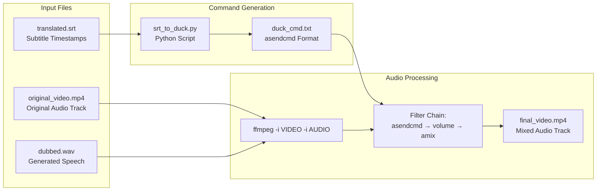
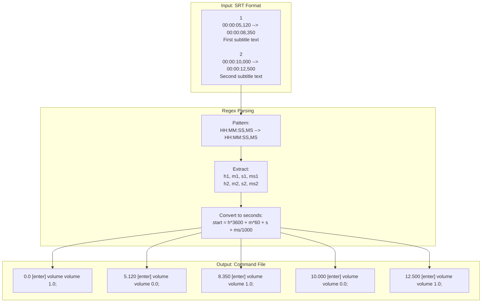
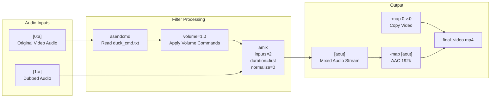
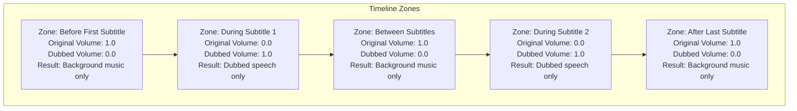

<!-- source: DeepWiki mcp.deepwiki.com · repo NoizAI/skills · extra page Audio Ducking and Mixing · fetched 2026-10-26 -->

# Audio Ducking and Mixing

<details>
<summary>Relevant source files</summary>

The following files were used as context for generating this wiki page:

- [skills/video-translation/SKILL.md](skills/video-translation/SKILL.md)
- [skills/video-translation/scripts/replace_audio.sh](skills/video-translation/scripts/replace_audio.sh)
- [skills/video-translation/scripts/srt_to_duck.py](skills/video-translation/scripts/srt_to_duck.py)

</details>


## Purpose and Scope

This document explains the audio ducking and mixing feature in the video-translation skill, which preserves background audio (music, ambient sounds, sound effects) from the original video while inserting dubbed speech. This feature enables higher-quality video dubbing by retaining the original video's non-speech audio layers.

For the overall video translation workflow, see [Video Translation Workflow](#5.3.1). For the broader video-translation skill documentation, see [Video Translation](#5.3).

---

## Overview

The audio ducking system solves a common problem in video dubbing: when replacing a video's audio track entirely, all background audio (music, ambient sound, sound effects) is lost. The ducking feature addresses this by:

1. Keeping the original audio track intact during non-speech segments
2. Reducing (ducking) the original audio volume to 0.0 during speech segments (as defined by SRT timestamps)
3. Mixing the dubbed speech audio with the ducked original audio

This creates a final audio track where:
- **During speech segments**: Only dubbed speech is audible (original audio volume = 0.0)
- **Between speech segments**: Original background audio is fully audible (original audio volume = 1.0)

**Sources:** [skills/video-translation/SKILL.md:60-64]()

---

## System Architecture

The ducking system consists of three components that form a linear pipeline:



**Diagram: Audio Ducking Pipeline**

The system operates in two distinct phases:

1. **Command Generation Phase**: `srt_to_duck.py` parses SRT timestamps and generates volume control commands
2. **Audio Mixing Phase**: `ffmpeg` applies volume ducking to the original audio and mixes it with dubbed audio

**Sources:** [skills/video-translation/scripts/replace_audio.sh:48-75](), [skills/video-translation/scripts/srt_to_duck.py:1-43]()

---

## Command-Line Interface

The ducking feature is activated by providing the `--srt` parameter to `replace_audio.sh`:

```bash
bash skills/video-translation/scripts/replace_audio.sh \
  --video original_video.mp4 \
  --audio dubbed.wav \
  --output final_video.mp4 \
  --srt translated.srt
```

**Parameters:**

| Parameter | Required | Description |
|-----------|----------|-------------|
| `--video` | Yes | Path to original video file (MP4/MKV/etc) |
| `--audio` | Yes | Path to dubbed audio file (WAV/MP3) |
| `--output` | Yes | Path for output video file |
| `--srt` | Optional | Path to SRT file. If provided, enables ducking mode |

**Behavior:**
- **Without `--srt`**: Complete audio replacement (original audio discarded)
- **With `--srt`**: Audio ducking and mixing (original audio preserved outside speech segments)

**Sources:** [skills/video-translation/scripts/replace_audio.sh:4-15](), [skills/video-translation/scripts/replace_audio.sh:51-67]()

---

## SRT Timestamp Parsing

The `srt_to_duck.py` script converts SRT subtitle timestamps into ffmpeg `asendcmd` volume control commands.



**Diagram: SRT to asendcmd Conversion**

### Parsing Logic

The script uses a regular expression to extract timestamp pairs from the SRT file:

```python
pattern = r"(\d{2}):(\d{2}):(\d{2}),(\d{3})\s*-->\s*(\d{2}):(\d{2}):(\d{2}),(\d{3})"
```

For each matched timestamp range:
1. Parse start time: `h1:m1:s1,ms1`
2. Parse end time: `h2:m2:s2,ms2`
3. Convert to seconds: `start = h*3600 + m*60 + s + ms/1000.0`
4. Generate two commands:
   - At `start`: Set volume to 0.0 (duck original audio)
   - At `end`: Set volume to 1.0 (restore original audio)

**Sources:** [skills/video-translation/scripts/srt_to_duck.py:20-37]()

### Volume State Timeline

The generated command file creates a timeline of volume states:

| Time (seconds) | Command | Original Audio Volume | Effect |
|----------------|---------|----------------------|--------|
| 0.000 | Initial | 1.0 | Background audio fully audible |
| 5.120 | Start subtitle 1 | 0.0 | Original audio muted (dubbed speech plays) |
| 8.350 | End subtitle 1 | 1.0 | Background audio restored |
| 10.000 | Start subtitle 2 | 0.0 | Original audio muted (dubbed speech plays) |
| 12.500 | End subtitle 2 | 1.0 | Background audio restored |

**Sources:** [skills/video-translation/scripts/srt_to_duck.py:23-37]()

---

## FFmpeg Filter Chain

The `replace_audio.sh` script constructs an ffmpeg filter chain that applies volume ducking and mixes the two audio streams.



**Diagram: FFmpeg Audio Processing Flow**

### Filter Chain Components

The complete filter chain is constructed as follows:

```bash
ffmpeg -y -i "$VIDEO" -i "$AUDIO" \
  -filter_complex "[0:a]asendcmd=f='${CMD_FILE}',volume=1.0[orig_ducked];[orig_ducked][1:a]amix=inputs=2:duration=first:dropout_transition=0:normalize=0[aout]" \
  -map 0:v:0 -map "[aout]" \
  -c:v copy -c:a aac -b:a 192k \
  -shortest \
  "$OUTPUT"
```

**Filter Breakdown:**

| Filter Stage | Filter Name | Parameters | Purpose |
|--------------|-------------|------------|---------|
| 1 | `asendcmd` | `f='${CMD_FILE}'` | Reads volume commands from generated file |
| 2 | `volume` | `volume=1.0` | Applies dynamic volume control (modified by asendcmd) |
| 3 | `amix` | `inputs=2, duration=first, dropout_transition=0, normalize=0` | Mixes ducked original with dubbed audio |

**Key Parameters:**

- **`asendcmd=f='${CMD_FILE}'`**: Loads the command file generated by `srt_to_duck.py`. Commands execute at specified timestamps.
- **`volume=1.0`**: Initial volume (1.0 = 100%). The `asendcmd` filter dynamically changes this value.
- **`amix` parameters**:
  - `inputs=2`: Two audio sources (original ducked + dubbed)
  - `duration=first`: Output duration matches first input (original video)
  - `dropout_transition=0`: No fade when streams start/stop
  - `normalize=0`: Disable automatic normalization (preserve exact volume levels)

**Sources:** [skills/video-translation/scripts/replace_audio.sh:60-65]()

### Video Encoding Settings

| Setting | Value | Purpose |
|---------|-------|---------|
| Video codec | `copy` | No re-encoding (preserves quality and speed) |
| Audio codec | `aac` | Standard compatibility codec |
| Audio bitrate | `192k` | High quality stereo |
| Duration | `shortest` | Trim to shortest input (prevents silence padding) |

**Sources:** [skills/video-translation/scripts/replace_audio.sh:62-64]()

---

## Volume Ducking Behavior

The ducking system creates distinct audio zones based on SRT subtitle presence:



**Diagram: Audio Zone Transitions**

### Practical Example

Given an SRT file with two subtitle entries:

```
1
00:00:05,120 --> 00:00:08,350
Hello, how are you?

2
00:00:10,000 --> 00:00:12,500
I am doing well, thank you.
```

**Resulting Audio Behavior:**

| Time Range | Original Audio | Dubbed Audio | What User Hears |
|------------|----------------|--------------|-----------------|
| 0.0 - 5.120s | Volume 1.0 | Silent | Opening music/background |
| 5.120 - 8.350s | Volume 0.0 | Playing | "Hello, how are you?" |
| 8.350 - 10.000s | Volume 1.0 | Silent | Background music continues |
| 10.000 - 12.500s | Volume 0.0 | Playing | "I am doing well, thank you." |
| 12.500s - end | Volume 1.0 | Silent | Closing music/background |

**Sources:** [skills/video-translation/scripts/srt_to_duck.py:23-37]()

---

## Implementation Details

### Temporary File Management

The `replace_audio.sh` script creates a temporary command file that is automatically cleaned up:

```bash
CMD_FILE="$(mktemp /tmp/duck_cmd.XXXXXX.txt)"

# ... generate and use command file ...

rm -f "$CMD_FILE"
```

The temporary file is created with a unique name in `/tmp/` to avoid conflicts in concurrent executions.

**Sources:** [skills/video-translation/scripts/replace_audio.sh:53-67]()

### Error Handling

The `srt_to_duck.py` script includes basic error handling for file I/O:

```python
try:
    with open(srt_file, 'r', encoding='utf-8') as f:
        content = f.read()
except Exception as e:
    print(f"Error reading SRT: {e}", file=sys.stderr)
    sys.exit(1)
```

**Sources:** [skills/video-translation/scripts/srt_to_duck.py:13-18]()

### Encoding Considerations

The scripts handle UTF-8 encoding throughout to support international subtitle content:

- SRT file read: `encoding='utf-8'` [skills/video-translation/scripts/srt_to_duck.py:14]()
- Command file write: `encoding='utf-8'` [skills/video-translation/scripts/srt_to_duck.py:39]()

---

## Use Cases and Limitations

### Appropriate Use Cases

The ducking feature is most effective for:

1. **Educational videos**: Preserve background music while replacing lecture audio
2. **Documentary dubbing**: Keep ambient sounds and music while translating narration
3. **Interview translations**: Maintain location ambience during speech replacement
4. **Music videos**: Preserve instrumental backing while translating vocals

### Known Limitations

| Limitation | Impact | Mitigation |
|------------|--------|------------|
| Binary volume control (0.0 or 1.0) | Abrupt transitions | SRT timestamps should align with natural pauses |
| No partial ducking | Original audio fully muted during speech | Consider manual audio mixing for nuanced control |
| Relies on SRT accuracy | Mistimed subtitles cause incorrect ducking | Verify SRT timestamps before processing |
| Single original audio track | Cannot isolate specific elements | Works best when speech and background are already separated |

**Sources:** [skills/video-translation/scripts/srt_to_duck.py:36](), [skills/video-translation/scripts/replace_audio.sh:60-61]()

---

## Code Entity Reference

### File Locations

| Component | File Path | Entry Point |
|-----------|-----------|-------------|
| Main script | `skills/video-translation/scripts/replace_audio.sh` | Executed via bash |
| Command generator | `skills/video-translation/scripts/srt_to_duck.py` | Called by `replace_audio.sh` |

### Key Functions and Variables

**In `replace_audio.sh`:**

| Symbol | Type | Purpose |
|--------|------|---------|
| `SRT` | Variable | Optional SRT file path [skills/video-translation/scripts/replace_audio.sh:20]() |
| `CMD_FILE` | Variable | Temporary command file path [skills/video-translation/scripts/replace_audio.sh:53]() |
| `srt_to_duck.py` | External script | Invoked at [skills/video-translation/scripts/replace_audio.sh:56]() |

**In `srt_to_duck.py`:**

| Symbol | Type | Purpose |
|--------|------|---------|
| `main()` | Function | Entry point [skills/video-translation/scripts/srt_to_duck.py:5]() |
| `pattern` | Regex | SRT timestamp extraction [skills/video-translation/scripts/srt_to_duck.py:20]() |
| `commands` | List | Accumulated volume commands [skills/video-translation/scripts/srt_to_duck.py:23]() |

**Sources:** [skills/video-translation/scripts/replace_audio.sh:1-78](), [skills/video-translation/scripts/srt_to_duck.py:1-43]()

---

