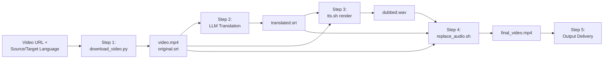
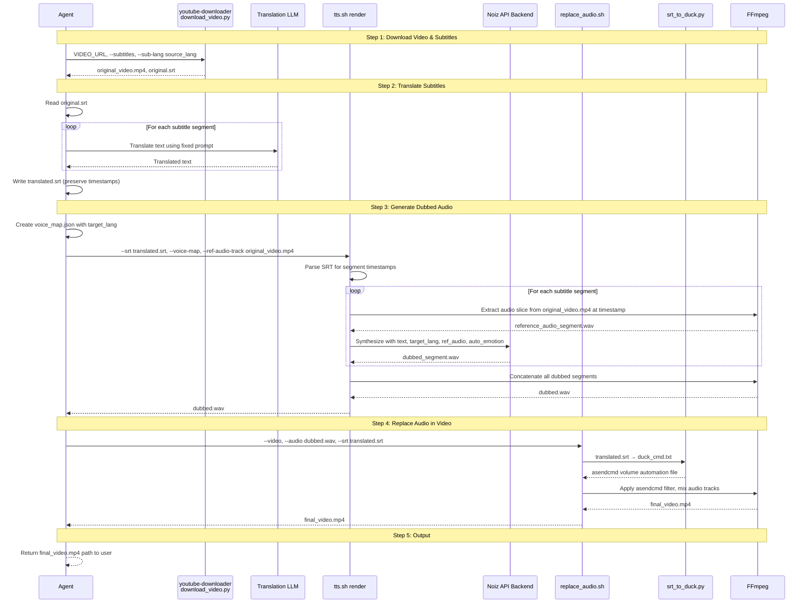
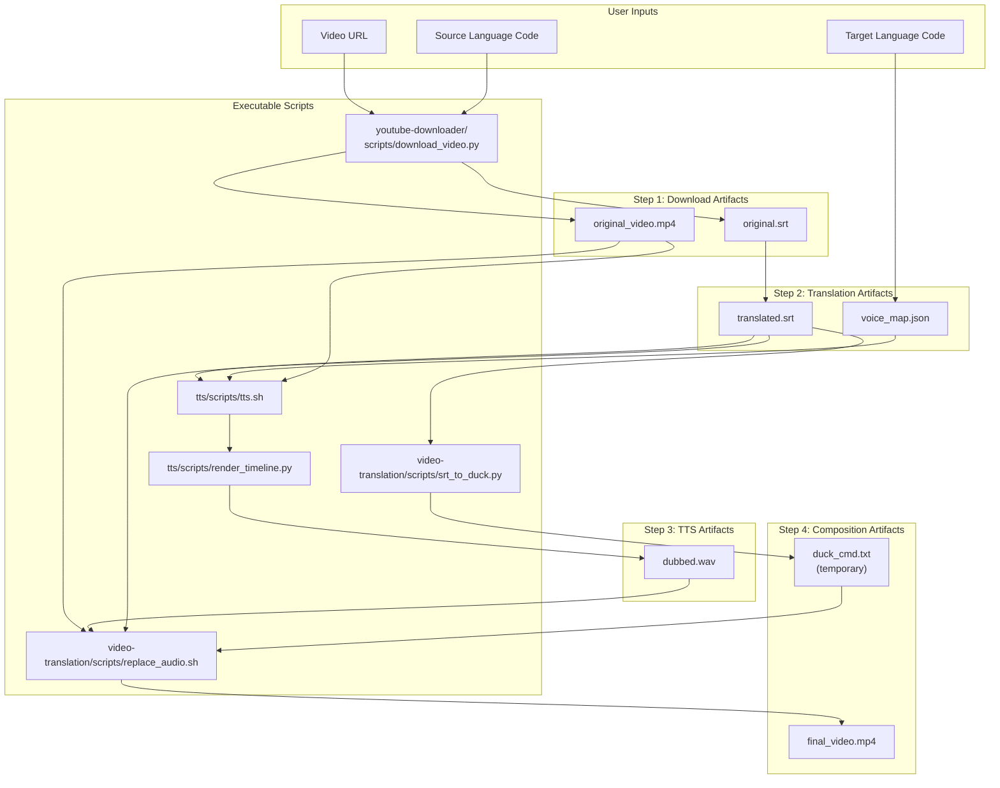

<!-- source: DeepWiki mcp.deepwiki.com · repo NoizAI/skills · extra page Video Translation Workflow · fetched 2026-10-26 -->

# Video Translation Workflow

<details>
<summary>Relevant source files</summary>

The following files were used as context for generating this wiki page:

- [skills/video-translation/SKILL.md](skills/video-translation/SKILL.md)
- [skills/video-translation/scripts/replace_audio.sh](skills/video-translation/scripts/replace_audio.sh)
- [skills/video-translation/scripts/srt_to_duck.py](skills/video-translation/scripts/srt_to_duck.py)

</details>


This document details the five-step technical workflow for translating and dubbing videos using the video-translation skill. The workflow orchestrates multiple components—video download, subtitle translation, TTS rendering, and audio replacement—to produce a final dubbed video. For the overall feature description and use cases, see [Video Translation](#5.3). For details on the audio mixing strategy that preserves background audio, see [Audio Ducking and Mixing](#5.3.2).

## Overview of the Five-Step Pipeline

The video-translation workflow follows a linear pipeline architecture where each step produces artifacts consumed by subsequent steps. The pipeline is designed to be fault-tolerant with clear boundaries between external dependencies (youtube-downloader), internal processing (subtitle translation), and core skills (TTS).



**Sources:** [skills/video-translation/SKILL.md:22-67]()

## Step 1: Download Video & Subtitles

The workflow begins by invoking the `youtube-downloader` skill to fetch both the video file and its original subtitles in SRT format. This step delegates to an external dependency that must be pre-installed in the `skills/` directory.

### Command Invocation

```bash
python path/to/youtube-downloader/scripts/download_video.py "VIDEO_URL" \
  --subtitles \
  --sub-lang <source_lang_code> \
  -o /tmp/video-translation
```

### Parameters

| Parameter | Purpose | Example |
|-----------|---------|---------|
| `VIDEO_URL` | Source video URL (typically YouTube) | `https://www.youtube.com/watch?v=...` |
| `--subtitles` | Flag to download available subtitles | Required |
| `--sub-lang` | Source language code for subtitle selection | `en`, `ja`, `zh-CN` |
| `-o` | Output directory for downloaded files | `/tmp/video-translation` |

### Output Artifacts

This step produces two critical files:
- **Video file**: `original_video.mp4` - The source video with original audio intact
- **Subtitle file**: `original.srt` - Timestamped subtitles in the source language

The subtitle file must exist and be properly formatted; if the video has no subtitles, the workflow cannot proceed (as noted in limitations at [skills/video-translation/SKILL.md:95]()).

**Sources:** [skills/video-translation/SKILL.md:26-30](), [skills/video-translation/SKILL.md:84-89]()

## Step 2: Translate Subtitles

This step performs sentence-by-sentence translation of the SRT file while preserving the exact timestamp and index structure. The translation is performed by the agent's LLM backend using a fixed prompt template.

### Translation Prompt Template

```
Translate the following subtitle text from <Source Language> to <Target Language>.
Provide ONLY the translated text. Do not explain, do not add notes, do not add index numbers.
The translation must be colloquial, natural-sounding, and suitable for video dubbing.
```

The prompt explicitly constrains the LLM to output only translated text without index numbers or timestamps, which are preserved from the original SRT structure.

### SRT Format Preservation

The agent must maintain the exact SRT structure:

```
1
00:00:01,000 --> 00:00:04,000
[Original text in source language]

2
00:00:04,500 --> 00:00:07,800
[Original text in source language]
```

Becomes:

```
1
00:00:01,000 --> 00:00:04,000
[Translated text in target language]

2
00:00:04,500 --> 00:00:07,800
[Translated text in target language]
```

The index numbers (1, 2, ...) and timestamps must remain byte-for-byte identical to ensure timeline alignment in subsequent steps.

### Output Artifact

- **Translated subtitle file**: `translated.srt` - Same timeline structure with target language text

**Sources:** [skills/video-translation/SKILL.md:32-40]()

## Step 3: Generate Dubbed Audio

This step leverages the TTS skill's timeline mode (see [Timeline Mode - SRT to Audio](#3.2)) to generate time-aligned dubbed audio. The key innovation is using `--ref-audio-track` to automatically extract reference audio from the original video at each subtitle's timestamp for voice cloning.

### Voice Map Configuration

A minimal `voice_map.json` is created to configure the target language:

```json
{
  "default": {
    "target_lang": "<target_lang_code>"
  }
}
```

The `default` key applies settings to all segments unless overridden. For voice map details, see [Voice Maps and Segment Configuration](#3.3).

### TTS Render Command

```bash
bash skills/tts/scripts/tts.sh render \
  --srt translated.srt \
  --voice-map voice_map.json \
  --backend noiz \
  --auto-emotion \
  --ref-audio-track original_video.mp4 \
  -o dubbed.wav
```

### Key Parameters

| Parameter | Function | Technical Detail |
|-----------|----------|------------------|
| `--srt` | Input subtitle file with translated text | Must match original timing structure |
| `--voice-map` | Segment configuration file | Contains `target_lang` setting |
| `--backend noiz` | Enforces Noiz backend usage | Required for `--ref-audio-track` feature |
| `--auto-emotion` | Enables automatic emotion detection | Analyzes translated text per segment |
| `--ref-audio-track` | Source video file for reference audio extraction | TTS engine slices audio at each subtitle timestamp |
| `-o` | Output dubbed audio file | WAV format recommended |

### Reference Audio Extraction Mechanism

The `--ref-audio-track` parameter instructs the TTS backend to:

1. Parse the SRT file to extract timestamp ranges for each segment
2. Use ffmpeg to extract the corresponding audio slice from the original video
3. Use this audio slice as the reference for voice cloning for that specific segment
4. Repeat for all segments, ensuring each dubbed sentence matches the original speaker's tone and emotion at that exact moment

This provides per-segment voice cloning that adapts to changing speaker tone throughout the video.

### Output Artifact

- **Dubbed audio file**: `dubbed.wav` - Timeline-accurate audio with same total duration as subtitle span

**Sources:** [skills/video-translation/SKILL.md:42-58]()

## Step 4: Replace Audio in Video

The final composition step uses the `replace_audio.sh` script to merge the dubbed audio back into the video. This step supports two modes: simple replacement or SRT-based mixing.

### Command Invocation

```bash
bash skills/video-translation/scripts/replace_audio.sh \
  --video original_video.mp4 \
  --audio dubbed.wav \
  --output final_video.mp4 \
  --srt translated.srt
```

### Script Behavior

The script at [skills/video-translation/scripts/replace_audio.sh]() implements conditional logic:

**Without `--srt` parameter** (lines 69-74):
- Performs simple audio track replacement
- Dubbed audio completely replaces original audio
- Uses ffmpeg with `-map 0:v:0 -map 1:a:0` to select video from input 0 and audio from input 1

**With `--srt` parameter** (lines 51-67):
- Invokes `srt_to_duck.py` to generate volume ducking commands (see [Audio Ducking and Mixing](#5.3.2))
- Creates ffmpeg `asendcmd` filter that lowers original audio volume to 0.0 during subtitle segments
- Mixes ducked original audio with dubbed audio using `amix` filter
- Preserves background music, sound effects, and ambient audio outside subtitle timestamps

### FFmpeg Filter Chain (SRT Mode)

The complex filter at [skills/video-translation/scripts/replace_audio.sh:60-62]() implements:

```
[0:a]asendcmd=f='${CMD_FILE}',volume=1.0[orig_ducked];
[orig_ducked][1:a]amix=inputs=2:duration=first:dropout_transition=0:normalize=0[aout]
```

Where:
- `[0:a]` = Original video audio stream
- `asendcmd=f='${CMD_FILE}'` = Time-based volume automation from `srt_to_duck.py`
- `volume=1.0` = Default volume level (overridden by asendcmd)
- `[1:a]` = Dubbed audio stream
- `amix` = Combines ducked original with dubbed audio
- `duration=first` = Uses original video duration as reference

### Output Artifact

- **Final video file**: `final_video.mp4` - Original video with replaced/mixed audio track

**Sources:** [skills/video-translation/scripts/replace_audio.sh:1-78](), [skills/video-translation/SKILL.md:60-64]()

## Step 5: Output and Delivery

The final step returns the `final_video.mp4` file path to the user. The video contains:
- Original video stream (unchanged)
- Dubbed audio in target language
- Optional preserved background audio (if `--srt` was used)

**Sources:** [skills/video-translation/SKILL.md:66-67]()

## Complete Workflow Sequence

The following sequence diagram illustrates the chronological execution flow and data dependencies:



**Sources:** [skills/video-translation/SKILL.md:22-67](), [skills/video-translation/scripts/replace_audio.sh:51-67]()

## File Dependency Graph

The following diagram maps the concrete file artifacts and script executables involved in the workflow:



**Sources:** [skills/video-translation/SKILL.md:26-67](), [skills/video-translation/scripts/replace_audio.sh:51-67]()

## Error Handling Considerations

The workflow has multiple failure points that should be handled gracefully:

### Step 1 Failures
- **Missing subtitles**: If the video lacks subtitles for `--sub-lang`, `download_video.py` will fail. The error should be surfaced to the user with a suggestion to try auto-generated subtitles or a different source language.
- **Network errors**: Download failures should be caught and reported with the specific HTTP error.

### Step 2 Failures
- **Malformed SRT**: If the original SRT has invalid timestamp syntax, the LLM translation may corrupt the structure. The agent should validate SRT format before and after translation.
- **LLM refusal**: Some LLMs may refuse to translate certain content. The agent should detect refusal patterns in the output.

### Step 3 Failures
- **Missing NOIZ_API_KEY**: The Noiz backend is required for `--ref-audio-track`. If the API key is not configured, the error message should guide the user to obtain and configure a key as described in [API Key Configuration](#2.3).
- **Duration mismatch**: If the dubbed audio duration significantly differs from the subtitle span, this indicates a TTS backend failure. The error should include the expected vs actual duration.
- **Audio extraction failure**: If ffmpeg cannot extract reference audio from the video track, this may indicate an unsupported codec or corrupted video.

### Step 4 Failures
- **ffmpeg codec errors**: Video codec incompatibility can cause `replace_audio.sh` to fail. The error message at [skills/video-translation/scripts/replace_audio.sh:77]() should surface the specific ffmpeg error.
- **Insufficient disk space**: Large videos may exceed available `/tmp` space. The agent should check available space before starting.

### Partial Failure Recovery

The workflow produces intermediate artifacts (`translated.srt`, `dubbed.wav`) that can be reused if later steps fail. An agent implementation should preserve these files to allow manual inspection or resumption without re-downloading or re-translating.

**Sources:** [skills/video-translation/SKILL.md:81](), [skills/video-translation/SKILL.md:90-91](), [skills/video-translation/scripts/replace_audio.sh:38-46]()

---

