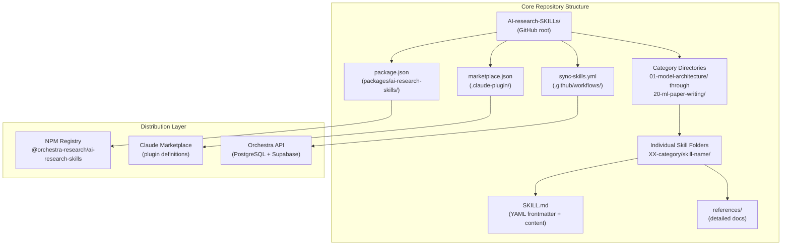
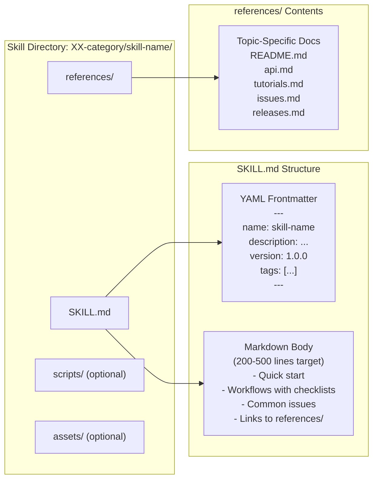
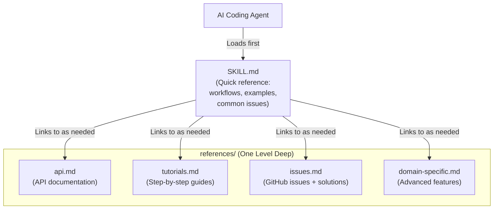
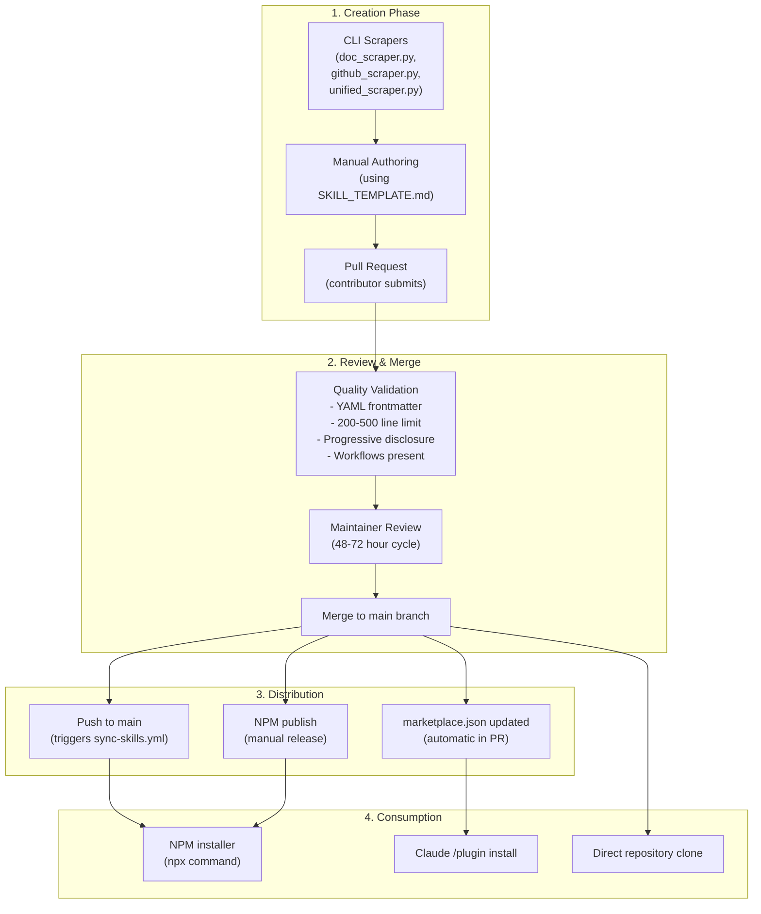
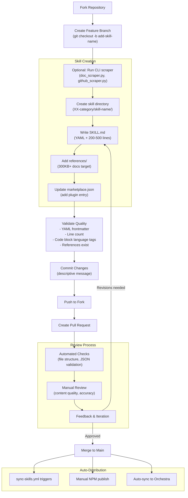

<!-- source: DeepWiki mcp.deepwiki.com · repo Orchestra-Research/AI-research-SKILLs · page 1 Overview · fetched 2026-10-26 -->

# Overview

<details>
<summary>Relevant source files</summary>

The following files were used as context for generating this wiki page:

- [.claude-plugin/marketplace.json](.claude-plugin/marketplace.json)
- [CONTRIBUTING.md](CONTRIBUTING.md)
- [README.md](README.md)
- [demos/README.md](demos/README.md)
- [docs/ROADMAP.md](docs/ROADMAP.md)
- [docs/SKILL_CREATION_GUIDE.md](docs/SKILL_CREATION_GUIDE.md)
- [docs/SKILL_TEMPLATE.md](docs/SKILL_TEMPLATE.md)
- [docs/assets/promo.gif](docs/assets/promo.gif)
- [docs/christmas-tree.svg](docs/christmas-tree.svg)
- [docs/tech-tree.svg](docs/tech-tree.svg)

</details>


## Purpose and Scope

The AI Research Skills repository provides a curated library of 82 expert-level skills spanning the complete AI research engineering lifecycle. Each skill packages comprehensive documentation, code examples, and workflows to enable AI coding agents to autonomously implement research experiments—from data preparation and model training through evaluation and deployment.

This page describes the high-level architecture of the repository, its organization, and how skills are structured and distributed. For installation instructions, see [Installation Guide](#2). For detailed skill taxonomy and organization, see [Skills Library](#3). For how AI agents consume skills, see [Using Skills with AI Agents](#4).

**Sources:** [README.md:1-72](), [README.md:386-416]()

## Repository Architecture

The repository implements a hub-and-spoke distribution model with a centralized GitHub repository serving as the source of truth for 82 skills organized into 20 numbered category directories.



**Directory Structure:**

The repository root contains 20 numbered category directories following the pattern `XX-category-name/`:

- `01-model-architecture/` through `02-tokenization/`: Foundation skills
- `03-fine-tuning/` through `08-distributed-training/`: Training pipeline
- `09-infrastructure/` through `13-mlops/`: Infrastructure and production
- `14-agents/` through `18-multimodal/`: Application layer
- `19-emerging-techniques/` and `20-ml-paper-writing/`: Advanced techniques

Each category directory contains skill folders with lowercase-hyphenated names (e.g., `vllm/`, `grpo-rl-training/`).

**Sources:** [README.md:386-416](), [docs/ROADMAP.md:21-217]()

## Skill Anatomy

Every skill follows a standardized structure with mandatory YAML frontmatter and progressive disclosure through reference files.



**YAML Frontmatter Fields:**

Each `SKILL.md` begins with YAML frontmatter containing metadata for skill discovery and installation:

| Field | Format | Purpose | Example |
|-------|--------|---------|---------|
| `name` | kebab-case | Unique identifier (gerund form preferred) | `serving-llms`, `grpo-rl-training` |
| `description` | Plain text (max 1024 chars) | Third-person explanation of what and when | "Serves LLMs with high throughput using vLLM's PagedAttention..." |
| `version` | Semantic versioning | Version tracking | `1.0.0` |
| `author` | Plain text | Attribution | `Orchestra Research` |
| `license` | License identifier | Legal terms | `MIT` |
| `tags` | Array (Title Case) | Discovery keywords | `[Inference, Serving, vLLM, Production Deployment]` |
| `dependencies` | Array (with version constraints) | Required packages | `[vllm>=0.2.0, torch>=2.0.0]` |

**Sources:** [CONTRIBUTING.md:126-187](), [docs/SKILL_CREATION_GUIDE.md:122-179](), [docs/SKILL_TEMPLATE.md:1-9]()

## Content Organization Principles

Skills implement **progressive disclosure** where `SKILL.md` serves as a focused entry point (200-500 lines target) with references to detailed documentation in separate files.



**Quality Standards:**

- SKILL.md body: 200-500 lines (maximum 500 for optimal performance)
- References total: 300KB+ documentation minimum
- Workflows include copy-paste checklists with `- [ ]` format
- Code blocks require language detection (e.g., ````python`)
- Assumes AI agent intelligence—no over-explaining basics
- One-level reference depth (SKILL.md → reference.md, no nested links)

**Sources:** [CONTRIBUTING.md:82-112](), [docs/SKILL_CREATION_GUIDE.md:46-66]()

## Distribution Channels

The repository distributes skills through three distinct channels, each optimized for different consumption patterns.

### Channel 1: NPM Package

**Location:** `packages/ai-research-skills/`

**Entry Point:** `packages/ai-research-skills/src/index.ts`

**Distribution:** `@orchestra-research/ai-research-skills` on NPM registry

The NPM package provides an interactive CLI installer that:
1. Detects installed AI coding agents by scanning config directories (`~/.claude`, `~/.cursor`, etc.)
2. Presents installation options (everything, categories, individual skills)
3. Installs to canonical storage directory `~/.orchestra/skills/`
4. Creates symlinks to agent-specific directories
5. Tracks installations in `~/.orchestra/.lock.json`

**Key Functions:**
- `detectAgents()`: Scans filesystem for agent installations [README.md:86]()
- Installation creates symlinks, avoiding duplication across agents

**Sources:** [README.md:77-104](), [.claude-plugin/marketplace.json:1-256]()

### Channel 2: GitHub Actions Sync

**Workflow File:** `.github/workflows/sync-skills.yml`

**Trigger:** Push to main branch

**Process:**
1. Detects changed skill folders via git diff pattern matching (`^[0-9]{2}-[^/]+/`)
2. Extracts YAML frontmatter from each changed `SKILL.md`
3. Validates metadata (name format, description length, required fields)
4. Creates ZIP archive of skill directory (SKILL.md + references/)
5. Base64 encodes ZIP and POSTs to Orchestra API endpoint `/api/admin/sync-github-skill`
6. API stores ZIP in Supabase Storage and updates PostgreSQL `research_skills` table
7. Classifies skills as "Orchestra" or "Community" based on author field

**Sources:** [README.md:1-72](), High-Level System Architecture Diagrams (Diagram 2, Diagram 3, Diagram 5)

### Channel 3: Claude Marketplace

**Configuration File:** `.claude-plugin/marketplace.json`

**Structure:**
```json
{
  "name": "ai-research-skills",
  "owner": { "name": "Orchestra Research", "email": "..." },
  "metadata": { "description": "...", "version": "1.1.0" },
  "plugins": [
    {
      "name": "category-name",
      "description": "...",
      "source": "./",
      "strict": false,
      "skills": [
        "./XX-category/skill-name"
      ]
    }
  ]
}
```

Each plugin entry maps to a category containing skill directory paths. The `description` field combines what the skill does and when to use it, enabling semantic matching for skill discovery.

**Sources:** [.claude-plugin/marketplace.json:1-256](), [CONTRIBUTING.md:198-224]()

## Target Consumers

Skills are designed for consumption by three primary audiences:

### AI Coding Agents

**Supported Agents:**
- Claude Code (via `.claude-plugin/marketplace.json` and NPM)
- Cursor (via NPM installer with symlinks to `~/.cursor/skills/`)
- Windsurf (via NPM installer)
- Gemini CLI (via manual directory pointing)
- Qwen Code (via NPM installer)

**Consumption Pattern:**
1. Agent searches installed skills via YAML frontmatter metadata
2. Loads relevant `SKILL.md` for task context
3. Follows workflows with copy-paste checklists
4. Accesses reference files as needed via inline links
5. Executes commands/code from examples

**Sources:** [README.md:79-90](), [README.md:290-310]()

### Custom RAG Systems

**Ingestion Pattern:**
- Ingest `SKILL.md` + all files in `references/` directory
- Use as retrieval context for domain-specific queries
- Build specialized agents with curated skill subsets

**Typical Use Cases:**
- Internal AI research platforms
- Company-specific coding assistants
- Academic research tools

**Sources:** [README.md:307-310]()

### Manual Developers

**Access Methods:**
- Clone repository and browse markdown files
- Download individual skill directories
- Use as reference documentation
- Copy code examples and workflows

**Sources:** [README.md:290-300]()

## Skill Lifecycle

Skills progress through a standardized lifecycle from creation to consumption:



**Creation Tools:**

Three CLI scrapers assist skill creation by automating documentation gathering:

- `doc_scraper.py`: Scrapes official documentation websites
- `github_scraper.py`: Extracts content from GitHub repositories (README, issues, releases)
- `unified_scraper.py`: Combines documentation, GitHub, and PDF sources

**Quality Gates:**

Before merge, skills must pass validation:
- YAML frontmatter present with all required fields
- SKILL.md body under 500 lines
- Progressive disclosure implemented (references for details)
- Workflows include checklists
- Code blocks have language tags

**Sources:** [CONTRIBUTING.md:30-62](), [CONTRIBUTING.md:82-112](), [CONTRIBUTING.md:441-460]()

## Category Taxonomy

The 20 categories organize skills into a logical progression through the AI research lifecycle:

| Category Range | Phase | Skill Count | Purpose |
|----------------|-------|-------------|---------|
| 01-02 | Foundation | 7 | Model architectures and tokenization |
| 03-08 | Training | 27 | Fine-tuning, data processing, post-training, safety, distributed training |
| 09-11 | Optimization | 12 | Infrastructure, optimization techniques, evaluation |
| 12-13 | Production | 9 | Inference serving and MLOps |
| 14-18 | Application | 20 | Agents, RAG, prompt engineering, observability, multimodal |
| 19-20 | Advanced | 7 | Emerging techniques and ML paper writing |

**Numbering Scheme:**
- Two-digit prefix (01, 02, ..., 20) for sorting
- Kebab-case category name
- Example: `06-post-training/`, `12-inference-serving/`

**Sources:** [README.md:125-149](), [docs/ROADMAP.md:21-217]()

## Promotional Assets

The repository includes a Remotion-based video promo system demonstrating the complete user journey.

**Location:** `video-promo/` (implied from diagram analysis)

**Architecture:**
- `src/index.ts`: Registers Remotion root composition
- `src/Root.tsx`: Main composition (465 frames @ 30fps = 15.5s)
- `src/AIResearchSkillsPromo.tsx`: Orchestrates 8 sequential scenes
- `remotion.config.ts`: Build configuration (JPEG format, output settings)

**8 Sequential Scenes:**
1. Logo (ASCII art + subtitle with spring animations)
2. Stats Display (82 skills, 20 categories, 5 agents - count-up interpolation)
3. Agent Detection (5 agents found with staggered checkmarks)
4. Category Selection (interactive menu mock)
5. Install Progress (13 skill names with progress bar)
6. Success Screen (completion message + 3 example prompts)
7. Call to Action (npx command + GitHub/npm links with blinking cursor)
8. Audio (music.wav with volume fade)

**Build Commands:**
- `npm start`: Launch Remotion Studio for preview
- `npm run build`: Render promo.mp4
- `npm run build:gif`: Render promo.gif

**Sources:** High-Level System Architecture Diagrams (Diagram 6), [docs/assets/promo.gif:1]()

## Documentation Standards

The repository enforces specific documentation standards based on Anthropic's official best practices for AI-consumable content.

**Core Principles:**

1. **Concise Content**: Assume AI agents are intelligent—avoid over-explaining basics
2. **Progressive Disclosure**: SKILL.md as overview, details in separate reference files
3. **Workflows with Checklists**: Multi-step tasks use copy-paste checklist format
4. **Feedback Loops**: Quality-critical operations include validation steps (run → validate → fix → repeat)
5. **Consistent Terminology**: Use one term consistently throughout skill
6. **No Time-Sensitive Information**: Use "old patterns" sections for deprecated content

**Anti-Patterns to Avoid:**

- SKILL.md exceeding 500 lines
- Nested references (SKILL.md → ref1.md → ref2.md)
- Windows-style paths (use forward slashes)
- First-person descriptions ("I can help you...")
- Vague skill names ("helper", "utils")
- Missing workflows for complex tasks

**Sources:** [CONTRIBUTING.md:82-112](), [docs/SKILL_CREATION_GUIDE.md:8-120]()

## Contribution Workflow

Contributors follow a standardized process for adding or improving skills:



**Review Timeline:** 48-72 hours for maintainer review

**Contributor Recognition:** All contributors listed in `CONTRIBUTORS.md` with attribution in SKILL.md metadata

**Sources:** [CONTRIBUTING.md:30-286](), [CONTRIBUTING.md:440-460]()

## Key Statistics

As of January 2026:

| Metric | Current Value | Target |
|--------|---------------|--------|
| Total Skills | 82 | 70 ✅ (exceeded) |
| Categories | 20 | 20 ✅ |
| Avg Lines/Skill | 420 | 200-600 |
| Total Documentation | ~130,000 lines | 100,000+ ✅ |
| Gold Standard Skills | 65 (with comprehensive references) | 50+ ✅ |
| Supported Agents | 5 (Claude Code, Cursor, Windsurf, Gemini CLI, Qwen Code) | - |
| Distribution Channels | 3 (NPM, GitHub Actions, Claude Marketplace) | - |

**Recent Milestones:**
- v0.14.0 (January 2026): NPM package `@orchestra-research/ai-research-skills` launched
- 70-skill roadmap completed
- All 20 categories filled with high-quality skills

**Sources:** [README.md:369-382](), [README.md:465-632](), [docs/ROADMAP.md:9-18]()

---

