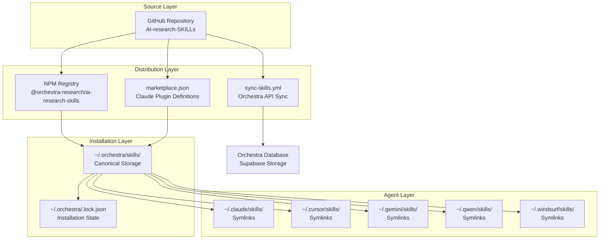
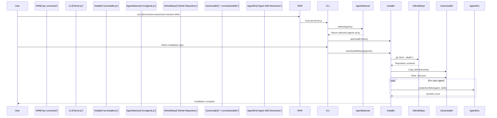
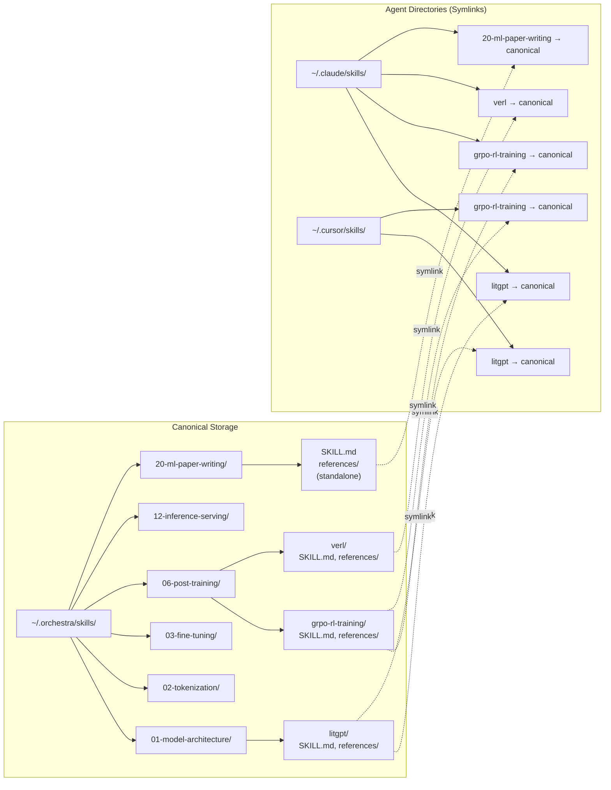
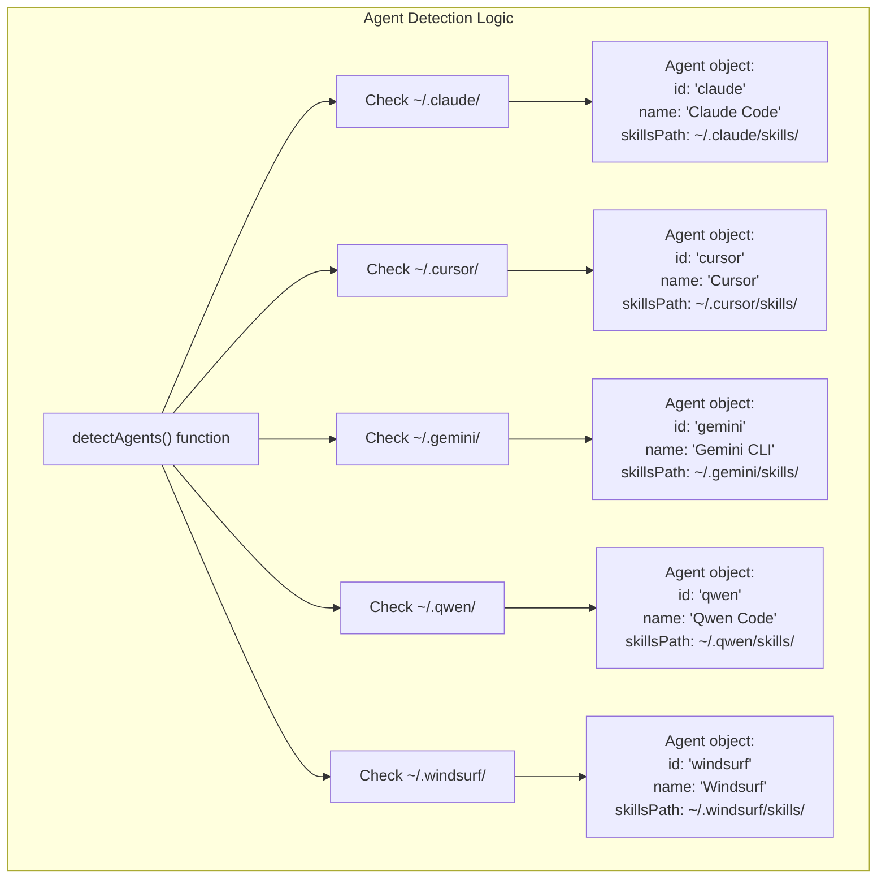
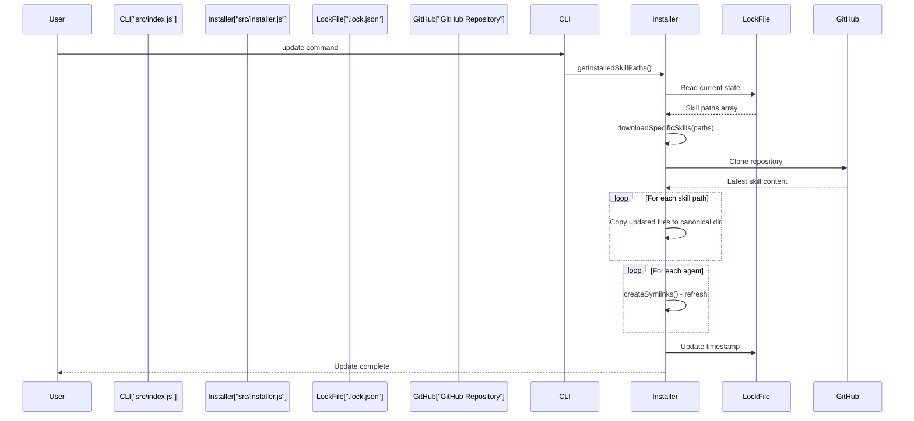

<!-- source: DeepWiki mcp.deepwiki.com · repo Orchestra-Research/AI-research-SKILLs · page 2 Installation Guide · fetched 2026-10-26 -->

# Installation Guide

<details>
<summary>Relevant source files</summary>

The following files were used as context for generating this wiki page:

- [.claude-plugin/marketplace.json](.claude-plugin/marketplace.json)
- [CONTRIBUTING.md](CONTRIBUTING.md)
- [README.md](README.md)
- [demos/README.md](demos/README.md)
- [docs/ROADMAP.md](docs/ROADMAP.md)
- [docs/SKILL_CREATION_GUIDE.md](docs/SKILL_CREATION_GUIDE.md)
- [docs/SKILL_TEMPLATE.md](docs/SKILL_TEMPLATE.md)
- [docs/assets/promo.gif](docs/assets/promo.gif)
- [docs/christmas-tree.svg](docs/christmas-tree.svg)
- [docs/tech-tree.svg](docs/tech-tree.svg)
- [packages/ai-research-skills/package.json](packages/ai-research-skills/package.json)
- [packages/ai-research-skills/src/index.js](packages/ai-research-skills/src/index.js)
- [packages/ai-research-skills/src/installer.js](packages/ai-research-skills/src/installer.js)
- [packages/ai-research-skills/src/prompts.js](packages/ai-research-skills/src/prompts.js)

</details>


## Purpose and Scope

This document covers the installation and distribution architecture of AI Research Skills. It explains how to install the 82-skill library to AI coding agents, the underlying distribution mechanisms, and the canonical storage pattern that enables multi-agent support.

For detailed usage of the interactive NPM installer, see [NPM Package Installer](#2.1). For Claude Code marketplace integration, see [Claude Marketplace Integration](#2.2). For alternative installation methods including Gemini CLI and custom RAG systems, see [Manual Installation Methods](#2.3).

## Installation Architecture Overview

The AI Research Skills library implements a three-tier distribution architecture: a canonical storage directory at `~/.orchestra/skills/`, symlinks to individual agent directories, and a lock file tracking installation state.



**Sources:** [packages/ai-research-skills/src/installer.js:9-10](), [packages/ai-research-skills/src/installer.js:15-23](), [README.md:77-91]()

## Prerequisites

| Requirement | Specification | Notes |
|------------|---------------|-------|
| Node.js | >=18.0.0 | Required for NPM installer |
| Git | Any recent version | Used for cloning repository |
| Operating System | macOS, Linux, Windows | Windows requires compatible shell |
| Disk Space | ~50MB | For full skill library |
| Supported Agents | Claude Code, Cursor, Gemini CLI, Qwen Code, Windsurf | At least one required |

**Sources:** [packages/ai-research-skills/package.json:38-40]()

## Installation Methods Comparison

| Method | Use Case | Agent Detection | Interactive | Requires Node.js |
|--------|----------|----------------|-------------|------------------|
| NPM Installer | Recommended for all users | Automatic | Yes | Yes |
| Claude Marketplace | Claude Code users only | N/A | Via slash commands | No |
| Manual Installation | Custom RAG systems, Gemini CLI | Manual | No | No |
| GitHub Actions Sync | Orchestra marketplace publishing | N/A | No | No |

**Sources:** [README.md:77-124]()

## Distribution Flow



**Sources:** [packages/ai-research-skills/src/index.js:35-57](), [packages/ai-research-skills/src/installer.js:49-114](), [packages/ai-research-skills/src/installer.js:119-151]()

## Core Installation Components

### Entry Point: `bin/cli.js`

The CLI entry point invokes the main function from `src/index.js`:

**Sources:** [packages/ai-research-skills/package.json:6-8]()

### Main Orchestrator: `src/index.js`

Key functions:
- `interactiveFlow()`: Guided installation with menu navigation ([packages/ai-research-skills/src/index.js:35-283]())
- `commandMode()`: Direct command execution for power users ([packages/ai-research-skills/src/index.js:288-342]())
- `main()`: Entry point that routes to appropriate mode ([packages/ai-research-skills/src/index.js:347-358]())

### Installation Logic: `src/installer.js`

Core constants:
- `REPO_URL`: `'https://github.com/Orchestra-Research/AI-research-SKILLs'` ([packages/ai-research-skills/src/installer.js:8]())
- `CANONICAL_DIR`: `join(homedir(), '.orchestra', 'skills')` ([packages/ai-research-skills/src/installer.js:9]())
- `LOCK_FILE`: `join(homedir(), '.orchestra', '.lock.json')` ([packages/ai-research-skills/src/installer.js:10]())

Key functions:
- `ensureCanonicalDir()`: Creates `~/.orchestra/skills/` directory ([packages/ai-research-skills/src/installer.js:15-23]())
- `downloadSkills(categories, spinner)`: Clones repository and copies selected categories ([packages/ai-research-skills/src/installer.js:49-114]())
- `createSymlinks(agent, skills, spinner)`: Creates symlinks from canonical directory to agent directories ([packages/ai-research-skills/src/installer.js:119-151]())
- `installSkills(categories, agents)`: Main installation workflow ([packages/ai-research-skills/src/installer.js:260-293]())

**Sources:** [packages/ai-research-skills/src/installer.js:8-10](), [packages/ai-research-skills/src/installer.js:15-293]()

## Canonical Directory Pattern



The canonical directory pattern ensures a single source of truth for skill content, enabling consistent updates across all installed agents.

**Sources:** [packages/ai-research-skills/src/installer.js:9](), [packages/ai-research-skills/src/installer.js:130-145]()

## Skill Directory Structure

Skills are organized by category with numeric prefixes:

| Category Prefix | Category Name | Example Skills |
|----------------|---------------|----------------|
| `01-` | model-architecture | litgpt, mamba, torchtitan |
| `02-` | tokenization | huggingface-tokenizers, sentencepiece |
| `03-` | fine-tuning | axolotl, unsloth, peft |
| `06-` | post-training | grpo-rl-training, verl, slime, miles |
| `12-` | inference-serving | vllm, sglang, tensorrt-llm |
| `20-` | ml-paper-writing | (standalone skill) |

### Nested vs Standalone Skills

**Nested skill structure** (most categories):
```
06-post-training/
├── grpo-rl-training/
│   ├── SKILL.md
│   └── references/
├── verl/
│   ├── SKILL.md
│   └── references/
└── slime/
    ├── SKILL.md
    └── references/
```

**Standalone skill structure** (category 20):
```
20-ml-paper-writing/
├── SKILL.md
└── references/
```

The installer detects standalone skills by checking for `SKILL.md` directly in the category directory ([packages/ai-research-skills/src/installer.js:78-83]()).

**Sources:** [packages/ai-research-skills/src/installer.js:68-101](), [packages/ai-research-skills/src/prompts.js:7-28]()

## Installation State Management

### Lock File Format

The lock file at `~/.orchestra/.lock.json` tracks installation state:

```json
{
  "version": "1.0.0",
  "installedAt": "2025-01-15T10:30:00.000Z",
  "skills": [
    {
      "category": "06-post-training",
      "skill": "verl",
      "standalone": false
    },
    {
      "category": "20-ml-paper-writing",
      "skill": "20-ml-paper-writing",
      "standalone": true
    }
  ],
  "agents": ["claude", "cursor"]
}
```

**Lock file operations:**
- `readLock()`: Parses lock file or returns defaults ([packages/ai-research-skills/src/installer.js:28-37]())
- `writeLock(data)`: Serializes and writes lock file ([packages/ai-research-skills/src/installer.js:42-44]())

**Sources:** [packages/ai-research-skills/src/installer.js:10](), [packages/ai-research-skills/src/installer.js:28-44](), [packages/ai-research-skills/src/installer.js:280-286]()

## Quick Start: NPM Installation

The most common installation workflow:

```bash
# Interactive installer (recommended)
npx @orchestra-research/ai-research-skills

# Direct commands
npx @orchestra-research/ai-research-skills list      # View installed skills
npx @orchestra-research/ai-research-skills update    # Update installed skills
```

**Agent detection flow:**
1. `detectAgents()` scans known directories ([packages/ai-research-skills/src/index.js:47]())
2. Returns array of detected agents with paths
3. User selects installation scope (everything, categories, or individual skills)
4. Installer clones repository to temporary directory ([packages/ai-research-skills/src/installer.js:56-63]())
5. Copies selected skills to `~/.orchestra/skills/` ([packages/ai-research-skills/src/installer.js:68-102]())
6. Creates symlinks for each agent ([packages/ai-research-skills/src/installer.js:272-276]())
7. Writes lock file with installation state ([packages/ai-research-skills/src/installer.js:280-286]())

**Sources:** [README.md:77-103](), [packages/ai-research-skills/src/index.js:35-283]()

## Quick Start: Claude Marketplace

Claude Code users can install via slash commands:

```bash
# Add the marketplace
/plugin marketplace add orchestra-research/AI-research-SKILLs

# Install by category
/plugin install fine-tuning@ai-research-skills
/plugin install post-training@ai-research-skills
/plugin install inference-serving@ai-research-skills
```

The marketplace is defined in `.claude-plugin/marketplace.json` with 20 plugin entries mapping to skill categories.

**Marketplace plugin structure:**
```json
{
  "name": "post-training",
  "description": "RLHF and preference alignment...",
  "source": "./",
  "strict": false,
  "skills": [
    "./06-post-training/grpo-rl-training",
    "./06-post-training/miles",
    "./06-post-training/openrlhf",
    "./06-post-training/simpo",
    "./06-post-training/slime",
    "./06-post-training/torchforge",
    "./06-post-training/trl-fine-tuning",
    "./06-post-training/verl"
  ]
}
```

**Sources:** [README.md:107-122](), [.claude-plugin/marketplace.json:1-255]()

## Installation Commands Reference

| Command | Function | Code Reference |
|---------|----------|----------------|
| `npx @orchestra-research/ai-research-skills` | Launch interactive installer | [packages/ai-research-skills/src/index.js:347-358]() |
| `npx @orchestra-research/ai-research-skills list` | Display installed skills | [packages/ai-research-skills/src/installer.js:298-363]() |
| `npx @orchestra-research/ai-research-skills update` | Update all installed skills | [packages/ai-research-skills/src/installer.js:432-470]() |
| `npx @orchestra-research/ai-research-skills install --all` | Install all categories (non-interactive) | [packages/ai-research-skills/src/index.js:311-341]() |

**Sources:** [packages/ai-research-skills/src/index.js:288-342](), [README.md:95-103]()

## Supported Agent Configuration Directories



The `detectAgents()` function in `src/agents.js` scans for these configuration directories and returns an array of agent objects with standardized properties.

**Sources:** [packages/ai-research-skills/src/index.js:47](), [README.md:79]()

## Update Mechanism

The update workflow re-downloads only installed skills and refreshes symlinks:



**Key functions:**
- `getInstalledSkillPaths()`: Returns array like `['06-post-training/verl', '20-ml-paper-writing']` ([packages/ai-research-skills/src/installer.js:397-427]())
- `updateInstalledSkills(agents)`: Re-downloads and refreshes symlinks ([packages/ai-research-skills/src/installer.js:432-470]())
- `downloadSpecificSkills(skillPaths, spinner)`: Clones and copies specific skills ([packages/ai-research-skills/src/installer.js:156-219]())

**Sources:** [packages/ai-research-skills/src/installer.js:397-470](), [packages/ai-research-skills/src/index.js:82-103]()

## Uninstallation

Two uninstallation modes are supported:

### Full Uninstallation

Removes all skills and symlinks:

```bash
# Interactive mode
npx @orchestra-research/ai-research-skills
# Select "Uninstall all skills"
```

**Implementation:**
- `uninstallAllSkills(agents)`: Removes symlinks from all agents, deletes canonical directory, removes lock file ([packages/ai-research-skills/src/installer.js:475-516]())

### Selective Uninstallation

Removes specific skills:

**Implementation:**
- `uninstallSpecificSkills(skillPaths, agents)`: Removes selected symlinks, deletes from canonical directory, updates lock file ([packages/ai-research-skills/src/installer.js:523-593]())
- `getInstalledSkillsForSelection()`: Returns formatted skill list for UI ([packages/ai-research-skills/src/installer.js:599-611]())

**Sources:** [packages/ai-research-skills/src/installer.js:475-593](), [packages/ai-research-skills/src/index.js:106-166]()

## Category ID Reference

The installer uses these category IDs from `getAllCategoryIds()`:

```javascript
[
  '01-model-architecture',
  '02-tokenization',
  '03-fine-tuning',
  '04-mechanistic-interpretability',
  '05-data-processing',
  '06-post-training',
  '07-safety-alignment',
  '08-distributed-training',
  '09-infrastructure',
  '10-optimization',
  '11-evaluation',
  '12-inference-serving',
  '13-mlops',
  '14-agents',
  '15-rag',
  '16-prompt-engineering',
  '17-observability',
  '18-multimodal',
  '19-emerging-techniques',
  '20-ml-paper-writing'
]
```

**Sources:** [packages/ai-research-skills/src/installer.js:368-391]()

## Troubleshooting

| Issue | Cause | Solution |
|-------|-------|----------|
| "No agents detected" | Agent config directories not found | Install a supported coding agent first |
| Symlink creation fails | Permissions issue | Check write access to agent directories |
| Git clone fails | Network or GitHub access | Check internet connection, GitHub availability |
| Lock file parse error | Corrupted JSON | Delete `~/.orchestra/.lock.json` and reinstall |
| Skill not appearing in agent | Symlink broken | Run update command to refresh symlinks |

**Common debug commands:**
```bash
# List canonical directory contents
ls -la ~/.orchestra/skills/

# Check symlinks in agent directory
ls -la ~/.claude/skills/

# Verify lock file
cat ~/.orchestra/.lock.json

# Test agent detection
npx @orchestra-research/ai-research-skills list
```

**Sources:** [packages/ai-research-skills/src/installer.js:28-37](), [packages/ai-research-skills/src/installer.js:136-147]()

---

