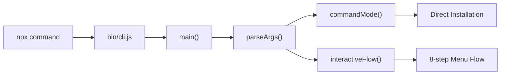
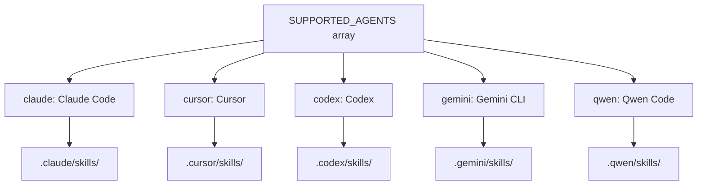
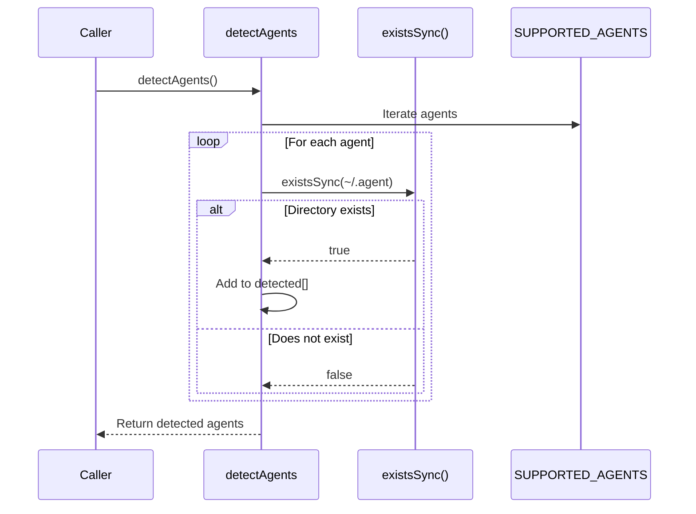
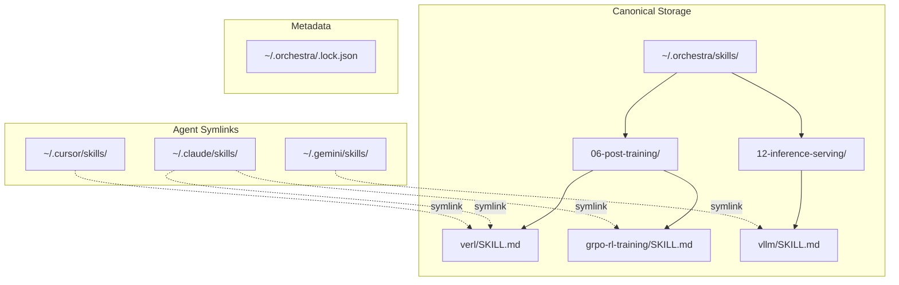
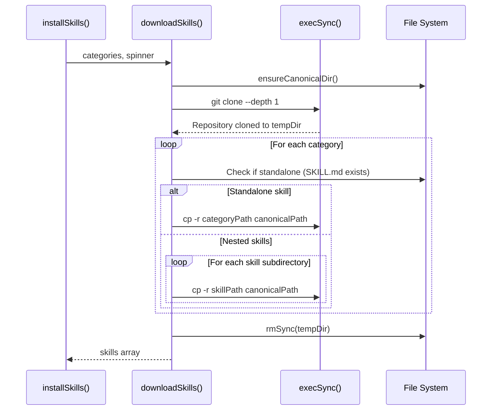
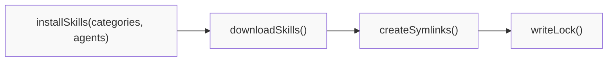
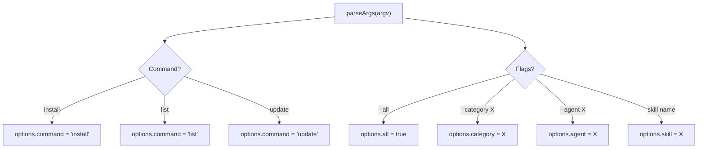
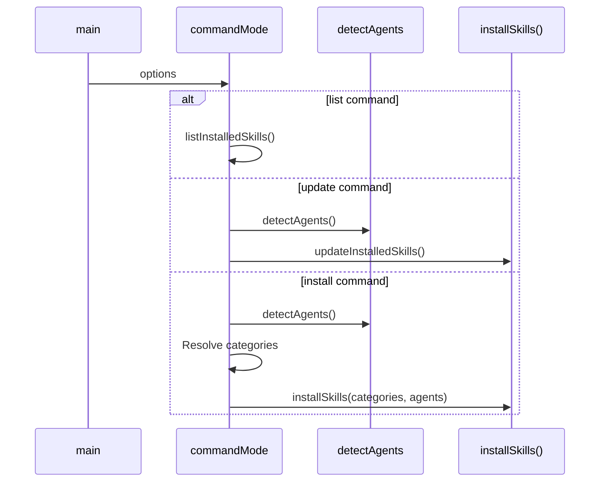
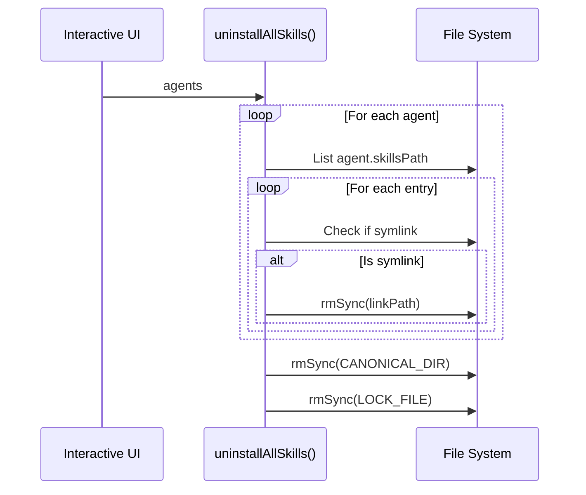
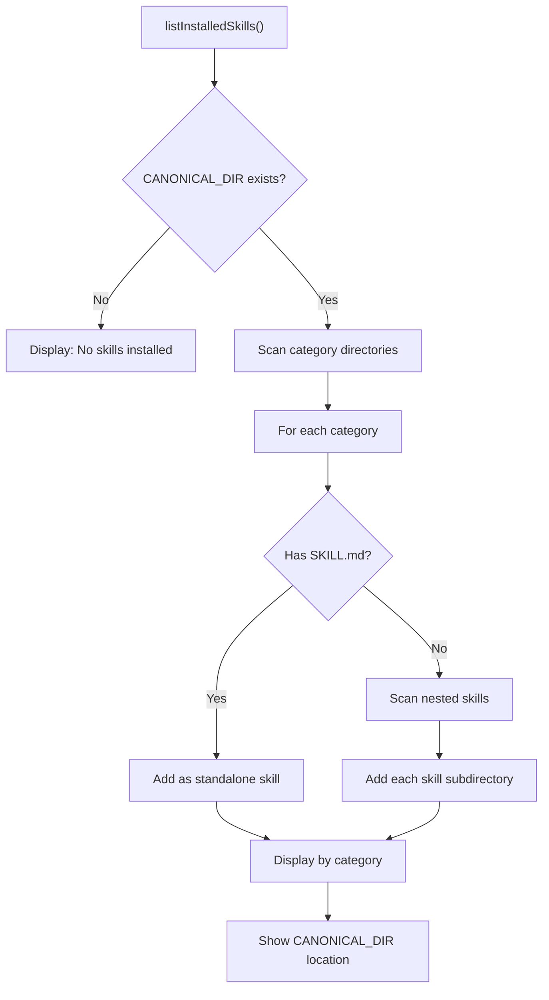

<!-- source: DeepWiki mcp.deepwiki.com · repo Orchestra-Research/AI-research-SKILLs · page 2.1 NPM Package Installer · fetched 2026-10-26 -->

# NPM Package Installer

<details>
<summary>Relevant source files</summary>

The following files were used as context for generating this wiki page:

- [docs/npm-package-ux-mockup.html](docs/npm-package-ux-mockup.html)
- [packages/ai-research-skills/.gitignore](packages/ai-research-skills/.gitignore)
- [packages/ai-research-skills/README.md](packages/ai-research-skills/README.md)
- [packages/ai-research-skills/bin/cli.js](packages/ai-research-skills/bin/cli.js)
- [packages/ai-research-skills/package-lock.json](packages/ai-research-skills/package-lock.json)
- [packages/ai-research-skills/package.json](packages/ai-research-skills/package.json)
- [packages/ai-research-skills/src/agents.js](packages/ai-research-skills/src/agents.js)
- [packages/ai-research-skills/src/ascii.js](packages/ai-research-skills/src/ascii.js)
- [packages/ai-research-skills/src/index.js](packages/ai-research-skills/src/index.js)
- [packages/ai-research-skills/src/installer.js](packages/ai-research-skills/src/installer.js)
- [packages/ai-research-skills/src/prompts.js](packages/ai-research-skills/src/prompts.js)

</details>


## Purpose and Scope

This document covers the technical implementation of the NPM package installer (`@orchestra-research/ai-research-skills`), which provides an interactive CLI for installing AI research skills to coding agents. The installer detects agents on the user's system, presents an interactive menu for skill selection, downloads skills from GitHub, and creates a canonical storage architecture with symlinks.

For Claude marketplace integration, see [Claude Marketplace Integration](#2.2). For manual installation methods for specific agents, see [Manual Installation Methods](#2.3). For the broader distribution architecture including GitHub Actions sync, see [Distribution Channels](#6.1).

---

## Package Structure and Entry Points

The NPM package is published as `@orchestra-research/ai-research-skills` with version 1.0.3. The package provides both programmatic and CLI interfaces.

### Package Configuration

| Property | Value | Purpose |
|----------|-------|---------|
| Package Name | `@orchestra-research/ai-research-skills` | NPM registry identifier |
| Main Entry | `src/index.js` | Programmatic entry point |
| Binary Command | `ai-research-skills` | CLI command name |
| Binary Path | `./bin/cli.js` | Executable script |
| Node Version | `>=18.0.0` | Minimum runtime requirement |

The package uses ES modules (`"type": "module"`) and depends on three libraries: `chalk` (terminal colors), `inquirer` (interactive prompts), and `ora` (spinners).

**Sources:** [packages/ai-research-skills/package.json:1-46]()

### Entry Point Chain



The CLI entry point at `bin/cli.js` imports and invokes `main()` from `src/index.js`, which determines whether to run in command mode (for power users with CLI flags) or interactive mode (default guided experience).

**Sources:** [packages/ai-research-skills/bin/cli.js:1-9](), [packages/ai-research-skills/src/index.js:347-358]()

---

## Agent Detection System

The installer automatically detects which AI coding agents are installed by checking for configuration directories in the user's home directory.

### Supported Agents Configuration



Each agent entry in `SUPPORTED_AGENTS` defines:
- `id`: Agent identifier (e.g., `"claude"`)
- `name`: Display name (e.g., `"Claude Code"`)
- `configDir`: Home directory subdirectory (e.g., `".claude"`)
- `skillsDir`: Skills subdirectory within config (always `"skills"`)

**Sources:** [packages/ai-research-skills/src/agents.js:9-40]()

### Detection Algorithm

The `detectAgents()` function performs filesystem checks:



For each agent, the function checks if `join(homedir(), agent.configDir)` exists. If found, it constructs an agent object with:
- Original configuration from `SUPPORTED_AGENTS`
- `path`: Display path (e.g., `"~/.claude"`)
- `fullPath`: Absolute filesystem path
- `skillsPath`: Full path to skills directory (e.g., `/home/user/.claude/skills`)

**Sources:** [packages/ai-research-skills/src/agents.js:46-64]()

---

## Interactive Flow Architecture

The interactive mode presents an 8-step guided experience with menu navigation. The flow is implemented as nested labeled loops in `interactiveFlow()`.

### Flow Control Structure

```mermaid
graph TD
    start["Start interactiveFlow()"] --> welcome["showWelcome()"]
    welcome --> detect["detectAgents()"]
    detect --> checkAgents{agents.length > 0?}
    checkAgents -->|No| noAgents["showNoAgents()"]
    checkAgents -->|Yes| step2["step2_menu loop"]
    
    step2 --> mainMenu["askMainMenuAction()"]
    mainMenu --> menuChoice{Choice?}
    menuChoice -->|exit| exit["Exit"]
    menuChoice -->|view| listSkills["listInstalledSkills()"]
    menuChoice -->|update| updateFlow["updateInstalledSkills()"]
    menuChoice -->|uninstall| uninstallFlow["step_uninstall loop"]
    menuChoice -->|install| step3["step3_choice loop"]
    
    step3 --> installChoice["askInstallChoice()"]
    installChoice --> choiceType{Type?}
    choiceType -->|everything| allCats["getAllCategoryIds()"]
    choiceType -->|quickstart| quickStart["QUICK_START_SKILLS"]
    choiceType -->|categories| step4cat["step4_categories loop"]
    choiceType -->|individual| step4ind["step4_individual loop"]
    
    step4cat --> selectCats["askCategories()"]
    step4ind --> selectSkills["askIndividualSkills()"]
    
    selectCats --> step5["step5_agents loop"]
    selectSkills --> step5
    allCats --> step5
    quickStart --> step5
    
    step5 --> selectAgents["askSelectAgents()"]
    selectAgents --> confirm["askConfirmation()"]
    confirm --> confirmChoice{Confirm?}
    confirmChoice -->|back| step5
    confirmChoice -->|exit| exit
    confirmChoice -->|confirm| install["installSkills() / installSpecificSkills()"]
    
    install --> success["showSuccess()"]
    success --> end["End"]
```

The implementation uses labeled loops (`step2_menu:`, `step3_choice:`, etc.) to enable navigation between menu levels with `continue step2_menu` statements.

**Sources:** [packages/ai-research-skills/src/index.js:35-283]()

### Menu Components

| Function | Purpose | Choices |
|----------|---------|---------|
| `askMainMenuAction()` | Root menu after agent detection | Install, View, Update, Uninstall, Exit |
| `askInstallChoice()` | What to install | Everything, Quick start, Categories, Individual skills |
| `askCategories()` | Category multi-select | 20 category checkboxes |
| `askIndividualSkills()` | Skill multi-select | Individual skills from `INDIVIDUAL_SKILLS` |
| `askSelectAgents()` | Agent selection | All agents or specific selection |
| `askConfirmation()` | Installation summary | Install or Go back |

Each prompt function returns either a choice value or an object with `{ action, ... }` for handling retry/back navigation.

**Sources:** [packages/ai-research-skills/src/prompts.js:96-407]()

---

## Canonical Storage Architecture

The installer implements a "canonical directory with symlinks" pattern to avoid duplicating skills across multiple agents.

### Storage Locations



**Key Constants:**
- `CANONICAL_DIR`: `join(homedir(), '.orchestra', 'skills')` - Single source of truth
- `LOCK_FILE`: `join(homedir(), '.orchestra', '.lock.json')` - Installation metadata

**Sources:** [packages/ai-research-skills/src/installer.js:8-10]()

### Directory Structure

Skills are organized hierarchically:
- **Standalone skills**: Category folder contains `SKILL.md` directly (e.g., `20-ml-paper-writing/SKILL.md`)
- **Nested skills**: Category folder contains multiple skill subfolders (e.g., `06-post-training/verl/SKILL.md`)

The installer handles both patterns by checking for the presence of `SKILL.md` in the category directory.

**Sources:** [packages/ai-research-skills/src/installer.js:78-101]()

---

## Installation Process

The installation process involves three phases: download, storage, and linking.

### Download Phase



The `downloadSkills()` function:
1. Creates temporary clone directory at `~/.orchestra/.temp-clone`
2. Clones repository with `--depth 1` for minimal download
3. Iterates through selected category IDs
4. Distinguishes standalone vs nested skills by checking for `SKILL.md` in category root
5. Copies skill directories to `CANONICAL_DIR` using `cp -r` via `execSync()`
6. Cleans up temporary directory
7. Returns array of skill objects: `{ category, skill, standalone }`

**Sources:** [packages/ai-research-skills/src/installer.js:49-114]()

### Symlink Creation Phase

```mermaid
sequenceDiagram
    participant install as installSkills()
    participant create as createSymlinks()
    participant fs as File System
    
    install->>create: agent, skills, spinner
    create->>fs: mkdirSync(agentSkillsPath)
    
    loop For each skill
        create->>create: Determine sourcePath
        create->>create: Determine linkName
        create->>fs: Check if linkPath exists
        alt Exists
            create->>fs: rmSync(linkPath)
        end
        create->>fs: symlinkSync(sourcePath, linkPath)
    end
    
    create-->>install: linkedCount
```

The `createSymlinks()` function:
1. Ensures agent's skills directory exists
2. For each skill, computes:
   - `sourcePath`: Absolute path in `CANONICAL_DIR`
   - `linkName`: Skill or category name (what appears in agent's directory)
   - `linkPath`: Full path to symlink in agent's directory
3. Removes existing symlink if present (for updates)
4. Creates symlink with `symlinkSync(sourcePath, linkPath)`

**Sources:** [packages/ai-research-skills/src/installer.js:119-151]()

### Installation Execution



The main `installSkills()` function orchestrates:
1. Spinner starts with "Downloading from GitHub..."
2. Calls `downloadSkills(categories, spinner)` to fetch skills
3. For each agent, calls `createSymlinks(agent, skills, spinner)`
4. Displays progress: `✓ AgentName → path count skills`
5. Updates lock file with installation metadata
6. Returns total skill count

**Sources:** [packages/ai-research-skills/src/installer.js:260-293]()

---

## Lock File Management

The lock file at `~/.orchestra/.lock.json` tracks installation state to support updates and uninstalls.

### Lock File Schema

```json
{
  "version": "1.0.0",
  "installedAt": "2024-01-15T10:30:00.000Z",
  "skills": [
    {
      "category": "06-post-training",
      "skill": "verl",
      "standalone": false
    }
  ],
  "agents": ["claude", "cursor", "gemini"]
}
```

| Field | Type | Purpose |
|-------|------|---------|
| `version` | string | Package version at install time |
| `installedAt` | ISO 8601 string | Timestamp of last installation |
| `skills` | array | List of installed skills with metadata |
| `agents` | array | Agent IDs that have symlinks |

**Sources:** [packages/ai-research-skills/src/installer.js:28-44](), [packages/ai-research-skills/src/installer.js:280-286]()

### Update Strategy

The `updateInstalledSkills()` function:
1. Calls `getInstalledSkillPaths()` to read lock file and scan `CANONICAL_DIR`
2. Generates skill paths (e.g., `["06-post-training/verl", "20-ml-paper-writing"]`)
3. Uses `downloadSpecificSkills()` to re-download only installed skills
4. Refreshes symlinks for all agents
5. Updates lock file with new timestamp

This approach minimizes download size by only fetching previously installed skills rather than all 82 skills.

**Sources:** [packages/ai-research-skills/src/installer.js:432-470]()

---

## Category and Skill Definitions

The installer maintains hardcoded definitions for interactive prompts.

### Category Metadata

The `CATEGORIES` array defines all 20 categories with metadata for display:

```javascript
{
  id: '06-post-training',
  name: 'Post-Training',
  skills: 8,
  examples: 'GRPO, verl, slime, miles, torchforge'
}
```

The `getAllCategoryIds()` function returns all 20 category IDs for "Install Everything" mode.

**Sources:** [packages/ai-research-skills/src/prompts.js:7-28](), [packages/ai-research-skills/src/installer.js:368-391]()

### Individual Skills Subset

The `INDIVIDUAL_SKILLS` array defines a curated subset of 24 notable skills for granular selection:

| Category | Skills |
|----------|--------|
| Post-Training | GRPO, verl, slime, miles, torchforge, TRL, OpenRLHF, SimPO |
| Fine-Tuning | Axolotl, Unsloth, Torchtune |
| Inference | vLLM, SGLang, TensorRT-LLM |
| Training | DeepSpeed, FSDP, TorchTitan |
| Optimization | Flash Attention, GPTQ |
| Tools | W&B, lm-eval-harness, DSPy, Chroma |
| Paper Writing | ML Paper Writing |

**Sources:** [packages/ai-research-skills/src/prompts.js:33-65]()

### Quick Start Bundle

The `QUICK_START_SKILLS` array defines 14 essential skills for new users:

```javascript
[
  '06-post-training/grpo-rl-training',
  '06-post-training/verl',
  '06-post-training/trl-fine-tuning',
  '03-fine-tuning/axolotl',
  '03-fine-tuning/unsloth',
  // ... 9 more skills
]
```

This bundle includes skills from post-training, fine-tuning, inference, distributed training, optimization, MLOps, evaluation, prompt engineering, RAG, and paper writing categories.

**Sources:** [packages/ai-research-skills/src/prompts.js:70-85]()

---

## Command-Line Mode

The installer supports direct command-line invocation for power users, bypassing the interactive flow.

### Argument Parsing



The `parseArgs()` function extracts:
- `command`: First positional argument (`install`, `list`, `update`)
- `all`: `--all` or `-a` flag
- `category`: `--category` flag value
- `skill`: Positional argument (category or skill name)
- `agent`: `--agent` flag value

**Sources:** [packages/ai-research-skills/src/prompts.js:499-529]()

### Command Mode Execution



The `commandMode()` function:
1. For `list`: Directly calls `listInstalledSkills()` and exits
2. For `update`: Detects agents, fetches installed paths, calls `updateInstalledSkills()`
3. For `install`: Detects agents, resolves category from flags/args, calls `installSkills()`

**Sources:** [packages/ai-research-skills/src/index.js:288-342]()

### Example Commands

| Command | Behavior |
|---------|----------|
| `npx @orchestra-research/ai-research-skills` | Interactive mode |
| `npx @orchestra-research/ai-research-skills list` | List installed skills |
| `npx @orchestra-research/ai-research-skills update` | Update all installed skills |
| `npx @orchestra-research/ai-research-skills install --all` | Install all 82 skills |
| `npx @orchestra-research/ai-research-skills install post-training` | Install post-training category |

**Sources:** [packages/ai-research-skills/README.md:32-48]()

---

## Uninstall Operations

The installer supports uninstalling all skills or specific skills.

### Uninstall All



The `uninstallAllSkills()` function:
1. Iterates through all detected agents
2. For each agent's skills directory, checks each entry with `lstatSync().isSymbolicLink()`
3. Removes symlinks (only those pointing to canonical directory)
4. Removes entire `CANONICAL_DIR` (`~/.orchestra/skills/`)
5. Removes lock file

**Sources:** [packages/ai-research-skills/src/installer.js:475-516]()

### Uninstall Specific Skills

The `uninstallSpecificSkills()` function:
1. Parses skill paths (e.g., `"06-post-training/verl"`)
2. Determines link name from path
3. Removes symlinks from all agents
4. Removes skill directory from `CANONICAL_DIR`
5. Cleans up empty category directories
6. Updates lock file to remove uninstalled skills

**Sources:** [packages/ai-research-skills/src/installer.js:523-593]()

---

## Listing Installed Skills

The `listInstalledSkills()` function scans the actual filesystem rather than relying solely on the lock file.

### Scanning Algorithm



The function:
1. Reads all directories in `CANONICAL_DIR`
2. For each category, checks if `SKILL.md` exists directly (standalone skill)
3. If not standalone, scans subdirectories that contain `SKILL.md`
4. Groups skills by category and displays with counts
5. Shows canonical storage location path

**Sources:** [packages/ai-research-skills/src/installer.js:298-363]()

---

## Display and UI Components

The installer uses ASCII art and formatted output for visual appeal.

### ASCII Components

| Function | Purpose | Content |
|----------|---------|---------|
| `showWelcome()` | Initial splash screen | Orchestra logo + tagline + stats |
| `showAgentsDetected()` | Agent detection results | Logo + detected agent list |
| `showMenuHeader()` | Menu screen header | Divider + "ORCHESTRA · AI Research Skills" |
| `showSuccess()` | Completion screen | Success message + examples + commands |
| `showNoAgents()` | Error state | Warning + supported agent list |

All functions use `chalk` for colors:
- `chalk.white()`: Primary text
- `chalk.green()`: Success indicators
- `chalk.cyan()`: Interactive prompts
- `chalk.dim()`: Secondary information
- `chalk.yellow()`: Warnings

**Sources:** [packages/ai-research-skills/src/ascii.js:1-127]()

### Progress Indicators

The installer uses `ora` spinners for long-running operations:

```javascript
const spinner = ora('Downloading from GitHub...').start();
// ... perform operation
spinner.succeed(`Downloaded ${count} skills`);
```

Spinners are passed to download functions to update text during multi-step processes.

**Sources:** [packages/ai-research-skills/src/installer.js:225-230](), [packages/ai-research-skills/src/installer.js:261-266]()

---

## Error Handling

The installer implements try-catch blocks around filesystem and Git operations.

### Download Error Recovery

```javascript
try {
  // Clone and copy operations
} catch (error) {
  if (existsSync(tempDir)) {
    rmSync(tempDir, { recursive: true, force: true });
  }
  throw error;
}
```

If any error occurs during download, the temporary clone directory is cleaned up before re-throwing.

**Sources:** [packages/ai-research-skills/src/installer.js:108-113]()

### Symlink Error Handling

```javascript
try {
  symlinkSync(sourcePath, linkPath);
  linkedCount++;
} catch (error) {
  // Ignore symlink errors (e.g., already exists)
}
```

Symlink creation errors are silently ignored since the installer removes existing symlinks before creating new ones.

**Sources:** [packages/ai-research-skills/src/installer.js:142-148]()

---

## Technical Dependencies

The package relies on three key dependencies:

| Package | Version | Purpose |
|---------|---------|---------|
| `chalk` | ^5.3.0 | Terminal string styling (colors, bold, dim) |
| `inquirer` | ^9.2.12 | Interactive command-line prompts |
| `ora` | ^8.0.1 | Terminal spinners |

All three use ES module syntax and require Node.js 18+.

**Sources:** [packages/ai-research-skills/package.json:41-45]()

---

