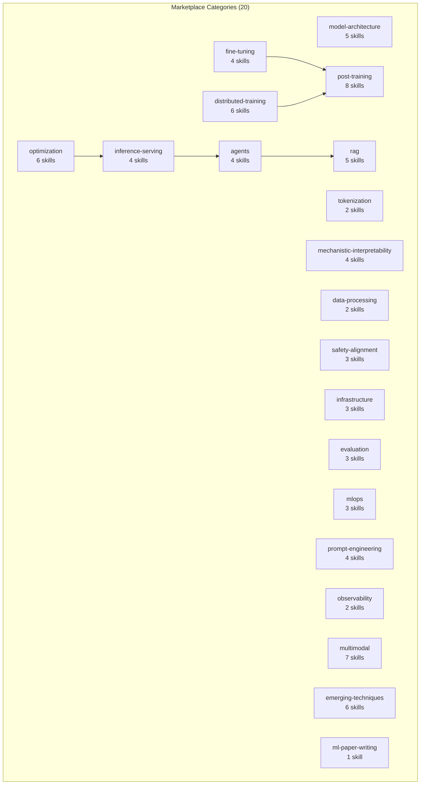
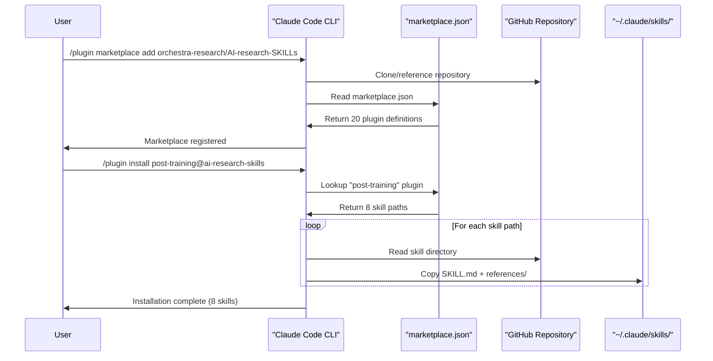
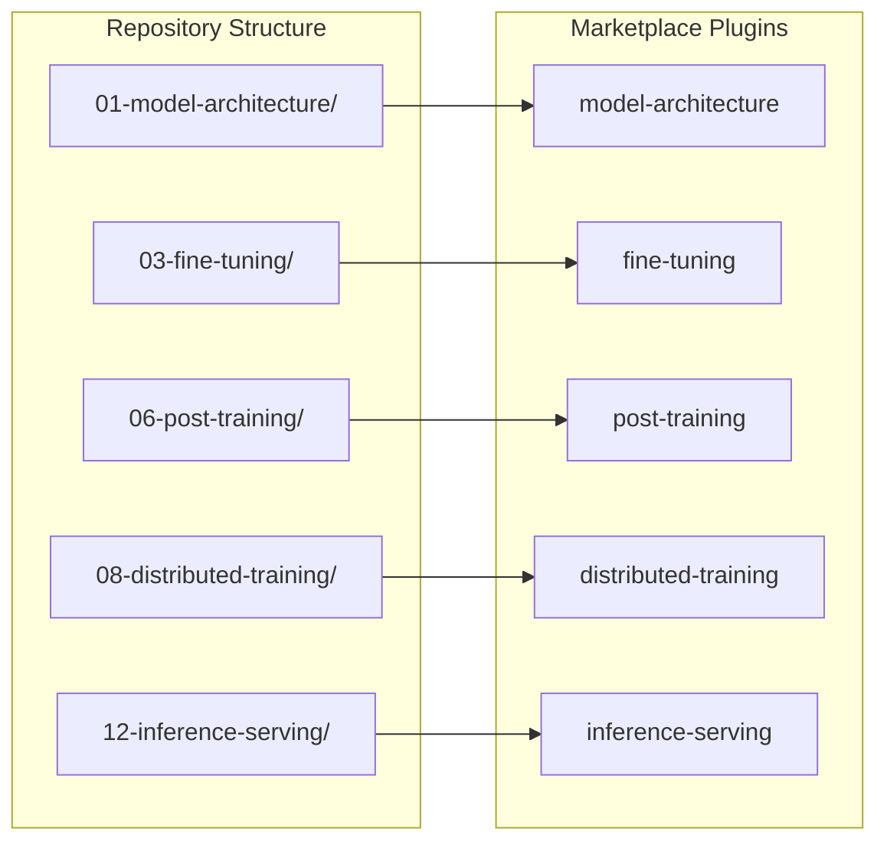
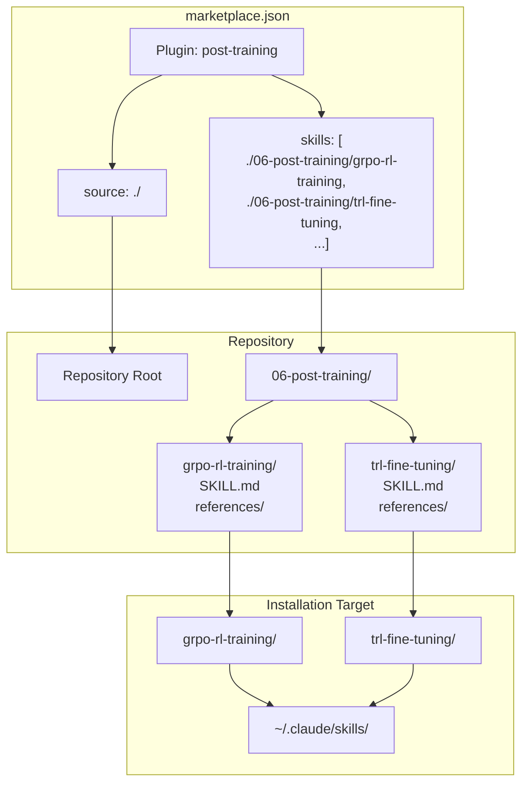
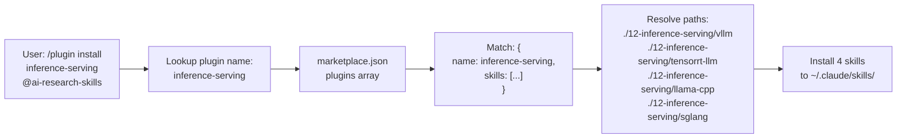

<!-- source: DeepWiki mcp.deepwiki.com · repo Orchestra-Research/AI-research-SKILLs · page 2.2 Claude Marketplace Integration · fetched 2026-10-26 -->

# Claude Marketplace Integration

<details>
<summary>Relevant source files</summary>

The following files were used as context for generating this wiki page:

- [.claude-plugin/marketplace.json](.claude-plugin/marketplace.json)
- [CONTRIBUTING.md](CONTRIBUTING.md)
- [README.md](README.md)
- [demos/README.md](demos/README.md)
- [docs/ROADMAP.md](docs/ROADMAP.md)
- [docs/SKILL_CREATION_GUIDE.md](docs/SKILL_CREATION_GUIDE.md)
- [docs/SKILL_TEMPLATE.md](docs/SKILL_TEMPLATE.md)
- [docs/assets/promo.gif](docs/assets/promo.gif)
- [docs/christmas-tree.svg](docs/christmas-tree.svg)
- [docs/tech-tree.svg](docs/tech-tree.svg)

</details>


## Purpose and Scope

This document describes how to install AI Research Skills using the Claude Code plugin marketplace system. This method uses slash commands within Claude Code to browse and install skill categories defined in `marketplace.json`. For the NPM-based interactive installer, see [NPM Package Installer](#2.1). For direct manual installation to other agents, see [Manual Installation Methods](#2.3).

---

## Overview

The Claude Marketplace Integration provides a native installation method for Claude Code users through the plugin system. Skills are organized into 20 categories (matching the repository structure) and can be installed individually or by category using simple slash commands.

**Key characteristics:**
- Native integration with Claude Code CLI
- Category-based installation (e.g., `fine-tuning`, `post-training`, `inference-serving`)
- Direct installation to `~/.claude/skills/`
- No npm or external tools required
- Defined by `.claude-plugin/marketplace.json` configuration

Sources: [README.md:107-123](), [.claude-plugin/marketplace.json:1-256]()

---

## Marketplace Definition File

### Structure

The marketplace is defined in `.claude-plugin/marketplace.json`, which contains metadata and an array of plugin definitions:

```json
{
  "name": "ai-research-skills",
  "owner": {
    "name": "Orchestra Research",
    "email": "zechen@orchestra-research.com"
  },
  "metadata": {
    "description": "Comprehensive library of 82 AI research engineering skills",
    "version": "1.1.0"
  },
  "plugins": [...]
}
```

Sources: [.claude-plugin/marketplace.json:1-11]()

### Plugin Entry Format

Each plugin in the `plugins` array represents one skill category:

| Field | Type | Description |
|-------|------|-------------|
| `name` | string | Category identifier (kebab-case) |
| `description` | string | What the category contains and when to use it |
| `source` | string | Repository root path (`./`) |
| `strict` | boolean | Validation mode (always `false`) |
| `skills` | array | List of skill directory paths |

**Example plugin entry:**

```json
{
  "name": "fine-tuning",
  "description": "LLM fine-tuning frameworks including Axolotl, LLaMA-Factory, PEFT, and Unsloth. Use when fine-tuning models with LoRA, QLoRA, or full fine-tuning.",
  "source": "./",
  "strict": false,
  "skills": [
    "./03-fine-tuning/axolotl",
    "./03-fine-tuning/llama-factory",
    "./03-fine-tuning/peft",
    "./03-fine-tuning/unsloth"
  ]
}
```

Sources: [.claude-plugin/marketplace.json:35-46]()

### Category Organization

The marketplace defines 20 plugin categories matching the repository structure:



**Category naming convention:**
- Lowercase with hyphens (kebab-case)
- Matches directory name without numeric prefix
- Example: `03-fine-tuning/` → plugin name `fine-tuning`

Sources: [.claude-plugin/marketplace.json:11-254]()

---

## Installation Commands

### Adding the Marketplace

Before installing skills, add the marketplace repository:

```bash
/plugin marketplace add orchestra-research/AI-research-SKILLs
```

This command:
1. Clones or references the GitHub repository
2. Reads `.claude-plugin/marketplace.json`
3. Registers all 20 plugin categories
4. Makes categories available for installation

Sources: [README.md:112-113]()

### Installing by Category

Install all skills in a category using the `@ai-research-skills` suffix:

```bash
# Install fine-tuning frameworks (Axolotl, LLaMA-Factory, PEFT, Unsloth)
/plugin install fine-tuning@ai-research-skills

# Install post-training frameworks (TRL, GRPO, OpenRLHF, SimPO, verl, slime, miles, torchforge)
/plugin install post-training@ai-research-skills

# Install inference servers (vLLM, TensorRT-LLM, llama.cpp, SGLang)
/plugin install inference-serving@ai-research-skills
```

**Command structure:**
- `/plugin install` - Claude Code installation command
- `<category-name>` - Plugin name from marketplace.json
- `@ai-research-skills` - Marketplace identifier

Sources: [README.md:116-121]()

### Common Installation Examples

```bash
# Training and optimization pipeline
/plugin install distributed-training@ai-research-skills
/plugin install optimization@ai-research-skills

# Full post-training stack
/plugin install post-training@ai-research-skills
/plugin install evaluation@ai-research-skills

# Application development
/plugin install agents@ai-research-skills
/plugin install rag@ai-research-skills
/plugin install prompt-engineering@ai-research-skills
```

Sources: [README.md:116-121]()

---

## Installation Process

### Installation Flow



Sources: [.claude-plugin/marketplace.json:70-83](), [README.md:107-123]()

### File System Layout

After installation, skills are copied to `~/.claude/skills/`:

```
~/.claude/skills/
├── trl-fine-tuning/
│   ├── SKILL.md
│   └── references/
│       ├── README.md
│       ├── api.md
│       ├── tutorials.md
│       └── issues.md
├── grpo-rl-training/
│   ├── SKILL.md
│   └── references/
├── openrlhf/
│   ├── SKILL.md
│   └── references/
└── ...
```

**Installation characteristics:**
- Skills installed directly to `~/.claude/skills/` (no subdirectories)
- Each skill folder contains `SKILL.md` + `references/` directory
- No symlinks created (direct copy)
- Category structure flattened (no `06-post-training/` prefix)

Sources: [.claude-plugin/marketplace.json:74-82]()

---

## Plugin Category Mapping

### Mapping Repository Structure to Plugin Names



**Naming transformation:**
1. Remove numeric prefix: `03-fine-tuning` → `fine-tuning`
2. Keep kebab-case format unchanged
3. Use as plugin `name` field in marketplace.json

Sources: [.claude-plugin/marketplace.json:11-254](), [README.md:125-149]()

### Complete Category Index

| Category Number | Directory Name | Plugin Name | Skill Count |
|----------------|----------------|-------------|-------------|
| 01 | `01-model-architecture` | `model-architecture` | 5 |
| 02 | `02-tokenization` | `tokenization` | 2 |
| 03 | `03-fine-tuning` | `fine-tuning` | 4 |
| 04 | `04-mechanistic-interpretability` | `mechanistic-interpretability` | 4 |
| 05 | `05-data-processing` | `data-processing` | 2 |
| 06 | `06-post-training` | `post-training` | 8 |
| 07 | `07-safety-alignment` | `safety-alignment` | 3 |
| 08 | `08-distributed-training` | `distributed-training` | 6 |
| 09 | `09-infrastructure` | `infrastructure` | 3 |
| 10 | `10-optimization` | `optimization` | 6 |
| 11 | `11-evaluation` | `evaluation` | 3 |
| 12 | `12-inference-serving` | `inference-serving` | 4 |
| 13 | `13-mlops` | `mlops` | 3 |
| 14 | `14-agents` | `agents` | 4 |
| 15 | `15-rag` | `rag` | 5 |
| 16 | `16-prompt-engineering` | `prompt-engineering` | 4 |
| 17 | `17-observability` | `observability` | 2 |
| 18 | `18-multimodal` | `multimodal` | 7 |
| 19 | `19-emerging-techniques` | `emerging-techniques` | 6 |
| 20 | `20-ml-paper-writing` | `ml-paper-writing` | 1 |

Sources: [.claude-plugin/marketplace.json:11-254](), [README.md:125-149]()

---

## Skill Path Resolution

### Path Structure in marketplace.json

Each plugin's `skills` array contains relative paths from repository root:

```json
{
  "name": "post-training",
  "source": "./",
  "skills": [
    "./06-post-training/grpo-rl-training",
    "./06-post-training/miles",
    "./06-post-training/openrlhf",
    "./06-post-training/simpo",
    "./06-post-training/slime",
    "./06-post-training/torchforge",
    "./06-post-training/trl-fine-tuning",
    "./06-post-training/verl"
  ]
}
```

**Path components:**
- `source: "./"` - Repository root as base path
- `"./06-post-training/grpo-rl-training"` - Relative path to skill directory
- Each path points to a directory containing `SKILL.md`

Sources: [.claude-plugin/marketplace.json:70-83]()

### Path Resolution Diagram



Sources: [.claude-plugin/marketplace.json:70-83]()

---

## Description Field Guidelines

### Purpose and Format

The `description` field in each plugin entry serves two functions:
1. **Discovery** - Helps users find relevant categories
2. **Guidance** - Explains when to use vs alternatives

**Format requirements:**
- Lists key tools/frameworks included
- States use cases explicitly ("Use when...")
- Includes technical terms for searchability
- Maximum 1024 characters (typical: 150-250)

Sources: [.claude-plugin/marketplace.json:1-256](), [CONTRIBUTING.md:158-177]()

### Example Descriptions

**Good description (post-training):**
```json
{
  "description": "RLHF and preference alignment including TRL, GRPO, OpenRLHF, SimPO, verl, slime, miles, and torchforge. Use when aligning models with human preferences, training reward models, or large-scale RL training."
}
```

**Key elements:**
- Lists all 8 included frameworks
- Defines scope: "RLHF and preference alignment"
- Specifies use cases: "aligning models", "training reward models", "large-scale RL"

Sources: [.claude-plugin/marketplace.json:71]()

**Good description (inference-serving):**
```json
{
  "description": "Production LLM inference including vLLM, TensorRT-LLM, llama.cpp, and SGLang. Use when deploying models for production inference."
}
```

**Key elements:**
- Lists frameworks: vLLM, TensorRT-LLM, llama.cpp, SGLang
- Context: "Production LLM inference"
- Trigger: "deploying models for production inference"

Sources: [.claude-plugin/marketplace.json:148]()

### Description Pattern

All descriptions follow this pattern:

```
[Category scope] including [Tool 1], [Tool 2], [Tool 3]. Use when [use case 1], [use case 2], or [use case 3].
```

**Example breakdown:**

| Element | Content |
|---------|---------|
| Category scope | "Model optimization and quantization" |
| Tools | "Flash Attention, bitsandbytes, GPTQ, AWQ, GGUF, and HQQ" |
| Use cases | "reducing memory, accelerating inference, or quantizing models" |

Sources: [.claude-plugin/marketplace.json:122-133]()

---

## Comparison with Other Installation Methods

### Installation Method Matrix

| Feature | Claude Marketplace | NPM Installer | Manual Installation |
|---------|-------------------|---------------|-------------------|
| **Command** | `/plugin install category@ai-research-skills` | `npx @orchestra-research/ai-research-skills` | Copy/symlink directories |
| **Target agents** | Claude Code only | Claude, Cursor, Windsurf, Gemini, Qwen | Any agent |
| **Agent detection** | N/A (Claude only) | Automatic for 5+ agents | Manual |
| **Installation path** | `~/.claude/skills/` | `~/.orchestra/skills/` (canonical) | Custom |
| **Symlinks** | No (direct copy) | Yes (to ~/.orchestra/skills/) | Optional |
| **Category selection** | One at a time | Multiple via interactive menu | Manual selection |
| **Update mechanism** | Re-run install command | `npx ... update` | Manual re-copy |
| **Skill tracking** | Claude internal | `~/.orchestra/.lock.json` | None |
| **Requires npm** | No | Yes | No |

Sources: [README.md:78-123]()

### Use Case Recommendations

**Use Claude Marketplace when:**
- Using Claude Code exclusively
- Want native CLI integration
- Installing one category at a time
- Don't need cross-agent compatibility

**Use NPM Installer when:**
- Using multiple AI coding agents
- Want centralized storage with symlinks
- Need interactive category/skill selection
- Want automatic agent detection
- Need update management

**Use Manual Installation when:**
- Using unsupported agents (Grok, custom)
- Integrating into RAG systems
- Custom directory structures required
- Offline environment

Sources: [README.md:78-123](), [README.md:290-310]()

---

## Marketplace Maintenance

### Updating marketplace.json

When adding new skills to the repository, the marketplace.json must be updated:

1. **Determine category** - Match to existing plugin or create new
2. **Add skill path** - Append to `skills` array
3. **Update description** - Include new tool name if significant
4. **Update version** - Increment `metadata.version`

**Example addition:**

```json
{
  "name": "post-training",
  "skills": [
    "./06-post-training/grpo-rl-training",
    "./06-post-training/miles",
    "./06-post-training/openrlhf",
    "./06-post-training/simpo",
    "./06-post-training/slime",
    "./06-post-training/torchforge",
    "./06-post-training/trl-fine-tuning",
    "./06-post-training/verl",
    "./06-post-training/new-framework"  // New skill added
  ]
}
```

Sources: [CONTRIBUTING.md:198-226](), [.claude-plugin/marketplace.json:70-83]()

### Validation

Validate marketplace.json after edits:

```bash
# Check JSON syntax
python3 -c "import json; json.load(open('.claude-plugin/marketplace.json'))"

# Verify all paths exist
for path in $(jq -r '.plugins[].skills[]' .claude-plugin/marketplace.json); do
  if [ ! -d "$path" ]; then
    echo "Missing: $path"
  fi
done
```

**Validation requirements:**
- Valid JSON syntax
- All paths in `skills` arrays exist
- Each path contains `SKILL.md`
- No duplicate plugin names
- All descriptions under 1024 characters

Sources: [CONTRIBUTING.md:219-223]()

---

## Integration with GitHub Actions

### Automatic Sync

While the marketplace.json is manually maintained, installed skills automatically sync with repository updates through the GitHub Actions workflow:

```mermaid
graph TB
    subgraph "Repository Updates"
        Commit["Commit to main"]
        Actions["GitHub Actions<br/>sync-skills.yml"]
    end
    
    subgraph "Marketplace Definition"
        MarketplaceJSON["marketplace.json<br/>Updated manually"]
        CategoryDef["Category definitions<br/>skill paths"]
    end
    
    subgraph "Orchestra Backend"
        API["Orchestra API<br/>/api/admin/sync-github-skill"]
        DB["Supabase Database<br/>research_skills table"]
    end
    
    subgraph "User Installation"
        PluginCmd["/plugin install category@"]
        ClaudeDir["~/.claude/skills/"]
    end
    
    Commit --> Actions
    Actions --> API
    API --> DB
    
    MarketplaceJSON --> PluginCmd
    CategoryDef --> PluginCmd
    PluginCmd --> ClaudeDir
    
    DB -.."provides latest version"..-> ClaudeDir
```

**Sync flow:**
1. Contributor updates skill and marketplace.json
2. PR merged to main triggers GitHub Actions
3. Actions sync skills to Orchestra API
4. Users install via marketplace get latest version

Sources: [.claude-plugin/marketplace.json:1-256]()

---

## Limitations and Considerations

### Current Limitations

**Claude Code specific:**
- Only works with Claude Code CLI
- Cannot install to other agents automatically
- No multi-agent support

**Installation granularity:**
- Category-level only (no individual skills)
- Installing one category at a time
- Cannot cherry-pick skills across categories

**Update mechanism:**
- Must re-run install to update
- No version pinning
- No automatic update notifications

Sources: [README.md:107-123]()

### Workarounds

**For multi-agent installations:**
- Use NPM installer ([NPM Package Installer](#2.1))
- Provides automatic detection and symlinks

**For individual skill selection:**
- Use NPM interactive menu
- Or manually copy specific skill directories

**For custom paths:**
- Use manual installation ([Manual Installation Methods](#2.3))
- Copy directories to desired locations

Sources: [README.md:78-104](), [README.md:290-310]()

---

## Technical Implementation Details

### marketplace.json Schema

```typescript
interface MarketplaceConfig {
  name: string;                    // Marketplace identifier
  owner: {
    name: string;                  // Owner name
    email: string;                 // Contact email
  };
  metadata: {
    description: string;           // Overall description
    version: string;               // Semantic version
  };
  plugins: Plugin[];               // Array of plugin definitions
}

interface Plugin {
  name: string;                    // Plugin/category name (kebab-case)
  description: string;             // What it contains + when to use
  source: string;                  // Base path ("./" = repo root)
  strict: boolean;                 // Validation mode (false)
  skills: string[];                // Array of skill directory paths
}
```

Sources: [.claude-plugin/marketplace.json:1-11]()

### Plugin Name Resolution



Sources: [.claude-plugin/marketplace.json:146-157]()

---

## Future Enhancements

### Potential Improvements

**Individual skill installation:**
```bash
# Future: Install specific skills within category
/plugin install inference-serving/vllm@ai-research-skills
```

**Version pinning:**
```bash
# Future: Install specific version
/plugin install post-training@ai-research-skills:1.0.0
```

**Bulk installation:**
```bash
# Future: Install multiple categories
/plugin install post-training,inference-serving,evaluation@ai-research-skills
```

**Update notifications:**
- Detect when skills have new versions available
- Automatic update checking
- Changelog display

Sources: [README.md:107-123]()

---

## Related Documentation

- **NPM Package Installer** - Interactive multi-agent installer: [NPM Package Installer](#2.1)
- **Manual Installation Methods** - Direct installation guide: [Manual Installation Methods](#2.3)
- **Skill Structure & Format** - Understanding skill file organization: [Skill Structure & Format](#4.2)
- **Contributing Guide** - How to add skills and update marketplace: [Submission & Review Process](#5.3)

---

