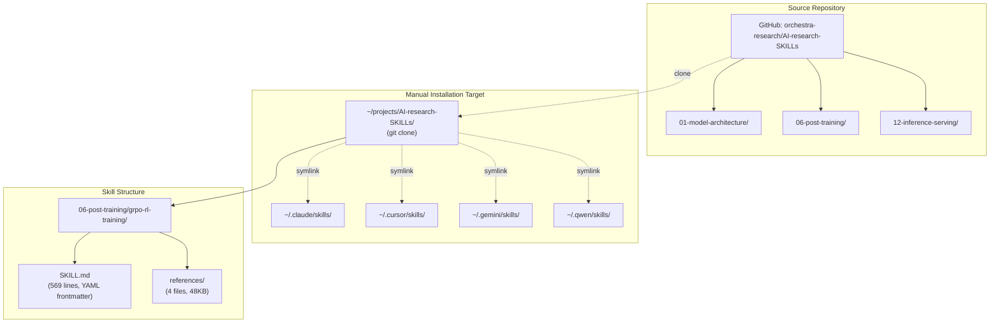
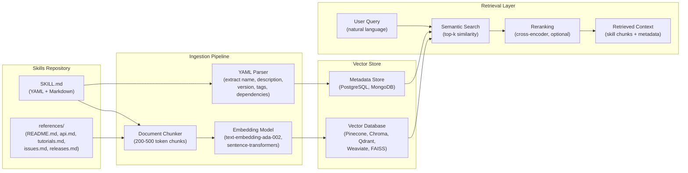

<!-- source: DeepWiki mcp.deepwiki.com · repo Orchestra-Research/AI-research-SKILLs · page 2.3 Manual Installation Methods · fetched 2026-10-26 -->

# Manual Installation Methods

<details>
<summary>Relevant source files</summary>

The following files were used as context for generating this wiki page:

- [.claude-plugin/marketplace.json](.claude-plugin/marketplace.json)
- [CONTRIBUTING.md](CONTRIBUTING.md)
- [README.md](README.md)
- [demos/README.md](demos/README.md)
- [docs/ROADMAP.md](docs/ROADMAP.md)
- [docs/SKILL_CREATION_GUIDE.md](docs/SKILL_CREATION_GUIDE.md)
- [docs/SKILL_TEMPLATE.md](docs/SKILL_TEMPLATE.md)
- [docs/assets/promo.gif](docs/assets/promo.gif)
- [docs/christmas-tree.svg](docs/christmas-tree.svg)
- [docs/npm-package-ux-mockup.html](docs/npm-package-ux-mockup.html)
- [docs/tech-tree.svg](docs/tech-tree.svg)
- [packages/ai-research-skills/.gitignore](packages/ai-research-skills/.gitignore)
- [packages/ai-research-skills/README.md](packages/ai-research-skills/README.md)
- [packages/ai-research-skills/bin/cli.js](packages/ai-research-skills/bin/cli.js)
- [packages/ai-research-skills/package-lock.json](packages/ai-research-skills/package-lock.json)
- [packages/ai-research-skills/src/agents.js](packages/ai-research-skills/src/agents.js)
- [packages/ai-research-skills/src/ascii.js](packages/ai-research-skills/src/ascii.js)

</details>


## Purpose and Scope

This document covers alternative installation methods for AI Research Skills when the NPM package installer (see [NPM Package Installer](#2.1)) or Claude Marketplace (see [Claude Marketplace Integration](#2.2)) are not suitable. These methods provide greater control over installation and support custom integration patterns including:

- Manual Git-based installation for coding agents (Gemini CLI, Cursor, Windsurf, Qwen Code)
- Direct cloning for workspace-based usage
- Custom RAG system integration
- Specialized deployment scenarios requiring modified skill subsets

For automated installation with agent auto-detection, use the NPM package instead. For Claude Code users, the marketplace integration provides native plugin support.

---

## Manual Installation for Coding Agents

### Directory Structure Overview

All supported coding agents follow a consistent directory structure pattern where skills are stored in `~/.{agent}/skills/`. The manual installation process replicates what the NPM installer automates.

**Manual Installation Directory Layout**



Sources: [README.md:290-310](), [packages/ai-research-skills/src/agents.js:9-41]()

### Git Clone Method

**Step 1: Clone the Repository**

Clone the complete skills library to a local directory:

```bash
# Clone to a persistent location (not a temporary directory)
cd ~/projects
git clone https://github.com/Orchestra-Research/AI-research-SKILLs.git
cd AI-research-SKILLs

# Verify clone contains all 82 skills across 20 categories
ls -la | grep "^d" | wc -l  # Should show ~20 category directories
```

**Step 2: Identify Agent Configuration Directories**

Check which agents are installed by verifying their configuration directories exist:

```bash
# Claude Code
test -d ~/.claude && echo "Claude Code detected at ~/.claude"

# Cursor
test -d ~/.cursor && echo "Cursor detected at ~/.cursor"

# Gemini CLI
test -d ~/.gemini && echo "Gemini CLI detected at ~/.gemini"

# Windsurf
test -d ~/.windsurf && echo "Windsurf detected at ~/.windsurf"

# Qwen Code
test -d ~/.qwen && echo "Qwen Code detected at ~/.qwen"
```

If an agent's directory doesn't exist, create it:

```bash
# Example: Create Gemini CLI skills directory
mkdir -p ~/.gemini/skills
```

**Step 3: Create Symlinks**

Create symbolic links from agent skill directories to the cloned repository:

```bash
# Example: Install all skills to Gemini CLI
cd ~/.gemini/skills
for category in ~/projects/AI-research-SKILLs/*/; do
    for skill in "$category"*/; do
        if [ -f "$skill/SKILL.md" ]; then
            skill_name=$(basename "$skill")
            ln -s "$skill" "$skill_name"
        fi
    done
done

# Verify symlinks
ls -lah ~/.gemini/skills/ | grep "^l"  # Should show symlinks to repository
```

**Step 4: Update Skills**

To update installed skills, pull the latest changes:

```bash
cd ~/projects/AI-research-SKILLs
git pull origin main

# Symlinks automatically point to updated content
# No need to reinstall
```

Sources: [README.md:81-89](), [packages/ai-research-skills/README.md:20-30](), [packages/ai-research-skills/src/agents.js:9-65]()

---

### Agent-Specific Manual Installation

#### Gemini CLI

Gemini CLI expects skills in `~/.gemini/skills/` with each skill as a subdirectory containing `SKILL.md`.

```bash
# Create skills directory
mkdir -p ~/.gemini/skills

# Clone repository
git clone https://github.com/Orchestra-Research/AI-research-SKILLs.git ~/gemini-skills-repo

# Install specific categories (example: inference serving)
cd ~/.gemini/skills
ln -s ~/gemini-skills-repo/12-inference-serving/vllm vllm
ln -s ~/gemini-skills-repo/12-inference-serving/tensorrt-llm tensorrt-llm
ln -s ~/gemini-skills-repo/12-inference-serving/sglang sglang
ln -s ~/gemini-skills-repo/12-inference-serving/llama-cpp llama-cpp

# Verify installation
ls -lah ~/.gemini/skills/
```

**Gemini CLI Workspace Method** (alternative):

Point Gemini to skill directories within a project workspace without global installation:

```bash
# In your project directory
mkdir -p .gemini-skills
cd .gemini-skills

# Clone or copy specific skills
cp -r ~/projects/AI-research-SKILLs/12-inference-serving/vllm .
cp -r ~/projects/AI-research-SKILLs/06-post-training/grpo-rl-training .

# Reference in .gemini/config.json (if supported)
# Or simply keep skills in workspace for Gemini to discover
```

Sources: [README.md:302-310]()

#### Cursor

Cursor reads skills from `~/.cursor/skills/` and can also discover skills within project directories.

```bash
# Global installation
mkdir -p ~/.cursor/skills
cd ~/.cursor/skills

# Clone repository
git clone https://github.com/Orchestra-Research/AI-research-SKILLs.git ~/cursor-skills-repo

# Install all skills via symlinks
for skill_dir in ~/cursor-skills-repo/*/*/; do
    if [ -f "$skill_dir/SKILL.md" ]; then
        skill_name=$(basename "$skill_dir")
        ln -s "$skill_dir" "$skill_name"
    fi
done
```

**Project-Specific Installation**:

Add skills to Cursor's project knowledge base:

```bash
# In your project root
mkdir -p .cursor/skills

# Copy relevant skills (example: fine-tuning skills)
cp -r ~/projects/AI-research-SKILLs/03-fine-tuning/axolotl .cursor/skills/
cp -r ~/projects/AI-research-SKILLs/03-fine-tuning/unsloth .cursor/skills/

# Cursor will discover these automatically
```

Sources: [README.md:305](), [packages/ai-research-skills/src/agents.js:15-21]()

#### Windsurf

Windsurf follows the same `~/.windsurf/skills/` pattern as other agents.

```bash
# Create skills directory
mkdir -p ~/.windsurf/skills

# Clone and symlink
git clone https://github.com/Orchestra-Research/AI-research-SKILLs.git ~/windsurf-skills-repo
cd ~/.windsurf/skills

# Install skills
ln -s ~/windsurf-skills-repo/01-model-architecture/* .
ln -s ~/windsurf-skills-repo/03-fine-tuning/* .
ln -s ~/windsurf-skills-repo/06-post-training/* .
# ... repeat for desired categories

# Verify
ls -lah ~/.windsurf/skills/
```

Sources: [packages/ai-research-skills/README.md:89-93]()

---

## Comparison: Installation Methods

The following table compares manual installation against automated methods:

| Feature | NPM Installer | Claude Marketplace | Manual Git Clone |
|---------|--------------|-------------------|------------------|
| **Agent Detection** | Automatic | N/A (Claude only) | Manual |
| **Skill Updates** | `npx ... update` | Plugin update command | `git pull` |
| **Symlink Management** | Automatic | Automatic | Manual |
| **Category Selection** | Interactive UI | Category-based plugins | Manual selection |
| **Canonical Storage** | `~/.orchestra/skills/` | Plugin storage | Custom location |
| **Supports Multiple Agents** | Yes (5+ agents) | Claude only | Yes (manual setup) |
| **Lock File** | `.lock.json` tracking | Marketplace tracking | No tracking |
| **Selective Installation** | Yes (interactive) | Yes (per category) | Yes (manual symlinks) |
| **Offline Operation** | After initial install | Requires marketplace | Yes (after clone) |

**When to Use Manual Installation:**

- NPM installer fails or is not available
- Custom directory layout requirements
- Building a fork with modified skills
- Automated provisioning scripts (e.g., Ansible, Docker)
- Working behind restrictive firewalls (clone once, distribute internally)

Sources: [README.md:78-123](), [packages/ai-research-skills/README.md:8-48]()

---

## Custom RAG System Integration

### Skill Ingestion Pipeline

Skills are structured for ingestion into custom RAG systems. Each skill provides:

1. **SKILL.md**: 200-500 lines of focused guidance with YAML frontmatter for metadata extraction
2. **references/**: Detailed documentation (300KB+ per skill) for deep retrieval
3. **scripts/**: Optional utility scripts (not for ingestion)

**RAG Ingestion Architecture**



Sources: [README.md:307-310](), [docs/SKILL_TEMPLATE.md:1-107](), [CONTRIBUTING.md:83-112]()

### YAML Frontmatter Extraction

Each skill's `SKILL.md` begins with YAML frontmatter containing structured metadata:

```yaml
---
name: grpo-rl-training
description: Expert guidance for GRPO/RL fine-tuning with TRL for reasoning and task-specific model training
version: 1.0.0
author: Orchestra Research
license: MIT
tags: [Reinforcement Learning, GRPO, TRL, Post-Training, RLHF, Reward Modeling, Reasoning, DPO, PPO, Structured Output]
dependencies: [transformers>=4.47.0, trl>=0.14.0, datasets>=3.2.0, peft>=0.14.0, torch]
---
```

**Python Extraction Example**:

```python
import yaml
import re
from pathlib import Path

def extract_skill_metadata(skill_path: Path) -> dict:
    """Extract YAML frontmatter from SKILL.md."""
    skill_md = (skill_path / "SKILL.md").read_text()
    
    # Extract YAML frontmatter (between --- delimiters)
    match = re.match(r'^---\n(.*?)\n---\n', skill_md, re.DOTALL)
    if not match:
        raise ValueError(f"No YAML frontmatter in {skill_path}")
    
    metadata = yaml.safe_load(match.group(1))
    
    # Extract skill body (everything after frontmatter)
    body = skill_md[match.end():]
    
    return {
        **metadata,
        'body': body,
        'path': str(skill_path),
        'category': skill_path.parent.name,  # e.g., "06-post-training"
    }

# Usage
skill = extract_skill_metadata(Path("06-post-training/grpo-rl-training"))
print(f"Skill: {skill['name']}")
print(f"Tags: {skill['tags']}")
print(f"Dependencies: {skill['dependencies']}")
```

Sources: [CONTRIBUTING.md:125-187](), [docs/SKILL_CREATION_GUIDE.md:123-227]()

### Document Chunking Strategy

**Chunk SKILL.md and references/ separately** to preserve hierarchical context:

```python
from typing import List, Dict
import re

def chunk_skill_document(skill_path: Path, chunk_size: int = 500) -> List[Dict]:
    """Chunk skill documents with metadata preservation."""
    metadata = extract_skill_metadata(skill_path)
    chunks = []
    
    # Chunk 1: SKILL.md overview (higher priority)
    skill_body = metadata['body']
    skill_chunks = split_markdown_by_section(skill_body, chunk_size)
    
    for i, chunk_text in enumerate(skill_chunks):
        chunks.append({
            'text': chunk_text,
            'metadata': {
                'skill_name': metadata['name'],
                'source': 'SKILL.md',
                'chunk_index': i,
                'priority': 'high',  # SKILL.md gets retrieval priority
                'tags': metadata['tags'],
                'category': metadata['category'],
            }
        })
    
    # Chunk 2: references/ files (lower priority, deep context)
    ref_dir = skill_path / "references"
    if ref_dir.exists():
        for ref_file in ref_dir.glob("*.md"):
            ref_text = ref_file.read_text()
            ref_chunks = split_markdown_by_section(ref_text, chunk_size)
            
            for i, chunk_text in enumerate(ref_chunks):
                chunks.append({
                    'text': chunk_text,
                    'metadata': {
                        'skill_name': metadata['name'],
                        'source': f'references/{ref_file.name}',
                        'chunk_index': i,
                        'priority': 'medium',  # Lower priority than SKILL.md
                        'tags': metadata['tags'],
                        'category': metadata['category'],
                    }
                })
    
    return chunks

def split_markdown_by_section(text: str, target_size: int) -> List[str]:
    """Split markdown by headers while respecting target size."""
    sections = re.split(r'\n(#{1,3} .+)\n', text)
    chunks = []
    current_chunk = ""
    
    for section in sections:
        if len(current_chunk) + len(section) < target_size:
            current_chunk += section + "\n"
        else:
            if current_chunk:
                chunks.append(current_chunk.strip())
            current_chunk = section + "\n"
    
    if current_chunk:
        chunks.append(current_chunk.strip())
    
    return chunks
```

Sources: [CONTRIBUTING.md:83-112](), [docs/SKILL_TEMPLATE.md:1-107]()

### Vector Database Ingestion

**Example: Ingesting into Chroma**

```python
import chromadb
from chromadb.utils import embedding_functions

# Initialize Chroma client
client = chromadb.PersistentClient(path="./ai-skills-vectordb")

# Use OpenAI embeddings or sentence-transformers
embedding_fn = embedding_functions.OpenAIEmbeddingFunction(
    api_key="your-api-key",
    model_name="text-embedding-ada-002"
)

# Create collection
collection = client.create_collection(
    name="ai_research_skills",
    embedding_function=embedding_fn,
    metadata={"description": "82 AI research engineering skills"}
)

# Ingest all skills
from pathlib import Path

repo_path = Path("./AI-research-SKILLs")
all_chunks = []

# Iterate through all categories
for category_dir in repo_path.glob("*-*/"):
    for skill_dir in category_dir.glob("*/"):
        if (skill_dir / "SKILL.md").exists():
            chunks = chunk_skill_document(skill_dir)
            all_chunks.extend(chunks)

# Batch insert into Chroma
batch_size = 100
for i in range(0, len(all_chunks), batch_size):
    batch = all_chunks[i:i+batch_size]
    
    collection.add(
        documents=[c['text'] for c in batch],
        metadatas=[c['metadata'] for c in batch],
        ids=[f"chunk_{i+j}" for j in range(len(batch))]
    )

print(f"Ingested {len(all_chunks)} chunks from {len(set(c['metadata']['skill_name'] for c in all_chunks))} skills")
```

Sources: [15-rag/chroma/SKILL.md]() (reference pattern), [README.md:307-310]()

### Retrieval Query Patterns

**Example: Semantic Search with Skill Filtering**

```python
def retrieve_skill_context(query: str, top_k: int = 5, category_filter: str = None) -> List[Dict]:
    """Retrieve relevant skill chunks for a query."""
    
    # Build metadata filter
    where_filter = {}
    if category_filter:
        where_filter['category'] = category_filter
    
    # Query vector database
    results = collection.query(
        query_texts=[query],
        n_results=top_k,
        where=where_filter if where_filter else None,
    )
    
    # Return chunks with metadata
    chunks = []
    for i in range(len(results['documents'][0])):
        chunks.append({
            'text': results['documents'][0][i],
            'metadata': results['metadatas'][0][i],
            'distance': results['distances'][0][i],
        })
    
    return chunks

# Usage examples
results = retrieve_skill_context("How do I set up GRPO training?")
# Returns chunks from 06-post-training/grpo-rl-training/

results = retrieve_skill_context(
    "vLLM inference optimization", 
    category_filter="12-inference-serving"
)
# Returns chunks only from inference serving category
```

Sources: [15-rag/chroma/SKILL.md](), [README.md:307-310]()

---

## Building Skill Subsets

For specialized agents, curate skill subsets instead of ingesting all 82 skills:

**Subset Examples**:

```bash
# LLM Training Specialist (18 skills)
mkdir -p custom-rag-skills/llm-training
cp -r AI-research-SKILLs/01-model-architecture/* custom-rag-skills/llm-training/
cp -r AI-research-SKILLs/03-fine-tuning/* custom-rag-skills/llm-training/
cp -r AI-research-SKILLs/06-post-training/* custom-rag-skills/llm-training/
cp -r AI-research-SKILLs/08-distributed-training/* custom-rag-skills/llm-training/

# Inference & Deployment Specialist (13 skills)
mkdir -p custom-rag-skills/inference
cp -r AI-research-SKILLs/12-inference-serving/* custom-rag-skills/inference/
cp -r AI-research-SKILLs/10-optimization/* custom-rag-skills/inference/
cp -r AI-research-SKILLs/09-infrastructure/* custom-rag-skills/inference/

# Research Agent (20 skills)
mkdir -p custom-rag-skills/research
cp -r AI-research-SKILLs/11-evaluation/* custom-rag-skills/research/
cp -r AI-research-SKILLs/13-mlops/* custom-rag-skills/research/
cp -r AI-research-SKILLs/17-observability/* custom-rag-skills/research/
cp -r AI-research-SKILLs/20-ml-paper-writing/* custom-rag-skills/research/
```

**Skill Subset Metadata** (create `subset-manifest.json`):

```json
{
  "name": "llm-training-specialist",
  "description": "Curated skills for LLM training workflows",
  "version": "1.0.0",
  "skills": [
    "01-model-architecture/litgpt",
    "01-model-architecture/torchtitan",
    "03-fine-tuning/axolotl",
    "03-fine-tuning/unsloth",
    "06-post-training/grpo-rl-training",
    "06-post-training/verl",
    "08-distributed-training/deepspeed",
    "08-distributed-training/megatron-core"
  ],
  "categories": [
    "01-model-architecture",
    "03-fine-tuning",
    "06-post-training",
    "08-distributed-training"
  ],
  "total_skills": 18,
  "use_cases": [
    "LLM pretraining",
    "Fine-tuning workflows",
    "RLHF/DPO alignment",
    "Distributed training orchestration"
  ]
}
```

Sources: [README.md:307-310](), [docs/ROADMAP.md:1-217]()

---

## Direct Workspace Usage

Some workflows require skills directly within a project workspace without global installation:

```bash
# In your ML project directory
mkdir -p .ai-skills

# Clone entire repository
git clone https://github.com/Orchestra-Research/AI-research-SKILLs.git .ai-skills/

# Or clone as a Git submodule for version tracking
git submodule add https://github.com/Orchestra-Research/AI-research-SKILLs.git .ai-skills/

# Reference skills in your project code
# Example: Load skill documentation programmatically
cat .ai-skills/06-post-training/grpo-rl-training/SKILL.md
```

**Workspace Structure**:

```
my-llm-project/
├── src/
├── configs/
├── .ai-skills/                 # Skills as submodule or clone
│   ├── 03-fine-tuning/
│   ├── 06-post-training/
│   └── 12-inference-serving/
└── .gitignore                  # Add .ai-skills/ if not using submodule
```

**Gitignore Configuration**:

```gitignore
# If using direct clone (not submodule)
.ai-skills/

# If using submodule, commit the .gitmodules file
# and let Git track the submodule reference
```

Sources: [README.md:302-310]()

---

## Verification and Troubleshooting

### Verify Manual Installation

```bash
# Check symlinks are valid
find ~/.gemini/skills -type l -exec test ! -e {} \; -print
# Empty output = all symlinks valid

# Count installed skills
ls ~/.gemini/skills | wc -l
# Should match expected skill count

# Verify SKILL.md files are accessible
for skill in ~/.gemini/skills/*/; do
    if [ ! -f "$skill/SKILL.md" ]; then
        echo "Missing SKILL.md in $skill"
    fi
done
```

### Common Issues

**Issue: Symlinks broken after repository move**

If you move the cloned repository, symlinks break. Fix by recreating them:

```bash
# Remove old symlinks
rm -rf ~/.gemini/skills/*

# Recreate with new repository path
cd ~/.gemini/skills
for skill_dir in /new/path/AI-research-SKILLs/*/*/; do
    if [ -f "$skill_dir/SKILL.md" ]; then
        ln -s "$skill_dir" $(basename "$skill_dir")
    fi
done
```

**Issue: Agent doesn't recognize skills**

Ensure the agent's configuration directory exists and has the correct structure:

```bash
# Check directory exists
ls -la ~/.gemini/skills/

# Check permissions
chmod 755 ~/.gemini
chmod 755 ~/.gemini/skills
chmod 644 ~/.gemini/skills/*/SKILL.md

# Restart agent to reload skills
```

**Issue: Duplicate skills from multiple sources**

If you have both NPM-installed and manually-installed skills, remove one:

```bash
# Option 1: Keep manual installation, remove NPM symlinks
rm -rf ~/.orchestra/skills

# Option 2: Keep NPM installation, remove manual symlinks
rm -rf ~/.gemini/skills/*
# Then reinstall via NPM
npx @orchestra-research/ai-research-skills
```

Sources: [packages/ai-research-skills/README.md:20-97](), [README.md:78-123]()

---

