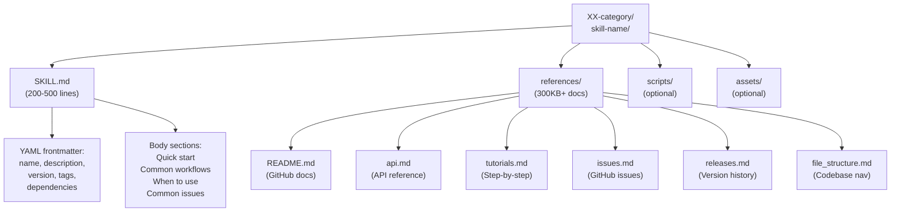
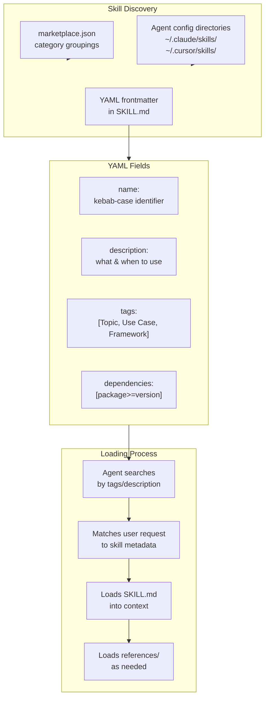
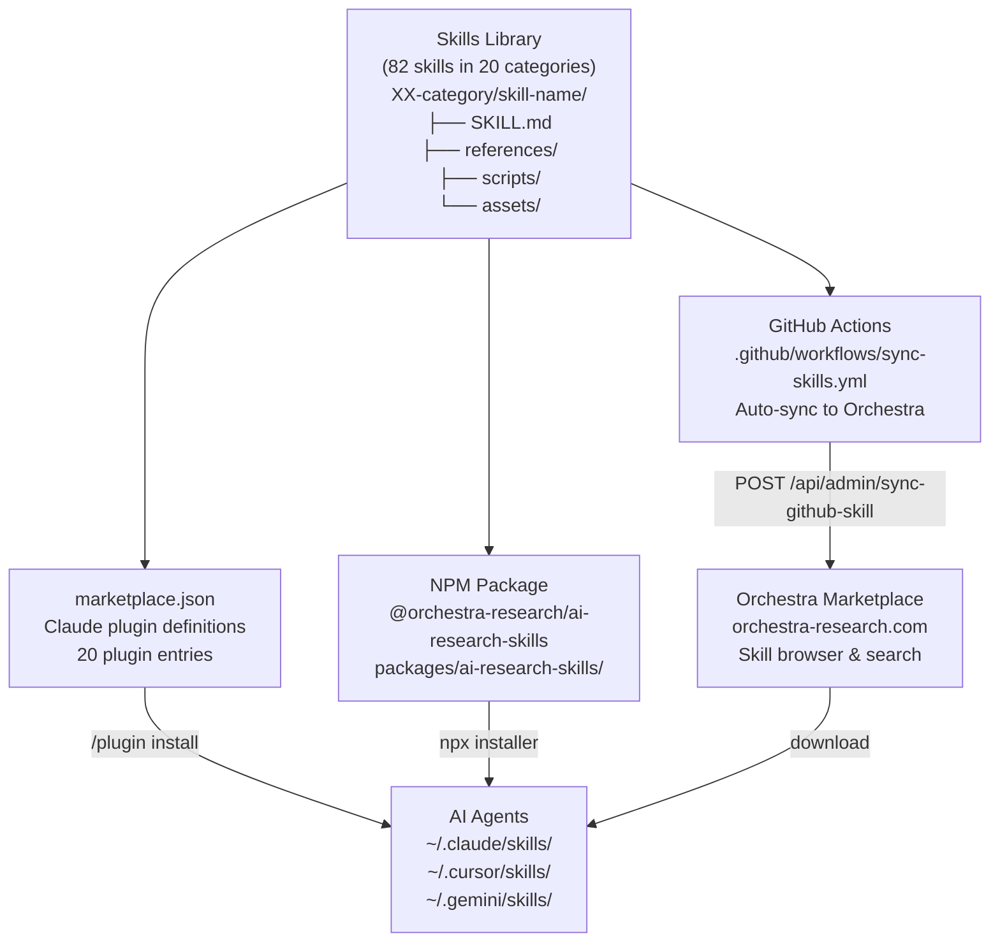

<!-- source: DeepWiki mcp.deepwiki.com · repo Orchestra-Research/AI-research-SKILLs · page 3 Skills Library · fetched 2026-10-26 -->

# Skills Library

<details>
<summary>Relevant source files</summary>

The following files were used as context for generating this wiki page:

- [.claude-plugin/marketplace.json](.claude-plugin/marketplace.json)
- [CONTRIBUTING.md](CONTRIBUTING.md)
- [README.md](README.md)
- [demos/README.md](demos/README.md)
- [docs/ROADMAP.md](docs/ROADMAP.md)
- [docs/SKILL_CREATION_GUIDE.md](docs/SKILL_CREATION_GUIDE.md)
- [docs/SKILL_TEMPLATE.md](docs/SKILL_TEMPLATE.md)
- [docs/assets/promo.gif](docs/assets/promo.gif)
- [docs/christmas-tree.svg](docs/christmas-tree.svg)
- [docs/skills.png](docs/skills.png)
- [docs/tech-tree.svg](docs/tech-tree.svg)

</details>


## Purpose and Scope

The Skills Library is a collection of 82 expert-level AI research skills organized into 20 categories, covering the complete AI research lifecycle from model architecture to production deployment. Each skill provides comprehensive documentation in a standardized format consisting of a `SKILL.md` file (200-500 lines) with progressive disclosure to detailed reference materials.

This page provides an architectural overview of the library structure, organization, and navigation. For installation methods, see [Installation Guide](#2). For skill creation guidelines, see [Contributing New Skills](#5). For examples of skills in action, see [Using Skills with AI Agents](#4).

**Sources**: [README.md:1-72](), [.claude-plugin/marketplace.json:1-255]()

---

## Repository Structure

The library is organized as a flat directory structure with numbered category prefixes for ordering:

```
AI-research-SKILLs/
├── 01-model-architecture/       # 5 skills - LitGPT, Mamba, NanoGPT, RWKV, TorchTitan
├── 02-tokenization/             # 2 skills - HuggingFace Tokenizers, SentencePiece
├── 03-fine-tuning/              # 4 skills - Axolotl, LLaMA-Factory, PEFT, Unsloth
├── 04-mechanistic-interpretability/  # 4 skills - TransformerLens, SAELens, pyvene, nnsight
├── 05-data-processing/          # 2 skills - Ray Data, NeMo Curator
├── 06-post-training/            # 8 skills - TRL, GRPO, OpenRLHF, SimPO, verl, slime, miles, torchforge
├── 07-safety-alignment/         # 3 skills - Constitutional AI, LlamaGuard, NeMo Guardrails
├── 08-distributed-training/     # 6 skills - Megatron-Core, DeepSpeed, FSDP, Accelerate, Lightning, Ray Train
├── 09-infrastructure/           # 3 skills - Modal, SkyPilot, Lambda Labs
├── 10-optimization/             # 6 skills - Flash Attention, bitsandbytes, GPTQ, AWQ, HQQ, GGUF
├── 11-evaluation/               # 3 skills - lm-evaluation-harness, BigCode, NeMo Evaluator
├── 12-inference-serving/        # 4 skills - vLLM, TensorRT-LLM, llama.cpp, SGLang
├── 13-mlops/                    # 3 skills - W&B, MLflow, TensorBoard
├── 14-agents/                   # 4 skills - LangChain, LlamaIndex, CrewAI, AutoGPT
├── 15-rag/                      # 5 skills - Chroma, FAISS, Pinecone, Qdrant, Sentence Transformers
├── 16-prompt-engineering/       # 4 skills - DSPy, Instructor, Guidance, Outlines
├── 17-observability/            # 2 skills - LangSmith, Phoenix
├── 18-multimodal/               # 7 skills - CLIP, Whisper, LLaVA, Stable Diffusion, SAM, BLIP-2, AudioCraft
├── 19-emerging-techniques/      # 6 skills - MoE, Model Merging, Long Context, Speculative Decoding, Distillation, Pruning
├── 20-ml-paper-writing/         # 1 skill - ML Paper Writing
├── .claude-plugin/
│   └── marketplace.json         # Plugin metadata for Claude Code integration
├── packages/
│   └── ai-research-skills/      # NPM package for installation
└── demos/                       # Example usage repositories
```

**Sources**: [README.md:387-415](), [CONTRIBUTING.md:258-283]()

---

## Skill Directory Structure

Each skill follows a standardized layout that separates quick-reference material from comprehensive documentation:



**Sources**: [README.md:325-347](), [CONTRIBUTING.md:287-309]()

---

## SKILL.md Format

The `SKILL.md` file uses YAML frontmatter followed by markdown content with progressive disclosure:

```yaml
---
name: skill-name-in-kebab-case
description: Third-person description including what it does and when to use it
version: 1.0.0
author: Orchestra Research
license: MIT
tags: [Tag One, Tag Two, Key Concept]
dependencies: [package1>=1.0.0, package2>=2.0.0]
---
```

**Body structure** (following Anthropic best practices):

| Section | Purpose | Typical Length |
|---------|---------|----------------|
| Quick start | Minimal working example | 1 paragraph + code |
| Common workflows | Step-by-step checklists for main use cases | 2-3 workflows with checkboxes |
| When to use vs alternatives | Decision guidance | 1-2 paragraphs |
| Common issues | Troubleshooting with solutions | 3-5 issues with fixes |
| Advanced topics | Links to reference files | 1 line per topic |
| Resources | Official docs and GitHub links | 2-3 links |

**Key principles**:
- **Concise**: Assume Claude is smart, avoid over-explaining basics
- **Progressive disclosure**: Keep SKILL.md under 500 lines, split details into `references/`
- **Workflows with checklists**: Use copy-paste checkbox lists for multi-step tasks
- **Feedback loops**: Emphasize validate → fix → repeat patterns

**Sources**: [CONTRIBUTING.md:125-195](), [docs/SKILL_CREATION_GUIDE.md:8-120](), [docs/SKILL_TEMPLATE.md:1-107]()

---

## Category Taxonomy Mapping

The 20 categories map to the AI research lifecycle stages:

```mermaid
graph LR
    subgraph Foundation["Foundation (2 categories, 7 skills)"]
        C01["01-model-architecture<br/>(5 skills)"]
        C02["02-tokenization<br/>(2 skills)"]
    end
    
    subgraph Training["Training & Data (6 categories, 27 skills)"]
        C03["03-fine-tuning<br/>(4 skills)"]
        C04["04-mechanistic-interpretability<br/>(4 skills)"]
        C05["05-data-processing<br/>(2 skills)"]
        C06["06-post-training<br/>(8 skills)"]
        C07["07-safety-alignment<br/>(3 skills)"]
        C08["08-distributed-training<br/>(6 skills)"]
    end
    
    subgraph Optimization["Infrastructure & Optimization (3 categories, 12 skills)"]
        C09["09-infrastructure<br/>(3 skills)"]
        C10["10-optimization<br/>(6 skills)"]
        C11["11-evaluation<br/>(3 skills)"]
    end
    
    subgraph Production["Production (2 categories, 7 skills)"]
        C12["12-inference-serving<br/>(4 skills)"]
        C13["13-mlops<br/>(3 skills)"]
    end
    
    subgraph Application["Application (5 categories, 20 skills)"]
        C14["14-agents<br/>(4 skills)"]
        C15["15-rag<br/>(5 skills)"]
        C16["16-prompt-engineering<br/>(4 skills)"]
        C17["17-observability<br/>(2 skills)"]
        C18["18-multimodal<br/>(7 skills)"]
    end
    
    subgraph Advanced["Advanced (2 categories, 7 skills)"]
        C19["19-emerging-techniques<br/>(6 skills)"]
        C20["20-ml-paper-writing<br/>(1 skill)"]
    end
    
    Foundation --> Training
    Training --> Optimization
    Optimization --> Production
    Production --> Application
    Application --> Advanced
```



**Sources**: [README.md:125-149](), [.claude-plugin/marketplace.json:11-254]()

---

## Skills by Category

### Foundation Skills (Categories 01-02, 7 skills)

| Category | Skills | Key Frameworks |
|----------|--------|----------------|
| **01-model-architecture** | LitGPT, Mamba, NanoGPT, RWKV, TorchTitan | Lightning AI implementations, state-space models, educational GPT, RNN-Transformer hybrid, 4D parallelism |
| **02-tokenization** | HuggingFace Tokenizers, SentencePiece | BPE/WordPiece/Unigram algorithms, language-independent tokenization |

**File locations**: `01-model-architecture/{litgpt,mamba,nanogpt,rwkv,torchtitan}/`, `02-tokenization/{huggingface-tokenizers,sentencepiece}/`

### Training & Data Skills (Categories 03-08, 27 skills)

| Category | Skills | Key Frameworks |
|----------|--------|----------------|
| **03-fine-tuning** | Axolotl, LLaMA-Factory, PEFT, Unsloth | YAML-based training, WebUI no-code, LoRA/QLoRA/DoRA, 2-5× speedup |
| **04-mechanistic-interpretability** | TransformerLens, SAELens, pyvene, nnsight | HookPoints, sparse autoencoders, causal interventions, remote interpretability |
| **05-data-processing** | Ray Data, NeMo Curator | Distributed ETL, GPU-accelerated curation (16× faster deduplication) |
| **06-post-training** | TRL, GRPO, OpenRLHF, SimPO, verl, slime, miles, torchforge | RLHF pipelines, reward modeling, DPO/PPO, ByteDance/THUDM/Meta frameworks |
| **07-safety-alignment** | Constitutional AI, LlamaGuard, NeMo Guardrails | Self-improvement via principles, safety classifiers, programmable guardrails |
| **08-distributed-training** | Megatron-Core, DeepSpeed, FSDP, Accelerate, Lightning, Ray Train | ZeRO optimization, 3D/4D parallelism, 47% MFU on H100 |

**File locations**: `03-fine-tuning/{axolotl,llama-factory,peft,unsloth}/`, `04-mechanistic-interpretability/{transformer-lens,saelens,pyvene,nnsight}/`, `05-data-processing/{ray-data,nemo-curator}/`, `06-post-training/{trl-fine-tuning,grpo-rl-training,openrlhf,simpo,verl,slime,miles,torchforge}/`, `07-safety-alignment/{constitutional-ai,llamaguard,nemo-guardrails}/`, `08-distributed-training/{megatron-core,deepspeed,pytorch-fsdp,accelerate,pytorch-lightning,ray-train}/`

### Infrastructure & Optimization Skills (Categories 09-11, 12 skills)

| Category | Skills | Key Frameworks |
|----------|--------|----------------|
| **09-infrastructure** | Modal, SkyPilot, Lambda Labs | Serverless GPU (T4-H200), multi-cloud orchestration (20+ providers), reserved/on-demand H100/A100 |
| **10-optimization** | Flash Attention, bitsandbytes, GPTQ, AWQ, HQQ, GGUF | 2-4× faster attention, 4-bit/8-bit quantization, 50-75% memory reduction |
| **11-evaluation** | lm-evaluation-harness, BigCode Evaluation Harness, NeMo Evaluator | 60+ tasks, HumanEval/MBPP/MultiPL-E, 100+ benchmarks across 18+ harnesses |

**File locations**: `09-infrastructure/{modal,skypilot,lambda-labs}/`, `10-optimization/{flash-attention,bitsandbytes,gptq,awq,hqq,gguf}/`, `11-evaluation/{lm-evaluation-harness,bigcode-evaluation-harness,nemo-evaluator}/`

### Production Skills (Categories 12-13, 7 skills)

| Category | Skills | Key Frameworks |
|----------|--------|----------------|
| **12-inference-serving** | vLLM, TensorRT-LLM, llama.cpp, SGLang | PagedAttention, 24k tok/s, CPU/Metal inference, RadixAttention (5-10× faster for agents) |
| **13-mlops** | Weights & Biases, MLflow, TensorBoard | Experiment tracking, sweeps, model registry, visualization, profiling |

**File locations**: `12-inference-serving/{vllm,tensorrt-llm,llama-cpp,sglang}/`, `13-mlops/{weights-and-biases,mlflow,tensorboard}/`

### Application Skills (Categories 14-18, 20 skills)

| Category | Skills | Key Frameworks |
|----------|--------|----------------|
| **14-agents** | LangChain, LlamaIndex, CrewAI, AutoGPT | 500+ integrations, 300+ connectors, multi-agent orchestration, visual workflow builder |
| **15-rag** | Chroma, FAISS, Pinecone, Qdrant, Sentence Transformers | Open-source/managed vector DBs, billion-scale search, 5000+ embedding models |
| **16-prompt-engineering** | DSPy, Instructor, Guidance, Outlines | Declarative optimization, Pydantic validation, regex/grammars, FSM-based generation |
| **17-observability** | LangSmith, Phoenix | LLM tracing, evaluation, OpenTelemetry integration, LLM analytics |
| **18-multimodal** | CLIP, Whisper, LLaVA, Stable Diffusion, SAM, BLIP-2, AudioCraft | Vision-language, speech (99 languages), image generation, segmentation, captioning, audio synthesis |

**File locations**: `14-agents/{langchain,llamaindex,crewai,autogpt}/`, `15-rag/{chroma,faiss,pinecone,qdrant,sentence-transformers}/`, `16-prompt-engineering/{dspy,instructor,guidance,outlines}/`, `17-observability/{langsmith,phoenix}/`, `18-multimodal/{clip,whisper,llava,stable-diffusion,segment-anything,blip-2,audiocraft}/`

### Advanced Skills (Categories 19-20, 7 skills)

| Category | Skills | Key Frameworks |
|----------|--------|----------------|
| **19-emerging-techniques** | MoE Training, Model Merging, Long Context, Speculative Decoding, Knowledge Distillation, Model Pruning | Mixtral 8x7B (5× cost reduction), TIES/DARE/SLERP, RoPE/YaRN/ALiBi (32k-128k tokens), Medusa/Lookahead (1.5-3.6× faster), 70B→7B compression, 50% sparsity |
| **20-ml-paper-writing** | ML Paper Writing | LaTeX templates for NeurIPS/ICML/ICLR/ACL/AAAI/COLM, citation verification pipeline |

**File locations**: `19-emerging-techniques/{moe-training,model-merging,long-context,speculative-decoding,knowledge-distillation,model-pruning}/`, `20-ml-paper-writing/`

**Sources**: [README.md:125-271](), [.claude-plugin/marketplace.json:11-254]()

---

## Marketplace Integration

The `.claude-plugin/marketplace.json` file defines how skills are discovered and installed via Claude Code:

```json
{
  "name": "ai-research-skills",
  "owner": {
    "name": "Orchestra Research",
    "email": "zechen@orchestra-research.com"
  },
  "metadata": {
    "description": "Comprehensive library of 82 AI research engineering skills...",
    "version": "1.1.0"
  },
  "plugins": [
    {
      "name": "category-name",
      "description": "What skills do and when to use them",
      "source": "./",
      "strict": false,
      "skills": [
        "./XX-category/skill-name",
        ...
      ]
    },
    ...
  ]
}
```

**Plugin structure**:
- Each plugin entry corresponds to one category (01-20)
- `name` field: lowercase category name with hyphens (e.g., `"fine-tuning"`, `"inference-serving"`)
- `description` field: includes what the skills do AND when to use them
- `skills` array: relative paths to skill directories (e.g., `"./03-fine-tuning/axolotl"`)

**Usage with Claude Code**:
```bash
# Add the marketplace
/plugin marketplace add orchestra-research/AI-research-SKILLs

# Install by category
/plugin install fine-tuning@ai-research-skills
/plugin install post-training@ai-research-skills
```

**Sources**: [.claude-plugin/marketplace.json:1-255](), [README.md:107-123](), [CONTRIBUTING.md:197-226]()

---

## Skill Discovery Mechanisms

AI agents discover and load skills through three mechanisms:



**Discovery by YAML frontmatter**:
- Agents parse `name`, `description`, and `tags` fields
- Semantic search matches user queries to skill descriptions
- Example: User asks "Fine-tune Llama 3 with custom data" → matches `name: axolotl` with `tags: [Fine-Tuning, YAML Config, Custom Data]`

**Discovery by marketplace.json**:
- Categories provide coarse-grained discovery
- User installs entire category (e.g., `/plugin install fine-tuning@ai-research-skills`)
- All skills in that category become available

**Discovery by file system**:
- NPM installer creates symlinks: `~/.orchestra/skills/` → `~/.claude/skills/`, `~/.cursor/skills/`, etc.
- Agents scan their config directories for `*/SKILL.md` files
- Canonical storage pattern prevents duplication across agents

**Sources**: [README.md:77-105](), [CONTRIBUTING.md:125-195]()

---

## Quality Standards

Skills must meet strict quality criteria to be accepted into the library:

### Core Requirements (Rejection Criteria)

| Requirement | Validation |
|-------------|-----------|
| **YAML frontmatter** | Must include `name`, `description`, `version`, `author`, `license`, `tags`, optional `dependencies` |
| **SKILL.md length** | 200-500 lines (body only, excluding frontmatter) |
| **Progressive disclosure** | Details split into `references/` files, not nested |
| **Workflows** | Copy-paste checklists with checkboxes for complex tasks |
| **Code examples** | Language detection (` ```python`, ` ```bash`, etc.) |
| **When to use guidance** | Explicit comparison to alternatives |
| **Common issues** | Troubleshooting section with solutions |
| **Concise content** | Assume Claude is smart, no over-explaining |

### Gold Standard (Target)

| Criterion | Measurement |
|-----------|-------------|
| **SKILL.md body** | 200-300 lines of focused guidance |
| **Workflows** | 2-3 complete workflows with step-by-step checklists |
| **Reference files** | One level deep from SKILL.md (no `references/deep/nested.md`) |
| **Feedback loops** | Validate → fix → repeat patterns emphasized |
| **Terminology** | Consistent throughout all files |
| **Examples** | Input/output pairs where helpful |
| **Documentation size** | 300KB+ total in `references/` |

### Validation Commands

```bash
# Check SKILL.md length (body only, excluding frontmatter)
cat XX-category/skill-name/SKILL.md | tail -n +10 | wc -l

# Check reference files exist
ls -lh XX-category/skill-name/references/

# Verify documentation size (target: 300KB+)
du -sh XX-category/skill-name/references/

# Check code blocks have language tags
grep -A 1 '```' XX-category/skill-name/SKILL.md | grep -E '(python|bash|yaml|json)'

# Validate YAML frontmatter
python -c "import yaml; yaml.safe_load(open('XX-category/skill-name/SKILL.md').read().split('---')[1])"

# Verify marketplace.json is valid
python3 -c "import json; json.load(open('.claude-plugin/marketplace.json'))"
```

**Sources**: [CONTRIBUTING.md:80-124](), [docs/SKILL_CREATION_GUIDE.md:8-120]()

---

## Documentation Size Requirements

The library maintains high documentation standards to ensure skills provide real value:

| Metric | Minimum | Target | Gold Standard |
|--------|---------|--------|---------------|
| **SKILL.md (body)** | 200 lines | 200-300 lines | 300-500 lines |
| **references/ total** | 100KB | 300KB+ | 500KB+ |
| **Reference files** | 1 | 3-5 | 6+ |
| **GitHub issues** | Optional | Recommended | 10+ with solutions |
| **Code examples** | 3+ | 10+ | 20+ |
| **Total lines** | ~500 | ~2,000 | ~5,000+ |

**Preferred reference content**:
- ✅ Official documentation (README.md from GitHub)
- ✅ API reference with parameter descriptions
- ✅ Step-by-step tutorials
- ✅ Real GitHub issues with solutions
- ✅ Version history and breaking changes
- ✅ File structure navigation for codebase
- ✅ Performance benchmarks

**Not acceptable**:
- ❌ Generic templates without real content
- ❌ Just links to external docs
- ❌ Time-sensitive information (use "old patterns" section instead)
- ❌ Nested references (`references/` → `deep/` → `nested.md`)

**Example skill structure** (GRPO RL Training - gold standard):
```
06-post-training/grpo-rl-training/
├── SKILL.md                    # 569 lines
├── references/
│   ├── README.md               # 15KB - GitHub README
│   ├── grpo_training_guide.md  # 45KB - Training workflows
│   ├── api_reference.md        # 30KB - GRPOConfig, GRPOTrainer
│   ├── issues.md               # 25KB - 12 real issues + solutions
│   └── examples.md             # 20KB - Complete training scripts
└── scripts/
    └── validate_config.py      # Config validator
```

**Sources**: [CONTRIBUTING.md:313-357](), [README.md:178-180]()

---

## Navigating to Specific Skills

### By Category Number

Categories are numbered 01-20 for ordering. The numbering reflects the AI research lifecycle:

```
01-02: Foundation (architecture, tokenization)
03-08: Training & Data (fine-tuning, interp, data, post-training, safety, distributed)
09-11: Infrastructure & Optimization (infra, optimization, evaluation)
12-13: Production (inference, mlops)
14-18: Application (agents, rag, prompt engineering, observability, multimodal)
19-20: Advanced (emerging techniques, paper writing)
```

**File path pattern**: `<XX-category-name>/<skill-name>/SKILL.md`

**Examples**:
- Fine-tuning with Axolotl: `03-fine-tuning/axolotl/SKILL.md`
- vLLM inference: `12-inference-serving/vllm/SKILL.md`
- GRPO training: `06-post-training/grpo-rl-training/SKILL.md`

### By Use Case

| Use Case | Recommended Skills | File Paths |
|----------|-------------------|------------|
| Fine-tune Llama 3 with custom data | Axolotl, Unsloth | `03-fine-tuning/{axolotl,unsloth}/` |
| Train with RLHF/RL | GRPO, TRL, verl, slime | `06-post-training/{grpo-rl-training,trl-fine-tuning,verl,slime}/` |
| Deploy high-throughput inference | vLLM, SGLang, TensorRT-LLM | `12-inference-serving/{vllm,sglang,tensorrt-llm}/` |
| Scale training to 100+ GPUs | DeepSpeed, Megatron-Core, FSDP | `08-distributed-training/{deepspeed,megatron-core,pytorch-fsdp}/` |
| Build RAG system | Chroma, FAISS, LangChain | `15-rag/{chroma,faiss}/`, `14-agents/langchain/` |
| Optimize inference latency | Flash Attention, GPTQ, AWQ | `10-optimization/{flash-attention,gptq,awq}/` |
| Benchmark model performance | lm-evaluation-harness, NeMo Evaluator | `11-evaluation/{lm-evaluation-harness,nemo-evaluator}/` |
| Write research paper | ML Paper Writing | `20-ml-paper-writing/` |

### By Framework Name

Skills are named after their primary framework. To find a skill:

1. **Identify the framework** (e.g., "vLLM", "DeepSpeed", "LangChain")
2. **Determine the category** (inference, distributed training, agents)
3. **Navigate to** `<category>/<framework-name-lowercase>/SKILL.md`

**Category mapping hints**:
- Training frameworks → `03-fine-tuning/`, `06-post-training/`, `08-distributed-training/`
- Inference frameworks → `12-inference-serving/`, `10-optimization/`
- Application frameworks → `14-agents/`, `15-rag/`, `16-prompt-engineering/`
- Infrastructure → `09-infrastructure/`

**Sources**: [README.md:125-271](), [CONTRIBUTING.md:258-283]()

---

## Skill Development Metrics

Current library status (January 2026):

| Metric | Value | Target | Status |
|--------|-------|--------|--------|
| **Total skills** | 82 | 70 | ✅ 117% |
| **Categories** | 20 | 20 | ✅ 100% |
| **Avg lines/skill** | 420 | 200-500 | ✅ Optimal |
| **Total documentation** | ~130,000 lines | 100,000+ | ✅ 130% |
| **Gold Standard skills** | 65 | 50+ | ✅ 130% |
| **Coverage** | Full lifecycle | Full lifecycle | ✅ Complete |

**Distribution by category**:
- Foundation: 7 skills (8.5%)
- Training & Data: 27 skills (32.9%) ← Largest
- Infrastructure & Optimization: 12 skills (14.6%)
- Production: 7 skills (8.5%)
- Application: 20 skills (24.4%) ← Second-largest
- Advanced: 7 skills (8.5%)

**Quality distribution**:
- Gold Standard (300KB+ refs): 65 skills (79.3%)
- Good (100-300KB refs): 15 skills (18.3%)
- Basic (<100KB refs): 2 skills (2.4%)

**Recent additions** (January 2026):
- 5 new post-training skills: verl, slime, miles, torchforge, TorchTitan
- NPM package installer (`@orchestra-research/ai-research-skills`)
- ML Paper Writing category (20th category)

**Sources**: [README.md:368-382](), [docs/ROADMAP.md:9-18]()

---

## Relationship to Other Systems

The Skills Library serves as the core content that powers multiple distribution and consumption systems:



For details on:
- **Installation methods**: See [Installation Guide](#2) and [NPM Package Installer](#2.1)
- **GitHub Actions sync**: See [GitHub Actions Sync Workflow](#6.2)
- **Agent integration**: See [Agent Integration Patterns](#4.1)
- **Skill usage**: See [Using Skills with AI Agents](#4)

**Sources**: High-level system architecture diagrams (Diagram 1, 3), [README.md:77-105]()

---

