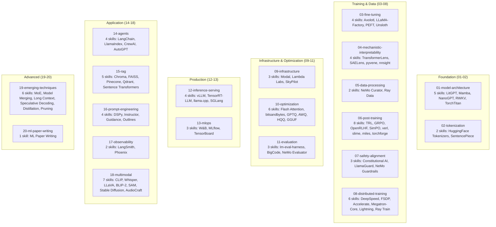
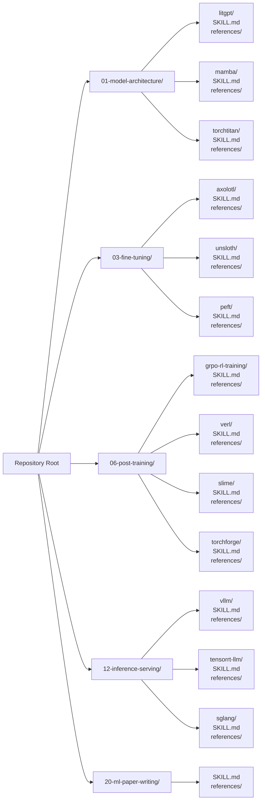
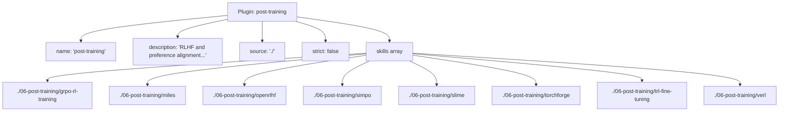
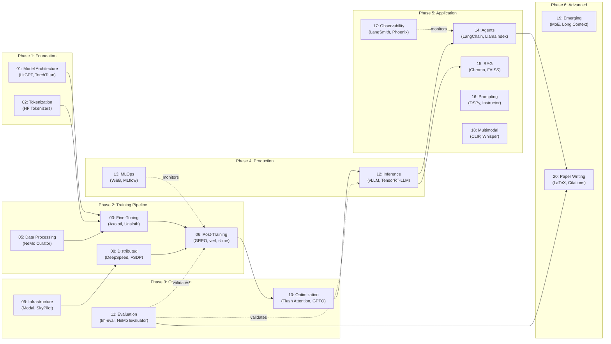
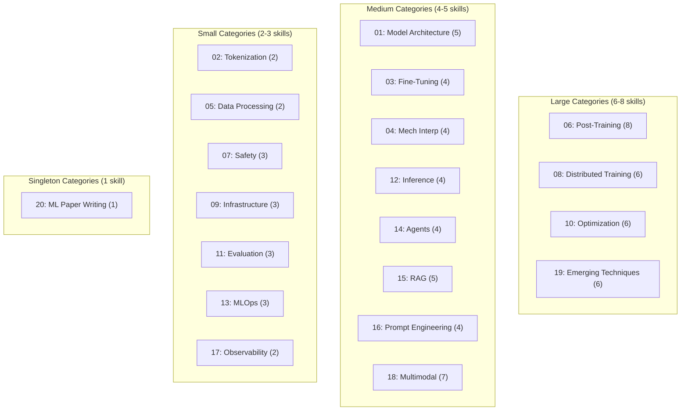
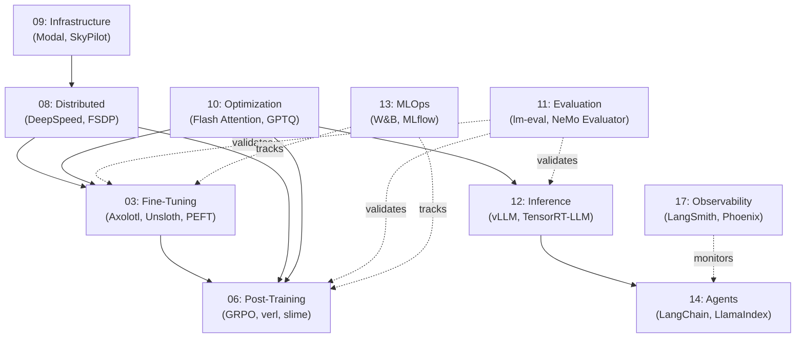

<!-- source: DeepWiki mcp.deepwiki.com · repo Orchestra-Research/AI-research-SKILLs · page 3.1 Taxonomy & Organization · fetched 2026-10-26 -->

# Taxonomy & Organization

<details>
<summary>Relevant source files</summary>

The following files were used as context for generating this wiki page:

- [.claude-plugin/marketplace.json](.claude-plugin/marketplace.json)
- [CONTRIBUTING.md](CONTRIBUTING.md)
- [README.md](README.md)
- [demos/README.md](demos/README.md)
- [docs/ROADMAP.md](docs/ROADMAP.md)
- [docs/SKILL_CREATION_GUIDE.md](docs/SKILL_CREATION_GUIDE.md)
- [docs/SKILL_TEMPLATE.md](docs/SKILL_TEMPLATE.md)
- [docs/assets/promo.gif](docs/assets/promo.gif)
- [docs/christmas-tree.svg](docs/christmas-tree.svg)
- [docs/skills.png](docs/skills.png)
- [docs/tech-tree.svg](docs/tech-tree.svg)

</details>


## Purpose and Scope

This document explains the organizational structure of the 82-skill library, including the 20-category taxonomy, directory naming conventions, numbering system, and how categories map to the AI research lifecycle. For details about individual skills within categories, see Foundation Skills [3.2](#3.2), Training & Data Skills [3.3](#3.3), Infrastructure & Optimization Skills [3.4](#3.4), Production & Serving Skills [3.5](#3.5), Application Skills [3.6](#3.6), and Advanced Skills [3.7](#3.7).

The taxonomy serves three purposes: (1) enables AI agents to discover relevant skills via semantic search, (2) provides logical grouping for the NPM installer's category selection interface, and (3) maps to the Claude Code marketplace plugin structure defined in [.claude-plugin/marketplace.json:1-255]().

**Sources:** [README.md:1-643](), [.claude-plugin/marketplace.json:1-255]()

## Numbering System

Skills are organized into 20 numbered categories using a two-digit prefix format (`01` through `20`). This zero-padded numbering ensures lexicographic sorting aligns with the intended order while providing a stable reference system that remains consistent across documentation, file paths, and marketplace entries.

The numbers follow the AI research lifecycle progression:

| Range | Phase | Categories |
|-------|-------|------------|
| 01-02 | Foundation | Model Architecture, Tokenization |
| 03-08 | Training | Fine-Tuning, Mech Interp, Data Processing, Post-Training, Safety, Distributed Training |
| 09-11 | Optimization | Infrastructure, Optimization, Evaluation |
| 12-13 | Production | Inference & Serving, MLOps |
| 14-18 | Application | Agents, RAG, Prompt Engineering, Observability, Multimodal |
| 19-20 | Advanced | Emerging Techniques, ML Paper Writing |

Each category directory follows the naming pattern `XX-category-name/` where `XX` is the zero-padded number and `category-name` uses lowercase with hyphens. Individual skills within categories use the pattern `XX-category-name/skill-name/`.

**Sources:** [README.md:125-149](), [README.md:386-415]()

## Category Definitions

### Complete Category Reference



**Sources:** [README.md:125-149](), [.claude-plugin/marketplace.json:11-253]()

### Category Metadata Table

The following table maps category numbers to their marketplace plugin definitions and directory structures:

| # | Category Name | Plugin ID | Directory Pattern | Skill Count |
|---|---------------|-----------|-------------------|-------------|
| 01 | Model Architecture | `model-architecture` | `01-model-architecture/*/` | 5 |
| 02 | Tokenization | `tokenization` | `02-tokenization/*/` | 2 |
| 03 | Fine-Tuning | `fine-tuning` | `03-fine-tuning/*/` | 4 |
| 04 | Mech Interp | `mechanistic-interpretability` | `04-mechanistic-interpretability/*/` | 4 |
| 05 | Data Processing | `data-processing` | `05-data-processing/*/` | 2 |
| 06 | Post-Training | `post-training` | `06-post-training/*/` | 8 |
| 07 | Safety & Alignment | `safety-alignment` | `07-safety-alignment/*/` | 3 |
| 08 | Distributed Training | `distributed-training` | `08-distributed-training/*/` | 6 |
| 09 | Infrastructure | `infrastructure` | `09-infrastructure/*/` | 3 |
| 10 | Optimization | `optimization` | `10-optimization/*/` | 6 |
| 11 | Evaluation | `evaluation` | `11-evaluation/*/` | 3 |
| 12 | Inference & Serving | `inference-serving` | `12-inference-serving/*/` | 4 |
| 13 | MLOps | `mlops` | `13-mlops/*/` | 3 |
| 14 | Agents | `agents` | `14-agents/*/` | 4 |
| 15 | RAG | `rag` | `15-rag/*/` | 5 |
| 16 | Prompt Engineering | `prompt-engineering` | `16-prompt-engineering/*/` | 4 |
| 17 | Observability | `observability` | `17-observability/*/` | 2 |
| 18 | Multimodal | `multimodal` | `18-multimodal/*/` | 7 |
| 19 | Emerging Techniques | `emerging-techniques` | `19-emerging-techniques/*/` | 6 |
| 20 | ML Paper Writing | `ml-paper-writing` | `20-ml-paper-writing/` | 1 |

**Sources:** [.claude-plugin/marketplace.json:11-253](), [README.md:386-415]()

## Directory Structure Mapping

### Repository Root to Skill Hierarchy



Each skill directory contains:
- `SKILL.md` with YAML frontmatter (200-500 lines)
- `references/` directory with detailed documentation (300KB+ target)
- Optional `scripts/` for automation tools
- Optional `assets/` for templates and examples

**Sources:** [README.md:386-415](), [CONTRIBUTING.md:260-283]()

## Category Plugin Definitions

The marketplace integration uses plugin objects that map categories to their constituent skills. Each plugin definition in [.claude-plugin/marketplace.json:11-253]() follows this structure:

```json
{
  "name": "plugin-id",
  "description": "What this category does and when to use it",
  "source": "./",
  "strict": false,
  "skills": [
    "./XX-category-name/skill-1",
    "./XX-category-name/skill-2"
  ]
}
```

### Example: Post-Training Category



The `description` field serves as the semantic trigger for AI agent discovery. For example, the post-training plugin description "RLHF and preference alignment including TRL, GRPO, OpenRLHF, SimPO, verl, slime, miles, and torchforge. Use when aligning models with human preferences, training reward models, or large-scale RL training." [.claude-plugin/marketplace.json:71]() contains key terms that match user queries like "reward model" or "preference optimization".

**Sources:** [.claude-plugin/marketplace.json:69-83]()

## Lifecycle Phase Mapping

### Taxonomy as Research Pipeline



This progression reflects the typical AI research workflow:

1. **Foundation (01-02)**: Choose architecture and tokenizer
2. **Training Pipeline (03-08)**: Prepare data, fine-tune, apply RLHF, scale to multiple GPUs
3. **Optimization (09-11)**: Provision infrastructure, optimize kernels, benchmark results
4. **Production (12-13)**: Deploy inference servers, track experiments
5. **Application (14-18)**: Build agents, RAG systems, multimodal apps
6. **Advanced (19-20)**: Experiment with emerging techniques, write papers

Cross-cutting concerns like evaluation (11) and observability (17) support multiple phases via dashed lines in the diagram.

**Sources:** [README.md:125-149](), [docs/ROADMAP.md:10-18]()

## Naming Conventions

### Category Directory Names

Category directories use the format `XX-category-name/` where:
- `XX` is zero-padded (e.g., `01`, `12`, `20`)
- `category-name` uses lowercase with hyphens
- Full words preferred over abbreviations (exception: `mlops`)

Examples from the repository structure:
- `01-model-architecture/` [README.md:394]()
- `06-post-training/` [README.md:399]()
- `12-inference-serving/` [README.md:405]()
- `16-prompt-engineering/` [README.md:409]()

### Skill Directory Names

Skill directories within categories follow `skill-name/` format:
- Lowercase with hyphens
- Framework/tool name verbatim (e.g., `vllm`, `llamaindex`, `deepspeed`)
- Descriptive compound names for conceptual skills (e.g., `grpo-rl-training`, `ml-paper-writing`)

Examples:
- `03-fine-tuning/axolotl/` [README.md:162]()
- `06-post-training/grpo-rl-training/` [README.md:179]()
- `12-inference-serving/vllm/` [README.md:219]()
- `20-ml-paper-writing/` [README.md:270]()

**Sources:** [README.md:386-415](), [CONTRIBUTING.md:260-283]()

### Plugin ID Mapping

Plugin IDs in [.claude-plugin/marketplace.json:1-255]() strip the numeric prefix and use kebab-case:

| Directory | Plugin ID |
|-----------|-----------|
| `01-model-architecture/` | `model-architecture` |
| `03-fine-tuning/` | `fine-tuning` |
| `04-mechanistic-interpretability/` | `mechanistic-interpretability` |
| `06-post-training/` | `post-training` |
| `12-inference-serving/` | `inference-serving` |
| `16-prompt-engineering/` | `prompt-engineering` |

This allows Claude Code users to install categories via `/plugin install fine-tuning@ai-research-skills` commands [README.md:116]().

**Sources:** [.claude-plugin/marketplace.json:11-253](), [README.md:106-123]()

## Category Size Distribution

### Skill Count Analysis



The largest category, Post-Training (8 skills), reflects the diversity of RLHF approaches: traditional (TRL), group-based (GRPO), simple preference (SimPO), and production frameworks (verl, slime, miles, torchforge) [README.md:177-186](). The second-largest categories (Distributed Training, Optimization, Emerging Techniques with 6 skills each) cover broad technique families requiring multiple implementations.

Category 20 (ML Paper Writing) intentionally contains a single comprehensive skill [README.md:269-270]() as it represents a distinct end-to-end workflow rather than a collection of tools.

**Sources:** [README.md:125-149]()

## Category Dependencies

### Cross-Category Skill Relationships



Solid arrows represent direct dependencies (e.g., post-training requires fine-tuning skills as prerequisites). Dashed arrows represent cross-cutting concerns (e.g., evaluation validates training results, observability monitors production agents).

Common dependency patterns:
- Fine-tuning skills often reference distributed training for multi-GPU setups
- Inference serving skills depend on optimization techniques (quantization, kernel optimization)
- Application skills (agents, RAG) depend on inference serving for LLM backends
- Evaluation skills validate outputs from training, post-training, and inference categories

**Sources:** [README.md:125-149](), [demos/README.md:1-137]()

## Discovery Mechanisms

### How AI Agents Find Skills

AI agents discover skills through three mechanisms, all driven by the taxonomy:

**1. YAML Frontmatter Search**

Each `SKILL.md` contains structured metadata [CONTRIBUTING.md:125-151]():

```yaml
---
name: grpo-rl-training
description: Expert guidance for GRPO/RL fine-tuning with TRL for reasoning and task-specific model training
tags: [Reinforcement Learning, GRPO, TRL, Post-Training, RLHF, Reward Modeling]
dependencies: [transformers>=4.47.0, trl>=0.14.0]
---
```

Agents extract the `description` and `tags` fields to match user queries. For example, a query "train reward model" matches the tag "Reward Modeling" in the GRPO skill.

**2. Category Plugin Descriptions**

The [.claude-plugin/marketplace.json:1-255]() descriptions serve as category-level search targets:

```json
{
  "name": "post-training",
  "description": "RLHF and preference alignment including TRL, GRPO, OpenRLHF, SimPO, verl, slime, miles, and torchforge. Use when aligning models with human preferences, training reward models, or large-scale RL training."
}
```

This allows agents to narrow to a category before examining individual skills.

**3. README Category Tables**

The README skill listing [README.md:125-149]() provides a human-readable overview that agents can parse to understand category boundaries and skill groupings.

**Sources:** [.claude-plugin/marketplace.json:69-83](), [CONTRIBUTING.md:125-151](), [README.md:125-149]()

## Extensibility

### Adding New Categories

The taxonomy is designed to accommodate new categories as the AI research landscape evolves. The current system supports up to category 99 before requiring three-digit prefixes, providing room for 79 additional categories.

To add a new category:

1. Choose the next available number in the appropriate lifecycle phase
2. Create directory `XX-new-category-name/` following naming conventions
3. Add plugin definition to [.claude-plugin/marketplace.json:1-255]() with `name`, `description`, and `skills` array
4. Update README category table [README.md:125-149]()
5. Update ROADMAP [docs/ROADMAP.md:1-217]() with the new category milestone

Example hypothetical addition (category 21):

```
21-model-compression/
├── llm-pruning/
│   ├── SKILL.md
│   └── references/
└── neural-architecture-search/
    ├── SKILL.md
    └── references/
```

**Sources:** [CONTRIBUTING.md:260-283](), [docs/ROADMAP.md:189-217]()

### Skill-Level Organization

Within each category, skills are independent—no enforced ordering or dependencies between sibling skills in the same directory. The NPM installer presents skills in alphabetical order [README.md:76-104](), and the marketplace.json skills arrays list them in the same order [.claude-plugin/marketplace.json:11-253]().

This flat structure within categories allows parallel development: multiple contributors can add skills to the same category without coordination beyond avoiding naming collisions.

**Sources:** [.claude-plugin/marketplace.json:11-253](), [README.md:76-104]()

---

