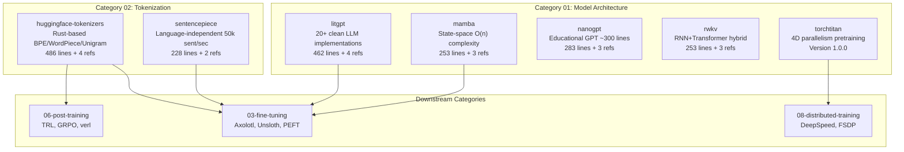
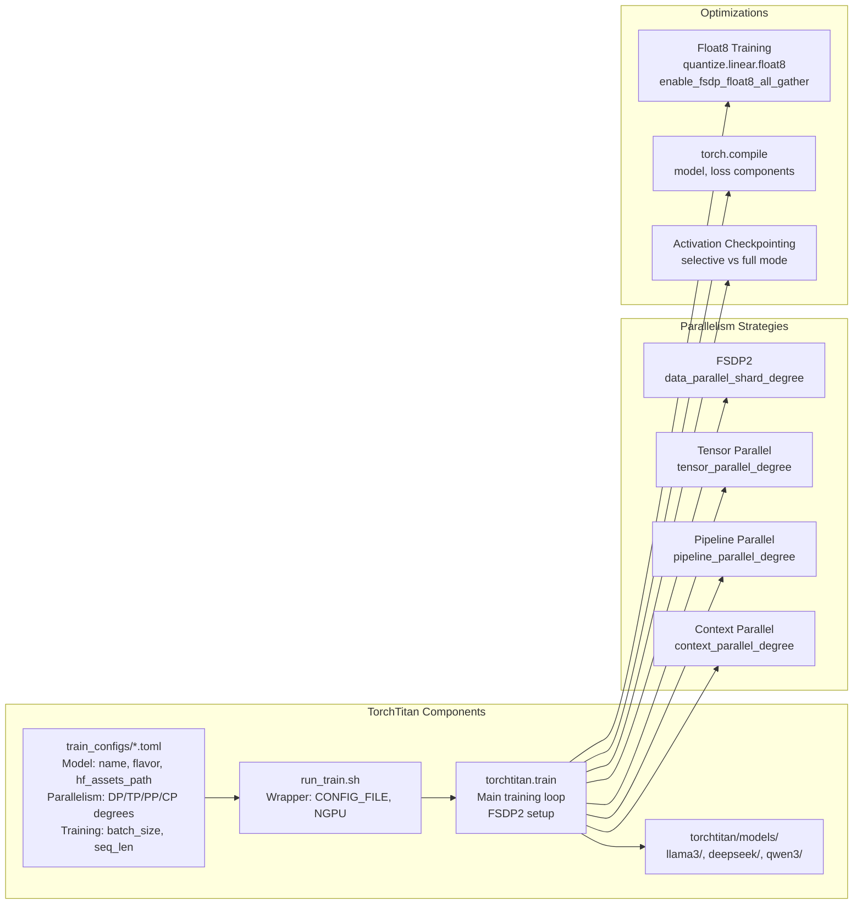
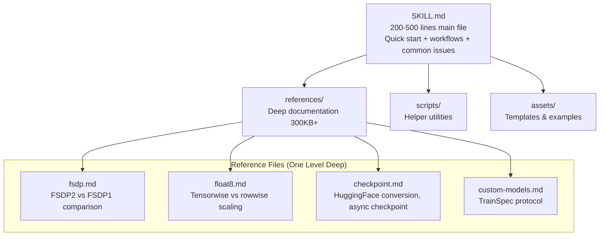
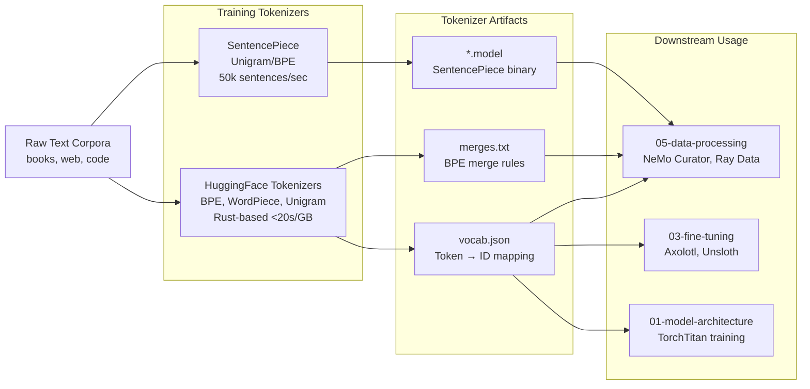
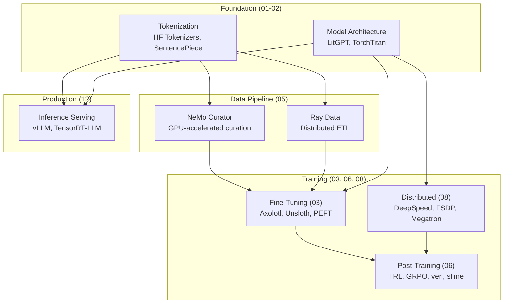

<!-- source: DeepWiki mcp.deepwiki.com · repo Orchestra-Research/AI-research-SKILLs · page 3.2 Foundation Skills (Categories 01-02) · fetched 2026-10-26 -->

# Foundation Skills (Categories 01-02)

<details>
<summary>Relevant source files</summary>

The following files were used as context for generating this wiki page:

- [.claude-plugin/marketplace.json](.claude-plugin/marketplace.json)
- [01-model-architecture/torchtitan/SKILL.md](01-model-architecture/torchtitan/SKILL.md)
- [06-post-training/miles/SKILL.md](06-post-training/miles/SKILL.md)
- [06-post-training/slime/SKILL.md](06-post-training/slime/SKILL.md)
- [06-post-training/torchforge/SKILL.md](06-post-training/torchforge/SKILL.md)
- [06-post-training/verl/SKILL.md](06-post-training/verl/SKILL.md)
- [20-ml-paper-writing/SKILL.md](20-ml-paper-writing/SKILL.md)
- [CONTRIBUTING.md](CONTRIBUTING.md)
- [README.md](README.md)
- [demos/README.md](demos/README.md)
- [docs/ROADMAP.md](docs/ROADMAP.md)
- [docs/SKILL_CREATION_GUIDE.md](docs/SKILL_CREATION_GUIDE.md)
- [docs/SKILL_TEMPLATE.md](docs/SKILL_TEMPLATE.md)
- [docs/assets/promo.gif](docs/assets/promo.gif)
- [docs/christmas-tree.svg](docs/christmas-tree.svg)
- [docs/tech-tree.svg](docs/tech-tree.svg)
- [docs/writing-assets/ML_paper_guide.md](docs/writing-assets/ML_paper_guide.md)
- [docs/writing-assets/ml_paper_writing_sources.md](docs/writing-assets/ml_paper_writing_sources.md)

</details>


## Purpose and Scope

This page documents the Foundation Skills layer, comprising **Category 01 (Model Architecture)** and **Category 02 (Tokenization)**. These 7 skills provide the base implementations and tokenization frameworks that subsequent training, optimization, and production workflows depend on. Model architecture skills cover transformer implementations, alternative architectures, and distributed pretraining, while tokenization skills handle text-to-token conversion for LLM training pipelines.

For training workflows that build on these foundations, see [Training & Data Skills](#3.3). For production deployment, see [Production & Serving Skills](#3.5).

---

## Foundation Layer Architecture

The foundation skills form the base of the AI research pipeline, providing model implementations and tokenization that all downstream categories depend on.



**Foundation Skills Dependency Flow**

Sources: [README.md:127-160](), [.claude-plugin/marketplace.json:12-34]()

---

## Category 01: Model Architecture

Model architecture skills provide production-ready and educational implementations of transformer and alternative architectures, ranging from educational codebases to enterprise-scale pretraining frameworks.

### Skill Inventory

| Skill Name | Directory | Primary Use Case | Model Support | Parallelism |
|------------|-----------|------------------|---------------|-------------|
| **LitGPT** | `01-model-architecture/litgpt/` | Clean LLM implementations with training recipes | 20+ models (Llama, GPT, Phi, Gemma) | FSDP, TP |
| **Mamba** | `01-model-architecture/mamba/` | State-space models for long sequences | Mamba-130M to 2.8B | Standard training |
| **NanoGPT** | `01-model-architecture/nanogpt/` | Educational GPT understanding | GPT-2 style | Single GPU |
| **RWKV** | `01-model-architecture/rwkv/` | Linear complexity alternative | RWKV-4, RWKV-5 | Custom parallel |
| **TorchTitan** | `01-model-architecture/torchtitan/` | Production-scale pretraining | Llama 3.1/4, DeepSeek V3 | FSDP2+TP+PP+CP |

Sources: [README.md:150-156](), [.claude-plugin/marketplace.json:17-23]()

### TorchTitan Architecture Details

TorchTitan represents the production-grade end of model architecture skills, implementing PyTorch's official pretraining platform with composable 4D parallelism.



**TorchTitan System Architecture**

Sources: [01-model-architecture/torchtitan/SKILL.md:1-359]()

### Model Architecture Frontmatter Structure

All model architecture skills follow the YAML frontmatter standard:

```yaml
---
name: distributed-llm-pretraining-torchtitan
description: Provides PyTorch-native distributed LLM pretraining using torchtitan with 4D parallelism (FSDP2, TP, PP, CP). Use when pretraining Llama 3.1, DeepSeek V3, or custom models at scale from 8 to 512+ GPUs with Float8, torch.compile, and distributed checkpointing.
version: 1.0.0
author: Orchestra Research
license: MIT
tags: [Model Architecture, Distributed Training, TorchTitan, FSDP2, Tensor Parallel, Pipeline Parallel, Context Parallel, Float8, Llama, Pretraining]
dependencies: [torch>=2.6.0, torchtitan>=0.2.0, torchao>=0.5.0]
---
```

Key fields:
- **`name`**: Kebab-case identifier (e.g., `distributed-llm-pretraining-torchtitan`)
- **`description`**: Third-person usage guidance including triggers ("Use when...")
- **`tags`**: Title Case terms with UPPERCASE acronyms (FSDP2, TP, PP)
- **`dependencies`**: Version-constrained packages with `>=` operators

Sources: [01-model-architecture/torchtitan/SKILL.md:1-9](), [CONTRIBUTING.md:129-196]()

### Skill Content Organization Pattern



**Standard Skill Directory Structure**

The progressive disclosure pattern keeps SKILL.md under 500 lines while maintaining comprehensive documentation in separate reference files. Reference depth is limited to one level to avoid nested complexity.

Sources: [01-model-architecture/torchtitan/SKILL.md:344-351](), [docs/SKILL_CREATION_GUIDE.md:48-64]()

---

## Category 02: Tokenization

Tokenization skills handle text-to-token conversion, providing the preprocessing layer for all LLM training pipelines. The two skills cover complementary approaches: subword tokenization (HuggingFace Tokenizers) and language-independent unigram segmentation (SentencePiece).

### Tokenization Workflow Integration



**Tokenizer Training and Usage Flow**

Sources: [README.md:157-160](), [.claude-plugin/marketplace.json:25-34]()

### Tokenization Skills Comparison

| Feature | HuggingFace Tokenizers | SentencePiece |
|---------|----------------------|---------------|
| **Primary Algorithm** | BPE, WordPiece, Unigram | Unigram, BPE |
| **Implementation** | Rust core, Python bindings | C++ with Python bindings |
| **Training Speed** | <20 seconds per GB | 50k sentences/sec |
| **Language Support** | Multi-lingual with language-specific handling | Language-independent by design |
| **Preprocessing** | Configurable normalizers, pre-tokenizers | Unified whitespace handling |
| **Special Tokens** | Full control via special_tokens_map.json | Built-in <unk>, <s>, </s> |
| **Integration** | Native HuggingFace ecosystem | Used by T5, ALBERT, Llama |
| **Output Format** | Fast JSON, Slow legacy | Binary .model + .vocab |
| **Typical Use Case** | Modern transformer training | Language-independent models |

Sources: [README.md:157-160]()

### Plugin Marketplace Definitions

The tokenization category is exposed via Claude plugin marketplace with unified descriptions:

```json
{
  "name": "tokenization",
  "description": "Text tokenization for LLMs including HuggingFace Tokenizers and SentencePiece. Use when training custom tokenizers or handling multilingual text.",
  "source": "./",
  "strict": false,
  "skills": [
    "./02-tokenization/huggingface-tokenizers",
    "./02-tokenization/sentencepiece"
  ]
}
```

The `description` field provides discovery triggers ("Use when training custom tokenizers...") that help AI agents determine when to load these skills.

Sources: [.claude-plugin/marketplace.json:25-34]()

---

## Skill Metadata Standards

All foundation skills adhere to standardized YAML frontmatter for consistency and discoverability.

### Required Frontmatter Fields

```yaml
---
name: skill-identifier-kebab-case
description: Third-person description including what it does and when to use it. Maximum 1024 characters with concrete triggers.
version: MAJOR.MINOR.PATCH
author: Orchestra Research
license: MIT
tags: [Title Case Tags, UPPERCASE Acronyms, Key Concepts]
dependencies: [package>=min.version, optional-package]
---
```

### Field Validation Rules

| Field | Format | Validation | Example |
|-------|--------|------------|---------|
| `name` | kebab-case | No spaces, lowercase, hyphens | `distributed-llm-pretraining-torchtitan` |
| `description` | Plain text | No quotes, includes "Use when..." | Provides PyTorch-native... Use when pretraining... |
| `version` | Semantic | `MAJOR.MINOR.PATCH` | `1.0.0` |
| `tags` | Array | Title Case, no quotes | `[Model Architecture, FSDP2, Float8]` |
| `dependencies` | Array | Include `>=` constraints | `[torch>=2.6.0, torchtitan>=0.2.0]` |

### Tag Capitalization Standards

- **Title Case**: Regular words (`Model Architecture`, `Distributed Training`)
- **UPPERCASE**: Acronyms and initialisms (`FSDP2`, `TP`, `PP`, `CP`, `Float8`)
- **No quotes**: Tags are bare array elements

Sources: [CONTRIBUTING.md:129-196](), [01-model-architecture/torchtitan/SKILL.md:1-9]()

---

## Directory Structure Convention

Foundation skills follow a standardized directory layout enabling progressive disclosure:

```
XX-category-name/
├── skill-name/
│   ├── SKILL.md              # Main file: 200-500 lines (target 200-300)
│   │                         # - YAML frontmatter (required)
│   │                         # - Quick start section
│   │                         # - 2-3 workflows with checklists
│   │                         # - When to use vs alternatives
│   │                         # - Common issues with solutions
│   │                         # - Links to references/
│   │
│   ├── references/           # Deep documentation (300KB+ total)
│   │   ├── README.md         # From official repo/docs
│   │   ├── api.md            # API reference
│   │   ├── tutorials.md      # Step-by-step guides
│   │   ├── issues.md         # Real GitHub issues (if applicable)
│   │   ├── releases.md       # Version history
│   │   └── file_structure.md # Codebase navigation
│   │
│   ├── scripts/              # Helper scripts (optional)
│   │   └── validate.py
│   │
│   └── assets/               # Templates & examples (optional)
│       └── config_template.toml
```

### Line Count Distribution

Across the 7 foundation skills:

| Skill | SKILL.md Lines | Reference Count | Total Documentation |
|-------|---------------|-----------------|---------------------|
| LitGPT | 462 | 4 files | Comprehensive |
| Mamba | 253 | 3 files | Standard |
| NanoGPT | 283 | 3 files | Standard |
| RWKV | 253 | 3 files | Standard |
| TorchTitan | 359 | 4+ files | Comprehensive |
| HuggingFace Tokenizers | 486 | 4 files | Comprehensive |
| SentencePiece | 228 | 2 files | Standard |

**Average**: 332 lines per SKILL.md (within 200-500 target range)

The 200-300 line target is recommended but not strictly enforced; comprehensive skills like HuggingFace Tokenizers (486 lines) exceed this when necessary for clarity.

Sources: [README.md:150-160](), [CONTRIBUTING.md:82-112](), [docs/SKILL_CREATION_GUIDE.md:48-64]()

---

## Workflow Pattern: Multi-Step Tasks

Foundation skills implement copy-paste workflow checklists for complex multi-step tasks:

### TorchTitan Multi-Node Training Example

```markdown
## Workflow 2: Multi-node training with SLURM

```
Multi-Node Training:
- [ ] Step 1: Configure parallelism for scale
- [ ] Step 2: Set up SLURM script
- [ ] Step 3: Submit job
- [ ] Step 4: Resume from checkpoint
```

**Step 1: Configure parallelism for scale**

For 70B model on 256 GPUs (32 nodes):
```toml
[parallelism]
data_parallel_shard_degree = 32  # FSDP across 32 ranks
tensor_parallel_degree = 8        # TP within node
pipeline_parallel_degree = 1      # No PP for 70B
context_parallel_degree = 1       # Increase for long sequences
```
```

This pattern:
1. Provides copy-paste checklist at workflow start
2. Breaks complex tasks into discrete steps
3. Includes validation steps ("Resume from checkpoint")
4. Assumes Claude knows basics (no over-explanation)

Sources: [01-model-architecture/torchtitan/SKILL.md:123-171](), [docs/SKILL_CREATION_GUIDE.md:67-112]()

---

## Integration with Training Pipeline

Foundation skills feed into downstream training categories:



**Cross-Category Dependencies**

Foundation skills are referenced by 6 downstream categories, making them the most frequently depended-upon layer in the skill taxonomy.

Sources: [README.md:386-414](), Diagram 4 from system architecture context

---

## Quality Standards for Foundation Skills

Foundation skills must meet elevated quality bars as they form the base layer:

### Gold Standard Requirements

- **SKILL.md**: 200-500 lines with YAML frontmatter
- **Progressive disclosure**: Main file links to references/, no nested references
- **Workflows**: 2-3 copy-paste checklists for complex tasks
- **Validation**: "When to use vs alternatives" section required
- **Documentation size**: 300KB+ total across all reference files
- **Code examples**: Language-tagged code blocks (```python, ```bash)
- **Issue coverage**: Real GitHub issues with solutions (when applicable)

### Validation Checklist

```bash
# Check YAML frontmatter validity
python -c "import yaml; yaml.safe_load(open('SKILL.md').read().split('---')[1])"

# Verify line count (target 200-300, max 500)
wc -l SKILL.md

# Check reference documentation size (target 300KB+)
du -sh references/

# Verify workflow checklists present
grep -A 5 "Step 1:" SKILL.md
```

Sources: [CONTRIBUTING.md:82-112](), [docs/SKILL_CREATION_GUIDE.md:1-370]()

---

## Marketplace Discovery Mechanisms

Foundation skills are discoverable through multiple channels:

### Claude Plugin Marketplace

Skills are bundled into category-level plugins:

```json
{
  "plugins": [
    {
      "name": "model-architecture",
      "description": "LLM architectures and implementations including LitGPT, Mamba, NanoGPT, RWKV, and TorchTitan. Use when implementing, training, or understanding transformer and alternative architectures.",
      "skills": [
        "./01-model-architecture/litgpt",
        "./01-model-architecture/mamba",
        "./01-model-architecture/nanogpt",
        "./01-model-architecture/rwkv",
        "./01-model-architecture/torchtitan"
      ]
    }
  ]
}
```

Installation via Claude Code CLI:
```bash
/plugin marketplace add orchestra-research/AI-research-SKILLs
/plugin install model-architecture@ai-research-skills
```

### NPM Package Installer

Alternative installation via `@orchestra-research/ai-research-skills`:

```bash
npx @orchestra-research/ai-research-skills
# Interactive wizard detects agents → installs to ~/.orchestra/skills/ → creates symlinks
```

Sources: [.claude-plugin/marketplace.json:11-24](), [README.md:77-123]()

---

## Relationship to Other Documentation

- **Category taxonomy overview**: See [Skills Library](#3) for complete 20-category structure
- **Training workflows using these skills**: See [Training & Data Skills](#3.3) for fine-tuning, post-training
- **Production deployment**: See [Production & Serving Skills](#3.5) for inference using trained models
- **Skill creation guidelines**: See [Contributing New Skills](#5) for adding new foundation skills
- **System architecture**: See [Distribution Channels](#6.1) for how skills are packaged and delivered

Sources: Table of contents from context

---

