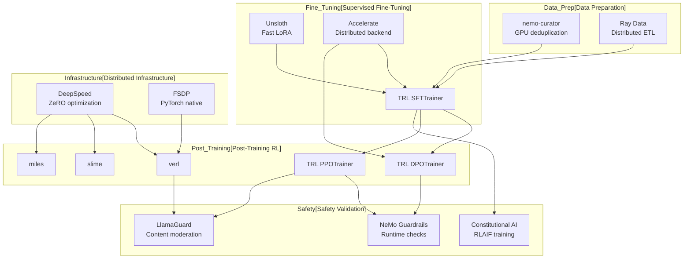

<!-- source: DeepWiki mcp.deepwiki.com · repo Orchestra-Research/AI-research-SKILLs · page 3.3 Training & Data Skills (Categories 03-08) · fetched 2026-10-26 -->

# Training & Data Skills (Categories 03-08)

<details>
<summary>Relevant source files</summary>

The following files were used as context for generating this wiki page:

- [01-model-architecture/torchtitan/SKILL.md](01-model-architecture/torchtitan/SKILL.md)
- [03-fine-tuning/unsloth/SKILL.md](03-fine-tuning/unsloth/SKILL.md)
- [05-data-processing/nemo-curator/SKILL.md](05-data-processing/nemo-curator/SKILL.md)
- [05-data-processing/ray-data/SKILL.md](05-data-processing/ray-data/SKILL.md)
- [06-post-training/grpo-rl-training/SKILL.md](06-post-training/grpo-rl-training/SKILL.md)
- [06-post-training/miles/SKILL.md](06-post-training/miles/SKILL.md)
- [06-post-training/openrlhf/SKILL.md](06-post-training/openrlhf/SKILL.md)
- [06-post-training/simpo/SKILL.md](06-post-training/simpo/SKILL.md)
- [06-post-training/slime/SKILL.md](06-post-training/slime/SKILL.md)
- [06-post-training/torchforge/SKILL.md](06-post-training/torchforge/SKILL.md)
- [06-post-training/trl-fine-tuning/SKILL.md](06-post-training/trl-fine-tuning/SKILL.md)
- [06-post-training/verl/SKILL.md](06-post-training/verl/SKILL.md)
- [07-safety-alignment/constitutional-ai/SKILL.md](07-safety-alignment/constitutional-ai/SKILL.md)
- [07-safety-alignment/llamaguard/SKILL.md](07-safety-alignment/llamaguard/SKILL.md)
- [07-safety-alignment/nemo-guardrails/SKILL.md](07-safety-alignment/nemo-guardrails/SKILL.md)
- [08-distributed-training/accelerate/SKILL.md](08-distributed-training/accelerate/SKILL.md)
- [08-distributed-training/deepspeed/SKILL.md](08-distributed-training/deepspeed/SKILL.md)
- [20-ml-paper-writing/SKILL.md](20-ml-paper-writing/SKILL.md)
- [docs/writing-assets/ML_paper_guide.md](docs/writing-assets/ML_paper_guide.md)
- [docs/writing-assets/ml_paper_writing_sources.md](docs/writing-assets/ml_paper_writing_sources.md)

</details>


This page covers the skills library's tools for training LLMs after initial pretraining, spanning six categories: fine-tuning (03), mechanistic interpretability (04), data processing (05), post-training reinforcement learning (06), safety alignment (07), and distributed training infrastructure (08). These skills enable the complete pipeline from raw data curation through supervised fine-tuning, RLHF alignment, safety validation, and production deployment.

**Related pages**: For pretraining from scratch, see [Foundation Skills (Categories 01-02)](#3.2). For production deployment and serving, see [Production & Serving Skills (Categories 12-13)](#3.5). For infrastructure orchestration, see [Infrastructure & Optimization Skills (Categories 09-11)](#3.4).

---

## Skill Taxonomy Overview

The training and data skills are organized into 27 individual skills across 6 categories, representing the largest group in the library. This reflects the complexity and diversity of the post-pretraining phase where models are adapted for specific use cases.

```mermaid
graph TB
    subgraph "03_Fine-Tuning[03 Fine-Tuning - 6 skills]"
        unsloth["unsloth<br/>2-5× faster LoRA/QLoRA<br/>50-80% memory reduction"]
        axolotl["axolotl<br/>YAML-based training<br/>Multi-task SFT"]
        peft["PEFT<br/>Parameter-efficient methods<br/>LoRA, QLoRA, prefix tuning"]
        torchtune["torchtune<br/>PyTorch native<br/>Recipe-based training"]
    end
    
    subgraph "05_Data[05 Data Processing - 4 skills]"
        nemo_curator["nemo-curator<br/>GPU-accelerated curation<br/>16× faster deduplication"]
        ray_data["Ray Data<br/>Distributed ETL<br/>Scalable preprocessing"]
    end
    
    subgraph "06_PostTrain[06 Post-Training - 10 skills]"
        trl["TRL<br/>SFT, DPO, PPO, GRPO<br/>HuggingFace standard"]
        simpo["SimPO<br/>Reference-free DPO<br/>+6.4 AlpacaEval points"]
        verl["verl<br/>Flexible backends<br/>FSDP/Megatron/vLLM"]
        slime["slime<br/>Megatron+SGLang<br/>Powers GLM-4.x"]
        miles["miles<br/>Enterprise slime fork<br/>FP8/INT4 + Speculative RL"]
        torchforge["torchforge<br/>PyTorch-native<br/>Monarch actor system"]
        openrlhf["OpenRLHF<br/>Ray+vLLM<br/>2× faster than DeepSpeedChat"]
    end
    
    subgraph "07_Safety[07 Safety & Alignment - 4 skills]"
        nemo_guardrails["NeMo Guardrails<br/>Runtime safety<br/>Colang 2.0 DSL"]
        llamaguard["LlamaGuard<br/>7-8B moderation<br/>6 safety categories"]
        constitutional_ai["Constitutional AI<br/>RLAIF self-critique<br/>Powers Claude safety"]
    end
    
    subgraph "08_Distributed[08 Distributed Training - 3 skills]"
        deepspeed["DeepSpeed<br/>ZeRO-1/2/3<br/>8× memory reduction"]
        accelerate["Accelerate<br/>Unified API<br/>4-line distributed"]
        fsdp["FSDP<br/>PyTorch native<br/>Fully sharded"]
    end
    
    unsloth --> trl
    axolotl --> trl
    nemo_curator --> trl
    ray_data --> trl
    
    trl --> nemo_guardrails
    trl --> llamaguard
    
    deepspeed --> verl
    deepspeed --> slime
    deepspeed --> miles
    deepspeed --> openrlhf
    accelerate --> trl
    accelerate --> torchforge
    
    style 03_Fine-Tuning fill:#f9f9f9
    style 05_Data fill:#f9f9f9
    style 06_PostTrain fill:#f9f9f9
    style 07_Safety fill:#f9f9f9
    style 08_Distributed fill:#f9f9f9
```



**Skill taxonomy by category**

Sources: [03-fine-tuning/unsloth/SKILL.md:1-80](), [05-data-processing/nemo-curator/SKILL.md:1-50](), [06-post-training/verl/SKILL.md:1-50](), [06-post-training/slime/SKILL.md:1-50](), [06-post-training/miles/SKILL.md:1-50](), [06-post-training/torchforge/SKILL.md:1-50](), [06-post-training/trl-fine-tuning/SKILL.md:1-50](), [06-post-training/simpo/SKILL.md:1-50](), [06-post-training/openrlhf/SKILL.md:1-50](), [07-safety-alignment/nemo-guardrails/SKILL.md:1-50](), [07-safety-alignment/llamaguard/SKILL.md:1-50](), [07-safety-alignment/constitutional-ai/SKILL.md:1-50](), [08-distributed-training/deepspeed/SKILL.md:1-50](), [08-distributed-training/accelerate/SKILL.md:1-50]()

---

## Category 03: Fine-Tuning

Fine-tuning skills provide memory-efficient methods for adapting pretrained models to specific tasks using supervised learning. The primary optimization is parameter-efficient fine-tuning (PEFT), which trains only a small fraction of model parameters.

### Unsloth: Accelerated LoRA Training

Unsloth provides 2-5× training speedup and 50-80% memory reduction through optimized LoRA/QLoRA implementations. It achieves this by replacing standard PyTorch operations with hand-written kernels.

**Key features**:
- **Fast LoRA**: Optimized backward pass for LoRA adapters
- **Memory efficiency**: 80% VRAM reduction via 4-bit quantization (QLoRA)
- **Model support**: Llama, Mistral, Gemma, Qwen
- **Integration**: Works with TRL's `SFTTrainer`

**Configuration pattern** [03-fine-tuning/unsloth/SKILL.md:24-80]():
```python
from unsloth import FastLanguageModel

model, tokenizer = FastLanguageModel.from_pretrained(
    model_name="unsloth/llama-3-8b-bnb-4bit",
    max_seq_length=2048,
    dtype=None,  # Auto-detect
    load_in_4bit=True  # QLoRA quantization
)

model = FastLanguageModel.get_peft_model(
    model,
    r=16,                # LoRA rank
    target_modules=["q_proj", "k_proj", "v_proj", "o_proj"],
    lora_alpha=16,
    lora_dropout=0
)
```

**Training invocation**:
The skill integrates with TRL's `SFTTrainer` for supervised fine-tuning. Training scripts typically use `trl.SFTTrainer` with Unsloth-loaded models.

### Axolotl: YAML-Based Training Framework

While not detailed in the provided files, Axolotl is referenced as a YAML-based training configuration system that supports multi-task SFT and various fine-tuning methods.

Sources: [03-fine-tuning/unsloth/SKILL.md:1-80]()

---

## Category 05: Data Processing

Data processing skills handle the ETL pipeline for preparing high-quality training datasets from raw sources like Common Crawl. The primary optimization is GPU acceleration, which provides 16× speedup over CPU-based alternatives.

### NeMo Curator: GPU-Accelerated Data Curation

NeMo Curator processes text, image, video, and audio data using RAPIDS for GPU acceleration. It achieved 16× faster fuzzy deduplication on the 8TB RedPajama v2 dataset compared to CPU baselines.

```mermaid
graph TB
    subgraph "Data_Curation_Pipeline[NeMo Curator Pipeline]"
        raw["Raw Data<br/>Common Crawl<br/>Web scrapes<br/>Parquet files"]
        
        quality["Stage 1: Quality Filtering<br/>WordCountFilter<br/>RepeatedLinesFilter<br/>UrlRatioFilter<br/>NonAlphaNumericFilter"]
        
        exact["Stage 2: Exact Deduplication<br/>ExactDuplicates module<br/>Hash-based matching"]
        
        fuzzy["Stage 3: Fuzzy Deduplication<br/>FuzzyDuplicates module<br/>MinHash + LSH<br/>16× faster on GPU"]
        
        semantic["Stage 4: Semantic Deduplication<br/>SemanticDuplicates module<br/>Embedding similarity"]
        
        pii["Stage 5: PII Redaction<br/>PIIRedactor modifier<br/>EMAIL_ADDRESS<br/>PHONE_NUMBER<br/>PERSON, LOCATION"]
        
        classifier["Stage 6: Quality Classification<br/>QualityClassifier<br/>nvidia/quality-classifier-deberta"]
        
        curated["Curated Dataset<br/>High-quality training data"]
    end
    
    raw --> quality
    quality --> exact
    exact --> fuzzy
    fuzzy --> semantic
    semantic --> pii
    pii --> classifier
    classifier --> curated
```



**NeMo Curator data processing pipeline**

**Installation and initialization** [05-data-processing/nemo-curator/SKILL.md:36-48]():
```bash
# Text curation with CUDA 12
uv pip install "nemo-curator[text_cuda12]"

# All modalities (text, image, video, audio)
uv pip install "nemo-curator[all_cuda12]"
```

**Pipeline implementation** [05-data-processing/nemo-curator/SKILL.md:50-73]():
```python
from nemo_curator import ScoreFilter, Modify
from nemo_curator.datasets import DocumentDataset
from nemo_curator.modules import ExactDuplicates, FuzzyDuplicates
from nemo_curator.filters import WordCountFilter, RepeatedLinesFilter

# Load data
dataset = DocumentDataset.from_parquet("input/")

# Stage 1: Quality filters
dataset = dataset.filter(WordCountFilter(min_words=50, max_words=100000))
dataset = dataset.filter(RepeatedLinesFilter(max_repeated_line_fraction=0.3))

# Stage 2-3: Deduplication
dataset = ExactDuplicates(id_field="id", text_field="text")(dataset)
dataset = FuzzyDuplicates(
    id_field="id",
    text_field="text",
    num_hashes=260,
    num_buckets=20
)(dataset)

# Save curated data
dataset.to_parquet("curated_data/")
```

**Performance metrics** [05-data-processing/nemo-curator/SKILL.md:174-180]():

| Operation | CPU (16 cores) | GPU (A100) | Speedup |
|-----------|----------------|------------|---------|
| Fuzzy dedup (8TB) | 120 hours | 7.5 hours | 16× |
| Exact dedup (1TB) | 8 hours | 0.5 hours | 16× |
| Quality filtering | 2 hours | 0.2 hours | 10× |

**GPU scaling** [05-data-processing/nemo-curator/SKILL.md:182-192]():
```python
from nemo_curator import get_client

# Initialize 8-GPU cluster
client = get_client(cluster_type="gpu", n_workers=8)

# Process with multi-GPU
deduped = FuzzyDuplicates(...)(dataset)
```

### Ray Data: Distributed ETL

Ray Data provides distributed data processing for ML workloads, complementing NeMo Curator for CPU-based or hybrid workflows.

Sources: [05-data-processing/nemo-curator/SKILL.md:1-300]()

---

## Category 06: Post-Training

Post-training skills implement reinforcement learning from human feedback (RLHF) and preference optimization. This is the largest category with 10 skills, reflecting the complexity of aligning models with human preferences.

### Architecture Comparison: RLHF Frameworks

The post-training landscape features seven major frameworks with distinct architectural choices. The key differentiator is the **backend pairing**: which training framework is used for the actor model, and which inference engine is used for rollout generation.

```mermaid
graph TB
    subgraph "TRL_Stack[TRL - HuggingFace Standard]"
        trl_trainer["SFTTrainer<br/>DPOTrainer<br/>PPOTrainer<br/>GRPOTrainer<br/>RewardTrainer"]
        trl_backend["Backend: HuggingFace Transformers<br/>Inference: HuggingFace generate"]
        trl_integration["Integration: Accelerate<br/>Mixed precision: FP16/BF16<br/>Distributed: DDP/FSDP"]
    end
    
    subgraph "verl_Stack[verl - Flexible Backends]"
        verl_trainer["HybridFlow controller<br/>ActorRolloutRefWorker<br/>CriticWorker<br/>RewardManager"]
        verl_backend["Training: FSDP/FSDP2/Megatron<br/>Inference: vLLM/SGLang/HF"]
        verl_algo["Algorithms: PPO, GRPO, DAPO<br/>RLOO, REINFORCE++"]
    end
    
    subgraph "slime_Stack[slime - Megatron Native]"
        slime_trainer["RolloutDataSource<br/>RolloutDataSourceWithBuffer<br/>AsyncTrainer"]
        slime_backend["Training: Megatron-LM<br/>Inference: SGLang-router"]
        slime_models["Models: GLM-4.x, Qwen3<br/>DeepSeek V3, Llama 3"]
    end
    
    subgraph "miles_Stack[miles - Enterprise Production]"
        miles_trainer["Inherits slime API<br/>Speculative RL<br/>MTP training"]
        miles_backend["Training: Megatron-LM<br/>Inference: SGLang<br/>Precision: FP8/INT4"]
        miles_features["R3: Rollout Routing Replay<br/>TIS/MIS: Importance sampling<br/>Zero-copy weight sync"]
    end
    
    subgraph "torchforge_Stack[torchforge - PyTorch Native]"
        torchforge_trainer["Forge API<br/>Episode/Group dataclasses<br/>Service interfaces"]
        torchforge_backend["Training: TorchTitan FSDP<br/>Inference: vLLM<br/>Sync: TorchStore"]
        torchforge_algo["Monarch actor system<br/>SimpleGRPOLoss<br/>ReinforceLoss"]
    end
    
    subgraph "OpenRLHF_Stack[OpenRLHF - Ray Distributed]"
        openrlhf_trainer["Ray job submission<br/>Hybrid Engine<br/>vLLM sleep mode"]
        openrlhf_backend["Training: DeepSpeed ZeRO-3<br/>Inference: vLLM<br/>Orchestration: Ray"]
        openrlhf_perf["2× faster than DeepSpeedChat<br/>GPU colocation"]
    end
    
    subgraph "SimPO_Stack[SimPO - Reference-Free]"
        simpo_trainer["Reference-free DPO<br/>Alignment Handbook"]
        simpo_backend["No reference model<br/>Target reward margin"]
        simpo_perf["+6.4 AlpacaEval 2.0<br/>Simpler than DPO"]
    end
```



**Post-training framework architecture landscape**

Sources: [06-post-training/verl/SKILL.md:1-100](), [06-post-training/slime/SKILL.md:1-100](), [06-post-training/miles/SKILL.md:1-100](), [06-post-training/torchforge/SKILL.md:1-100](), [06-post-training/openrlhf/SKILL.md:1-100](), [06-post-training/trl-fine-tuning/SKILL.md:1-100](), [06-post-training/simpo/SKILL.md:1-100]()

### TRL: HuggingFace Standard

TRL (Transformer Reinforcement Learning) is the de facto standard for post-training in the HuggingFace ecosystem. It provides five trainer classes for different training paradigms.

**Trainer classes** [06-post-training/trl-fine-tuning/SKILL.md:1-456]():

| Trainer | Purpose | Reference Model | When to Use |
|---------|---------|-----------------|-------------|
| `SFTTrainer` | Supervised fine-tuning | No | Instruction following |
| `DPOTrainer` | Direct preference optimization | Frozen reference | Preference alignment |
| `PPOTrainer` | Proximal policy optimization | Yes | Complex rewards |
| `GRPOTrainer` | Group relative policy optimization | No | Memory-efficient RL |
| `RewardTrainer` | Train reward model | No | Building RLHF pipeline |

**Full RLHF pipeline** [06-post-training/trl-fine-tuning/SKILL.md:49-135]():
```python
# Step 1: SFT
from trl import SFTTrainer, SFTConfig

sft_args = SFTConfig(
    output_dir="model-sft",
    per_device_train_batch_size=4,
    learning_rate=2e-5
)
sft_trainer = SFTTrainer(
    model="Qwen/Qwen2.5-0.5B",
    args=sft_args,
    train_dataset=instruction_dataset
)
sft_trainer.train()

# Step 2: Train reward model
from trl import RewardTrainer, RewardConfig
from transformers import AutoModelForSequenceClassification

rm_model = AutoModelForSequenceClassification.from_pretrained(
    "model-sft", num_labels=1
)
rm_args = RewardConfig(
    output_dir="model-rm",
    learning_rate=1e-5
)
rm_trainer = RewardTrainer(
    model=rm_model,
    args=rm_args,
    train_dataset=preference_dataset  # chosen/rejected pairs
)
rm_trainer.train()

# Step 3: PPO
from trl import PPOTrainer, PPOConfig

ppo_args = PPOConfig(
    reward_model_path="model-rm",
    learning_rate=3e-6,
    kl_coef=0.05
)
ppo_trainer = PPOTrainer(
    model="model-sft",
    config=ppo_args,
    reward_model="model-rm"
)
ppo_trainer.train()
```

**DPO simplified alternative** [06-post-training/trl-fine-tuning/SKILL.md:167-235]():
```python
from trl import DPOTrainer, DPOConfig

dpo_config = DPOConfig(
    output_dir="model-dpo",
    beta=0.1,  # KL penalty
    per_device_train_batch_size=4
)
dpo_trainer = DPOTrainer(
    model="Qwen/Qwen2.5-0.5B-Instruct",
    args=dpo_config,
    train_dataset=preference_dataset
)
dpo_trainer.train()
```

**GRPO memory-efficient RL** [06-post-training/trl-fine-tuning/SKILL.md:249-329]():
```python
from trl import GRPOTrainer, GRPOConfig

grpo_config = GRPOConfig(
    output_dir="model-grpo",
    num_generations=4,  # Samples per prompt
    learning_rate=1e-5
)
grpo_trainer = GRPOTrainer(
    model="Qwen/Qwen2-0.5B-Instruct",
    reward_funcs=custom_reward_function,
    args=grpo_config,
    train_dataset=prompt_dataset
)
grpo_trainer.train()
```

### SimPO: Reference-Free Preference Optimization

SimPO eliminates the need for a reference model in DPO, simplifying training and improving performance by +6.4 points on AlpacaEval 2.0.

**Configuration** [06-post-training/simpo/SKILL.md:46-76]():
```yaml
# mistral-7b-base-simpo.yaml
model_name_or_path: mistralai/Mistral-7B-v0.1
torch_dtype: bfloat16

dataset_mixer:
  HuggingFaceH4/ultrafeedback_binarized: 1.0

# SimPO hyperparameters
beta: 2.0                    # Reward scaling (2.0-10.0)
gamma_beta_ratio: 0.5        # Target margin (0-1)
loss_type: sigmoid           # sigmoid or hinge
sft_weight: 0.0              # Optional SFT regularization

learning_rate: 5e-7          # Critical: 3e-7 to 1e-6
num_train_epochs: 1
per_device_train_batch_size: 1
gradient_accumulation_steps: 8
```

**Launch** [06-post-training/simpo/SKILL.md:78-80]():
```bash
accelerate launch --config_file accelerate_configs/deepspeed_zero3.yaml \
  scripts/run_simpo.py training_configs/mistral-7b-base-simpo.yaml
```

### verl: Volcano Engine Reinforcement Learning

verl implements the HybridFlow framework (EuroSys 2025) with flexible backend swapping between FSDP, Megatron-LM, vLLM, and SGLang.

**Architecture** [06-post-training/verl/SKILL.md:62-80]():
```
┌─────────────────────────────────────────────────────────┐
│ Single-Process Controller (Ray)                         │
│ - Orchestrates: rollout → reward → train → sync        │
└─────────────────────┬───────────────────────────────────┘
                      │
┌─────────────────────▼───────────────────────────────────┐
│ Multi-Process Workers                                   │
│ ├── ActorRolloutRefWorker (policy + generation)        │
│ ├── CriticWorker (value estimation, PPO only)          │
│ └── RewardManager (model-based or rule-based rewards)  │
└─────────────────────────────────────────────────────────┘
```

**GRPO training command** [06-post-training/verl/SKILL.md:51-62]():
```bash
python3 -m verl.trainer.main_ppo \
    algorithm.adv_estimator=grpo \
    data.train_files=~/data/gsm8k/train.parquet \
    actor_rollout_ref.model.path=Qwen/Qwen2.5-7B \
    actor_rollout_ref.rollout.n=8 \
    actor_rollout_ref.actor.use_kl_loss=True \
    trainer.n_gpus_per_node=8
```

**Configuration structure** [06-post-training/verl/SKILL.md:127-160]():
```yaml
algorithm:
  adv_estimator: grpo
  gamma: 1.0
  lam: 1.0

actor_rollout_ref:
  model:
    path: Qwen/Qwen2.5-7B-Instruct
  actor:
    use_kl_loss: true
    kl_loss_coef: 0.001
  rollout:
    name: vllm
    n: 8
    temperature: 0.7

trainer:
  total_epochs: 3
  n_gpus_per_node: 8
```

### slime: Megatron-LM Native RLHF

slime connects Megatron-LM for training with SGLang for high-throughput rollout, powering GLM-4.5, GLM-4.6, and GLM-4.7.

**Architecture** [06-post-training/slime/SKILL.md:35-51]():
```
┌─────────────────────────────────────────────────────────┐
│                    Data Buffer                          │
│ - Prompt initialization and management                  │
│ - Custom data generation and filtering                  │
│ - Rollout sample storage                                │
└─────────────┬───────────────────────────┬───────────────┘
              │                           │
┌─────────────▼───────────┐ ┌─────────────▼───────────────┐
│ Training (Megatron-LM)  │ │ Rollout (SGLang + Router)   │
│ - Actor model training  │ │ - Response generation       │
│ - Critic (optional)     │ │ - Reward/verifier output    │
│ - Weight sync to rollout│ │ - Multi-turn support        │
└─────────────────────────┘ └─────────────────────────────┘
```

**Training launch** [06-post-training/slime/SKILL.md:74-94]():
```bash
# Source model configuration
source scripts/models/qwen3-4B.sh

# Launch GRPO training
python train.py \
    --actor-num-nodes 1 \
    --actor-num-gpus-per-node 4 \
    --rollout-num-gpus 4 \
    --advantage-estimator grpo \
    --use-kl-loss --kl-loss-coef 0.001 \
    --rollout-batch-size 32 \
    --n-samples-per-prompt 8 \
    --global-batch-size 256 \
    --num-rollout 3000 \
    --prompt-data /path/to/data.jsonl \
    ${MODEL_ARGS[@]} ${CKPT_ARGS[@]}
```

**Three argument categories** [06-post-training/slime/SKILL.md:249-294]():
```bash
# 1. Megatron Arguments (passed directly)
--tensor-model-parallel-size 2
--pipeline-model-parallel-size 1

# 2. SGLang Arguments (prefixed with --sglang-)
--sglang-mem-fraction-static 0.8
--sglang-context-length 8192

# 3. slime Arguments
--actor-num-nodes 1
--actor-num-gpus-per-node 8
--rollout-num-gpus 8
--advantage-estimator grpo
--use-kl-loss
--kl-loss-coef 0.001
```

### miles: Enterprise-Grade Production Fork

miles is a production-ready fork of slime with enterprise features: FP8/INT4 quantization-aware training, speculative RL with EAGLE decoding, and Rollout Routing Replay (R3) for MoE models.

**Key features** [06-post-training/miles/SKILL.md:30-45]():
- **Unified FP8**: End-to-end FP8 for inference and training
- **INT4 QAT**: 1TB models on single-machine VRAM (H200)
- **Rollout Routing Replay (R3)**: Bit-wise expert alignment for MoE
- **Speculative RL**: 25%+ rollout speedup with online SFT draft models
- **Zero-copy weight sync**: CUDA IPC zero-copy mapping

**Speculative RL configuration** [06-post-training/miles/SKILL.md:123-150]():
```bash
python train.py \
    --actor-num-gpus-per-node 8 \
    --hf-checkpoint /path/to/target-model \
    --sglang-speculative-algorithm EAGLE \
    --sglang-speculative-num-steps 3 \
    --sglang-speculative-eagle-topk 1 \
    --sglang-speculative-num-draft-tokens 4 \
    --sglang-speculative-draft-model-path /path/to/draft-model \
    --mtp-num-layers 1 \
    --enable-mtp-training \
    --mtp-loss-scaling-factor 0.2 \
    --advantage-estimator grpo
```

**INT4 memory savings** [06-post-training/miles/SKILL.md:222-229]():

| Model Size | BF16 VRAM | INT4 VRAM | Reduction |
|------------|-----------|-----------|-----------|
| 70B | 140GB | 45GB | 3.1× |
| 235B | 470GB | 150GB | 3.1× |
| 671B | 1.3TB | 420GB | 3.1× |

**Sample data structure** [06-post-training/miles/SKILL.md:245-261]():
```python
@dataclass
class Sample:
    prompt: str | list[dict]
    tokens: list[int]
    response: str
    reward: float | dict
    loss_mask: list[int]
    status: Status
    metadata: dict
    rollout_log_probs: list[float]
    rollout_routed_experts: list[list[int]]  # MoE routing for R3
```

### torchforge: PyTorch-Native Agentic RL

torchforge is Meta's PyTorch-native library that separates infrastructure from algorithms using the Monarch actor system.

**Architecture** [06-post-training/torchforge/SKILL.md:35-57]():
```
┌─────────────────────────────────────────────────────────┐
│ Application Layer (Your Code)                           │
│ - Define reward models, loss functions, sampling        │
└─────────────────────┬───────────────────────────────────┘
                      │
┌─────────────────────▼───────────────────────────────────┐
│ Forge API Layer                                         │
│ - Episode, Group dataclasses                           │
│ - Service interfaces (async/await)                      │
└─────────────────────┬───────────────────────────────────┘
                      │
┌─────────────────────▼───────────────────────────────────┐
│ Distributed Services (Monarch)                          │
│ ├── Trainer (TorchTitan FSDP)                          │
│ ├── Generator (vLLM inference)                          │
│ ├── Reference Model (frozen KL baseline)               │
│ └── Reward Actors (compute rewards)                    │
└─────────────────────────────────────────────────────────┘
```

**GRPO configuration** [06-post-training/torchforge/SKILL.md:106-143]():
```yaml
model: "Qwen/Qwen2.5-7B-Instruct"

dataset:
  path: "openai/gsm8k"
  split: "train"

training:
  batch_size: 4
  learning_rate: 1e-6
  seq_len: 4096
  dtype: bfloat16

grpo:
  n_samples: 8           # Responses per prompt
  clip_low: 0.2
  clip_high: 0.28
  beta: 0.1              # KL penalty coefficient
  temperature: 0.7

services:
  generator:
    procs: 1
    with_gpus: true
  trainer:
    procs: 1
    with_gpus: true
  ref_model:
    procs: 1
    with_gpus: true
```

**Custom loss implementation** [06-post-training/torchforge/SKILL.md:179-220]():
```python
import torch
import torch.nn as nn

class CustomLoss(nn.Module):
    def __init__(self, clip_range: float = 0.2, beta: float = 0.1):
        super().__init__()
        self.clip_range = clip_range
        self.beta = beta

    def forward(
        self,
        logprobs: torch.Tensor,
        ref_logprobs: torch.Tensor,
        advantages: torch.Tensor,
        padding_mask: torch.Tensor,
    ) -> torch.Tensor:
        ratio = torch.exp(logprobs - ref_logprobs)
        clipped_ratio = torch.clamp(ratio, 1 - self.clip_range, 1 + self.clip_range)
        pg_loss = -torch.min(ratio * advantages, clipped_ratio * advantages)
        kl = ref_logprobs - logprobs
        masked_loss = (pg_loss + self.beta * kl) * padding_mask
        return masked_loss.sum() / padding_mask.sum()
```

### OpenRLHF: Ray-Distributed High Performance

OpenRLHF achieves 2× faster training than DeepSpeedChat through Ray orchestration and vLLM inference acceleration.

**Architecture: Hybrid Engine** [06-post-training/openrlhf/SKILL.md:30-55]():
```bash
ray start --head --node-ip-address 0.0.0.0 --num-gpus 8

ray job submit --address="http://127.0.0.1:8265" \
  -- python3 -m openrlhf.cli.train_ppo_ray \
  --ref_num_nodes 1 --ref_num_gpus_per_node 8 \
  --reward_num_nodes 1 --reward_num_gpus_per_node 8 \
  --critic_num_nodes 1 --critic_num_gpus_per_node 8 \
  --actor_num_nodes 1 --actor_num_gpus_per_node 8 \
  --vllm_num_engines 4 --vllm_tensor_parallel_size 2 \
  --colocate_all_models \
  --vllm_gpu_memory_utilization 0.5 \
  --pretrain OpenRLHF/Llama-3-8b-sft-mixture \
  --reward_pretrain OpenRLHF/Llama-3-8b-rm-700k \
  --save_path ./output/llama3-8b-rlhf \
  --zero_stage 3 --bf16 \
  --vllm_enable_sleep --deepspeed_enable_sleep
```

**GRPO simplified** [06-post-training/openrlhf/SKILL.md:107-134]():
```bash
# Enable group normalization advantage estimator
ray job submit --address="http://127.0.0.1:8265" \
  -- python3 -m openrlhf.cli.train_ppo_ray \
  --advantage_estimator group_norm \
  --use_kl_loss \
  --kl_estimator k3 \
  --normalize_reward \
  --no_advantage_std_norm
```

Sources: [06-post-training/trl-fine-tuning/SKILL.md:1-456](), [06-post-training/simpo/SKILL.md:1-220](), [06-post-training/verl/SKILL.md:1-391](), [06-post-training/slime/SKILL.md:1-465](), [06-post-training/miles/SKILL.md:1-316](), [06-post-training/torchforge/SKILL.md:1-434](), [06-post-training/openrlhf/SKILL.md:1-250](), [06-post-training/grpo-rl-training/SKILL.md:1-400]()

---

## Category 07: Safety & Alignment

Safety skills provide content moderation and alignment methods to prevent harmful outputs. These operate at two phases: training-time alignment (Constitutional AI) and runtime filtering (NeMo Guardrails, LlamaGuard).

### NeMo Guardrails: Programmable Runtime Safety

NeMo Guardrails uses the Colang 2.0 DSL to define programmable safety rails that execute at runtime.

**Core concepts** [07-safety-alignment/nemo-guardrails/SKILL.md:13-50]():
```python
from nemoguardrails import RailsConfig, LLMRails

# Define safety rules in Colang DSL
config = RailsConfig.from_content("""
define user ask about illegal activity
  "How do I hack"
  "How to break into"
  "illegal ways to"

define bot refuse illegal request
  "I cannot help with illegal activities."

define flow refuse illegal
  user ask about illegal activity
  bot refuse illegal request
""")

rails = LLMRails(config)
response = rails.generate(messages=[{
    "role": "user",
    "content": "How do I hack a website?"
}])
# Output: "I cannot help with illegal activities."
```

**Self-check input/output** [07-safety-alignment/nemo-guardrails/SKILL.md:82-119]():
```python
from nemoguardrails.actions import action

@action()
async def check_input_toxicity(context):
    user_message = context.get("user_message")
    toxicity_score = toxicity_detector(user_message)
    return toxicity_score < 0.5

@action()
async def check_output_hallucination(context):
    bot_message = context.get("bot_message")
    facts = extract_facts(bot_message)
    verified = verify_facts(facts)
    return verified

config = RailsConfig.from_content("""
define flow self check input
  user ...
  $safe = execute check_input_toxicity
  if not $safe
    bot refuse toxic input
    stop

define flow self check output
  bot ...
  $verified = execute check_output_hallucination
  if not $verified
    bot apologize for error
    stop
""", actions=[check_input_toxicity, check_output_hallucination])
```

**Safety mechanisms** [07-safety-alignment/nemo-guardrails/SKILL.md:211-218]():
- **Jailbreak detection**: Pattern matching + LLM
- **Self-check I/O**: LLM-based validation
- **Fact-checking**: Retrieval + verification
- **Hallucination detection**: Consistency checking
- **PII filtering**: Presidio integration
- **Toxicity detection**: ActiveFence integration

**Latency profile** [07-safety-alignment/nemo-guardrails/SKILL.md:276-287]():
- Pattern matching: <1ms
- LLM-based checks: 50-200ms
- LlamaGuard: 100-300ms (T4)
- Total overhead: 100-500ms typical

### LlamaGuard: Specialized Moderation Model

LlamaGuard is Meta's 7-8B parameter model trained specifically for content safety classification across 6 categories.

**Safety categories** [07-safety-alignment/llamaguard/SKILL.md:69-76]():
- **S1**: Violence & Hate
- **S2**: Sexual Content
- **S3**: Guns & Illegal Weapons
- **S4**: Regulated Substances
- **S5**: Suicide & Self-Harm
- **S6**: Criminal Planning

**Basic usage** [07-safety-alignment/llamaguard/SKILL.md:22-43]():
```python
from transformers import AutoTokenizer, AutoModelForCausalLM

model_id = "meta-llama/LlamaGuard-7b"
tokenizer = AutoTokenizer.from_pretrained(model_id)
model = AutoModelForCausalLM.from_pretrained(model_id, device_map="auto")

def moderate(chat):
    input_ids = tokenizer.apply_chat_template(chat, return_tensors="pt").to(model.device)
    output = model.generate(input_ids=input_ids, max_new_tokens=100)
    return tokenizer.decode(output[0], skip_special_tokens=True)

result = moderate([{"role": "user", "content": "How do I make explosives?"}])
# Output: "unsafe\nS3" (Criminal Planning)
```

**Input/output filtering** [07-safety-alignment/llamaguard/SKILL.md:48-105]():
```python
def check_input(user_message):
    result = moderate([{"role": "user", "content": user_message}])
    if result.startswith("unsafe"):
        category = result.split("\n")[1]
        return False, category
    return True, None

def check_output(user_message, bot_response):
    conversation = [
        {"role": "user", "content": user_message},
        {"role": "assistant", "content": bot_response}
    ]
    result = moderate(conversation)
    if result.startswith("unsafe"):
        category = result.split("\n")[1]
        return False, category
    return True, None
```

**vLLM production deployment** [07-safety-alignment/llamaguard/SKILL.md:107-147]():
```python
from vllm import LLM, SamplingParams

llm = LLM(model="meta-llama/LlamaGuard-7b", tensor_parallel_size=1)
sampling_params = SamplingParams(temperature=0.0, max_tokens=100)

def moderate_vllm(chat):
    prompt = tokenizer.apply_chat_template(chat, tokenize=False)
    output = llm.generate([prompt], sampling_params)
    return output[0].outputs[0].text

# Throughput: ~50-100 requests/sec on single A100
```

### Constitutional AI: Self-Critique and RLAIF

Constitutional AI trains models to be harmless through self-improvement using a constitution (set of principles) and reinforcement learning from AI feedback (RLAIF).

**Two-phase approach** [07-safety-alignment/constitutional-ai/SKILL.md:13-30]():
1. **Supervised Learning (SL)**: Self-critique + revision
2. **Reinforcement Learning (RL)**: RLAIF (RL from AI Feedback)

**Constitution example** [07-safety-alignment/constitutional-ai/SKILL.md:23-30]():
```
Principles:
1. Choose the response that is most helpful, honest, and harmless
2. Avoid responses that are toxic, racist, or sexist
3. Prefer responses that explain objections rather than refuse
4. Choose responses that are thoughtful and nuanced
```

**SL phase: Self-critique workflow** [07-safety-alignment/constitutional-ai/SKILL.md:35-91]():
```python
# Step 1: Generate initial responses
generator = pipeline("text-generation", model="base-model")
initial_responses = generator(prompts, max_length=200)

# Step 2: Self-critique with constitution
critique_prompt = """
Given the question: {question}
And the response: {response}

Constitution:
1. Choose responses that are helpful, honest, and harmless
2. Avoid toxic, racist, or sexist content
3. Explain objections rather than refuse

Identify any ways this response violates the constitution:
"""
critiques = generator([critique_prompt.format(q=q, r=r) for q, r in zip(prompts, initial_responses)])

# Step 3: Revision based on critique
revision_prompt = """
Question: {question}
Original response: {response}
Critique: {critique}

Please revise the response to better align with the constitution:
"""
revised_responses = generator([revision_prompt.format(q=q, r=r, c=c) for q, r, c in zip(prompts, initial_responses, critiques)])

# Step 4: Fine-tune on revised responses
trainer = SFTTrainer(model=model, train_dataset=create_dataset(prompts, revised_responses))
trainer.train()
```

**RL phase: RLAIF workflow** [07-safety-alignment/constitutional-ai/SKILL.md:93-173]():
```python
# Step 1: Generate comparison pairs
responses_a = generator(prompts, num_return_sequences=2, do_sample=True)
responses_b = generator(prompts, num_return_sequences=2, do_sample=True)

# Step 2: AI preference evaluation (no human labels!)
preference_prompt = """
Question: {question}
Response A: {response_a}
Response B: {response_b}

Constitution: {constitution}

Which response better follows the constitution? Explain your reasoning, then choose A or B.
"""
preferences = generator([preference_prompt.format(...) for ...])
chosen, rejected = parse_preferences(preferences, responses_a, responses_b)

# Step 3: Train preference model (reward model)
reward_trainer = RewardTrainer(
    model=model,
    args=RewardConfig(output_dir="constitutional-reward-model"),
    train_dataset=create_preference_dataset(prompts, chosen, rejected)
)
reward_trainer.train()

# Step 4: RL training with RLAIF
ppo_trainer = PPOTrainer(
    model=model,
    config=PPOConfig(reward_model_path="constitutional-reward-model"),
    reward_model=reward_model
)
ppo_trainer.train()
```

Sources: [07-safety-alignment/nemo-guardrails/SKILL.md:1-298](), [07-safety-alignment/llamaguard/SKILL.md:1-297](), [07-safety-alignment/constitutional-ai/SKILL.md:1-291]()

---

## Category 08: Distributed Training

Distributed training skills provide infrastructure for scaling training across multiple GPUs and nodes. The two primary frameworks are DeepSpeed (Microsoft) and Accelerate (HuggingFace).

### DeepSpeed: ZeRO Optimization

DeepSpeed implements ZeRO (Zero Redundancy Optimizer) which partitions optimizer states, gradients, and parameters across GPUs to achieve 8× memory reduction.

**ZeRO stages** [08-distributed-training/deepspeed/SKILL.md:1-50]():

| Stage | What's Partitioned | Memory Reduction | When to Use |
|-------|-------------------|------------------|-------------|
| ZeRO-1 | Optimizer states | 4× | Large batch training |
| ZeRO-2 | Optimizer + gradients | 8× | Standard training |
| ZeRO-3 | Optimizer + gradients + parameters | 8×+ | Maximum memory savings |

**Configuration file** (`ds_config.json`):
```json
{
    "train_batch_size": 256,
    "train_micro_batch_size_per_gpu": 4,
    "gradient_accumulation_steps": 8,
    
    "fp16": {
        "enabled": true,
        "loss_scale": 0,
        "initial_scale_power": 16,
        "loss_scale_window": 1000
    },
    
    "zero_optimization": {
        "stage": 2,
        "offload_optimizer": {
            "device": "cpu",
            "pin_memory": true
        },
        "allgather_bucket_size": 5e8,
        "reduce_bucket_size": 5e8
    }
}
```

**Launch command**:
```bash
deepspeed --num_gpus=8 train.py --deepspeed_config ds_config.json
```

### Accelerate: Unified Distributed API

Accelerate provides a unified API that works with DDP, FSDP, DeepSpeed, and Megatron-LM with minimal code changes (4 lines).

**Conversion pattern** [08-distributed-training/accelerate/SKILL.md:22-91]():
```python
import torch
+ from accelerate import Accelerator

+ accelerator = Accelerator()

model = torch.nn.Linear(10, 2)
optimizer = torch.optim.Adam(model.parameters())
dataloader = torch.utils.data.DataLoader(dataset, batch_size=32)

+ model, optimizer, dataloader = accelerator.prepare(model, optimizer, dataloader)

for epoch in range(10):
    for batch in dataloader:
        optimizer.zero_grad()
        loss = model(batch).mean()
-       loss.backward()
+       accelerator.backward(loss)
        optimizer.step()
```

**Configuration methods** [08-distributed-training/accelerate/SKILL.md:93-118]():
```bash
# Interactive configuration
accelerate config

# Questions:
# - Which machine? (single/multi GPU/TPU/CPU)
# - How many machines? (1)
# - Mixed precision? (no/fp16/bf16/fp8)
# - DeepSpeed? (no/yes)

# Launch works on any setup
accelerate launch train.py                          # Single GPU
accelerate launch --multi_gpu --num_processes 8 train.py  # Multi-GPU
accelerate launch --config_file config.yaml train.py      # Custom config
```

**Mixed precision** [08-distributed-training/accelerate/SKILL.md:121-142]():
```python
# FP16 (with gradient scaling)
accelerator = Accelerator(mixed_precision='fp16')

# BF16 (no scaling, more stable)
accelerator = Accelerator(mixed_precision='bf16')

# FP8 (H100+)
accelerator = Accelerator(mixed_precision='fp8')
```

**DeepSpeed integration** [08-distributed-training/accelerate/SKILL.md:145-183]():
```python
accelerator = Accelerator(
    mixed_precision='bf16',
    deepspeed_plugin={
        "zero_stage": 2,
        "offload_optimizer": False,
        "gradient_accumulation_steps": 4
    }
)
```

**FSDP (Fully Sharded Data Parallel)** [08-distributed-training/accelerate/SKILL.md:185-206]():
```python
from accelerate import FullyShardedDataParallelPlugin

fsdp_plugin = FullyShardedDataParallelPlugin(
    sharding_strategy="FULL_SHARD",  # ZeRO-3 equivalent
    auto_wrap_policy="TRANSFORMER_AUTO_WRAP",
    cpu_offload=False
)

accelerator = Accelerator(
    mixed_precision='bf16',
    fsdp_plugin=fsdp_plugin
)
```

**Gradient accumulation** [08-distributed-training/accelerate/SKILL.md:208-230]():
```python
accelerator = Accelerator(gradient_accumulation_steps=4)

for batch in dataloader:
    with accelerator.accumulate(model):  # Handles accumulation
        optimizer.zero_grad()
        loss = model(batch)
        accelerator.backward(loss)
        optimizer.step()

# Effective batch size = batch_size * num_gpus * gradient_accumulation_steps
```

Sources: [08-distributed-training/deepspeed/SKILL.md:1-100](), [08-distributed-training/accelerate/SKILL.md:1-333]()

---

## Integration Patterns

The skills in this category integrate extensively with each other and with foundation skills. This section maps common integration patterns.



**Common skill integration patterns**

### Integration Pattern 1: Full Pipeline from Raw Data to Safe Model

This pattern chains data curation → SFT → RLHF → safety validation.

**Pipeline stages**:
1. **Data curation**: NeMo Curator processes raw web scrapes
2. **SFT**: Unsloth + TRL SFTTrainer for instruction tuning
3. **Reward model**: TRL RewardTrainer on preference data
4. **PPO**: TRL PPOTrainer for RLHF
5. **Safety validation**: LlamaGuard for content moderation
6. **Runtime guardrails**: NeMo Guardrails for production filtering

**File references**:
- Data: [05-data-processing/nemo-curator/SKILL.md:50-192]()
- SFT: [03-fine-tuning/unsloth/SKILL.md:24-80]() + [06-post-training/trl-fine-tuning/SKILL.md:49-98]()
- RLHF: [06-post-training/trl-fine-tuning/SKILL.md:99-164]()
- Safety: [07-safety-alignment/llamaguard/SKILL.md:22-105]() + [07-safety-alignment/nemo-guardrails/SKILL.md:13-119]()

### Integration Pattern 2: Large-Scale Distributed Training

This pattern uses DeepSpeed or Accelerate as the distributed backend for any training framework.

**Example: TRL with DeepSpeed ZeRO-3**:
```python
from accelerate import Accelerator

accelerator = Accelerator(
    deepspeed_plugin={
        "zero_stage": 3,
        "offload_optimizer": True,
        "offload_param": True
    }
)

# Works with any TRL trainer
from trl import DPOTrainer
trainer = DPOTrainer(model=model, args=config, train_dataset=dataset)
trainer.train()
```

**Example: verl with FSDP2**:
```yaml
actor_rollout_ref:
  actor:
    strategy: fsdp2
    fsdp_config:
      sharding_strategy: FULL_SHARD
      offload_policy: true
```

**File references**:
- Accelerate: [08-distributed-training/accelerate/SKILL.md:145-206]()
- DeepSpeed: [08-distributed-training/deepspeed/SKILL.md:1-100]()
- TRL integration: [06-post-training/trl-fine-tuning/SKILL.md:1-456]()
- verl FSDP: [06-post-training/verl/SKILL.md:227-240]()

### Integration Pattern 3: Memory-Efficient Training Stack

This pattern maximizes memory efficiency using Unsloth + QLoRA + GRPO + Accelerate.

**Configuration**:
```python
# Unsloth with 4-bit quantization
from unsloth import FastLanguageModel
model, tokenizer = FastLanguageModel.from_pretrained(
    "unsloth/llama-3-8b-bnb-4bit",
    load_in_4bit=True
)

# GRPO (no critic model needed)
from trl import GRPOTrainer
trainer = GRPOTrainer(
    model=model,
    reward_funcs=reward_fn,
    args=GRPOConfig(
        per_device_train_batch_size=1,
        gradient_accumulation_steps=16
    )
)

# Accelerate with gradient checkpointing
accelerator = Accelerator(
    mixed_precision='bf16',
    gradient_accumulation_steps=16
)
model.gradient_checkpointing_enable()
```

**Memory savings**:
- QLoRA 4-bit: 75% VRAM reduction
- Gradient checkpointing: 30-50% VRAM reduction
- GRPO (no critic): 50% VRAM vs PPO
- Gradient accumulation: Effective batch size without memory increase

**File references**:
- Unsloth: [03-fine-tuning/unsloth/SKILL.md:24-80]()
- GRPO: [06-post-training/trl-fine-tuning/SKILL.md:249-329]()
- Accelerate: [08-distributed-training/accelerate/SKILL.md:208-230]()

Sources: All skill files in categories 03-08

---

## Summary: When to Use Each Skill

This decision matrix maps use cases to the most appropriate skills.

| Goal | Primary Skill | Secondary Skills | Rationale |
|------|--------------|------------------|-----------|
| Fast SFT on single GPU | Unsloth | TRL SFTTrainer | 2-5× speedup, 80% memory reduction |
| Distributed SFT | TRL + Accelerate | DeepSpeed | Unified API, 4-line conversion |
| Large-scale pretraining | TorchTitan | DeepSpeed | 4D parallelism for 8B-405B models |
| Data curation | NeMo Curator | Ray Data | 16× GPU acceleration |
| Simple preference alignment | SimPO | TRL DPOTrainer | Reference-free, +6.4 AlpacaEval |
| Full RLHF pipeline | TRL | Constitutional AI | Complete PPO implementation |
| Memory-efficient RL | GRPO (TRL) | Unsloth | No critic model, QLoRA |
| Large model RL (70B+) | verl | slime, miles | Flexible backends, tested to 671B |
| Production RL | miles | OpenRLHF | FP8/INT4, speculative RL |
| PyTorch-native RL | torchforge | - | Clean abstractions, Monarch |
| Megatron-native RL | slime | miles | Powers GLM-4.x |
| Runtime safety | NeMo Guardrails | LlamaGuard | Programmable Colang DSL |
| Content moderation | LlamaGuard | - | 7-8B specialized model |
| Training-time safety | Constitutional AI | TRL PPOTrainer | RLAIF self-critique |
| Multi-GPU scaling | Accelerate | DeepSpeed, FSDP | Unified API for all backends |
| Maximum memory efficiency | DeepSpeed ZeRO-3 | - | 8× memory reduction |

**File references for decision matrix**: All SKILL.md files in [03-fine-tuning/](), [05-data-processing/](), [06-post-training/](), [07-safety-alignment/](), [08-distributed-training/]()

Sources: All skill files in categories 03-08

---

