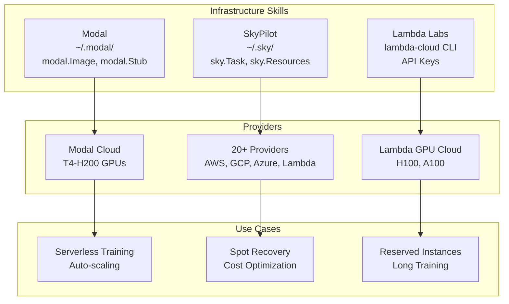
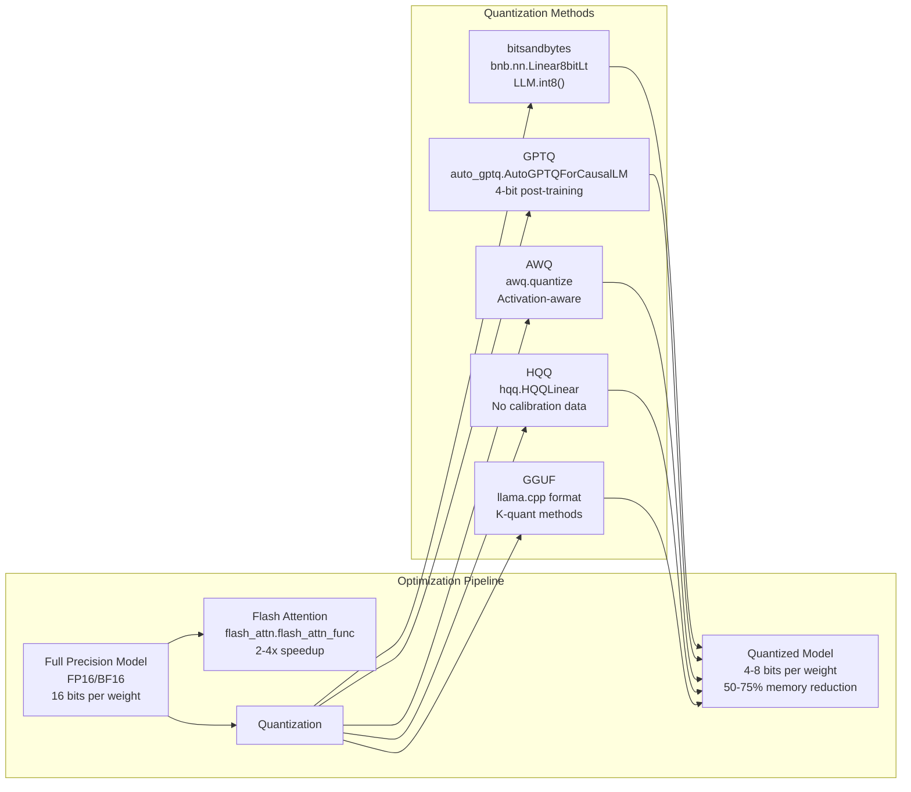
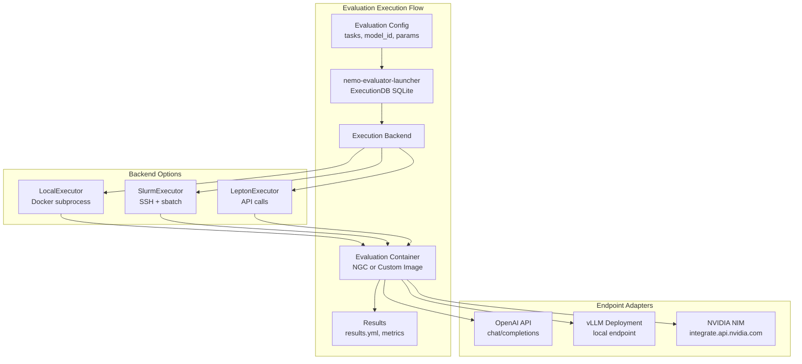
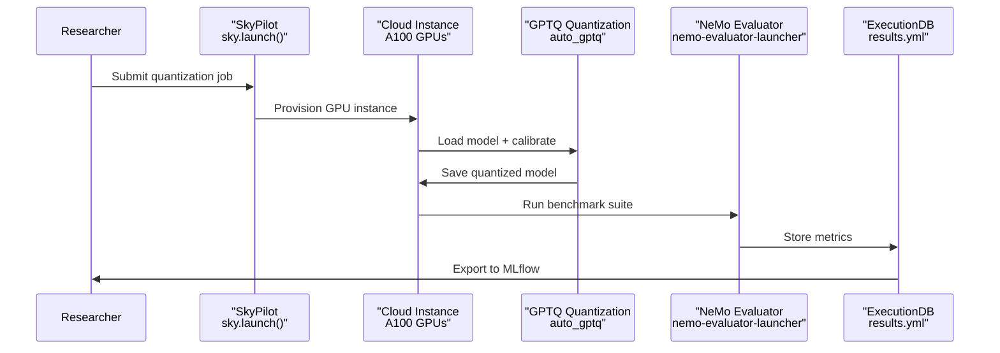

<!-- source: DeepWiki mcp.deepwiki.com · repo Orchestra-Research/AI-research-SKILLs · page 3.4 Infrastructure & Optimization Skills (Categories 09-11) · fetched 2026-10-26 -->

# Infrastructure & Optimization Skills (Categories 09-11)

<details>
<summary>Relevant source files</summary>

The following files were used as context for generating this wiki page:

- [.claude-plugin/marketplace.json](.claude-plugin/marketplace.json)
- [11-evaluation/bigcode-evaluation-harness/SKILL.md](11-evaluation/bigcode-evaluation-harness/SKILL.md)
- [11-evaluation/bigcode-evaluation-harness/references/benchmarks.md](11-evaluation/bigcode-evaluation-harness/references/benchmarks.md)
- [11-evaluation/bigcode-evaluation-harness/references/custom-tasks.md](11-evaluation/bigcode-evaluation-harness/references/custom-tasks.md)
- [11-evaluation/bigcode-evaluation-harness/references/issues.md](11-evaluation/bigcode-evaluation-harness/references/issues.md)
- [11-evaluation/nemo-evaluator/SKILL.md](11-evaluation/nemo-evaluator/SKILL.md)
- [11-evaluation/nemo-evaluator/references/adapter-system.md](11-evaluation/nemo-evaluator/references/adapter-system.md)
- [11-evaluation/nemo-evaluator/references/configuration.md](11-evaluation/nemo-evaluator/references/configuration.md)
- [11-evaluation/nemo-evaluator/references/custom-benchmarks.md](11-evaluation/nemo-evaluator/references/custom-benchmarks.md)
- [11-evaluation/nemo-evaluator/references/execution-backends.md](11-evaluation/nemo-evaluator/references/execution-backends.md)
- [CONTRIBUTING.md](CONTRIBUTING.md)
- [README.md](README.md)
- [demos/README.md](demos/README.md)
- [docs/ROADMAP.md](docs/ROADMAP.md)
- [docs/SKILL_CREATION_GUIDE.md](docs/SKILL_CREATION_GUIDE.md)
- [docs/SKILL_TEMPLATE.md](docs/SKILL_TEMPLATE.md)
- [docs/assets/promo.gif](docs/assets/promo.gif)
- [docs/christmas-tree.svg](docs/christmas-tree.svg)
- [docs/tech-tree.svg](docs/tech-tree.svg)

</details>


## Purpose and Scope

This document covers the skills in categories 09-11 of the AI Research Skills library, which provide infrastructure orchestration, model optimization, and evaluation capabilities for AI research workflows. These skills bridge the gap between model development and production deployment by handling GPU resource management, model compression, and systematic benchmarking.

**Category 09 (Infrastructure)** provides cloud GPU orchestration across providers. **Category 10 (Optimization)** implements memory reduction and inference acceleration techniques. **Category 11 (Evaluation)** offers systematic benchmarking across 100+ tasks.

For model architecture and training skills, see [3.2](#3.2) and [3.3](#3.3). For production inference serving, see [3.5](#3.5).

Sources: [README.md:1-643](), [.claude-plugin/marketplace.json:1-255]()

## Category Overview

| Category | Skills | Purpose | Key Use Cases |
|----------|--------|---------|---------------|
| **09 - Infrastructure** | 3 | GPU cloud orchestration | Provisioning compute, multi-cloud deployment, spot instance management |
| **10 - Optimization** | 6 | Model compression and acceleration | Memory reduction, quantization, inference speedup |
| **11 - Evaluation** | 3 | Model benchmarking | Academic benchmarks, code evaluation, multi-task assessment |

Sources: [README.md:126-149](), [.claude-plugin/marketplace.json:111-144]()

## Infrastructure Skills (Category 09)

### Overview

Infrastructure skills provide GPU resource orchestration across serverless, multi-cloud, and dedicated environments. All three skills expose Python APIs for programmatic job submission and monitoring.



**Infrastructure Skills Architecture**

Sources: [README.md:213-217](), [.claude-plugin/marketplace.json:111-120]()

### Modal

**Skill location**: `09-infrastructure/modal/`

Modal provides serverless GPU execution with Python-native APIs. Functions decorated with `@stub.function(gpu="A100")` automatically provision infrastructure.

**Core components**:
- `modal.Stub`: Application container
- `modal.Image`: Docker image specification
- `modal.gpu`: GPU resource allocation
- `modal.Volume`: Persistent storage

**Typical workflow**:
```python
import modal

stub = modal.Stub("training-job")

@stub.function(
    gpu="A100",
    image=modal.Image.debian_slim().pip_install("torch", "transformers"),
    timeout=3600
)
def train_model(config):
    # Training code runs on Modal infrastructure
    pass
```

Sources: [README.md:214]()

### SkyPilot

**Skill location**: `09-infrastructure/skypilot/`

SkyPilot orchestrates jobs across 20+ cloud providers with automatic spot instance recovery and cost optimization.

**Core components**:
- `sky.Task`: Job specification with resource requirements
- `sky.Resources`: GPU/CPU requirements
- `sky.launch()`: Job submission
- `~/.sky/`: Local state directory

**Typical workflow**:
```yaml
# task.yaml
resources:
  accelerators: A100:8
  cloud: aws
  use_spot: true

setup: |
  pip install torch transformers

run: |
  python train.py
```

Sources: [README.md:215]()

### Lambda Labs

**Skill location**: `09-infrastructure/lambda-labs/`

Lambda Labs provides reserved and on-demand GPU instances with persistent filesystems.

**Core components**:
- `lambda-cloud` CLI
- API keys stored in `~/.lambda_cloud/`
- Instance management API
- SSH access to reserved instances

**Typical workflow**:
```bash
# Launch instance
lambda-cloud instance launch \
  --instance-type gpu_1x_a100 \
  --ssh-key-name my-key

# List running instances
lambda-cloud instance list
```

Sources: [README.md:216]()

## Optimization Skills (Category 10)

### Overview

Optimization skills implement kernel-level acceleration and model compression techniques. These range from attention mechanism optimizations (Flash Attention) to various quantization methods (4-bit to 8-bit compression).



**Optimization Techniques and Tools**

Sources: [README.md:200-207](), [.claude-plugin/marketplace.json:121-134]()

### Flash Attention

**Skill location**: `10-optimization/flash-attention/`

Flash Attention implements IO-aware attention computation that reduces memory access and achieves 2-4× speedup.

**Core function**: `flash_attn.flash_attn_func(q, k, v, causal=True)`

**Integration points**:
- Drop-in replacement for `torch.nn.functional.scaled_dot_product_attention`
- Used by HuggingFace Transformers via `attn_implementation="flash_attention_2"`
- Supported in `transformers.AutoModelForCausalLM.from_pretrained()`

**Typical usage**:
```python
from flash_attn import flash_attn_func

# Direct usage
output = flash_attn_func(q, k, v, causal=True)

# HuggingFace integration
model = AutoModelForCausalLM.from_pretrained(
    "meta-llama/Llama-2-7b-hf",
    attn_implementation="flash_attention_2",
    torch_dtype=torch.float16
)
```

Sources: [README.md:201]()

### Quantization Tools

All quantization skills reduce model memory footprint while preserving accuracy. The choice depends on execution backend and calibration data availability.

#### bitsandbytes

**Skill location**: `10-optimization/bitsandbytes/`

**Core modules**:
- `bitsandbytes.nn.Linear8bitLt`: 8-bit linear layers
- `bitsandbytes.nn.Linear4bit`: 4-bit NormalFloat quantization
- `bnb.optim.AdamW8bit`: 8-bit optimizer

**Integration**: Native support in HuggingFace PEFT/Transformers via `load_in_8bit=True` or `load_in_4bit=True`.

**Typical usage**:
```python
from transformers import AutoModelForCausalLM, BitsAndBytesConfig

bnb_config = BitsAndBytesConfig(
    load_in_4bit=True,
    bnb_4bit_quant_type="nf4",
    bnb_4bit_compute_dtype=torch.bfloat16
)

model = AutoModelForCausalLM.from_pretrained(
    "meta-llama/Llama-2-7b-hf",
    quantization_config=bnb_config
)
```

Sources: [README.md:202]()

#### GPTQ

**Skill location**: `10-optimization/gptq/`

**Core module**: `auto_gptq.AutoGPTQForCausalLM`

Post-training quantization requiring calibration dataset. Achieves 4-bit compression with <2% accuracy loss.

**Typical workflow**:
```python
from auto_gptq import AutoGPTQForCausalLM, BaseQuantizeConfig

quantize_config = BaseQuantizeConfig(
    bits=4,
    group_size=128,
    desc_act=True
)

model = AutoGPTQForCausalLM.from_pretrained(
    "meta-llama/Llama-2-7b-hf",
    quantize_config=quantize_config
)

model.quantize(calibration_dataset)
model.save_quantized("./llama-2-7b-gptq")
```

Sources: [README.md:203]()

#### AWQ

**Skill location**: `10-optimization/awq/`

**Core module**: `awq.quantize.quantize`

Activation-aware quantization protecting important weight channels. Preserves accuracy better than GPTQ for same bit width.

**Typical usage**:
```python
from awq import AutoAWQForCausalLM

model = AutoAWQForCausalLM.from_pretrained("meta-llama/Llama-2-7b-hf")
model.quantize(
    tokenizer,
    quant_config={"zero_point": True, "q_group_size": 128}
)
model.save_quantized("./llama-2-7b-awq")
```

Sources: [README.md:204]()

#### HQQ

**Skill location**: `10-optimization/hqq/`

**Core module**: `hqq.HQQLinear`

Half-Quadratic Quantization requiring no calibration data. Multi-backend support (PyTorch, TorchAO, Marlin).

**Typical usage**:
```python
from hqq.engine.hf import HQQModelForCausalLM

model = HQQModelForCausalLM.from_pretrained(
    "meta-llama/Llama-2-7b-hf",
    quant_config={"weight_quant_params": {"nbits": 4}}
)
```

Sources: [README.md:205]()

#### GGUF

**Skill location**: `10-optimization/gguf/`

**Format**: llama.cpp quantization format with K-quant methods

Designed for CPU and Apple Silicon inference. Supports multiple quantization levels (Q4_0, Q4_K_M, Q8_0, etc.).

**Conversion workflow**:
```bash
# Convert HuggingFace to GGUF
python convert.py meta-llama/Llama-2-7b-hf \
  --outtype f16 --outfile llama-2-7b.gguf

# Quantize
./quantize llama-2-7b.gguf llama-2-7b-Q4_K_M.gguf Q4_K_M

# Run inference
./main -m llama-2-7b-Q4_K_M.gguf -p "Prompt"
```

Sources: [README.md:206]()

## Evaluation Skills (Category 11)

### Overview

Evaluation skills provide systematic benchmarking infrastructure. Each targets different domains: academic LLM tasks (lm-evaluation-harness), code generation (BigCode), and enterprise multi-harness evaluation (NeMo Evaluator).



**NeMo Evaluator Architecture with Execution Backends**

Sources: [11-evaluation/nemo-evaluator/SKILL.md:1-454](), [11-evaluation/nemo-evaluator/references/execution-backends.md:1-362]()

### lm-evaluation-harness

**Skill location**: `11-evaluation/lm-evaluation-harness/`

EleutherAI's standard for LLM benchmarking across 60+ academic tasks including MMLU, HellaSwag, TruthfulQA.

**Core command**: `lm_eval --model hf --model_args pretrained=<model> --tasks <tasks>`

**Integration points**:
- HuggingFace model loading via `--model hf`
- OpenAI API compatibility via `--model openai-completions`
- Custom task definitions in `lm_eval/tasks/`

**Typical usage**:
```bash
lm_eval \
  --model hf \
  --model_args pretrained=meta-llama/Llama-2-7b-hf \
  --tasks mmlu,hellaswag,truthfulqa_mc2 \
  --batch_size 8 \
  --output_path ./results/
```

Sources: [README.md:209]()

### BigCode Evaluation Harness

**Skill location**: `11-evaluation/bigcode-evaluation-harness/`

Code generation benchmarking with pass@k metrics across HumanEval, MBPP, and MultiPL-E (18 languages).

**Core components**:
- `bigcode_eval.tasks.Task`: Base class for benchmarks
- `bigcode_eval.tasks.ALL_TASKS`: Registry of available tasks
- Execution sandbox for code safety

**Key tasks**:
- `humaneval`: 164 Python function completion problems
- `humanevalplus`: Extended with 80× more test cases
- `mbpp`: 500 entry-level Python problems
- `multiple-py`, `multiple-cpp`, etc.: Multi-language variants

**Typical usage**:
```bash
accelerate launch main.py \
  --model bigcode/starcoder2-7b \
  --tasks humaneval \
  --max_length_generation 512 \
  --temperature 0.2 \
  --n_samples 20 \
  --batch_size 10 \
  --allow_code_execution \
  --save_generations
```

**Pass@k calculation**: Evaluates k samples per problem and measures percentage of problems with ≥1 passing solution.

Sources: [11-evaluation/bigcode-evaluation-harness/SKILL.md:1-406](), [11-evaluation/bigcode-evaluation-harness/references/benchmarks.md:1-420]()

### NeMo Evaluator

**Skill location**: `11-evaluation/nemo-evaluator/`

Enterprise-grade platform supporting 100+ benchmarks from 18+ harnesses with multi-backend execution.

#### Execution Backends

NeMo Evaluator implements three execution backends via the `ExecutionDB` SQLite database:

| Backend | Executor Class | Use Case | Job Submission |
|---------|---------------|----------|----------------|
| Local | `LocalExecutor` | Development, quick tests | `docker run` subprocess |
| Slurm | `SlurmExecutor` | HPC clusters, large-scale | SSH + `sbatch` commands |
| Lepton | `LeptonExecutor` | Cloud-native CI/CD | Lepton API calls |

**Backend configuration**:
```yaml
# Local execution
defaults:
  - execution: local
  - deployment: none

execution:
  output_dir: ./results
  docker_args:
    - "--gpus=all"
    - "--shm-size=16g"

# Slurm execution
defaults:
  - execution: slurm
  - deployment: vllm

execution:
  hostname: cluster.example.com
  account: my_account
  partition: gpu
  nodes: 1
  gpus_per_node: 8
  walltime: "04:00:00"
```

Sources: [11-evaluation/nemo-evaluator/references/execution-backends.md:1-362]()

#### Adapter System

The adapter system processes requests/responses between evaluation engine and model endpoints via interceptor chains:

**Available interceptors**:
- `system_message`: Injects system prompts
- `caching`: Caches responses (stored in configured `cache_dir`)
- `endpoint`: Performs HTTP call
- `reasoning`: Extracts `"
```

Sources: [11-evaluation/nemo-evaluator/references/adapter-system.md:1-329]()

#### Custom Benchmark Integration

Custom benchmarks are added via Framework Definition Files (FDFs):

**FDF structure** (`framework_def.yaml`):
```yaml
framework:
  name: my-custom-framework
  package_name: my_custom_eval

defaults:
  command: "python -m my_custom_eval.run --model-id {model_id} --task {task} --output-dir {output_dir}"

evaluations:
  - name: custom_task_1
    defaults:
      temperature: 0.0
      max_new_tokens: 512
```

**Container registration** (`mapping.toml`):
```toml
[my-custom-framework]
container = "my-registry/custom-eval:1.0"

[my-custom-framework.tasks.chat.custom_task_1]
required_env_vars = []
```

Sources: [11-evaluation/nemo-evaluator/references/custom-benchmarks.md:1-306]()

#### Task Execution

**CLI workflow**:
```bash
# Run evaluation
nemo-evaluator-launcher run \
  --config-dir . \
  --config-name config

# Check status
nemo-evaluator-launcher status <invocation_id>

# List all runs
nemo-evaluator-launcher ls runs

# Export results
nemo-evaluator-launcher export <invocation_id> --dest mlflow
```

**Task configuration**:
```yaml
evaluation:
  tasks:
    - name: ifeval              # Instruction following
    - name: gpqa_diamond        # Graduate-level QA
      env_vars:
        HF_TOKEN: HF_TOKEN
    - name: humaneval           # Code generation
```

Sources: [11-evaluation/nemo-evaluator/SKILL.md:58-146]()

## Integration Patterns

### Cross-Skill Workflow: Optimized Evaluation on Infrastructure

Typical research workflow combining skills from all three categories:



**Optimized Multi-Cloud Evaluation Workflow**

**Concrete implementation**:

1. **Provision infrastructure** (SkyPilot):
```yaml
# sky_task.yaml
resources:
  accelerators: A100:8
  cloud: aws
  use_spot: true

setup: |
  pip install auto-gptq nemo-evaluator-launcher

run: |
  python quantize_and_eval.py
```

2. **Quantize model** (GPTQ):
```python
# quantize_and_eval.py
from auto_gptq import AutoGPTQForCausalLM

model = AutoGPTQForCausalLM.from_pretrained(
    "meta-llama/Llama-2-70b-hf",
    quantize_config={"bits": 4, "group_size": 128}
)
model.quantize(calibration_dataset)
model.save_quantized("./llama-2-70b-gptq")
```

3. **Evaluate** (NeMo Evaluator):
```yaml
# eval_config.yaml
target:
  api_endpoint:
    model_id: llama-2-70b-gptq
    url: http://localhost:8000/v1/chat/completions

evaluation:
  tasks:
    - name: mmlu_pro
    - name: gsm8k_cot_instruct
    - name: ifeval
```

4. **Launch**:
```bash
sky launch -c eval-cluster sky_task.yaml
```

Sources: [README.md:200-217]()

### Skill Structure and Discovery

All skills follow the standardized YAML frontmatter format for discovery:

```yaml
---
name: skill-name-here
description: Clear description including what AND when to use
version: 1.0.0
author: Orchestra Research
license: MIT
tags: [Tag One, Tag Two, Tag Three]
dependencies: [package1>=1.0.0, package2>=2.0.0]
---
```

**Directory structure**:
```
XX-category/skill-name/
├── SKILL.md                    # 200-500 line overview
├── references/                 # Deep documentation (300KB+)
│   ├── README.md
│   ├── api.md
│   ├── tutorials.md
│   └── issues.md
├── scripts/                    # Helper scripts (optional)
└── assets/                     # Templates (optional)
```

**CLI installer** (`@orchestra-research/ai-research-skills`):
- Auto-detects agents in `~/.claude/`, `~/.cursor/`, etc.
- Installs to canonical location `~/.orchestra/skills/`
- Creates symlinks to agent directories
- Tracks state in `~/.orchestra/.lock.json`

Sources: [README.md:325-358](), [CONTRIBUTING.md:125-196]()

## Marketplace Integration

Skills are registered in `.claude-plugin/marketplace.json` for discovery:

```json
{
  "name": "infrastructure",
  "description": "GPU cloud and compute orchestration including Modal, Lambda Labs, and SkyPilot. Use when deploying training jobs or managing GPU resources.",
  "source": "./",
  "strict": false,
  "skills": [
    "./09-infrastructure/lambda-labs",
    "./09-infrastructure/modal",
    "./09-infrastructure/skypilot"
  ]
}
```

**Installation via Claude Code CLI**:
```bash
/plugin marketplace add orchestra-research/AI-research-SKILLs
/plugin install infrastructure@ai-research-skills
/plugin install optimization@ai-research-skills
/plugin install evaluation@ai-research-skills
```

Sources: [.claude-plugin/marketplace.json:111-144]()

## Distribution and Synchronization

Skills automatically sync to Orchestra marketplace via GitHub Actions:

**Sync workflow** (`.github/workflows/sync-skills.yml`):
1. Detects changed skill directories via git diff pattern `^[0-9]{2}-[^/]+/`
2. Extracts YAML frontmatter from `SKILL.md`
3. Creates ZIP of skill directory
4. POSTs to Orchestra API with authentication
5. Classifies as "Orchestra" or "Community" based on `author` field

**Result**: Skills are available via:
- NPM package: `npx @orchestra-research/ai-research-skills`
- Claude marketplace: `/plugin install <category>@ai-research-skills`
- Direct download: `https://www.orchestra-research.com/research-skills`

Sources: [README.md:285-288]()

---

