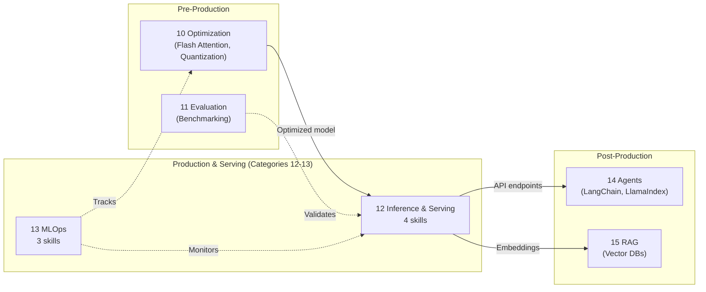
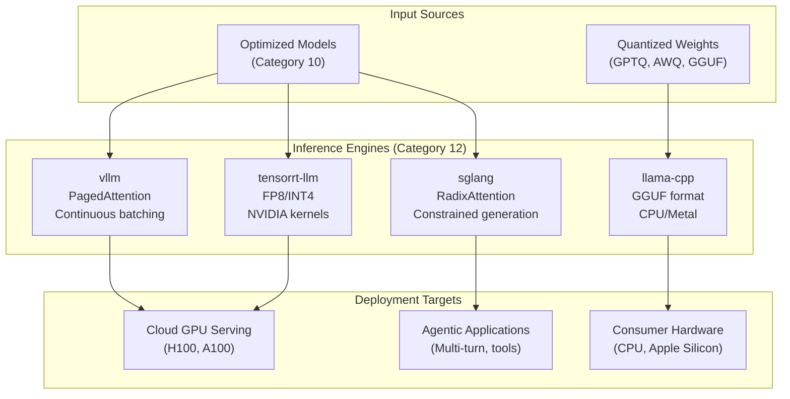
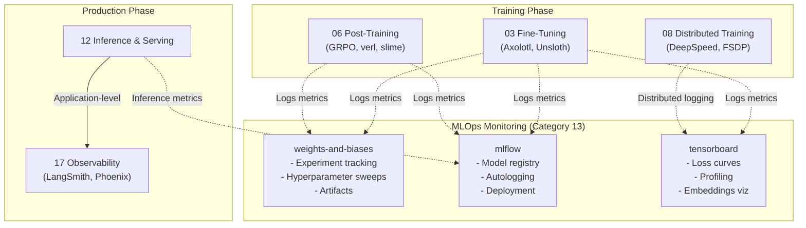
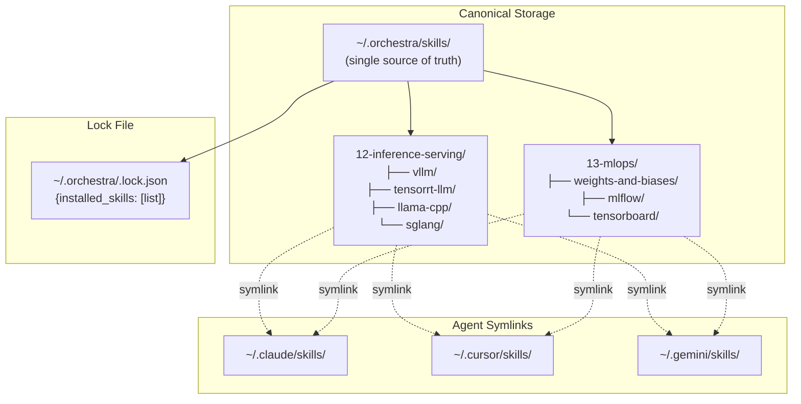
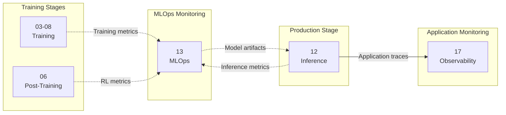
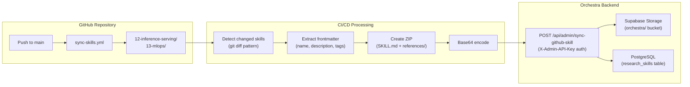

<!-- source: DeepWiki mcp.deepwiki.com · repo Orchestra-Research/AI-research-SKILLs · page 3.5 Production & Serving Skills (Categories 12-13) · fetched 2026-10-26 -->

# Production & Serving Skills (Categories 12-13)

<details>
<summary>Relevant source files</summary>

The following files were used as context for generating this wiki page:

- [.claude-plugin/marketplace.json](.claude-plugin/marketplace.json)
- [01-model-architecture/torchtitan/SKILL.md](01-model-architecture/torchtitan/SKILL.md)
- [06-post-training/miles/SKILL.md](06-post-training/miles/SKILL.md)
- [06-post-training/slime/SKILL.md](06-post-training/slime/SKILL.md)
- [06-post-training/torchforge/SKILL.md](06-post-training/torchforge/SKILL.md)
- [06-post-training/verl/SKILL.md](06-post-training/verl/SKILL.md)
- [20-ml-paper-writing/SKILL.md](20-ml-paper-writing/SKILL.md)
- [CONTRIBUTING.md](CONTRIBUTING.md)
- [README.md](README.md)
- [demos/README.md](demos/README.md)
- [docs/ROADMAP.md](docs/ROADMAP.md)
- [docs/SKILL_CREATION_GUIDE.md](docs/SKILL_CREATION_GUIDE.md)
- [docs/SKILL_TEMPLATE.md](docs/SKILL_TEMPLATE.md)
- [docs/assets/promo.gif](docs/assets/promo.gif)
- [docs/christmas-tree.svg](docs/christmas-tree.svg)
- [docs/tech-tree.svg](docs/tech-tree.svg)
- [docs/writing-assets/ML_paper_guide.md](docs/writing-assets/ML_paper_guide.md)
- [docs/writing-assets/ml_paper_writing_sources.md](docs/writing-assets/ml_paper_writing_sources.md)

</details>


## Purpose and Scope

This page documents the **Production & Serving Skills** encompassing Categories 12 (Inference & Serving) and 13 (MLOps). These skills cover the deployment and operational phases of the AI research lifecycle: serving trained models for inference at scale, and tracking/monitoring experiments and production systems.

**Category 12** provides skills for deploying LLMs with optimized inference engines (vLLM, TensorRT-LLM, llama.cpp, SGLang), while **Category 13** provides skills for experiment tracking, model registry, and operational monitoring (W&B, MLflow, TensorBoard).

For model optimization techniques that precede inference deployment, see [Infrastructure & Optimization Skills](#3.4). For evaluation frameworks that validate inference quality, see [Infrastructure & Optimization Skills](#3.4). For applications that consume inference APIs, see [Application Skills](#3.6).

Sources: [README.md:218-256](), [.claude-plugin/marketplace.json:147-168]()

---

## Categories in the Production Pipeline

The Production & Serving phase follows model training and optimization, representing the transition from research artifact to deployable service:



**Title:** Production & Serving Skills in the AI Research Lifecycle

**Key Relationships:**
- **Optimization (Category 10)** produces quantized/optimized models consumed by inference engines
- **Evaluation (Category 11)** validates inference quality and throughput
- **Inference (Category 12)** serves models via APIs to downstream applications
- **MLOps (Category 13)** monitors all stages: training, optimization, and production inference
- **Agents/RAG (Categories 14-15)** consume inference APIs for end-user applications

Sources: [README.md:200-256](), High-Level System Architecture Diagrams (Diagram 4)

---

## Category 12: Inference & Serving Skills

Category 12 contains **4 skills** focused on deploying LLMs for production inference with various backends optimized for different hardware and use cases.

### Directory Structure

```
12-inference-serving/
├── vllm/
│   ├── SKILL.md                    # 356 lines, production-ready
│   └── references/                 # 4 reference files
├── tensorrt-llm/
│   ├── SKILL.md                    # 180 lines
│   └── references/                 # 3 reference files
├── llama-cpp/
│   ├── SKILL.md                    # 251 lines
│   └── references/                 # 3 reference files
└── sglang/
    ├── SKILL.md                    # 435 lines
    └── references/                 # 3 reference files
```

Sources: [README.md:218-222](), [README.md:388-415]()

### Skill Overview Table

| Skill | Use Case | Key Technology | Performance Claim | References |
|-------|----------|----------------|-------------------|------------|
| **vLLM** | High-throughput production serving | PagedAttention, continuous batching | Production-ready, industry standard | 356 lines + 4 refs |
| **TensorRT-LLM** | Maximum throughput on NVIDIA GPUs | FP8/INT4 quantization, kernel fusion | 24k tok/s | 180 lines + 3 refs |
| **llama.cpp** | CPU and Apple Silicon inference | GGUF quantization format | Optimized for consumer hardware | 251 lines + 3 refs |
| **SGLang** | Structured generation for agents | RadixAttention, constrained decoding | 5-10× faster for agentic workflows | 435 lines + 3 refs |

Sources: [README.md:218-222]()

### Inference Engine Architecture



**Title:** Inference & Serving Skills Architecture and Deployment Targets

Sources: [README.md:218-222](), [.claude-plugin/marketplace.json:147-157]()

### Marketplace Integration

The Claude Code plugin marketplace exposes inference-serving skills via:

```json
{
  "name": "inference-serving",
  "description": "Production LLM inference including vLLM, TensorRT-LLM, llama.cpp, and SGLang. Use when deploying models for production inference.",
  "source": "./",
  "skills": [
    "./12-inference-serving/llama-cpp",
    "./12-inference-serving/sglang",
    "./12-inference-serving/tensorrt-llm",
    "./12-inference-serving/vllm"
  ]
}
```

**Installation via Claude Code:**
```bash
/plugin marketplace add orchestra-research/AI-research-SKILLs
/plugin install inference-serving@ai-research-skills
```

Sources: [.claude-plugin/marketplace.json:147-157]()

### YAML Frontmatter Example: vLLM

Each inference skill follows the standardized YAML frontmatter format:

```yaml
---
name: serving-llms-vllm
description: High-throughput LLM serving using vLLM with PagedAttention and continuous batching. Use for production deployments requiring maximum throughput on GPU clusters.
version: 1.0.0
author: Orchestra Research
license: MIT
tags: [Inference, Production, vLLM, PagedAttention, Serving]
dependencies: [vllm>=0.2.0, torch>=2.0.0, transformers>=4.40.0]
---
```

**Common patterns across inference skills:**
- `name` field uses gerund form: `serving-llms-*` 
- `description` includes both capabilities (what) and use cases (when)
- `tags` reference specific technologies: PagedAttention, RadixAttention, GGUF
- `dependencies` specify minimum versions for deployment compatibility

Sources: [CONTRIBUTING.md:129-187](), [README.md:218-222]()

---

## Category 13: MLOps Skills

Category 13 contains **3 skills** for experiment tracking, model registry, and operational monitoring across the AI research lifecycle.

### Directory Structure

```
13-mlops/
├── weights-and-biases/
│   ├── SKILL.md                    # 427 lines
│   └── references/                 # 3 reference files
├── mlflow/
│   ├── SKILL.md                    # 514 lines
│   └── references/                 # 3 reference files
└── tensorboard/
    ├── SKILL.md                    # 538 lines
    └── references/                 # 3 reference files
```

Sources: [README.md:252-256](), [README.md:388-415]()

### Skill Overview Table

| Skill | Primary Use | Key Features | Documentation |
|-------|-------------|--------------|---------------|
| **Weights & Biases** | Experiment tracking and collaboration | Sweeps, artifacts, model registry, team dashboards | 427 lines + 3 refs |
| **MLflow** | Model lifecycle management | Tracking, registry, deployment, autologging | 514 lines + 3 refs |
| **TensorBoard** | Training visualization | Scalars, images, embeddings, profiler | 538 lines + 3 refs |

Sources: [README.md:252-256]()

### MLOps Monitoring Scope



**Title:** MLOps Skills Monitoring Scope Across AI Research Lifecycle

**Distinction from Category 17 (Observability):**
- **Category 13 (MLOps)** tracks training metrics, experiments, and model artifacts
- **Category 17 (Observability)** monitors production LLM application behavior (traces, evaluations)

Sources: [README.md:252-260](), High-Level System Architecture Diagrams (Diagram 4)

### Marketplace Integration

```json
{
  "name": "mlops",
  "description": "ML experiment tracking and lifecycle including Weights & Biases, MLflow, and TensorBoard. Use when tracking experiments or managing models.",
  "source": "./",
  "skills": [
    "./13-mlops/mlflow",
    "./13-mlops/tensorboard",
    "./13-mlops/weights-and-biases"
  ]
}
```

**Installation via Claude Code:**
```bash
/plugin install mlops@ai-research-skills
```

Sources: [.claude-plugin/marketplace.json:159-168]()

### YAML Frontmatter Example: MLflow

```yaml
---
name: mlflow-tracking
description: Comprehensive MLflow guide for experiment tracking, model registry, and deployment. Use when managing ML model lifecycles from experimentation to production.
version: 1.0.0
author: Orchestra Research
license: MIT
tags: [MLOps, Tracking, Model Registry, Deployment, MLflow]
dependencies: [mlflow>=2.0.0, scikit-learn, pandas]
---
```

**Cross-skill patterns:**
- All three MLOps skills share similar `tags`: [MLOps, Tracking, ...]
- `dependencies` vary: W&B requires `wandb`, MLflow requires `mlflow`, TensorBoard integrates with `torch`
- Descriptions emphasize lifecycle stage: "experiment tracking" vs "model registry" vs "visualization"

Sources: [CONTRIBUTING.md:129-187]()

---

## Skill File Structure and Conventions

Both Categories 12 and 13 follow the standardized skill structure defined in the repository.

### Canonical Skill Directory Layout

```
XX-category-name/skill-name/
├── SKILL.md                        # 200-500 lines (target: 200-300)
│   ├── YAML frontmatter            # Metadata block
│   ├── Quick start section         # Minimal working example
│   ├── Common workflows            # Step-by-step with checklists
│   ├── When to use vs alternatives # Decision guidance
│   ├── Common issues               # Troubleshooting
│   └── Resources                   # Links to references/
│
└── references/                     # 300KB+ total documentation
    ├── README.md                   # From official docs/GitHub
    ├── api.md                      # API reference
    ├── tutorials.md                # Step-by-step guides
    ├── issues.md                   # Real GitHub issues (optional)
    ├── releases.md                 # Version history (optional)
    └── file_structure.md           # Codebase navigation (optional)
```

Sources: [README.md:325-358](), [CONTRIBUTING.md:287-309]()

### Progressive Disclosure Pattern

The repository implements progressive disclosure from Anthropic's best practices:

**SKILL.md responsibilities:**
- Overview and quick start (assume Claude is smart)
- Workflows with copy-paste checklists
- Links to `references/` for deep dives

**references/ responsibilities:**
- Comprehensive API documentation
- Detailed tutorials
- Real-world troubleshooting (GitHub issues)
- Version history and breaking changes

**Anti-pattern (rejected):**
```
SKILL.md → deep-topic.md → subtopic.md → implementation-details.md
```

**Correct pattern:**
```
SKILL.md → {api.md, tutorials.md, issues.md} (all one level deep)
```

Sources: [CONTRIBUTING.md:82-112](), [docs/SKILL_CREATION_GUIDE.md:46-64]()

### Workflow Checklist Format

Both inference and MLOps skills use standardized workflow checklists:

```markdown
### Workflow 1: Deploy vLLM Server

Copy this checklist:

```
Deployment Progress:
- [ ] Step 1: Install dependencies
- [ ] Step 2: Configure model
- [ ] Step 3: Launch server
- [ ] Step 4: Validate endpoints
```

**Step 1: Install dependencies**

[Instructions and code]

**Step 2: Configure model**

[Instructions and code]
```

This format enables AI agents to:
1. Copy the checklist to track progress
2. Execute steps sequentially
3. Validate completion before proceeding

Sources: [docs/SKILL_TEMPLATE.md:27-73](), [CONTRIBUTING.md:82-112]()

---

## AI Agent Consumption Patterns

AI coding agents discover and utilize Production & Serving skills through multiple pathways defined in the repository architecture.

### Discovery via YAML Frontmatter

Agents search skills using YAML metadata:

```python
# Agent searches for "serving" or "inference"
# Matches skills with:
# - name: serving-llms-vllm
# - tags: [Inference, Production, vLLM, PagedAttention, Serving]
# - description: "...Use for production deployments..."
```

The `description` field follows the pattern: **"[What it does]. Use when [specific use case]."**

Sources: [README.md:4.1](), [CONTRIBUTING.md:129-187]()

### Installation via NPM Package

The repository provides `@orchestra-research/ai-research-skills` npm package for installation:

```bash
npx @orchestra-research/ai-research-skills
```

**Interactive installer workflow:**
1. Detects installed coding agents (Claude Code, Cursor, Gemini CLI, etc.)
2. Offers skill selection (everything, by category, individual)
3. Installs to canonical directory: `~/.orchestra/skills/`
4. Creates symlinks in agent-specific directories:
   - `~/.claude/skills/12-inference-serving/vllm/`
   - `~/.cursor/skills/13-mlops/mlflow/`

Sources: [README.md:77-104](), High-Level System Architecture Diagrams (Diagram 2)

### Symlink Architecture for Multi-Agent Support



**Title:** Canonical Storage and Symlink Architecture for Multi-Agent Skill Access

**Key benefits:**
- Single source of truth (`~/.orchestra/skills/`) enables consistent updates
- Symlinks avoid duplication (no 3× storage for 3 agents)
- Lock file tracks installed skills for update/uninstall operations

Sources: [README.md:77-104](), High-Level System Architecture Diagrams (Diagram 5)

### Example Agent Workflow: vLLM Deployment

```markdown
User: "Deploy Llama 3.1 8B with vLLM for production inference"

Agent workflow:
1. Search installed skills for "inference" + "production"
2. Match: 12-inference-serving/vllm/SKILL.md
3. Load YAML frontmatter to confirm use case
4. Parse workflows section for deployment checklist
5. Execute steps:
   - Install vLLM dependencies
   - Download model from HuggingFace
   - Configure server (VRAM, batch size)
   - Launch vLLM OpenAI-compatible server
   - Validate endpoints with test queries
6. Reference references/api.md for advanced configuration
```

Sources: [README.md:4.3](), High-Level System Architecture Diagrams (Diagram 2)

---

## Cross-Category Relationships

Production & Serving skills integrate with other categories in the research lifecycle:

### Upstream Dependencies

**Category 10 (Optimization) → Category 12 (Inference):**
- Flash Attention kernels integrated into vLLM, TensorRT-LLM
- Quantized models (GPTQ, AWQ, GGUF) consumed by inference engines
- Memory optimizations enable larger batch sizes

**Category 11 (Evaluation) → Categories 12-13:**
- NeMo Evaluator benchmarks inference throughput
- Evaluation results tracked in W&B/MLflow
- BigCode Harness validates code generation quality

Sources: [README.md:200-222](), High-Level System Architecture Diagrams (Diagram 4)

### Downstream Consumers

**Category 12 (Inference) → Category 14 (Agents):**
- LangChain integrates vLLM for production agent backends
- LlamaIndex uses inference APIs for query engines
- CrewAI orchestrates multi-agent systems via inference endpoints

**Category 12 (Inference) → Category 15 (RAG):**
- Chroma/FAISS retrieve documents
- Sentence Transformers generate embeddings via inference
- Inference servers provide generation for RAG pipelines

Sources: [README.md:224-236](), High-Level System Architecture Diagrams (Diagram 4)

### Monitoring Relationships



**Title:** MLOps Monitoring Across Lifecycle Stages

**Distinction:**
- **Category 13 (MLOps)** monitors model-level metrics: loss, accuracy, throughput
- **Category 17 (Observability)** monitors application-level behavior: traces, LLM calls, user queries

Sources: [README.md:252-260](), High-Level System Architecture Diagrams (Diagram 4)

---

## Skill Quality Standards

Both Categories 12 and 13 adhere to repository-wide quality standards defined in contributing guidelines.

### Gold Standard Requirements

**Mandatory (all production skills must have):**
- ✅ 200-500 lines in SKILL.md (target: 200-300)
- ✅ YAML frontmatter with complete metadata
- ✅ At least 2 workflows with copy-paste checklists
- ✅ "When to use vs alternatives" section
- ✅ Common issues with solutions
- ✅ 300KB+ total documentation in `references/`

**Production-ready markers:**
- vLLM marked as "production-ready" (356 lines + 4 refs)
- Comprehensive error handling workflows
- Real-world GitHub issues in `references/issues.md`

Sources: [CONTRIBUTING.md:82-112](), [README.md:325-358]()

### Line Count Distribution

| Category | Avg Lines/Skill | Range | Notes |
|----------|----------------|-------|-------|
| **12 Inference** | 305 lines | 180-435 | SGLang highest (435), TensorRT lowest (180) |
| **13 MLOps** | 493 lines | 427-538 | All exceed 400 lines due to API breadth |
| **Repository Avg** | 420 lines | 200-600 | Progressive disclosure keeps most under 500 |

**TensorRT-LLM exception:**
- Only 180 lines in SKILL.md
- Compensates with comprehensive `references/` (3 files)
- Focuses on NVIDIA-specific optimizations

Sources: [README.md:218-256](), [docs/ROADMAP.md:10-17]()

### Validation Checklist

Before skill submission, contributors verify:

```markdown
Validation Checklist (Categories 12-13):
- [ ] SKILL.md between 200-500 lines
- [ ] YAML frontmatter valid (test with Python yaml.safe_load)
- [ ] Tags use Title Case (vLLM, MLOps, TensorBoard)
- [ ] Dependencies include version constraints (vllm>=0.2.0)
- [ ] At least 2 workflows with checklists
- [ ] "When to use vs alternatives" with 2+ alternatives
- [ ] Common issues section with solutions
- [ ] references/ directory exists with 300KB+ content
- [ ] Code examples use language detection (```python, ```bash)
- [ ] Marketplace.json updated with new skill
```

Sources: [CONTRIBUTING.md:82-223](), [CONTRIBUTING.md:189-223]()

---

## GitHub Actions Sync Workflow

Skills in Categories 12-13 automatically sync to the Orchestra marketplace via GitHub Actions.

### Sync Pipeline Architecture



**Title:** GitHub Actions Sync Workflow for Production & Serving Skills

**Change detection pattern:**
```bash
git diff --name-only $GITHUB_SHA $GITHUB_SHA~1 | grep '^12-inference-serving/\|^13-mlops/'
```

Sources: [README.md:6.2](), High-Level System Architecture Diagrams (Diagram 2, Diagram 5)

### Author-Based Classification

Skills are classified based on YAML `author` field:

```yaml
# Orchestra-authored skill → orchestra/ bucket
author: Orchestra Research

# Community-authored skill → community/ bucket
author: Community Contributor
```

**Storage paths:**
- `orchestra/12-inference-serving/vllm.zip`
- `orchestra/13-mlops/mlflow.zip`
- `community/12-inference-serving/custom-inference.zip`

Sources: [README.md:6.2](), High-Level System Architecture Diagrams (Diagram 5)

### Sync Validation

The workflow validates before upload:

```yaml
# Validation steps
- YAML frontmatter present and parsable
- SKILL.md exists and under 100KB
- references/ directory exists
- Required fields: name, description, version, author
```

Failed validation prevents sync and creates GitHub issue.

Sources: [README.md:6.2]()

---

## Demo Gallery Integration

Production & Serving skills feature in demo repositories showcasing real-world usage.

### Featured Demo: NeMo Evaluator GPQA Benchmark

**Repository:** [zechenzhangAGI/Nemo-Eval-Skill-Demo](https://github.com/zechenzhangAGI/Nemo-Eval-Skill-Demo)

**Skills Used:**
- Category 11: [nemo-evaluator]() (evaluation, not Categories 12-13)
- Demonstrates validation of inference quality

**Relevance to Category 12:**
- Benchmarks inference throughput (tokens/sec)
- Validates accuracy across model scales (8B, 70B, 405B)
- Integration pattern for MLOps tracking (Category 13)

Sources: [demos/README.md:11-42]()

### Demo Template for Production Skills

Future demos targeting Categories 12-13:

```markdown
Demo: vLLM Production Deployment
- Skill: 12-inference-serving/vllm
- What: Deploy Llama 3.1 70B on 8× H100 cluster
- Demonstrates:
  - PagedAttention configuration
  - Continuous batching optimization
  - OpenAI-compatible API integration
  - W&B monitoring (Category 13)
```

Sources: [demos/README.md:69-97]()

---

## Roadmap and Completion Status

Categories 12-13 reached completion status in repository milestones.

### Completion Timeline

| Category | Target Skills | Completed | Completion Date | Status |
|----------|--------------|-----------|-----------------|--------|
| **12 Inference** | 4 | 4 | November 2025 | ✅ Phase 10 Complete |
| **13 MLOps** | 3 | 3 | November 2025 | ✅ Phase 15 Complete |

**Phase 10 milestone:**
```markdown
### ✅ Phase 10: Inference & Serving (COMPLETE - 4 skills)
**Status**: Production inference frameworks covered

**Completed Skills**:
- ✅ vLLM - High-throughput LLM serving with PagedAttention
- ✅ TensorRT-LLM - NVIDIA's fastest inference
- ✅ llama.cpp - CPU/Apple Silicon inference
- ✅ SGLang - Structured generation with RadixAttention
```

**Phase 15 milestone:**
```markdown
### ✅ Phase 15: MLOps & Observability (COMPLETE - 5 skills)
**Status**: Core MLOps and LLM observability covered

**Completed Skills**:
- ✅ MLflow - Open-source MLOps platform for tracking experiments
- ✅ TensorBoard - Visualization and experiment tracking
- ✅ Weights & Biases - Experiment tracking and collaboration
- ✅ LangSmith - LLM observability (Category 17)
- ✅ Phoenix - Open-source AI observability (Category 17)
```

Sources: [docs/ROADMAP.md:98-160]()

### No Planned Additions

Categories 12-13 considered complete with current skill set:

**Rationale:**
- vLLM covers production GPU inference (industry standard)
- TensorRT-LLM covers maximum NVIDIA performance
- llama.cpp covers CPU/consumer hardware
- SGLang covers agentic/structured generation use cases
- W&B, MLflow, TensorBoard cover experiment tracking trifecta

**Potential future additions:**
- Inference: Monarch (Meta's actor-based serving, referenced in torchforge)
- MLOps: Comet ML, Neptune.ai (community contributions)

Sources: [docs/ROADMAP.md:188-200](), [06-post-training/torchforge/SKILL.md:1-9]()

---

## Conclusion

Categories 12 (Inference & Serving) and 13 (MLOps) provide **7 production-ready skills** covering deployment and operational monitoring for AI research systems. These skills bridge the gap between research artifacts (trained models) and production systems (serving APIs, monitoring dashboards).

**Key characteristics:**
- Total documentation: ~2,500 lines in SKILL.md + 300KB+ in references/
- All skills marked production-ready or battle-tested
- Comprehensive coverage of inference backends (GPU, CPU, Apple Silicon)
- Complete MLOps lifecycle (tracking, registry, visualization)

**Integration points:**
- Consumes optimized models from Category 10
- Validated by benchmarks from Category 11
- Powers applications in Categories 14-18
- Monitored by observability tools in Category 17

For related categories, see:
- [Infrastructure & Optimization Skills](#3.4) for pre-production optimization
- [Application Skills](#3.6) for post-production consumer applications
- [Advanced Skills](#3.7) for emerging deployment techniques

Sources: [README.md:218-256](), [docs/ROADMAP.md:98-160]()

---

