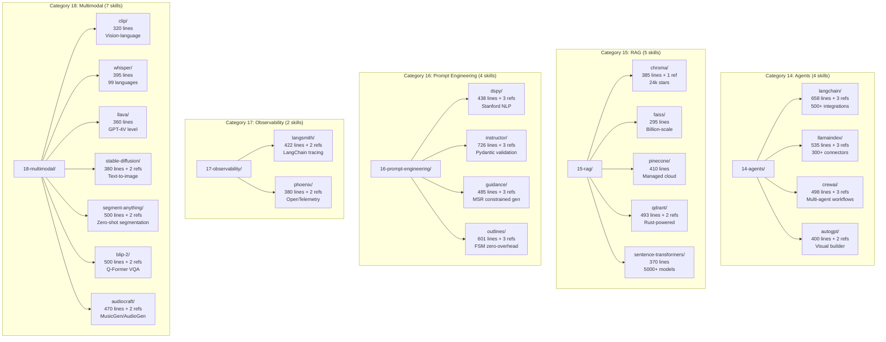
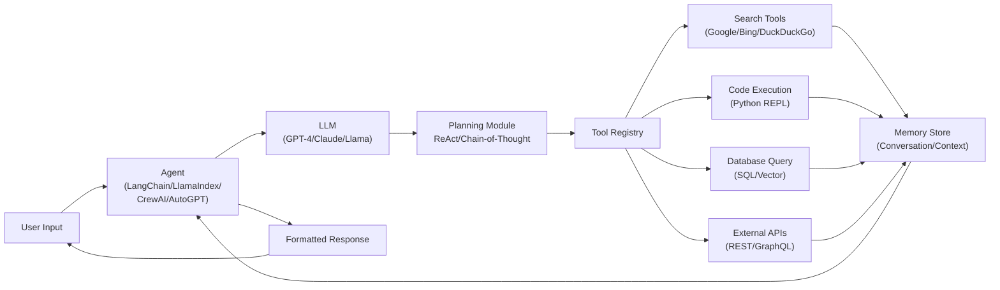
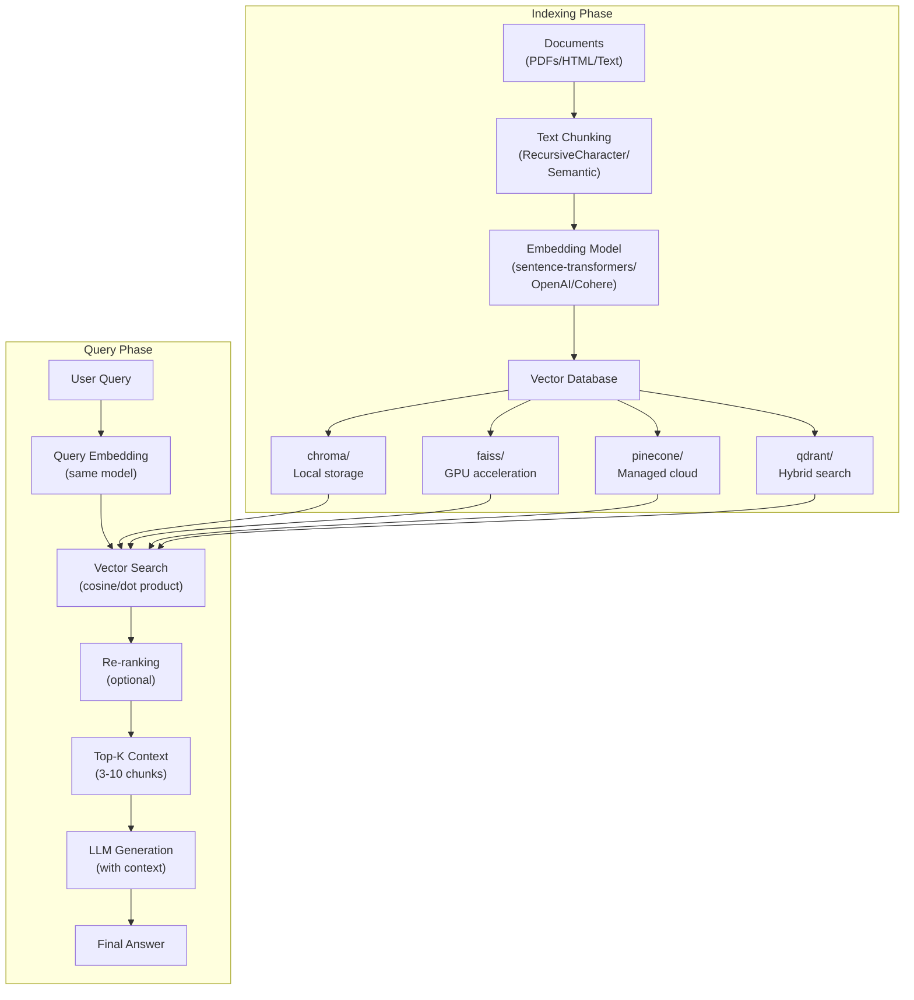
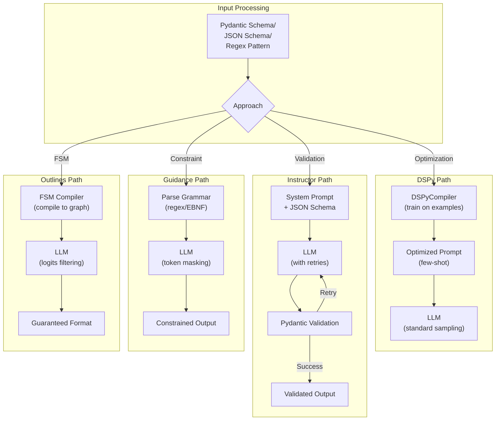
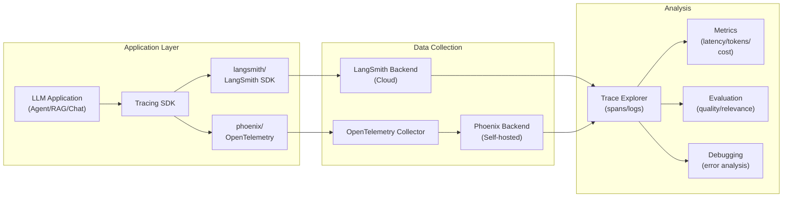
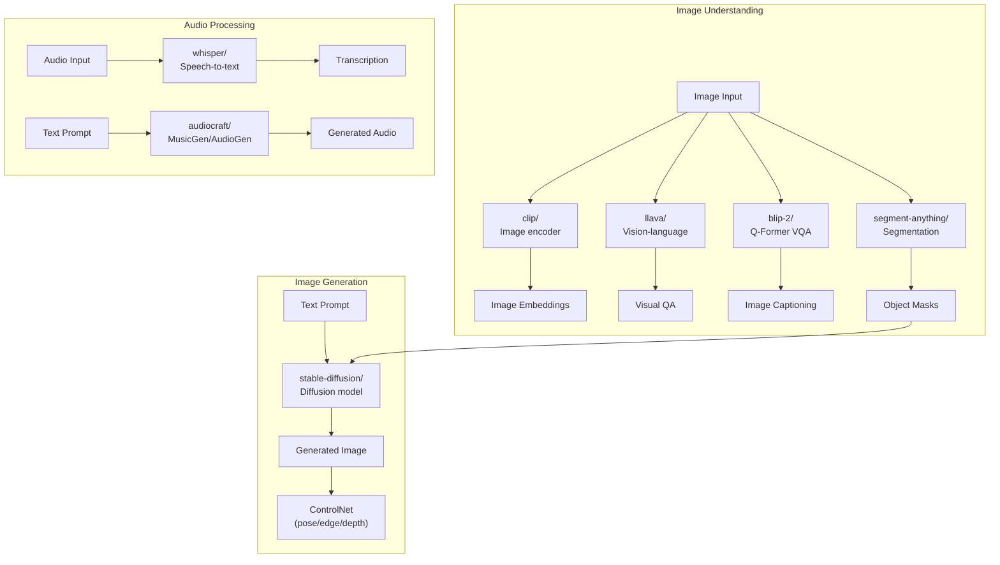
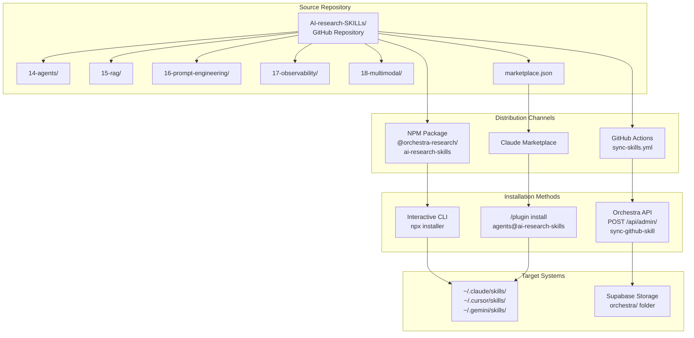
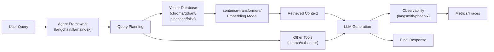
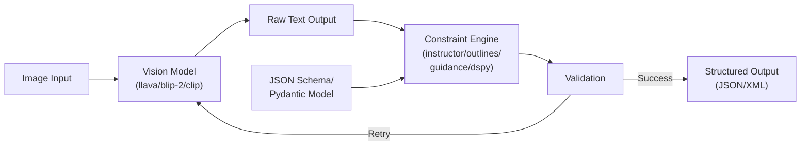
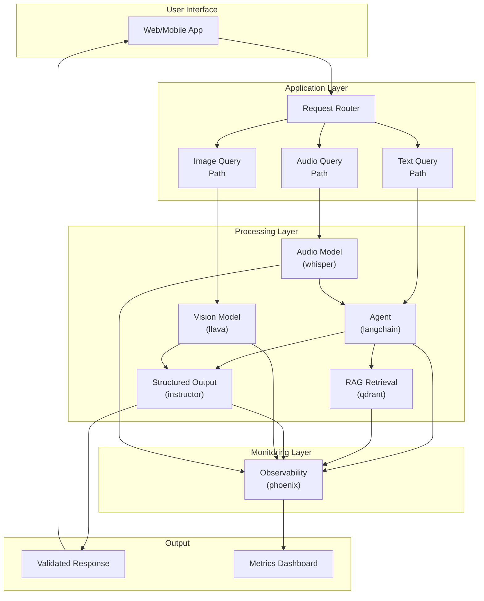

<!-- source: DeepWiki mcp.deepwiki.com · repo Orchestra-Research/AI-research-SKILLs · page 3.6 Application Skills (Categories 14-18) · fetched 2026-10-26 -->

# Application Skills (Categories 14-18)

<details>
<summary>Relevant source files</summary>

The following files were used as context for generating this wiki page:

- [.claude-plugin/marketplace.json](.claude-plugin/marketplace.json)
- [06-post-training/openrlhf/SKILL.md](06-post-training/openrlhf/SKILL.md)
- [06-post-training/simpo/SKILL.md](06-post-training/simpo/SKILL.md)
- [06-post-training/trl-fine-tuning/SKILL.md](06-post-training/trl-fine-tuning/SKILL.md)
- [07-safety-alignment/constitutional-ai/SKILL.md](07-safety-alignment/constitutional-ai/SKILL.md)
- [07-safety-alignment/llamaguard/SKILL.md](07-safety-alignment/llamaguard/SKILL.md)
- [07-safety-alignment/nemo-guardrails/SKILL.md](07-safety-alignment/nemo-guardrails/SKILL.md)
- [08-distributed-training/accelerate/SKILL.md](08-distributed-training/accelerate/SKILL.md)
- [CONTRIBUTING.md](CONTRIBUTING.md)
- [README.md](README.md)
- [demos/README.md](demos/README.md)
- [docs/ROADMAP.md](docs/ROADMAP.md)
- [docs/SKILL_CREATION_GUIDE.md](docs/SKILL_CREATION_GUIDE.md)
- [docs/SKILL_TEMPLATE.md](docs/SKILL_TEMPLATE.md)
- [docs/assets/promo.gif](docs/assets/promo.gif)
- [docs/christmas-tree.svg](docs/christmas-tree.svg)
- [docs/tech-tree.svg](docs/tech-tree.svg)

</details>


## Purpose and Scope

This document covers the **Application Skills** layer of the AI Research Skills library, encompassing categories 14-18. These 22 skills focus on end-user AI applications and deployment patterns, including agent frameworks, retrieval systems, prompt engineering tools, observability platforms, and multimodal models.

For skills related to model training and optimization, see [Training & Data Skills (Categories 03-08)](#3.3). For production infrastructure and serving, see [Production & Serving Skills (Categories 12-13)](#3.5). For overall taxonomy and organization principles, see [Taxonomy & Organization](#3.1).

**Categories covered**:
- **Category 14**: Agents (4 skills) - LLM application frameworks with tool use
- **Category 15**: RAG (5 skills) - Retrieval-augmented generation and vector databases
- **Category 16**: Prompt Engineering (4 skills) - Structured output and constrained generation
- **Category 17**: Observability (2 skills) - LLM application monitoring and tracing
- **Category 18**: Multimodal (7 skills) - Vision, audio, and cross-modal models

---

## Application Skills Taxonomy

The following diagram shows the complete taxonomy of application skills, organized by category with skill counts and key frameworks:



**Sources**: [README.md:127-149](), [README.md:224-244](), [.claude-plugin/marketplace.json:169-253]()

---

## Category 14: Agents

Agent frameworks enable LLM applications to use tools, maintain memory, and execute multi-step workflows autonomously. The 4 agent skills provide different approaches to building autonomous systems.

### Skills Overview

| Skill | Lines | References | Key Feature | GitHub Stars | Use Case |
|-------|-------|------------|-------------|--------------|----------|
| **LangChain** | 658 | 3 refs | 500+ integrations, ReAct pattern | 100k+ | Most popular agent framework |
| **LlamaIndex** | 535 | 3 refs | 300+ data connectors, RAG-focused | 40k+ | Data framework for LLM apps |
| **CrewAI** | 498 | 3 refs | Role-based multi-agent collaboration | 25k+ | Team-based agent orchestration |
| **AutoGPT** | 400 | 2 refs | Visual workflow builder, continuous execution | 175k+ | Autonomous AI agent platform |

**Sources**: [README.md:224-228](), [.claude-plugin/marketplace.json:169-180]()

### Agent Architecture Pattern

The following diagram illustrates the common architecture pattern implemented by agent frameworks, showing the flow from user input through tool execution:



**Sources**: [README.md:224-228](), [.claude-plugin/marketplace.json:171-172]()

### Skill Structure Example: LangChain

The LangChain skill demonstrates the standard structure for agent frameworks:

**Directory structure**:
```
14-agents/langchain/
├── SKILL.md              # 658 lines, main reference
├── references/           # Deep documentation
│   ├── README.md         # Official docs
│   ├── api.md            # API reference
│   └── tutorials.md      # Step-by-step guides
└── examples/             # Code samples (optional)
```

**YAML frontmatter** [pattern from nemo-guardrails/SKILL.md:1-9]():
```yaml
---
name: langchain
description: Most popular agent framework, 500+ integrations, ReAct pattern
version: 1.0.0
author: Orchestra Research
license: MIT
tags: [Agents, LangChain, ReAct, Tool Use, Chain, Memory]
dependencies: [langchain>=0.1.0, langchain-community]
---
```

**Sources**: [07-safety-alignment/nemo-guardrails/SKILL.md:1-9](), [CONTRIBUTING.md:126-187](), [README.md:224-228]()

---

## Category 15: RAG (Retrieval-Augmented Generation)

RAG skills provide vector databases and embedding models for semantic search and document retrieval. These 5 skills cover local databases, managed cloud solutions, and embedding frameworks.

### Skills Overview

| Skill | Lines | References | Key Feature | Throughput | Use Case |
|-------|-------|------------|-------------|------------|----------|
| **Chroma** | 385 | 1 ref | Local/cloud, 24k stars | 1M vectors | Open-source embedding DB |
| **FAISS** | 295 | None | GPU acceleration | Billion-scale | Meta's similarity search |
| **Pinecone** | 410 | None | Auto-scaling, <100ms latency | Production | Managed vector database |
| **Qdrant** | 493 | 2 refs | Hybrid search with filtering | High-performance | Rust-powered vector search |
| **Sentence Transformers** | 370 | None | 5000+ models, multilingual | N/A | Embedding model library |

**Sources**: [README.md:230-235](), [.claude-plugin/marketplace.json:181-193]()

### RAG Pipeline Architecture

This diagram shows how RAG components integrate to enable semantic retrieval:



**Sources**: [README.md:230-235](), [.claude-plugin/marketplace.json:182-183]()

### Vector Database Selection Matrix

Each RAG skill targets different deployment scenarios:

| Scenario | Recommended Skill | Reason |
|----------|------------------|--------|
| Local development/prototyping | **Chroma** | Simple API, local-first, easy setup |
| Maximum performance on single machine | **FAISS** | GPU acceleration, billion-scale search |
| Production cloud deployment | **Pinecone** | Auto-scaling, managed infrastructure |
| Hybrid search (vector + filtering) | **Qdrant** | Combined semantic + metadata filtering |
| Multilingual embedding | **Sentence Transformers** | 5000+ models, 100+ languages |

**Sources**: [README.md:230-235]()

---

## Category 16: Prompt Engineering

Prompt engineering skills provide structured output, constrained generation, and LLM program optimization. These 4 skills enable reliable extraction of JSON/XML from LLMs.

### Skills Overview

| Skill | Lines | References | Key Feature | Approach | Use Case |
|-------|-------|------------|-------------|----------|----------|
| **DSPy** | 438 | 3 refs | Declarative optimization, Stanford NLP | Program optimization | Automated prompt tuning |
| **Instructor** | 726 | 3 refs | Pydantic validation, 15k stars | Type-safe extraction | Structured LLM outputs |
| **Guidance** | 485 | 3 refs | Regex/grammar constraints, MSR | Constrained generation | Token-level control |
| **Outlines** | 601 | 3 refs | FSM-based, zero-overhead | Finite state machines | Fast structured generation |

**Sources**: [README.md:246-250](), [.claude-plugin/marketplace.json:194-205]()

### Prompt Engineering Approaches

Different skills use different mechanisms to ensure structured outputs:



**Sources**: [README.md:246-250](), [.claude-plugin/marketplace.json:195-196]()

### Structured Output Example Pattern

All prompt engineering skills follow a similar usage pattern. Here's the conceptual flow demonstrated across skills:

```python
# Pattern: Schema Definition → Constraint Application → LLM Call

# 1. Define schema (Pydantic/JSON Schema/Regex)
from pydantic import BaseModel

class Person(BaseModel):
    name: str
    age: int
    email: str

# 2. Apply constraint mechanism (varies by skill)
# - DSPy: dspy.ChainOfThought(signature)
# - Instructor: instructor.patch(client)
# - Guidance: guidance.gen(regex=pattern)
# - Outlines: outlines.generate.json(model, schema)

# 3. Call LLM with constraints
result = constrained_llm(prompt, schema=Person)
# Result guaranteed to match schema
```

**Sources**: [CONTRIBUTING.md:126-187](), [docs/SKILL_TEMPLATE.md:1-107]()

---

## Category 17: Observability

Observability skills provide tracing, monitoring, and evaluation for LLM applications. These 2 skills enable debugging and production monitoring.

### Skills Overview

| Skill | Lines | References | Key Feature | Backend | Use Case |
|-------|-------|------------|-------------|---------|----------|
| **LangSmith** | 422 | 2 refs | LangChain integration, hosted service | Cloud | LLM app observability |
| **Phoenix** | 380 | 2 refs | OpenTelemetry tracing, open-source | Self-hosted | AI observability platform |

**Sources**: [README.md:257-259](), [.claude-plugin/marketplace.json:206-215]()

### Observability Architecture

LLM observability tools capture execution traces, token usage, and performance metrics:



**Sources**: [README.md:257-259](), [.claude-plugin/marketplace.json:207-208]()

### Tracing Integration Pattern

Both observability skills integrate similarly with LLM applications:

**LangSmith pattern** (cloud-hosted):
```python
# Environment setup
import os
os.environ["LANGCHAIN_TRACING_V2"] = "true"
os.environ["LANGCHAIN_API_KEY"] = "your-key"

# Automatic tracing for LangChain
from langchain.chains import LLMChain
chain = LLMChain(...)
chain.run("query")  # Automatically traced
```

**Phoenix pattern** (self-hosted):
```python
# Instrument OpenTelemetry
from opentelemetry import trace
from opentelemetry.sdk.trace import TracerProvider
import phoenix as px

px.launch_app()  # Start Phoenix server

# Manual span creation
tracer = trace.get_tracer(__name__)
with tracer.start_as_current_span("llm_call"):
    response = llm.generate(prompt)
```

**Sources**: [.claude-plugin/marketplace.json:206-215]()

---

## Category 18: Multimodal

Multimodal skills enable vision, audio, and cross-modal AI applications. These 7 skills cover image understanding, speech recognition, text-to-image generation, and audio synthesis.

### Skills Overview

| Skill | Lines | References | Modality | Key Feature | Use Case |
|-------|-------|------------|----------|-------------|----------|
| **CLIP** | 320 | None | Vision-Language | Zero-shot classification | Image-text understanding |
| **Whisper** | 395 | None | Audio→Text | 99 languages | Speech recognition |
| **LLaVA** | 360 | None | Vision-Language | GPT-4V level | Visual question answering |
| **Stable Diffusion** | 380 | 2 refs | Text→Image | SDXL, ControlNet | Text-to-image generation |
| **Segment Anything** | 500 | 2 refs | Image→Mask | Zero-shot segmentation | Object segmentation |
| **BLIP-2** | 500 | 2 refs | Vision-Language | Q-Former architecture | Image captioning, VQA |
| **AudioCraft** | 470 | 2 refs | Text→Audio | MusicGen/AudioGen | Audio/music generation |

**Sources**: [README.md:237-244](), [.claude-plugin/marketplace.json:216-230]()

### Multimodal Architecture Patterns

Different modality combinations serve different use cases:



**Sources**: [README.md:237-244](), [.claude-plugin/marketplace.json:218-219]()

### Multimodal Skill Integration Example

Multimodal skills often work together in applications. Example: Image understanding → Text generation → Image editing:

```python
# 1. Image captioning with BLIP-2
from transformers import Blip2Processor, Blip2ForConditionalGeneration

processor = Blip2Processor.from_pretrained("Salesforce/blip2-opt-2.7b")
model = Blip2ForConditionalGeneration.from_pretrained("Salesforce/blip2-opt-2.7b")

caption = model.generate(processor(image, return_tensors="pt"))
# Output: "a cat sitting on a couch"

# 2. Segment objects with SAM
from segment_anything import sam_model_registry, SamPredictor

sam = sam_model_registry["vit_h"](checkpoint="sam_vit_h.pth")
predictor = SamPredictor(sam)
masks = predictor.predict(image, point_coords=[[x, y]])

# 3. Generate new image with Stable Diffusion
from diffusers import StableDiffusionPipeline

pipe = StableDiffusionPipeline.from_pretrained("stabilityai/stable-diffusion-xl")
new_image = pipe(f"Photo of {caption} in a different setting").images[0]
```

**Sources**: [README.md:237-244]()

---

## Skill Distribution and Installation

Application skills are distributed through three channels, all managed from the main repository:

### Distribution Channels



**Sources**: [README.md:77-123](), [.claude-plugin/marketplace.json:1-255]()

### Installation Commands

**NPM Package** (recommended for local installation):
```bash
# Interactive installer - detects agents, offers category selection
npx @orchestra-research/ai-research-skills

# Install specific category
npx @orchestra-research/ai-research-skills install 14-agents

# List installed skills
npx @orchestra-research/ai-research-skills list
```

**Claude Marketplace** (for Claude Code users):
```bash
# Add marketplace
/plugin marketplace add orchestra-research/AI-research-SKILLs

# Install by category
/plugin install agents@ai-research-skills
/plugin install rag@ai-research-skills
/plugin install prompt-engineering@ai-research-skills
```

**Sources**: [README.md:77-123](), [.claude-plugin/marketplace.json:1-255]()

### Canonical Storage Architecture

The NPM installer uses a canonical directory pattern to avoid duplication:

**Directory structure**:
```
~/.orchestra/skills/               # Canonical storage
├── 14-agents/
│   ├── langchain/
│   │   ├── SKILL.md
│   │   └── references/
│   └── llamaindex/
├── 15-rag/
│   ├── chroma/
│   └── faiss/
└── ...

~/.claude/skills/                  # Symlinks
├── langchain -> ~/.orchestra/skills/14-agents/langchain
└── chroma -> ~/.orchestra/skills/15-rag/chroma

~/.cursor/skills/                  # Symlinks
├── langchain -> ~/.orchestra/skills/14-agents/langchain
└── faiss -> ~/.orchestra/skills/15-rag/faiss

~/.orchestra/.lock.json            # Installed skills tracking
```

This architecture enables:
- **Single source of truth**: Updates propagate to all agents
- **Storage efficiency**: No duplication across agents
- **Selective installation**: Install only needed skills

**Sources**: [README.md:77-123]()

---

## Skill Quality Standards

All application skills follow standardized quality requirements to ensure consistency and usefulness:

### YAML Frontmatter Requirements

Every `SKILL.md` file begins with YAML frontmatter [pattern from CONTRIBUTING.md:126-187]():

**Required fields**:
```yaml
---
name: skill-name-here                # kebab-case, no quotes
description: Clear third-person description of when to use this skill
version: 1.0.0                       # Semantic versioning
author: Orchestra Research
license: MIT
tags: [Tag One, Tag Two, Key Concept]  # Title Case, no quotes
dependencies: [package1>=1.0.0]      # With version constraints
---
```

**Field validation checklist**:
- [ ] `name` in kebab-case (e.g., "langchain", "stable-diffusion")
- [ ] `description` includes WHAT skill does AND WHEN to use it
- [ ] `tags` use Title Case (capitalize first letter of each word)
- [ ] `tags` keep acronyms uppercase (e.g., RAG, CLIP, VQA)
- [ ] `dependencies` include version constraints with `>=`
- [ ] All fields present, no quotes around values (except in arrays)

**Sources**: [CONTRIBUTING.md:126-187](), [07-safety-alignment/nemo-guardrails/SKILL.md:1-9]()

### Content Quality Standards

**Core requirements** [from CONTRIBUTING.md:82-112]():

| Requirement | Standard | Reason |
|-------------|----------|--------|
| SKILL.md body length | 200-500 lines | Optimal for AI agent loading |
| Progressive disclosure | Details in `references/` | Keep main file focused |
| Workflows with checklists | Copy-paste task lists | Enable execution tracking |
| Code examples | All blocks have language tags | Enable syntax highlighting |
| References depth | Maximum 1 level from SKILL.md | Prevent deep nesting |
| Documentation size | 300KB+ in `references/` | Ensure comprehensive coverage |

**Example workflow pattern** [from CONTRIBUTING.md:87-98]():
```markdown
### Workflow 1: [Task Name]

Copy this checklist:

```
Task Progress:
- [ ] Step 1: [Action]
- [ ] Step 2: [Action]
- [ ] Step 3: [Validation]
- [ ] Step 4: [Completion]
```

**Step 1: [Action]**

[Brief instruction - assume Claude knows basics]

```python
# Code example with language tag
[implementation]
```
```

**Sources**: [CONTRIBUTING.md:82-112](), [docs/SKILL_CREATION_GUIDE.md:46-63]()

### Marketplace.json Integration

Each skill must have an entry in `.claude-plugin/marketplace.json` for Claude marketplace distribution:

**Plugin entry format**:
```json
{
  "name": "agents",
  "description": "LLM agent frameworks including LangChain, LlamaIndex, CrewAI, and AutoGPT. Use when building chatbots, autonomous agents, or tool-using systems.",
  "source": "./",
  "strict": false,
  "skills": [
    "./14-agents/autogpt",
    "./14-agents/crewai",
    "./14-agents/langchain",
    "./14-agents/llamaindex"
  ]
}
```

**Key fields**:
- `name`: Plugin identifier (lowercase, hyphenated)
- `description`: When to use (triggers for AI agent discovery)
- `source`: Base path (always `"./"`)
- `skills`: Array of skill directory paths

**Sources**: [.claude-plugin/marketplace.json:169-180](), [CONTRIBUTING.md:198-224]()

---

## Application Skill Integration Patterns

Application skills often work together in production systems. This section shows common integration patterns.

### Agent + RAG Pattern

The most common pattern combines agent frameworks with retrieval systems:



**Example**: LangChain + Chroma + LangSmith
```python
from langchain.vectorstores import Chroma
from langchain.chains import RetrievalQA
import os

# 1. RAG setup (chroma skill)
vectordb = Chroma(persist_directory="./db", embedding_function=embeddings)

# 2. Agent setup (langchain skill)
qa_chain = RetrievalQA.from_chain_type(
    llm=llm,
    retriever=vectordb.as_retriever()
)

# 3. Observability (langsmith skill)
os.environ["LANGCHAIN_TRACING_V2"] = "true"

# Query automatically traced and uses RAG
response = qa_chain.run("What is quantum computing?")
```

**Sources**: [README.md:224-235](), [.claude-plugin/marketplace.json:169-215]()

### Prompt Engineering + Multimodal Pattern

Structured output skills work with multimodal models for reliable extraction:



**Example**: LLaVA + Instructor
```python
from pydantic import BaseModel
from transformers import pipeline
import instructor

# 1. Define schema (instructor skill)
class ImageDescription(BaseModel):
    objects: list[str]
    scene: str
    colors: list[str]

# 2. Vision model (llava skill)
vision_model = pipeline("image-to-text", model="llava-hf/llava-1.5-7b-hf")

# 3. Structured extraction
response = vision_model(image)
structured = instructor.parse(response, response_model=ImageDescription)
# Guaranteed to match schema
```

**Sources**: [README.md:237-250]()

### Full Stack Application Example

A complete production application might use skills from all 5 categories:



**Components used**:
- **Category 14 (Agents)**: LangChain for orchestration
- **Category 15 (RAG)**: Qdrant for semantic search
- **Category 16 (Prompt Engineering)**: Instructor for structured outputs
- **Category 17 (Observability)**: Phoenix for monitoring
- **Category 18 (Multimodal)**: LLaVA for vision, Whisper for audio

**Sources**: [README.md:224-259]()

---

## Skill Contribution Workflow

New application skills follow the standard contribution process documented in [CONTRIBUTING.md](). Key steps specific to application skills:

### Creation Process

1. **Category selection**: Determine which category (14-18) fits the new skill
2. **Scraper usage**: Use CLI tools to generate initial content
3. **Quality validation**: Ensure 200-500 lines in SKILL.md, 300KB+ in references/
4. **Marketplace entry**: Add to `.claude-plugin/marketplace.json`
5. **PR submission**: Submit for 48-72 hour review cycle

**Sources**: [CONTRIBUTING.md:30-256]()

### Automated Sync

Once merged, GitHub Actions automatically syncs skills to Orchestra:

**Workflow** [from README.md, high-level diagrams]:
```
git push → main branch
  ↓
.github/workflows/sync-skills.yml triggered
  ↓
Detect changed skill folders (14-18)
  ↓
Extract YAML frontmatter
  ↓
Create ZIP (SKILL.md + references/)
  ↓
POST to Orchestra API with X-Admin-API-Key
  ↓
Store in Supabase Storage (orchestra/ folder)
  ↓
Update database (research_skills table)
```

**Sources**: [README.md:274-288]()

---

This completes the documentation for Application Skills (Categories 14-18), covering agents, RAG, prompt engineering, observability, and multimodal capabilities that enable end-user AI applications.

---

