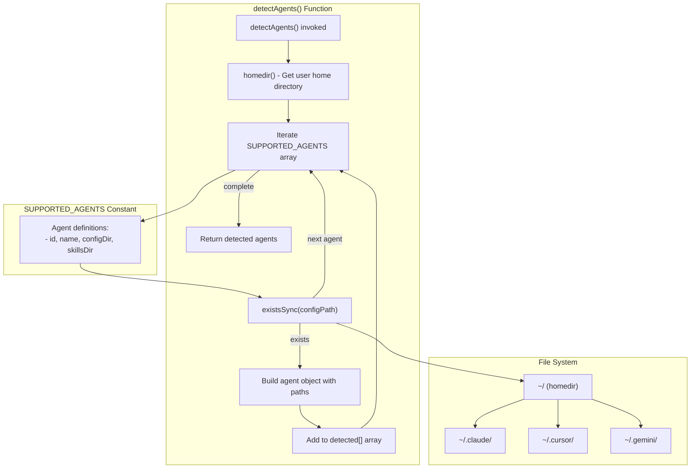
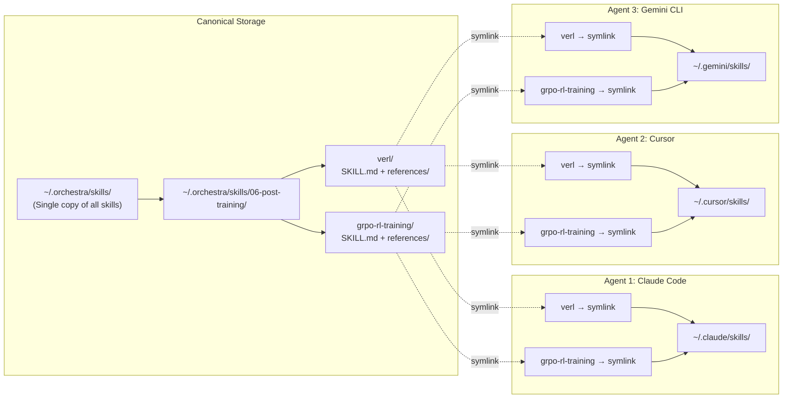
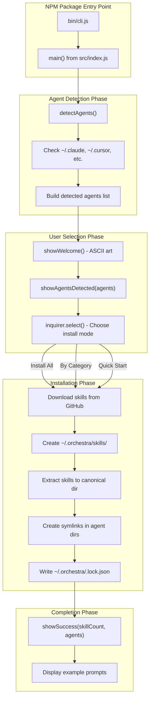
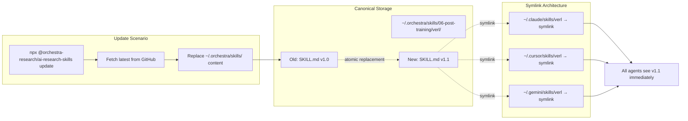

<!-- source: DeepWiki mcp.deepwiki.com · repo Orchestra-Research/AI-research-SKILLs · page 4.1 Agent Integration Patterns · fetched 2026-10-26 -->

# Agent Integration Patterns

<details>
<summary>Relevant source files</summary>

The following files were used as context for generating this wiki page:

- [.claude-plugin/marketplace.json](.claude-plugin/marketplace.json)
- [CONTRIBUTING.md](CONTRIBUTING.md)
- [README.md](README.md)
- [demos/README.md](demos/README.md)
- [docs/ROADMAP.md](docs/ROADMAP.md)
- [docs/SKILL_CREATION_GUIDE.md](docs/SKILL_CREATION_GUIDE.md)
- [docs/SKILL_TEMPLATE.md](docs/SKILL_TEMPLATE.md)
- [docs/assets/promo.gif](docs/assets/promo.gif)
- [docs/christmas-tree.svg](docs/christmas-tree.svg)
- [docs/npm-package-ux-mockup.html](docs/npm-package-ux-mockup.html)
- [docs/tech-tree.svg](docs/tech-tree.svg)
- [packages/ai-research-skills/.gitignore](packages/ai-research-skills/.gitignore)
- [packages/ai-research-skills/README.md](packages/ai-research-skills/README.md)
- [packages/ai-research-skills/bin/cli.js](packages/ai-research-skills/bin/cli.js)
- [packages/ai-research-skills/package-lock.json](packages/ai-research-skills/package-lock.json)
- [packages/ai-research-skills/src/agents.js](packages/ai-research-skills/src/agents.js)
- [packages/ai-research-skills/src/ascii.js](packages/ai-research-skills/src/ascii.js)

</details>


## Purpose and Scope

This document describes how AI coding agents integrate with the AI Research Skills library through their configuration directories. It covers the technical architecture for agent detection, skill storage patterns, symlink management, and skill activation mechanisms. For information about the actual skill file format and structure, see [Skill Structure & Format](#4.2). For end-to-end usage examples, see [Example Workflows](#4.3).

---

## Supported Agent Architecture

The skills library supports five AI coding agents, each with standardized configuration directory patterns. All agents follow the `~/.{agent}/skills/` directory structure for skill discovery.

### Agent Configuration Table

| Agent ID | Display Name | Config Directory | Skills Path | Detection Method |
|----------|-------------|------------------|-------------|------------------|
| `claude` | Claude Code | `~/.claude` | `~/.claude/skills/` | Directory existence check |
| `cursor` | Cursor | `~/.cursor` | `~/.cursor/skills/` | Directory existence check |
| `codex` | Codex | `~/.codex` | `~/.codex/skills/` | Directory existence check |
| `gemini` | Gemini CLI | `~/.gemini` | `~/.gemini/skills/` | Directory existence check |
| `qwen` | Qwen Code | `~/.qwen` | `~/.qwen/skills/` | Directory existence check |

**Sources:** [packages/ai-research-skills/src/agents.js:9-40](), [README.md:79-83]()

---

## Agent Detection System

The installer automatically detects which coding agents are installed on the user's system by checking for the existence of standard configuration directories.



**Agent Detection Implementation**

The `detectAgents()` function performs filesystem checks to identify installed agents:

```javascript
// From packages/ai-research-skills/src/agents.js:46-64
export function detectAgents() {
  const home = homedir();
  const detected = [];

  for (const agent of SUPPORTED_AGENTS) {
    const configPath = join(home, agent.configDir);

    if (existsSync(configPath)) {
      detected.push({
        ...agent,
        path: `~/${agent.configDir}`,
        fullPath: configPath,
        skillsPath: join(configPath, agent.skillsDir),
      });
    }
  }

  return detected;
}
```

**Sources:** [packages/ai-research-skills/src/agents.js:46-64]()

---

## Canonical Storage Pattern

The skills library uses a **single-source-of-truth** storage model to avoid duplication and enable atomic updates across all agents.



**Storage Architecture Benefits:**

| Aspect | Benefit |
|--------|---------|
| **Disk Space** | Each skill stored once, regardless of agent count |
| **Updates** | Update canonical copy, all agents see changes immediately |
| **Consistency** | All agents guaranteed to have identical skill versions |
| **Management** | Single `.lock.json` file tracks installed skills |

**Sources:** [packages/ai-research-skills/README.md:63-81](), [README.md:85-90]()

---

## Directory Structure Implementation

### Canonical Directory Layout

```
~/.orchestra/
├── skills/                          # Canonical skill storage
│   ├── 01-model-architecture/
│   │   ├── litgpt/
│   │   │   ├── SKILL.md
│   │   │   └── references/
│   │   ├── mamba/
│   │   └── torchtitan/
│   ├── 03-fine-tuning/
│   │   ├── axolotl/
│   │   ├── unsloth/
│   │   └── peft/
│   ├── 06-post-training/
│   │   ├── verl/
│   │   ├── grpo-rl-training/
│   │   ├── slime/
│   │   └── torchforge/
│   └── [18 more categories...]
└── .lock.json                       # Installation state tracker
```

### Agent Symlink Layout

```
~/.claude/
└── skills/                          # Claude Code skills directory
    ├── litgpt → ~/.orchestra/skills/01-model-architecture/litgpt
    ├── verl → ~/.orchestra/skills/06-post-training/verl
    ├── grpo-rl-training → ~/.orchestra/skills/06-post-training/grpo-rl-training
    └── [symlinks to other installed skills...]

~/.cursor/
└── skills/                          # Cursor skills directory
    ├── litgpt → ~/.orchestra/skills/01-model-architecture/litgpt
    ├── verl → ~/.orchestra/skills/06-post-training/verl
    └── [same symlinks as Claude...]

~/.gemini/
└── skills/                          # Gemini CLI skills directory
    └── [same symlinks as above agents...]
```

**Sources:** [packages/ai-research-skills/README.md:63-81]()

---

## Skill Discovery and Activation

```mermaid
sequenceDiagram
    participant User
    participant Agent["AI Agent<br/>(Claude/Cursor/Gemini)"]
    participant SkillsDir["~/.{agent}/skills/"]
    participant Symlink["Skill Symlink"]
    participant CanonicalSkill["~/.orchestra/skills/<br/>{category}/{skill}/"]
    participant SKILL_MD["SKILL.md<br/>(YAML frontmatter + content)"]
    participant References["references/<br/>(detailed docs)"]
    
    User->>Agent: "Help me set up GRPO training"
    Agent->>SkillsDir: Scan skills directory
    SkillsDir->>Symlink: List skill directories
    Symlink->>CanonicalSkill: Resolve symlink
    CanonicalSkill->>SKILL_MD: Parse YAML frontmatter
    SKILL_MD->>Agent: Match keywords: "GRPO", "training", "reinforcement learning"
    Agent->>SKILL_MD: Load skill content
    SKILL_MD->>Agent: Return overview + workflows
    Agent->>User: Present GRPO setup guidance
    
    User->>Agent: "Show me the advanced configuration"
    Agent->>References: Load references/advanced-config.md
    References->>Agent: Return detailed configuration guide
    Agent->>User: Present advanced configuration options
```

**Activation Mechanism:**

Agents discover skills through a semantic search process:

1. **Directory Scan**: Agent lists `~/.{agent}/skills/` directory
2. **Symlink Resolution**: Each skill directory is a symlink to canonical storage
3. **YAML Parsing**: Agent reads YAML frontmatter from each `SKILL.md`:
   - `name`: Skill identifier (e.g., `grpo-rl-training`)
   - `description`: Third-person description with trigger keywords
   - `tags`: Searchable terms (e.g., `[GRPO, TRL, Post-Training, RLHF]`)
4. **Semantic Match**: Agent matches user query against skill metadata
5. **Progressive Loading**: Agent loads `SKILL.md` first, then references as needed

**Sources:** [README.md:325-358](), [CONTRIBUTING.md:125-196]()

---

## Installation Flow



**Sources:** [packages/ai-research-skills/bin/cli.js:1-9](), [packages/ai-research-skills/src/agents.js:46-64](), [packages/ai-research-skills/src/ascii.js:18-31]()

---

## Claude Marketplace Integration

Claude Code provides an additional distribution channel through its plugin marketplace, defined in `.claude-plugin/marketplace.json`.

### Marketplace Configuration Structure

```json
{
  "name": "ai-research-skills",
  "owner": {
    "name": "Orchestra Research",
    "email": "zechen@orchestra-research.com"
  },
  "metadata": {
    "description": "Comprehensive library of 82 AI research engineering skills...",
    "version": "1.1.0"
  },
  "plugins": [
    {
      "name": "post-training",
      "description": "RLHF and preference alignment including TRL, GRPO, OpenRLHF...",
      "source": "./",
      "strict": false,
      "skills": [
        "./06-post-training/grpo-rl-training",
        "./06-post-training/verl",
        "./06-post-training/slime",
        "./06-post-training/torchforge"
      ]
    }
  ]
}
```

### Marketplace Installation Commands

| Command | Effect |
|---------|--------|
| `/plugin marketplace add orchestra-research/AI-research-SKILLs` | Add marketplace to Claude Code |
| `/plugin install post-training@ai-research-skills` | Install entire post-training category |
| `/plugin install inference-serving@ai-research-skills` | Install inference serving skills |

**Sources:** [.claude-plugin/marketplace.json:1-255](), [README.md:108-122]()

---

## Agent-Specific Integration Details

### Claude Code Integration

**Configuration Directory:** `~/.claude`

**Skills Path:** `~/.claude/skills/`

**Integration Methods:**
1. NPM installer creates symlinks to `~/.claude/skills/`
2. Marketplace installation via `/plugin install` commands
3. Manual placement of skill directories

**Discovery:** Claude Code scans `~/.claude/skills/` and parses YAML frontmatter from each `SKILL.md` to build searchable skill index.

**Sources:** [packages/ai-research-skills/src/agents.js:10-15]()

---

### Cursor Integration

**Configuration Directory:** `~/.cursor`

**Skills Path:** `~/.cursor/skills/`

**Integration Methods:**
1. NPM installer creates symlinks to `~/.cursor/skills/`
2. Manual placement of skill directories

**Discovery:** Cursor scans `~/.cursor/skills/` directory at startup and indexes skills by YAML metadata.

**Sources:** [packages/ai-research-skills/src/agents.js:16-21]()

---

### Gemini CLI Integration

**Configuration Directory:** `~/.gemini`

**Skills Path:** `~/.gemini/skills/`

**Integration Methods:**
1. NPM installer creates symlinks to `~/.gemini/skills/`
2. Manual workspace pointing

**Discovery:** Gemini CLI loads skills from `~/.gemini/skills/` when invoked in a workspace.

**Alternative Method:** Point Gemini CLI directly to skill directories in workspace:
```bash
# Add to project .gemini config
skills_path: path/to/03-fine-tuning/axolotl
```

**Sources:** [packages/ai-research-skills/src/agents.js:28-33](), [README.md:303-306]()

---

### Codex Integration

**Configuration Directory:** `~/.codex`

**Skills Path:** `~/.codex/skills/`

**Integration Methods:**
1. NPM installer creates symlinks to `~/.codex/skills/`

**Discovery:** Codex scans `~/.codex/skills/` and loads skills contextually based on conversation.

**Sources:** [packages/ai-research-skills/src/agents.js:22-27]()

---

### Qwen Code Integration

**Configuration Directory:** `~/.qwen`

**Skills Path:** `~/.qwen/skills/`

**Integration Methods:**
1. NPM installer creates symlinks to `~/.qwen/skills/`

**Discovery:** Qwen Code indexes skills from `~/.qwen/skills/` directory.

**Sources:** [packages/ai-research-skills/src/agents.js:34-39]()

---

## Lock File Management

The `~/.orchestra/.lock.json` file tracks installation state across all agents.

### Lock File Schema

```json
{
  "version": "1.0.0",
  "installed_at": "2025-01-15T10:30:00Z",
  "skills": [
    {
      "name": "verl",
      "category": "06-post-training",
      "path": "06-post-training/verl",
      "installed_at": "2025-01-15T10:30:00Z"
    },
    {
      "name": "grpo-rl-training",
      "category": "06-post-training",
      "path": "06-post-training/grpo-rl-training",
      "installed_at": "2025-01-15T10:30:00Z"
    }
  ],
  "agents": [
    {
      "id": "claude",
      "name": "Claude Code",
      "skills_path": "/Users/username/.claude/skills"
    },
    {
      "id": "cursor",
      "name": "Cursor",
      "skills_path": "/Users/username/.cursor/skills"
    }
  ]
}
```

**Lock File Purpose:**

| Function | Description |
|----------|-------------|
| **State Tracking** | Records which skills are installed and when |
| **Update Detection** | Determines which skills need updating |
| **Uninstall Support** | Identifies symlinks to remove |
| **Audit Trail** | Logs installation history per skill |

**Sources:** [packages/ai-research-skills/README.md:1-98]()

---

## Symlink Creation Implementation

```mermaid
graph TB
    subgraph "createSymlinks() Process"
        Input["Input: agents[], skills[], canonicalDir"]
        IterateAgents["For each detected agent"]
        CheckSkillsDir["Check if agent.skillsPath exists"]
        CreateSkillsDir["Create skills/ directory if needed"]
        IterateSkills["For each skill to install"]
        BuildSymlink["Build symlink path"]
        CheckExisting["Check if symlink already exists"]
        RemoveOld["Remove old symlink if exists"]
        CreateNew["fs.symlinkSync(target, link, 'dir')"]
        LogSuccess["Log symlink creation"]
        Complete["All symlinks created"]
    end
    
    Input --> IterateAgents
    IterateAgents --> CheckSkillsDir
    CheckSkillsDir -->|"missing"| CreateSkillsDir
    CheckSkillsDir -->|"exists"| IterateSkills
    CreateSkillsDir --> IterateSkills
    IterateSkills --> BuildSymlink
    BuildSymlink --> CheckExisting
    CheckExisting -->|"exists"| RemoveOld
    CheckExisting -->|"new"| CreateNew
    RemoveOld --> CreateNew
    CreateNew --> LogSuccess
    LogSuccess --> IterateSkills
    IterateSkills -->|"next skill"| BuildSymlink
    IterateSkills -->|"complete"| IterateAgents
    IterateAgents -->|"next agent"| CheckSkillsDir
    IterateAgents -->|"complete"| Complete
```



**Symlink Implementation:**

The installer uses Node.js `fs.symlinkSync()` to create directory symlinks from agent skills directories to canonical storage:

```javascript
// Conceptual implementation (actual code in installer)
for (const agent of detectedAgents) {
  const skillsDir = join(agent.fullPath, agent.skillsDir);
  
  // Create skills directory if doesn't exist
  if (!existsSync(skillsDir)) {
    mkdirSync(skillsDir, { recursive: true });
  }
  
  for (const skill of selectedSkills) {
    const target = join(canonicalDir, skill.path);
    const link = join(skillsDir, skill.name);
    
    // Remove existing symlink if present
    if (existsSync(link)) {
      unlinkSync(link);
    }
    
    // Create symlink: agent skill dir -> canonical storage
    symlinkSync(target, link, 'dir');
  }
}
```

**Sources:** [packages/ai-research-skills/README.md:63-81]()

---

## Multi-Agent Consistency Guarantees



**Consistency Properties:**

| Property | Implementation | Benefit |
|----------|----------------|---------|
| **Atomic Updates** | Replace canonical files, symlinks unchanged | No partial update state |
| **Instant Propagation** | All symlinks point to same location | All agents see updates immediately |
| **Version Consistency** | Single source of truth | Impossible for agents to have different versions |
| **Rollback Safety** | Backup canonical dir before update | Can restore previous state atomically |

**Sources:** [packages/ai-research-skills/README.md:63-81]()

---

## Alternative Integration Patterns

### Custom RAG System Integration

For custom RAG or agent systems, skills can be ingested directly without symlinks:

```python
# Ingest skills into vector database
import os
from pathlib import Path

skills_dir = Path.home() / ".orchestra" / "skills"

for category_dir in skills_dir.iterdir():
    if category_dir.is_dir():
        for skill_dir in category_dir.iterdir():
            skill_md = skill_dir / "SKILL.md"
            references_dir = skill_dir / "references"
            
            # Ingest SKILL.md
            with open(skill_md) as f:
                content = f.read()
                # Parse YAML frontmatter for metadata
                # Index content in vector database
            
            # Ingest reference files
            if references_dir.exists():
                for ref_file in references_dir.glob("*.md"):
                    # Index reference content
```

**Sources:** [README.md:307-310]()

---

### Manual Workspace Integration (Cursor/Windsurf)

Cursor and Windsurf support adding skill folders directly to project knowledge:

1. Open Cursor/Windsurf project settings
2. Add skill directory to "Knowledge Base" or "Context"
3. Example: Add `03-fine-tuning/axolotl` to project context

This approach loads skills per-project rather than globally.

**Sources:** [README.md:303-306]()

---

## Agent Helper Functions

The `agents.js` module provides utility functions for agent management:

### `detectAgents()`
Scans filesystem for installed agents.

**Returns:** Array of detected agent objects with paths.

**Usage:**
```javascript
import { detectAgents } from './agents.js';

const agents = detectAgents();
// Returns: [{ id: 'claude', name: 'Claude Code', path: '~/.claude', ... }]
```

### `getAgentById(id)`
Retrieves agent configuration by ID.

**Parameters:** `id` (string) - Agent identifier (`claude`, `cursor`, etc.)

**Returns:** Agent object or `null` if not found.

**Usage:**
```javascript
import { getAgentById } from './agents.js';

const claude = getAgentById('claude');
// Returns: { id: 'claude', name: 'Claude Code', configDir: '.claude', ... }
```

### `getSupportedAgentIds()`
Returns list of all supported agent identifiers.

**Returns:** Array of agent ID strings.

**Usage:**
```javascript
import { getSupportedAgentIds } from './agents.js';

const ids = getSupportedAgentIds();
// Returns: ['claude', 'cursor', 'codex', 'gemini', 'qwen']
```

**Sources:** [packages/ai-research-skills/src/agents.js:66-82]()

---

## Troubleshooting Integration Issues

### Issue: Agent Not Detecting Skills

**Symptom:** Agent doesn't suggest skills despite installation.

**Diagnosis:**
1. Check if symlinks exist: `ls -la ~/.{agent}/skills/`
2. Verify symlink targets are valid: `readlink ~/.{agent}/skills/verl`
3. Confirm canonical storage exists: `ls ~/.orchestra/skills/`

**Fix:**
```bash
# Re-run installer to recreate symlinks
npx @orchestra-research/ai-research-skills

# Or manually recreate symlinks
ln -s ~/.orchestra/skills/06-post-training/verl ~/.claude/skills/verl
```

---

### Issue: Symlinks Broken After Directory Move

**Symptom:** Skills stop working after moving home directory or restoring from backup.

**Cause:** Symlinks contain absolute paths that become invalid when directories move.

**Fix:**
```bash
# Remove all symlinks
find ~/.claude/skills -type l -delete
find ~/.cursor/skills -type l -delete

# Re-run installer to recreate with correct paths
npx @orchestra-research/ai-research-skills
```

---

### Issue: Multiple Agents Showing Different Skill Versions

**Symptom:** Should never happen with canonical storage, but might occur if symlinks are manually created incorrectly.

**Diagnosis:**
```bash
# Check where each symlink points
readlink ~/.claude/skills/verl
readlink ~/.cursor/skills/verl

# They should point to the same location
```

**Fix:**
```bash
# Delete all symlinks and reinstall
npx @orchestra-research/ai-research-skills
```

**Sources:** [packages/ai-research-skills/README.md:1-98]()

---

