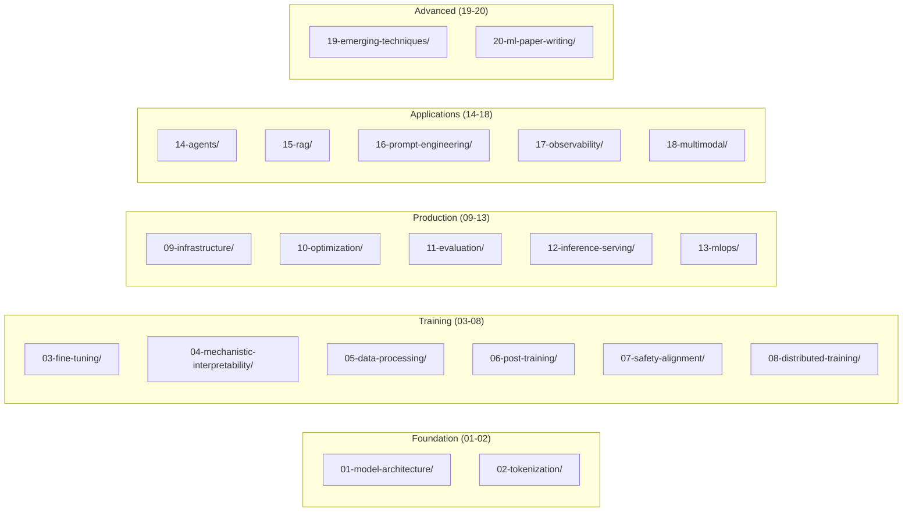
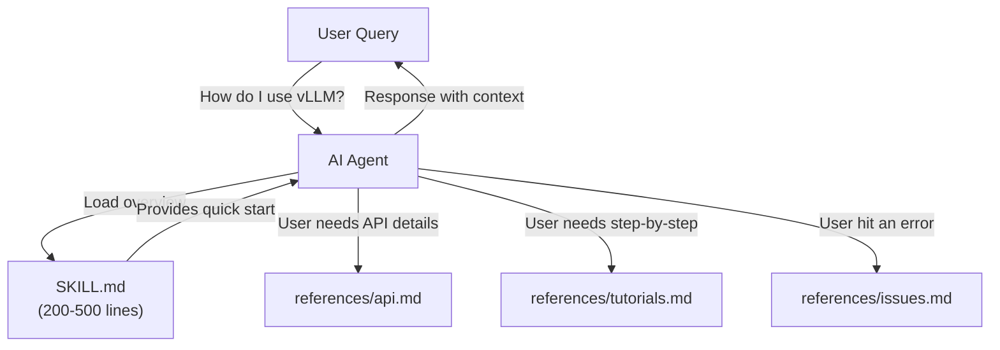
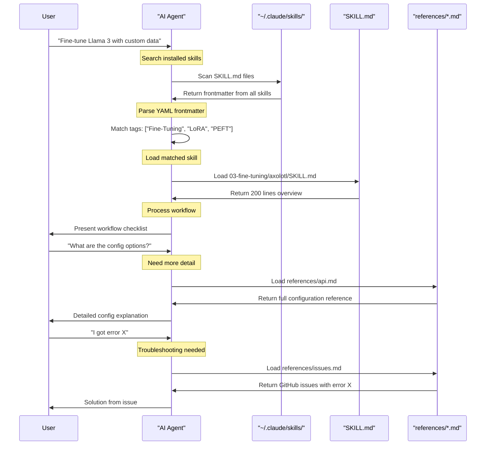
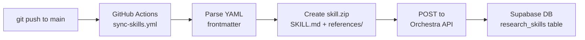

<!-- source: DeepWiki mcp.deepwiki.com · repo Orchestra-Research/AI-research-SKILLs · page 4.2 Skill Structure & Format · fetched 2026-10-26 -->

# Skill Structure & Format

<details>
<summary>Relevant source files</summary>

The following files were used as context for generating this wiki page:

- [.claude-plugin/marketplace.json](.claude-plugin/marketplace.json)
- [CONTRIBUTING.md](CONTRIBUTING.md)
- [README.md](README.md)
- [demos/README.md](demos/README.md)
- [docs/ROADMAP.md](docs/ROADMAP.md)
- [docs/SKILL_CREATION_GUIDE.md](docs/SKILL_CREATION_GUIDE.md)
- [docs/SKILL_TEMPLATE.md](docs/SKILL_TEMPLATE.md)
- [docs/assets/promo.gif](docs/assets/promo.gif)
- [docs/christmas-tree.svg](docs/christmas-tree.svg)
- [docs/skills.png](docs/skills.png)
- [docs/tech-tree.svg](docs/tech-tree.svg)

</details>


## Purpose and Scope

This document describes the technical structure and formatting requirements for skills in the AI Research Skills library. It covers the file organization, YAML frontmatter specification, progressive disclosure pattern, and documentation guidelines that enable AI agents to effectively discover and utilize skills.

For information about how different AI agents integrate with skills via their configuration directories, see [Agent Integration Patterns](#4.1). For practical examples of agents using skills in research workflows, see [Example Workflows](#4.3).

---

## File Structure

Each skill follows a standardized directory structure that separates quick reference material from comprehensive documentation:

```
skill-name/
├── SKILL.md                    # Main entry point (200-500 lines)
│   ├── YAML frontmatter        # Metadata for discovery
│   ├── Quick start             # Minimal working example
│   ├── Common workflows        # Step-by-step checklists
│   ├── When to use             # Decision guidance
│   ├── Common issues           # Troubleshooting
│   └── Advanced topics         # Links to references/
│
├── references/                 # Deep documentation (300KB+ total)
│   ├── README.md              # GitHub repository documentation
│   ├── api.md                 # API reference
│   ├── tutorials.md           # Step-by-step guides
│   ├── issues.md              # Real GitHub issues & solutions
│   ├── releases.md            # Version history & breaking changes
│   └── file_structure.md      # Codebase navigation
│
├── scripts/                    # Helper utilities (optional)
│   ├── validate.py            # Validation scripts
│   └── setup.sh               # Setup automation
│
└── assets/                     # Templates & examples (optional)
    ├── config.yaml.template   # Configuration templates
    └── example.py             # Usage examples
```

**Design Rationale**: The structure implements progressive disclosure—agents first load `SKILL.md` for quick reference, then load specific reference files only when needed for deeper knowledge. This optimizes context window usage while maintaining comprehensive coverage.

**Sources**: [README.md:325-358](), [CONTRIBUTING.md:286-309]()

---

## Directory Organization by Category

Skills are organized into 20 numbered categories that represent the AI research lifecycle:



Each category directory contains multiple skill subdirectories following the pattern: `XX-category/skill-name/SKILL.md`

**Sources**: [README.md:386-415](), [CONTRIBUTING.md:256-282]()

---

## YAML Frontmatter Specification

Every `SKILL.md` file begins with YAML frontmatter that enables skill discovery and metadata extraction. This frontmatter is parsed by both the GitHub Actions sync workflow and AI agent skill discovery mechanisms.

### Required Fields

```yaml
---
name: skill-name-here
description: Clear description of when to use this skill
version: 1.0.0
author: Orchestra Research
license: MIT
tags: [Tag One, Tag Two, Tag Three]
dependencies: [package1>=1.0.0, package2>=2.0.0]
---
```

### Field Specifications

| Field | Required | Format | Validation Rules |
|-------|----------|--------|------------------|
| `name` | ✅ Yes | kebab-case | No quotes, lowercase with hyphens, gerund form preferred (e.g., "serving-llms") |
| `description` | ✅ Yes | Plain text | No quotes, third-person description, includes WHAT and WHEN, max 1024 characters |
| `version` | ✅ Yes | `MAJOR.MINOR.PATCH` | Semantic versioning |
| `author` | ✅ Yes | Plain text | Typically "Orchestra Research" |
| `license` | ✅ Yes | License identifier | Usually `MIT` |
| `tags` | ✅ Yes | Array | Title Case, no quotes, 5-10 tags |
| `dependencies` | ⚠️ Optional | Array | Include version constraints using `>=` |

### Tag Conventions

Tags use **Title Case** for words and **UPPERCASE** for acronyms:

```yaml
# Correct
tags: [Reinforcement Learning, GRPO, TRL, Post-Training, RLHF, Reward Modeling]

# Incorrect
tags: [reinforcement learning, grpo, trl, post-training, rlhf, reward modeling]
```

### Dependencies Format

Dependencies list direct requirements with version constraints:

```yaml
dependencies: [transformers>=4.47.0, trl>=0.14.0, datasets>=3.2.0, peft>=0.14.0, torch]
```

### Example Frontmatter

```yaml
---
name: grpo-rl-training
description: Expert guidance for GRPO/RL fine-tuning with TRL for reasoning and task-specific model training
version: 1.0.0
author: Orchestra Research
license: MIT
tags: [Reinforcement Learning, GRPO, TRL, Post-Training, RLHF, Reward Modeling, Reasoning, DPO, PPO, Structured Output]
dependencies: [transformers>=4.47.0, trl>=0.14.0, datasets>=3.2.0, peft>=0.14.0, torch]
---
```

**How Agents Use Frontmatter**: AI agents parse the YAML to discover skills semantically. When a user asks "How do I do reinforcement learning fine-tuning?", agents search `tags` fields for matches like "Reinforcement Learning", "RLHF", etc. The `description` field is used for contextual ranking when multiple skills match.

**Sources**: [CONTRIBUTING.md:125-196](), [SKILL_TEMPLATE.md:1-9]()

---

## Progressive Disclosure Pattern

The progressive disclosure pattern optimizes context window usage by separating overview information from detailed documentation. This is based on Anthropic's official best practices for skill design.

### Core Principle

**The context window is a public good** shared by system prompts, conversation history, and multiple skills. Skills must be concise and assume Claude already possesses general knowledge.



### SKILL.md Guidelines

**Target Length**: 200-300 lines (maximum 500 lines)

**Content Strategy**:
- Assume Claude knows fundamentals (no over-explaining)
- Provide quick start with minimal working example
- Include decision guidance ("When to use vs alternatives")
- Link to reference files for depth

**Example of Concise Writing**:

✅ **Good** (50 tokens):
```markdown
## Extract PDF text

Use pdfplumber for text extraction:

```python
import pdfplumber
with pdfplumber.open("file.pdf") as pdf:
    text = pdf.pages[0].extract_text()
```
```

❌ **Bad** (150 tokens):
```markdown
## Extract PDF text

PDF (Portable Document Format) files are a common file format that contains
text, images, and other content. To extract text from a PDF, you'll need to
use a library. There are many libraries available for PDF processing, but we
recommend pdfplumber because it's easy to use and handles most cases well.
First, you'll need to install it using pip. Then you can use the code below...
```

### References Directory Organization

References are **one level deep** from `SKILL.md` (no nested references). Each reference file focuses on a specific topic:

| File | Purpose | Typical Size |
|------|---------|--------------|
| `README.md` | Official GitHub repository docs | 50-200 KB |
| `api.md` | API reference extracted from docs | 50-150 KB |
| `tutorials.md` | Step-by-step guides from docs | 30-100 KB |
| `issues.md` | Real GitHub issues with solutions | 50-200 KB |
| `releases.md` | Version history, breaking changes | 20-80 KB |
| `file_structure.md` | Codebase navigation guide | 10-50 KB |

**Linking Pattern**:
```markdown
## Advanced topics

**Distributed inference**: See [references/distributed.md](references/distributed.md)
**Performance tuning**: See [references/optimization.md](references/optimization.md)
**API reference**: See [references/api.md](references/api.md)
```

**Sources**: [SKILL_CREATION_GUIDE.md:46-64](), [CONTRIBUTING.md:83-112]()

---

## Code Example Requirements

All code examples in skills must include language detection tags. This enables syntax highlighting in agent interfaces and proper parsing by code execution systems.

### Language Tag Specification

````markdown
✅ Correct - with language tag:
```python
from transformers import AutoModel
model = AutoModel.from_pretrained("gpt2")
```

❌ Incorrect - missing language tag:
```
from transformers import AutoModel
model = AutoModel.from_pretrained("gpt2")
```
````

### Supported Language Tags

Common tags used across skills:

| Language | Tag | Usage |
|----------|-----|-------|
| Python | `python` | Training scripts, model code |
| Bash | `bash` | Installation, CLI commands |
| YAML | `yaml` | Configuration files |
| JSON | `json` | Config examples, API responses |
| Text | `text` | Plain text output, logs |
| Dockerfile | `dockerfile` | Container definitions |
| Markdown | `markdown` | Documentation templates |

### Multi-Language Examples

When showing command sequences, separate by language:

````markdown
**Installation**:
```bash
pip install transformers torch
```

**Basic usage**:
```python
from transformers import pipeline
classifier = pipeline("sentiment-analysis")
result = classifier("I love this!")
```

**Configuration**:
```yaml
model:
  name: gpt2
  max_length: 512
```
````

**Validation**: The repository includes a validation script to check for missing language tags:
```bash
grep -A 1 '```' your-skill/SKILL.md | head -20
```

**Sources**: [CONTRIBUTING.md:316-334]()

---

## Workflow Checklist Format

For multi-step tasks, skills provide copy-paste checklists that users can track in their conversation with the AI agent. This pattern is recommended by Anthropic for complex operations.

### Checklist Structure

````markdown
## Deployment workflow

Copy this checklist and track progress:

```
Task Progress:
- [ ] Step 1: Configure server settings
- [ ] Step 2: Validate configuration
- [ ] Step 3: Deploy to production
- [ ] Step 4: Verify deployment
```

**Step 1: Configure server settings**

Edit `config.yaml` with production values:
```yaml
server:
  host: 0.0.0.0
  port: 8000
  workers: 4
```

**Step 2: Validate configuration**

Run validator and fix errors:
```bash
python validate.py config.yaml
# If errors: fix → validate again → continue
```

**Step 3: Deploy to production**

Deploy using the deployment script:
```bash
./deploy.sh --env production
```

**Step 4: Verify deployment**

Check service health:
```bash
curl http://localhost:8000/health
```
````

### Feedback Loop Pattern

For quality-critical operations, include explicit feedback loops:

````markdown
**Step 2: Validate configuration**

Run validator and fix errors if found:

```bash
python validate.py config.yaml
# If errors: fix → validate again → continue
```

Do not proceed until validation passes.
````

This pattern appears in skills that involve configuration (like training setup), deployment, or data processing where errors have significant consequences.

**Sources**: [SKILL_CREATION_GUIDE.md:67-119](), [SKILL_TEMPLATE.md:27-69]()

---

## Skill Discovery and Usage Flow

The following diagram shows how AI agents discover and utilize skills through the standardized structure:



### Discovery Mechanism

**Step 1: Frontmatter Scanning**

When an agent starts, it scans all `SKILL.md` files in its skills directory:

```
~/.claude/skills/
├── 01-model-architecture/litgpt/SKILL.md
├── 03-fine-tuning/axolotl/SKILL.md
├── 06-post-training/grpo-rl-training/SKILL.md
└── ...
```

**Step 2: Metadata Extraction**

For each skill, the agent extracts the YAML frontmatter:
```yaml
name: axolotl
description: YAML-based fine-tuning framework supporting 100+ models...
tags: [Fine-Tuning, LoRA, QLoRA, YAML Config, Multi-GPU]
```

**Step 3: Semantic Matching**

When a user makes a request, the agent:
1. Tokenizes the request: "Fine-tune" → "Llama 3" → "custom data"
2. Matches against `tags` and `description` fields
3. Ranks skills by relevance
4. Loads the top match

**Step 4: Progressive Loading**

The agent loads files progressively:
1. First: `SKILL.md` (overview)
2. Then: Specific reference files as needed
3. Finally: Scripts if execution required

**Sources**: [README.md:325-358]()

---

## Marketplace Integration

Skills are automatically synced to the Orchestra marketplace and Claude plugin marketplace via GitHub Actions. The sync workflow reads the same YAML frontmatter and directory structure.

### Marketplace.json Format

The [.claude-plugin/marketplace.json]() file groups skills into plugins by category:

```json
{
  "name": "ai-research-skills",
  "plugins": [
    {
      "name": "fine-tuning",
      "description": "LLM fine-tuning frameworks including Axolotl, LLaMA-Factory, PEFT, and Unsloth. Use when fine-tuning models with LoRA, QLoRA, or full fine-tuning.",
      "source": "./",
      "strict": false,
      "skills": [
        "./03-fine-tuning/axolotl",
        "./03-fine-tuning/llama-factory",
        "./03-fine-tuning/peft",
        "./03-fine-tuning/unsloth"
      ]
    }
  ]
}
```

### Sync Workflow



When a contributor pushes a new skill:

1. **GitHub Actions Trigger**: [.github/workflows/sync-skills.yml]() detects changes to `XX-category/` directories
2. **Metadata Extraction**: Workflow extracts YAML frontmatter from `SKILL.md`
3. **ZIP Creation**: Packages `SKILL.md` + `references/` directory
4. **API Upload**: POSTs ZIP to Orchestra API with metadata
5. **Database Update**: Skill appears in marketplace search

**Key Files**:
- `.claude-plugin/marketplace.json` - Plugin definitions
- `.github/workflows/sync-skills.yml` - Sync automation
- Individual `SKILL.md` files - Source of truth for metadata

**Sources**: [.claude-plugin/marketplace.json:1-255](), [README.md:196-223]()

---

## Quality Standards Summary

### Required Elements

**SKILL.md must contain**:
- ✅ YAML frontmatter with all required fields
- ✅ Quick start with minimal working example
- ✅ At least one workflow with checklist
- ✅ "When to use vs alternatives" section
- ✅ Common issues with solutions
- ✅ Links to reference files for advanced topics

**Code examples must**:
- ✅ Include language detection tags
- ✅ Be concise (5-15 lines for basic examples)
- ✅ Work copy-paste (no ellipsis or placeholders)

**References directory must**:
- ✅ Total at least 300KB of documentation
- ✅ Include official documentation (README.md)
- ✅ Be one level deep (no nested references)

### Validation Checklist

```bash
# 1. Check SKILL.md line count (target 200-500)
wc -l skill-name/SKILL.md

# 2. Validate YAML frontmatter
python -c "import yaml; yaml.safe_load(open('skill-name/SKILL.md').read().split('---')[1])"

# 3. Check for language tags
grep -A 1 '```' skill-name/SKILL.md

# 4. Verify references size (target 300KB+)
du -sh skill-name/references/

# 5. Validate marketplace.json
python -c "import json; json.load(open('.claude-plugin/marketplace.json'))"
```

**Sources**: [CONTRIBUTING.md:83-196]()

---

## File Size Guidelines

Based on the current library of 82 skills, optimal file sizes are:

| Component | Target Size | Rationale |
|-----------|-------------|-----------|
| `SKILL.md` | 200-500 lines | Balances completeness with context efficiency |
| `references/` total | 300KB-1MB | Provides comprehensive coverage without overwhelming |
| Individual reference | 10-200KB | Focused on single topic |
| `scripts/` | 50-500 lines | Utility functions, not documentation |

**Example Skill Sizes**:

| Skill | SKILL.md Lines | References Size | Total Documentation |
|-------|----------------|-----------------|---------------------|
| `grpo-rl-training` | 569 lines | 4 files | ~150KB |
| `axolotl` | 151 lines | 4 files | ~200KB |
| `vllm` | 356 lines | 4 files | ~300KB |
| `langchain` | 658 lines | 3 files | ~250KB |

The largest skills approach 700 lines in `SKILL.md`, but 200-500 is recommended for optimal agent performance.

**Sources**: [README.md:369-382](), [ROADMAP.md:9-18]()

---

## Template Usage

The repository provides [docs/SKILL_TEMPLATE.md]() as a starting scaffold. Contributors should:

1. Copy template to new skill directory:
   ```bash
   cp docs/SKILL_TEMPLATE.md XX-category/skill-name/SKILL.md
   ```

2. Fill in YAML frontmatter with accurate metadata

3. Replace template sections with actual content:
   - Quick start with real code
   - Workflows with domain-specific steps
   - Common issues from GitHub issues/documentation
   - Reference links to actual files

4. Validate using checklist above

5. Update [.claude-plugin/marketplace.json]() with new skill entry

**Sources**: [SKILL_TEMPLATE.md:1-107](), [CONTRIBUTING.md:227-254]()

---

