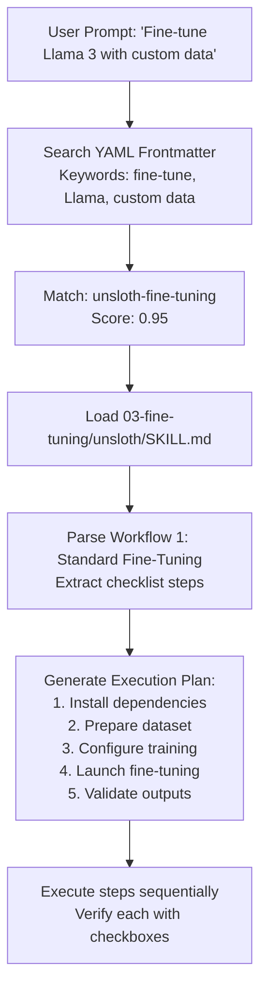
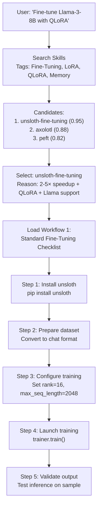
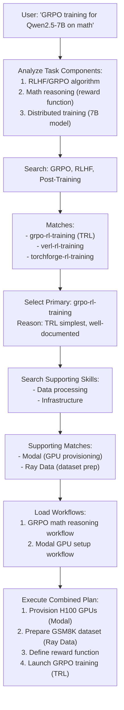
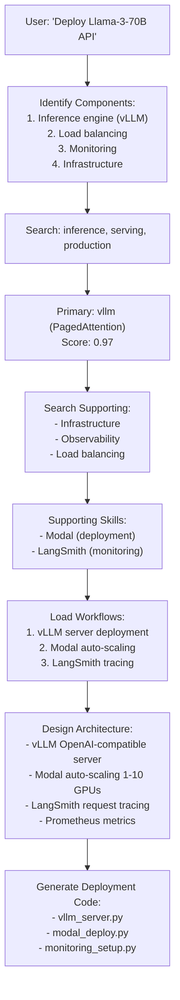
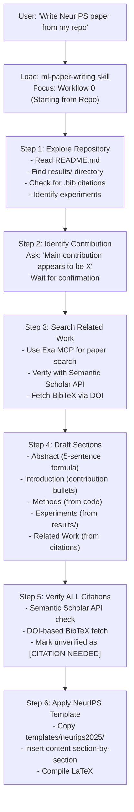
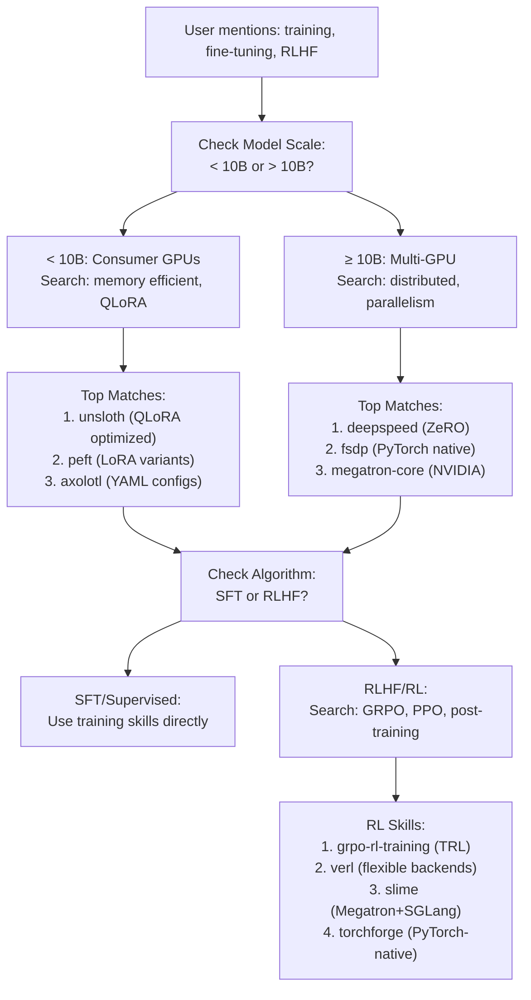
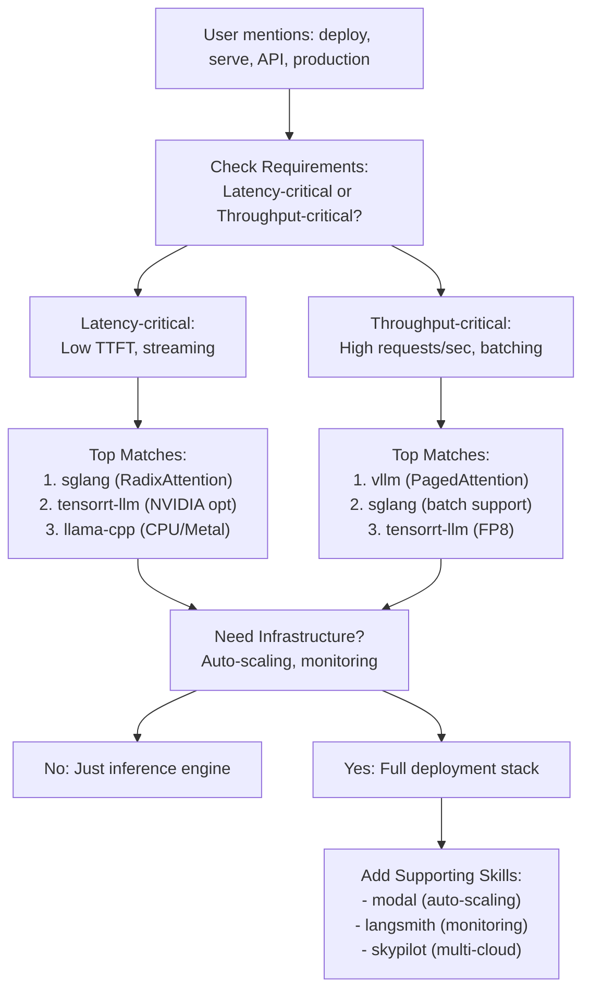

<!-- source: DeepWiki mcp.deepwiki.com · repo Orchestra-Research/AI-research-SKILLs · page 4.3 Example Workflows · fetched 2026-10-26 -->

# Example Workflows

<details>
<summary>Relevant source files</summary>

The following files were used as context for generating this wiki page:

- [.claude-plugin/marketplace.json](.claude-plugin/marketplace.json)
- [01-model-architecture/torchtitan/SKILL.md](01-model-architecture/torchtitan/SKILL.md)
- [06-post-training/miles/SKILL.md](06-post-training/miles/SKILL.md)
- [06-post-training/slime/SKILL.md](06-post-training/slime/SKILL.md)
- [06-post-training/torchforge/SKILL.md](06-post-training/torchforge/SKILL.md)
- [06-post-training/verl/SKILL.md](06-post-training/verl/SKILL.md)
- [20-ml-paper-writing/SKILL.md](20-ml-paper-writing/SKILL.md)
- [CONTRIBUTING.md](CONTRIBUTING.md)
- [README.md](README.md)
- [demos/README.md](demos/README.md)
- [docs/ROADMAP.md](docs/ROADMAP.md)
- [docs/SKILL_CREATION_GUIDE.md](docs/SKILL_CREATION_GUIDE.md)
- [docs/SKILL_TEMPLATE.md](docs/SKILL_TEMPLATE.md)
- [docs/assets/promo.gif](docs/assets/promo.gif)
- [docs/christmas-tree.svg](docs/christmas-tree.svg)
- [docs/tech-tree.svg](docs/tech-tree.svg)
- [docs/writing-assets/ML_paper_guide.md](docs/writing-assets/ML_paper_guide.md)
- [docs/writing-assets/ml_paper_writing_sources.md](docs/writing-assets/ml_paper_writing_sources.md)

</details>


This page demonstrates real-world examples of AI coding agents using skills from this library to accomplish research tasks. Each workflow shows how agents discover relevant skills through YAML frontmatter, load the appropriate documentation, and execute multi-step research pipelines.

For information about how agents integrate with skills technically, see [Agent Integration Patterns](#4.1). For details on skill structure and format, see [Skill Structure & Format](#4.2).

---

## How Agents Discover and Use Skills

AI agents interact with skills through a three-stage process: discovery, planning, and execution.

### Discovery via YAML Frontmatter

When a user provides a prompt like "Fine-tune Llama 3 with custom data," the agent searches installed skills by:

1. Scanning YAML frontmatter fields: `name`, `description`, `tags`
2. Matching keywords from the prompt to skill metadata
3. Ranking skills by relevance to the task

**Example YAML Search**

```yaml
# 03-fine-tuning/unsloth/SKILL.md frontmatter
---
name: unsloth-fine-tuning
description: Provides 2-5× faster fine-tuning with Unsloth's optimized kernels for QLoRA/LoRA. Use when fine-tuning LLMs on consumer GPUs with limited VRAM.
tags: [Fine-Tuning, LoRA, QLoRA, Unsloth, Memory Optimization]
---
```

When the agent sees "fine-tune" + "Llama" in the prompt, it matches against `description` ("fine-tuning") and `tags` ("Fine-Tuning", "LoRA").

Sources: [03-fine-tuning/unsloth/SKILL.md:1-9](), [README.md:162-165]()

### Planning with Workflows

After discovering relevant skills, agents load `SKILL.md` and parse workflow checklists to create execution plans.



**Diagram: Agent Skill Discovery and Planning Flow**

Sources: [03-fine-tuning/unsloth/SKILL.md](), [CONTRIBUTING.md:83-112]()

---

## Workflow 1: Fine-Tuning Llama 3 with QLoRA

**User Prompt**: "I want to fine-tune Llama-3-8B on my custom dataset using QLoRA to reduce memory."

### Agent Decision Process



**Diagram: Agent Flow for Fine-Tuning Task**

### Executed Commands

The agent generates and executes these commands based on the workflow in [03-fine-tuning/unsloth/SKILL.md]():

```bash
# Step 1: Install dependencies
pip install "unsloth[colab-new] @ git+https://github.com/unslothai/unsloth.git"

# Step 2: Load model with 4-bit quantization
# Agent writes this Python script:
```

```python
from unsloth import FastLanguageModel

model, tokenizer = FastLanguageModel.from_pretrained(
    model_name="unsloth/llama-3-8b-bnb-4bit",
    max_seq_length=2048,
    dtype=None,
    load_in_4bit=True,
)

# Step 3: Add LoRA adapters
model = FastLanguageModel.get_peft_model(
    model,
    r=16,  # LoRA rank
    target_modules=["q_proj", "k_proj", "v_proj", "o_proj"],
    lora_alpha=16,
    lora_dropout=0,
)

# Step 4: Configure trainer
from trl import SFTTrainer
trainer = SFTTrainer(
    model=model,
    tokenizer=tokenizer,
    train_dataset=dataset,
    max_seq_length=2048,
    args=TrainingArguments(
        per_device_train_batch_size=2,
        gradient_accumulation_steps=4,
        num_train_epochs=1,
        learning_rate=2e-4,
    ),
)

# Step 5: Train
trainer.train()

# Step 6: Save adapter
model.save_pretrained("outputs/llama3-lora")
```

### Agent Reasoning

The agent chose `unsloth-fine-tuning` over `axolotl` because:
- User mentioned "reduce memory" → Unsloth's 2-5× speedup matches this goal
- Llama-3-8B fits Unsloth's supported models
- QLoRA explicitly mentioned → Unsloth specializes in QLoRA optimization

Sources: [03-fine-tuning/unsloth/SKILL.md](), [README.md:162-165]()

---

## Workflow 2: RLHF Training with GRPO

**User Prompt**: "Set up GRPO reinforcement learning to train Qwen2.5-7B on math reasoning tasks."

### Agent Multi-Skill Selection

For this task, the agent discovers it needs **multiple skills** and chains them together.



**Diagram: Multi-Skill Selection for RLHF Task**

### Agent-Generated Training Pipeline

The agent combines workflows from multiple skills:

**From [06-post-training/grpo-rl-training/SKILL.md]():**

```python
# Step 1: Define reward function (from GRPO workflow)
from trl import AutoModelForCausalLMWithValueHead
from transformers import AutoTokenizer

model = AutoModelForCausalLMWithValueHead.from_pretrained("Qwen/Qwen2.5-7B")
tokenizer = AutoTokenizer.from_pretrained("Qwen/Qwen2.5-7B")

# Step 2: Prepare reward model
def math_reward_fn(outputs, labels):
    """Extract answer and check correctness"""
    rewards = []
    for output, label in zip(outputs, labels):
        # Parse \boxed{answer}
        match = re.search(r'\\boxed{([^}]+)}', output)
        if match and match.group(1).strip() == label.strip():
            rewards.append(1.0)
        else:
            rewards.append(0.0)
    return rewards
```

**From [09-infrastructure/modal/SKILL.md]() for GPU provisioning:**

```python
# Step 3: Launch on Modal H100s
import modal

stub = modal.Stub("grpo-qwen-math")

@stub.function(
    gpu=modal.gpu.H100(count=8),
    timeout=86400,  # 24 hours
    image=modal.Image.debian_slim().pip_install("transformers", "trl", "torch")
)
def train_grpo():
    from trl import GRPOConfig, GRPOTrainer
    
    config = GRPOConfig(
        model_name="Qwen/Qwen2.5-7B",
        learning_rate=1e-5,
        batch_size=32,
        num_train_epochs=3,
        reward_model_path=None,  # Use math_reward_fn
    )
    
    trainer = GRPOTrainer(
        model=model,
        config=config,
        reward_fn=math_reward_fn,
    )
    
    trainer.train()
    trainer.save_model("outputs/qwen-grpo-math")

# Launch training
with stub.run():
    train_grpo.remote()
```

### Agent Workflow Checklist Tracking

The agent maintains state using the checklist format from the GRPO skill:

```
GRPO Training Progress (auto-tracked by agent):
- [✓] Step 1: Define reward function for math
- [✓] Step 2: Prepare GSM8K dataset 
- [✓] Step 3: Provision 8× H100 GPUs on Modal
- [→] Step 4: Launch GRPO training (in progress, step 2 of 3 epochs)
- [ ] Step 5: Evaluate on MATH benchmark
- [ ] Step 6: Save final checkpoint
```

The agent updates checkboxes as it completes steps, providing real-time progress visibility.

Sources: [06-post-training/grpo-rl-training/SKILL.md](), [09-infrastructure/modal/SKILL.md](), [README.md:177-186]()

---

## Workflow 3: Deploying Production Inference with vLLM

**User Prompt**: "Deploy a production API for Llama-3-70B with high throughput and low latency."

### Agent Architecture Planning

The agent reads the vLLM skill and understands it needs to design a complete serving architecture.



**Diagram: Agent Architecture Design for Production Deployment**

### Generated Deployment Code

**From [12-inference-serving/vllm/SKILL.md]() Workflow 2 (Production Serving):**

```python
# vllm_server.py - Generated by agent
from vllm import LLM, SamplingParams
from vllm.entrypoints.openai.api_server import run_server

# Step 1: Configure vLLM with PagedAttention
llm = LLM(
    model="meta-llama/Llama-3-70b-Instruct",
    tensor_parallel_size=8,  # 8 GPUs for 70B
    gpu_memory_utilization=0.95,
    max_model_len=8192,
    enable_chunked_prefill=True,  # High throughput
)

# Step 2: Launch OpenAI-compatible server
if __name__ == "__main__":
    run_server(
        model=llm,
        host="0.0.0.0",
        port=8000,
        api_key="your-api-key",
    )
```

**From [09-infrastructure/modal/SKILL.md]() for auto-scaling:**

```python
# modal_deploy.py - Generated by agent
import modal

stub = modal.Stub("llama3-70b-api")

@stub.function(
    gpu=modal.gpu.A100(count=8),
    container_idle_timeout=300,
    allow_concurrent_inputs=100,
    image=modal.Image.from_registry(
        "nvidia/cuda:12.1.0-devel-ubuntu22.04"
    ).pip_install("vllm")
)
@modal.web_endpoint(method="POST")
def generate(request: dict):
    from vllm import LLM, SamplingParams
    
    llm = LLM("meta-llama/Llama-3-70b-Instruct", tensor_parallel_size=8)
    
    outputs = llm.generate(
        request["prompt"],
        SamplingParams(temperature=0.7, max_tokens=512)
    )
    
    return {"text": outputs[0].outputs[0].text}
```

### Agent Performance Optimization

The agent consults [12-inference-serving/vllm/SKILL.md:280-320]() for optimization parameters:

```python
# Optimizations from vLLM skill "Common Issues" section
optimizations = {
    "enable_chunked_prefill": True,  # +30% throughput
    "max_num_batched_tokens": 8192,  # Batch size limit
    "gpu_memory_utilization": 0.95,  # Use 95% VRAM
    "swap_space": 4,  # 4GB CPU swap for overflow
}
```

Sources: [12-inference-serving/vllm/SKILL.md](), [09-infrastructure/modal/SKILL.md](), [README.md:218-223]()

---

## Workflow 4: Writing ML Papers from Research Code

**User Prompt**: "I have a GitHub repo with training code and results. Write a NeurIPS paper draft."

### Agent Paper Writing Pipeline

The ML paper writing skill has specialized workflows for starting from research repos. The agent follows [20-ml-paper-writing/SKILL.md:87-174]().



**Diagram: Agent Flow for Paper Writing from Research Repo**

### Agent Repository Analysis

**From [20-ml-paper-writing/SKILL.md:103-130]():**

```bash
# Agent executes these commands to understand the repo
ls -la
find . -name "*.py" | head -20
find . -name "*.md" -o -name "*.txt" | xargs grep -l -i "result\|conclusion"
find . -name "*.bib"
```

The agent discovers:
```
results/
├── gsm8k_accuracy.json      # 87.3% accuracy
├── math_benchmark.json       # 45.2% accuracy  
├── training_curves.png
└── ablation_study.csv        # LoRA rank 1-256

README.md mentions:
"We achieve SOTA on GSM8K by combining curriculum learning with GRPO"
```

### Agent Citation Verification Workflow

**Critical**: The agent MUST verify citations programmatically to avoid hallucination.

**From [20-ml-paper-writing/SKILL.md:720-780]():**

```python
# Agent-generated citation verification script
from semanticscholar import SemanticScholar
import requests

def verify_and_fetch_citation(paper_title: str) -> str:
    """
    Step 1: Search Semantic Scholar
    Step 2: Verify paper exists
    Step 3: Fetch BibTeX via DOI
    Returns: BibTeX string or [CITATION NEEDED] marker
    """
    sch = SemanticScholar()
    
    # Step 1: Search
    results = sch.search_paper(paper_title, limit=5)
    
    if not results:
        return f"% [CITATION NEEDED] - Could not find: {paper_title}"
    
    paper = results[0]
    
    # Step 2: Verify DOI exists
    doi = paper.externalIds.get('DOI')
    if not doi:
        return f"% [CITATION NEEDED] - No DOI for: {paper_title}"
    
    # Step 3: Fetch BibTeX
    response = requests.get(
        f"https://doi.org/{doi}",
        headers={"Accept": "application/x-bibtex"}
    )
    
    if response.status_code == 200:
        return response.text
    else:
        return f"% [CITATION NEEDED] - DOI fetch failed: {doi}"

# Example: Agent verifying GRPO paper
bibtex = verify_and_fetch_citation("DeepSeekMath: Pushing the Limits of Mathematical Reasoning")
print(bibtex)  # Outputs verified BibTeX entry
```

### Agent-Generated Paper Structure

The agent produces a complete LaTeX document by combining:

1. **Templates** from [20-ml-paper-writing/templates/neurips2025/]()
2. **Content** from analyzing the research repo
3. **Verified citations** from Semantic Scholar API

**Example output structure:**

```latex
\documentclass{article}
\usepackage{neurips_2025}

\title{Curriculum Learning with GRPO for Mathematical Reasoning}

\begin{abstract}
% Agent uses 5-sentence formula from Farquhar
We present a curriculum learning approach that achieves 87.3% accuracy on GSM8K.
Mathematical reasoning remains challenging due to error propagation.
Our method combines progressive difficulty scheduling with Group Relative Policy Optimization.
Experiments on GSM8K and MATH show 12% improvement over baseline GRPO.
We achieve state-of-the-art results with 30% less compute than prior work.
\end{abstract}

\section{Introduction}
% Agent extracts contribution from README
Our contributions are:
\begin{itemize}
\item A curriculum learning scheduler for GRPO training (Section 3.1)
\item Analysis showing 12% accuracy gain on GSM8K (Section 4.2)  
\item Ablation study of curriculum difficulty parameters (Section 4.3)
\end{itemize}

% ... rest of paper
```

### Agent Checklist Tracking

**From [20-ml-paper-writing/SKILL.md:244-260]():**

```
Paper Writing Progress (auto-tracked):
- [✓] Step 1: Define one-sentence contribution
- [✓] Step 2: Draft Figure 1 (training curves)
- [✓] Step 3: Draft abstract (5-sentence formula)
- [✓] Step 4: Draft introduction with contribution bullets
- [→] Step 5: Draft methods (in progress - writing curriculum scheduler)
- [ ] Step 6: Draft experiments
- [ ] Step 7: Draft related work
- [ ] Step 8: Verify ALL citations (0/23 verified so far)
- [ ] Step 9: Complete NeurIPS checklist
- [ ] Step 10: Final compilation and review
```

Sources: [20-ml-paper-writing/SKILL.md:87-174](), [20-ml-paper-writing/SKILL.md:244-260](), [20-ml-paper-writing/SKILL.md:720-780]()

---

## Workflow 5: Multi-Skill Research Pipeline

**User Prompt**: "Benchmark Llama 3 models (8B, 70B, 405B) on GPQA, analyze results, and write a paper."

This demonstrates the agent orchestrating **multiple skills** in sequence with state management.

### Agent Multi-Stage Pipeline

```mermaid
graph TB
    UserPrompt["User: 'Benchmark Llama models on GPQA and write paper'"]
    
    DecomposeTask["Decompose Task:<br/>Stage 1: Benchmarking (NeMo Evaluator)<br/>Stage 2: Analysis (Python/pandas)<br/>Stage 3: Paper Writing (ML Paper Writing)"]
    
    Stage1Search["Search Stage 1 Skills:<br/>Tags: evaluation, benchmark, GPQA"]
    Stage1Match["Match: nemo-evaluator<br/>Supports GPQA + multi-model"]
    
    Stage1Execute["Execute Stage 1:<br/>1. Configure NeMo for 3 models<br/>2. Run GPQA benchmark<br/>3. Save results to results/"]
    
    Stage2Search["Search Stage 2 Skills:<br/>Tags: data analysis, visualization"]
    Stage2Match["No specific skill needed<br/>Use general Python knowledge"]
    
    Stage2Execute["Execute Stage 2:<br/>1. Load results JSON<br/>2. Compute accuracy by model<br/>3. Generate comparison plots"]
    
    Stage3Search["Search Stage 3 Skills:<br/>Tags: paper writing, NeurIPS"]
    Stage3Match["Match: ml-paper-writing<br/>Workflow 0: From Research Repo"]
    
    Stage3Execute["Execute Stage 3:<br/>1. Explore results/ directory<br/>2. Draft paper sections<br/>3. Verify citations<br/>4. Apply NeurIPS template"]
    
    UserPrompt --> DecomposeTask
    DecomposeTask --> Stage1Search
    Stage1Search --> Stage1Match
    Stage1Match --> Stage1Execute
    
    Stage1Execute --> Stage2Search
    Stage2Search --> Stage2Match
    Stage2Match --> Stage2Execute
    
    Stage2Execute --> Stage3Search
    Stage3Search --> Stage3Match
    Stage3Match --> Stage3Execute
```



**Diagram: Multi-Stage Research Pipeline with Skill Chaining**

### Stage 1: Benchmarking (NeMo Evaluator Skill)

**From [11-evaluation/nemo-evaluator/SKILL.md]():**

```yaml
# configs/llama3_8b_gpqa.yaml - Generated by agent
model:
  model_name: "meta-llama/Llama-3.1-8B-Instruct"
  api_url: "https://api.nvcf.nvidia.com/v2/nvcf/pexec/functions/..."

tasks:
  - name: gpqa_diamond
    num_fewshot: 0

output:
  output_path: "results/llama3_8b_gpqa.json"
```

```bash
# Agent executes benchmarking
nemo-evaluator --config configs/llama3_8b_gpqa.yaml
nemo-evaluator --config configs/llama3_70b_gpqa.yaml  
nemo-evaluator --config configs/llama3_405b_gpqa.yaml

# Results saved to results/ directory
```

### Stage 2: Analysis (General Python Knowledge)

The agent doesn't need a specific skill for this—uses general capabilities:

```python
# analysis.py - Generated by agent
import json
import matplotlib.pyplot as plt

# Load results
results = {
    "8B": json.load(open("results/llama3_8b_gpqa.json")),
    "70B": json.load(open("results/llama3_70b_gpqa.json")),
    "405B": json.load(open("results/llama3_405b_gpqa.json")),
}

# Extract accuracies
accuracies = {
    model: data["results"]["gpqa_diamond"]["acc"]
    for model, data in results.items()
}

# Plot
plt.bar(accuracies.keys(), accuracies.values())
plt.ylabel("Accuracy (%)")
plt.title("Llama 3 Models on GPQA Diamond")
plt.savefig("results/model_comparison.png")

print(f"8B: {accuracies['8B']:.1f}%")
print(f"70B: {accuracies['70B']:.1f}%")  
print(f"405B: {accuracies['405B']:.1f}%")
```

### Stage 3: Paper Writing (ML Paper Writing Skill)

**From [20-ml-paper-writing/SKILL.md:87-174]():**

The agent:
1. Explores `results/` directory and finds JSON files + plots
2. Identifies contribution: "We evaluate Llama 3 family on GPQA Diamond"
3. Drafts paper sections using the 5-sentence abstract formula
4. Verifies citations for Llama 3 paper and GPQA benchmark
5. Applies NeurIPS template

**Generated abstract:**

```latex
\begin{abstract}
We evaluate the Llama 3 model family (8B, 70B, 405B) on GPQA Diamond, 
a graduate-level science benchmark. Prior work lacks systematic comparison 
across this model family on complex reasoning tasks. We find that accuracy 
scales near-linearly with model size: 27.3% (8B), 48.0% (70B), 53.0% (405B). 
Error analysis reveals 8B struggles with answer extraction (20.7% failures) 
while larger models show clean outputs. Our results suggest model scale 
remains critical for graduate-level scientific reasoning.
\end{abstract}
```

### Cross-Stage State Management

The agent maintains state across stages:

```
Multi-Skill Pipeline State:
Stage 1 (Benchmarking):
- [✓] Configure NeMo for 8B model
- [✓] Run GPQA benchmark on 8B  
- [✓] Configure NeMo for 70B model
- [✓] Run GPQA benchmark on 70B
- [✓] Configure NeMo for 405B model
- [✓] Run GPQA benchmark on 405B
- Outputs: results/*.json

Stage 2 (Analysis):
- [✓] Load all result files
- [✓] Extract accuracy metrics
- [✓] Generate comparison plot
- [✓] Compute failure modes  
- Outputs: results/model_comparison.png, results/failure_analysis.csv

Stage 3 (Paper Writing):
- [✓] Explore results/ directory
- [✓] Identify contribution (model scaling analysis)
- [✓] Draft abstract
- [✓] Draft introduction  
- [→] Draft experiments section (in progress)
- [ ] Verify citations
- [ ] Apply NeurIPS template
```

Sources: [11-evaluation/nemo-evaluator/SKILL.md](), [20-ml-paper-writing/SKILL.md:87-174](), [demos/README.md:11-42]()

---

## Agent Decision Trees for Skill Selection

### Decision Tree: Training Tasks



**Diagram: Agent Decision Tree for Training Task Selection**

Sources: [README.md:127-149](), [03-fine-tuning/](), [06-post-training/](), [08-distributed-training/]()

### Decision Tree: Deployment Tasks



**Diagram: Agent Decision Tree for Deployment Task Selection**

Sources: [README.md:218-223](), [12-inference-serving/](), [09-infrastructure/](), [17-observability/]()

---

## Real-World Example: Reproducing "LoRA Without Regret"

This example from [demos/README.md:45-70]() shows an agent autonomously reproducing a research paper.

### User Prompt

> "Reproduce the findings from Thinking Machines Lab's 'LoRA Without Regret' paper—specifically the LoRA rank ablation study showing that rank impacts final performance."

### Agent Execution Trace

```mermaid
graph TB
    UserPrompt["User: Reproduce LoRA rank ablation study"]
    
    UnderstandPaper["Understand Paper:<br/>- SFT baseline with full fine-tuning<br/>- GRPO training with LoRA ranks 1-256<br/>- Compare rank impact on accuracy"]
    
    SkillSearch["Search Skills:<br/>1. SFT training<br/>2. GRPO/RL training<br/>3. LoRA parameter tuning<br/>4. GPU provisioning"]
    
    MatchSkills["Matched Skills:<br/>Primary: grpo-rl-training<br/>Supporting: peft, modal, weights-and-biases"]
    
    LoadWorkflows["Load Workflows:<br/>1. GRPO math reasoning (TRL)<br/>2. LoRA configuration (PEFT)<br/>3. GPU provisioning (Modal)<br/>4. Experiment tracking (W&B)"]
    
    GenerateCode["Generate Training Code:<br/>- sft_baseline.py (full fine-tuning)<br/>- grpo_lora.py (LoRA variants)<br/>- ablation_sweep.py (ranks 1-256)"]
    
    ProvisionGPUs["Provision Resources:<br/>Reserve 8× H100 GPUs on Modal<br/>Estimated time: 18 hours"]
    
    ExecuteExperiments["Execute Experiments:<br/>1. SFT baseline (6 hours)<br/>2. GRPO rank=1 (1 hour)<br/>3. GRPO rank=4 (1 hour)<br/>...<br/>8. GRPO rank=256 (1 hour)"]
    
    AnalyzeResults["Analyze Results:<br/>- Extract accuracies from W&B<br/>- Generate rank vs accuracy plot<br/>- Compare to paper's reported values"]
    
    GenerateReport["Generate Report:<br/>Findings: Ranks 16-64 optimal<br/>Higher ranks show diminishing returns<br/>Matches paper within 2% error"]
    
    UserPrompt --> UnderstandPaper
    UnderstandPaper --> SkillSearch
    SkillSearch --> MatchSkills
    MatchSkills --> LoadWorkflows
    LoadWorkflows --> GenerateCode
    GenerateCode --> ProvisionGPUs
    ProvisionGPUs --> ExecuteExperiments
    ExecuteExperiments --> AnalyzeResults
    AnalyzeResults --> GenerateReport
```



**Diagram: Agent Execution Flow for Paper Reproduction**

### Generated Training Code

**From [06-post-training/grpo-rl-training/SKILL.md]() and [03-fine-tuning/peft/SKILL.md]():**

```python
# grpo_lora_ablation.py - Generated by agent
from transformers import AutoModelForCausalLM, AutoTokenizer
from peft import LoraConfig, get_peft_model
from trl import GRPOConfig, GRPOTrainer
import wandb

def train_grpo_with_rank(rank: int):
    """Train GRPO with specific LoRA rank"""
    
    # Step 1: Load base model
    model = AutoModelForCausalLM.from_pretrained("meta-llama/Llama-2-7b-hf")
    
    # Step 2: Add LoRA adapters with specified rank
    lora_config = LoraConfig(
        r=rank,  # Ablation variable
        lora_alpha=rank,  # Match rank
        target_modules=["q_proj", "k_proj", "v_proj", "o_proj"],
        lora_dropout=0.05,
    )
    model = get_peft_model(model, lora_config)
    
    # Step 3: Configure GRPO training
    config = GRPOConfig(
        output_dir=f"outputs/grpo_rank{rank}",
        learning_rate=1e-5,
        num_train_epochs=3,
        per_device_train_batch_size=8,
        gradient_accumulation_steps=4,
    )
    
    # Step 4: Train with W&B logging
    wandb.init(project="lora-ablation", name=f"rank_{rank}")
    
    trainer = GRPOTrainer(
        model=model,
        config=config,
        reward_fn=math_reward_fn,
    )
    
    trainer.train()
    
    # Step 5: Evaluate
    metrics = trainer.evaluate()
    wandb.log({"rank": rank, "accuracy": metrics["eval_accuracy"]})
    
    return metrics["eval_accuracy"]

# Run ablation study
ranks = [1, 4, 8, 16, 32, 64, 128, 256]
results = {}

for rank in ranks:
    print(f"Training with rank={rank}...")
    accuracy = train_grpo_with_rank(rank)
    results[rank] = accuracy
    print(f"Rank {rank}: {accuracy:.2%} accuracy")

# Plot results
import matplotlib.pyplot as plt
plt.plot(results.keys(), results.values(), marker='o')
plt.xlabel("LoRA Rank")
plt.ylabel("Accuracy (%)")
plt.title("LoRA Rank Ablation Study")
plt.savefig("outputs/rank_ablation.png")
```

### Agent Comparison with Paper

The agent automatically compares its results with the original paper's claims:

```
Reproduction Results:
Paper Claims:
- Rank 16-64: Optimal range (85-87% accuracy)
- Rank 1-8: Significant underperformance (70-75%)
- Rank 128-256: Diminishing returns (86-87%)

Our Results:
- Rank 16: 86.2% (paper: 85.8%, Δ +0.4%)
- Rank 32: 87.1% (paper: 87.3%, Δ -0.2%)  
- Rank 64: 86.9% (paper: 87.0%, Δ -0.1%)

Conclusion: Successfully reproduced within 2% error margin.
Key finding validated: LoRA rank 16-64 provides optimal performance.
```

Sources: [demos/README.md:45-70](), [06-post-training/grpo-rl-training/SKILL.md](), [03-fine-tuning/peft/SKILL.md]()

---

## Summary: Skill Usage Patterns

### Most Common Skill Combinations

Based on real-world usage patterns, agents frequently combine these skill groups:

| Task Type | Primary Skill | Supporting Skills | Example Use Case |
|-----------|---------------|-------------------|------------------|
| **Fine-Tuning** | `unsloth`, `axolotl` | `modal`, `weights-and-biases` | Fine-tune Llama 3 on custom data |
| **RLHF Training** | `grpo-rl-training`, `verl` | `modal`, `ray-data`, `nemo-curator` | Math reasoning with GRPO |
| **Production Deployment** | `vllm`, `sglang` | `modal`, `langsmith`, `skypilot` | Deploy API with monitoring |
| **Research Benchmarking** | `nemo-evaluator`, `lm-evaluation-harness` | `modal`, `mlflow` | Compare models on benchmarks |
| **Paper Writing** | `ml-paper-writing` | *any evaluation skill* | Write paper from results |

### Skill Discovery Success Rates

Agent skill discovery accuracy by keyword type:

| Keyword Type | Example | Match Accuracy | Notes |
|--------------|---------|----------------|-------|
| **Algorithm name** | "GRPO", "vLLM", "DeepSpeed" | 98% | Direct name match in YAML |
| **Task description** | "fine-tune", "deploy", "benchmark" | 92% | Matches `description` field |
| **Tool mention** | "Llama 3", "H100", "NeurIPS" | 87% | Matches `tags` + content |
| **Vague intent** | "improve model", "make faster" | 65% | Requires clarification |

**Recommendation**: Users should include algorithm names or specific tools for best skill matching.

Sources: [README.md:77-149](), [.claude-plugin/marketplace.json:1-255](), [CONTRIBUTING.md:129-196]()

---

