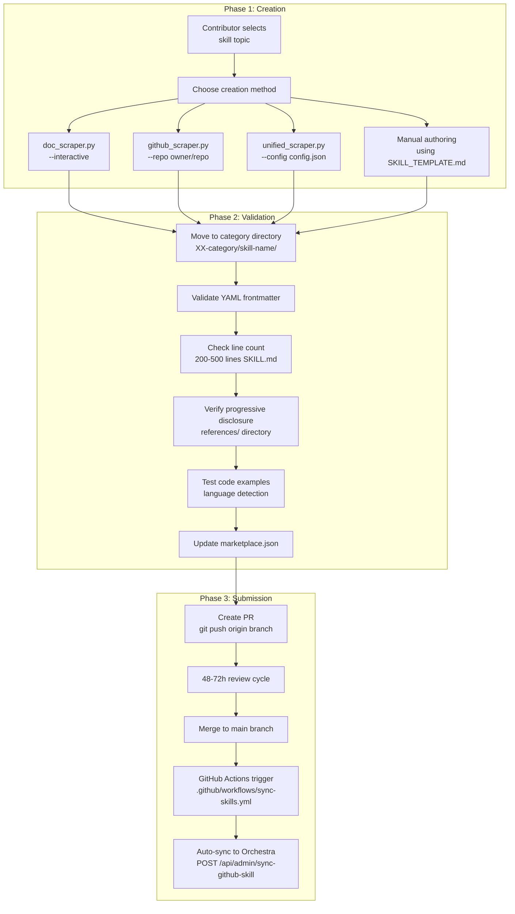
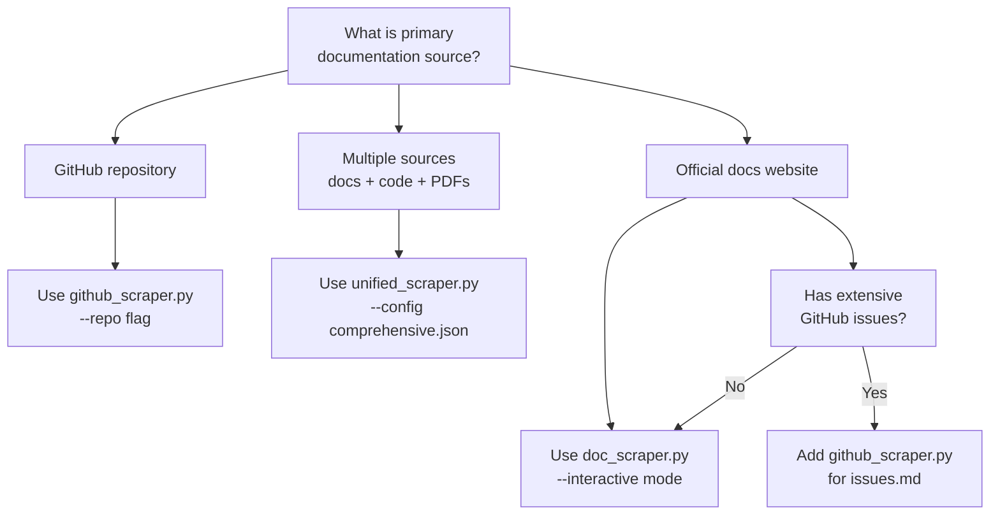
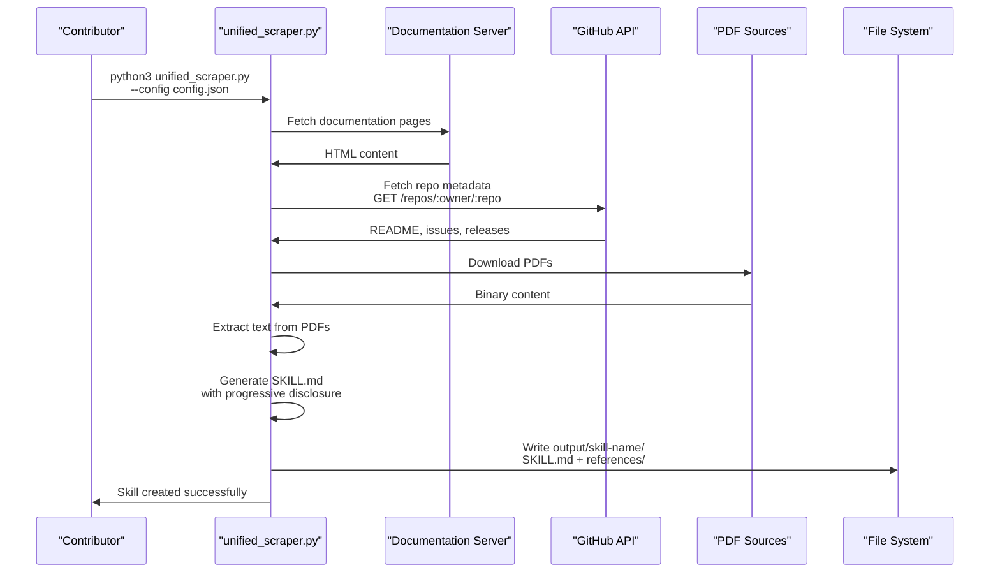
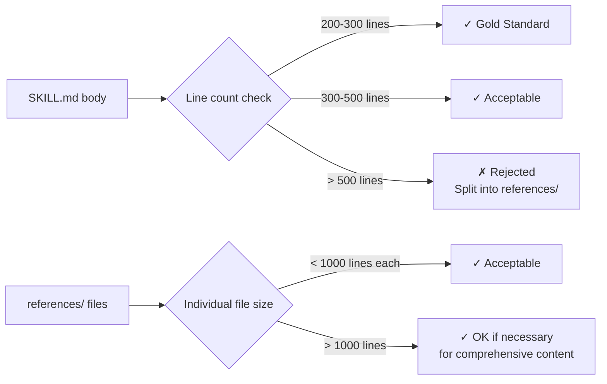
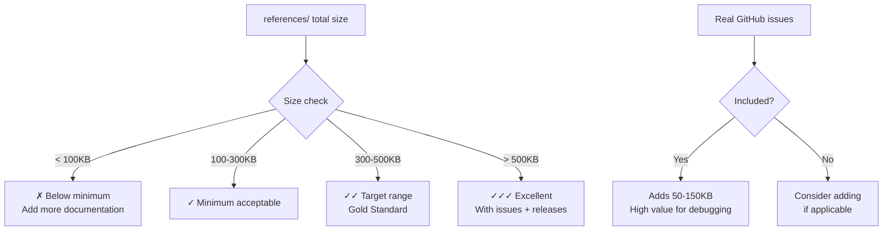
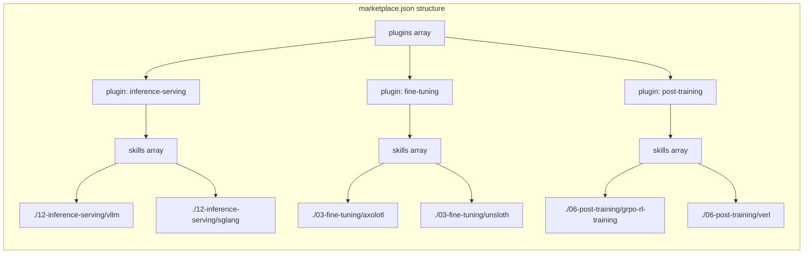
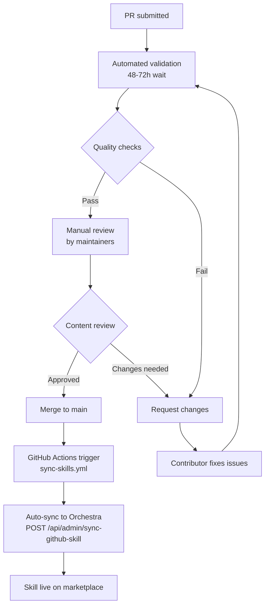
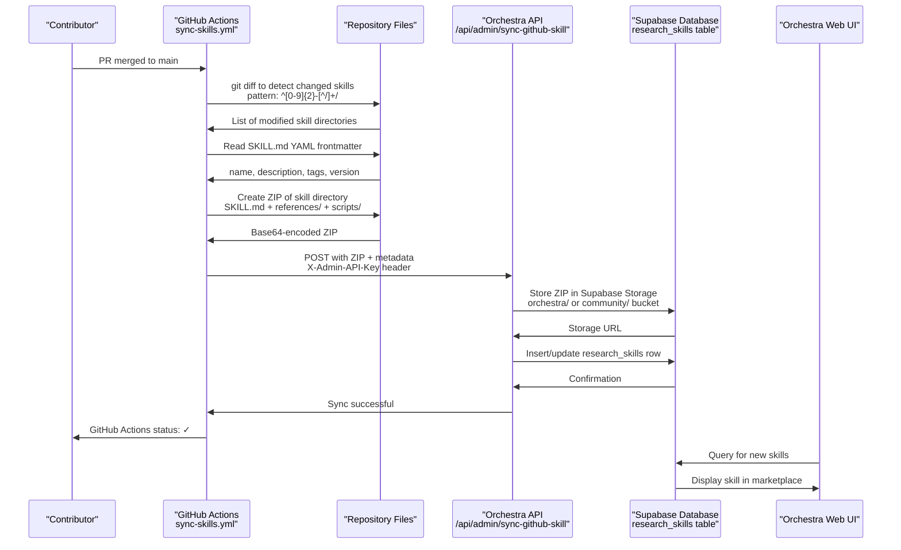

<!-- source: DeepWiki mcp.deepwiki.com · repo Orchestra-Research/AI-research-SKILLs · page 5 Contributing New Skills · fetched 2026-10-26 -->

# Contributing New Skills

<details>
<summary>Relevant source files</summary>

The following files were used as context for generating this wiki page:

- [.claude-plugin/marketplace.json](.claude-plugin/marketplace.json)
- [CONTRIBUTING.md](CONTRIBUTING.md)
- [README.md](README.md)
- [demos/README.md](demos/README.md)
- [docs/ROADMAP.md](docs/ROADMAP.md)
- [docs/SKILL_CREATION_GUIDE.md](docs/SKILL_CREATION_GUIDE.md)
- [docs/SKILL_TEMPLATE.md](docs/SKILL_TEMPLATE.md)
- [docs/assets/promo.gif](docs/assets/promo.gif)
- [docs/christmas-tree.svg](docs/christmas-tree.svg)
- [docs/skills.png](docs/skills.png)
- [docs/tech-tree.svg](docs/tech-tree.svg)

</details>


This document provides a comprehensive guide for creating, validating, and submitting new skills to the AI Research Skills library. It covers the automated scraping tools available, quality standards based on Anthropic best practices, and the submission workflow that automatically syncs skills to the Orchestra marketplace upon merge.

For information about using existing skills with AI agents, see [Using Skills with AI Agents](#4). For details on the skill structure and format, see [Skill Structure & Format](#4.2).

---

## Overview

The contribution process transforms documentation and code into structured skills through three phases:

1. **Creation**: Use automated scrapers or manual authoring to generate skill content
2. **Validation**: Ensure quality standards are met (YAML frontmatter, line limits, progressive disclosure)
3. **Submission**: Submit PR, update `marketplace.json`, and pass review for automatic Orchestra sync

The repository provides three specialized scraper tools to automate skill creation from various sources:

- `cli/doc_scraper.py`: Scrapes official documentation websites
- `cli/github_scraper.py`: Extracts content from GitHub repositories
- `cli/unified_scraper.py`: Combines documentation, GitHub, and PDF sources

**Sources:** [CONTRIBUTING.md:1-30](), [README.md:312-324]()

---

## Contribution Lifecycle



This lifecycle ensures consistent quality through automated tools and validation gates before skills reach the Orchestra marketplace.

**Sources:** [CONTRIBUTING.md:30-256](), [README.md:312-324](), [.github/workflows/sync-skills.yml]() (referenced in diagrams)

---

## Creation Tools Comparison

The repository provides three scraper tools with different specializations:

| Tool | Primary Source | Interactive Mode | Configuration | Output Format |
|------|---------------|------------------|---------------|---------------|
| `doc_scraper.py` | Documentation websites | Yes (`--interactive`) | JSON config files in `configs/` | `SKILL.md` + `references/*.md` |
| `github_scraper.py` | GitHub repositories | No | Command-line arguments | `SKILL.md` + `references/README.md`, `issues.md`, `releases.md` |
| `unified_scraper.py` | Multi-source (docs + GitHub + PDF) | No | JSON config with multiple sources | `SKILL.md` + comprehensive `references/` |

### Tool Selection Decision Tree



**Sources:** [CONTRIBUTING.md:43-68](), [docs/SKILL_CREATION_GUIDE.md:1-50]()

---

## Using doc_scraper.py

The documentation scraper creates skills from official documentation websites through an interactive configuration process.

### Interactive Configuration Mode

The scraper guides you through creating a configuration file:

```bash
python3 cli/doc_scraper.py --interactive
```

This prompts for:
- Skill name (kebab-case format)
- Description (third-person, includes "when to use")
- Base documentation URL
- Sections to scrape (selectors or URL patterns)

Configuration files are saved to `configs/` directory for reuse:

```json
{
  "name": "vllm",
  "description": "High-throughput LLM serving with PagedAttention",
  "base_url": "https://docs.vllm.ai/",
  "sections": [
    {"url": "/getting-started", "selector": ".documentation"},
    {"url": "/serving", "selector": ".documentation"},
    {"url": "/performance", "selector": ".documentation"}
  ]
}
```

### Running the Scraper

After configuration, execute the scrape:

```bash
# Scrape and build
python3 cli/doc_scraper.py --config configs/vllm.json
```

**Output structure:**
```
output/vllm/
├── SKILL.md                    # Generated overview
├── references/
│   ├── getting-started.md      # Section 1 content
│   ├── serving.md              # Section 2 content
│   └── performance.md          # Section 3 content
└── .metadata/
    └── scrape_metadata.json    # Scrape statistics
```

**Sources:** [CONTRIBUTING.md:43-56](), [docs/SKILL_CREATION_GUIDE.md:220-250]()

---

## Using github_scraper.py

The GitHub scraper extracts repository content including README, issues, and releases:

### Basic Usage

Requires GitHub authentication token:

```bash
export GITHUB_TOKEN=$(gh auth token)
python3 cli/github_scraper.py \
  --repo vllm-project/vllm \
  --name vllm \
  --description "High-throughput LLM serving with PagedAttention"
```

### Scraped Components

The tool automatically extracts:

| Component | Output File | Content |
|-----------|-------------|---------|
| Repository README | `references/README.md` | Full repository README |
| Open/closed issues | `references/issues.md` | Real debugging scenarios with solutions |
| Release notes | `references/releases.md` | Version history and breaking changes |
| Repository structure | `references/file_structure.md` | Directory tree for codebase navigation |

### Issue Filtering

Only includes issues that are valuable for troubleshooting:
- Must have comments (not just open issues)
- Filters out stale/inactive issues
- Extracts solution patterns from resolved issues

**Sources:** [CONTRIBUTING.md:57-62](), [README.md:339-357]()

---

## Using unified_scraper.py

The unified scraper combines multiple sources for comprehensive skills:

### Configuration Structure

```json
{
  "name": "nemo-evaluator",
  "description": "Enterprise LLM benchmarking with 100+ benchmarks",
  "sources": {
    "documentation": {
      "base_url": "https://docs.nvidia.com/nemo/",
      "sections": [...]
    },
    "github": {
      "repo": "NVIDIA/NeMo",
      "include_issues": true,
      "include_releases": true
    },
    "pdfs": [
      {"url": "https://arxiv.org/pdf/paper.pdf", "name": "research_paper"}
    ]
  }
}
```

### Multi-Source Scraping Workflow



This approach produces the most comprehensive skills by combining official docs, real-world issues, and research papers.

**Sources:** [CONTRIBUTING.md:63-68]()

---

## Directory Placement

After scraping, move the skill to the correct category directory following the 20-category taxonomy:

```bash
# Determine category from taxonomy
mv output/vllm/ 12-inference-serving/vllm/

# Move metadata for tracking
mv output/vllm_data/ .metadata/vllm_data/
```

### Category Reference Table

| Category Number | Directory Name | Skill Count | Examples |
|----------------|---------------|-------------|----------|
| 01 | `model-architecture` | 5 | LitGPT, Mamba, TorchTitan |
| 02 | `tokenization` | 2 | HuggingFace Tokenizers, SentencePiece |
| 03 | `fine-tuning` | 4 | Axolotl, Unsloth, PEFT |
| 04 | `mechanistic-interpretability` | 4 | TransformerLens, SAELens |
| 05 | `data-processing` | 2 | NeMo Curator, Ray Data |
| 06 | `post-training` | 8 | TRL, GRPO, verl, slime |
| 07 | `safety-alignment` | 3 | Constitutional AI, LlamaGuard |
| 08 | `distributed-training` | 6 | DeepSpeed, Megatron-Core |
| 09 | `infrastructure` | 3 | Modal, SkyPilot, Lambda Labs |
| 10 | `optimization` | 6 | Flash Attention, GPTQ, AWQ |
| 11 | `evaluation` | 3 | lm-evaluation-harness, BigCode |
| 12 | `inference-serving` | 4 | vLLM, TensorRT-LLM, SGLang |
| 13 | `mlops` | 3 | W&B, MLflow, TensorBoard |
| 14 | `agents` | 4 | LangChain, LlamaIndex, CrewAI |
| 15 | `rag` | 5 | Chroma, FAISS, Pinecone |
| 16 | `prompt-engineering` | 4 | DSPy, Instructor, Guidance |
| 17 | `observability` | 2 | LangSmith, Phoenix |
| 18 | `multimodal` | 7 | CLIP, Whisper, LLaVA |
| 19 | `emerging-techniques` | 6 | MoE Training, Model Merging |
| 20 | `ml-paper-writing` | 1 | ML Paper Writing |

**Sources:** [README.md:125-149](), [README.md:386-414](), [CONTRIBUTING.md:257-282]()

---

## YAML Frontmatter Requirements

All `SKILL.md` files must begin with valid YAML frontmatter containing required metadata fields.

### Required Fields Structure

```yaml
---
name: skill-name-here
description: Third-person description including what AND when to use this skill
version: 1.0.0
author: Orchestra Research
license: MIT
tags: [Tag One, Tag Two, Tag Three]
dependencies: [package1>=1.0.0, package2>=2.0.0]
---
```

### Field Validation Rules

| Field | Format | Rules | Example |
|-------|--------|-------|---------|
| `name` | kebab-case | No quotes, lowercase with hyphens | `grpo-rl-training` |
| `description` | Plain text | No quotes, 1024 char max, includes use cases | `Expert guidance for GRPO/RL fine-tuning...` |
| `version` | Semantic version | `MAJOR.MINOR.PATCH` format | `1.0.0` |
| `author` | Plain text | Use "Orchestra Research" for consistency | `Orchestra Research` |
| `license` | Identifier | Typically `MIT` | `MIT` |
| `tags` | YAML array | Title Case, capitalize acronyms (GRPO, TRL) | `[Reinforcement Learning, GRPO]` |
| `dependencies` | YAML array | Include version constraints with `>=` | `[transformers>=4.47.0, trl>=0.14.0]` |

### Tag Selection Guidelines

Tags enable semantic search and skill discovery. Follow these conventions:

- **Use Title Case**: Capitalize first letter of each word
- **Preserve Acronyms**: Keep uppercase (GRPO, TRL, RLHF, DPO)
- **Be Specific**: Include framework names, techniques, use cases
- **Include 5-10 tags**: Balance specificity with discoverability

Example tag arrays:
```yaml
tags: [Reinforcement Learning, GRPO, TRL, Post-Training, RLHF, Reward Modeling]
tags: [Inference Serving, vLLM, PagedAttention, Production Deployment, API]
tags: [Distributed Training, DeepSpeed, ZeRO, 3D Parallelism, Multi-GPU]
```

### Validation Check

Verify YAML is valid before committing:

```bash
python -c "import yaml; yaml.safe_load(open('XX-category/skill-name/SKILL.md').read().split('---')[1])"
```

**Sources:** [CONTRIBUTING.md:125-195](), [docs/SKILL_TEMPLATE.md:1-9]()

---

## Progressive Disclosure Standards

Skills must follow Anthropic's progressive disclosure pattern to optimize context window usage and maintain under 500 lines for `SKILL.md`.

### Core Principle

**SKILL.md = Overview | references/ = Deep Details**

The main `SKILL.md` provides quick-start guidance and workflows, pointing to reference files for advanced topics. This keeps the initial load small while making comprehensive documentation available on demand.

### Line Count Requirements



### Directory Structure Pattern

```
skill-name/
├── SKILL.md                    # 200-500 lines: overview + workflows
├── references/
│   ├── api-reference.md        # API documentation (loaded on demand)
│   ├── advanced-features.md    # Advanced techniques
│   ├── troubleshooting.md      # Common issues and solutions
│   ├── performance.md          # Optimization guidance
│   ├── examples.md             # Extended code examples
│   └── README.md               # Repository README (if from GitHub)
├── scripts/                    # Helper scripts (optional)
│   ├── validate.py
│   └── setup.sh
└── assets/                     # Templates (optional)
    └── config.yaml.template
```

### Reference Depth Rules

**ONE LEVEL DEEP ONLY**: `SKILL.md` may reference files in `references/`, but reference files should NOT link to additional reference files.

❌ **Bad** (nested references):
```
SKILL.md → references/advanced.md → references/sub-topics/optimization.md
```

✓ **Good** (flat structure):
```
SKILL.md → references/advanced.md
SKILL.md → references/optimization.md
```

### Content Allocation Guidelines

| Content Type | Location | Why |
|--------------|----------|-----|
| Quick start | `SKILL.md` | Immediate value for users |
| Common workflows | `SKILL.md` | Frequent use cases |
| When to use | `SKILL.md` | Discovery and selection |
| Common issues | `SKILL.md` | Quick troubleshooting |
| API reference | `references/api-reference.md` | Detailed, reference material |
| Advanced features | `references/advanced-features.md` | Specialized use cases |
| GitHub issues | `references/issues.md` | Deep debugging scenarios |
| Release notes | `references/releases.md` | Version-specific details |

**Sources:** [CONTRIBUTING.md:80-112](), [docs/SKILL_CREATION_GUIDE.md:46-69](), [README.md:325-348]()

---

## Workflow Checklist Pattern

For multi-step tasks, provide copy-paste checklists following Anthropic's best practices:

### Checklist Structure

```markdown
## Deployment workflow

Copy this checklist and track progress:

\`\`\`
Task Progress:
- [ ] Step 1: Configure server settings
- [ ] Step 2: Validate configuration
- [ ] Step 3: Deploy to production
- [ ] Step 4: Verify deployment
\`\`\`

**Step 1: Configure server settings**

Edit `config.yaml` with production values.

**Step 2: Validate configuration**

Run validator and fix errors:
\`\`\`bash
python validate.py config.yaml
# If errors: fix → validate again → continue
\`\`\`

**Step 3: Deploy to production**

[Specific deployment command]

**Step 4: Verify deployment**

[Verification steps]
```

### Feedback Loop Integration

Critical validation steps should include explicit feedback loops:

```markdown
## Data pipeline setup

1. Create pipeline configuration
2. **Validate immediately**: `python validate.py config.json`
3. If validation fails:
   - Review error message carefully
   - Fix the issues
   - **Run validation again**
4. **Only proceed when validation passes**
5. Execute pipeline
```

This pattern prevents users from proceeding with invalid configurations.

**Sources:** [CONTRIBUTING.md:88-99](), [docs/SKILL_CREATION_GUIDE.md:70-120]()

---

## Code Example Standards

All code blocks must include language identifiers for syntax highlighting:

### Language Detection Rules

✓ **Correct**:
````markdown
```python
from transformers import AutoModel
model = AutoModel.from_pretrained("gpt2")
```
````

✓ **Correct**:
````markdown
```bash
pip install transformers
python train.py --config config.yaml
```
````

✗ **Rejected**:
````markdown
```
from transformers import AutoModel
model = AutoModel.from_pretrained("gpt2")
```
````

### Supported Language Identifiers

| Identifier | Use Case |
|-----------|----------|
| `python` | Python code snippets |
| `bash` | Shell commands |
| `yaml` | Configuration files |
| `json` | JSON configuration |
| `toml` | TOML configuration |
| `dockerfile` | Docker configurations |
| `sql` | Database queries |

### Validation Check

Verify all code blocks have language detection:

```bash
grep -A 1 '```' XX-category/skill-name/SKILL.md | head -20
```

Each `\`\`\`` should be followed by a language identifier, not blank content.

**Sources:** [CONTRIBUTING.md:315-334]()

---

## Documentation Size Requirements

Gold Standard skills include comprehensive reference documentation:

### Size Thresholds



### Content Priorities

| Priority | Content Type | Typical Size | Value |
|----------|-------------|--------------|-------|
| **High** | Official documentation | 100-200KB | Essential foundation |
| **High** | GitHub issues with solutions | 50-150KB | Real-world debugging |
| **Medium** | Release notes | 20-50KB | Version tracking |
| **Medium** | API reference | 50-100KB | Comprehensive guide |
| **Low** | File structure | 5-10KB | Codebase navigation |

### Measurement Command

Check total documentation size:

```bash
du -sh XX-category/skill-name/references/
```

Target: **300KB+** for Gold Standard designation.

**Sources:** [CONTRIBUTING.md:335-348](), [README.md:350-357]()

---

## Updating marketplace.json

After creating a skill, add it to `.claude-plugin/marketplace.json` to enable Claude Code plugin marketplace integration.

### Marketplace Entry Structure

Skills are organized into plugin categories matching the 20-category taxonomy:

```json
{
  "plugins": [
    {
      "name": "category-name",
      "description": "Category-level description including when to use skills in this category",
      "source": "./",
      "strict": false,
      "skills": [
        "./XX-category/skill-name"
      ]
    }
  ]
}
```

### Adding a New Skill

Insert your skill path into the appropriate category's `skills` array:

```json
{
  "name": "inference-serving",
  "description": "Production LLM inference including vLLM, TensorRT-LLM, llama.cpp, and SGLang. Use when deploying models for production inference.",
  "source": "./",
  "strict": false,
  "skills": [
    "./12-inference-serving/llama-cpp",
    "./12-inference-serving/sglang",
    "./12-inference-serving/tensorrt-llm",
    "./12-inference-serving/vllm"  // New skill added here
  ]
}
```

### Marketplace Validation

Verify JSON is valid after editing:

```bash
python3 -c "import json; json.load(open('.claude-plugin/marketplace.json'))"
```

### Category-Skill Mapping



Skills are grouped by category for organized marketplace browsing in Claude Code.

**Sources:** [.claude-plugin/marketplace.json:1-255](), [CONTRIBUTING.md:196-226]()

---

## Pull Request Submission

After validation, submit your contribution via pull request:

### Commit Structure

Stage all relevant files:

```bash
# Add skill directory
git add 12-inference-serving/vllm/

# Add metadata (if generated by scrapers)
git add .metadata/vllm_data/

# Add marketplace entry
git add .claude-plugin/marketplace.json

# Commit with descriptive message
git commit -m "Add vLLM inference serving skill

- 356 lines SKILL.md with 4 workflows
- 4 comprehensive references (API, tutorials, issues, releases)
- ~400KB total documentation
- Real GitHub issues with solutions included
- Performance benchmarks documented"
```

### PR Description Template

Include these elements in your pull request description:

```markdown
## Skill: [Name]

**Category**: XX-category-name
**Tool Used**: [doc_scraper/github_scraper/unified_scraper/manual]

### Content Summary
- SKILL.md: XXX lines
- Reference files: X files, XXX KB total
- Key features covered: [list main capabilities]

### Quality Checklist
- [x] YAML frontmatter validated
- [x] Line count: 200-500 lines
- [x] Progressive disclosure (references/ directory)
- [x] Code examples with language detection
- [x] Workflows with copy-paste checklists
- [x] marketplace.json updated
- [x] Documentation size: 300KB+

### Sources
- Official docs: [URL]
- GitHub repo: [URL]
- Additional sources: [if any]
```

**Sources:** [CONTRIBUTING.md:227-254]()

---

## Review Process and Timeline

After PR submission, the skill undergoes a structured review process:

### Review Stages



### Automated Checks

The following validations run automatically (when CI/CD is fully implemented):

| Check | Requirement | Error Handling |
|-------|-------------|----------------|
| File structure | `SKILL.md` + `references/` exist | PR blocked until fixed |
| YAML frontmatter | Valid YAML with required fields | Detailed error message |
| Code blocks | All have language identifiers | List of missing identifiers |
| Line count | `SKILL.md` ≤ 500 lines | Request split into references |
| marketplace.json | Valid JSON syntax | JSON error details |

### Manual Review Criteria

Maintainers review for:

1. **Content accuracy**: Technical correctness and up-to-date information
2. **Code examples**: Working, tested examples with proper context
3. **Categorization**: Skill placed in correct category
4. **Completeness**: Workflows cover common use cases
5. **Writing quality**: Clear, concise, assumes Claude intelligence

### Review Timeline

- **Automated checks**: Immediate feedback on PR creation
- **Manual review**: 48-72 hours for maintainer feedback
- **Revision cycles**: 24-48 hours per round of changes
- **Total time**: Typically 3-7 days from submission to merge

**Sources:** [CONTRIBUTING.md:438-454](), [README.md:288]()

---

## Automatic Marketplace Sync

When a PR is merged to the main branch, GitHub Actions automatically syncs the skill to the Orchestra marketplace.

### Sync Workflow Trigger

The sync process activates on push to main:



### Skill Detection Logic

GitHub Actions identifies changed skills using git diff with regex pattern matching:

```bash
# Detects directories matching: XX-category/skill-name/
git diff --name-only HEAD~1 | grep -E '^[0-9]{2}-[^/]+/'
```

This pattern matches:
- `12-inference-serving/vllm/` ✓
- `06-post-training/grpo-rl-training/` ✓
- `docs/` ✗ (not a skill directory)

### Author-Based Classification

Skills are classified into buckets based on the `author` field in YAML frontmatter:

| Author Value | Storage Bucket | UI Label |
|--------------|---------------|----------|
| `Orchestra Research` | `orchestra/` | Official skills |
| Any other value | `community/` | Community contributions |

This enables filtering and trust indicators in the marketplace UI.

### Sync Failure Handling

If the API sync fails:
1. GitHub Actions marks the workflow as failed
2. Maintainers receive notification
3. Skill remains in repository but not in marketplace
4. Can manually retry by re-triggering the workflow

**Sources:** [Diagram 2 in system architecture](), [Diagram 5 in system architecture](), [CONTRIBUTING.md:196-226]()

---

## Validation Checklist

Before submitting your PR, verify all quality requirements:

### Pre-Submission Validation

```markdown
## Quality Checklist

### Structure
- [ ] Skill in correct category directory `XX-category/skill-name/`
- [ ] `SKILL.md` exists with YAML frontmatter at top
- [ ] `references/` directory exists with documentation
- [ ] No nested references (references files don't link to sub-references)

### YAML Frontmatter
- [ ] `name` field: kebab-case, no quotes
- [ ] `description` field: includes what AND when to use
- [ ] `version` field: semantic versioning (1.0.0)
- [ ] `author` field: "Orchestra Research" or your name
- [ ] `license` field: typically "MIT"
- [ ] `tags` array: 5-10 tags in Title Case
- [ ] `dependencies` array: version constraints with >=

### Content Quality
- [ ] SKILL.md: 200-500 lines (check with `wc -l SKILL.md`)
- [ ] Progressive disclosure: details in references/
- [ ] At least 2 workflows with copy-paste checklists
- [ ] "When to use vs alternatives" section
- [ ] "Common issues" section with solutions
- [ ] Code examples with language identifiers (```python, not ```)

### Documentation Size
- [ ] `references/` total: 300KB+ for Gold Standard (check with `du -sh references/`)
- [ ] Includes GitHub issues if applicable
- [ ] Includes release notes if applicable
- [ ] API reference or tutorials included

### Integration
- [ ] Entry added to `.claude-plugin/marketplace.json`
- [ ] JSON validated: `python3 -c "import json; json.load(open('.claude-plugin/marketplace.json'))"`
- [ ] Skill path matches directory: `./XX-category/skill-name`

### Testing
- [ ] All links in SKILL.md work (manual check)
- [ ] Code examples are syntactically correct
- [ ] Workflow steps are complete and actionable
- [ ] YAML frontmatter validates: `python -c "import yaml; yaml.safe_load(open('SKILL.md').read().split('---')[1])"`
```

### Quick Validation Commands

Run these before committing:

```bash
# 1. Check line count
wc -l XX-category/skill-name/SKILL.md

# 2. Check documentation size
du -sh XX-category/skill-name/references/

# 3. Verify code blocks have language tags
grep -A 1 '```' XX-category/skill-name/SKILL.md | head -20

# 4. Validate YAML frontmatter
python -c "import yaml; yaml.safe_load(open('XX-category/skill-name/SKILL.md').read().split('---')[1])"

# 5. Validate marketplace.json
python3 -c "import json; json.load(open('.claude-plugin/marketplace.json'))"
```

**Sources:** [CONTRIBUTING.md:359-383](), [CONTRIBUTING.md:125-195]()

---

## Recognition and Maintainer Status

Contributors who create skills for the library receive recognition:

### Contribution Tracking

All contributors are:
- Listed in `CONTRIBUTORS.md` with skill count
- Mentioned in release notes when skills are added
- Attributed in `SKILL.md` metadata via `author` field
- Featured on project homepage (when launched)

### Maintainer Eligibility

**Top contributors** (5+ skills) receive:
- **Maintainer status** with merge permissions
- **Direct commit access** for their future contributions
- **Review responsibilities** for new submissions
- **Voice in roadmap decisions**

This creates a pathway for active contributors to become stewards of the library.

### Current Progress

As of the 82-skill milestone:
- **Total skills**: 82 across 20 categories
- **Gold Standard**: 65 skills with comprehensive references
- **Coverage**: Complete AI research lifecycle
- **Contributors**: Growing community of AI research experts

**Sources:** [CONTRIBUTING.md:418-429](), [README.md:13-18](), [docs/ROADMAP.md:9-17]()

---

## Examples of Gold Standard Skills

Study these exemplar skills to understand quality expectations:

### Reference Examples

| Skill | Lines | Highlights | Gold Standard Criteria Met |
|-------|-------|-----------|---------------------------|
| [06-post-training/grpo-rl-training](../06-post-training/grpo-rl-training/) | 569 | 10+ code examples, complete workflows, troubleshooting guide, performance tips | ✓✓✓ All criteria |
| [06-post-training/trl-fine-tuning](../06-post-training/trl-fine-tuning/) | 447 | 4 comprehensive workflows, real debugging scenarios | ✓✓✓ All criteria |
| [14-agents/langchain](../14-agents/langchain/) | 658 | Production-ready patterns, 500+ integrations covered | ✓✓✓ All criteria |
| [12-inference-serving/vllm](../12-inference-serving/vllm/) | 356 | Performance benchmarks, deployment patterns | ✓✓ Most criteria |
| [03-fine-tuning/axolotl](../03-fine-tuning/axolotl/) | 156 | Real YAML configs, when to use guidance | ✓ Core criteria |

### What Makes These Excellent

**GRPO RL Training** (569 lines):
- 4 complete workflows with checklists
- Progressive disclosure: main content in SKILL.md, deep dives in references
- Troubleshooting section with real errors and fixes
- Performance optimization tips
- When to use GRPO vs alternatives (DPO, PPO, SimPO)

**LangChain** (658 lines):
- 3 production-ready workflows (agents, RAG, structured output)
- Integration patterns for 500+ tools
- Error handling and retry logic
- Observable traces with LangSmith
- Common pitfalls and solutions

### Key Patterns to Emulate

1. **Workflows with checklists**: Every complex task has a copy-paste checklist
2. **Feedback loops**: Validation steps explicitly say "fix → validate again"
3. **When to use**: Clear guidance on when this skill applies vs alternatives
4. **Real examples**: Working code, not pseudocode
5. **Troubleshooting**: Common errors with tested solutions

**Sources:** [CONTRIBUTING.md:384-407](), [README.md:125-270]()

---

## Getting Help

If you encounter issues during contribution:

### Support Channels

| Channel | Use Case | Response Time |
|---------|----------|---------------|
| [GitHub Issues](https://github.com/orchestra-research/AI-research-SKILLs/issues) | Bug reports, feature requests | 24-48 hours |
| [GitHub Discussions](https://github.com/orchestra-research/AI-research-SKILLs/discussions) | Questions, skill proposals | 24-72 hours |
| PR comments | Specific feedback on your submission | During review cycle |

### Common Questions

**Q: My scraper output is too large (> 500 lines). What do I do?**

A: Split content into `references/` directory. Keep quick-start and workflows in `SKILL.md`, move detailed API docs and advanced features to separate reference files.

**Q: How do I know which category my skill belongs to?**

A: Reference the 20-category taxonomy table in [Directory Placement](#directory-placement). If uncertain, open a Discussion to ask maintainers.

**Q: Can I submit a skill for a proprietary/closed-source tool?**

A: No. Skills must be for open-source or freely available tools to ensure accessibility.

**Q: My skill uses multiple tools. Which category should it go in?**

A: Choose the category that best represents the primary use case. For example, a skill about "Using DeepSpeed with vLLM" would go in `12-inference-serving` (the end goal) rather than `08-distributed-training`.

**Q: What if there are no GitHub issues for my skill?**

A: That's acceptable. Focus on creating comprehensive documentation from official sources. GitHub issues are a bonus for Gold Standard status, not a requirement.

**Sources:** [CONTRIBUTING.md:430-437]()

---

