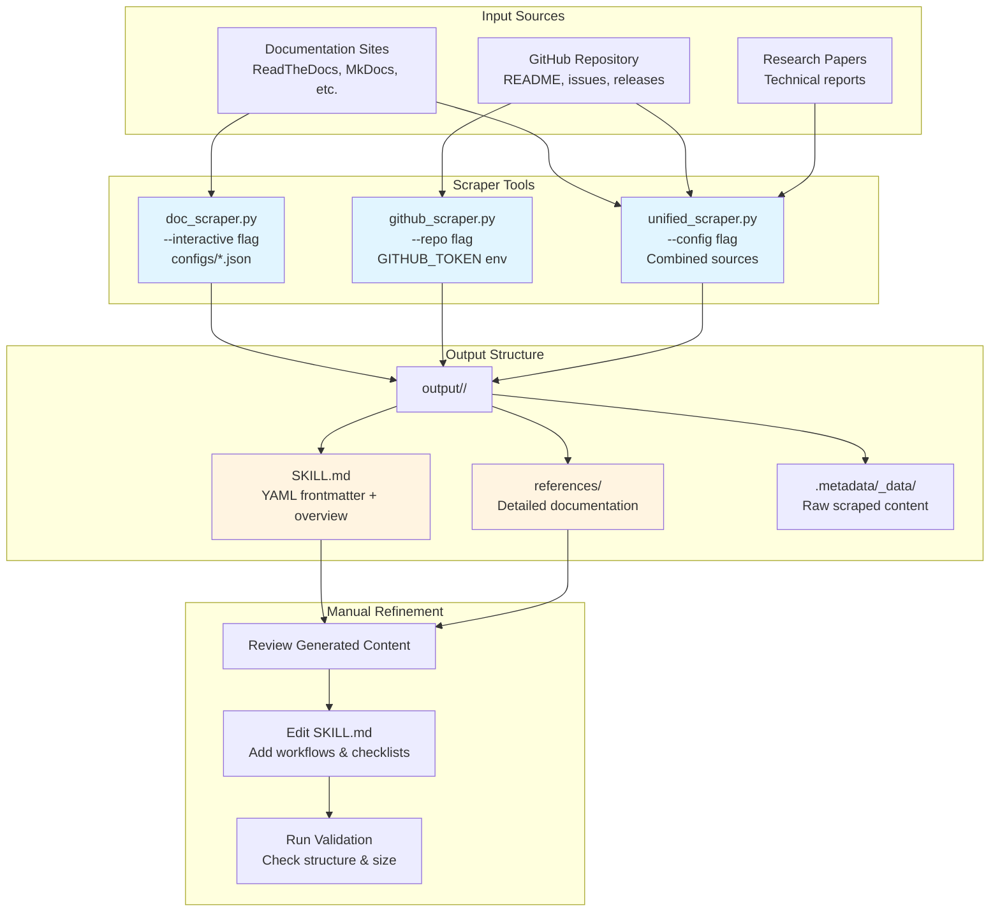
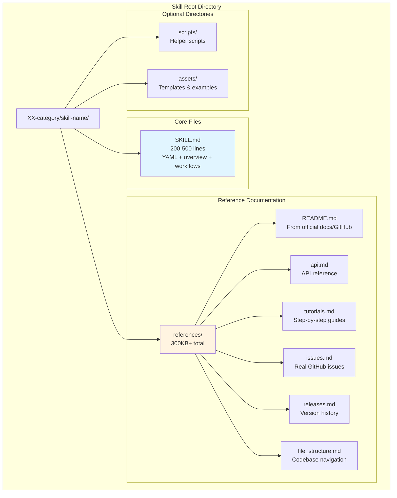
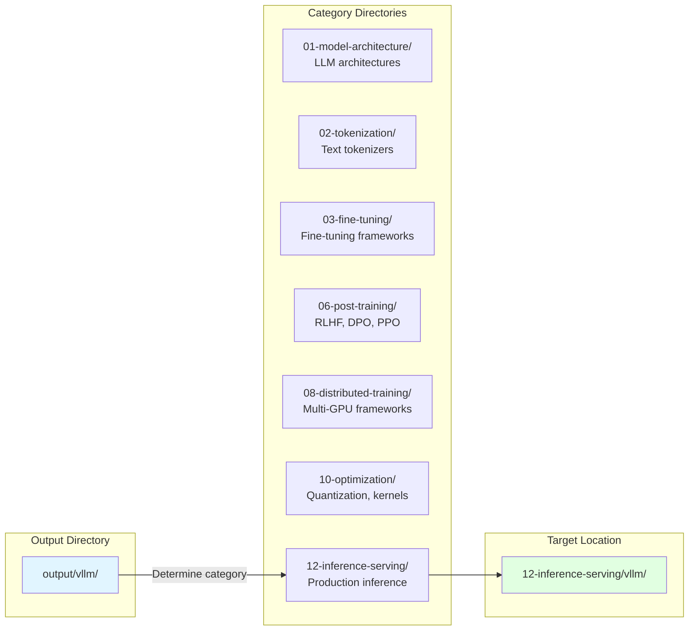

<!-- source: DeepWiki mcp.deepwiki.com · repo Orchestra-Research/AI-research-SKILLs · page 5.1 Skill Creation Guide · fetched 2026-10-26 -->

# Skill Creation Guide

<details>
<summary>Relevant source files</summary>

The following files were used as context for generating this wiki page:

- [.claude-plugin/marketplace.json](.claude-plugin/marketplace.json)
- [CONTRIBUTING.md](CONTRIBUTING.md)
- [README.md](README.md)
- [demos/README.md](demos/README.md)
- [docs/ROADMAP.md](docs/ROADMAP.md)
- [docs/SKILL_CREATION_GUIDE.md](docs/SKILL_CREATION_GUIDE.md)
- [docs/SKILL_TEMPLATE.md](docs/SKILL_TEMPLATE.md)
- [docs/assets/promo.gif](docs/assets/promo.gif)
- [docs/christmas-tree.svg](docs/christmas-tree.svg)
- [docs/skills.png](docs/skills.png)
- [docs/tech-tree.svg](docs/tech-tree.svg)

</details>


This document provides a step-by-step guide for creating new skills for the AI Research Skills library. It covers three creation approaches (manual authoring, documentation scraping, and unified scraping), explains the skill directory structure, and walks through the content organization process.

For quality requirements and validation rules, see [Quality Standards & Validation](#5.2). For the pull request and review workflow, see [Submission & Review Process](#5.3).

---

## Skill Creation Approaches

The repository supports three approaches to skill creation, each suited to different scenarios:

| Approach | Best For | Tools Used | Typical Output Size |
|----------|----------|------------|---------------------|
| **Documentation Scraping** | Well-documented libraries with official docs | `doc_scraper.py` | 100-300KB |
| **GitHub Repository Scraping** | Open-source projects with README + issues | `github_scraper.py` | 50-200KB |
| **Unified Scraping** | Comprehensive skills combining docs + GitHub + PDFs | `unified_scraper.py` | 300KB+ |
| **Manual Authoring** | Novel frameworks or specialized knowledge | Text editor + template | Variable |

**Recommended workflow**: Start with automated scraping to generate the skeleton, then manually refine for quality and accuracy.

Sources: [CONTRIBUTING.md:30-69](), [README.md:312-324]()

---

## Automated Skill Generation Workflow



**Diagram 1: Skill Generation Pipeline from Source to Validated Output**

The scraper tools automate the initial content extraction and structuring, reducing manual effort from hours to minutes. The output always requires human review to ensure quality standards are met.

Sources: [CONTRIBUTING.md:43-69]()

---

## Using Documentation Scraper

### Interactive Mode

The `doc_scraper.py` script supports interactive configuration creation:

```bash
python3 cli/doc_scraper.py --interactive
```

This prompts for:
- Skill name (e.g., `vllm`)
- Description (third-person, includes "when to use")
- Documentation URLs to scrape
- Output directory path

The script generates a JSON configuration file and immediately executes the scrape.

### Configuration-Based Mode

For reproducibility, create or modify an existing configuration file:

```bash
# Copy existing config as starting point
cp configs/react.json configs/vllm.json

# Edit config with skill-specific settings
# Then execute scraper
python3 cli/doc_scraper.py --config configs/vllm.json
```

Configuration files are stored in `configs/*.json` and contain URL patterns, CSS selectors, and metadata.

Sources: [CONTRIBUTING.md:46-55]()

---

## Using GitHub Scraper

The `github_scraper.py` script extracts content from GitHub repositories, including README, issues, releases, and file structure:

```bash
# Set GitHub authentication token
export GITHUB_TOKEN=$(gh auth token)

# Scrape repository
python3 cli/github_scraper.py \
  --repo vllm-project/vllm \
  --name vllm \
  --description "High-performance LLM serving with PagedAttention"
```

**Key parameters:**
- `--repo`: GitHub repository in `owner/name` format
- `--name`: Skill name (used for output directory)
- `--description`: Skill description for YAML frontmatter

**Output structure:**
```
output/vllm/
├── SKILL.md
└── references/
    ├── README.md          # From repository root
    ├── issues.md          # Real GitHub issues with solutions
    ├── releases.md        # Version history and breaking changes
    └── file_structure.md  # Codebase navigation guide
```

The scraper automatically parses issues for troubleshooting content and extracts release notes for version-specific guidance.

Sources: [CONTRIBUTING.md:57-62]()

---

## Using Unified Scraper

For comprehensive "Gold Standard" skills, `unified_scraper.py` combines multiple sources:

```bash
python3 cli/unified_scraper.py --config configs/vllm_unified.json
```

The unified configuration specifies:
- Documentation URLs (similar to `doc_scraper.py`)
- GitHub repository details (similar to `github_scraper.py`)
- PDF URLs for research papers or technical reports

This approach produces skills with 300KB+ documentation, satisfying the Gold Standard requirement.

Sources: [CONTRIBUTING.md:64-69]()

---

## Skill Directory Structure



**Diagram 2: Skill Directory Structure with File Organization**

All skills follow this standardized structure to ensure consistency and ease of use by AI agents. The `SKILL.md` file acts as the entry point, with references loaded progressively as needed.

Sources: [README.md:329-347](), [CONTRIBUTING.md:288-309]()

---

## SKILL.md Structure and YAML Frontmatter

### Required YAML Frontmatter

Every `SKILL.md` file must begin with YAML frontmatter:

```yaml
---
name: skill-name-here
description: Third-person description including what AND when to use
version: 1.0.0
author: Orchestra Research
license: MIT
tags: [Tag One, Tag Two, Tag Three]
dependencies: [package1>=1.0.0, package2>=2.0.0]
---
```

| Field | Required | Format | Notes |
|-------|----------|--------|-------|
| `name` | ✅ Yes | kebab-case | No quotes, lowercase with hyphens |
| `description` | ✅ Yes | Plain text | No quotes, max 1024 characters |
| `version` | ✅ Yes | Semantic version | Format: `MAJOR.MINOR.PATCH` |
| `author` | ✅ Yes | Plain text | Use "Orchestra Research" |
| `license` | ✅ Yes | License identifier | Typically `MIT` |
| `tags` | ✅ Yes | Array | Title Case, no quotes |
| `dependencies` | ⚠️ Optional | Array | Include version constraints |

**Tag guidelines:**
- Use Title Case (e.g., `Reinforcement Learning`, `Post-Training`)
- Keep acronyms UPPERCASE (e.g., `GRPO`, `TRL`, `RLHF`, `DPO`)
- Include 5-10 relevant, searchable terms
- No quotes around tags

**Dependencies guidelines:**
- Include only direct dependencies needed to use the skill
- Use version constraints: `package>=1.0.0`
- No quotes around package names

Sources: [CONTRIBUTING.md:125-187]()

---

## SKILL.md Content Organization

### Progressive Disclosure Pattern

The body of `SKILL.md` should follow this structure:

```markdown
# [Skill Title]

## Quick start
[One paragraph overview + minimal working example]

## Common workflows
[2-3 workflows with copy-paste checklists]

## When to use vs alternatives
[Specific scenarios for this vs other tools]

## Common issues
[Error messages and solutions]

## Advanced topics
[Links to reference files in references/]

## Resources
[Official docs and GitHub links]
```

**Line limit**: 200-500 lines (target: 200-300 lines)

### Workflow Structure with Checklists

Each workflow must include a copy-paste checklist:

```markdown
### Workflow 1: Deploy vLLM Server

Copy this checklist and track progress:

\`\`\`
Task Progress:
- [ ] Step 1: Install dependencies
- [ ] Step 2: Configure server
- [ ] Step 3: Validate configuration
- [ ] Step 4: Start server
- [ ] Step 5: Verify deployment
\`\`\`

**Step 1: Install dependencies**

\`\`\`bash
pip install vllm
\`\`\`

**Step 2: Configure server**

Edit `config.yaml`:
\`\`\`yaml
model: meta-llama/Llama-2-7b-hf
tensor_parallel_size: 1
\`\`\`

**Step 3: Validate configuration**

Run validator and fix errors:
\`\`\`bash
python validate.py config.yaml
# If errors: fix → validate again → continue
\`\`\`

[Continue with remaining steps...]
```

This pattern enables AI agents to track multi-step processes effectively.

Sources: [docs/SKILL_CREATION_GUIDE.md:65-120](), [docs/SKILL_TEMPLATE.md:1-107]()

---

## Reference Files Organization

The `references/` directory contains detailed documentation split by topic. Files are loaded by AI agents only when needed, keeping the context window efficient.

### Typical Reference Files

```
references/
├── README.md              # From GitHub/official docs (100-200KB)
├── api.md                 # API reference documentation
├── tutorials.md           # Step-by-step guides
├── issues.md              # Real GitHub issues with solutions
├── releases.md            # Version history and breaking changes
└── file_structure.md      # Codebase navigation
```

### Reference File Rules

1. **ONE LEVEL DEEP**: SKILL.md links to reference files, but reference files do NOT link to other reference files
2. **Topic-focused**: Each file covers one specific area (e.g., deployment, optimization, troubleshooting)
3. **300KB+ total**: Combined size of all reference files should exceed 300KB for Gold Standard skills
4. **Self-contained**: Each reference file can be understood independently

❌ **Bad** (nested references):
```
SKILL.md → deployment.md → advanced-deployment.md → kubernetes-config.md
```

✅ **Good** (flat references):
```
SKILL.md → deployment.md
SKILL.md → optimization.md
SKILL.md → troubleshooting.md
```

Sources: [CONTRIBUTING.md:98-112](), [docs/SKILL_CREATION_GUIDE.md:43-64]()

---

## Moving Skills to Category Directories

After generation, skills must be moved from `output/` to the correct category directory:

### Category Mapping



**Diagram 3: Moving Generated Skills to Correct Category Directory**

### Moving Commands

```bash
# Determine the correct category
# For vLLM (inference serving framework)
mv output/vllm/ 12-inference-serving/vllm/

# Move metadata (preserves raw scraped content)
mv output/vllm_data/ .metadata/vllm_data/
```

### Category Selection Guide

| Category Number | Category Name | Examples |
|----------------|---------------|----------|
| 01 | Model Architecture | LitGPT, TorchTitan, Mamba |
| 02 | Tokenization | HuggingFace Tokenizers, SentencePiece |
| 03 | Fine-Tuning | Axolotl, Unsloth, PEFT |
| 04 | Mechanistic Interpretability | TransformerLens, SAELens |
| 05 | Data Processing | NeMo Curator, Ray Data |
| 06 | Post-Training | TRL, GRPO, OpenRLHF, SimPO |
| 07 | Safety & Alignment | Constitutional AI, LlamaGuard |
| 08 | Distributed Training | DeepSpeed, FSDP, Megatron-Core |
| 09 | Infrastructure | Modal, SkyPilot, Lambda Labs |
| 10 | Optimization | Flash Attention, GPTQ, AWQ |
| 11 | Evaluation | lm-eval-harness, BigCode, NeMo Evaluator |
| 12 | Inference & Serving | vLLM, TensorRT-LLM, SGLang |
| 13 | MLOps | W&B, MLflow, TensorBoard |
| 14 | Agents | LangChain, LlamaIndex, CrewAI |
| 15 | RAG | Chroma, FAISS, Pinecone |
| 16 | Prompt Engineering | DSPy, Instructor, Outlines |
| 17 | Observability | LangSmith, Phoenix |
| 18 | Multimodal | CLIP, Whisper, LLaVA |
| 19 | Emerging Techniques | MoE, Model Merging, Long Context |
| 20 | ML Paper Writing | LaTeX templates, citation verification |

If uncertain about categorization, review existing skills in similar categories or ask in GitHub Discussions.

Sources: [CONTRIBUTING.md:70-76](), [CONTRIBUTING.md:257-283]()

---

## Scraper Tool CLI Reference

### doc_scraper.py

**Location**: `cli/doc_scraper.py`

**Usage**:
```bash
# Interactive mode (prompts for configuration)
python3 cli/doc_scraper.py --interactive

# Config file mode (reproducible)
python3 cli/doc_scraper.py --config configs/skill-name.json
```

**Configuration file format** (`configs/*.json`):
```json
{
  "name": "skill-name",
  "description": "Third-person description with when to use",
  "urls": [
    "https://docs.example.com/",
    "https://docs.example.com/api/"
  ],
  "output_dir": "output/skill-name"
}
```

### github_scraper.py

**Location**: `cli/github_scraper.py`

**Usage**:
```bash
# Set authentication token
export GITHUB_TOKEN=$(gh auth token)

# Scrape repository
python3 cli/github_scraper.py \
  --repo owner/repo-name \
  --name skill-name \
  --description "Description including when to use"
```

**Required environment variable**: `GITHUB_TOKEN`

**Output includes**:
- README.md from repository root
- Selected GitHub issues (with solutions)
- Release notes and version history
- File structure and navigation guide

### unified_scraper.py

**Location**: `cli/unified_scraper.py`

**Usage**:
```bash
python3 cli/unified_scraper.py --config configs/skill-name_unified.json
```

**Configuration file format** (`configs/*_unified.json`):
```json
{
  "name": "skill-name",
  "description": "Description",
  "documentation_urls": [...],
  "github_repo": "owner/repo-name",
  "pdf_urls": [
    "https://arxiv.org/pdf/..."
  ],
  "output_dir": "output/skill-name"
}
```

Combines documentation scraping, GitHub scraping, and PDF extraction for comprehensive skills.

Sources: [CONTRIBUTING.md:46-68]()

---

## Manual Skill Creation

For cases where automated scraping is not suitable (novel frameworks, specialized knowledge, or poorly documented tools), skills can be created manually:

### Using the Template

1. Copy the template:
```bash
cp docs/SKILL_TEMPLATE.md XX-category/skill-name/SKILL.md
```

2. Fill in YAML frontmatter with accurate metadata

3. Write content following progressive disclosure pattern

4. Create reference files in `references/` directory

5. Add code examples with proper language tags

### Template Structure

The template at [docs/SKILL_TEMPLATE.md:1-107]() provides a scaffold with:
- YAML frontmatter placeholders
- Quick start section
- Common workflows with checklist templates
- "When to use vs alternatives" section
- Common issues section
- Advanced topics section with reference links
- Resources section

Replace all placeholder text with skill-specific content.

Sources: [docs/SKILL_TEMPLATE.md:1-107]()

---

## Validation Before Submission

Before submitting a pull request, validate the skill structure:

```bash
# Check SKILL.md line count (should be 200-500 lines)
wc -l XX-category/skill-name/SKILL.md

# Check reference documentation size (should be 300KB+)
du -sh XX-category/skill-name/references/

# Verify all code blocks have language tags
grep -A 1 '```' XX-category/skill-name/SKILL.md | head -20

# Validate JSON frontmatter
python -c "import yaml; yaml.safe_load(open('XX-category/skill-name/SKILL.md').read().split('---')[1])"

# Check marketplace.json validity
python3 -c "import json; json.load(open('.claude-plugin/marketplace.json'))"
```

For detailed quality requirements, see [Quality Standards & Validation](#5.2).

Sources: [CONTRIBUTING.md:362-383]()

---

## Common Patterns and Anti-Patterns

### ✅ Good Practices

1. **Concise content**: Assume Claude knows basics, avoid over-explaining
2. **Copy-paste checklists**: Enable agents to track multi-step workflows
3. **Feedback loops**: `validate → fix errors → validate again → proceed`
4. **Progressive disclosure**: Keep SKILL.md under 500 lines, split details into references
5. **Language-tagged code**: All code blocks specify language (```python, ```bash, etc.)
6. **Third-person descriptions**: "Serves LLMs with high throughput..." not "I can help you..."

### ❌ Anti-Patterns

1. **Nested references**: SKILL.md → ref1.md → ref2.md (should be flat)
2. **Missing checklists**: Complex workflows without progress tracking
3. **First-person descriptions**: "I can help you..." in YAML frontmatter
4. **Generic names**: "helper-skill", "utils", "tools" (should be specific)
5. **Over 500 lines**: SKILL.md body exceeds optimal length
6. **Missing language tags**: Code blocks without language specification

Sources: [CONTRIBUTING.md:81-112](), [docs/SKILL_CREATION_GUIDE.md:8-51]()

---

## Next Steps

After creating your skill:

1. **Validate quality**: Ensure YAML frontmatter is correct, line limits are met, and references exist
2. **Update marketplace**: Add skill entry to `.claude-plugin/marketplace.json` (see [Submission & Review Process](#5.3))
3. **Submit pull request**: Follow the PR template and review process (see [Submission & Review Process](#5.3))

For quality requirements, see [Quality Standards & Validation](#5.2).

Sources: [CONTRIBUTING.md:227-254]()

---

