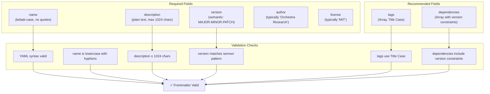
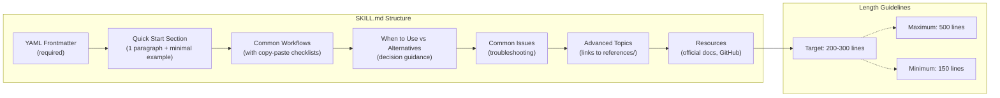
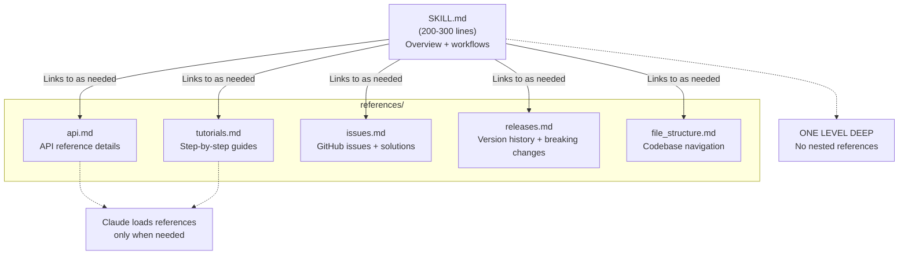
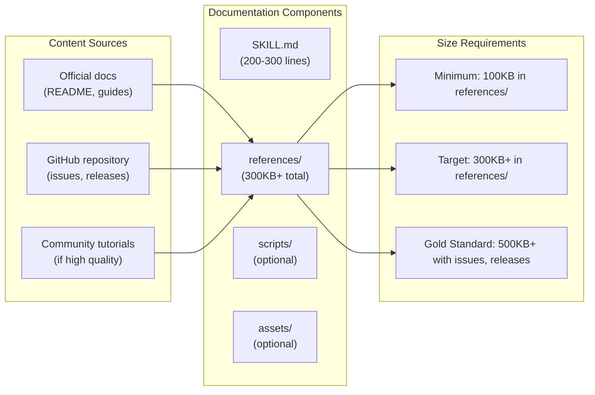
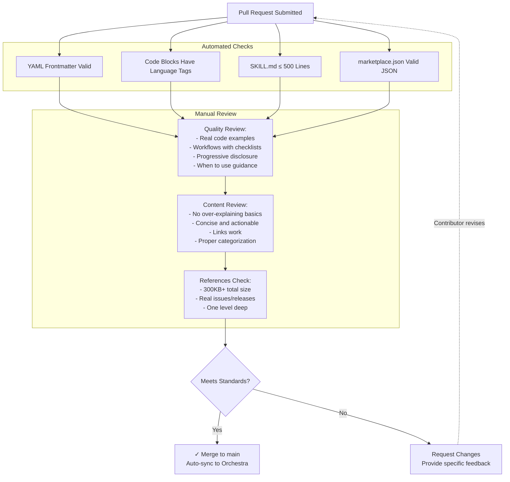

<!-- source: DeepWiki mcp.deepwiki.com · repo Orchestra-Research/AI-research-SKILLs · page 5.2 Quality Standards & Validation · fetched 2026-10-26 -->

# Quality Standards & Validation

<details>
<summary>Relevant source files</summary>

The following files were used as context for generating this wiki page:

- [.claude-plugin/marketplace.json](.claude-plugin/marketplace.json)
- [CONTRIBUTING.md](CONTRIBUTING.md)
- [README.md](README.md)
- [demos/README.md](demos/README.md)
- [docs/ROADMAP.md](docs/ROADMAP.md)
- [docs/SKILL_CREATION_GUIDE.md](docs/SKILL_CREATION_GUIDE.md)
- [docs/SKILL_TEMPLATE.md](docs/SKILL_TEMPLATE.md)
- [docs/assets/promo.gif](docs/assets/promo.gif)
- [docs/christmas-tree.svg](docs/christmas-tree.svg)
- [docs/skills.png](docs/skills.png)
- [docs/tech-tree.svg](docs/tech-tree.svg)

</details>


This document defines the quality requirements for skills in the AI Research Skills library. Skills must meet these standards to be accepted via pull request. For information about the skill creation process itself, see [Skill Creation Guide](#5.1). For information about the submission and review process, see [Submission & Review Process](#5.3).

## Overview of Quality Tiers

The library maintains two quality tiers:

| Tier | Requirements | Current Count |
|------|--------------|---------------|
| **Gold Standard** | All requirements met: YAML frontmatter, 200-500 lines SKILL.md, 300KB+ references, workflows with checklists, code examples with language tags | 65 skills |
| **Minimum Viable** | Basic requirements: Valid YAML frontmatter, <500 lines SKILL.md, code examples with language tags, working links | Accepted but flagged for improvement |

**Philosophy**: Quality over quantity. We deleted 9 low-quality skills in November 2025 to maintain high standards [README.md:15-16]().

Sources: [README.md:369-381](), [CONTRIBUTING.md:83-112]()

## YAML Frontmatter Requirements



### Field Specifications

All SKILL.md files must begin with YAML frontmatter delimited by `---` [CONTRIBUTING.md:125-196]():

| Field | Required | Format | Validation Rule |
|-------|----------|--------|-----------------|
| `name` | ✅ Yes | kebab-case | No quotes, lowercase with hyphens, must match directory name |
| `description` | ✅ Yes | Plain text | No quotes, ≤1024 characters, third-person, includes what AND when to use |
| `version` | ✅ Yes | Semantic version | Format: `MAJOR.MINOR.PATCH` (e.g., `1.0.0`) |
| `author` | ✅ Yes | Plain text | Typically `Orchestra Research` |
| `license` | ✅ Yes | License identifier | Typically `MIT` |
| `tags` | ✅ Yes | Array | Title Case, 5-10 tags, no quotes around individual tags |
| `dependencies` | ⚠️ Optional | Array | Include version constraints with `>=` where known |

**Example - Gold Standard Frontmatter**:

```yaml
---
name: grpo-rl-training
description: Expert guidance for GRPO/RL fine-tuning with TRL for reasoning and task-specific model training
version: 1.0.0
author: Orchestra Research
license: MIT
tags: [Reinforcement Learning, GRPO, TRL, Post-Training, RLHF, Reward Modeling, Reasoning, DPO, PPO, Structured Output]
dependencies: [transformers>=4.47.0, trl>=0.14.0, datasets>=3.2.0, peft>=0.14.0, torch]
---
```

Sources: [CONTRIBUTING.md:125-196](), [docs/SKILL_CREATION_GUIDE.md:123-204]()

### Tag Guidelines

Tags must follow these conventions [CONTRIBUTING.md:153-163]():

- **Title Case** for all tags (capitalize first letter of each word)
- **UPPERCASE** for acronyms (e.g., `GRPO`, `TRL`, `RLHF`, `DPO`)
- **No quotes** around individual tags
- **5-10 relevant tags** for searchability
- Include framework names, techniques, use cases

**Good tags**:
```yaml
tags: [Reinforcement Learning, GRPO, TRL, Post-Training, RLHF]
```

**Bad tags**:
```yaml
tags: ["reinforcement learning", "grpo", "trl"]  # Wrong case, unnecessary quotes
```

### Validation Command

Check YAML validity before submitting:

```bash
python -c "import yaml; yaml.safe_load(open('SKILL.md').read().split('---')[1])"
```

Sources: [CONTRIBUTING.md:189-195]()

## SKILL.md Length and Structure Guidelines



### Line Count Requirements

Based on [Anthropic Official Best Practices](anthropic_official_docs/best_practices.md) [CONTRIBUTING.md:82-112]():

| Metric | Requirement | Rationale |
|--------|-------------|-----------|
| **Target range** | 200-300 lines | Optimal for Claude's context window usage |
| **Maximum** | 500 lines | Hard limit - exceeding this requires splitting into references |
| **Minimum** | 150 lines | Below this indicates insufficient content |
| **Current average** | 420 lines | Across 82 skills [README.md:372]() |

**Why these limits matter**: The context window is a shared resource. SKILL.md competes with system prompts, conversation history, and other loaded skills. Conciseness maximizes available context for actual work [docs/SKILL_CREATION_GUIDE.md:10-42]().

Sources: [CONTRIBUTING.md:85-88](), [README.md:372-373](), [docs/SKILL_CREATION_GUIDE.md:10-42]()

### Progressive Disclosure Pattern



**Structure principle** [CONTRIBUTING.md:85-88]():

- SKILL.md serves as **overview** with pointers to detailed materials
- Reference files contain **deep documentation** loaded on demand
- Keep references **ONE LEVEL DEEP** from SKILL.md (no `references/subfolder/file.md`)

**Example - Good structure**:
```
vllm/
├── SKILL.md                    # 215 lines - overview
├── references/
│   ├── api.md                  # Detailed API docs
│   ├── server-deployment.md    # Server configuration
│   └── offline-inference.md    # Offline mode guide
```

**Example - Bad structure** (nested references):
```
vllm/
├── SKILL.md
├── references/
│   ├── deployment/
│   │   └── server.md          # ❌ Too nested
│   └── advanced/
│       └── optimization.md     # ❌ Too nested
```

Sources: [CONTRIBUTING.md:85-112](), [docs/SKILL_CREATION_GUIDE.md:47-64]()

## Documentation Size Requirements



### Size Metrics

[CONTRIBUTING.md:336-348]():

| Category | Minimum | Target | Gold Standard | Check Command |
|----------|---------|--------|---------------|---------------|
| Total references/ size | 100KB | 300KB | 500KB+ | `du -sh skill-name/references/` |
| Number of reference files | 2+ | 4+ | 6+ | `ls -1 skill-name/references/ \| wc -l` |
| Total documentation lines | 5,000 | 10,000 | 15,000+ | `wc -l skill-name/**/*.md` |

**Current library stats** [README.md:373]():
- **~130,000 lines** total documentation across 82 skills
- **Average ~1,585 lines per skill** (SKILL.md + references)

### Reference File Categories

High-quality skills include [CONTRIBUTING.md:291-308]():

1. **README.md** - From GitHub/official docs
2. **api.md** - API reference
3. **tutorials.md** - Step-by-step guides
4. **issues.md** - Real GitHub issues with solutions
5. **releases.md** - Version history and breaking changes
6. **file_structure.md** - Codebase navigation (for GitHub scraped skills)

**Validation checklist**:
```bash
# Check total size (should be 300KB+)
du -sh 12-inference-serving/vllm/references/

# Check reference files exist
ls -lh 12-inference-serving/vllm/references/

# Count total lines
find 12-inference-serving/vllm -name "*.md" -exec wc -l {} + | tail -1
```

Sources: [CONTRIBUTING.md:121-123](), [CONTRIBUTING.md:336-348](), [README.md:373]()

## Workflow Structure with Checklists

### Checklist Template Format

All complex multi-step tasks must include copy-paste checklists [docs/SKILL_CREATION_GUIDE.md:66-119]():

````markdown
## Deployment workflow

Copy this checklist and track progress:

```
Task Progress:
- [ ] Step 1: Configure server settings
- [ ] Step 2: Validate configuration
- [ ] Step 3: Deploy to production
- [ ] Step 4: Verify deployment
```

**Step 1: Configure server settings**

Edit `config.yaml` with production values:
```yaml
server:
  host: 0.0.0.0
  port: 8000
```

**Step 2: Validate configuration**

Run validator and fix errors:
```bash
python validate.py config.yaml
# If errors: fix → validate again → continue
```

**Step 3: Deploy to production**

Deploy with:
```bash
deploy.sh --config config.yaml
```

**Step 4: Verify deployment**

Test endpoint:
```bash
curl http://localhost:8000/health
```
````

### Feedback Loop Pattern

For quality-critical operations, include validation loops [docs/SKILL_CREATION_GUIDE.md:105-119]():

```markdown
## Document editing process

1. Make your edits to `document.xml`
2. **Validate immediately**: `python validate.py document.xml`
3. If validation fails:
   - Review the error message carefully
   - Fix the issues
   - Run validation again
4. **Only proceed when validation passes**
5. Export final document
```

**Key principle**: Make validation steps explicit and iterative to prevent downstream errors.

Sources: [docs/SKILL_CREATION_GUIDE.md:66-119](), [CONTRIBUTING.md:88-98]()

## Code Example Standards

### Language Detection Requirement

**All code blocks MUST specify the language** [CONTRIBUTING.md:316-334]():

✅ **Acceptable**:
````markdown
```python
from transformers import AutoModel
model = AutoModel.from_pretrained("gpt2")
```
````

❌ **Rejected**:
````markdown
```
from transformers import AutoModel
model = AutoModel.from_pretrained("gpt2")
```
````

**Rationale**: Language detection enables proper syntax highlighting and helps Claude understand context.

### Conciseness Standard

Based on Anthropic best practices, assume Claude already knows basics [docs/SKILL_CREATION_GUIDE.md:10-42]():

✅ **Good** (50 tokens):
```markdown
## Extract PDF text

Use pdfplumber for text extraction:

```python
import pdfplumber
with pdfplumber.open("file.pdf") as pdf:
    text = pdf.pages[0].extract_text()
```
```

❌ **Bad** (150 tokens):
```markdown
## Extract PDF text

PDF (Portable Document Format) files are a common file format that contains
text, images, and other content. To extract text from a PDF, you'll need to
use a library. There are many libraries available for PDF processing, but we
recommend pdfplumber because it's easy to use and handles most cases well.
First, you'll need to install it using pip. Then you can use the code below...
```

**Challenge each piece of information**:
- "Does Claude really need this explanation?"
- "Can I assume Claude knows this?"
- "Does this paragraph justify its token cost?"

Sources: [CONTRIBUTING.md:316-334](), [docs/SKILL_CREATION_GUIDE.md:10-42]()

### Real-World Content Preference

High-quality skills include [CONTRIBUTING.md:341-348]():

✅ **Preferred content**:
- Real GitHub issues with solutions
- Release notes and breaking changes
- Community discussions
- Performance benchmarks
- Production troubleshooting guides

❌ **Avoid**:
- Generic templates that just link to README/CHANGELOG
- Over-explaining basics Claude already knows
- First-person descriptions ("I can help you...")
- Vague content without concrete examples

Sources: [CONTRIBUTING.md:341-348](), [CONTRIBUTING.md:103-112]()

## Validation Process



### Pre-Submission Validation

Run these checks before submitting [CONTRIBUTING.md:362-382]():

```bash
# 1. SKILL.md is well-formatted
cat your-skill/SKILL.md

# 2. All reference files exist
ls -R your-skill/references/

# 3. Documentation size is adequate (300KB+ target)
du -sh your-skill/references/

# 4. Code blocks have language tags
grep -A 1 '```' your-skill/SKILL.md | head -20

# 5. YAML frontmatter is valid
python3 -c "import yaml; yaml.safe_load(open('your-skill/SKILL.md').read().split('---')[1])"

# 6. Marketplace entry added and valid
python3 -c "import json; json.load(open('.claude-plugin/marketplace.json'))"
```

### Review Timeline

[CONTRIBUTING.md:440-453]():

1. **Automated Checks** (<5 minutes) - File structure, YAML validity, JSON validity
2. **Manual Review** (48-72 hours) - Content quality, accuracy, categorization
3. **Feedback** (if needed) - Specific actionable items
4. **Merge** - Automatic sync to Orchestra marketplace

### Common Rejection Reasons

[CONTRIBUTING.md:103-112]():

| Issue | Explanation | Fix |
|-------|-------------|-----|
| ❌ SKILL.md over 500 lines | Exceeds context window optimization | Split into reference files |
| ❌ Over-explaining basics | Claude already knows fundamentals | Assume Claude is smart, remove filler |
| ❌ First-person descriptions | "I can help you..." | Use third-person: "Use this when..." |
| ❌ Vague skill names | "helper", "utils", "tools" | Use specific action names (gerund form) |
| ❌ Nested references | SKILL.md → ref1.md → ref2.md | Keep references one level deep |
| ❌ Missing workflows | No checklists for complex tasks | Add copy-paste checklists with validation |
| ❌ Missing language tags | Code blocks without ` ```python ` | Add language identifier to all code blocks |
| ❌ Insufficient references | <100KB in references/ | Add official docs, issues, tutorials |

Sources: [CONTRIBUTING.md:103-112](), [CONTRIBUTING.md:440-453]()

## Example: Gold Standard Skill

The GRPO RL Training skill exemplifies all quality standards [CONTRIBUTING.md:388-395]():

**Metrics**:
- **SKILL.md**: 569 lines (within progressive disclosure guidance)
- **Workflows**: 3 complete workflows with copy-paste checklists
- **Code examples**: 10+ examples with language tags
- **References**: Comprehensive troubleshooting, performance tips, common pitfalls
- **Frontmatter**: All required fields, 10 descriptive tags
- **When to use**: Clear guidance vs alternatives (DPO, PPO)

**Location**: [06-post-training/grpo-rl-training/SKILL.md]()

**What makes it Gold Standard**:
1. Complete implementation workflow with validation steps
2. Troubleshooting guide with real solutions
3. Performance optimization tips
4. Common pitfalls section
5. Clear decision guidance (when to use GRPO vs alternatives)
6. Concise but comprehensive (no over-explaining)

Sources: [CONTRIBUTING.md:388-395](), [README.md:179]()

## Quality Assurance Checklist

Before submitting, verify:

```
Pre-Submission Quality Checklist:
- [ ] YAML frontmatter present with all required fields
- [ ] SKILL.md body is 200-500 lines
- [ ] At least 2 workflows with copy-paste checklists
- [ ] All code blocks have language tags (```python, ```bash, etc.)
- [ ] "When to use vs alternatives" section included
- [ ] "Common issues" troubleshooting section included
- [ ] references/ directory has 300KB+ documentation
- [ ] Reference files are ONE LEVEL DEEP (no subdirectories)
- [ ] All links work (manual check)
- [ ] marketplace.json updated with new skill entry
- [ ] marketplace.json is valid JSON
- [ ] No over-explaining of basics Claude already knows
- [ ] Third-person descriptions (not first-person)
- [ ] Specific, actionable content (not generic templates)
```

Sources: [CONTRIBUTING.md:362-382](), [CONTRIBUTING.md:189-195]()

---

