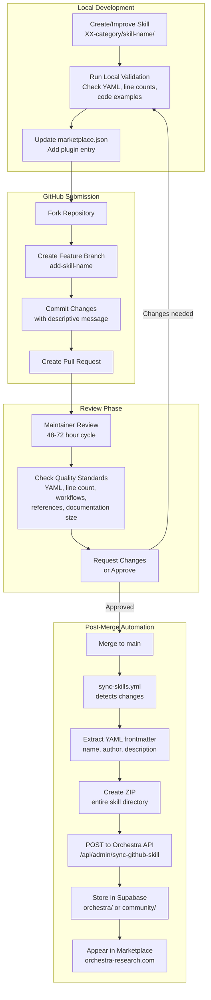
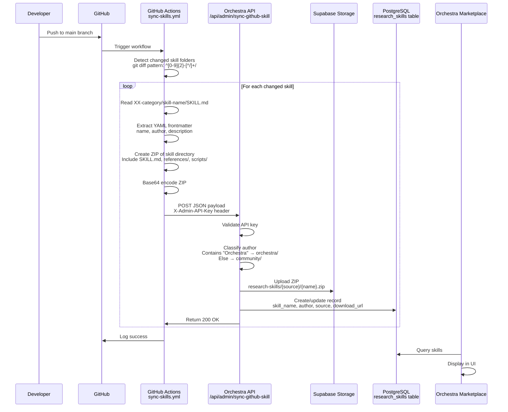
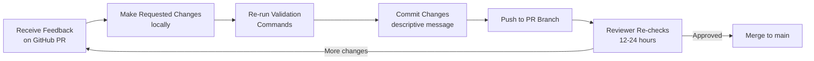

<!-- source: DeepWiki mcp.deepwiki.com · repo Orchestra-Research/AI-research-SKILLs · page 5.3 Submission & Review Process · fetched 2026-10-26 -->

# Submission & Review Process

<details>
<summary>Relevant source files</summary>

The following files were used as context for generating this wiki page:

- [.claude-plugin/marketplace.json](.claude-plugin/marketplace.json)
- [.github/workflows/sync-skills.yml](.github/workflows/sync-skills.yml)
- [01-model-architecture/litgpt/SKILL.md](01-model-architecture/litgpt/SKILL.md)
- [CLAUDE.md](CLAUDE.md)
- [CONTRIBUTING.md](CONTRIBUTING.md)
- [README.md](README.md)
- [demos/README.md](demos/README.md)
- [dev_data/GITHUB_SKILLS_SYNC_SETUP.md](dev_data/GITHUB_SKILLS_SYNC_SETUP.md)
- [docs/ROADMAP.md](docs/ROADMAP.md)
- [docs/SKILL_CREATION_GUIDE.md](docs/SKILL_CREATION_GUIDE.md)
- [docs/SKILL_TEMPLATE.md](docs/SKILL_TEMPLATE.md)
- [docs/assets/promo.gif](docs/assets/promo.gif)
- [docs/christmas-tree.svg](docs/christmas-tree.svg)
- [docs/tech-tree.svg](docs/tech-tree.svg)

</details>


This document describes how to submit new skills or improvements to the AI Research Skills library, the review cycle and quality criteria, and the automated synchronization to the Orchestra marketplace after merge.

For guidance on creating skills from scratch, see [Skill Creation Guide](#5.1). For quality standards and validation requirements, see [Quality Standards & Validation](#5.2).

---

## Submission Workflow Overview

When you've created a skill, the submission process follows these stages:

1. **Validation** - Verify skill meets quality standards locally
2. **PR Creation** - Submit pull request with descriptive information
3. **Review Cycle** - Maintainers review within 48-72 hours
4. **Iteration** - Address feedback and make requested changes
5. **Merge** - PR is merged to main branch
6. **Auto-Sync** - GitHub Actions automatically publishes to Orchestra

The entire process from submission to marketplace availability typically takes 2-4 days for high-quality contributions.



**Diagram: Complete submission and publication workflow from local development to marketplace**

Sources: [CONTRIBUTING.md:229-254](), [README.md:288-323](), [.github/workflows/sync-skills.yml:1-200]()

---

## Pre-Submission Validation

Before creating a pull request, validate your skill locally to avoid common rejection reasons.

### Required Validation Steps

```markdown
Pre-Submission Checklist:
- [ ] YAML frontmatter present with all required fields
- [ ] SKILL.md body is 200-500 lines (under 500 critical)
- [ ] All code blocks have language tags (```python, ```bash, etc.)
- [ ] 2-3 workflows with copy-paste checklists
- [ ] "When to use vs alternatives" section exists
- [ ] "Common issues" section with solutions
- [ ] References are one level deep from SKILL.md
- [ ] Documentation size is 300KB+ (target)
- [ ] marketplace.json updated with plugin entry
```

### Validation Commands

Run these commands before submitting:

```bash
# Check YAML frontmatter exists and is valid
head -20 XX-category/skill-name/SKILL.md
python -c "import yaml; yaml.safe_load(open('XX-category/skill-name/SKILL.md').read().split('---')[1])"

# Verify SKILL.md line count (target 200-500 lines)
wc -l XX-category/skill-name/SKILL.md

# Check documentation size (target 300KB+)
du -sh XX-category/skill-name/references/

# Verify code blocks have language tags
grep -A 1 '```' XX-category/skill-name/SKILL.md | head -20

# Validate marketplace.json syntax
python -c "import json; json.load(open('.claude-plugin/marketplace.json'))"
```

Sources: [CONTRIBUTING.md:80-124](), [CLAUDE.md:131-149]()

---

## Pull Request Structure

Create a well-structured pull request that helps reviewers understand your contribution.

### Branch Naming

```bash
# Create descriptive feature branch
git checkout -b add-vllm-skill           # For new skills
git checkout -b improve-axolotl-skill    # For improvements
git checkout -b fix-grpo-examples        # For bug fixes
```

### Commit Message Format

```bash
git commit -m "Add vLLM inference serving skill

- 356 lines SKILL.md with 4 workflows
- 4 comprehensive reference files (~48KB total)
- Server deployment, offline inference, optimization guides
- Real GitHub issues with solutions included
- API reference and production examples"
```

**Good commit messages include:**
- Skill name and category
- SKILL.md line count
- Number and types of reference files
- Total documentation size
- Key features or workflows included

### PR Description Template

```markdown
## Summary
Brief description of what this skill covers and why it's valuable.

## Skill Details
- **Category**: XX-category-name
- **Skill Name**: skill-name
- **SKILL.md Lines**: 356 lines
- **References**: 4 files, ~48KB total
- **Source**: Official documentation / GitHub repository / Both

## Key Features
- Feature 1: Brief description
- Feature 2: Brief description
- Workflow 1: What it accomplishes
- Workflow 2: What it accomplishes

## Quality Checklist
- [x] YAML frontmatter with all required fields
- [x] SKILL.md under 500 lines
- [x] 2-3 workflows with checklists
- [x] Code examples with language tags
- [x] References one level deep
- [x] marketplace.json updated

## Testing
Describe how you tested this skill (e.g., used it with Claude Code, validated examples work, checked external links).
```

Sources: [CONTRIBUTING.md:229-254]()

---

## Review Cycle and Criteria

### Timeline

| Stage | Duration | Responsible |
|-------|----------|-------------|
| Initial review | 24-48 hours | Maintainers |
| Feedback iteration | Varies | Contributor |
| Re-review | 12-24 hours | Maintainers |
| Merge decision | After approval | Maintainers |
| Auto-sync to marketplace | ~5 minutes | GitHub Actions |

**Target total cycle**: 2-4 days for quality submissions

### Review Criteria

Reviewers evaluate submissions against these critical standards:

**Mandatory Requirements** (will be rejected if missing):

```yaml
✅ YAML Frontmatter:
  - name: kebab-case, no quotes
  - description: third person, what + when
  - version: semantic versioning
  - author: Orchestra Research (or contributor name)
  - license: MIT
  - tags: Title Case (UPPERCASE acronyms)
  - dependencies: with version constraints (optional)

✅ SKILL.md Content:
  - Body: 200-500 lines (under 500 critical)
  - Progressive disclosure: details in references/
  - 2-3 workflows with checklists
  - Code examples with language tags
  - "When to use vs alternatives" section
  - "Common issues" section

✅ File Structure:
  - References one level deep from SKILL.md
  - No nested references
  - Documentation target: 300KB+

✅ Integration:
  - marketplace.json updated with plugin entry
```

**Common Rejection Reasons**:

```diff
❌ SKILL.md over 500 lines
❌ Missing YAML frontmatter or invalid format
❌ Code blocks without language tags
❌ First-person descriptions ("I can help you...")
❌ Missing workflows with checklists
❌ Nested references (SKILL.md → ref1.md → ref2.md)
❌ marketplace.json not updated
❌ Over-explaining basics Claude already knows
```

Sources: [CONTRIBUTING.md:84-112](), [CLAUDE.md:59-106]()

---

## Marketplace Integration

### Updating marketplace.json

Every new skill **must** add an entry to `.claude-plugin/marketplace.json` to appear in the Claude Code plugin marketplace.

**File location**: [.claude-plugin/marketplace.json]()

**Structure**:

```json
{
  "plugins": [
    {
      "name": "skill-category-name",
      "description": "Category-level description of what skills do and when to use them",
      "source": "./",
      "strict": false,
      "skills": [
        "./XX-category/skill-name"
      ]
    }
  ]
}
```

### Adding Your Skill

Locate the appropriate category in the `plugins` array and add your skill path to the `skills` array:

```json
{
  "name": "inference-serving",
  "description": "Production LLM inference including vLLM, TensorRT-LLM, llama.cpp, and SGLang. Use when deploying models for production inference.",
  "source": "./",
  "strict": false,
  "skills": [
    "./12-inference-serving/llama-cpp",
    "./12-inference-serving/sglang",
    "./12-inference-serving/tensorrt-llm",
    "./12-inference-serving/vllm"  // Add your new skill here
  ]
}
```

**Validation**:

```bash
# Verify JSON is valid after editing
python -c "import json; json.load(open('.claude-plugin/marketplace.json'))"
```

**Important**: Skills are ordered by category number (01-20). Place your entry in the correct category to maintain consistency.

Sources: [CONTRIBUTING.md:197-226](), [.claude-plugin/marketplace.json:1-256]()

---

## Post-Merge Auto-Sync Process

After your PR is merged, GitHub Actions automatically publishes your skill to the Orchestra marketplace.

### Sync Workflow Architecture



**Diagram: GitHub Actions auto-sync sequence from merge to marketplace publication**

Sources: [.github/workflows/sync-skills.yml:1-200](), [dev_data/GITHUB_SKILLS_SYNC_SETUP.md:1-290]()

### Workflow Trigger Mechanism

The sync workflow triggers on two events:

**File**: [.github/workflows/sync-skills.yml:3-7]()

```yaml
on:
  push:
    branches:
      - main
  workflow_dispatch: # Manual trigger
```

**Change Detection**:

The workflow only syncs skills that changed in the most recent commit:

```bash
# Pattern 1: Nested skills (XX-category/skill-name/)
grep -E '^[0-9]{2}-[^/]+/[^/]+/' changed_files

# Pattern 2: Standalone skills (XX-category/SKILL.md)
grep -E '^[0-9]{2}-[^/]+/SKILL\.md$' changed_files
```

Sources: [.github/workflows/sync-skills.yml:19-63]()

### Metadata Extraction

For each changed skill, the workflow extracts metadata from YAML frontmatter:

**File**: [.github/workflows/sync-skills.yml:84-110]()

```bash
# Extract skill name
SKILL_NAME=$(grep -A 20 "^---$" "$SKILL_PATH/SKILL.md" | grep "^name:" | head -1 | sed 's/name: *//;s/"//g;s/'\''//g')

# Extract author for classification
AUTHOR=$(grep -A 20 "^---$" "$SKILL_PATH/SKILL.md" | grep "^author:" | head -1 | sed 's/author: *//;s/"//g;s/'\''//g')

# Default to "Orchestra Research" if missing
if [ -z "$AUTHOR" ]; then
  AUTHOR="Orchestra Research"
fi
```

### ZIP Package Creation

The workflow packages the entire skill directory:

**File**: [.github/workflows/sync-skills.yml:112-132]()

```bash
# Create temporary directory
TEMP_DIR=$(mktemp -d)
SKILL_DIR="$TEMP_DIR/$SKILL_NAME"

# Copy all contents (SKILL.md, references/, scripts/, assets/, examples/)
cp -r "$SKILL_PATH"/* "$SKILL_DIR/"

# Create ZIP (exclude hidden files)
cd "$TEMP_DIR"
zip -r "${SKILL_NAME}.zip" "$SKILL_NAME" -x "*/.*" "*/.gitkeep" "*.DS_Store"
```

**Contents included in ZIP**:
- `SKILL.md` - Main skill file
- `references/` - All reference documentation
- `scripts/` - Helper scripts (if exists)
- `assets/` - Templates and examples (if exists)
- `examples/` - Example implementations (if exists)

**Contents excluded**:
- Hidden files (`.gitkeep`, `.DS_Store`)
- Files starting with `.`

Sources: [.github/workflows/sync-skills.yml:112-140](), [dev_data/GITHUB_SKILLS_SYNC_SETUP.md:210-228]()

### API Upload

The workflow uploads the packaged skill to Orchestra:

**File**: [.github/workflows/sync-skills.yml:143-193]()

```bash
# Prepare JSON payload
JSON_PAYLOAD=$(jq -n \
  --arg skillName "$SKILL_NAME" \
  --arg skillPath "$SKILL_PATH" \
  --arg author "$AUTHOR" \
  --rawfile skillMdContent "$SKILL_MD_FILE" \
  --rawfile zipBase64 "$ZIP_BASE64_FILE" \
  '{
    skillName: $skillName,
    skillPath: $skillPath,
    author: $author,
    skillMdContent: $skillMdContent,
    zipBase64: $zipBase64
  }')

# POST to Orchestra API
curl -X POST \
  -H "Content-Type: application/json" \
  -H "X-Admin-API-Key: $ORCHESTRA_SYNC_API_KEY" \
  -d @"$JSON_FILE" \
  "$ORCHESTRA_API_URL/api/admin/sync-github-skill"
```

**Response handling**:

| HTTP Status | Action | Meaning |
|------------|--------|---------|
| 200 | Success | Skill created or updated |
| 401 | Fail | Invalid API key |
| 400 | Fail | Invalid payload or missing data |
| 500 | Fail | Server error |

Sources: [.github/workflows/sync-skills.yml:143-193]()

### Author Classification

Skills are classified as "orchestra" (official) or "community" based on the `author` field:

**File**: [dev_data/GITHUB_SKILLS_SYNC_SETUP.md:166-208]()

```yaml
# Official Orchestra skill
---
author: Orchestra Research  # Contains "Orchestra"
---
Result: source = "orchestra", path = research-skills/orchestra/skill-name.zip

# Community skill
---
author: Jane Doe  # Does NOT contain "Orchestra"
---
Result: source = "community", path = research-skills/community/skill-name.zip

# Missing author
---
# No author field
---
Result: Defaults to "Orchestra Research", source = "orchestra"
```

This classification determines:
- **Storage path** in Supabase Storage
- **Badge display** in marketplace UI (Official vs Community)
- **Discovery ordering** (official skills appear first)

Sources: [dev_data/GITHUB_SKILLS_SYNC_SETUP.md:166-208]()

---

## Verification and Troubleshooting

### Verifying Successful Sync

After your PR is merged, verify the skill synced correctly:

**1. Check GitHub Actions logs**:
```
GitHub Repository → Actions tab → "Sync Skills to Orchestra" workflow
Look for: "✅ SUCCESS: Skill <name> synced (source: orchestra)"
```

**2. Check Orchestra Marketplace**:
```
Navigate to: https://orchestra-research.com/research-skills
Search for: Your skill name
Verify: Metadata, description, tags appear correctly
```

**3. Check Supabase Storage** (maintainers only):
```
Supabase Dashboard → Storage → research-skills bucket
Check: orchestra/<skill-name>.zip or community/<skill-name>.zip exists
```

### Common Sync Issues

**Issue: "No skill changes detected"**

```
Cause: Modified files outside skill directories
Fix: Ensure you modified files inside XX-category/skill-name/
Workaround: Manually trigger workflow via Actions tab
```

**Issue: "No SKILL.md found"**

```
Cause: SKILL.md missing or in wrong location
Fix: Ensure file is at XX-category/skill-name/SKILL.md
```

**Issue: "Failed to parse YAML frontmatter"**

```
Cause: Invalid YAML syntax in frontmatter
Fix: 
1. Check YAML has opening and closing --- delimiters
2. Validate with: python -c "import yaml; yaml.safe_load(open('SKILL.md').read().split('---')[1])"
3. Ensure no quotes around field values
4. Fix any syntax errors and re-commit
```

**Issue: "Skill not appearing in marketplace"**

```
Cause: Database record not created or marketplace cache
Fix:
1. Check GitHub Actions logs for API errors
2. Verify ZIP was created successfully
3. Contact maintainers if API returned 500 error
4. Allow 5-10 minutes for marketplace cache to refresh
```

Sources: [dev_data/GITHUB_SKILLS_SYNC_SETUP.md:236-284](), [.github/workflows/sync-skills.yml:195-200]()

---

## Manual Sync Trigger

Maintainers can manually trigger the sync workflow for testing or republishing skills:

**Steps**:
1. Go to repository on GitHub
2. Click **Actions** tab
3. Select **"Sync Skills to Orchestra"** workflow
4. Click **"Run workflow"** dropdown
5. Select branch (usually `main`)
6. Click **"Run workflow"** button

**Use cases**:
- Testing sync workflow changes
- Republishing after API endpoint updates
- Syncing all skills after bulk updates
- Troubleshooting sync issues

**Note**: Manual triggers sync **all skills**, not just changed ones.

Sources: [.github/workflows/sync-skills.yml:7-8](), [dev_data/GITHUB_SKILLS_SYNC_SETUP.md:116-125]()

---

## Review Iteration Process

If reviewers request changes, follow this iteration cycle:



**Diagram: Review iteration cycle for addressing feedback**

**Best practices for iterations**:

```markdown
✅ Good iteration response:
- Address all requested changes
- Add commit message explaining what changed
- Comment on PR describing fixes
- Re-run validation commands
- Update line counts in PR description if changed

❌ Bad iteration response:
- Partial fixes
- No explanation of changes
- New issues introduced
- Validation not re-run
```

**Typical iteration time**: Most PRs require 1-2 iteration cycles before approval.

Sources: [CONTRIBUTING.md:229-254]()

---

## Post-Publication

### Contributors Recognition

After your skill is merged, you're automatically added to the Contributors Hall of Fame:

**File**: `CONTRIBUTORS.md` (maintained by project)

```markdown
## Contributors Hall of Fame 🌟

Thank you to these amazing contributors:

- **[Your Name]** - Contributed [skill-name] ([Category])
```

### Skill Usage Tracking

Your published skill will be:
- Available in Orchestra marketplace at `https://orchestra-research.com/research-skills`
- Installable via NPM package: `npx @orchestra-research/ai-research-skills`
- Accessible via Claude Code plugin marketplace
- Used by AI coding agents globally

### Maintenance Responsibilities

As a contributor, you're encouraged to:
- Monitor issues related to your skill
- Update documentation when dependencies change
- Respond to questions in discussions
- Submit improvements as new PRs

**Note**: Maintainers will handle critical updates, but your ongoing involvement helps keep skills high-quality.

Sources: [README.md:462-463](), [README.md:74-149]()

---

## Quality Standards Summary

Skills must meet these standards to be merged:

| Aspect | Requirement | Validation |
|--------|-------------|------------|
| YAML Frontmatter | All required fields, valid syntax | `python -c "import yaml; yaml.safe_load(...)"` |
| SKILL.md Length | 200-500 lines (under 500 critical) | `wc -l SKILL.md` |
| Code Examples | Language tags on all blocks | `grep -A 1 '```' SKILL.md` |
| Workflows | 2-3 with copy-paste checklists | Manual inspection |
| References | One level deep, 300KB+ target | `du -sh references/` |
| marketplace.json | Plugin entry added | `python -c "import json; json.load(...)"` |
| Alternatives | "When to use vs alternatives" section | Manual inspection |
| Common Issues | Section with solutions | Manual inspection |

For complete quality standards, see [Quality Standards & Validation](#5.2).

Sources: [CONTRIBUTING.md:80-124](), [CLAUDE.md:59-106]()

---

