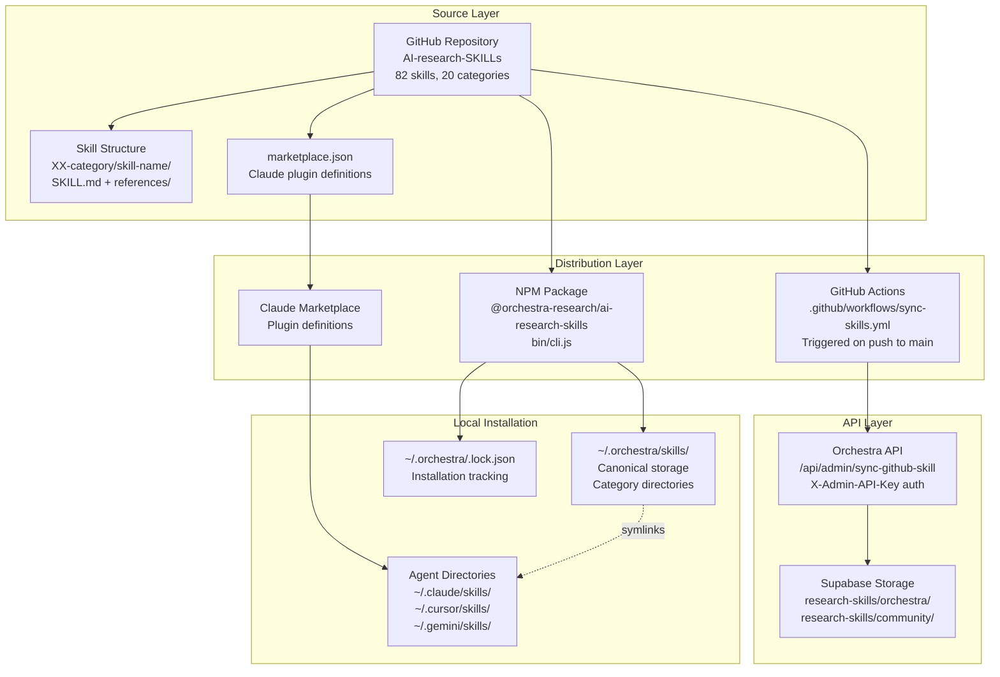
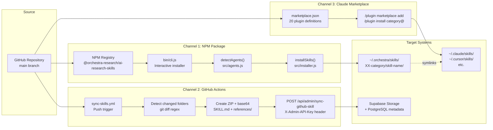
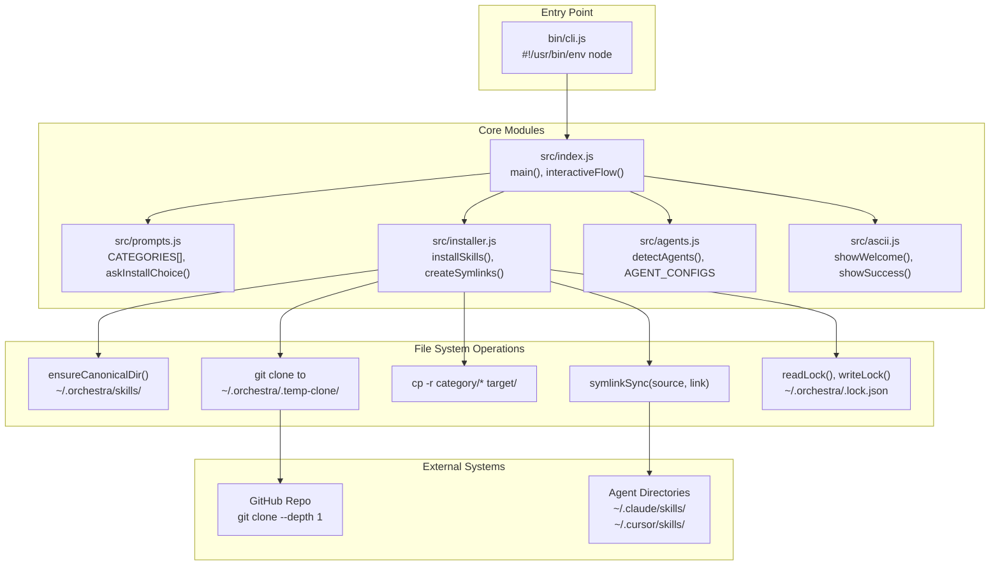
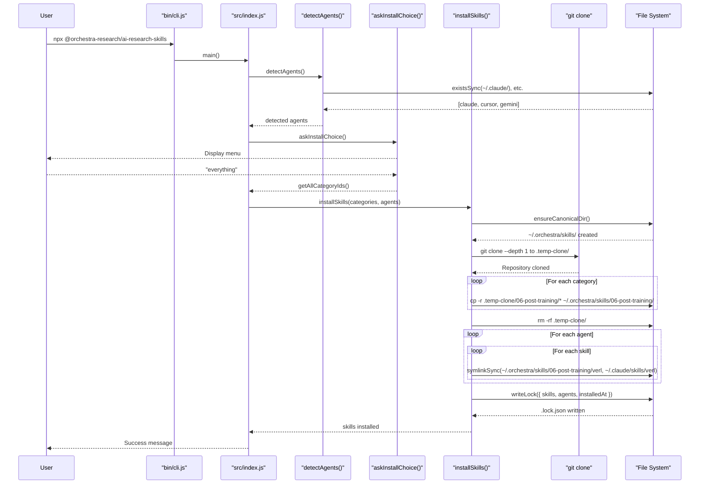
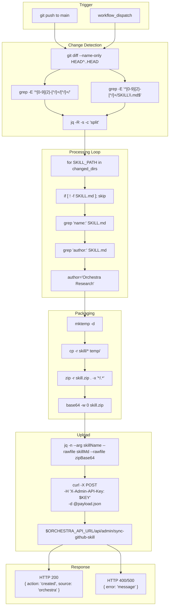
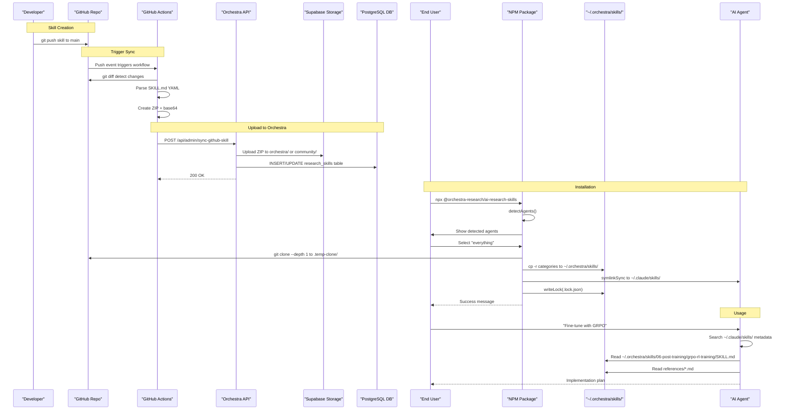
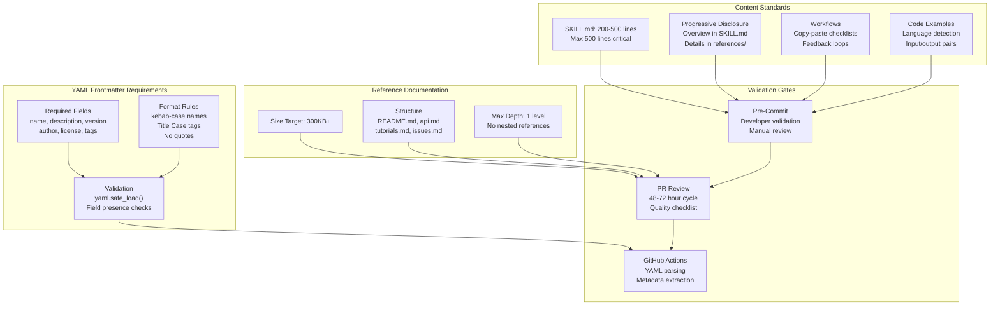
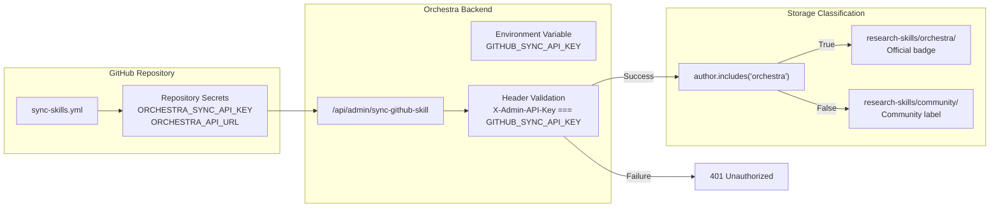
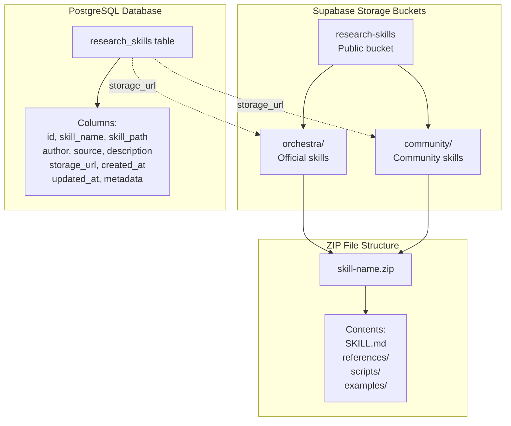
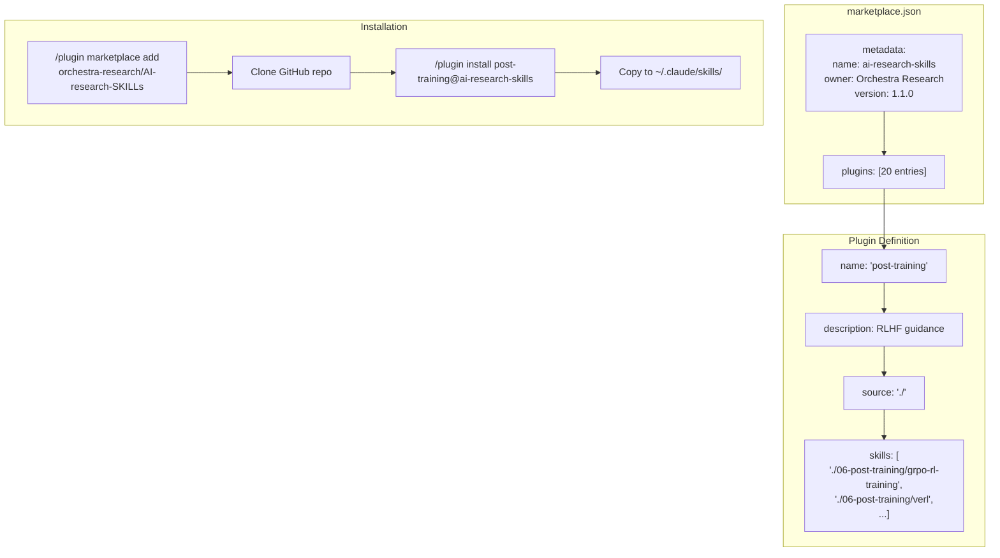

<!-- source: DeepWiki mcp.deepwiki.com · repo Orchestra-Research/AI-research-SKILLs · page 6 System Architecture · fetched 2026-10-26 -->

# System Architecture

<details>
<summary>Relevant source files</summary>

The following files were used as context for generating this wiki page:

- [.claude-plugin/marketplace.json](.claude-plugin/marketplace.json)
- [.github/workflows/sync-skills.yml](.github/workflows/sync-skills.yml)
- [01-model-architecture/litgpt/SKILL.md](01-model-architecture/litgpt/SKILL.md)
- [CLAUDE.md](CLAUDE.md)
- [CONTRIBUTING.md](CONTRIBUTING.md)
- [README.md](README.md)
- [demos/README.md](demos/README.md)
- [dev_data/GITHUB_SKILLS_SYNC_SETUP.md](dev_data/GITHUB_SKILLS_SYNC_SETUP.md)
- [docs/ROADMAP.md](docs/ROADMAP.md)
- [docs/SKILL_CREATION_GUIDE.md](docs/SKILL_CREATION_GUIDE.md)
- [docs/SKILL_TEMPLATE.md](docs/SKILL_TEMPLATE.md)
- [docs/assets/promo.gif](docs/assets/promo.gif)
- [docs/christmas-tree.svg](docs/christmas-tree.svg)
- [docs/tech-tree.svg](docs/tech-tree.svg)
- [packages/ai-research-skills/package.json](packages/ai-research-skills/package.json)
- [packages/ai-research-skills/src/index.js](packages/ai-research-skills/src/index.js)
- [packages/ai-research-skills/src/installer.js](packages/ai-research-skills/src/installer.js)
- [packages/ai-research-skills/src/prompts.js](packages/ai-research-skills/src/prompts.js)

</details>


This document describes the technical architecture of the AI Research Skills repository, including the distribution system, installation mechanisms, synchronization workflows, and data flow patterns. The architecture implements a multi-channel distribution strategy with a single source of truth, canonical local storage, and automated CI/CD pipelines.

For information about skill content structure and quality standards, see [Skill Structure & Format](#4.2). For creating new skills, see [Skill Creation Guide](#5.1).

---

## Overview

The AI Research Skills system consists of three primary architectural layers:

1. **Core Repository Layer** - GitHub repository containing 82 skills across 20 categories with standardized YAML frontmatter and reference documentation
2. **Distribution Layer** - Three distinct channels (NPM package, GitHub Actions sync, Claude marketplace) for delivering skills to end users
3. **Local Storage Layer** - Canonical directory pattern with symlinks to multiple AI agent configurations

The system prioritizes developer ergonomics, installation simplicity, and automatic synchronization while maintaining a single source of truth in the GitHub repository.

**System Components Overview**



Sources: [README.md:1-643](), [.github/workflows/sync-skills.yml:1-200](), [packages/ai-research-skills/src/installer.js:1-612]()

---

## Repository Organization

The repository follows a hierarchical numbering system where skills are grouped into 20 categories representing the AI research lifecycle stages.

**Category Structure**

| Category ID | Name | Skills | Purpose |
|-------------|------|--------|---------|
| 01 | Model Architecture | 5 | LitGPT, Mamba, TorchTitan, RWKV, NanoGPT |
| 02 | Tokenization | 2 | HuggingFace Tokenizers, SentencePiece |
| 03 | Fine-Tuning | 4 | Axolotl, Unsloth, PEFT, LLaMA-Factory |
| 04 | Mechanistic Interpretability | 4 | TransformerLens, SAELens, pyvene, nnsight |
| 05 | Data Processing | 2 | NeMo Curator, Ray Data |
| 06 | Post-Training | 8 | GRPO, verl, slime, miles, torchforge, TRL, OpenRLHF, SimPO |
| 07 | Safety & Alignment | 3 | Constitutional AI, LlamaGuard, NeMo Guardrails |
| 08 | Distributed Training | 6 | DeepSpeed, FSDP, Accelerate, Megatron-Core, Lightning, Ray Train |
| 09 | Infrastructure | 3 | Modal, SkyPilot, Lambda Labs |
| 10 | Optimization | 6 | Flash Attention, bitsandbytes, GPTQ, AWQ, HQQ, GGUF |
| 11 | Evaluation | 3 | lm-eval-harness, BigCode, NeMo Evaluator |
| 12 | Inference Serving | 4 | vLLM, TensorRT-LLM, llama.cpp, SGLang |
| 13 | MLOps | 3 | Weights & Biases, MLflow, TensorBoard |
| 14 | Agents | 4 | LangChain, LlamaIndex, CrewAI, AutoGPT |
| 15 | RAG | 5 | Chroma, FAISS, Pinecone, Qdrant, Sentence Transformers |
| 16 | Prompt Engineering | 4 | DSPy, Instructor, Guidance, Outlines |
| 17 | Observability | 2 | LangSmith, Phoenix |
| 18 | Multimodal | 7 | CLIP, Whisper, LLaVA, BLIP-2, SAM, Stable Diffusion, AudioCraft |
| 19 | Emerging Techniques | 6 | MoE, Model Merging, Long Context, Speculative Decoding, Distillation, Pruning |
| 20 | ML Paper Writing | 1 | LaTeX templates, citation verification |

**Skill Directory Structure**

Each skill follows a standardized format:

```
XX-category/skill-name/
├── SKILL.md                    # Main guidance (200-500 lines with YAML frontmatter)
├── references/                 # Deep documentation (300KB+ target)
│   ├── README.md              # Official docs
│   ├── api.md                 # API reference
│   ├── tutorials.md           # Step-by-step guides
│   ├── issues.md              # GitHub issues & solutions
│   └── releases.md            # Version history
├── scripts/                    # Optional helper scripts
└── examples/                   # Optional code examples
```

Standalone skills (like `20-ml-paper-writing/`) have `SKILL.md` directly in the category directory rather than a nested subdirectory.

Sources: [README.md:125-271](), [CONTRIBUTING.md:70-80](), [CLAUDE.md:13-51]()

---

## Distribution Channels

The system implements three independent distribution channels, each optimized for different use cases and audiences.

**Distribution Channel Architecture**



### Channel 1: NPM Package Installer

The NPM package provides an interactive CLI for developers to install skills with agent auto-detection and selective installation.

**Key Features:**
- Auto-detection of 5+ AI coding agents
- Interactive category/skill selection
- Canonical storage at `~/.orchestra/skills/`
- Symlink creation to agent directories
- Update and uninstall capabilities

**Entry Point:** `packages/ai-research-skills/bin/cli.js`

**Core Workflow:**
1. User runs `npx @orchestra-research/ai-research-skills`
2. `detectAgents()` scans for agent config directories ([packages/ai-research-skills/src/agents.js:1-100]())
3. User selects installation type (everything/categories/individual)
4. `installSkills()` clones GitHub repo to temp directory
5. Skills copied to `~/.orchestra/skills/XX-category/skill-name/`
6. Symlinks created in each agent's skills directory
7. `.lock.json` updated with installation metadata

**Installation Commands:**

```bash
# Interactive mode (recommended)
npx @orchestra-research/ai-research-skills

# Direct commands
npx @orchestra-research/ai-research-skills list
npx @orchestra-research/ai-research-skills update
```

Sources: [packages/ai-research-skills/package.json:1-46](), [packages/ai-research-skills/src/installer.js:1-612](), [packages/ai-research-skills/src/index.js:1-359]()

### Channel 2: GitHub Actions Sync

Automated synchronization pipeline that pushes skill updates to the Orchestra marketplace on every commit to `main`.

**Trigger:** Push to `main` branch or manual `workflow_dispatch`

**Workflow Steps:**

1. **Change Detection** ([.github/workflows/sync-skills.yml:19-64]()):
   - Detects changed files via `git diff --name-only HEAD^..HEAD`
   - Matches patterns: `^[0-9]{2}-[^/]+/[^/]+/` (nested) or `^[0-9]{2}-[^/]+/SKILL\.md$` (standalone)
   - Outputs JSON array of changed skill directories

2. **Metadata Extraction** ([.github/workflows/sync-skills.yml:90-106]()):
   - Parses YAML frontmatter from `SKILL.md`
   - Extracts `name:` and `author:` fields
   - Defaults to directory name and "Orchestra Research" if missing

3. **ZIP Creation** ([.github/workflows/sync-skills.yml:112-124]()):
   - Creates temp directory structure: `$TEMP_DIR/$SKILL_NAME/`
   - Copies all skill files (SKILL.md, references/, scripts/, etc.)
   - Creates ZIP excluding hidden files: `zip -r skill.zip . -x "*/.*"`

4. **API Upload** ([.github/workflows/sync-skills.yml:143-183]()):
   - Base64 encodes ZIP file
   - Creates JSON payload with metadata
   - POSTs to Orchestra API with `X-Admin-API-Key` authentication
   - Verifies HTTP 200 response

**Author-Based Classification:**
- Skills with `author: Orchestra Research` → `research-skills/orchestra/` bucket
- Other authors → `research-skills/community/` bucket

Sources: [.github/workflows/sync-skills.yml:1-200](), [dev_data/GITHUB_SKILLS_SYNC_SETUP.md:1-270]()

### Channel 3: Claude Marketplace Integration

Native integration for Claude Code users via plugin marketplace commands.

**Marketplace Definition:** [.claude-plugin/marketplace.json:1-255]()

**Structure:**
- 20 plugin entries (one per category)
- Each plugin contains:
  - `name`: Category identifier (e.g., `"post-training"`)
  - `description`: When to use the category
  - `skills`: Array of skill paths (e.g., `"./06-post-training/grpo-rl-training"`)

**Installation:**

```bash
# Add marketplace
/plugin marketplace add orchestra-research/AI-research-SKILLs

# Install category
/plugin install post-training@ai-research-skills

# Skills installed to ~/.claude/skills/
```

Sources: [.claude-plugin/marketplace.json:1-255](), [README.md:107-123]()

---

## NPM Package Architecture

The NPM package implements an interactive CLI with agent detection, canonical storage management, and symlink orchestration.

**Component Architecture**



### Agent Detection System

The `detectAgents()` function scans the filesystem for AI coding agent installations.

**Supported Agents:**

| Agent ID | Config Path | Skills Path |
|----------|-------------|-------------|
| `claude` | `~/.claude/` | `~/.claude/skills/` |
| `claude-vscode` | `~/Library/Application Support/Code/User/globalStorage/claude-code.claude-code/` | `(config path)/skills/` |
| `cursor` | `~/.cursor/` | `~/.cursor/skills/` |
| `gemini` | `~/.gemini/` | `~/.gemini/skills/` |
| `windsurf` | `~/.windsurf/` | `~/.windsurf/skills/` |
| `qwen` | `~/.qwen/` | `~/.qwen/skills/` |

**Detection Logic** ([packages/ai-research-skills/src/agents.js:15-85]()):

```javascript
function detectAgents() {
  const detected = [];
  for (const agent of AGENT_CONFIGS) {
    const configPath = agent.path.replace('~', homedir());
    if (existsSync(configPath)) {
      detected.push({
        id: agent.id,
        name: agent.name,
        path: configPath,
        skillsPath: agent.skillsPath.replace('~', homedir())
      });
    }
  }
  return detected;
}
```

Sources: [packages/ai-research-skills/src/agents.js:1-100]()

### Canonical Storage Pattern

The installer uses a centralized storage directory with symlinks to avoid duplication when multiple agents are installed.

**Directory Structure:**

```
~/.orchestra/
├── skills/                          # Canonical storage (source of truth)
│   ├── 01-model-architecture/
│   │   ├── litgpt/
│   │   │   ├── SKILL.md
│   │   │   └── references/
│   │   └── mamba/
│   ├── 06-post-training/
│   │   ├── grpo-rl-training/
│   │   ├── verl/
│   │   └── slime/
│   └── 20-ml-paper-writing/         # Standalone skill
│       ├── SKILL.md
│       └── references/
├── .lock.json                       # Installation metadata
└── .temp-clone/                     # Temporary during install
```

**Symlink Creation** ([packages/ai-research-skills/src/installer.js:117-151]()):

```javascript
function createSymlinks(agent, skills, spinner) {
  const agentSkillsPath = agent.skillsPath;
  
  for (const skill of skills) {
    const sourcePath = skill.standalone
      ? join(CANONICAL_DIR, skill.category)
      : join(CANONICAL_DIR, skill.category, skill.skill);
    
    const linkName = skill.standalone ? skill.category : skill.skill;
    const linkPath = join(agentSkillsPath, linkName);
    
    if (existsSync(linkPath)) {
      rmSync(linkPath, { recursive: true, force: true });
    }
    
    symlinkSync(sourcePath, linkPath);
  }
}
```

**Benefits:**
- Single source of truth for updates
- Reduced disk usage (one copy shared across agents)
- Atomic updates (modify canonical, symlinks reflect immediately)
- Easy cleanup (remove canonical directory, all symlinks break cleanly)

Sources: [packages/ai-research-skills/src/installer.js:1-612]()

### Installation Workflow

**Complete Installation Flow:**



**Key Functions:**

| Function | File | Purpose |
|----------|------|---------|
| `installSkills()` | `installer.js:260-293` | Orchestrates installation by category |
| `installSpecificSkills()` | `installer.js:224-255` | Installs individual skills |
| `downloadSkills()` | `installer.js:48-114` | Clones repo and copies categories |
| `downloadSpecificSkills()` | `installer.js:156-219` | Clones repo and copies specific skills |
| `createSymlinks()` | `installer.js:117-151` | Creates symlinks to agent directories |
| `updateInstalledSkills()` | `installer.js:432-470` | Re-downloads existing skills |
| `uninstallAllSkills()` | `installer.js:475-516` | Removes all skills and symlinks |
| `uninstallSpecificSkills()` | `installer.js:523-593` | Removes selected skills |

Sources: [packages/ai-research-skills/src/installer.js:1-612](), [packages/ai-research-skills/src/index.js:1-359]()

### Lock File Format

The `.lock.json` file tracks installation state:

```json
{
  "version": "1.0.0",
  "installedAt": "2026-01-15T10:30:00.000Z",
  "skills": [
    {
      "category": "06-post-training",
      "skill": "verl",
      "standalone": false
    },
    {
      "category": "20-ml-paper-writing",
      "skill": "20-ml-paper-writing",
      "standalone": true
    }
  ],
  "agents": ["claude", "cursor", "gemini"]
}
```

**Usage:**
- `readLock()` loads current state ([packages/ai-research-skills/src/installer.js:28-37]())
- `writeLock()` saves after installation/update ([packages/ai-research-skills/src/installer.js:42-44]())
- `getInstalledSkillPaths()` returns skill paths for updates ([packages/ai-research-skills/src/installer.js:397-427]())

Sources: [packages/ai-research-skills/src/installer.js:1-612]()

---

## GitHub Actions Sync System

The automated synchronization system detects skill changes and uploads them to the Orchestra API on every push to `main`.

**Sync Workflow Architecture**



### Change Detection Algorithm

**Pattern Matching** ([.github/workflows/sync-skills.yml:28-48]()):

The workflow detects two skill patterns:

1. **Nested skills:** `XX-category/skill-name/SKILL.md`
   - Regex: `^[0-9]{2}-[^/]+/[^/]+/`
   - Example: `06-post-training/verl/SKILL.md` → skill path: `06-post-training/verl`

2. **Standalone skills:** `XX-category/SKILL.md`
   - Regex: `^[0-9]{2}-[^/]+/SKILL\.md$`
   - Example: `20-ml-paper-writing/SKILL.md` → skill path: `20-ml-paper-writing`

**Shell Script:**

```bash
CHANGED_FILES=$(git diff --name-only HEAD^..HEAD)

# Nested skills
NESTED=$(echo "$CHANGED_FILES" | \
  grep -E '^[0-9]{2}-[^/]+/[^/]+/' | \
  sed -E 's|^([0-9]{2}-[^/]+/[^/]+)/.*|\1|' | \
  sort -u)

# Standalone skills
STANDALONE=$(echo "$CHANGED_FILES" | \
  grep -E '^[0-9]{2}-[^/]+/SKILL\.md$' | \
  sed -E 's|^([0-9]{2}-[^/]+)/SKILL\.md$|\1|' | \
  sort -u)

# Combine and convert to JSON array
SKILLS_JSON=$(printf "%s\n%s" "$NESTED" "$STANDALONE" | \
  sort -u | \
  jq -R -s -c 'split("\n") | map(select(length > 0))')
```

Sources: [.github/workflows/sync-skills.yml:19-64]()

### Metadata Extraction

**YAML Frontmatter Parsing** ([.github/workflows/sync-skills.yml:90-106]()):

```bash
# Extract skill name
SKILL_NAME=$(grep -A 20 "^---$" "$SKILL_PATH/SKILL.md" | \
  grep "^name:" | \
  head -1 | \
  sed 's/name: *//;s/"//g;s/'\''//g' | \
  tr -d '\r')

# Extract author
AUTHOR=$(grep -A 20 "^---$" "$SKILL_PATH/SKILL.md" | \
  grep "^author:" | \
  head -1 | \
  sed 's/author: *//;s/"//g;s/'\''//g' | \
  tr -d '\r')

# Defaults
if [ -z "$SKILL_NAME" ]; then
  SKILL_NAME=$(basename "$SKILL_PATH")
fi

if [ -z "$AUTHOR" ]; then
  AUTHOR="Orchestra Research"
fi
```

The workflow parses the first 20 lines after `---` to extract `name:` and `author:` fields, removing quotes and whitespace.

Sources: [.github/workflows/sync-skills.yml:90-111]()

### ZIP Creation and Encoding

**Packaging Process** ([.github/workflows/sync-skills.yml:112-140]()):

```bash
# Create temporary directory
TEMP_DIR=$(mktemp -d)
SKILL_DIR="$TEMP_DIR/$SKILL_NAME"
mkdir -p "$SKILL_DIR"

# Copy all skill contents
cp -r "$SKILL_PATH"/* "$SKILL_DIR/" 2>/dev/null || true

# Create ZIP (exclude hidden files)
ZIP_FILE="$TEMP_DIR/${SKILL_NAME}.zip"
cd "$TEMP_DIR"
zip -r "$ZIP_FILE" "$SKILL_NAME" -x "*/.*" "*/.gitkeep" "*.DS_Store"
cd -

# Base64 encode
base64 -w 0 "$ZIP_FILE" > "$TEMP_DIR/base64.txt"
```

**Payload Construction** ([.github/workflows/sync-skills.yml:143-156]()):

```bash
# Write SKILL.md to file
cat "$SKILL_PATH/SKILL.md" > "$TEMP_DIR/skill.md"

# Create JSON payload using jq --rawfile
JSON_PAYLOAD=$(jq -n \
  --arg skillName "$SKILL_NAME" \
  --arg skillPath "$SKILL_PATH" \
  --arg author "$AUTHOR" \
  --rawfile skillMdContent "$TEMP_DIR/skill.md" \
  --rawfile zipBase64 "$TEMP_DIR/base64.txt" \
  '{
    skillName: $skillName,
    skillPath: $skillPath,
    author: $author,
    skillMdContent: $skillMdContent,
    zipBase64: $zipBase64
  }')
```

Using `--rawfile` avoids argument length limits for large files.

Sources: [.github/workflows/sync-skills.yml:112-156]()

### API Upload

**POST Request** ([.github/workflows/sync-skills.yml:157-183]()):

```bash
echo "$JSON_PAYLOAD" > "$TEMP_DIR/payload.json"

RESPONSE=$(curl -s -w "\n%{http_code}" -L \
  -X POST \
  -H "Content-Type: application/json" \
  -H "X-Admin-API-Key: $ORCHESTRA_SYNC_API_KEY" \
  -d @"$TEMP_DIR/payload.json" \
  "$ORCHESTRA_API_URL/api/admin/sync-github-skill")

HTTP_CODE=$(echo "$RESPONSE" | tail -n1)
BODY=$(echo "$RESPONSE" | sed '$d')

if [ "$HTTP_CODE" = "200" ]; then
  ACTION=$(echo "$BODY" | jq -r '.action // "synced"')
  SOURCE=$(echo "$BODY" | jq -r '.source // "unknown"')
  echo "✅ SUCCESS: Skill $SKILL_NAME $ACTION (source: $SOURCE)"
else
  ERROR_MSG=$(echo "$BODY" | jq -r '.error // "Unknown error"')
  echo "❌ FAILED: $ERROR_MSG"
  exit 1
fi
```

**Authentication:**
- Header: `X-Admin-API-Key: $ORCHESTRA_SYNC_API_KEY`
- Secret stored in GitHub repository secrets

**Response Format:**

```json
{
  "action": "created" | "updated",
  "source": "orchestra" | "community",
  "skillName": "verl",
  "storageUrl": "research-skills/orchestra/verl.zip"
}
```

Sources: [.github/workflows/sync-skills.yml:157-183](), [dev_data/GITHUB_SKILLS_SYNC_SETUP.md:1-270]()

### Author-Based Classification

The API endpoint classifies skills based on the `author:` field:

**Classification Logic:**

```javascript
const source = author.toLowerCase().includes('orchestra') 
  ? 'orchestra' 
  : 'community';

const storagePath = `research-skills/${source}/${skillName}.zip`;
```

**Storage Buckets:**
- `research-skills/orchestra/` - Official Orchestra Research skills (badge in UI)
- `research-skills/community/` - Community-contributed skills

This enables the marketplace to distinguish official vs. community content.

Sources: [dev_data/GITHUB_SKILLS_SYNC_SETUP.md:163-185]()

---

## Data Flow

The complete lifecycle from skill creation to agent consumption involves multiple systems and storage locations.

**End-to-End Data Flow**



### Skill Creation Phase

**Tools Available:**

| Tool | Purpose | Command |
|------|---------|---------|
| `doc_scraper.py` | Scrape official documentation | `python3 cli/doc_scraper.py --interactive` |
| `github_scraper.py` | Scrape GitHub repository | `python3 cli/github_scraper.py --repo owner/repo --name skill-name` |
| `unified_scraper.py` | Combine docs + GitHub + PDFs | `python3 cli/unified_scraper.py --config config.json` |

**Manual Creation:**
1. Create directory: `XX-category/skill-name/`
2. Write `SKILL.md` with YAML frontmatter
3. Create `references/` with deep documentation
4. Validate with quality standards (200-500 lines, workflows with checklists)
5. Update `.claude-plugin/marketplace.json`
6. Commit to `main` branch

Sources: [CONTRIBUTING.md:30-80](), [docs/SKILL_CREATION_GUIDE.md:1-507]()

### Distribution Phase

Three parallel distribution channels activate on push:

1. **NPM Package**
   - Manual: Developer runs `npm publish` (requires auth)
   - Users install via `npx @orchestra-research/ai-research-skills`

2. **GitHub Actions Sync**
   - Automatic: Triggered on push to `main`
   - Syncs to Orchestra API within minutes

3. **Claude Marketplace**
   - Manual: Users run `/plugin marketplace add`
   - Installs directly from GitHub repo

Sources: [.github/workflows/sync-skills.yml:1-200](), [.claude-plugin/marketplace.json:1-255]()

### Installation Phase

**NPM Installation Flow:**

1. Clone GitHub repo to `~/.orchestra/.temp-clone/`
2. Copy selected categories to `~/.orchestra/skills/XX-category/`
3. Create symlinks in agent directories:
   - `~/.claude/skills/skill-name` → `~/.orchestra/skills/XX-category/skill-name/`
   - `~/.cursor/skills/skill-name` → `~/.orchestra/skills/XX-category/skill-name/`
4. Write `.lock.json` with installation metadata
5. Delete `.temp-clone/`

**Symlink Benefits:**
- One canonical copy shared across all agents
- Updates to `~/.orchestra/skills/` reflect in all agents instantly
- Easy cleanup (remove canonical directory)

Sources: [packages/ai-research-skills/src/installer.js:1-612]()

### Usage Phase

**Agent Discovery:**
1. AI agent scans its skills directory (e.g., `~/.claude/skills/`)
2. For each symlink, reads `SKILL.md` YAML frontmatter
3. Indexes `name`, `description`, `tags` for semantic search
4. On user query, matches relevant skills
5. Loads full `SKILL.md` + referenced files into context
6. Executes workflows and generates code

**Skill Loading:**
- Agent reads: `~/.claude/skills/verl/SKILL.md` (via symlink)
- Canonical location: `~/.orchestra/skills/06-post-training/verl/SKILL.md`
- Progressive disclosure: Agent loads `references/*.md` only when needed

Sources: [README.md:55-72](), [CLAUDE.md:1-246]()

---

## Skill Quality System

The architecture enforces quality standards through validation gates and automated checks.

**Quality Enforcement Architecture**



### YAML Frontmatter Specification

**Required Fields** ([CONTRIBUTING.md:126-151]()):

```yaml
---
name: skill-name-here                # kebab-case, gerund form (e.g., "serving-llms")
description: Third-person description including WHAT and WHEN to use this skill
version: 1.0.0                       # Semantic versioning
author: Orchestra Research           # Default for official skills
license: MIT                         # Standard license
tags: [Tag One, Tag Two, GRPO, TRL] # Title Case (except UPPERCASE acronyms)
dependencies: [pkg>=1.0.0]           # Optional, with version constraints
---
```

**Validation Rules:**
- `name`: No quotes, lowercase with hyphens, gerund form preferred
- `description`: Max 1024 chars, third person, includes use cases
- `tags`: Title Case for words, UPPERCASE for acronyms (GRPO, TRL, RLHF, DPO)
- `dependencies`: Include version constraints: `transformers>=4.47.0`

**Parsing in GitHub Actions** ([.github/workflows/sync-skills.yml:90-106]()):

```bash
grep -A 20 "^---$" "SKILL.md" | grep "^name:" | sed 's/name: *//'
```

Sources: [CONTRIBUTING.md:126-188](), [CLAUDE.md:56-78]()

### Content Quality Standards

**Core Requirements** ([CONTRIBUTING.md:82-113]()):

| Requirement | Standard | Rationale |
|-------------|----------|-----------|
| SKILL.md length | 200-500 lines (max 500) | Performance optimization |
| Progressive disclosure | Overview in SKILL.md, details in references/ | Context window efficiency |
| Workflows | Copy-paste checklists | User action tracking |
| Code examples | Language-tagged, concise | Executable guidance |
| Feedback loops | Validate → fix → repeat | Error prevention |
| Terminology | Consistent throughout | Reduces confusion |

**Gold Standard Example:** `06-post-training/grpo-rl-training/SKILL.md`
- 569 lines (comprehensive but under 600)
- 3 complete workflows with checklists
- 2 reference files for advanced topics
- Concrete code examples with input/output pairs
- Clear troubleshooting section

Sources: [CONTRIBUTING.md:82-113](), [docs/SKILL_CREATION_GUIDE.md:1-507]()

### Reference Documentation Requirements

**Structure** ([CONTRIBUTING.md:95-107]()):

```
references/
├── README.md              # Official docs (required)
├── api.md                 # API reference (optional)
├── tutorials.md           # Step-by-step guides (optional)
├── issues.md              # GitHub issues & solutions (optional)
└── releases.md            # Version history (optional)
```

**Quality Targets:**
- Total size: 300KB+ (comprehensive coverage)
- Depth: ONE level from SKILL.md (no nested references)
- Content: Real documentation from official sources
- Format: Markdown with code examples

Sources: [README.md:336-358](), [CONTRIBUTING.md:95-107]()

---

## Security and Authentication

The system implements API key authentication for GitHub Actions and supports multi-author skill contributions.

**Authentication Flow**



### API Key Generation

**Generate Secure Key:**

```bash
# Generate 64-character random key
openssl rand -hex 32
```

**Configuration:**

1. **Orchestra Backend** - Add to `.env.local`:
   ```bash
   GITHUB_SYNC_API_KEY=a1b2c3d4e5f6...
   ```

2. **GitHub Repository** - Add secrets:
   - `ORCHESTRA_SYNC_API_KEY`: Same key as backend
   - `ORCHESTRA_API_URL`: `https://your-orchestra.com`

Sources: [dev_data/GITHUB_SKILLS_SYNC_SETUP.md:23-50]()

### API Endpoint

**Route:** `/api/admin/sync-github-skill`

**Request Headers:**
```
Content-Type: application/json
X-Admin-API-Key: <secret-key>
```

**Request Body:**
```json
{
  "skillName": "verl",
  "skillPath": "06-post-training/verl",
  "author": "Orchestra Research",
  "skillMdContent": "<full SKILL.md content>",
  "zipBase64": "<base64-encoded ZIP>"
}
```

**Response (200 OK):**
```json
{
  "action": "created",
  "source": "orchestra",
  "skillName": "verl",
  "storageUrl": "research-skills/orchestra/verl.zip"
}
```

**Response (401 Unauthorized):**
```json
{
  "error": "Invalid API key"
}
```

Sources: [.github/workflows/sync-skills.yml:162-183](), [dev_data/GITHUB_SKILLS_SYNC_SETUP.md:53-83]()

### Multi-Author Support

The system supports community contributions through author-based classification:

**Official Skills:**
- YAML: `author: Orchestra Research`
- Storage: `research-skills/orchestra/`
- Marketplace: "Official" badge

**Community Skills:**
- YAML: `author: <any other name>`
- Storage: `research-skills/community/`
- Marketplace: "Community" label

**Classification Logic** ([dev_data/GITHUB_SKILLS_SYNC_SETUP.md:163-185]()):

```javascript
const author = yamlFrontmatter.author || "Orchestra Research";
const source = author.toLowerCase().includes('orchestra') ? 'orchestra' : 'community';
const storagePath = `research-skills/${source}/${skillName}.zip`;
```

This enables:
- Community-driven skill library growth
- Clear attribution and trust signals
- Separate storage buckets for moderation

Sources: [dev_data/GITHUB_SKILLS_SYNC_SETUP.md:163-185](), [.github/workflows/sync-skills.yml:93-106]()

---

## Storage and Database Schema

Skills are stored in Supabase Storage with metadata in PostgreSQL.

**Storage Architecture**



### Storage Paths

**Bucket Structure:**

```
research-skills/                      # Public bucket
├── orchestra/                        # Official skills
│   ├── verl.zip
│   ├── grpo-rl-training.zip
│   ├── litgpt.zip
│   └── ...
└── community/                        # Community skills
    ├── contributor-skill.zip
    └── ...
```

**Path Generation:**

```javascript
const source = author.toLowerCase().includes('orchestra') ? 'orchestra' : 'community';
const storagePath = `research-skills/${source}/${skillName}.zip`;
```

Sources: [dev_data/GITHUB_SKILLS_SYNC_SETUP.md:163-185]()

### Database Schema

**Table:** `research_skills`

| Column | Type | Purpose |
|--------|------|---------|
| `id` | UUID | Primary key |
| `skill_name` | TEXT | Skill identifier (from YAML `name`) |
| `skill_path` | TEXT | Repository path (e.g., `06-post-training/verl`) |
| `author` | TEXT | Author from YAML frontmatter |
| `source` | TEXT | `"orchestra"` or `"community"` |
| `description` | TEXT | From YAML frontmatter |
| `storage_url` | TEXT | Supabase Storage path |
| `created_at` | TIMESTAMP | First upload timestamp |
| `updated_at` | TIMESTAMP | Last sync timestamp |
| `metadata` | JSONB | Additional fields (tags, version, etc.) |

**Indexes:**
- `skill_name` (unique)
- `source` (for filtering official vs. community)
- `updated_at` (for sorting by recency)

Sources: [dev_data/GITHUB_SKILLS_SYNC_SETUP.md:155-162]()

### ZIP File Format

**Contents:**

```
skill-name.zip
├── SKILL.md                          # Main file with YAML frontmatter
├── references/
│   ├── README.md
│   ├── api.md
│   ├── tutorials.md
│   └── issues.md
├── scripts/                          # Optional
│   └── helper.py
└── examples/                         # Optional
    └── example.py
```

**Packaging in GitHub Actions** ([.github/workflows/sync-skills.yml:117-124]()):

```bash
cp -r "$SKILL_PATH"/* "$SKILL_DIR/"
zip -r "$ZIP_FILE" "$SKILL_NAME" -x "*/.*" "*/.gitkeep" "*.DS_Store"
```

**Exclusions:**
- Hidden files (`*/.*`)
- `.gitkeep` files
- `.DS_Store` files

Sources: [.github/workflows/sync-skills.yml:117-124]()

---

## Claude Marketplace Integration

The `.claude-plugin/marketplace.json` file defines 20 plugin entries for Claude Code marketplace integration.

**Marketplace Structure**



### Plugin Definition Format

**Example Entry** ([.claude-plugin/marketplace.json:70-83]()):

```json
{
  "name": "post-training",
  "description": "RLHF and preference alignment including TRL, GRPO, OpenRLHF, SimPO, verl, slime, miles, and torchforge. Use when aligning models with human preferences, training reward models, or large-scale RL training.",
  "source": "./",
  "strict": false,
  "skills": [
    "./06-post-training/grpo-rl-training",
    "./06-post-training/miles",
    "./06-post-training/openrlhf",
    "./06-post-training/simpo",
    "./06-post-training/slime",
    "./06-post-training/torchforge",
    "./06-post-training/trl-fine-tuning",
    "./06-post-training/verl"
  ]
}
```

**Fields:**
- `name`: Category identifier for installation command
- `description`: When to use this category (includes tool names)
- `source`: Path to repository root
- `strict`: `false` allows flexible loading
- `skills`: Array of relative paths to skill directories

Sources: [.claude-plugin/marketplace.json:1-255]()

### Installation Commands

**Add Marketplace:**

```bash
/plugin marketplace add orchestra-research/AI-research-SKILLs
```

This clones the repository and indexes `marketplace.json`.

**Install Category:**

```bash
/plugin install post-training@ai-research-skills
```

This copies all 8 post-training skills to `~/.claude/skills/`.

**List Available Categories:**

```bash
/plugin list marketplace ai-research-skills
```

Sources: [README.md:107-123](), [.claude-plugin/marketplace.json:1-255]()

### Marketplace Metadata

**Top-Level Configuration** ([.claude-plugin/marketplace.json:2-10]()):

```json
{
  "name": "ai-research-skills",
  "owner": {
    "name": "Orchestra Research",
    "email": "zechen@orchestra-research.com"
  },
  "metadata": {
    "description": "Comprehensive library of 82 AI research engineering skills enabling autonomous AI research from hypothesis to experimental verification",
    "version": "1.1.0"
  }
}
```

This metadata appears in Claude Code's marketplace browser.

Sources: [.claude-plugin/marketplace.json:1-10]()

---

## Performance Considerations

The architecture includes several optimizations for efficiency and scalability.

### Context Window Optimization

**Progressive Disclosure Pattern:**
- SKILL.md kept under 500 lines (optimal < 300 lines)
- Details split into separate reference files
- AI agent loads references only when needed
- Reduces token usage per query

**Example:**
```
vllm/
├── SKILL.md                   # 356 lines (overview)
├── references/
│   ├── api.md                 # Loaded only for API questions
│   ├── optimization.md        # Loaded only for optimization
│   └── troubleshooting.md     # Loaded only for errors
```

Sources: [CONTRIBUTING.md:48-66](), [docs/SKILL_CREATION_GUIDE.md:44-65]()

### Symlink Architecture Benefits

**Advantages:**

| Benefit | Implementation | Impact |
|---------|----------------|--------|
| Storage efficiency | Single canonical copy at `~/.orchestra/skills/` | ~75% disk space reduction (3 agents) |
| Update propagation | Modify canonical, all symlinks reflect | Instant updates across agents |
| Atomic operations | Update canonical atomically | No partial state across agents |
| Easy cleanup | Remove canonical directory | All symlinks break cleanly |

**Comparison:**

```
# Without symlinks (duplicated)
~/.claude/skills/verl/         # 2.5 MB
~/.cursor/skills/verl/         # 2.5 MB
~/.gemini/skills/verl/         # 2.5 MB
Total: 7.5 MB

# With symlinks (canonical)
~/.orchestra/skills/06-post-training/verl/   # 2.5 MB
~/.claude/skills/verl -> (symlink)           # ~1 KB
~/.cursor/skills/verl -> (symlink)           # ~1 KB
~/.gemini/skills/verl -> (symlink)           # ~1 KB
Total: 2.5 MB
```

Sources: [packages/ai-research-skills/src/installer.js:1-151]()

### Git Clone Optimization

**Shallow Clones:**

```bash
git clone --depth 1 ${REPO_URL}.git ${tempDir}
```

**Benefits:**
- Downloads only latest commit (no history)
- ~90% faster clone time
- ~80% less disk usage during installation

**Trade-offs:**
- Cannot access commit history
- Sufficient for installation purposes

Sources: [packages/ai-research-skills/src/installer.js:61-63]()

### GitHub Actions Optimization

**Change Detection:**
- Only processes changed skill directories
- Skips unchanged skills on each commit
- Regex-based pattern matching (fast)

**Parallel Uploads:**
- Each changed skill uploads independently
- No blocking between skills
- Failure in one skill doesn't block others

Sources: [.github/workflows/sync-skills.yml:19-64]()

---

## Error Handling and Recovery

The system implements comprehensive error handling at each layer.

### NPM Installer Error Handling

**File System Errors** ([packages/ai-research-skills/src/installer.js:108-113]()):

```javascript
try {
  if (existsSync(tempDir)) {
    rmSync(tempDir, { recursive: true, force: true });
  }
  // ... installation logic
} catch (error) {
  if (existsSync(tempDir)) {
    rmSync(tempDir, { recursive: true, force: true });
  }
  throw error;
}
```

Ensures cleanup even on failure.

**Symlink Errors** ([packages/ai-research-skills/src/installer.js:142-147]()):

```javascript
try {
  symlinkSync(sourcePath, linkPath);
  linkedCount++;
} catch (error) {
  // Ignore symlink errors (e.g., already exists)
}
```

Gracefully handles pre-existing symlinks.

Sources: [packages/ai-research-skills/src/installer.js:1-612]()

### GitHub Actions Error Handling

**Missing SKILL.md** ([.github/workflows/sync-skills.yml:85-88]()):

```bash
if [ ! -f "$SKILL_PATH/SKILL.md" ]; then
  echo "⚠️  WARNING: No SKILL.md found in $SKILL_PATH, skipping"
  continue
fi
```

Skips invalid skill directories.

**API Errors** ([.github/workflows/sync-skills.yml:175-183]()):

```bash
if [ "$HTTP_CODE" = "200" ]; then
  echo "✅ SUCCESS: Skill $SKILL_NAME synced"
else
  ERROR_MSG=$(echo "$BODY" | jq -r '.error // "Unknown error"')
  echo "❌ FAILED: $ERROR_MSG"
  exit 1
fi
```

Fails workflow on API errors with clear messages.

**No Changes Detected** ([.github/workflows/sync-skills.yml:195-199]()):

```yaml
- name: No changes detected
  if: steps.changes.outputs.count == 0
  run: |
    echo "ℹ️  No skill changes detected in this commit"
```

Provides informative message when no sync needed.

Sources: [.github/workflows/sync-skills.yml:1-200]()

### Recovery Procedures

**Reinstall Skills:**

```bash
# Remove existing installation
rm -rf ~/.orchestra/skills/
rm ~/.orchestra/.lock.json

# Reinstall
npx @orchestra-research/ai-research-skills
```

**Fix Broken Symlinks:**

```bash
# Find broken symlinks
find ~/.claude/skills/ -type l ! -exec test -e {} \; -print

# Reinstall to recreate symlinks
npx @orchestra-research/ai-research-skills update
```

**Force Re-sync to Orchestra:**

GitHub repository → **Actions** tab → **"Sync Skills to Orchestra"** → **"Run workflow"**

Sources: [packages/ai-research-skills/src/installer.js:475-516]()

---

## Extension Points

The architecture supports future enhancements through well-defined extension points.

### Adding New Distribution Channels

**Current Channels:**
1. NPM package
2. GitHub Actions sync
3. Claude marketplace

**New Channel Template:**

```javascript
// packages/ai-research-skills/src/distributors/custom-distributor.js
export async function distributeToCustomChannel(skills, config) {
  // 1. Authenticate with channel
  // 2. Package skills (ZIP, tar, etc.)
  // 3. Upload to channel API
  // 4. Verify upload success
  return { success: true, channelUrl: '...' };
}
```

Integration in `src/index.js`:

```javascript
import { distributeToCustomChannel } from './distributors/custom-distributor.js';

// After installation
await distributeToCustomChannel(installedSkills, config);
```

### Adding New Agent Support

**Steps:**

1. **Add to AGENT_CONFIGS** ([packages/ai-research-skills/src/agents.js:10-50]()):

```javascript
export const AGENT_CONFIGS = [
  // ... existing agents
  {
    id: 'new-agent',
    name: 'New Agent',
    path: '~/.newagent/',
    skillsPath: '~/.newagent/skills/',
  }
];
```

2. **Test Detection:**

```bash
npx @orchestra-research/ai-research-skills
# Should show "New Agent" if installed
```

No other changes required—symlink creation is automatic.

Sources: [packages/ai-research-skills/src/agents.js:1-100]()

### Adding New Skill Categories

**Steps:**

1. **Create Directory:**

```bash
mkdir 21-new-category/
```

2. **Add Skills:**

```bash
mkdir 21-new-category/skill-name/
# Add SKILL.md, references/, etc.
```

3. **Update NPM Package** ([packages/ai-research-skills/src/installer.js:368-391]()):

```javascript
export function getAllCategoryIds() {
  return [
    // ... existing categories
    '21-new-category',
  ];
}
```

4. **Update Prompts** ([packages/ai-research-skills/src/prompts.js:7-28]()):

```javascript
export const CATEGORIES = [
  // ... existing categories
  { 
    id: '21-new-category', 
    name: 'New Category', 
    skills: 5, 
    examples: 'Tool A, Tool B' 
  },
];
```

5. **Update Marketplace** ([.claude-plugin/marketplace.json:1-255]()):

```json
{
  "plugins": [
    {
      "name": "new-category",
      "description": "Description with use cases",
      "source": "./",
      "skills": [
        "./21-new-category/skill-1",
        "./21-new-category/skill-2"
      ]
    }
  ]
}
```

Sources: [packages/ai-research-skills/src/installer.js:368-391](), [packages/ai-research-skills/src/prompts.js:7-28]()

---

This architecture enables scalable, multi-channel distribution of AI research skills with minimal maintenance overhead and strong quality enforcement mechanisms.

---

