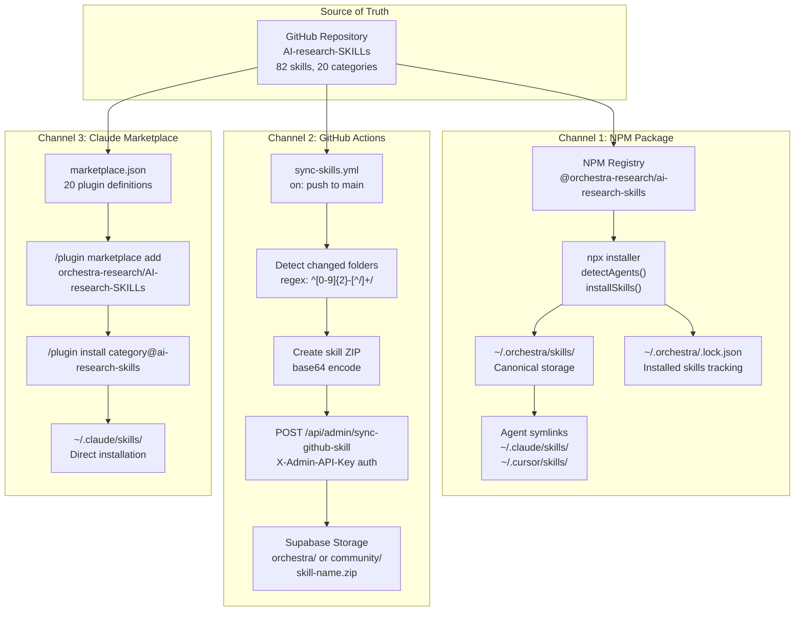
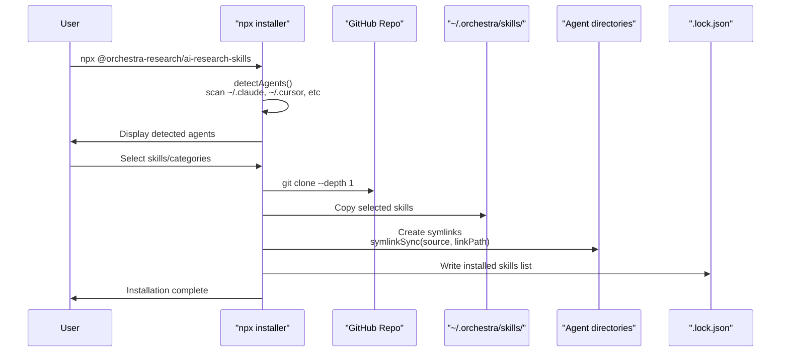
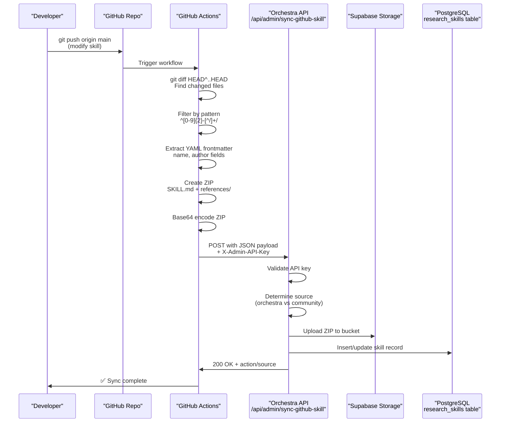
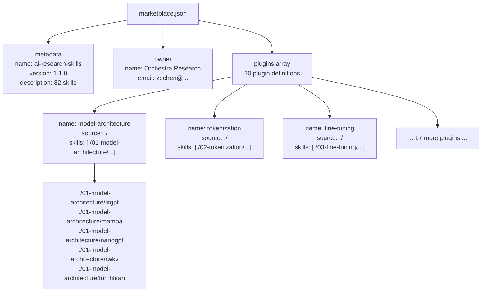
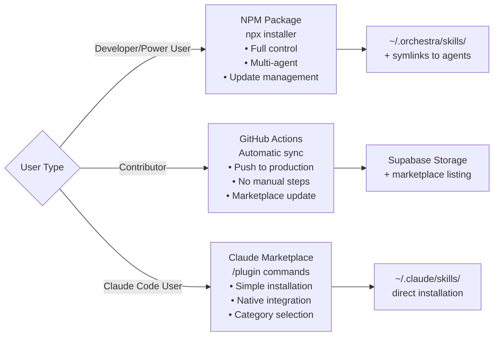

<!-- source: DeepWiki mcp.deepwiki.com · repo Orchestra-Research/AI-research-SKILLs · page 6.1 Distribution Channels · fetched 2026-10-26 -->

# Distribution Channels

<details>
<summary>Relevant source files</summary>

The following files were used as context for generating this wiki page:

- [.claude-plugin/marketplace.json](.claude-plugin/marketplace.json)
- [.github/workflows/sync-skills.yml](.github/workflows/sync-skills.yml)
- [01-model-architecture/litgpt/SKILL.md](01-model-architecture/litgpt/SKILL.md)
- [CLAUDE.md](CLAUDE.md)
- [CONTRIBUTING.md](CONTRIBUTING.md)
- [README.md](README.md)
- [demos/README.md](demos/README.md)
- [dev_data/GITHUB_SKILLS_SYNC_SETUP.md](dev_data/GITHUB_SKILLS_SYNC_SETUP.md)
- [docs/ROADMAP.md](docs/ROADMAP.md)
- [docs/SKILL_CREATION_GUIDE.md](docs/SKILL_CREATION_GUIDE.md)
- [docs/SKILL_TEMPLATE.md](docs/SKILL_TEMPLATE.md)
- [docs/assets/promo.gif](docs/assets/promo.gif)
- [docs/christmas-tree.svg](docs/christmas-tree.svg)
- [docs/tech-tree.svg](docs/tech-tree.svg)
- [packages/ai-research-skills/package.json](packages/ai-research-skills/package.json)
- [packages/ai-research-skills/src/index.js](packages/ai-research-skills/src/index.js)
- [packages/ai-research-skills/src/installer.js](packages/ai-research-skills/src/installer.js)
- [packages/ai-research-skills/src/prompts.js](packages/ai-research-skills/src/prompts.js)

</details>


## Purpose and Scope

This page documents the three distribution channels through which AI Research Skills are delivered to end users. Each channel serves different use cases and audiences, from developers seeking local installation control to automated CI/CD pipelines to end-users browsing a marketplace.

For information about how skills are created and validated before distribution, see [Contributing New Skills](#5). For details on the CLI architecture itself, see [CLI Architecture & Implementation](#6.3). For the complete lifecycle from creation to usage, see [Skill Lifecycle & Data Flow](#6.4).

---

## Overview of Distribution Channels

The repository implements three distinct distribution mechanisms, each optimized for different workflows:

| Channel | Primary Interface | Trigger | Target Audience | Installation Location |
|---------|------------------|---------|----------------|---------------------|
| **NPM Package** | Command-line installer | Manual execution | Developers, power users | `~/.orchestra/skills/` (canonical) + symlinks |
| **GitHub Actions** | Automated sync | Push to `main` branch | CI/CD, automatic updates | Orchestra Supabase Storage |
| **Claude Marketplace** | Slash commands | Manual selection | End users, Claude Code users | `~/.claude/skills/` |

All three channels maintain the GitHub repository as the single source of truth, with different methods of provisioning skills to end-user systems.

**Sources:** [README.md:78-123](), [.github/workflows/sync-skills.yml:1-200](), [.claude-plugin/marketplace.json:1-256]()

---

## Distribution Architecture



**Sources:** [README.md:78-311](), [packages/ai-research-skills/src/installer.js:1-612](), [.github/workflows/sync-skills.yml:1-200](), [.claude-plugin/marketplace.json:1-256]()

---

## Channel 1: NPM Package Installer

### Overview

The NPM package `@orchestra-research/ai-research-skills` provides an interactive CLI installer that auto-detects installed AI coding agents and provisions skills via a canonical directory with symlinks.

**Key characteristics:**
- **Interactive**: Guided prompts for skill selection
- **Multi-agent**: Supports Claude Code, Cursor, Gemini CLI, Windsurf, Qwen Code
- **Canonical storage**: Single directory at `~/.orchestra/skills/` with symlinks to agent directories
- **Incremental updates**: Can update only installed skills

### Installation Flow



### Core Functions

The installer is implemented in `packages/ai-research-skills/src/installer.js` with these key functions:

| Function | Purpose | Key Operations |
|----------|---------|---------------|
| `ensureCanonicalDir()` | Create `~/.orchestra/` directory | `mkdirSync(CANONICAL_DIR)` at line 15 |
| `downloadSkills(categories, spinner)` | Clone repo, copy selected skills | `git clone` at line 61, `cp -r` at line 82 |
| `createSymlinks(agent, skills, spinner)` | Link canonical to agent dirs | `symlinkSync(sourcePath, linkPath)` at line 143 |
| `readLock()` / `writeLock()` | Track installed skills | JSON at `~/.orchestra/.lock.json` |
| `updateInstalledSkills(agents)` | Re-download installed skills | Uses `downloadSpecificSkills()` at line 444 |

### Canonical Directory Pattern

The installer uses a **single source of truth** pattern to avoid duplication:

```
~/.orchestra/
├── skills/                    # Canonical storage (actual files)
│   ├── 01-model-architecture/
│   ├── 06-post-training/
│   └── 20-ml-paper-writing/
└── .lock.json                 # Installed skills manifest

~/.claude/skills/              # Symlinks to canonical
├── litgpt -> ~/.orchestra/skills/01-model-architecture/litgpt/
├── grpo-rl-training -> ~/.orchestra/skills/06-post-training/grpo-rl-training/
└── 20-ml-paper-writing -> ~/.orchestra/skills/20-ml-paper-writing/

~/.cursor/skills/              # Same symlinks for Cursor
├── litgpt -> ~/.orchestra/skills/01-model-architecture/litgpt/
└── ...
```

**Benefits:**
- Skills updated once in canonical directory propagate to all agents
- Disk space efficiency (no duplication)
- Consistent state across agents

**Sources:** [packages/ai-research-skills/src/installer.js:9-23, 119-151]()

### Agent Detection

The installer detects agents by checking for their configuration directories:

```javascript
// From src/agents.js (referenced by src/index.js)
const AGENT_CONFIGS = [
  { id: 'claude-code', name: 'Claude Code', path: '~/.claude', skillsPath: '~/.claude/skills' },
  { id: 'cursor', name: 'Cursor', path: '~/.cursor', skillsPath: '~/.cursor/skills' },
  { id: 'gemini-cli', name: 'Gemini CLI', path: '~/.gemini', skillsPath: '~/.gemini/skills' },
  { id: 'windsurf', name: 'Windsurf', path: '~/.windsurf', skillsPath: '~/.windsurf/skills' },
  { id: 'qwen-code', name: 'Qwen Code', path: '~/.qwen', skillsPath: '~/.qwen/skills' }
];
```

The `detectAgents()` function checks `existsSync()` for each path and returns detected agents for the installation prompt.

**Sources:** [packages/ai-research-skills/src/index.js:4, 38-48]()

### Lock File Format

Installed skills are tracked in `~/.orchestra/.lock.json`:

```json
{
  "version": "1.0.0",
  "installedAt": "2025-01-15T10:30:00.000Z",
  "skills": [
    {
      "category": "06-post-training",
      "skill": "grpo-rl-training",
      "standalone": false
    },
    {
      "category": "20-ml-paper-writing",
      "skill": "20-ml-paper-writing",
      "standalone": true
    }
  ],
  "agents": ["claude-code", "cursor"]
}
```

The `standalone` field distinguishes category-level skills (like `20-ml-paper-writing/` with `SKILL.md` directly inside) from nested skills (like `06-post-training/grpo-rl-training/`).

**Sources:** [packages/ai-research-skills/src/installer.js:28-44, 241-248]()

---

## Channel 2: GitHub Actions Sync

### Overview

The `sync-skills.yml` workflow automatically detects changed skills on push to `main` and syncs them to the Orchestra marketplace via API. This enables **push-to-production** deployments where contributors' merged PRs immediately update the marketplace.

**Key characteristics:**
- **Automatic**: Triggered on every push to `main`
- **Incremental**: Only changed skills are processed
- **Authenticated**: Uses `X-Admin-API-Key` header
- **Author-aware**: Routes to `orchestra/` or `community/` storage based on `author:` field

### Workflow Execution



### Change Detection Logic

The workflow detects changed skills using git diff and regex patterns:

```bash
# From .github/workflows/sync-skills.yml:23-48
CHANGED_FILES=$(git diff --name-only HEAD^..HEAD)

# Pattern 1: Nested skills (XX-category/skill-name/)
NESTED=$(echo "$CHANGED_FILES" | grep -E '^[0-9]{2}-[^/]+/[^/]+/' | sed -E 's|^([0-9]{2}-[^/]+/[^/]+)/.*|\1|' | sort -u)

# Pattern 2: Standalone skills (XX-category/ with SKILL.md directly inside)
STANDALONE=$(echo "$CHANGED_FILES" | grep -E '^[0-9]{2}-[^/]+/SKILL\.md$' | sed -E 's|^([0-9]{2}-[^/]+)/SKILL\.md$|\1|' | sort -u)
```

This produces an array like `["06-post-training/grpo-rl-training", "20-ml-paper-writing"]` which the workflow loops over.

**Sources:** [.github/workflows/sync-skills.yml:19-63]()

### YAML Frontmatter Extraction

For each detected skill, the workflow extracts metadata from SKILL.md:

```bash
# From .github/workflows/sync-skills.yml:91-106
SKILL_NAME=$(grep -A 20 "^---$" "$SKILL_PATH/SKILL.md" | grep "^name:" | head -1 | sed 's/name: *//;s/"//g;s/'\''//g' | tr -d '\r')

AUTHOR=$(grep -A 20 "^---$" "$SKILL_PATH/SKILL.md" | grep "^author:" | head -1 | sed 's/author: *//;s/"//g;s/'\''//g' | tr -d '\r')

# Defaults
if [ -z "$SKILL_NAME" ]; then
  SKILL_NAME=$(basename "$SKILL_PATH")
fi

if [ -z "$AUTHOR" ]; then
  AUTHOR="Orchestra Research"
fi
```

The `name` is used for the ZIP filename and database record. The `author` determines storage bucket classification.

**Sources:** [.github/workflows/sync-skills.yml:84-110]()

### ZIP Creation and Upload

```bash
# From .github/workflows/sync-skills.yml:112-155
# Create temporary directory with skill contents
TEMP_DIR=$(mktemp -d)
SKILL_DIR="$TEMP_DIR/$SKILL_NAME"
mkdir -p "$SKILL_DIR"
cp -r "$SKILL_PATH"/* "$SKILL_DIR/" 2>/dev/null || true

# Create ZIP (exclude hidden files and .gitkeep)
ZIP_FILE="$TEMP_DIR/${SKILL_NAME}.zip"
cd "$TEMP_DIR"
zip -r "$ZIP_FILE" "$SKILL_NAME" -x "*/.*" "*/.gitkeep" "*.DS_Store"

# Base64 encode for JSON payload
base64 -w 0 "$ZIP_FILE" > "$ZIP_BASE64_FILE"

# Construct JSON payload with jq
JSON_PAYLOAD=$(jq -n \
  --arg skillName "$SKILL_NAME" \
  --arg skillPath "$SKILL_PATH" \
  --arg author "$AUTHOR" \
  --rawfile skillMdContent "$SKILL_MD_FILE" \
  --rawfile zipBase64 "$ZIP_BASE64_FILE" \
  '{
    skillName: $skillName,
    skillPath: $skillPath,
    author: $author,
    skillMdContent: $skillMdContent,
    zipBase64: $zipBase64
  }')
```

The ZIP includes all skill directory contents: `SKILL.md`, `references/`, `scripts/`, `examples/`, etc.

**Sources:** [.github/workflows/sync-skills.yml:112-167]()

### API Endpoint

The workflow POSTs to `/api/admin/sync-github-skill` with authentication:

```bash
# From .github/workflows/sync-skills.yml:162-167
RESPONSE=$(curl -s -w "\n%{http_code}" -L \
  -X POST \
  -H "Content-Type: application/json" \
  -H "X-Admin-API-Key: $ORCHESTRA_SYNC_API_KEY" \
  -d @"$JSON_FILE" \
  "$ORCHESTRA_API_URL/api/admin/sync-github-skill")
```

The API validates the key, determines the source bucket (`orchestra/` vs `community/`), uploads the ZIP to Supabase Storage, and creates/updates the database record.

**Sources:** [.github/workflows/sync-skills.yml:162-183](), [dev_data/GITHUB_SKILLS_SYNC_SETUP.md:36-167]()

### Author-Based Classification

Skills are classified into two storage buckets based on the `author:` field:

| Author Field | Storage Path | Badge |
|--------------|--------------|-------|
| Contains "Orchestra" | `research-skills/orchestra/skill-name.zip` | Official |
| Any other value | `research-skills/community/skill-name.zip` | Community |

This is determined by the Orchestra API backend, not the workflow itself. The workflow only sends the `author` field; the backend makes the classification.

**Sources:** [dev_data/GITHUB_SKILLS_SYNC_SETUP.md:164-189]()

---

## Channel 3: Claude Marketplace Integration

### Overview

The `marketplace.json` file defines 20 plugin categories for the Claude Code CLI, enabling users to install skills via slash commands like `/plugin install post-training@ai-research-skills`.

**Key characteristics:**
- **Native integration**: Built into Claude Code CLI
- **Category-based**: Install entire categories at once
- **Simple commands**: `/plugin marketplace add` → `/plugin install`

### marketplace.json Structure



**Sources:** [.claude-plugin/marketplace.json:1-256]()

### Plugin Definition Format

Each plugin in the `plugins` array follows this structure:

```json
{
  "name": "post-training",
  "description": "RLHF and preference alignment including TRL, GRPO, OpenRLHF, SimPO, verl, slime, miles, and torchforge. Use when aligning models with human preferences, training reward models, or large-scale RL training.",
  "source": "./",
  "strict": false,
  "skills": [
    "./06-post-training/grpo-rl-training",
    "./06-post-training/miles",
    "./06-post-training/openrlhf",
    "./06-post-training/simpo",
    "./06-post-training/slime",
    "./06-post-training/torchforge",
    "./06-post-training/trl-fine-tuning",
    "./06-post-training/verl"
  ]
}
```

**Fields:**
- `name`: Plugin identifier (kebab-case)
- `description`: What skills are included and when to use them
- `source`: Repository root (`./`)
- `strict`: Validation mode (false allows flexible skill structure)
- `skills`: Array of relative paths to skill directories

**Sources:** [.claude-plugin/marketplace.json:70-84]()

### Usage Commands

Users interact with the marketplace via Claude Code CLI:

```bash
# Step 1: Add the marketplace
/plugin marketplace add orchestra-research/AI-research-SKILLs

# Step 2: Install a category
/plugin install post-training@ai-research-skills

# Or install multiple categories
/plugin install fine-tuning@ai-research-skills
/plugin install inference-serving@ai-research-skills
/plugin install distributed-training@ai-research-skills
```

This installs skills directly to `~/.claude/skills/` without the canonical directory pattern used by the NPM installer.

**Sources:** [README.md:107-123]()

### All 20 Plugin Categories

| Category ID | Skills Count | Representative Tools |
|-------------|--------------|---------------------|
| `model-architecture` | 5 | LitGPT, Mamba, TorchTitan |
| `tokenization` | 2 | HuggingFace Tokenizers, SentencePiece |
| `fine-tuning` | 4 | Axolotl, Unsloth, PEFT |
| `mechanistic-interpretability` | 4 | TransformerLens, SAELens |
| `data-processing` | 2 | NeMo Curator, Ray Data |
| `post-training` | 8 | GRPO, verl, slime, miles, torchforge |
| `safety-alignment` | 3 | Constitutional AI, LlamaGuard |
| `distributed-training` | 6 | DeepSpeed, FSDP, Megatron |
| `infrastructure` | 3 | Modal, SkyPilot, Lambda Labs |
| `optimization` | 6 | Flash Attention, GPTQ, AWQ |
| `evaluation` | 3 | lm-eval-harness, NeMo Evaluator |
| `inference-serving` | 4 | vLLM, TensorRT-LLM, SGLang |
| `mlops` | 3 | Weights & Biases, MLflow |
| `agents` | 4 | LangChain, LlamaIndex, CrewAI |
| `rag` | 5 | Chroma, FAISS, Pinecone |
| `prompt-engineering` | 4 | DSPy, Instructor, Outlines |
| `observability` | 2 | LangSmith, Phoenix |
| `multimodal` | 7 | CLIP, Whisper, LLaVA |
| `emerging-techniques` | 6 | MoE, Model Merging, Speculative Decoding |
| `ml-paper-writing` | 1 | ML Paper Writing |

**Sources:** [.claude-plugin/marketplace.json:11-254](), [packages/ai-research-skills/src/prompts.js:7-28]()

---

## Comparison and Use Cases

### When to Use Each Channel



### Feature Comparison

| Feature | NPM Installer | GitHub Actions | Claude Marketplace |
|---------|--------------|----------------|-------------------|
| **Trigger** | Manual command | Automatic on push | Manual command |
| **Target audience** | Developers | Contributors | End users |
| **Agent support** | 5+ agents | N/A (backend) | Claude Code only |
| **Installation path** | Canonical + symlinks | Supabase Storage | `~/.claude/skills/` |
| **Update mechanism** | `npx ... update` | Automatic on commit | Re-run `/plugin install` |
| **Selection granularity** | Categories or individual skills | All changed skills | Category level |
| **Offline operation** | Yes (after first install) | No | No |
| **Authentication** | None | API key | None |

**Sources:** [README.md:78-311](), [.github/workflows/sync-skills.yml:1-200](), [.claude-plugin/marketplace.json:1-256]()

### Typical User Journeys

**Developer installing locally:**
1. Run `npx @orchestra-research/ai-research-skills`
2. Select agents (Claude Code, Cursor, etc.)
3. Choose skills (everything, quickstart, categories, or individual)
4. Skills installed to `~/.orchestra/skills/` with symlinks
5. Later: Run `npx @orchestra-research/ai-research-skills` again to update

**Contributor adding a skill:**
1. Create skill following guidelines (see [Contributing New Skills](#5))
2. Update `marketplace.json` with new skill
3. Commit and push to `main` branch
4. GitHub Actions automatically syncs to Orchestra
5. Skill appears in marketplace within minutes

**Claude Code user:**
1. Run `/plugin marketplace add orchestra-research/AI-research-SKILLs`
2. Browse categories with `/plugin install` tab-completion
3. Install category: `/plugin install post-training@ai-research-skills`
4. Skills available immediately in Claude Code

**Sources:** [README.md:78-123](), [CONTRIBUTING.md:42-60, 199-265]()

---

## Technical Implementation Details

### NPM Package Entry Points

The NPM package defines its CLI entry point in `package.json`:

```json
{
  "name": "@orchestra-research/ai-research-skills",
  "version": "1.0.3",
  "bin": {
    "ai-research-skills": "./bin/cli.js"
  },
  "type": "module",
  "main": "src/index.js"
}
```

When users run `npx @orchestra-research/ai-research-skills`, NPM executes `bin/cli.js` which imports and calls the main function from `src/index.js`.

**Sources:** [packages/ai-research-skills/package.json:1-46]()

### Interactive Flow State Machine

The installer uses a state machine pattern with labeled continue points:

```javascript
// From src/index.js:58-282
async function interactiveFlow() {
  // STEP 2: Show detected agents + main menu
  step2_menu:
  while (true) {
    const menuAction = await askMainMenuAction();
    
    if (menuAction === 'install') {
      // STEP 3: Choose what to install
      step3_choice:
      while (true) {
        const choice = await askInstallChoice();
        
        if (choice === 'categories') {
          // STEP 4: Category selection
          step4_categories:
          while (true) {
            const result = await askCategories();
            if (result.action === 'back') continue step3_choice;
            break;
          }
        }
        
        // STEP 5: Select agents + Confirmation
        step5_agents:
        while (true) {
          const agentResult = await askSelectAgents(agents);
          if (agentResult.action === 'back') continue step3_choice;
          break;
        }
      }
    }
  }
}
```

This allows users to navigate back through menus with proper state management.

**Sources:** [packages/ai-research-skills/src/index.js:34-283]()

### Symlink Creation Details

The `createSymlinks()` function handles both standalone and nested skills:

```javascript
// From src/installer.js:119-151
function createSymlinks(agent, skills, spinner) {
  const agentSkillsPath = agent.skillsPath;
  
  for (const skill of skills) {
    // Determine source path based on skill type
    const sourcePath = skill.standalone
      ? join(CANONICAL_DIR, skill.category)  // e.g., ~/.orchestra/skills/20-ml-paper-writing
      : join(CANONICAL_DIR, skill.category, skill.skill);  // e.g., ~/.orchestra/skills/06-post-training/grpo-rl-training
    
    // Link name is either the category (standalone) or skill name (nested)
    const linkName = skill.standalone ? skill.category : skill.skill;
    const linkPath = join(agentSkillsPath, linkName);
    
    // Remove existing symlink if present
    if (existsSync(linkPath)) {
      rmSync(linkPath, { recursive: true, force: true });
    }
    
    // Create new symlink
    symlinkSync(sourcePath, linkPath);
  }
}
```

This ensures that standalone skills (like `20-ml-paper-writing/`) are linked at the category level, while nested skills (like `grpo-rl-training` inside `06-post-training/`) are linked at the skill level.

**Sources:** [packages/ai-research-skills/src/installer.js:119-151]()

### GitHub Actions Secret Management

The sync workflow requires two secrets configured in the repository settings:

| Secret Name | Purpose | Example Value |
|-------------|---------|---------------|
| `ORCHESTRA_API_URL` | Base URL of Orchestra instance | `https://orchestra-research.com` |
| `ORCHESTRA_SYNC_API_KEY` | Authentication for `/api/admin/sync-github-skill` | `a1b2c3d4e5f6...` (64 chars) |

These are accessed in the workflow via environment variables:

```yaml
# From .github/workflows/sync-skills.yml:67-69
env:
  ORCHESTRA_API_URL: ${{ secrets.ORCHESTRA_API_URL }}
  ORCHESTRA_SYNC_API_KEY: ${{ secrets.ORCHESTRA_SYNC_API_KEY }}
```

**Sources:** [.github/workflows/sync-skills.yml:67-69](), [dev_data/GITHUB_SKILLS_SYNC_SETUP.md:87-102]()

### Skill Path Resolution

All three channels use relative paths from the repository root:

```
Repository root structure:
├── 01-model-architecture/
│   ├── litgpt/                    # Nested skill
│   │   ├── SKILL.md
│   │   └── references/
│   └── mamba/
├── 06-post-training/
│   ├── grpo-rl-training/          # Nested skill
│   └── verl/
└── 20-ml-paper-writing/           # Standalone skill (no subdirectory)
    ├── SKILL.md
    └── references/
```

**Path patterns:**
- Nested: `06-post-training/grpo-rl-training` (category/skill)
- Standalone: `20-ml-paper-writing` (category only)

Each channel handles these differently:
- **NPM**: Detects via `existsSync(join(categoryPath, 'SKILL.md'))` at line 79
- **GitHub Actions**: Regex patterns for nested vs standalone at lines 35-41
- **Claude Marketplace**: Explicit array of paths in `skills` field

**Sources:** [packages/ai-research-skills/src/installer.js:78-102](), [.github/workflows/sync-skills.yml:29-48](), [.claude-plugin/marketplace.json:17-23, 74-83]()

---

## Summary

The AI Research Skills repository employs a **three-pronged distribution strategy** to maximize accessibility:

1. **NPM Package** provides developer-centric installation with multi-agent support and canonical storage
2. **GitHub Actions** enables automatic marketplace updates on every commit to `main`
3. **Claude Marketplace** offers native integration for Claude Code users via slash commands

All three channels share the GitHub repository as the single source of truth, ensuring consistency while serving different audiences and workflows. The canonical directory + symlink pattern (Channel 1) optimizes for disk usage and update propagation, while the automated sync (Channel 2) removes manual deployment burden from contributors.

**Sources:** [README.md:1-643](), [.github/workflows/sync-skills.yml:1-200](), [.claude-plugin/marketplace.json:1-256](), [packages/ai-research-skills/src/installer.js:1-612]()

---

