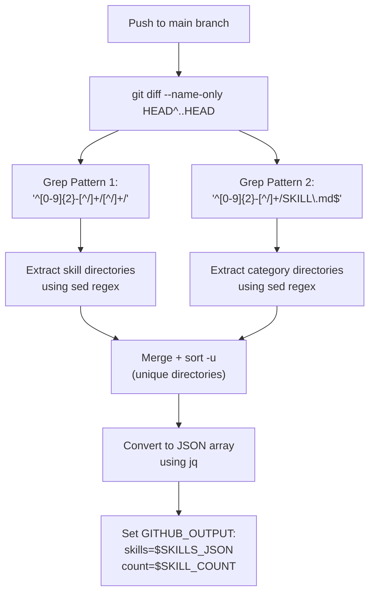
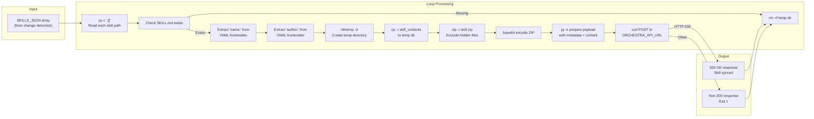
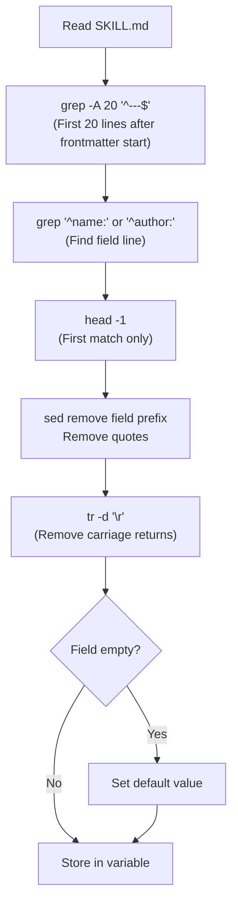
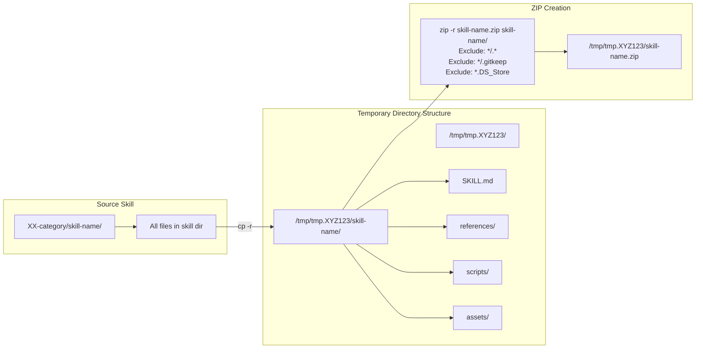
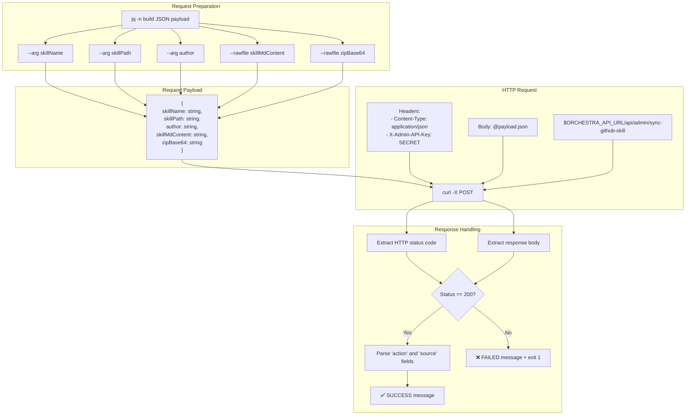
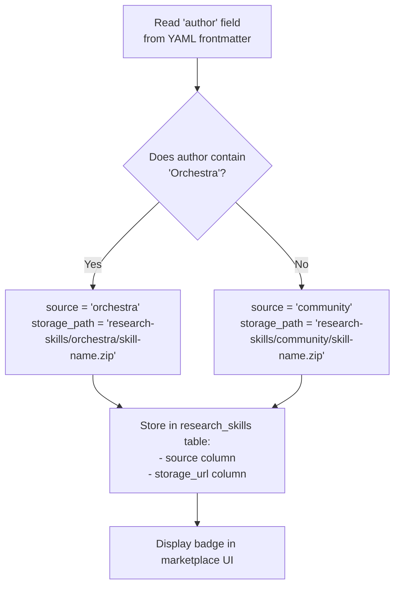
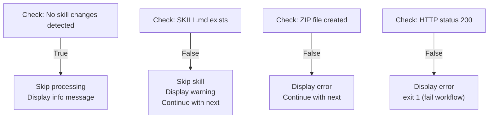
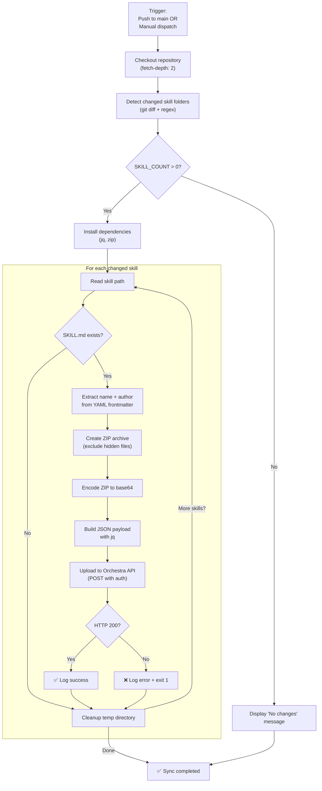

<!-- source: DeepWiki mcp.deepwiki.com · repo Orchestra-Research/AI-research-SKILLs · page 6.2 GitHub Actions Sync Workflow · fetched 2026-10-26 -->

# GitHub Actions Sync Workflow

<details>
<summary>Relevant source files</summary>

The following files were used as context for generating this wiki page:

- [.github/workflows/sync-skills.yml](.github/workflows/sync-skills.yml)
- [01-model-architecture/litgpt/SKILL.md](01-model-architecture/litgpt/SKILL.md)
- [CLAUDE.md](CLAUDE.md)
- [dev_data/GITHUB_SKILLS_SYNC_SETUP.md](dev_data/GITHUB_SKILLS_SYNC_SETUP.md)

</details>


## Purpose and Scope

This document explains the automated GitHub Actions workflow that synchronizes skills from the `AI-research-SKILLs` repository to the Orchestra marketplace. The workflow detects changed skill directories on push to `main`, extracts metadata from YAML frontmatter, packages skills into ZIP files, and uploads them to the Orchestra API with author-based classification.

**Related Pages:**
- For NPM package distribution: see [CLI Architecture & Implementation](#6.3)
- For overall distribution strategy: see [Distribution Channels](#6.1)
- For skill quality requirements: see [Quality Standards & Validation](#5.2)

**Sources:** [.github/workflows/sync-skills.yml:1-200](), [dev_data/GITHUB_SKILLS_SYNC_SETUP.md:1-445]()

---

## Workflow Triggers

The workflow is triggered by two mechanisms defined in the workflow file:

1. **Automatic Push Trigger**: Activates on any commit pushed to the `main` branch
2. **Manual Dispatch**: Can be triggered manually via the GitHub Actions UI

```yaml
on:
  push:
    branches:
      - main
  workflow_dispatch: # Allow manual trigger
```

The manual trigger is useful for full repository synchronization or testing without committing changes. When triggered by push, only skills modified in the commit are synced. When triggered manually, the change detection still runs but processes the most recent commit.

**Sources:** [.github/workflows/sync-skills.yml:3-7]()

---

## Change Detection Algorithm

### Detection Patterns

The workflow detects changed skills using two directory patterns to support both nested and standalone skill structures:

**Pattern 1: Nested Skills**
```
XX-category/skill-name/SKILL.md
```

**Pattern 2: Standalone Skills**
```
XX-category/SKILL.md
```

### Change Detection Flow



### Implementation Details

The change detection runs in the `changes` step and uses bash commands to extract skill directories:

**Variable Flow:**
- `CHANGED_FILES`: Raw output from `git diff --name-only`
- `NESTED`: Skill directories matching pattern 1 (e.g., `03-fine-tuning/axolotl`)
- `STANDALONE`: Category directories matching pattern 2 (e.g., `20-ml-paper-writing`)
- `SKILL_DIRS`: Combined list of unique directories
- `SKILLS_JSON`: JSON array for matrix processing
- `SKILL_COUNT`: Integer count for conditional execution

The regex patterns are critical:
- Pattern 1: `^[0-9]{2}-[^/]+/[^/]+/` matches nested structures
- Pattern 2: `^[0-9]{2}-[^/]+/SKILL\.md$` matches standalone structures

**Sources:** [.github/workflows/sync-skills.yml:19-63]()

---

## Skill Processing Pipeline

### Pipeline Architecture



### Processing Loop Variables

Each skill is processed with the following temporary variables:

| Variable | Purpose | Example Value |
|----------|---------|---------------|
| `SKILL_PATH` | Directory path | `03-fine-tuning/axolotl` |
| `SKILL_NAME` | Extracted from frontmatter | `fine-tuning-axolotl` |
| `AUTHOR` | Extracted from frontmatter | `Orchestra Research` |
| `TEMP_DIR` | Temporary workspace | `/tmp/tmp.XYZ123` |
| `SKILL_DIR` | Temp skill directory | `/tmp/tmp.XYZ123/fine-tuning-axolotl` |
| `ZIP_FILE` | Compressed archive | `/tmp/tmp.XYZ123/fine-tuning-axolotl.zip` |
| `SKILL_MD_FILE` | Temp SKILL.md copy | `/tmp/tmp.XYZ123/skill.md` |
| `ZIP_BASE64_FILE` | Base64 encoded ZIP | `/tmp/tmp.XYZ123/base64.txt` |
| `JSON_PAYLOAD` | API request body | (JSON string) |
| `JSON_FILE` | Temp payload file | `/tmp/tmp.XYZ123/payload.json` |

**Sources:** [.github/workflows/sync-skills.yml:65-189]()

---

## YAML Frontmatter Extraction

### Extraction Process

The workflow extracts metadata from the YAML frontmatter block at the top of each `SKILL.md` file using grep and sed commands:

```bash
# Extract skill name
SKILL_NAME=$(grep -A 20 "^---$" "$SKILL_PATH/SKILL.md" | \
             grep "^name:" | head -1 | \
             sed 's/name: *//;s/"//g;s/'\''//g' | tr -d '\r')

# Extract author
AUTHOR=$(grep -A 20 "^---$" "$SKILL_PATH/SKILL.md" | \
         grep "^author:" | head -1 | \
         sed 's/author: *//;s/"//g;s/'\''//g' | tr -d '\r')
```

### Extraction Logic Flow



### Default Values

If fields are missing or empty, the workflow applies defaults:

| Field | Default Value | Fallback Strategy |
|-------|--------------|-------------------|
| `name` | Directory basename | Extracted from `SKILL_PATH` using `basename` |
| `author` | `Orchestra Research` | Hardcoded default |

### Field Validation

The extraction process handles various edge cases:
- Strips quotes (both `"` and `'`)
- Removes leading/trailing whitespace
- Removes carriage returns (`\r`)
- Takes only the first match (handles duplicate fields)
- Limits search to first 20 lines after frontmatter delimiter

**Sources:** [.github/workflows/sync-skills.yml:90-110]()

---

## ZIP Packaging

### Packaging Process

The workflow creates a ZIP archive containing all skill directory contents:



### Included and Excluded Files

**Included in ZIP:**
- `SKILL.md` (required)
- `references/` directory (all subdirectories)
- `scripts/` directory (if exists)
- `assets/` directory (if exists)
- `examples/` directory (if exists)
- `templates/` directory (if exists)

**Excluded from ZIP:**
- Hidden files starting with `.`
- `.gitkeep` files
- `.DS_Store` files (macOS system files)

### ZIP Creation Commands

```bash
# Create temporary directory structure
TEMP_DIR=$(mktemp -d)
SKILL_DIR="$TEMP_DIR/$SKILL_NAME"
mkdir -p "$SKILL_DIR"

# Copy all skill contents
cp -r "$SKILL_PATH"/* "$SKILL_DIR/" 2>/dev/null || true

# Create ZIP with exclusions
ZIP_FILE="$TEMP_DIR/${SKILL_NAME}.zip"
cd "$TEMP_DIR"
zip -r "$ZIP_FILE" "$SKILL_NAME" -x "*/.*" "*/.gitkeep" "*.DS_Store"
cd -

# Encode to base64
base64 -w 0 "$ZIP_FILE" > "$ZIP_BASE64_FILE"
```

The `-w 0` flag ensures no line wrapping in base64 output (critical for JSON payload).

**Sources:** [.github/workflows/sync-skills.yml:112-141]()

---

## Orchestra API Integration

### API Request Structure



### API Endpoint Details

**Endpoint:** `/api/admin/sync-github-skill`

**Method:** POST

**Authentication:** `X-Admin-API-Key` header (from GitHub Secret `ORCHESTRA_SYNC_API_KEY`)

**Request Schema:**
```json
{
  "skillName": "fine-tuning-axolotl",
  "skillPath": "03-fine-tuning/axolotl",
  "author": "Orchestra Research",
  "skillMdContent": "---\nname: fine-tuning-axolotl\n...",
  "zipBase64": "UEsDBBQAAAAIAA..."
}
```

**Success Response (200):**
```json
{
  "action": "created" | "updated",
  "source": "orchestra" | "community"
}
```

**Error Response (non-200):**
```json
{
  "error": "Error message"
}
```

### Environment Variables

The workflow uses two GitHub Secrets:

| Secret | Purpose | Example |
|--------|---------|---------|
| `ORCHESTRA_API_URL` | Base API URL | `https://orchestra.com` |
| `ORCHESTRA_SYNC_API_KEY` | Authentication key | `a1b2c3d4e5f6...` (64 chars) |

These are accessed as `${{ secrets.ORCHESTRA_API_URL }}` and `${{ secrets.ORCHESTRA_SYNC_API_KEY }}` in the workflow.

**Sources:** [.github/workflows/sync-skills.yml:142-183](), [dev_data/GITHUB_SKILLS_SYNC_SETUP.md:20-42]()

---

## Author Classification System

### Classification Logic

The Orchestra API classifies skills based on the `author` field in the YAML frontmatter:



### Classification Examples

**Example 1: Official Orchestra Skill**
```yaml
---
name: implementing-llms-litgpt
author: Orchestra Research  # Contains "Orchestra"
---
```
- **Result:** `source = "orchestra"`
- **Storage:** `research-skills/orchestra/implementing-llms-litgpt.zip`
- **Badge:** "Official" badge in marketplace UI

**Example 2: Community Skill**
```yaml
---
name: custom-tokenizer
author: Jane Doe  # Does NOT contain "Orchestra"
---
```
- **Result:** `source = "community"`
- **Storage:** `research-skills/community/custom-tokenizer.zip`
- **Badge:** "Community" badge in marketplace UI

**Example 3: Missing Author (Default)**
```yaml
---
name: some-skill
# No author field
---
```
- **Workflow Default:** `author: "Orchestra Research"`
- **Result:** `source = "orchestra"`

### Storage Path Structure

```
Supabase Storage Bucket: research-skills/
├── orchestra/
│   ├── implementing-llms-litgpt.zip
│   ├── fine-tuning-axolotl.zip
│   └── grpo-rl-training.zip
└── community/
    ├── custom-tokenizer.zip
    └── community-skill.zip
```

The classification is performed by the Orchestra backend API, not by the GitHub Actions workflow itself. The workflow only passes the `author` field as part of the payload.

**Sources:** [.github/workflows/sync-skills.yml:93-109](), [dev_data/GITHUB_SKILLS_SYNC_SETUP.md:162-207](), [CLAUDE.md:198-219]()

---

## Error Handling and Validation

### Validation Checks

The workflow performs several validation checks before and during processing:



### Error Messages

**No Changes Detected:**
```
ℹ️  No skill changes detected in this commit
Only commits that modify skill directories will trigger sync
```

**Missing SKILL.md:**
```
⚠️  WARNING: No SKILL.md found in 03-fine-tuning/axolotl, skipping
```

**Missing Frontmatter Field:**
```
⚠️  No 'name' in frontmatter, using directory name: axolotl
⚠️  No 'author' in frontmatter, defaulting to: Orchestra Research
```

**ZIP Creation Failed:**
```
❌ ERROR: Failed to create zip file for fine-tuning-axolotl
```

**API Upload Failed:**
```
❌ FAILED: Invalid API key
```

### Success Messages

**Skill Synced Successfully:**
```
✅ SUCCESS: Skill fine-tuning-axolotl created (source: orchestra)
✅ SUCCESS: Skill custom-skill updated (source: community)
```

**All Skills Processed:**
```
===================================================
✅ Sync completed successfully!
===================================================
```

### Conditional Execution

The processing step only runs if changes are detected:

```yaml
- name: Process and sync skills
  if: steps.changes.outputs.count > 0
```

If `SKILL_COUNT == 0`, the workflow skips processing and displays the "no changes" message.

**Sources:** [.github/workflows/sync-skills.yml:66-199]()

---

## Manual Triggering and Testing

### Manual Workflow Dispatch

The workflow can be triggered manually from the GitHub Actions UI:

1. Navigate to repository → **Actions** tab
2. Select "**Sync Skills to Orchestra**" workflow
3. Click "**Run workflow**" dropdown
4. Select branch (typically `main`)
5. Click "**Run workflow**" button

Manual triggering processes the most recent commit on the selected branch, applying the same change detection logic.

### Testing Commands

**Test with Small Change:**
```bash
# Modify a skill to trigger sync
echo "\n<!-- Updated $(date) -->" >> 01-model-architecture/litgpt/SKILL.md

# Commit and push
git add .
git commit -m "test: trigger auto-sync"
git push origin main
```

**Verify Workflow Execution:**
```bash
# List recent workflow runs
gh run list --repo orchestra-research/AI-research-SKILLs --workflow="sync-skills.yml"

# View latest run logs
gh run view --repo orchestra-research/AI-research-SKILLs --log
```

**Manual Trigger via CLI:**
```bash
gh workflow run sync-skills.yml --repo orchestra-research/AI-research-SKILLs
```

### Local API Testing

Test the Orchestra API endpoint locally without triggering the full workflow:

```bash
# Generate test payload
PAYLOAD=$(jq -n \
  --arg skillName "test-skill" \
  --arg skillPath "test/path" \
  --arg author "Orchestra Research" \
  --arg skillMdContent "---\nname: test\n---\n# Test" \
  --arg zipBase64 "UEsDBBQAAAAIAA..." \
  '{
    skillName: $skillName,
    skillPath: $skillPath,
    author: $author,
    skillMdContent: $skillMdContent,
    zipBase64: $zipBase64
  }')

# Test API endpoint
curl -X POST http://localhost:3000/api/admin/sync-github-skill \
  -H "Content-Type: application/json" \
  -H "X-Admin-API-Key: your-api-key" \
  -d "$PAYLOAD"
```

### Verification Steps

After triggering sync, verify success by checking:

1. **GitHub Actions Logs:** Look for success messages in workflow run
2. **Orchestra Marketplace:** Search for skill at `https://orchestra.com/research-skills`
3. **Supabase Storage:** Verify ZIP exists in `research-skills/orchestra/` or `research-skills/community/`
4. **Database Record:** Check `research_skills` table for new/updated row

**Sources:** [.github/workflows/sync-skills.yml:7](), [dev_data/GITHUB_SKILLS_SYNC_SETUP.md:116-159](), [dev_data/GITHUB_SKILLS_SYNC_SETUP.md:389-408]()

---

## Workflow Dependencies

### Required Software

The workflow installs dependencies in the processing step:

```bash
sudo apt-get update && sudo apt-get install -y jq zip
```

**Installed Packages:**
- `jq`: JSON processing (parsing frontmatter, creating payloads)
- `zip`: Archive creation

### GitHub Actions Environment

**Runner:** `ubuntu-latest`

**Checkout Configuration:**
```yaml
- uses: actions/checkout@v4
  with:
    fetch-depth: 2  # Fetch last 2 commits for git diff
```

The `fetch-depth: 2` is critical for change detection, as it allows `git diff HEAD^..HEAD` to compare the current commit with its parent.

**Sources:** [.github/workflows/sync-skills.yml:10-17](), [.github/workflows/sync-skills.yml:76]()

---

## Complete Workflow Execution Flow



**Sources:** [.github/workflows/sync-skills.yml:1-200]()

---

